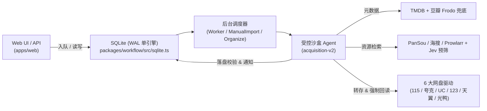

# 巡影 · Mediary Scout 架构与物理模块导航全景图 (Agent & Developer Map)

> **定位指引（For Coding Agents & Developers）**：
> - 本项目为 **纯 TypeScript / Node.js (>=22) / Next.js 16 (App Router) + SQLite (WAL 单引擎)** 的 Monorepo，**已全面剥离 PostgreSQL 与旧 Python 脚本**。
> - 若需操作本机运行中的 Mediary Scout HTTP Agent 接口，请查阅 [`tools/skills/mediary-scout/SKILL.md`](../tools/skills/mediary-scout/SKILL.md)（切勿参考 `docs/legacy-clawd-skill/` 下已归档的旧版 Python OpenClaw 历史文档）。

---

## 1. 系统拓扑与数据流

网页端（Next.js）负责查询展示、配置管理与任务入队；后台 Worker（支持 `inprocess` 同进程与 `host-worker` 独立进程双模式）驱动受控沙盒中的获取 Agent 或确定性导入器。所有改变网盘状态的写操作均经过作用域护栏（Write-Scope Guard），并在执行后强制回读网盘真实盘面校验。

---

## 2. Monorepo 物理目录与职责边界 ($O(1)$ 寻址表)

遵循严格的单向依赖铁律：`apps/*` ➔ `packages/workflow` ➔ `packages/contracts` & `packages/shared`（由 `.dependency-cruiser.cjs` 与 `eslint.config.mjs` 门禁强制守护）。

| 物理路径 | 包名 / 角色 | 核心职责与高频文件索引 | 依赖约束 |
| :--- | :--- | :--- | :--- |
| **`packages/shared/`** | `@media-track/shared` 无属主基础层 | 跨端通用纯工具：AES-256-GCM 凭据加解密（`crypto/`）、JWT/Password 鉴权原语（`auth/`）、滑动窗口限流器（`rate-limiter.ts`）、SQLite 热备（`sqlite-backup.ts`）、设计 Token（`design-tokens.ts`）。 | **严禁依赖** `contracts`、`workflow` 或任何 `apps/*` |
| **`packages/contracts/`** | `@media-track/contracts` 中立契约层 | 核心端口与抽象接口定义：`IStorageDriver.ts`（网盘统一驱动端口）、`ISearchProvider.ts`、`IMediaMetadataProvider.ts`、`IJobQueue.ts`。 | **严禁依赖**包外任何业务模块 |
| **`packages/workflow/`** | `@media-track/workflow` 核心业务与领域引擎 | - **持久化与队列**：`sqlite.ts`（SQLite WAL 仓储）、`repository.ts`（仓储契约与内存实现） - **6 大网盘驱动**：`storage-brands.ts`（品牌注册表）、`storage-115-executor.ts`、`quark-storage-executor.ts`、`pan123-storage-executor.ts`、`tianyi-storage-executor.ts`、`guangya-storage-executor.ts` - **元数据与资源搜索**：`tmdb-provider.ts`、`douban-provider.ts`、`pansou-provider.ts`、`haisou-provider.ts`、`prowlarr-provider.ts`、`title-resource-resolver.ts` - **任务调度与状态机**：`worker.ts`、`manual-import-worker.ts`、`organize-executor.ts`、`replace-request.ts`、`staging-recovery.ts` - **沙盒 Agent 引擎**：`acquisition-v2/`（`sandbox.ts`、`agent-loop.ts`、`task-agents.ts`、`run-state-machine.ts`） | **严禁反向依赖**任何 `apps/*` 宿主 |
| **`apps/web/`** | `@media-track/web` Next.js 16 宿主 | - **API 路由**：`app/api/**`（所有非公开路由受 `local/api-auth-required` ESLint 规则保护） - **运行时装配层**：`lib/workflow-runtime.ts` 及 `lib/runtime/*`（连接 Web 路由、SQLite 仓储与后台 Worker 的依赖装配） - **智能会话助手**：`lib/chat-agent-service.ts` - **前端页面与组件**：`app/`、`components/` | 宿主互相隔离，严禁引用 `desktop` / `host-worker` |
| **`apps/host-worker/`** | `@media-track/host-worker` 独立后台 Worker | 容器化部署时的常驻后台进程，定时触发巡检与队列消费。 | 仅通过 HTTP/DB 协同，严禁引用 `apps/web` |
| **`apps/desktop/`** | `@media-track/desktop` Electron 桌面宿主 | 桌面客户端外壳、托盘与内嵌服务启动（`src/server-launch.ts`）。 | 宿主互相隔离 |
| **`workers/`** | Cloudflare Workers | 独立部署的边缘服务：`workers/tmdb-proxy`（TMDB 边缘缓存代理）、`workers/scout-connect`（远程连接与隧道服务）。 | 含独立 `wrangler.jsonc`，非 npm workspace |

---

## 3. 开发、测试与质量门禁速查

- **单元测试（已打通源码级 Alias，修改 `packages/*` 无需预编译 `dist` 即可秒跑）**：
  - 跑单个测试：`npx vitest run <path/to/file.test.ts>`
  - 跑全量测试：`npm test`
- **构建与类型检查**：
  - 编译业务包：`npm run build:workflow`
  - 类型检查：`npm run typecheck`
- **六合一质量门禁（提交前必跑）**：
  - `npm run gate`（依次执行：`gate:layout` 物理结构与大文件行数棘轮门禁 ➔ `gate:deps` 循环依赖与跨层门禁 ➔ `gate:style` ➔ `gate:assets` ➔ `gate:http-timeout` ➔ `lint` ➔ `typecheck`）

更细的历史设计背景可参考 [架构治理与纯 SQLite 重构方案](architecture-remediation-and-governance.md) 与 [Agent 响应性能诊断与设计模式优化方案](agent-speed-and-architecture-optimization-plan.md)。
