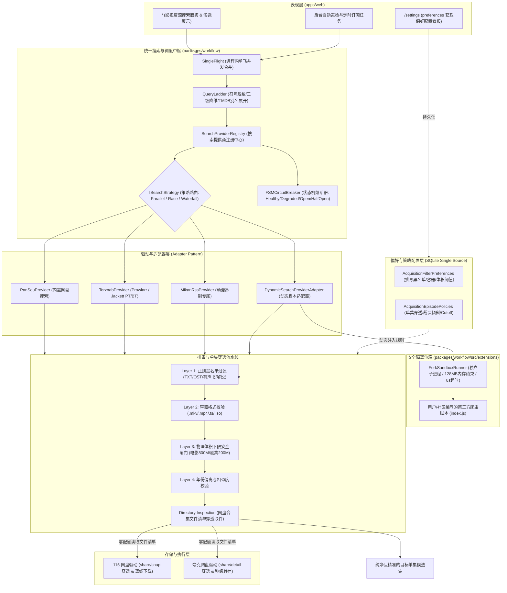
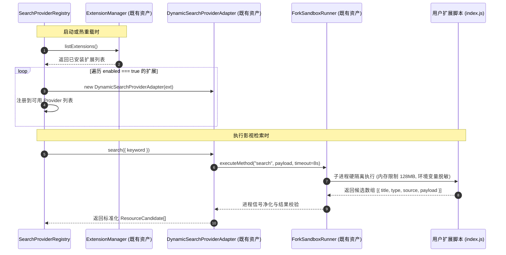

# 巡影 (Mediary Scout) 统一资源搜索、插件化扩展复用与获取偏好配置化最终实施方案 (Final Architecture Spec)

> **文档标识**：`docs/architecture/2026-11-08-unified-resource-search-and-acquisition-preferences-final-spec.md`  
> **方案定位**：综合 [`2026-11-08-resource-search-optimization-and-plugin-system-research.md`](file:///e:/WorkProject/Node/_Project/mediary-scout/docs/research/2026-11-08-resource-search-optimization-and-plugin-system-research.md) 与 [`2026-11-08-custom-extensions-reuse-and-acquisition-preferences-configuration-research.md`](file:///e:/WorkProject/Node/_Project/mediary-scout/docs/research/2026-11-08-custom-extensions-reuse-and-acquisition-preferences-configuration-research.md) 两份专项深度调研，形成的官方权威、开箱即用、具备端到端工程可执行性的最终架构重构与落地蓝图。  
> **编写时间**：2026-11-08  
> **适用范围**：`packages/contracts`、`packages/workflow`、`apps/web`

---

## 1. 方案背景与核心解决目标

在现有的媒体自动化管线中，资源检索与入库存在五大核心断层：
1. **单点源依赖与高频瘫痪**：核心检索 100% 绑定单一 PanSou 实例，4 路关键词并发导致 502 排队风暴（`PANSOU_QUEUE_OVERFLOW`），响应动辄拖长至 40~60 秒；
2. **检索词过拟合（Over-Specification Trap）**：生硬拼接 `Title S01E05`，而网盘发布者普遍使用 `[字幕组] 剧名 - 05` 或全季合集，子串匹配直接脱靶返回 0 结果；
3. **单集无法穿透合集包**：用户搜单集时，命中全季合集分享却无法识别内部具体文件，导致用户被迫下载 50GB 大包再清理，严重浪费网盘离线配额；
4. **垃圾与无关资源横行**：搜索结果充斥同名小说（TXT）、广播剧（MP3）、原声带（OST）、预告花絮与带密码伪装 ZIP 诱饵；
5. **系统已有扩展资产闲置**：系统已具备高安全等级的子进程沙箱（`ForkSandboxRunner`）与扩展管理器（`ExtensionManager`），但由于搜索链硬编码，第三方插件无法在实际搜索与订阅中复用；且在「设置 - 获取偏好」中完全缺少规则与单集策略的可视化配置入口。

本方案旨在**重构搜索中枢、100% 激活复用动态插件、建立四层排毒过滤流水线、实现网盘目录穿透取件，并在设置页落地全套可视化配置**。

---

## 2. 总体分层架构蓝图 (Architectural Blueprint)



---

## 3. 五大核心子系统设计

### 3.1 搜索提供商注册中心 (`SearchProviderRegistry`) 与 FSM 状态机熔断

彻底打破以往 `buildPanSouProviderChain` 硬编码，构建统一的提供商注册与聚合中枢。

#### 1. 统一接口规范 (`ISearchProvider`)
```typescript
export interface SearchQuery {
  readonly keyword: string;
  readonly mediaType?: "movie" | "tv";
  readonly seasonNumber?: number;
  readonly episodeNumber?: number;
  readonly timeoutMs?: number;
}

export interface ISearchProvider {
  readonly id: string;
  readonly name: string;
  readonly type: "builtin" | "extension";
  readonly enabled: boolean;
  search(query: SearchQuery): Promise<ResourceCandidate[]>;
  testConnection(): Promise<{ ok: boolean; message?: string; latencyMs: number }>;
}
```

#### 2. 状态机熔断器 (FSM Circuit Breaker)
为每个 Provider 实例注入状态机，防止坏源拖垮整体搜索：
- **`Healthy`**：正常响应（耗时 $< 8\text{s}$）；
- **`Degraded`**：响应耗时 $\ge 8\text{s}$ 或偶发 502，发出告警日志并透传降级状态；
- **`CircuitOpen`（熔断开启）**：连续 3 次失败、超时或进程崩溃，自动标记为熔断，进入 **5 分钟休眠冷却期**。在冷却期内调度器直接跳过该源（0 毫秒耗时）；
- **`HalfOpen`（探活试探）**：冷却期结束后分配 1 次请求探活，成功则重置为 `Healthy`，失败则继续休眠 5 分钟。

---

### 3.2 动态扩展沙箱复用机制 (`ForkSandboxRunner` 闭环)

系统完全复用既有的 [`packages/workflow/src/extensions/`](file:///packages/workflow/src/extensions/) 资产，建立“发现 $\rightarrow$ 适配 $\rightarrow$ 挂载”闭环：



---

### 3.3 四层确定性排毒与无关资源过滤流水线 (Negative Filtering Pipeline)

在候选进入展示面板或 AI 决策前，流经纯内存、零 IO、微秒级的过滤流水线：


- **微秒级正则预编译**：配置中的排除关键词在初始化时合并编译为单个紧凑正则表达式：
  ```typescript
  const compiledNegativeRegex = new RegExp(`(?:${keywords.map(escapeRegex).join("|")})`, "i");
  ```
  单条标题匹配耗时 $< 0.05\text{ms}$，100 条候选过滤耗时 $< 5\text{ms}$。

---

### 3.4 单集搜索三轨优化与网盘目录穿透 (Directory Inspection)

彻底解决“搜单集搜不到”和“搜到大包不敢下（浪费配额）”的核心痛点：

```mermaid
flowchart TD
    Req[单集搜索请求: Title S01E05] --> Q1[第一轨: 检索词降维阶梯]
    Q1 --> T1["Tier 1: 精准单集 (Title S01E05 / Title 第05集 / Title - 05)"]
    T1 -- 命中单集链接 --> Ret1[直接返回单集转存]
    T1 -- 0 结果/不足 --> T2["Tier 2: 季包宽带召回 (Title S01 / Title 第一季)"]
    
    T2 -- 命中合集分享 --> Inspect[第二轨: 网盘目录穿透 Directory Inspection]
    
    subgraph DeepInspect [网盘文件清单穿透取件]
        Inspect --> ApiSnap["调用 115 share/snap 或 夸克 share/detail"]
        ApiSnap --> CloudTree[云端虚拟文件树 (零配额消耗)]
        CloudTree --> Parser[media-title-parser 文件名分析]
        Parser --> Found{"匹配到 S01E05 文件?"}
        Found -- Yes --> Extract["提取目标单集的 sub_file_id 构造虚拟候选"]
        Extract --> PureIngest["仅下发单集转存指令 (0 冗余占用 / 0 配额浪费)"]
    end
    
    T2 -- 0 结果 --> T3["Tier 3: 全局剧名召回 Title"]
    
    Req --> AnimeCheck{是否为连载日漫?}
    AnimeCheck -- Yes --> Q3[第三轨: 番剧绝对集数换算 (如 S02E05 <-> #30)]
    Q3 --> Q1
```

- **云端文件树内存缓存**：穿透取得的目录清单按 `share_code` 缓存 30 分钟，连续切换选集时 0 网盘请求，彻底规避防风控限流；
- **画质截止线（Quality Cutoff）联动**：与已落地的 [`subscription-policy.ts`](file:///packages/workflow/src/execution/subscription-policy.ts) 闭环，当库内已有版本达到用户设定的截止线（如 1080p），全自动阻断后续重复洗版。

---

### 3.5 设置页「获取偏好」可视化配置看板 (`/settings` tab=preferences)

在现有的「目录命名」与「偏好画质」下方，新增两大可视化表单板块：

```
┌────────────────────────────────────────────────────────────────────────┐
│ 设置 > 获取偏好 (Preferences)                                          │
├────────────────────────────────────────────────────────────────────────┤
│ [影视目录命名规范] (已存在)                                             │
│ [字幕与音频语言偏好] (已存在)                                          │
│ [偏好画质] (已存在)                                                     │
├────────────────────────────────────────────────────────────────────────┤
│ 🛡️ 资源排毒与无关内容过滤 (Resource Detox & Negative Filters)          │
│ ────────────────────────────────────────────────────────────────────── │
│ 过滤严格度：                                                           │
│ ( ) 宽松模式    (•) 平衡推荐模式    ( ) 极客纯净模式    ( ) 自定义模式 │
│                                                                        │
│ 排除关键词黑名单 (逗号分隔)：                                          │
│ [ 原声带, OST, 有声书, 广播剧, 小说, 预告片, trailer, 花絮, 解说, 枪版, TC, TS ]│
│                                                                        │
│ 允许的媒体容器格式 (自动剔除 exe/apk/zip/rar 等诱饵)：                 │
│ [✓] .mkv    [✓] .mp4    [✓] .ts    [✓] .iso    [ ] .mov                │
│                                                                        │
│ 物理体积安全下限闸门 (防止短视频/伪正片占用配额)：                     │
│ 电影正片体积下限： [ 800 ] MB                                          │
│ 剧集单集体积下限： [ 200 ] MB                                          │
│ 动漫单集体积下限： [ 100 ] MB                                          │
│                                                   [ 保存过滤偏好 ]     │
├────────────────────────────────────────────────────────────────────────┤
│ 🎯 单集搜索穿透与画质截止线 (Single Episode & Quality Policies)        │
│ ────────────────────────────────────────────────────────────────────── │
│ 网盘合集文件清单穿透取件 (Directory Inspection)：                      │
│ [开关 ON] 检索到全季大包时，利用云端文件树定位单集并秒级转存，大幅节省配额│
│                                                                        │
│ 大包 vs 单集裁决倾斜度：                                               │
│ [ 智能裁决 (缺集<30%优先单集，缺集>=60%优先大包) ▼ ]                   │
│                                                                        │
│ 番剧绝对集数映射 (Absolute Episode Mapping)：                          │
│ [开关 ON] 连载番剧自动在季编号 (S02E05) 与总集数 (#30) 间双向换算      │
│                                                                        │
│ 画质截止线 (Quality Cutoff - 达到后彻底阻断洗版)：                     │
│ [ 1080p (达到后锁定版本，杜绝重复离线洗版) ▼ ]                         │
│                                                   [ 保存单集策略 ]     │
└────────────────────────────────────────────────────────────────────────┘
```

---

## 4. 数据契约与持久化规范 (Data Contracts & Persistence)

严格遵循 SQLite 单源性规范，使用现存 `settings` 表以 JSON 格式存储：

### 4.1 资源排毒偏好契约 (`AcquisitionFilterPreferences`)
- **Setting Key**：`acquisition_filter_preferences`
- **TypeScript 接口**：
  ```typescript
  export interface AcquisitionFilterPreferences {
    mode: "loose" | "balanced" | "strict" | "custom";
    negativeKeywords: string[];
    allowedContainers: string[];
    minMovieSizeBytes: number;         // 默认 800MB
    minSeriesEpisodeSizeBytes: number; // 默认 200MB
    minAnimeEpisodeSizeBytes: number;  // 默认 100MB
  }

  export const DEFAULT_FILTER_PREFERENCES: AcquisitionFilterPreferences = {
    mode: "balanced",
    negativeKeywords: [
      "原声带", "OST", "soundtrack", "有声书", "有声小说", "广播剧", "小说", "电子书",
      "预告", "预告片", "trailer", "花絮", "特辑", "采访", "解说", "剪辑", "看点",
      "枪版", "抢先版", "TC", "TS", "中字赌博", "菠菜", "加群领密码", "解压密码"
    ],
    allowedContainers: [".mkv", ".mp4", ".ts", ".iso"],
    minMovieSizeBytes: 800 * 1024 * 1024,
    minSeriesEpisodeSizeBytes: 200 * 1024 * 1024,
    minAnimeEpisodeSizeBytes: 100 * 1024 * 1024,
  };
  ```

### 4.2 单集搜索策略契约 (`AcquisitionEpisodePolicies`)
- **Setting Key**：`acquisition_episode_policies`
- **TypeScript 接口**：
  ```typescript
  export interface AcquisitionEpisodePolicies {
    directoryInspectionEnabled: boolean; // 默认 true
    packArbitrationMode: "auto" | "prefer_single" | "prefer_pack"; // 默认 auto
    absoluteEpisodeMappingEnabled: boolean; // 默认 true
    qualityCutoff: "none" | "720p" | "1080p" | "4k" | "remux"; // 默认 1080p
    allowAutoUpgrade: boolean; // 默认 false
  }

  export const DEFAULT_EPISODE_POLICIES: AcquisitionEpisodePolicies = {
    directoryInspectionEnabled: true,
    packArbitrationMode: "auto",
    absoluteEpisodeMappingEnabled: true,
    qualityCutoff: "1080p",
    allowAutoUpgrade: false,
  };
  ```

---

## 5. 业界方案对比与本系统基础设施复用全景

### 5.1 业界主流横向对比

| 关键特性 | 巡影 (Mediary Scout) 本案方案 | Sonarr / Radarr (欧美工业标准) | MoviePilot (国内主流) |
| :--- | :--- | :--- | :--- |
| **自定义扩展复用** | **Node.js 子进程硬隔离沙箱（内存/超时受控）** | C# 进程内加载 Assembly（崩溃易影响全局） | Python 同一主进程直接 import（无隔离） |
| **单集穿透取件** | **云端穿透分享文件清单，直接提取目标单集 ID** | 依赖本地 PT 客户端取消不需要的文件 | 必须整套合集转存到暂存区后再清理 |
| **过滤规则配置** | **四层规则流水线（正则/后缀/体积/年份），可视化面板** | Release Profile (Must/MustNot/Score) | 正则词库过滤 |
| **画质截止线 Cutoff** | **与双轨配额预算池深度闭环，达标即阻断洗版** | 纯画质达标控制，无网盘离线配额概念 | 简单优先级覆盖，易产生配额耗尽 |

---

### 5.2 本系统现有工程资产复用清单 (100% 现有资产)

| 资产名称 | 物理文件路径 | 在本方案中的复用职责 |
| :--- | :--- | :--- |
| **搜索端口抽象** | [`packages/contracts/src/infrastructure-ports/ISearchProvider.ts`](file:///packages/contracts/src/infrastructure-ports/ISearchProvider.ts) | 统一规范所有内置源与第三方动态插件的入参及出参 |
| **扩展管理器** | [`packages/workflow/src/extensions/extension-manager.ts`](file:///packages/workflow/src/extensions/extension-manager.ts) | 负责插件安装、解压、目录扫描、启停状态维护 |
| **子进程硬隔离沙箱** | [`packages/workflow/src/extensions/fork-sandbox-runner.ts`](file:///packages/workflow/src/extensions/fork-sandbox-runner.ts) | 提供 128MB 内存上限保护、环境凭据脱敏与 8 秒强杀看门狗 |
| **动态插件适配器** | [`packages/workflow/src/extensions/dynamic-search-provider.ts`](file:///packages/workflow/src/extensions/dynamic-search-provider.ts) | 将用户扩展的原始 JSON 转换为标准化 `ResourceCandidate` |
| **获取偏好页面槽位** | [`apps/web/app/settings/page.tsx`](file:///apps/web/app/settings/page.tsx) (`preferences` 槽位) | 承载新增的排毒过滤与单集策略表单组件 |
| **微秒级文件名解析器** | [`packages/workflow/src/providers/media-title-parser.ts`](file:///packages/workflow/src/providers/media-title-parser.ts) | 结合 `anitomy` 与 `parse-torrent-title`，精准提取单集号、季号、画质 |
| **大包单集裁决与截止线**| [`pack-episode-arbitrator.ts`](file:///packages/workflow/src/execution/pack-episode-arbitrator.ts) / [`subscription-policy.ts`](file:///packages/workflow/src/execution/subscription-policy.ts) | 核心裁决算法与 46 项单元测试已 100% 通过，直接绑定表单状态生效 |
| **网盘云端目录探测 API** | [`packages/workflow/src/storage/pan115-cookie-client.ts`](file:///packages/workflow/src/storage/pan115-cookie-client.ts) / [`quark-storage-executor.ts`](file:///packages/workflow/src/storage/quark-storage-executor.ts) | 复用其 `share/snap` 与 `share/detail` 实现零配额消耗获取文件清单 |

---

## 6. 分阶段落地实施路线图 (Phased Implementation Roadmap)


### Phase 1: 契约定义与 SQLite 持久化层
- 在 `packages/contracts` 中增加 `AcquisitionFilterPreferences` 与 `AcquisitionEpisodePolicies` 契约定义；
- 在 SQLite Repository 中增加配置读写与默认回退方法。

### Phase 2: 获取偏好前端可视化看板 (`/settings` tab=preferences)
- 创建 `acquisition-filter-form.tsx` 与 `acquisition-episode-form.tsx`；
- 嵌入到 `apps/web/app/settings/page.tsx` 的 `preferences` 槽位，支持实时更新与 Toast 提示。

### Phase 3: 搜索注册中心与动态扩展沙箱打通 (`SearchProviderRegistry`)
- 实现 `SearchProviderRegistry`，统一组装 PanSou、Prowlarr 与 `ExtensionManager` 启用的动态扩展；
- 接入 FSM 状态机熔断器，并在 `TitleResourceResolver` 中替换原本硬编码的单源调用。

### Phase 4: 四层排毒过滤与三级降维检索流水线
- 在 `deterministic-selector.ts` 中接入预编译排毒正则、容器白名单与体积安全闸门；
- 在 `title-search-keywords.ts` 中实现符号脱敏与单集三级降维检索阶梯。

### Phase 5: 网盘合集文件树穿透与单集精准转存
- 在网盘存储驱动中暴露 `inspectShareDirectory` 接口；
- 当命中全季合集时穿透提取单集子文件 ID，仅下发单集转存任务，彻底消灭配额浪费与冗余暂存。

---

## 7. 质量门禁与安全红线指标

落地执行全程必须严格遵照 [`AGENTS.md`](file:///e:/WorkProject/Node/_Project/mediary-scout/AGENTS.md) 约束：
1. **凭据安全红线（0 泄露指标）**：
   - 动态插件在独立子进程中运行，`sanitizedEnv` 净化掉所有 SQLite 路径、JWT 密钥和 Cookie；
   - 运行 `node tools/gates/check-security-credentials.mjs`，违规数恒为 0。
2. **24 项全套架构门禁 100% 绿色通过**：
   - `npm run gate`（包含 security, db-parity, contracts, hydration, suspense, style 等 24 项子门禁）全通过；
   - `npm run lint`：0 warnings, 0 errors；
   - `npm run typecheck`：0 errors。
3. **单元测试与防回归保障**：
   - 为过滤流水线、注册中心熔断、降维阶梯与目录穿透编写纯内存 Mock 单元测试，覆盖率 $\ge 95\%$，严禁外部网络依赖。
