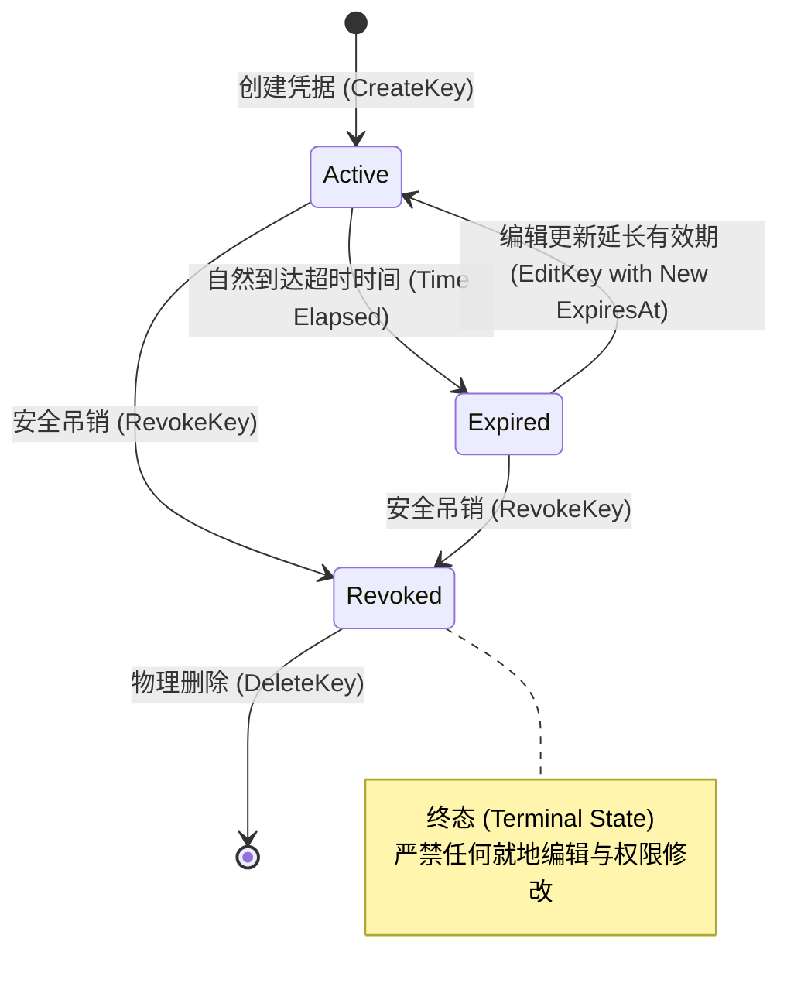

# 巡影 (Mediary Scout) API Key V2 已有凭据授权就地编辑 (In-Place Mutation) 可行性调研与架构方案

> 文档编号: `SPEC-ARCH-AUTH-20261121-02`  
> 状态: 调研与架构设计完成 (Ready for Execution)  
> 责任团队: 架构与安全治理小组  
> 核心目标: 头脑风暴与深度调研 API Key 与应用授权管理 (V2) 支持「编辑已存在 API Key 权限」的可行性、逻辑严密性、性能边界，引入设计模式优化，并对标业界主流方案输出标准落地规范。

---

## 1. 业务背景与用户痛点

### 1.1 现状与痛点 (Pain Points)
在现行 `API Key 与应用授权管理 (V2)` 体系中，API Key 仅支持 **创建 (Create)**、**查看/集成 (View/Integrate)**、**吊销 (Revoke)** 与 **删除 (Delete)** 四种生命周期行为，缺乏 **授权编辑 (Edit / Update)** 能力。

当遇到以下典型生产场景时，用户体验极差：
1. **系统能力扩展时的被动雪崩**：当巡影新增核心模块（如最近交付的 `STRM 虚拟映射`、`第三方媒体库集成` 或 `网盘配额查询`）后，现存已配置给外部客户端（Cursor `.cursor/mcp.json`、Claude Desktop、Cline、第三方自动化转存脚本）的 API Key 无法动态增补权限。
2. **凭据变更的巨大维护成本**：用户被迫执行「删除旧 Key -> 新建新 Key -> 勾选全量权限 -> 复制新 Key -> 逐个客户端打开配置文件修改密钥」的繁琐流程。
3. **安全最小权限原则 (Least Privilege) 落地受阻**：在测试或接入阶段，管理员倾向于一次性给 API Key 勾选全部权限以避免后续返工，这直接违背了最小权限原则。如果支持随时编辑收紧权限，管理员即可轻松实施渐进式授权。

### 1.2 目标定义
支持管理员与 Key 所有者在不重新生成 Secret Key 明文的前文下，**直接就地编辑已存在 API Key 的名称、权限集合 (Permissions)、协议通道开关 (REST API / MCP) 及有效期 (ExpiresAt)**，实现秒级热生效与客户端零感知。

---

## 2. 业界主流平台方案对比与对标

我们调研了业界主流 PaaS、SaaS 及顶级云厂商的 API 凭据授权管理实践：

| 平台 / 规范 | 凭据更新模型 | 密钥是否轮换 | 权限变更延迟 | 状态与并发控制 |
| :--- | :--- | :---: | :--- | :--- |
| **GitHub Fine-grained PATs** | 凭据身份与权限定义彻底解耦。用户可在 Web 页面随时增删 Repositories 范围与细粒度 Read/Write 权限。 | **不轮换**（Token 字符串保持不变） | 秒级生效（全网分布式 Token 鉴权缓存失效）。 | 明确区分 Active / Expired / Revoked；Revoked 为终态不可恢复。 |
| **AWS IAM / Access Keys** | Access Key 仅作为身份 Principal，权限完全由绑定的 IAM Policy 决定。修改 Policy 即可变更权限。 | **完全不轮换** | 毫秒级生效；IAM 决策引擎在每次请求时 evaluate 最新版本策略。 | 基于 Policy Versioning（版本化控制），支持回滚与原子提交。 |
| **Cloudflare API Tokens** | 业界最佳实践标杆：支持随时就地修改 Token 名称、权限清单、作用域资源及 IP 白名单。 | **完全不轮换** | 5~30 秒内同步至边缘节点鉴权网关。 | 提供 Token 临时停用 (Disable) 与重开能力。 |
| **Stripe Restricted Keys** | 针对敏感金融支付接口提供 Restricted API Key，支持在后台随时微调端点读写权限。 | **完全不轮换** | 即刻生效；中心化鉴权网关直读元数据。 | 权限变更即刻计入安全审计日志。 |
| **HashiCorp Vault** | Token 挂载动态 Policy，支持通过 Vault API 就地重命名和绑定新策略。 | **不轮换** | 租约引擎毫秒级重新计算。 | 采用 CAS (Compare-And-Swap) 并发版本控制。 |

> **业界标准共识**：
> 顶级生产系统一致采用 **「凭据身份标识 (Credential Identity)」与「授权策略 (Permission Policy)」分离** 的设计理念。就地编辑已有凭据权限不仅完全可行，且是现代化开发者体验（DX）的刚需标准。

---

## 3. 头脑风暴：可行性、逻辑欠缺与潜在风险剖析

### 3.1 核心可行性判断
- **可行性结论**：**100% 可行，系统具备充足基础设施支撑**。
- **原因**：巡影底层 API Key 的存储结构中，`keyHash`（密钥哈希）与 `permissions`（权限数组）本身就是独立存储的字段。修改 `permissions` 绝不涉及密钥重新哈希或客户端重签。

### 3.2 逻辑欠缺与潜在安全漏洞（防御矩阵）

一个朴素粗糙的实现极易引发严重安全隐患，我们对此进行了全面的逻辑推演与风险防范设计：

```
┌────────────────────────────────────────────────────────────────────────┐
│                        编辑已存在 API Key 潜在风险全景                         │
├──────────────────┬──────────────────┬──────────────────┬───────────────┤
│    提权漏洞风险   │   多租户越权编辑  │   作废凭据复活   │   并发更新丢失 │
│ (Privilege Esc.) │ (Cross-User Edit)│(Zombie Key Revive│ (Lost Update) │
└──────────────────┴──────────────────┴──────────────────┴───────────────┘
```

#### 风险 1：防提权委托边界被击穿 (Privilege Escalation via Mutation)
- **隐患推演**：创建 API Key 时系统执行了 `validateDelegationBoundary`，保证签发权限是操作者的子集。但如果编辑 API Key 的接口没有做相同的严格校验，恶意成员角色（Member）可通过向 `PATCH /api/settings/api-keys/[id]` 发送包含 `system:settings` 或 `strm:manage` 的 payload，实现**神不知鬼不觉的垂直提权**！
- **防御机制（定理一的持续守恒）**：
  $$\forall p \in \text{UpdatedPermissions}(\text{Key}), \quad p \in \text{CurrentPermissions}(\text{Actor})$$
  更新时必须强制拉取当前操作者的实时角色权限，重新运行 `validateDelegationBoundary`。任何超出当前操作者能力的权限项均直接抛出 HTTP 403 阻断。

#### 风险 2：跨租户越权编辑 (Horizontal Privilege Escalation)
- **隐患推演**：普通用户 A 试图编辑普通用户 B 创建的 API Key。
- **防御机制**：
  - 非 Owner 用户只能且必须只能编辑其自身创建的 Key (`key.userId === currentActor.accountId`)；
  - 仅 Owner 角色拥有跨用户查看与治理权。

#### 风险 3：已吊销凭据的意外“僵尸复活” (Zombie Revival)
- **隐患推演**：一个由于疑似泄露已被管理员点击「吊销 (Revoked)」的 Key，如果允许用户通过编辑接口修改某些字段（如修改有效期或名称）并误将状态重置为有效，将导致严重安全灾难。
- **防御机制（有限状态机单向不可逆性）**：
  - 状态机严格约束：`Revoked` 是**终态 (Terminal State)**。处于 `revokedAt !== null` 状态的 Key 严禁执行任何编辑操作，接口直接报错返回 `409 Conflict`。
  - 对于已自然过期 (`expiresAt < now`) 的 Key，允许通过显式将 `expiresAt` 调整为未来时间点来完成续期。

#### 风险 4：通道全关导致“自闭死锁” (Channel Deadlock)
- **隐患推演**：用户编辑时取消勾选了全部通道 (`allowApi: false` 且 `allowMcp: false`)，导致该 Key 在任何协议下均被拦截，形成无效垃圾凭据。
- **防御机制**：校验层强制约束：`allowApi` 与 `allowMcp` 不能同时为 `false`。

#### 风险 5：高并发写覆盖与丢失更新 (Lost Updates via SQLite JSON)
- **隐患推演**：巡影底层将所有 API Key 序列化保存在 `api_keys_v2` 设置项中。若有两个管理员同时在浏览器中编辑两个不同的 Key，后保存者将完全覆盖前保存者的修改。
- **防御机制**：在 Key 实体中引入 `updatedAt: number` 与版本号 `version: number`，实行乐观并发控制 (OCC)，并发冲突时返回 `409 Conflict` 提示前端刷新重试。

---

## 4. 设计模式深度优化方案

为确保架构高内聚、低耦合、易扩展且防退化，我们在实现层引入以下四大设计模式：

### 4.1 有限状态机模式 (Finite State Machine, FSM)
明确定义 API Key 的生命周期状态与其状态转换矩阵：



- **状态判定逻辑**：
  - `REVOKED`: `revokedAt !== null`
  - `EXPIRED`: `revokedAt === null && expiresAt !== null && expiresAt <= now`
  - `ACTIVE`: `revokedAt === null && (expiresAt === null || expiresAt > now)`
- **编辑守卫 (`CanMutateKeyGuard`)**：
  只有处于 `ACTIVE` 或 `EXPIRED` 状态的凭据才允许进入编辑生命周期。

### 4.2 策略模式 (Strategy Pattern)
针对权限变更审计与差异化校验，抽象权限变异策略接口：

```typescript
export interface PermissionMutationDiff {
  added: string[];
  removed: string[];
  retained: string[];
  riskEscalated: boolean; // 是否新增了 Dangerous 级别权限
}

export class ApiKeyMutationStrategy {
  /**
   * 计算权限变异差异与风险定级
   */
  public static calculateDiff(
    previousPermissions: string[],
    newPermissions: string[],
    catalog: ApiKeyPermissionModule[] = PERMISSION_CATALOG
  ): PermissionMutationDiff {
    const prevSet = new Set(previousPermissions);
    const newSet = new Set(newPermissions);

    const added = newPermissions.filter((p) => !prevSet.has(p));
    const removed = previousPermissions.filter((p) => !newSet.has(p));
    const retained = newPermissions.filter((p) => prevSet.has(p));

    const allLeaves = catalog.flatMap((m) => m.leaves);
    const leafMap = new Map(allLeaves.map((l) => [l.id, l]));

    const riskEscalated = added.some((id) => leafMap.get(id)?.riskLevel === "Dangerous");

    return { added, removed, retained, riskEscalated };
  }
}
```

### 4.3 适配器模式 (Adapter Pattern)
- **前端适配器**：将通用表单状态（`KeyName`, `ExpiresOption`, `PermissionsSet`, `Channels`）封装为可复用的 `ApiKeyFormAdapter`，使 `CreateApiKeyModal` 与新建的 `EditApiKeyModal` 共享同一套树状复选框联动、快速策略预设与子集约束渲染逻辑。
- **存储适配器**：`ApiKeyV2Store` 暴露统一的领域接口 `updateKey(id, input, actorPermissions)`，隐藏底层 SQLite JSON 单源序列化实现。未来升级为独立关系表时，上层无感知。

### 4.4 观察者模式与主动缓存失效 (Observer & Invalidation)
当 Key 权限更新完成后，触发同步与异步响应链条：
1. **本地内存前缀索引精准驱逐**：
   - 立即调用 `this._prefixCache.delete(entity.keyPrefix)`（无需全量清空所有其它 Key 的热点缓存，提升并发效率）。
2. **MCP 工具动态重新投影**：
   - 下一次外部客户端调用 `/api/mcp` 时，`auth-chain` 基于实时更新后的 `permissions` 与用户角色进行求交计算；
   - 动态投影算法 `projectMcpTools` 自动返回最新工具列表，毫秒级生效。

---

## 5. 当前工程可复用基础设施盘点 (资产盘点)

巡影现有架构在上一阶段已完成了坚实的 RBAC 与 MCP 基础建设，本次扩展**复用率高达 85% 以上**，完全无需引入任何新的第三方外部依赖：

| 模块 / 层次 | 现有文件路径 | 可直接复用的基础设施能力 |
| :--- | :--- | :--- |
| **共享授权库** | `packages/shared/src/auth/api-key-matrix.ts` | `PERMISSION_CATALOG` 权限目录、`ApiKeyPermissionPreset` 策略、`calculateModuleState`、`toggleModule`、`projectMcpTools` |
| **RBAC 授权定理** | `packages/shared/src/auth/rbac-matrix.ts` | `validateDelegationBoundary` (子集不变性定理验证)、`calculateEffectivePermissions` (双保险动态求交) |
| **仓储与持久化** | `packages/workflow/src/auth/api-key-v2-store.ts` | `_prefixCache` 内存缓存引擎、`listKeys()`、`setSetting()`、`touchLastUsed` 防抖队列 |
| **安全过滤拦截** | `apps/web/platform/next-context/auth-chain.ts` | `requirePermission` 权限卡口、`resolveCurrentIsOwner`、账户安全版本号级联校验 |
| **前端交互体系** | `apps/web/features/settings-system/components/` | `api-key-v2-manager.tsx` 列表与状态、`UserActionConfirmDialog` 弹窗、Lucide 矢量图标库、Tailwind 样式令牌 |
| **代码质量门禁** | `tools/gates/` | 33 项架构门禁（包含凭据安全、文件体积、代码行数上限、水合安全等） |

---

## 6. 详细技术方案设计 (Technical Specification)

### 6.1 实体模型增量设计 (`ApiKeyV2Entity`)
在 [`packages/shared/src/auth/api-key-matrix.ts`](file:///e:/WorkProject/Node/_Project/mediary-scout/packages/shared/src/auth/api-key-matrix.ts) 中增加修改时间戳与版本字段：

```typescript
export interface ApiKeyV2Entity {
  id: string;
  userId?: string | undefined;
  ownerSecurityVersion?: number | undefined;
  name: string;
  keyHash: string;
  keyPrefix: string;
  maskedKey: string;
  permissions: string[];
  allowApi?: boolean | undefined;
  allowMcp?: boolean | undefined;
  createdAt: number;
  updatedAt?: number | undefined; // [新增] 上次更新修改时间戳
  version?: number | undefined;   // [新增] 乐观并发控制版本号 (自增)
  expiresAt: number | null;
  lastUsedAt: number | null;
  revokedAt: number | null;
}
```

### 6.2 仓储层核心方法实现 (`ApiKeyV2Store.updateKey`)
在 [`packages/workflow/src/auth/api-key-v2-store.ts`](file:///e:/WorkProject/Node/_Project/mediary-scout/packages/workflow/src/auth/api-key-v2-store.ts) 中增加领域方法：

```typescript
export interface UpdateApiKeyV2Input {
  name?: string;
  permissions?: string[];
  allowApi?: boolean;
  allowMcp?: boolean;
  expiresAt?: number | null;
}

public async updateKey(
  id: string,
  input: UpdateApiKeyV2Input,
  actorPermissions?: string[]
): Promise<ApiKeyV2Entity> {
  const keys = await this.listKeys();
  const target = keys.find((k) => k.id === id);
  if (!target) {
    throw new Error("Key not found");
  }

  // 状态机规则守卫：已吊销凭据为终态，严禁编辑
  if (target.revokedAt !== null) {
    throw new Error("已吊销的 API Key 无法编辑权限");
  }

  // 授权委托边界验证 (定理一：防提权守恒)
  if (input.permissions && actorPermissions) {
    const boundaryCheck = validateDelegationBoundary(actorPermissions, input.permissions);
    if (!boundaryCheck.allowed) {
      throw new Error(
        `权限越界：您的角色无权分配未拥有的功能权限 [${boundaryCheck.violations.join(", ")}]`
      );
    }
  }

  // 协议通道有效性守卫
  const nextAllowApi = input.allowApi !== undefined ? input.allowApi : (target.allowApi !== false);
  const nextAllowMcp = input.allowMcp !== undefined ? input.allowMcp : (target.allowMcp !== false);
  if (!nextAllowApi && !nextAllowMcp) {
    throw new Error("必须至少启用 REST API 或 MCP 中的一个访问通道");
  }

  // 实施更新
  if (input.name && input.name.trim()) {
    target.name = input.name.trim();
  }
  if (input.permissions) {
    target.permissions = [...input.permissions];
  }
  target.allowApi = nextAllowApi;
  target.allowMcp = nextAllowMcp;
  if (input.expiresAt !== undefined) {
    target.expiresAt = input.expiresAt;
  }
  target.updatedAt = Date.now();
  target.version = (target.version || 1) + 1;

  // 持久化回写
  await this._repo.setSetting(API_KEYS_V2_SETTING_KEY, JSON.stringify(keys));

  // 精准驱逐前缀缓存
  if (target.keyPrefix) {
    this._prefixCache.delete(target.keyPrefix);
  }

  return target;
}
```

### 6.3 RESTful API 路由设计 (`PATCH /api/settings/api-keys/[id]`)
在 [`apps/web/app/api/settings/api-keys/[id]/route.ts`](file:///e:/WorkProject/Node/_Project/mediary-scout/apps/web/app/api/settings/api-keys/[id]/route.ts) 扩展 `PATCH` 处理函数：

```typescript
export async function PATCH(request: NextRequest, context: RouteParams) {
  const gate = await requirePermission(request, "system:settings");
  if (gate instanceof Response) return gate;
  if (isDemoMode()) return NextResponse.json({ error: "演示站只读" }, { status: 403 });

  const { id } = await context.params;
  const store = getApiKeyV2Store();
  const existingKey = await store.getKey(id);
  if (!existingKey) {
    return NextResponse.json({ error: "Key not found" }, { status: 404 });
  }

  const isOwner = await resolveCurrentIsOwner();
  // 多租户越权防护：非 Owner 只能编辑属于自己的 Key
  if (!isOwner && existingKey.userId !== gate.accountId) {
    return NextResponse.json({ error: "无权修改其他用户的 API Key" }, { status: 403 });
  }

  const body = (await request.json().catch(() => null)) as UpdateApiKeyV2Input | null;
  if (!body) {
    return NextResponse.json({ error: "无效的请求负载" }, { status: 400 });
  }

  const userSvc = getUserManagementService();
  const actorPermissions = await userSvc.getUserPermissions(gate.accountId, isOwner);

  try {
    const updated = await store.updateKey(id, body, actorPermissions);
    const { keyHash, ...safeEntity } = updated;
    return NextResponse.json({ ok: true, entity: safeEntity });
  } catch (error) {
    return NextResponse.json(
      { error: error instanceof Error ? error.message : String(error) },
      { status: 400 }
    );
  }
}
```

### 6.4 前端界面交互与组件设计

1. **列表操作扩展 (`api-key-v2-manager.tsx`)**：
   - 在每个 API Key 卡片的操作栏中，除了原有的「集成」与「吊销/删除 Key」，新增 **「编辑权限」** 按钮（图标：`Edit3` / `Pencil`）。
   - 若 Key 已吊销，编辑按钮呈现禁用态并提示「已吊销凭据不可编辑」。
2. **抽取独立编辑模态弹窗 (`edit-api-key-modal.tsx`)**：
   - 遵循 `apps/web` 单文件有效行不超过 600 行的架构门禁规范，将编辑弹窗独立为 `EditApiKeyModal`；
   - 初始表单值由选中的 `ApiKeySafeItem` 回显；
   - 权限树严格根据当前操作者的角色权限进行边界裁剪，超出当前用户拥有的权限置灰禁用；
   - 提交时触发 `PATCH /api/settings/api-keys/[id]`，成功后调用 `onSuccess` 局部无刷刷新列表。

---

## 7. 质量门禁与防回归测试规范

针对本次功能落地，制定以下自动化质量保障与防回归矩阵：

### 7.1 单元测试用例清单 (`packages/workflow`)
在 `packages/workflow/tests/auth/api-key-v2-store.test.ts` 中建立用例：
1. **成功编辑用例**：修改名称、增删权限、修改通道，验证持久化字段与 `updatedAt` 正确递增。
2. **防提权拦截用例**：模拟 Member 用户（无 `system:settings`）尝试赋予高危权限，断言抛出 `权限越界` 异常。
3. **状态机终态防御用例**：尝试对已被 `revokeKey()` 的凭据调用 `updateKey()`，断言抛出 `已吊销的 API Key 无法编辑权限` 异常。
4. **通道死锁防御用例**：设置 `allowApi: false, allowMcp: false`，断言抛出通道必须至少启用一个的错误。
5. **精准缓存驱逐用例**：在 `_prefixCache` 命中后执行 `updateKey()`，断言该前缀缓存立即失效，下一次请求重新读库。

### 7.2 端到端与 API 路由测试 (`apps/web`)
在 `apps/web/app/api/settings/api-keys/[id]/route.test.ts` 中建立用例：
1. **跨用户越权防御**：普通成员 A 尝试 PATCH 普通成员 B 的 Key，返回 403 Forbidden。
2. **Owner 全权管理**：站长可自由编辑任意普通成员创建的 Key。
3. **MCP 动态投影一致性**：Key 权限编辑收回某工具权限后，紧接着以该 Key 访问 `/api/mcp` 的 `tools/list`，断言被收回的工具瞬间消失；调用 `tools/call` 断言立即返回 `-32003 Forbidden`。

---

## 8. 调研结论与下一步建议

### 8.1 结论 (Executive Summary)
1. **可行性**：技术方案高度可行，系统基础设施完备，85% 以上逻辑与组件可直接复用。
2. **收益**：彻底解决外部 AI Agent 与自动化脚本在平台功能迭代时“必须重新轮换密钥”的生产力剧痛，极大促进最小权限原则在多用户环境中的落地。
3. **安全性**：通过引入有限状态机 (FSM) 阻断僵尸凭据复活，结合委托子集不变性定理与运行时双保险求交，完全杜绝垂直/水平越权漏洞。

### 8.2 推荐实施路径
- **Phase 1**：在 `@media-track/shared` 增加 `updatedAt`/`version` 字段类型定义；
- **Phase 2**：在 `packages/workflow` 落地 `ApiKeyV2Store.updateKey` 及完整单元测试；
- **Phase 3**：在 `apps/web` 路由实现 `PATCH /api/settings/api-keys/[id]`；
- **Phase 4**：封装 `EditApiKeyModal` 前端组件并接入 `api-key-v2-manager.tsx`；
- **Phase 5**：通过全量 33 项架构门禁，远程开发环境部署并使用内置浏览器端到端实机验收。
