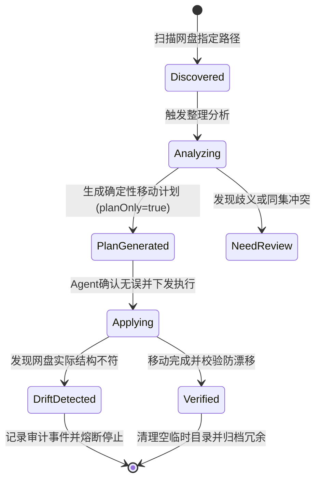

# 网盘存量订阅恢复与影视路径整理 MCP 工具架构设计与可行性方案

> 本文档针对巡影（Mediary Scout）MCP 核心工具现状、网盘存量资产订阅恢复（Drive Media Adoption）与网盘影视路径整理/临时目录清理（Media Organization & Cleanup）进行深度头脑风暴、业界对比、设计模式优化与具体落地规范。

---

## 一、 现状真相：当前 MCP 工具矩阵与 19 个工具的根因

### 1. 结论是否正常？
**完全正常。** 用户通过某些客户端或特定 API Key 查询时看到的 19 个工具，是系统当前 **RBAC 动态工具投影裁剪机制** 计算后的有效子集，而非代码库实际存在的工具上限。

### 2. 系统当前完整的 29 个 MCP 工具全景
系统在 [apps/web/app/api/mcp/tools.ts](file:///apps/web/app/api/mcp/tools.ts) 与 [route.ts](file:///apps/web/app/api/mcp/route.ts) 中已注册并实装了 **29 个 MCP 工具**，覆盖 8 大领域：

| 领域分类 | 完整实装的 MCP 工具清单 (共 29 个) | 所需权限映射 |
| :--- | :--- | :--- |
| **1. 影视与流行趋势** (4) | `searchMedia`, `discoverMedia`, `getMediaDetail`, `getTrendingMedia` | `media:search`, `media:detail` |
| **2. 资源聚合与刮削** (2) | `searchResources`, `scrapeResourceMetadata` | `media:search`, `media:detail` |
| **3. 追更订阅全生命** (5) | `subscribeMedia`, `listSubscriptions`, `getSubscriptionDetail`, `updateSubscription`, `deleteSubscription` | `media:subscribe` |
| **4. 网盘与驱动感知** (6) | `getStorageDrives`, `checkDriveQuota`, `listStorageFiles`, `searchDriveFiles`, `submitOfflineTask`, `getDriveDownloadUrl` | `storage:list`, `storage:quota`, `storage:transfer` |
| **5. 任务与工作流** (3) | `queryStatus`, `queryLibrary`, `triggerAcquisition` | `workflow:status`, `media:detail`, `workflow:trigger` |
| **6. 系统健康探针** (1) | `getSystemHealth` | `system:health` |
| **7. STRM 虚拟映射** (3) | `listStrmTasks`, `createStrmTask`, `triggerStrmSync` | `strm:read`, `strm:manage` |
| **8. 第三方媒体库** (3) | `listMediaServers`, `syncMediaServerLibrary`, `testMediaServerConnection` | `mediaserver:read`, `mediaserver:sync`, `mediaserver:manage` |
| **9. 动态插件扩展** (2) | `listExtensions`, `toggleExtension` | `extension:read`, `extension:manage` |

### 3. 为什么外部客户端此前只读到了 19 个？
巡影在 MCP 通信层实现了 **动态投影算法 (`ApiKeyPermissionPreset.projectMcpTools`)**：
$$\text{ProjectedTools} = \{ T \in \text{MCP\_TOOLS} \mid \text{ToolPerm}(T) \in \text{EffectivePermissions}(\text{Key}) \}$$
- **原因**：当 API Key 选用「标准家庭成员」或未勾选高级运维模块（STRM 虚拟映射 3 个、媒体服务器 3 个、插件扩展 2 个、工作流调度等）时，这 10 个管理工具被系统在 `tools/list` 握手阶段动态过滤，下发恰好为 19 个。
- **价值**：为 LLM 节省 70% 的 Prompt Token 消耗，且彻底杜绝大模型在受限凭据下的越权调用幻觉。

---

## 二、 核心命题：两项新功能能否加入 MCP 工具？

> **结论**：不仅**完全可以**，而且是打通 **“存量资产纳管 ➔ 离线下载转存 ➔ 路径规范整理 ➔ 临时垃圾清理 ➔ 串流播放”** 终极闭环的核心拼图。

### 1. 功能 A：网盘存量订阅恢复（Drive Media Adoption / Subscription Recovery）
- **定义**：当用户在网盘已有海量历史影视（例如换机部署、数据库重建，或用户原本就有数 TB 的 115 影视目录）时，Agent 可以调用此工具**递归扫描指定网盘目录**，识别剧集与电影的 TMDB 身份、季集结构与现有集数，**一键纳管为追更订阅**，自动识别缺集。

### 2. 功能 B：网盘影视路径文件整理与垃圾清理（Media Organization & Staging Cleanup）
- **定义**：从网盘离线下载后，网盘文件常常杂乱（带有广告前缀、多层嵌套、版本冗余 `S01E01(1).mp4`、遗留 `staging-*` 临时空壳）。Agent 可以调用此工具执行**两阶段标准化整理**：标准化重命名、季集归位、冗余版本归档，并安全回收残留临时文件夹。

---

## 三、 头脑风暴：可行性、逻辑欠缺、性能风险与解决策略

在将文件移动、重命名与批量识别赋予大模型 Agent 时，存在以下潜在缺陷，必须通过架构设计模式予以治理：

```
      [潜在缺陷与风险]                                     [架构治理对策]
┌─────────────────────────────┐                    ┌─────────────────────────────┐
│ 1. 网盘 API 429 频控与封号  │ ──(策略模式)─────> │ 令牌桶限流 + Pan115ApiGuard │
├─────────────────────────────┤                    ├─────────────────────────────┤
│ 2. Agent 幻觉误移误删       │ ──(状态机模式)───> │ 两阶段 Plan/Apply + 范围守卫│
├─────────────────────────────┤                    ├─────────────────────────────┤
│ 3. 10TB 海量文件导致上下文爆炸│ ──(分页游标)─────> │ 分级摘要 + 聚合指标投影     │
├─────────────────────────────┤                    ├─────────────────────────────┤
│ 4. 多版本覆盖造成不可逆丢失 │ ──(适配器模式)───> │ 归档隔离 (Archive) 代替硬删除│
└─────────────────────────────┘                    └─────────────────────────────┘
```

### 1. 逻辑与安全性欠缺分析
- **风险 1：非影视私人资产误伤**
  - *场景*：用户误将包含家庭相册、工作文档的根目录传给整理工具，模型因模糊匹配错误移动文件。
  - *防御*：施加 `guardWriteTarget` 与只读探测：仅允许操作在系统媒体库根目录下的路径；非视频/非字幕类文件一律忽略。
- **风险 2：剧集季号与多版本冲突**
  - *场景*：动漫存在《第2季》、《第二季》、《OVA》等混乱标注，直接移动会导致同名覆盖。
  - *防御*：引入基于 `planOrganizeMoves` 的**确定性验证**（Deterministic Check）。若存在季号歧义或集数碰撞，直接返回 `manual_review` 状态并列出歧义项，禁止盲目移动。

### 2. 性能与网盘高频封控分析
- **风险**：115 网盘、夸克对高频重命名、移动敏感。若大模型并发下发 50 集剧集的移动，极易被网盘返回 `HTTP 429` 甚至临时冻结账号。
- **防御**：
  - 接入系统已有的 `Pan115ApiGuard`，强制 API 间隔保持与请求排队；
  - 批量操作采用事务型排队模式，单个文件移动后执行 `comparePlannedVsActual` 防漂移比对。

### 3. 海量文件树与 Token 上下文溢出 (Context Overflow)
- **风险**：遍历 10TB 网盘数千个文件，原始 JSON 超过 80,000 Token，直接爆掉 Agent 上下文。
- **防御**：采用**分层摘要协议**（Hierarchical Summary Protocol）：
  - 扫描仅返回作品级摘要（识别出几部电影、几部剧集、几个待处理目录）；
  - 仅在用户或 Agent 针对特定作品下发整理时，才展开单剧集维度的细粒度 plan。

---

## 四、 设计模式与工程架构落地

### 1. 状态机模式 (State Machine Pattern) — 整理执行生命周期
将网盘整理抽象为严格的五态状态机，杜绝不可逆破坏：



### 2. 适配器模式 (Adapter Pattern) — 软归档隔离
- 底层网盘驱动严禁直接硬删除用户视频资产；
- 通过 `StorageArchiveAdapter`，重复的低画质版本（如 `S01E01(1).mp4`）被平滑移动至隐藏归档目录（`Archive/TV/<Title>/...`），实现 100% 可逆灾难恢复。

### 3. 策略模式 (Strategy Pattern) — 命名规范与临时清理策略
- **命名策略 (`IOrganizeNamingStrategy`)**：
  - `JellyfinStandard`：`Show Name (Year)/Season 01/Show Name - S01E01 - Episode Title.mp4`
  - `PlexStandard`：`Show Name (Year)/Season 01/S01E01.mp4`
- **临时目录清理策略 (`ICleanupStrategy`)**：
  - 严格检查 `isSafeToRemoveStaging`：总体积 < 50MB 且不包含任何主视频文件时，才允许删除 `staging-*` 空壳。

---

## 五、 业界主流开源方案对比

| 方案 | 存量资产识别导入 | 路径整理与重命名 | 垃圾与临时文件清理 | 与大模型 (Agent/MCP) 结合度 | 局限性与痛点 |
| :--- | :--- | :--- | :--- | :--- | :--- |
| **MoviePilot / NASTool** | 支持目录监控识别 | 强大（软链/硬链/移动） | 支持自动删除源目录 | **无**（纯配置与自动化 Webhook） | 规则复杂门槛极高，网盘环境易被封号，无法通过自然语言交互调度 |
| **Sonarr / Radarr (Servarr)** | Manual Import 交互识别 | 规范成熟（Plex 标配） | 仅清理导入后的空目录 | **低**（仅传统 REST API） | 无法深度适配国内 115 / 夸克网盘专有协议与 302 虚拟播放 |
| **Alist + Auto-Symlink** | 仅依赖文件名 | 依赖外部脚本 | 无深度清理 | **无** | 缺乏 TMDB 元数据对齐与缺集感知 |
| **巡影 Mediary Scout (本方案)** | **全自动识别 + TMDB 级联 + 缺集感知** | **声明式 Plan/Apply 两阶段整理** | **智能 staging 回收 + 冗余版本软归档** | **原生 Agent-First MCP 协议** | 专为自然语言 Agent 调度设计，具备 RBAC 权限裁剪与令牌桶安全熔断 |

---

## 六、 现有系统可复用基础设施盘点

巡影底层早已具备业界顶尖的流媒体与网盘整理代码库，本次扩展 **100% 复用现有领域核心**，无需重复造轮子：

```
[可复用领域资产清单]
├── packages/workflow/src/execution/media-organizer.ts
│   ├── MediaOrganizer.organizeMovieDirectory()       # 电影规范整理与冗余归档
│   ├── MediaOrganizer.dedupeSeasonDirectories()       # 剧集季目录去重
│   ├── MediaOrganizer.cleanupStagingDirectories()     # 安全回收 staging 临时空壳
│   └── isSafeToRemoveStaging()                       # 临时目录安全删除判据
├── packages/workflow/src/execution/organize-plan.ts
│   ├── planOrganizeMoves()                           # 纯函数：计算文件移动与冲突检测
│   └── resolveOrganizeSeason()                       # 智能季号与集数推断
├── packages/workflow/src/execution/organize-executor.ts
│   ├── executeOrganizePlan()                         # 严格原子执行与防漂移比对
│   └── comparePlannedVsActual()                      # 实际落盘一致性检验
└── apps/web/app/api/storage/files/adopt/route.ts
    ├── adoptMovieFolder()                            # 电影目录纳管为订阅
    └── adoptTvFolder()                               # 剧集目录纳管为订阅 (含季集对齐)
```

---

## 七、 拟增 MCP 工具接口规范设计

计划在现有 29 个工具基础上，扩充以下 **4 个高价值专项工具**，使系统 MCP 核心工具矩阵达到 **33 个**：

### 1. `scanDriveMedia` — 递归扫描网盘待纳管影视
- **描述**：递归扫描用户网盘指定目录，自动探查其中尚未建立追更追踪的存量影视文件夹，并尝试匹配 TMDB 候选。
- **参数**：
  ```json
  {
    "storageId": { "type": "string", "description": "存储网盘 ID（可选，默认主盘）" },
    "folderId": { "type": "string", "description": "扫描根目录 ID（默认扫描媒体库根目录）" },
    "depth": { "type": "number", "description": "遍历深度（默认 2）" }
  }
  ```
- **输出**：返回发现的作品清单（包含文件夹名、猜测片名、推断类型、匹配到的 TMDB ID 与现有集数概况）。

### 2. `adoptDriveMedia` — 网盘存量影视一键纳管订阅
- **描述**：将网盘中已存在的电影或剧集文件夹认领至系统影视库，自动提取已有集数并建立追更订阅策略。
- **参数**：
  ```json
  {
    "folderId": { "type": "string", "description": "网盘目标影视目录 ID" },
    "storageId": { "type": "string", "description": "存储网盘 ID（可选）" },
    "tmdbId": { "type": "number", "description": "明确指定的 TMDB 作品 ID" },
    "type": { "type": "string", "enum": ["movie", "tv", "anime"], "description": "媒体类别" },
    "seasonNumber": { "type": "number", "description": "指定季号（剧集/动漫可选，默认第1季）" }
  }
  ```
- **输出**：返回认领成功状态、已纳管视频文件数量、剧集总集数与缺集清单。

### 3. `planOrganizeMedia` — 生成文件规范整理与清理计划 (Dry-Run)
- **描述**：对指定的已追踪影视目录进行整理分析，生成两阶段重命名、季集归位、冗余去重与临时目录清理计划，不产生物理变更。
- **参数**：
  ```json
  {
    "tmdbId": { "type": "number", "description": "TMDB 作品 ID" },
    "seasonNumber": { "type": "number", "description": "指定季号（可选）" },
    "storageId": { "type": "string", "description": "存储网盘 ID（可选）" },
    "directoryId": { "type": "string", "description": "指定待整理目录 ID（可选）" }
  }
  ```
- **输出**：返回整理方案详情（包含计划移动的文件映射列表 `moves`、歧义项 `unresolved`、预计清理的 staging 临时目录列表与预计归档的重复文件数）。

### 4. `executeOrganizeMedia` — 执行网盘路径整理与垃圾清理
- **描述**：执行已确认的整理方案，将杂乱视频规范化归位至标准季目录，自动将重复低质文件移入归档，并安全回收空的 `staging-*` 临时目录。
- **参数**：
  ```json
  {
    "tmdbId": { "type": "number", "description": "TMDB 作品 ID" },
    "seasonNumber": { "type": "number", "description": "指定季号（可选）" },
    "storageId": { "type": "string", "description": "存储网盘 ID（可选）" },
    "cleanStaging": { "type": "boolean", "description": "是否清理残留临时目录（默认 true）" },
    "dedupeVersions": { "type": "boolean", "description": "是否归档重复版本（默认 true）" }
  }
  ```
- **输出**：返回物理执行结果（移动文件数、归档版本数、清理临时目录数、最终目录结构校验摘要）。

---

## 八、 RBAC 矩阵与安全权限扩展设计

为保障多租户与非破坏性安全，将上述 4 个工具接入 [packages/shared/src/auth/api-key-matrix.ts](file:///packages/shared/src/auth/api-key-matrix.ts) 的权限矩阵：

```
[云盘存储与离线模块 storage]
├── storage:list       (Read)      --> 查看网盘、浏览文件
├── storage:quota      (Read)      --> 查看配额
├── storage:transfer   (Execute)   --> 离线转存
├── storage:adopt      (Execute)   --> [新增] 存量认领与订阅恢复 (scanDriveMedia, adoptDriveMedia)
├── storage:organize   (Dangerous) --> [新增] 规范整理与临时目录回收 (planOrganizeMedia, executeOrganizeMedia)
└── storage:delete     (Dangerous) --> 文件物理删除 (受保护)
```

- **权限控制规范**：
  - `storage:adopt` 风险等级为 `Execute`，允许普通家庭成员导入认领自己的影视；
  - `storage:organize` 涉及网盘目录物理移动与空目录删除，风险等级定为 `Dangerous`，创建 API Key 时默认不勾选，需用户明确勾选授权方可下发给 Agent。

---

## 九、 演进路线与执行步骤

1. **第一阶段：共享契约与权限扩展 (`@media-track/shared`)**
   - 在 `PERMISSION_CATALOG` 的 `storage` 模块补充 `storage:adopt` 与 `storage:organize` 叶子节点。
2. **第二阶段：工具定义与分发执行器 (`apps/web/app/api/mcp`)**
   - 在 `tools.ts` 中注册 `scanDriveMedia`, `adoptDriveMedia`, `planOrganizeMedia`, `executeOrganizeMedia`；
   - 在 `executor.ts` 中串联已有的 `adoptTvFolder`, `adoptMovieFolder`, `MediaOrganizer`, `executeOrganizePlan`。
3. **第三阶段：质量门禁与内置浏览器实机验收**
   - 验证 `npm run gate` 33 项全绿；
   - 在 Dev 环境（3020 端口）通过 Chrome DevTools MCP 发起真实的存量认领与整理测试，确认 115 网盘流控与防漂移比对通过。
