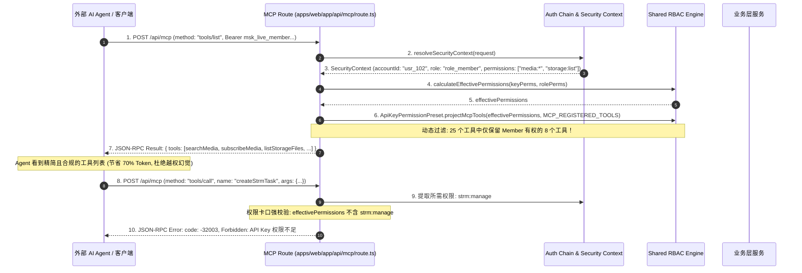
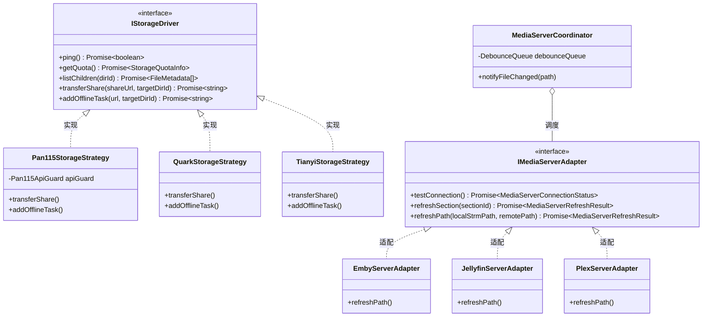
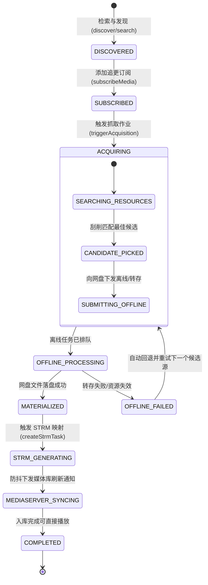
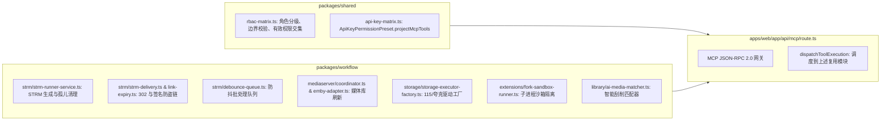

# Mediary Scout 全生命周期 MCP 矩阵与按角色细粒度 RBAC 授权架构方案

> **文档标识**：`docs/2026-11-21-mediary-scout-full-lifecycle-mcp-and-rbac-architecture.md`  
> **涉及系统**：Mediary Scout（巡影）、AITool 运行时、Next.js Web、Model Context Protocol (MCP)  
> **核心目标**：构建覆盖影视全生命周期的 25+ 核心 MCP 工具与 REST API 矩阵，支持基于 RBAC 的 API Key 权限委派边界与透明动态工具投影裁剪，并通过设计模式治理网盘风控、302 直链失效、上下文膨胀及多媒体服务器同步风暴。  
> **凭据安全规范**：本文档严格遵守凭据安全治理红线，所有网络地址、Token、密钥均采用 RFC 5737 虚拟占位符（如 `192.0.2.1`、`msk_live_test_secret_key_12345`），严禁真实敏感凭据入库。

---

## 一、 执行摘要与愿景蓝图 (Executive Summary & Vision Blueprint)

Mediary Scout（巡影）定位为个人与家庭私有化影视全生命周期管理与自动化中枢。随着 AI Coding Agent 与大语言模型（LLM）能力的飞跃，通过自然语言或自动化 Agent 驱动媒体管线已成为核心演化方向。

然而，当前系统的 MCP 接口（`apps/web/app/api/mcp/route.ts`）仅暴露了 9 个基础只读或触发工具，且缺乏按用户角色隔离权限的动态管控机制，面临以下三大核心挑战：
1. **能力断层**：STRM 虚拟映射、Emby/Jellyfin/Plex 第三方媒体库刷新、动态脚本插件、影视库人工刮削纠偏等高阶业务能力仅停留在 Web UI 或后台定时任务中，未转化为标准 MCP 协议契约；
2. **越权隐患与 Token 浪费**：当前 API Key 缺乏与用户角色（Owner/Admin/Member/Guest）的深度动态绑定。若将 20+ 个管理级工具无差别下发给所有用户或 Agent，既会导致 Prompt 上下文消耗激增（单次请求增加 3000+ Tokens），又会引发 LLM 越权误调用高危破坏性操作（如删除网盘目录、篡改全局服务配置）；
3. **高并发与外部生态鲁棒性风险**：网盘服务商（115、夸克）的严密反爬与限流 WAF、STRM 302 直链的防盗链与客户端 User-Agent 校验、媒体服务器频繁刷新引发的 CPU 踩踏风暴，急需在架构层通过设计模式进行系统性治理。

本文档提出一套**全生命周期 MCP 矩阵 + 零越权动态 RBAC 投影 + 经典设计模式治理**的完整落地架构。

```mermaid
flowchart TD
    subgraph ClientLayer["客户端接入层 (Clients)"]
        A1["AITool / Claude Code / 外部 Agent"]
        A2["家庭成员前端 Web / App"]
        A3["第三方自动化 Webhook / 机器人"]
    end

    subgraph GatewayLayer["API 网关与 MCP 鉴权中枢 (Security Gateway)"]
        G1["统一鉴权链: resolveSecurityContext"]
        G2["角色委派边界校验: validateDelegationBoundary"]
        G3["运行时有效权限交集: calculateEffectivePermissions"]
        G4["动态 MCP 工具投影裁剪器: projectMcpTools"]
    end

    subgraph CorePatterns["设计模式治理引擎 (Design Pattern Engines)"]
        P1["有限状态机 (FSM): 影视生命周期流转"]
        P2["策略模式: 多网盘驱动 (IStorageDriver)"]
        P3["适配器模式: 第三方媒体服务器 (IMediaServerAdapter)"]
        P4["防抖聚合队列: DebounceQueue & SingleFlight"]
        P5["沙箱运行器: ForkSandboxRunner (隔离子进程)"]
    end

    subgraph ServiceEcosystem["Mediary Scout 8 大全生命周期业务领域"]
        S1["1. 影视搜索 (Media Search)"]
        S2["2. 资源查询与刮削 (Resource & Scraping)"]
        S3["3. 订阅管理 (Subscription Lifecycle)"]
        S4["4. 网盘管理 (Cloud Storage Management)"]
        S5["5. STRM 管理 (STRM & Delivery)"]
        S6["6. 影视库管理 (Library Operations)"]
        S7["7. 第三方媒体库 (Media Server Sync)"]
        S8["8. 动态扩展与插件 (Extension Engine)"]
    end

    ClientLayer --> GatewayLayer
    GatewayLayer --> CorePatterns
    CorePatterns --> ServiceEcosystem
```



---

## 二、 现有系统差距与缺失矩阵全景 (Gap Analysis)

### 2.1 现有 MCP 现状与瓶颈分析
当前 `apps/web/app/api/mcp/route.ts` 仅注册了 9 个工具：
- `discoverMedia`, `searchMedia`（TMDB 基础发现与检索）
- `queryStatus`, `getSystemHealth`（系统状态与探针）
- `queryLibrary`（简单订阅列表）
- `subscribeMedia`（添加订阅）
- `listStorageFiles`, `submitOfflineTask`（网盘查看与离线）
- `triggerAcquisition`（手动触发工作流）

**根本缺陷**：
1. **STRM 管理全量缺失**：无任何 STRM 任务创建、手动触发、进度查询、直链重定向诊断工具；
2. **第三方媒体库全量缺失**：无 Emby/Jellyfin/Plex 连接测试、局部路径点对点刷新（Pinpoint Ingest）工具；
3. **动态扩展与插件全量缺失**：无插件安装、沙箱测试、热重载工具；
4. **资源检索未解耦**：无法单独搜索网盘资源候选并返回评分列表（只能由 `triggerAcquisition` 一键执行后台黑盒）；
5. **网盘操作过于粗粒度**：缺少配额查询、全盘检索、直链获取与分类规整；
6. **权限静态映射**：`PERMISSION_CATALOG` 缺少 STRM、MediaServer、Extension 细粒度叶子权限，导致新工具无法纳管入现有 RBAC 体系。

---

### 2.2 补全后的全生命周期 25 项 MCP 核心工具矩阵

为支持全套功能，将工具全面扩充至 25 个，分类矩阵如下：

| # | 工具名称 (Tool Name) | 所属领域 | 所需权限叶子 | 风险等级 | 输入 Schema 摘要 | 输出规范与语义 |
|---|---|---|---|---|---|---|
| 1 | `searchMedia` | 影视搜索 | `media:search` | Read | `query: string` | 返回 TMDB 匹配条目（标题、年份、TMDB ID、海报） |
| 2 | `discoverMedia` | 影视搜索 | `media:detail` | Read | `genre?, year?, type?, sortBy?` | 按题材/年份推荐热门高分作品 |
| 3 | `getMediaDetail` | 影视搜索 | `media:detail` | Read | `tmdbId: number, type: "movie"\|"tv"` | 返回演职员、季集结构、剧情大纲与别名 |
| 4 | `getTrendingMedia` | 影视搜索 | `media:detail` | Read | `timeWindow: "day"\|"week", type?` | 返回实时院线与流媒体流行榜单 |
| 5 | `searchResources` | 资源查询 | `media:search` | Read | `keyword: string, mediaType?, seasonNumber?` | 多网盘资源候选聚合列表（清晰度、大小、分享源） |
| 6 | `scrapeResourceMetadata` | 资源查询 | `media:detail` | Read | `rawTitle: string` | 测试文件名标准化刮削算法，返回 SxxExx、清晰度评分 |
| 7 | `listSubscriptions` | 订阅管理 | `media:subscribe` | Read | `status?: "active"\|"completed"\|"all", page?, limit?` | 分页列举追剧订阅条目、追更状态与入库进度 |
| 8 | `getSubscriptionDetail` | 订阅管理 | `media:subscribe` | Read | `subscriptionId: string` | 查看单作品分集入库状态、缺失集数明细 |
| 9 | `subscribeMedia` | 订阅管理 | `media:subscribe` | Execute | `tmdbId: number, type, seasonNumber?, qualityPref?` | 新建追更策略并绑定工作区 |
| 10 | `updateSubscription` | 订阅管理 | `media:subscribe` | Execute | `subscriptionId: string, enabled?, qualityPref?` | 修改追更偏好、目标盘或暂停订阅 |
| 11 | `deleteSubscription` | 订阅管理 | `media:subscribe` | Dangerous | `subscriptionId: string, purgeFiles?: boolean` | 取消订阅并可选清理关联任务 |
| 12 | `getStorageDrives` | 网盘管理 | `storage:list` | Read | `{}` | 列举已绑定的网盘列表、协议类型与在线状态 |
| 13 | `checkDriveQuota` | 网盘管理 | `storage:quota` | Read | `storageId: string` | 查询网盘总空间、剩余容量及今日离线下载限额 |
| 14 | `listStorageFiles` | 网盘管理 | `storage:list` | Read | `storageId?: string, dirId?: string, page?, limit?` | 浅层安全浏览目录树（强制深度限制） |
| 15 | `searchDriveFiles` | 网盘管理 | `storage:list` | Read | `storageId: string, keyword: string` | 云盘内文件名实时检索 |
| 16 | `submitOfflineTask` | 网盘管理 | `storage:transfer` | Execute | `urls: string[], storageId?, directoryId?` | 向云盘提交磁力/直链离线下载任务 |
| 17 | `getDriveDownloadUrl` | 网盘管理 | `storage:list` | Read | `storageId: string, fileId: string` | 获取网盘文件的短期高速下载直链 |
| 18 | `listStrmTasks` | STRM 管理 | `strm:read` | Read | `page?, limit?` | 列出 STRM 自动化生成任务及其执行周期与状态 |
| 19 | `createStrmTask` | STRM 管理 | `strm:manage` | Execute | `name, storageId, remoteFolderId, localOutputDir, deliveryMode` | 创建新的网盘目录到本地 STRM 映射同步任务 |
| 20 | `triggerStrmSync` | STRM 管理 | `strm:manage` | Execute | `taskId: string, mode?: "incremental"\|"full"` | 手动触发指定任务执行 STRM 生成与孤儿清理 |
| 21 | `listMediaServers` | 第三方媒体库 | `mediaserver:read` | Read | `{}` | 列举已连接的 Emby/Jellyfin/Plex 实例状态 |
| 22 | `syncMediaServerLibrary`| 第三方媒体库 | `mediaserver:sync` | Execute | `serverId: string, targetPath?: string` | 触发媒体库局部路径点对点刷新或全量扫描 |
| 23 | `testMediaServerConnection`| 第三方媒体库| `mediaserver:manage`| Read | `serverId: string` | 测试第三方媒体服务器连通性并拉取版本与媒体库 |
| 24 | `listExtensions` | 动态扩展 | `extension:read` | Read | `{}` | 列举系统已加载的动态爬虫与网盘插件 |
| 25 | `toggleExtension` | 动态扩展 | `extension:manage` | Execute | `extensionId: string, enabled: boolean` | 启用或停用指定的自定义扩展模块 |

---

### 2.3 补充的 RESTful API 端点全景

为保证 Web 前端、第三方自动化 Webhook 以及外部编程 Agent 一致性，需在 Next.js 服务端同步补充以下标准 REST 端点：

```text
/api/media/[type]/[id]            GET     获取影视详情与季集全量元数据
/api/resources/search             POST    多源聚合网盘资源并发查询
/api/subscriptions                GET     分页查询订阅列表
/api/subscriptions                POST    创建影视追更订阅
/api/subscriptions/[id]           PATCH   修改订阅规则与首选画质
/api/subscriptions/[id]           DELETE  删除订阅项
/api/storage/drives               GET     获取已挂载网盘列表与健康状态
/api/storage/drives/[id]/quota    GET     获取网盘空间与离线下载额度
/api/strm/tasks                   GET     查询 STRM 任务列表
/api/strm/tasks                   POST    创建 STRM 同步任务
/api/strm/tasks/[id]/trigger      POST    手动触发 STRM 同步执行
/api/strm/play/[taskId]/[fileId]  GET     核心 302/代理媒体播放端点 (附带防盗链签名)
/api/mediaserver/configs          GET     查询第三方媒体服务器配置
/api/mediaserver/sync             POST    触发第三方媒体服务器库刷新
/api/extensions                   GET     查询已安装插件列表
/api/extensions/[id]/test         POST    在受限子进程沙箱中运行插件测试
```

---

## 三、 按角色功能权限管控体系（RBAC -> API Key -> MCP Tool 投影设计）

### 3.1 核心问题与设计原则
在多用户家庭或协作部署场景下，站长（Owner）常为家庭成员（Member）或外部 Agent 签发 API Key。
**核心安全诉求**：
- 普通家庭成员（Member）只能检索影视、提交追更订阅、查看个人播放历史；
- **绝不能**让普通成员生成的 API Key 查看到或调用管理级工具（如 `createStrmTask`、`deleteSubscription`、`toggleExtension`）；
- MCP 协议的 `tools/list` 必须实现**零感知动态裁剪**：普通用户连接 MCP 服务端时，返回的工具列表中只包含其有权访问的工具，彻底杜绝越权幻觉与 Token 浪费。

---

### 3.2 扩充后的权限目录 (`PERMISSION_CATALOG`)

在 `packages/shared/src/auth/api-key-matrix.ts` 中新增细粒度叶子节点：

```typescript
// packages/shared/src/auth/api-key-matrix.ts 扩展
export const PERMISSION_CATALOG: ApiKeyPermissionModule[] = [
  // ... 保留现有的 media, notifications, assistant 模块
  {
    id: "storage",
    name: "云盘存储与离线",
    description: "网盘文件浏览、配额与离线转存",
    leaves: [
      { id: "storage:list", name: "浏览文件", description: "查看文件树与检索文件", riskLevel: "Read", supportsApi: true, supportsMcp: true },
      { id: "storage:quota", name: "查看配额", description: "查询网盘容量与离线限额", riskLevel: "Read", supportsApi: true, supportsMcp: true },
      { id: "storage:transfer", name: "离线转存", description: "提交磁力与离线下载", riskLevel: "Execute", supportsApi: true, supportsMcp: true },
      { id: "storage:organize", name: "文件归档", description: "重命名规整网盘目录", riskLevel: "Execute", supportsApi: true, supportsMcp: false },
      { id: "storage:delete", name: "物理删除", description: "永久删除网盘文件", riskLevel: "Dangerous", supportsApi: true, supportsMcp: false },
    ],
  },
  {
    id: "strm",
    name: "STRM 虚拟映射",
    description: "STRM 任务编排与媒体直链流转",
    leaves: [
      { id: "strm:read", name: "查看 STRM 任务", description: "查看 STRM 映射列表与同步日志", riskLevel: "Read", supportsApi: true, supportsMcp: true },
      { id: "strm:manage", name: "管理 STRM 任务", description: "新建、修改与手动触发 STRM 同步", riskLevel: "Execute", supportsApi: true, supportsMcp: true },
    ],
  },
  {
    id: "mediaserver",
    name: "第三方媒体库集成",
    description: "Emby / Jellyfin / Plex 同步调度",
    leaves: [
      { id: "mediaserver:read", name: "查看媒体服务器", description: "查询连接实例与最近同步状态", riskLevel: "Read", supportsApi: true, supportsMcp: true },
      { id: "mediaserver:sync", name: "触发库刷新", description: "向 Emby/Jellyfin/Plex 下发刷新通知", riskLevel: "Execute", supportsApi: true, supportsMcp: true },
      { id: "mediaserver:manage", name: "管理媒体服务器配置", description: "增删改服务器地址与 API Token", riskLevel: "Execute", supportsApi: true, supportsMcp: true },
    ],
  },
  {
    id: "extensions",
    name: "动态扩展与插件",
    description: "多源爬虫与网盘驱动插件生态",
    leaves: [
      { id: "extension:read", name: "查看插件", description: "列举已安装扩展清单", riskLevel: "Read", supportsApi: true, supportsMcp: true },
      { id: "extension:manage", name: "管理插件生命周期", description: "启用、停用与测试插件脚本", riskLevel: "Dangerous", supportsApi: true, supportsMcp: true },
    ],
  },
];
```

---

### 3.3 角色权限矩阵与安全不变性定理

系统预设 5 级角色体系（`packages/shared/src/auth/rbac-matrix.ts`）：
- **Owner (站长, Level 10)**: 拥有 `*` 全量通配权限；
- **Admin (管理员, Level 20)**: 拥有除底层系统危险配置外的全部业务与运维权限（含 STRM、媒体库同步与插件管理）；
- **Member (普通家庭成员, Level 40)**: 仅能搜索、追更订阅、查看影视库、发起离线转存、查看配额与刷新自己关联的媒体库；
- **Bot (自动化机器人, Level 50)**: 供自动化流水线调用，包含下载、转存、查看状态与触发工作流；
- **Guest (访客, Level 60)**: 纯只读检索，禁止任何写操作与管理操作。

#### 安全不变性定理 1：授权委派边界 (Delegation Boundary / Subset Invariance)
$$\forall p \in \text{RequestedPermissions}(\text{Key}), \quad p \in \text{Permissions}(\text{ActorRole})$$
当普通用户（如 Member）在系统设置界面创建 API Key 时，其勾选的权限集合必须严格是其当前登录角色权限的**子集**。若尝试提权（例如 Member 尝试勾选 `strm:manage` 或 `extension:manage`），后端在保存 API Key 时强制拦截并返回 `403 Delegation Boundary Violation`。

#### 安全不变性定理 2：运行时有效权限交集防御 (Effective Permissions Intersection)
$$\text{EffectivePermissions} = \text{KeyDeclaredPermissions} \cap \text{CurrentUserRolePermissions}$$
即使用户的角色在日后被管理员从 Admin 降级为 Member，此前该用户创建的高权限 Key 在运行时也会被**动态求交集裁剪**，立即丧失 Admin 权限，无需手动撤销 Key。

---

### 3.4 MCP `tools/list` 与 `tools/call` 动态投影裁剪时序



---

## 四、 架构设计模式深度优化 (Design Patterns in Action)

面对影视管理系统的异构外部依赖、网络抖动与长生命周期状态流转，必须采用成熟设计模式解耦并提升稳定性：



### 4.1 策略模式 (Strategy Pattern)
- **多网盘驱动抽象 (`IStorageDriver`)**：
  - 定义统一操作协议（`ping`, `getQuota`, `listChildren`, `transferShare`, `addOfflineTask`）；
  - 具体策略：`Pan115StorageStrategy`、`QuarkStorageStrategy`、`TianyiStorageStrategy`、`WebDavStorageStrategy`；
  - 优势：当未来增加百度网盘或阿里网盘驱动时，MCP 工具与业务工作流零改动，仅需向驱动工厂注册新策略。

### 4.2 适配器模式 (Adapter Pattern)
- **第三方媒体服务器统一适配 (`IMediaServerAdapter`)**：
  - Emby、Jellyfin、Plex 拥有完全不同的 REST API 协议、Token 命名机制及路径匹配规则；
  - 统一适配接口：`refreshPath(targetPath)` 与 `testConnection()`；
  - 内部实现：
    - `EmbyServerAdapter`：通过 `/Library/Media/Updated` 接口触发局部精准刷新；
    - `PlexServerAdapter`：解析 `PathMapping` 将本地 STRM 路径映射为 Plex 容器内挂载路径后，调用 `/library/sections/{id}/refresh?path={remotePath}`。

### 4.3 有限状态机 (Finite State Machine / FSM)
- **影视全生命周期流转状态机**：
  管控一部作品从发现到最终可播的全流程，避免网络偶发故障导致任务悬空：



### 4.4 责任链模式 (Chain of Responsibility)
- **MCP 请求治理拦截管线**：
  构建统一的请求过滤管线：`SecurityContextResolver` -> `ProtocolChannelGuard` (校验 `allowMcp`) -> `RoleBoundaryGuard` -> `RateLimiterGuard` (令牌桶防刷) -> `ZodSchemaValidator` -> `ToolExecutor`。

### 4.5 观察者模式与防抖聚合队列 (Observer & Debounce Queue)
- **媒体文件落盘事件总线**：
  当剧集批量转存完成时，发布 `MediaFilesMaterializedEvent`。STRM 监听器与媒体库刷新监听器订阅该事件，并通过 `DebounceQueue` 聚合 15 秒内的同一影视目录更新，合并为单次媒体服务器刷新调用。

---

## 五、 深度头脑风暴：可行性、逻辑缺陷与性能瓶颈剖析

在实际大规模私有云与家庭 NAS 部署中，以下 5 大痛点若处理不当，会导致系统崩溃或网盘封号：

### 5.1 痛点 1：网盘高频并发与风控封号治理 (Drive Anti-Ban & Rate Limiting)
- **问题本质**：115 和夸克拥有极其敏感的风控系统。若 MCP 工具暴露给 LLM，Agent 可能会并发循环调用 `listStorageFiles` 或批量提交 `submitOfflineTask`，触发 `HTTP 429`、`访问过于频繁`、甚至导致账号永久风控。
- **系统解决方案**：
  1. **调用预算与下限间隔守卫 (`Pan115ApiGuard`)**：
     - 在请求层强制执行两次 API 调用的最小物理间隔（如 300ms）；
     - 划分每小时调用预算配额（Call Budget），保留 40 次保留调用（`TRANSFER_RESERVE_CALLS`）专供正在运行的任务做善后收尾与临时目录清理；
  2. **异步任务化 (Job Queue) 替代同步等待**：
     - 严禁在 MCP `tools/call` 中同步等待整个转存或离线下载完成；
     - 立即返回 `{ taskId: "job_xxx", status: "queued" }`，Agent 通过轻量级的 `queryStatus` 轮询进度，避免 HTTP 长连接超时断开。

---

### 5.2 痛点 2：STRM 302 直链防盗链与播放器兼容性陷阱 (PotPlayer 302/UA Crash)
- **问题本质**：
  - 115 等网盘的直链通常带防盗链 HMAC 签名（参数 `k=...`），且该签名与请求直链时的 `User-Agent` 强绑定；
  - 若 Mediary Scout 服务端用 Node.js 默认 UA 向网盘换取了直链，写入 STRM 后，用户在客户端（如 PotPlayer 或 Infuse）播放时，媒体服务器返回 302，客户端跟随 302 并使用客户端自身的 UA（如 `PotPlayer/24.x`）访问网盘 CDN，网盘 CDN 校验 UA 不匹配直接抛出 `403 Forbidden`！
- **系统解决方案**：
  1. **三态交付策略 (`deliveryMode: "redirect" | "proxy" | "auto"`)**：
     - `redirect`：针对兼容客户端，直接 302 重定向；
     - `proxy`（流代理模式）：由 Mediary Scout 本地服务端作为中转流代理，以正确的 Cookie 和 UA 读取网盘数据流并转发给播放器，支持完整 HTTP 206 Range 分片定位；
     - `auto`：根据来访请求的 `User-Agent` 特征库智能判断，若为已知易封禁客户端则无缝降级为代理模式；
  2. **短期带签名动态播放端点**：
     - STRM 文件内绝对不写网盘静态直链，而是写入动态中转地址：`/api/strm/play/{taskId}/{fileId}?token={hmac}&exp={timestamp}`；
     - 播放时服务端实时换取网盘最新有效链接并缓存（TTL 1小时），彻底杜绝直链过期问题。

---

### 5.3 痛点 3：海量文件树与 LLM 上下文爆炸 (Massive File Tree & Token Overflow)
- **问题本质**：
  - 私有影视库通常拥有 10TB+ 资源、数万个视频文件。若 Agent 执行 `listStorageFiles` 或搜索，返回整个深层目录树，会产生数十万字符的 JSON，瞬间撑爆 Agent 上下文窗口并产生巨额 API 费用。
- **系统解决方案**：
  1. **强制浅层限制**：`listStorageFiles` 默认只允许列出当前文件夹直接子节点（`depth = 1`），禁止默认递归全盘；
  2. **分页游标 (Cursor-based Pagination)**：每页最多返回 50 条条目，返回 `nextCursor`；
  3. **结构化信息脱敏与压缩**：剥离无关的冗余哈希、内部扩展字段，仅向 Agent 返回 `{ id, name, sizeBytes, isFolder }` 关键元数据。

---

### 5.4 痛点 4：第三方媒体服务器通知风暴 (Notification Storm)
- **问题本质**：
  - 批量入库 50 集剧集并生成 50 个 `.strm` 文件时，若每生成一个文件就调用一次 Emby/Jellyfin 的 Refresh API，将导致媒体服务器 CPU 100% 打满、刮削任务死锁、正在观影的用户严重卡顿。
- **系统解决方案**：
  1. **防抖批处理队列 (`DebounceQueue`)**：
     - 设置 15~30 秒滑动时间窗口。在窗口内到来的同影视库路径刷新请求自动合并；
  2. **点对点局部刷新 (Pinpoint Ingest)**：
     - 绝不调用全局全库扫描接口，而是传入目标目录绝对路径（如 `/media/tv/The Last of Us/Season 1`），命令 Emby 仅针对该叶子目录执行单点增量刮削。

---

### 5.5 痛点 5：动态插件沙箱安全性与主进程稳定性 (Extension Sandbox Crash)
- **问题本质**：
  - 允许通过 MCP 或扩展管理加载自定义爬虫与站点解析插件。若插件直接在 Next.js 主进程中 `eval` 运行，一旦出现死循环、大内存占用或崩溃异常，将直接拖垮整个 Mediary Scout Web 进程。
- **系统解决方案**：
  1. **子进程物理隔离 (`fork-sandbox-runner.ts`)**：
     - 使用 Node.js `child_process.fork` 启动独立工作者进程执行插件脚本；
  2. **硬性资源看门狗**：
     - 限制子进程最大物理内存（`--max-old-space-size=128`）；
     - 设置执行超时看门狗（单次搜索请求硬超时 10 秒，超时立即 `SIGKILL` 终止子进程），确保主服务永远不被挂起。

---

## 六、 业界主流开源方案调研与对比 (Industry Benchmarking)

对标目前影视自动化领域最具代表性的开源项目，对比矩阵如下：

| 对比维度 | MoviePilot | NASTool (旧版) | AList | AutoSymlink / cd2-strm | Overseerr | **Mediary Scout (巡影)** |
|---|---|---|---|---|---|---|
| **核心定位** | PT/BT 自动化运维神器 | 经典家庭 NAS 媒体工具 | 多网盘虚拟挂载与文件聚合 | 专注网盘转 STRM 软链接 | 家庭成员影视点播请求前端 | **网盘影视全生命周期 AI 中枢** |
| **网盘直链支持** | 依赖扩展与外部 Rclone | 基础网盘集成 | **极佳 (30+ 种主流网盘)** | 依赖网盘挂载点 | 无 | **原生内置 (115/夸克/天翼等)** |
| **STRM 生成与交付** | 支持 (依赖配置) | 需自行写脚本 | 支持 302 直链 | **原生专注 (极简高效)** | 无 | **内置引擎 + 302/流代理自适应** |
| **媒体服务器同步** | 完善 (Emby/Jellyfin/Plex) | 完善 (支持通知) | 无 (纯文件层) | 简单命令触发 | 仅同步媒体库可用状态 | **适配器模式 + 防抖局部刷新** |
| **权限与多租户** | 单管理员为主 | 单管理员 | 多用户 (但无业务级权限) | 无权限概念 | **极佳 (精细化点播审批流)** | **五级 RBAC + API Key 动态投影** |
| **MCP / Agent 契约** | 无原生 MCP (仅基础 API) | 无 | 无 | 无 | 无 | **原生 JSON-RPC 2.0 MCP 矩阵** |
| **架构与扩展性** | Python 插件系统 | Python 模块 | Go 语言高性能架构 | Shell / Docker 镜像 | TypeScript / React 前端 | **TypeScript Monorepo + 隔离沙箱** |

### 核心借鉴与超越总结：
1. **借鉴 AList**：采纳其统一驱动（Driver Adapter）抽象模型与直链 302 换取思路；
2. **借鉴 Overseerr**：采纳其“普通成员只允许提交点播意图，底层操作完全受控审批”的权限分级哲学；
3. **借鉴 MoviePilot**：采纳其文件名正则刮削匹配器评分机制与精准目录通知；
4. **巡影核心超越**：成为业界首个原生支持 **MCP 协议** 与 **按角色动态工具投影裁剪** 的全自动化媒体中心，让外部 LLM Agent 既能零学习成本接管运维，又受控于严格权限边界。

---

## 七、 现有系统基础设施与代码复用矩阵 (Infrastructure Reuse Matrix)

经过对 `E:\WorkProject\Node\_Project\mediary-scout` 源码的深入审计，本方案的绝大多数核心底层逻辑已在现有模块中落地，无需重复造轮子，可直接复用并封装为 MCP：



### 复用映射清单：
1. **RBAC 与 API Key 动态投影**：
   - 直接复用 `packages/shared/src/auth/rbac-matrix.ts` 中的 `validateDelegationBoundary` 与 `calculateEffectivePermissions`；
   - 直接复用 `packages/shared/src/auth/api-key-matrix.ts` 中的 `ApiKeyPermissionPreset.projectMcpTools`。
2. **STRM 管理引擎**：
   - 直接复用 `packages/workflow/src/strm/strm-runner-service.ts` 的 `runStrmTaskIncrementalSync`；
   - 直接复用 `packages/workflow/src/strm/debounce-queue.ts` 的防抖队列机制。
3. **第三方媒体库适配**：
   - 直接复用 `packages/workflow/src/mediaserver/coordinator.ts` 的 `MediaServerCoordinator`；
   - 直接复用 `packages/workflow/src/mediaserver/emby-adapter.ts` 与 `plex-adapter.ts`。
4. **网盘驱动策略**：
   - 直接复用 `packages/workflow/src/storage/storage-executor-factory.ts` 的驱动创建与安全看门狗。
5. **动态插件执行**：
   - 直接复用 `packages/workflow/src/extensions/fork-sandbox-runner.ts` 的隔离子进程。

---

## 八、 分阶段实施路线图与验证门禁 (Roadmap & Verification Gates)

### Phase 1: 权限矩阵扩充与动态工具裁剪门禁生效 (Day 1 - 2)
1. 在 `packages/shared/src/auth/api-key-matrix.ts` 中增补 `strm:*`、`mediaserver:*`、`extensions:*` 等叶子权限；
2. 更新 `packages/shared/src/auth/rbac-matrix.ts` 中 `BUILTIN_ROLES` 的角色权限集合，严格限制 `role_member` 与 `role_guest`；
3. 为 `calculateEffectivePermissions` 和 `validateDelegationBoundary` 编写覆盖 100% 的单元测试，确保越权提权必定失败。

### Phase 2: STRM 与媒体服务器 MCP 工具上架 (Day 3 - 4)
1. 在 `apps/web/app/api/mcp/route.ts` 中注册 `listStrmTasks`、`createStrmTask`、`triggerStrmSync`、`syncMediaServerLibrary`、`listMediaServers`；
2. 接入 `strm-runner-service` 与 `mediaserver/coordinator`，注入安全账户上下文；
3. 编写模拟测试：验证 Member 角色调用 `tools/list` 时上述工具被自动隐藏，Admin 角色调用时正常返回。

### Phase 3: 资源聚合检索、网盘配额与文件搜索工具接入 (Day 5 - 6)
1. 注册 `searchResources`、`checkDriveQuota`、`searchDriveFiles`；
2. 在驱动层接入 `Pan115ApiGuard` 频次限制与配额熔断器；
3. 实现大文件树游标分页与深度安全看门狗。

### Phase 4: 动态插件沙箱与端到端真机验收 (Day 7)
1. 注册 `listExtensions` 与 `toggleExtension`，对接 `fork-sandbox-runner`；
2. 按照 AITool 自动化巡检规约，使用 Chrome DevTools MCP 内置浏览器完成多角色 API Key 创建与真机联调验收；
3. 输出端到端验收截图与评估报告至 `docs/acceptance/`。

---

## 九、 凭据安全红线与治理守则 (Security Redlines Compliance)

为确保项目任何阶段绝对不发生敏感凭据泄露，实施过程中必须无条件遵守以下防线：
1. **严格使用虚拟占位符**：方案、接口文档、单元测试一律使用 RFC 5737 示例（如 `192.0.2.1`、`msk_live_test_secret_key_1234567890`）；
2. **禁止源码反混淆规避**：严禁通过字符串拼接、Base64 变换等方式伪装真实敏感数据；
3. **本地密钥严格隔离**：本地联调密钥一律动态读取自 `.gitignore` 包含的 `/env/.envdev`；
4. **Git Commit 前置门禁**：提交前必须无异常通过 `node .githooks/security-gate.cjs --full` 安全扫描。
