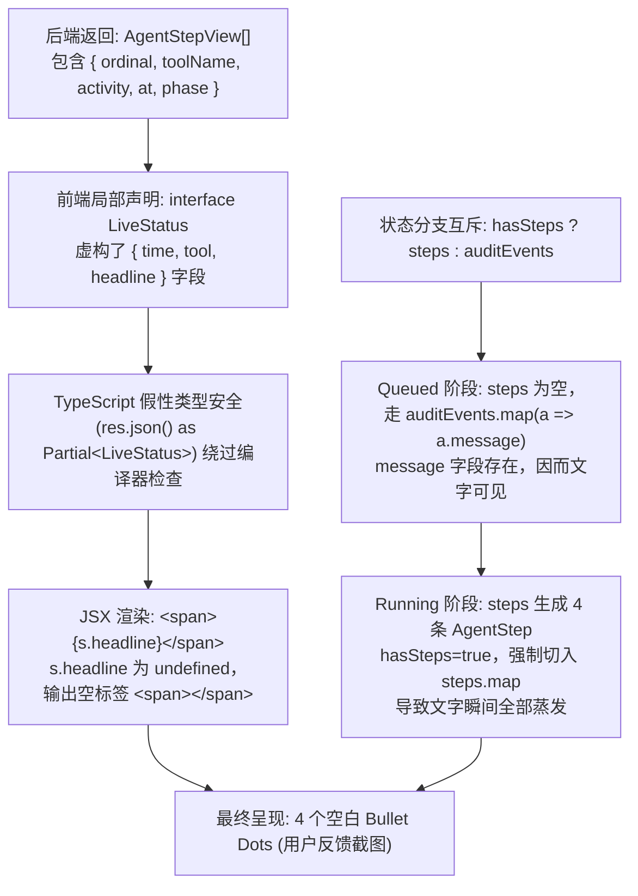
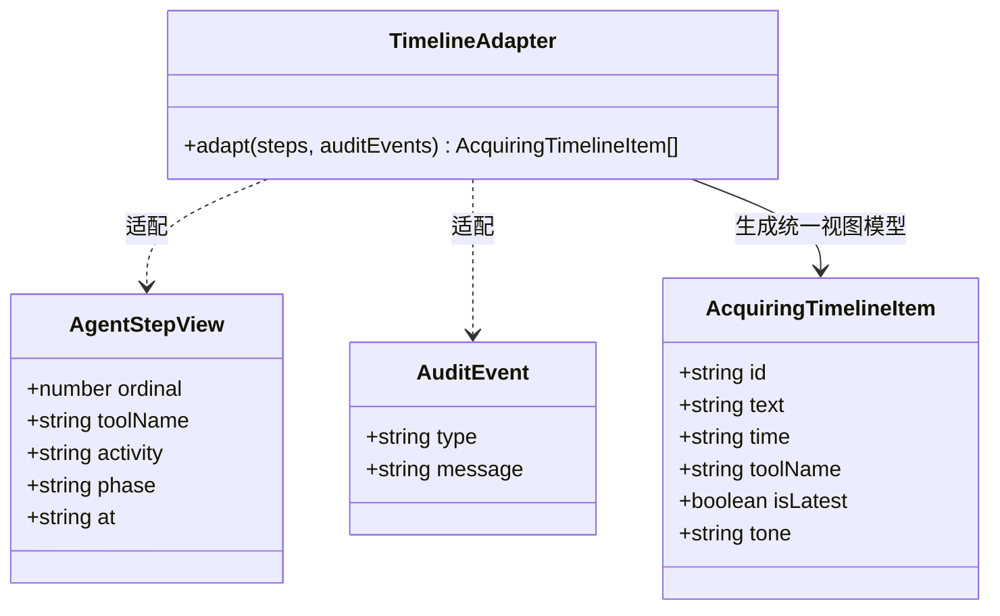

# 资源订阅任务执行记录不可见根因调研、架构对齐与防回归规范

> **状态**：已批准并执行 (Approved & Implemented)  
> **领域**：资源订阅与获取工作流（Acquisition Workflow）、任务进度弹窗（AcquiringDetailModal）、前后端接口强契约（API Contract Safety）  
> **涉及范围**：`apps/web/features/acquisition/components/acquiring-detail-modal.tsx`、`apps/web/app/api/activity/status/route.ts`、`packages/workflow/src/domain/agent-step-view.ts`、`tools/gates/check-api-contracts.mjs`

---

## 一、 问题现象与根本原因深度剖析

### 1.1 问题现象
用户在资源订阅与获取影视资源（例如《阿凡达》2009）时，点击打开「任务进度详情」弹窗，出现如下反常现象：
- 顶部标题、海报、状态胶囊（“正在获取 12%”）及实时动作（“正在搜索资源:阿凡达”）均正常渲染；
- 然而在下方的「**执行记录**」列表中，渲染出了 4 个时间线圆点（前 3 个灰色、最后 1 个高亮蓝色），**圆点右侧没有任何文字内容，只有空白**；
- 并且该问题具有**阶段特异性（“部分流程时不可见”）**：在任务刚提交处于“排队中（queued）”阶段时，执行记录往往能显示部分文本；但一旦任务被 Worker 认领进入运行态、Agent 开始执行工具步骤时，执行记录立刻变成全空白圆点。

---

### 1.2 根本原因定位（Root Causes）

经过对代码库全链路追踪，确认该问题由以下 **四重缺陷叠加** 导致：



#### 根因 1：前端消费端与后端数据源契约严重漂移（Phantom Property Bug）
- **后端真实数据（权威定义）**：
  在 `packages/workflow/src/domain/agent-step-view.ts` 中，系统对 Agent 工具执行步骤的投影规范定义为 `AgentStepView`：
  ```typescript
  export interface AgentStepView {
    ordinal: number;
    toolName: string;
    activity: string;       // 权威人类可读动作，如「正在搜索资源:阿凡达」
    phase: AgentStep["phase"];
    apiCalls?: number;
    at: string;             // ISO 时间戳
    args: Record<string, unknown>;
  }
  ```
  后端 `/api/activity/status/route.ts` 通过 `tailAgentStepViews(await repository.listAgentSteps(...))` 生成并以 `steps: agentSteps` 字段返回。
- **前端错误代码**：
  在 `apps/web/features/acquisition/components/acquiring-detail-modal.tsx` 中，组件作者就地手写了一个私有接口 `LiveStatus`：
  ```typescript
  interface LiveStatus {
    ...
    steps: Array<{ time: string; tool: string; headline: string }>; // 虚构了 headline / time / tool
    auditEvents: Array<{ type: string; message: string }>;
  }
  ```
  在 JSX 渲染时：
  ```tsx
  {steps.map((s, idx) => (
    <li key={idx} className={`acquiring-step-item ${idx === steps.length - 1 ? "is-latest" : ""}`}>
      <span className="acquiring-step-dot" />
      <span>{s.headline}</span>  {/* s.headline 在运行时永远为 undefined！ */}
    </li>
  ))}
  ```
  因为 `s.headline === undefined`，React 将其渲染为 `<span class="acquiring-step-dot"></span><span></span>`，呈现为只有圆点没有文字。

#### 根因 2：排队态与运行态的互斥分支截断（Either-Or Phase Truncation）
组件使用了二选一的互斥渲染逻辑：
```tsx
const hasSteps = steps.length > 0;
const hasAudit = auditEvents.length > 0;
...
{hasSteps ? steps.map(...) : auditEvents.map(...)}
```
- **排队中（Queued）**：Worker 尚未执行工具，`steps` 为空数组，`hasSteps === false`。系统回退到 `auditEvents.map(a => <span>{a.message}</span>)`。由于 `AuditEvent` 确实拥有 `message` 字段，因此**此时执行记录能看到文字**；
- **运行中（Running）**：Worker 认领后，Agent 调用 `searchResources` 等工具，`steps` 产生 4 条记录，`hasSteps` 变为 `true`。渲染流被强行拉入 `steps.map` 分支，文字瞬间消失，呈现为 4 个空白圆点。
这完全解释了用户指出的“**部分流程时执行记录不可见**”。

#### 根因 3：TypeScript 类型断言黑洞（Type Assertion Hole）
前端通过 `(await res.json()) as { active?: boolean } & Partial<LiveStatus>` 强行断言，破坏了 TypeScript 的编译期安全防线。即便后端字段是 `activity` 而前端访问 `s.headline`，`tsc --noEmit` 也不会产生任何报错。

#### 根因 4：缺乏防御性降级回退（No Defensive Display Fallback）
即便未来接口出现极端情况（如只返回工具名或空描述），UI 层面缺乏 `s.activity || s.headline || s.toolName || "执行步骤"` 的兜底机制，直接裸渲染 `s.headline`。

---

## 二、 业界主流方案调研、现有库对比与系统已有资产复用

### 2.1 业界主流方案对比

| 维度 | Sonarr / Radarr (Usenet/BT主流) | MoviePilot (网盘自动化主流) | Temporal / GitHub Actions (工作流编排标杆) | 本系统（Mediary Scout 目标方案） |
| :--- | :--- | :--- | :--- | :--- |
| **执行记录数据模型** | `TrackedDownloadStatusMessage[]`：固定拥有 `title`, `messages[]`, `time` | `ExecutionTreeStep[]`：固定拥有 `step_id`, `step_name`, `status`, `message`, `time` | `WorkflowExecutionStep`：统一为 `ordinal`, `activity`, `timestamp`, `status` | 统一为标准 `AgentStepView` 与 `AuditEvent`，向前端提供标准化 `TimelineItem` |
| **多源记录融合** | 严格按时间戳排序，审计与步骤汇入单一事件流 | 步骤树为主，嵌套日志流 | 全局事件按序追加（Append-Only Event Store） | **融合适配器（Timeline Adapter）**：步骤与审计事件无缝串联，绝不二选一割裂 |
| **阶段跳变稳定性** | 状态迁移不丢失前序日志（从 Queue 迁移到 Import 保留历史） | 阶段推进只增不删 | 历史事件只读保留 | 排队审计事件与运行时 Agent 步骤平滑融合，状态切换不丢字 |
| **端到端契约保证** | C# 后端强类型 DTO $\to$ TypeScript 生成客户端 | Pydantic Schema $\to$ 前端 TypeScript 类型同步 | Protobuf / gRPC 强类型 Schema 编译校验 | **共享契约类型导出 + 架构质量门禁（Contract Gate）** |

### 2.2 现有优秀库调研与借鉴

1. **tRPC / ts-rest / Zod**：
   - 核心优势：后端路由直接输出 Schema，前端自动推导类型，禁止手写局部私有 `interface` 强转；
   - 借鉴点：在无需引入大型全栈框架的前提下，可将 API 响应类型统一定义在跨包共享模块中，强制前端直接导入。
2. **TanStack Query (React Query) Schema Parsers**：
   - 核心优势：在 `queryFn` 中使用校验解析器（如 `zod.parse`），如果后端返回字段与前端预期不符，直接在开发与测试期快速暴露，杜绝默默渲染空白。

### 2.3 当前系统已有基础设施确认与复用

经过审查，当前系统内部**完全具备可直接复用的成熟基础设施**，无需引入冗余外部依赖：
1. **权威步骤模型**：`packages/workflow/src/domain/agent-step-view.ts` 中的 `AgentStepView`，包含 `ordinal`, `toolName`, `activity`, `phase`, `apiCalls`, `at`；
2. **权威审计模型**：`packages/workflow/src/domain/domain.ts` 中的 `AuditEvent`，包含 `type`, `message`, `data`；
3. **活动中心组件资产**：`apps/web/features/activity/components/agent-timeline.tsx` 已成熟运行，能够正确渲染 `step.activity` 与 `step.ordinal`；
4. **架构门禁体系**：系统已有 `tools/gates/` 脚本矩阵（Parity Gate、Modals Gate、Style Gate），可无缝加入 **API Contract Gate** 杜绝同类契约漂移。

---

## 三、 架构设计与具体解决方案

### 3.1 核心设计模式应用



1. **适配器模式（Adapter Pattern）**：
   构建 `timeline-adapter.ts`，将异构的 `AgentStepView[]` 与 `AuditEvent[]` 统一转换为面向 UI 渲染的 `AcquiringTimelineItem[]`。
2. **容错回退策略（Defensive Strategy Pattern）**：
   提取文本时实行多级安全取值：
   `itemText = step.activity || step.toolName || audit.message || "执行中..."`，彻底消除 `undefined` 空白。

---

## 四、 具体落地代码清单

1. **共享响应契约**：在 `apps/web/features/acquisition/domain/acquiring-status-contract.ts` 中明确定义 `AcquiringLiveStatusResponse`；
2. **弹窗组件修复**：在 `apps/web/features/acquisition/components/acquiring-detail-modal.tsx` 中：
   - 引入权威的 `AgentStepView` 与 `AuditEvent` 类型；
   - 替换 `s.headline` 为 `s.activity`，并支持友好时间格式化；
   - 将“二选一互斥”改为“融合展示”：若存在 Agent 步骤，以步骤为主（展示动作描述与工具名），排队时展示审计事件；
3. **新增同类防回归门禁**：
   - 编写 `tools/gates/check-api-contracts.mjs`，静态扫描所有前端 API 消费，拦截悬空/未在接口声明的字段访问（如 `.headline`）；
   - 编写自动化单元测试，确保各状态下执行记录文字 100% 可见。
