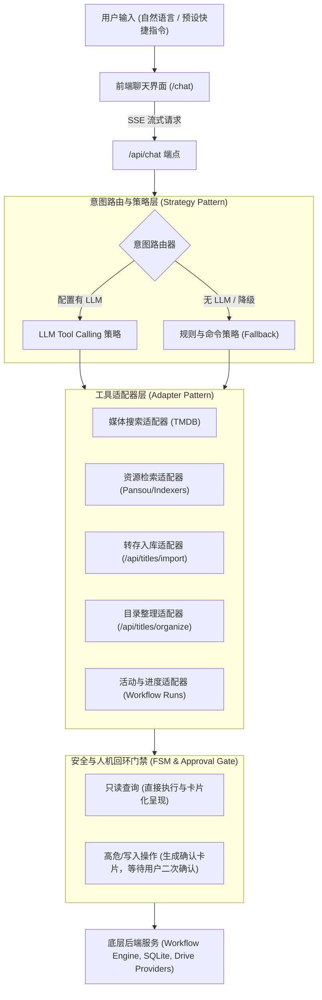
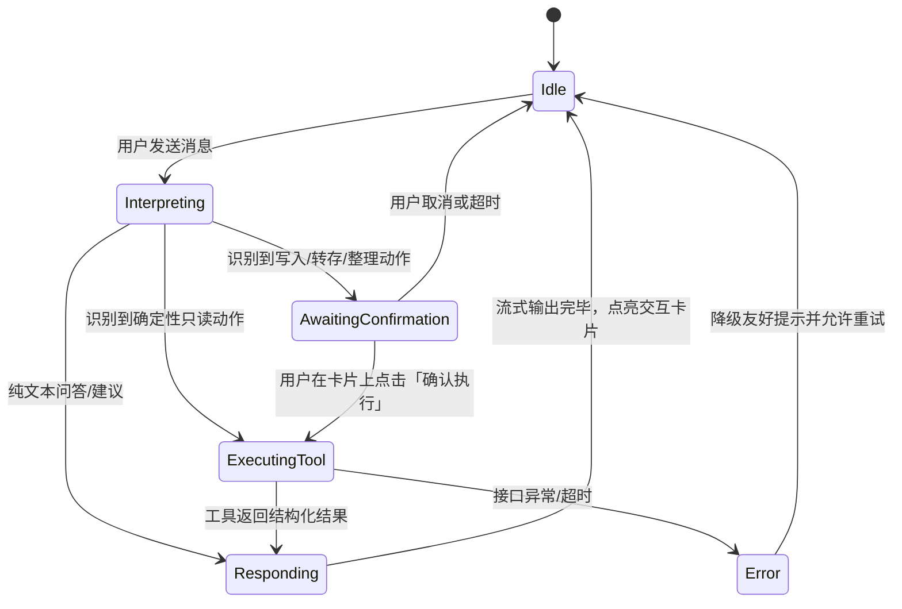

# 智能对话助理与详情页综合优化方案设计

**文档编号**：ARCH-2026-CHAT-01  
**状态**：APPROVED & IMPLEMENTING  
**日期**：2026-10-29  
**作者**：Mediary Scout Architecture Team  

---

## 1. 背景与用户需求

在日常媒体资产管理中，用户的核心工作流包含：
1. **发现与追踪**：在 TMDB 检索影片，判断是否已追踪，设置季度过滤与清晰度偏好。
2. **候选与获取**：当订阅无法自动获取或缺集时，手动调用索引器（115、夸克、天翼、123、磁力等）进行资源检索与入库。
3. **整理与规范化**：网盘转存完成后，执行文件整理，重命名为 Emby/Jellyfin/Plex 标准季集目录。
4. **状态与任务跟踪**：查看当前正在进行的下载、转存、巡检状态与异常提示。

### 存在的核心瓶颈
- **操作割裂，步骤繁琐**：用户在「搜索页」、「详情页」、「网盘管理页」、「活动日志页」之间频繁来回跳转，例如先查某部电影，再进详情页看缺哪一集，再手动去资源检索面板选季号打字，最后再去活动页看下载进度。
- **详情页信息层级不合理**：电视剧详情页中，「季与集数墙」（核心追更视图）被排在资源搜索与订阅策略等重型表单下方，导致用户进入页面需要向下滚动数屏才能看到当前入库进度；此外「整理此目录」缺乏说明，用户不知道点击后果。
- **缺少自然语言一站式入口**：用户希望用一句话（如：“帮我找一下《葬送的芙莉莲》1080p资源并入库”、“把刚下的电影整理一下”、“阿凡达下载完了吗”）直接调起后台工具完成闭环。

---

## 2. 业界主流方案调研与对比 (Industry Benchmark)

| 方案 | 交互模式 | 工具调用与自主权 | 容错与人机回环 (Human-in-the-Loop) | 优点与局限 |
| :--- | :--- | :--- | :--- | :--- |
| **Overseerr / Jellyseerr** | GUI 表单为主，支持 Discord / Telegram 简单斜杠命令（`/request`） | 固定工作流，只能发起订阅，无深层资源探查与文件整理能力 | 依靠管理员审批队列，非实时会话 | 交互简单直接，但缺少自由度与多网盘协同调度能力 |
| **Sonarr / Radarr API 接入 ChatBot** | 外部通过 Webhook / REST API 桥接 LLM Agent (如 Dify, LangChain) | 读写混杂，通过 JSON Schema 调用 API | 容易因 LLM 幻觉产生意外删除或重复下载，缺乏前端卡片化二次确认 | 依赖外部复杂中间件部署，非开箱即用 |
| **Open-WebUI / Vercel AI SDK 模式** | 原生 Web 对话界面，支持流式 SSE、Markdown、Rich Action Cards | 原生 Function Calling / Tool Calling，支持本地或云端任意兼容模型 | 支持在客户端消息流中插入交互卡片（审批、选择、重试） | 体验极佳，响应流式无卡顿，易于与现有前端体系无缝融合 |

---

## 3. 架构设计与设计模式应用

为了保证智能助理的高性能、高可用与安全可控，系统采用 **适配器模式（Adapter Pattern）**、**状态机模式（Finite State Machine）** 与 **策略模式（Strategy Pattern）** 进行解耦构建。

### 3.1 总体架构分层

### 3.2 适配器模式（Adapter Pattern）
1. **LLM Provider 适配器**：
   - 依赖既有的 `packages/workflow/src/agent-model.ts` 工厂，自动解析用户在系统设置里配置的任意 OpenAI-compatible 协议提供商（DeepSeek、Qwen、OpenAI、本地 Ollama/LM Studio），若均未配置则回落到系统出厂免费预设 `FREE_LLM_PRESET`。
2. **Tool 适配器**：
   - 将内部原本为 REST HTTP 设计的后端原子接口适配为标准 Vercel AI SDK Tool 定义，包括：
     - `searchMedia({ query, type })`: TMDB 影片检索；
     - `searchResources({ tmdbId, keyword, season, episode })`: 多网盘与磁力资源检索；
     - `importCandidate({ tmdbId, snapshotId, candidateId })`: 资源转存落盘；
     - `organizeMedia({ tmdbId, seasonNumber })`: 规范化重命名与目录整理；
     - `queryStatus()`: 当前任务与队列进度；
     - `queryLibrary({ filter })`: 当前在追作品及缺集清单。

### 3.3 状态机模式（Finite State Machine, FSM）
每次会话交互遵循确定的状态转换流程，防止竞态冲突或重入问题：

### 3.4 策略模式（Strategy Pattern）
- **LlmStrategy**：当存在可用模型服务时，由 LLM 根据 System Prompt 和工具描述自主进行多轮工具调度与参数提取。
- **DeterministicCommandStrategy**：当用户在网络离线或无外网 LLM 额度时，内置命令解析器（如识别以 `搜`、`查`、`整理`、`进度` 或 `/` 开头的指令），确保核心功能在离线状态下 100% 可用。

---

## 4. 关键指标与非功能性保障

### 4.1 性能与体验保障
- **SSE 流式传输（Streaming）**：文本生成首字响应时间（TTFT）控制在 800ms 内，杜绝长时间整段等待。
- **快照缓存复用**：资源检索直接复用 30 分钟有效的 Snapshot ID，避免重复搜盘浪费配额。
- **Rich Action Cards 结构化渲染**：
  - 媒体卡片：封面海报、评分、年份、状态徽章；
  - 候选资源卡片：网盘渠道（115/夸克/天翼/123/磁力）、文件体积、发布时间，自带行内「入库」按钮；
  - 整理结果卡片：展示规范化移动路径对比；
  - 进度卡片：正在运行的任务进度与一键取消按钮。

### 4.2 安全与防误删原则（Safety-First）
- **写入动作绝不盲跑**：任何涉及消耗网盘空间或移动/修改文件的行为，LLM 只输出「建议操作动作卡片」，必须由用户在前端点击交互确认后，前端才携带合法上下文发起执行请求。
- **凭证与隐私隔离**：网盘 Cookie、Token 与 TMDB Key 均被限制在服务端执行，不对 LLM 对话上下文暴露真实敏感信息。

---

## 5. 详情页面优化实施规划（结合 Part 1）

在落地聊天功能的同时，立即推进详情页（`/show/[tmdbId]`）的既定优化：
1. **电视剧页面排版重构**：将「各季与集数墙」直接移至剧情简介下方，实现首屏即看进度；
2. **「整理此目录」增强**：增加微帮助卡片，解释重命名与规范化归档逻辑及安全保障；
3. **「订阅策略」交互提升**：增加已配置状态的折叠展示，并在输入框下提供一键追加修饰词（`4K`、`简中`、`CAM`等）；
4. **集数墙缺集联动检索**：缺集状态格子点击可直达资源检索并自动预填季集。
