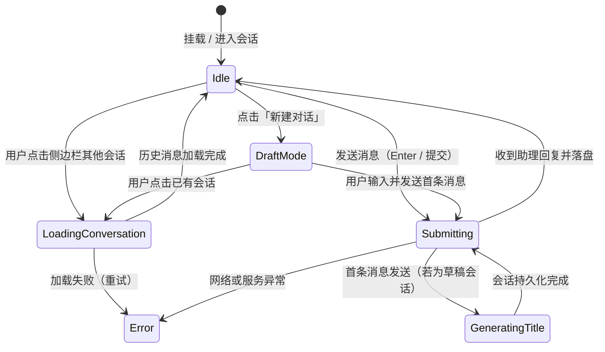

# 智能对话助理会话持久化与管理架构方案（Chat Conversation Persistence Architecture）

本文档针对 Mediary Scout 智能对话助理（`/chat`）新增「创建新聊天、会话列表、会话记录持久化、历史管理」等能力，进行全方位调研、可行性论证、逻辑与性能分析、设计模式应用、以及工业级主流方案对照，并确定最终实现方案。

---

## 1. 需求与痛点背景

### 1.1 现状现状与痛点
当前 Mediary Scout 的对话助理页面（`apps/web/components/chat-panel.tsx`）具备影视检索、网盘入库确认卡片、活动状态追踪、流式/工具卡片渲染及常用按钮等能力，但所有对话状态仅存在于单个 React Client Component 的内存中（`useState<ChatMessage[]>([INITIAL_MESSAGE])`）：
1. **刷新即失**：用户刷新页面或导航至「库 / 任务 / 设置」后再返回，历史对话全部丢失；
2. **单会话局限**：无法针对不同影视、不同整理任务分别开启多个对话主题，所有对话混杂在一起；
3. **无法回溯与归档**：历史中 LLM 推荐的影视列表、用户选定入库的决策卡片无法回溯追溯；
4. **与账号/存储隔离缺失**：多账号多网盘环境下，未能持久绑定会话所属账号与存储上下文。

### 1.2 目标特性
1. **多会话管理（Multi-Conversation Support）**：支持快速「新建对话」，自动生成符合语境的简短标题；
2. **会话列表抽屉（Sidebar List）**：按时间分桶（今天、昨天、前 7 天、更早）组织展示会话，支持高亮当前会话、重命名与删除；
3. **数据持久化（ACID Persistence in Pure SQLite）**：会话与消息历史落入 SQLite，支持消息卡片（thinking、toolsUsed、actionCard）的完整无损还原；
4. **多账号严格隔离（Multi-Account Scoping）**：严格按 `accountId` 隔离，严禁越权读取其他账号会话；
5. **高性能与低延迟（O(1) Metadata List）**：会话列表接口仅查询元数据与消息数，消息详情按需单会话加载，杜绝历史积压引起的内存与网络暴涨。

---

## 2. 业界主流方案对比与借鉴

| 维度 | ChatGPT (OpenAI) | Claude.ai (Anthropic) | LibreChat / Open WebUI | Vercel AI SDK (Core/UI) | Mediary Scout 目标方案 |
| :--- | :--- | :--- | :--- | :--- | :--- |
| **会话初始化** | **惰性持久化 (Lazy Materialization)**：点击 New Chat 仅置前端草稿态，首条消息发送时才建表落盘 | 惰性持久化：首轮问答生成前仅 URL 草稿，问答后持久化 | 混合模式：支持创建空会话或首条消息落盘 | 提供 `useChat({ id })`，生命周期由开发者自定 | **惰性持久化（首条消息落盘）**：杜绝产生大量空白无意义会话 |
| **标题生成** | 异步 LLM 摘要（轻量级 prompt），首轮问答后并发生成并更新侧边栏 | 首轮问答后 LLM 自动拟定 4~6 字标题 | 策略分发：启发式前缀截断 vs LLM 异步摘要 | 需自行实现标题生成端点 | **策略模式（Strategy Pattern）**：首轮启发式即时拟定（0延迟）+ LLM 可选异步精修 |
| **数据模型** | Conversation 元表 + Message 细粒度表，流式 chunk 落盘 | Conversation + Turn + ContentBlock (结构化树) | `conversations` (id, user, title) + `messages` (id, conv_id, role, text, metadata) | Document Store 或 Relational Store 适配器 | **规范化双表设计**：`chat_conversations` + `chat_messages`，纯 SQLite 单文件存储 |
| **富卡片/工具持久化** | 工具调用状态、代码执行容器均作为 message 的 parts/metadata 持久化 | 工具卡片与思考过程分别持久化为 thinking block 与 tool_use block | metadata 字段存 JSON 字符串，反序列化渲染 | message.parts JSON 结构落盘 | **结构化字段落盘**：`thinking` (text), `tools_used` (JSON), `action_card` (JSON) 无损还原 |
| **会话分桶与交互** | 按今天、昨天、7天、30天分组，悬浮提供重命名、删除、固定 | 按时间流分组，支持重命名、删除、星标 | 按时间/文件夹/标签分组，支持完整 CRUD | 仅提供基础数据 hooks，UI 需自行构建 | **时间分桶折叠展示 + 悬浮快捷重命名与删除** |

---

## 3. 架构设计与设计模式应用

### 3.1 仓储模式（Repository Pattern）
为了将 SQLite 底层 SQL 细节与 Web API 层解耦，并在自动化测试中支持轻量测试桩，定义标准的 `ChatConversationStore` 接口：

```typescript
export interface ChatConversationSummary {
  id: string;
  accountId: string;
  title: string;
  storageId?: string | null;
  messageCount: number;
  createdAt: string;
  updatedAt: string;
}

export interface PersistedChatMessage {
  id: string;
  conversationId: string;
  accountId: string;
  role: "user" | "assistant" | "system";
  content: string;
  thinking?: string | null;
  toolsUsed?: ToolCallItem[] | null;
  actionCard?: ActionCardPayload | null;
  createdAt: string;
}

export interface ChatConversationStore {
  listConversations(input: { accountId: string }): Promise<ChatConversationSummary[]>;
  getConversation(input: { accountId: string; id: string }): Promise<ChatConversationSummary | null>;
  createConversation(input: { accountId: string; title: string; storageId?: string | null; id?: string; now: string }): Promise<ChatConversationSummary>;
  updateConversation(input: { accountId: string; id: string; title?: string; updatedAt: string }): Promise<ChatConversationSummary | null>;
  deleteConversation(input: { accountId: string; id: string }): Promise<boolean>;
  listMessages(input: { accountId: string; conversationId: string }): Promise<PersistedChatMessage[]>;
  saveMessage(input: {
    id: string;
    conversationId: string;
    accountId: string;
    role: "user" | "assistant" | "system";
    content: string;
    thinking?: string | null;
    toolsUsed?: ToolCallItem[] | null;
    actionCard?: ActionCardPayload | null;
    createdAt: string;
  }): Promise<PersistedChatMessage>;
}
```

### 3.2 策略模式（Strategy Pattern）：会话标题生成
会话标题直接影响用户体验。如果每次都调用 LLM，不仅增加 500ms~1500ms 的等待延迟，还会消耗 API 配额且在离线模式下崩溃。采用策略模式进行平滑回落：

1. **`HeuristicTitleStrategy`（启发式策略）**：
   - 提取首条用户消息内容；
   - 正则剔除常见命令前缀（如“帮我搜”、“找一下”、“查看”、“查询”）；
   - 清洗标点符号与空白换行；
   - 截断前 16~20 个字符，若为空则保底为“影视对话”；
   - **特点**：0 毫秒延迟，0 成本，100% 可用。
2. **`LlmTitleStrategy`（模型总结策略，可选扩展）**：
   - 在后台非阻塞任务中触发轻量总结；
   - 总结成功后补丁更新 `chat_conversations.title`。

### 3.3 有限状态机（Finite State Machine / FSM）：前端会话与交互流转
避免在对话流式生成或网络请求中切换会话导致的“幽灵消息入库”与跨会话污染：



- **Guard 约束**：
  1. 当处于 `Submitting` 状态时，侧边栏切换对话按钮触发确认提示或中止当次请求（AbortController）；
  2. 若已处于空草稿状态，再次点击「新建对话」属于幂等操作，不发起重复请求。

### 3.4 适配器模式（Adapter Pattern）：模型实体与持久层双向转换
- **存储端**：将复杂富卡片 `ActionCardPayload` 与工具调用数组 `ToolCallItem[]` 序列化为规范 JSON 字符串落入 `chat_messages`；
- **展示端**：读取时将 DB 实体适配为前端 UI 消费的 `ChatMessage` 模型，保持 `thinking`、`actionCard`、`toolsUsed`、`rawMode` 状态兼容。

---

## 4. 数据库 Schema 设计（Pure SQLite）

遵循 Mediary 单文件 SQLite 架构，在 `packages/workflow/src/sqlite.ts` 的 `SQLITE_SCHEMA` 中新增两张表及对应高性能索引：

```sql
-- 会话表（按账号严格隔离）
CREATE TABLE IF NOT EXISTS chat_conversations (
  id text PRIMARY KEY,
  account_id text NOT NULL,
  title text NOT NULL,
  storage_id text,
  created_at text NOT NULL,
  updated_at text NOT NULL
);

CREATE INDEX IF NOT EXISTS idx_chat_conversations_account
  ON chat_conversations (account_id, updated_at DESC);

-- 消息表（关联会话与账号）
CREATE TABLE IF NOT EXISTS chat_messages (
  id text PRIMARY KEY,
  conversation_id text NOT NULL,
  account_id text NOT NULL,
  role text NOT NULL,
  content text NOT NULL,
  thinking text,
  tools_used text,
  action_card text,
  created_at text NOT NULL
);

CREATE INDEX IF NOT EXISTS idx_chat_messages_conversation
  ON chat_messages (conversation_id, created_at ASC);

CREATE INDEX IF NOT EXISTS idx_chat_messages_account
  ON chat_messages (account_id);
```

### 级联删除与事务安全
在 SQLite 中，当删除会话时，使用事务原子执行：
```typescript
this.db.transaction(() => {
  this.db.prepare("DELETE FROM chat_messages WHERE conversation_id = ? AND account_id = ?").run(conversationId, accountId);
  this.db.prepare("DELETE FROM chat_conversations WHERE id = ? AND account_id = ?").run(conversationId, accountId);
})();
```
杜绝脏数据孤儿留存。

---

## 5. API 接口设计与鉴权规范

所有 API 端点严格位于 `/api/chat/*`，遵循 S5.4 规范，统一调用 `requireApiAccount(request)`。

### 5.1 会话列表：`GET /api/chat/conversations`
- **Response**：
  ```json
  [
    {
      "id": "conv_1730248800_abc",
      "accountId": "acct_default",
      "title": "搜 孤独摇滚",
      "storageId": "pan115_root",
      "messageCount": 4,
      "createdAt": "2026-10-29T14:00:00.000Z",
      "updatedAt": "2026-10-29T14:05:00.000Z"
    }
  ]
  ```

### 5.2 创建空会话：`POST /api/chat/conversations`
- **Body**：`{ title?: string, storageId?: string }`
- **Response**：`ChatConversationSummary`

### 5.3 获取会话详情与历史：`GET /api/chat/conversations/[id]`
- **Response**：
  ```json
  {
    "conversation": { "id": "...", "title": "...", "updatedAt": "..." },
    "messages": [
      {
        "id": "msg_1",
        "role": "user",
        "content": "搜 孤独摇滚",
        "createdAt": "..."
      },
      {
        "id": "msg_2",
        "role": "assistant",
        "content": "为您检索到以下结果：",
        "thinking": "...",
        "toolsUsed": [...],
        "actionCard": { "kind": "media_list", ... },
        "createdAt": "..."
      }
    ]
  }
  ```

### 5.4 重命名会话：`PATCH /api/chat/conversations/[id]`
- **Body**：`{ title: string }`
- **Response**：`ChatConversationSummary`

### 5.5 删除会话：`DELETE /api/chat/conversations/[id]`
- **Response**：`{ success: true }`

### 5.6 对话执行与自动落盘更新：`POST /api/chat`
- **Body**：
  ```json
  {
    "conversationId": "conv_123", // 可选；若为空则自动新建并持久化
    "messages": [ ... ],
    "storageId": "..."
  }
  ```
- **Response**：`ChatTurnResult & { conversationId: string }`

---

## 6. UI 交互与布局设计

1. **响应式双栏布局**：
   - 左侧：`ChatSidebar`（宽度 260px，支持折叠、移动端抽屉化）；
     - 顶部高亮「+ 新建对话」按钮；
     - 会话列表卡片，悬浮展现编辑与删除；
     - 按时间（今天、昨天、过去 7 天、更早）分类折叠；
   - 右侧：`ChatPanel`（消息瀑布流 + 底部输入区 + 快捷 Prompts）；
2. **URL 深度绑定**：
   - 支持 `/chat?c=[conversationId]`，页面刷新与分享时可精确停留于当前会话；
3. **视觉风格一致性**：
   - 严格遵循 `check-style-tokens.mjs`，所有样式通过 `var(--bg-surface)`、`var(--border-subtle)`、`var(--radius-card)` 等 Design Tokens 渲染。
