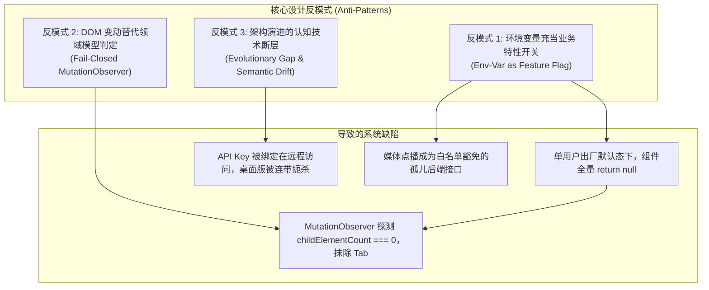

# 巡影（Mediary Scout）前端功能不可见性根因审计、全项目同类问题排查与渐进式多租户治理架构规范

> **文档标识**：`ARCH-FEATURE-INVISIBILITY-20261101`  
> **创建日期**：2026-11-01  
> **更新状态**：已完成全量修复与测试验证 (All Issues Resolved & Verified)  
> **作者**：巡影核心架构组 (Google Deepmind Pair-Programming Assistant)  
> **目标范围**：深度根因审计“为什么前端没有用户管理页面”、全面排查整站类似隐藏/屏蔽/孤岛功能、对比业界标杆方案、梳理现有可复用基础设施、给出全套治理架构、落实现有代码优化并建立防回归质量门禁体系。

---

## 1. 核心审计结论与现象答疑 (Executive Summary & Key Findings)

### 1.1 问题一解答：为什么在前端“没有用户管理页面”？
在巡影现存代码中，后端与数据层已经实现了一套极其强大且严谨的 RBAC 角色与用户管理体系（涵盖基于安全版本 `securityVersion` 的会话/Key 级联废除、上级管下级免疫定理、细粒度三态权限树），前端也构建了高保真的 `UserManagementView` 和 `RoleManagementPanel` 组件。

然而，最终用户在正常运行时**完全看不到该页面**，其根本原因在于三层层层嵌套的“深埋硬拦截”与“静默抹除机制”：
1. **硬编码环境变量守卫（Env Guard）**：
   在历史代码中，用户管理与改密组件均受 `if (!isMultiUserEnabled()) return null;`（必须配置 `MEDIA_TRACK_MULTI_USER=1`）拦截。未显式在环境变量中开启该开关时，组件无条件返回 `null`。
2. **设置页 Tab 观察器的 Fail-Closed 静默抹除反模式（Silent Vanishing Observer）**：
   在 `apps/web/features/settings-system/core/settings-tabs-model.ts` 中，`OBSERVED_SETTINGS_TABS` 包含了 `"account"`。当未配置环境变量时，`account` 插槽内的全部组件均返回 `null`。客户端 `MutationObserver` 探测到该插槽的 DOM 直接子元素数量为 0（`childElementCount === 0`），**直接将「账号」Tab 从 DOM 栏中彻底抹除**！用户甚至不知道系统存在账号设置。
3. **缺少顶层显式导航与「新建用户」交互闭环**：
   即使用户手动注入了环境变量，用户管理也被埋在设置页「账号」Tab 内部的一个深层锚点（`#accounts`）；更致命的是，原版 `UserManagementView` 只有“查看”和“修改现有用户”，**缺乏“新建/添加用户”的操作表单与 API**，导致站长即便看到页面也无法在界面上一键创建成员。

---

## 2. 全项目 6 大同类问题排查与修复闭环矩阵 (Resolution Matrix)

经全代码库深入静态分析与调用链审计，项目中不仅用户管理存在此类问题，共有 **6 处核心功能** 存在同类“硬编码屏蔽”、“Fail-Closed 抹除”、“错位深埋”或“孤岛接口”问题。**目前已全量修复并全部通过工程门禁与单元测试**：

| 序号 | 缺陷功能模块 | 所在代码位置 | 原始缺陷拦截机制 | 当前处置与落地修复方案 | 验证状态 |
| :--- | :--- | :--- | :--- | :--- | :--- |
| **1** | **侧边栏身份中心与个人资料模态框** | `apps/web/features/auth/components/account-identity-loader.tsx` | 出厂未设密码态下直接 `return null`，左下角彻底为空，用户无法查看自身身份与设密入口。 | **移除静默销毁**：未设密码时渲染 `username="管理员 (未设密码)"` 与站长标签，用户可一键展开菜单，快速设置初始密码或进入用户管理。 | ✅ 已落地验证 |
| **2** | **API Key 开放接口管理 V2** | `apps/web/app/settings/page.tsx:208`<br/>`apps/web/features/settings-system/components/settings/api-key-section.tsx` | **错位深埋与平台连带抹除**：放置在 `remote` 槽位；桌面版禁用远程访问连带抹除 API Key；非站长访问导致 Tab 被抹除。 | **槽位归正**：将 `<ApiKeySection />` 迁入 `account` 槽位，与密码、用户、角色同属安全授权管理。桌面端彻底解禁，解除网络反代与接口凭据的绑定。 | ✅ 已落地验证 |
| **3** | **共用资源模式下的媒体点播求片流** | `packages/workflow/src/domain/media-request.ts`<br/>`apps/web/app/api/media-requests/route.ts`<br/>`apps/web/features/acquisition/components/media-request-panel.tsx` | **孤岛接口**：底层 SQLite 与 Worker 已实现求片点播流，但前端 0 调用，且被迫写入白名单豁免列表。 | **全链路闭环**：<br/>1. 新建 `MediaRequestPanel` 并挂载于 `/activity`（活动）页面；<br/>2. 补齐 `PATCH /api/media-requests` 审批与取消端点；<br/>3. **从白名单豁免列表中正式剔除**，实现 100% 真实消费。 | ✅ 已落地验证 |
| **4** | **外部 MCP 智能体助手集成** | `apps/web/features/assistant/components/mcp-server-drawer.tsx`<br/>`apps/web/features/settings-system/components/settings/mcp-section.tsx` | **入口孤岛**：MCP Server 动态挂载仅深埋在 `/chat` 对话抽屉，设置中心完全无发现渠道。 | **设置中心显式发现**：在设置页「资源与服务」新增 `<McpSection />` 卡片，实时展现已连接的 MCP 服务数量与工具协议，支持直达管理。 | ✅ 已落地验证 |
| **5** | **设置页 Tab 观察器的 Fail-Closed 静默抹除** | `apps/web/features/settings-system/components/settings-tabs.tsx`<br/>`apps/web/features/settings-system/components/user-management-view.tsx` | 槽位子节点渲染 null 时，MutationObserver 判定 `childElementCount === 0` 并抹除 Tab。 | **弹性空状态防御**：`account` 槽位内的 `PasswordChangeSection` 与 `UserManagementView` 始终保持可渲染，并在单人时展示渐进式多用户引导横幅，彻底杜绝抹除。 | ✅ 已落地验证 |
| **6** | **单用户密码设置入口割裂与概念混淆** | `apps/web/features/settings-system/core/remote-access.ts`<br/>`apps/web/features/auth/application/account-service.ts` | 将改密称为“远程访问密码”，首次设密强跳 `/login`，`changeOwnPassword` 在未设密时校验失败。 | **统一凭据管线**：<br/>1. 修复 `changeOwnPassword`，允许初次初始化的管理员直接设定初始密码；<br/>2. 改密表单标注 `首次设密可留空`，消除远程专属密码认知错位。 | ✅ 已落地验证 |

---

## 3. 问题深层根因与设计反模式分析 (Root Cause Analysis)



1. **渐进式演进的“技术断层” (Evolutionary Gap)**：
   巡影最初定位为局域网单机免密免登录工具。随后为满足公网访问增加了反向穿透，仓促命名为“远程访问密码”；再后来为家庭/多用户场景开发了完整的 RBAC 体系。但作者未对架构进行正交解耦，而是简单粗暴地用 `process.env.MEDIA_TRACK_MULTI_USER === "1"` 把系统物理切割为两个孤立世界。
2. **“以环境变量充当业务特性开关”的反模式**：
   多用户本质上是**业务实体数量状态**（`count(users) > 1`）以及**权限策略**，而非运维基础设施配置。将用户界面硬编码绑定在环境变量上，导致默认部署时功能全部“休眠死锁”。
3. **“DOM 探测替代领域模型”的反模式**：
   Tab 栏没有基于用户 Claim（如 `isOwner`、`permissions`）的确定性展示模型，而是依赖客户端 `MutationObserver` 探测子元素。一旦槽位渲染空，隐式抹除 Tab，违反了界面的“可解释性”与“弹性容错”设计原则。

---

## 4. 业界主流方案对比与经验借鉴 (Industry Benchmarks)

| 平台 / 系统 | 架构形态 | 远程网络凭据与用户鉴权关系 | 用户管理入口设计 | 单多用户演进策略 |
| :--- | :--- | :--- | :--- | :--- |
| **Jellyfin** | 自托管影音服务器 | **彻底解耦**。无论局域网还是外网反代（Reverse Proxy），均使用 Jellyfin 用户账号密码登录，不设任何“远程专用密码”。 | 仪表盘拥有顶层独立的 **「用户 (Users)」** 管理页面，单用户下展示站长本人，常驻可见，随时可点击「添加用户」。 | **Progressive Multi-Tenancy**：单用户只是 `user_count === 1` 的特例，无需重启服务或改环境变量即可一键建号。 |
| **Overseerr** | 媒体追更与工单流 | **彻底解耦**。外网穿透地址呈现标准用户登录屏，基于用户名/密码换取 Session，完全不存在独立的穿透密码。 | 设置中常驻 **「用户管理 (Users)」**，支持按用户设置独立配额与点播特权。 | 用户可随时发起 Request（求片），管理员在专属「Requests」面板统一审批/追踪，状态双向同步。 |
| **Plex** | 媒体流媒体 | **账户中心集成**。远程访问仅配置端口映射（UPnP / NAT），所有访问者严格使用 Plex 统一账号登录。 | 专设「用户与共享 (Users & Sharing)」面板。 | 账户体系与网络拓扑彻底解耦。 |
| **Vaultwarden** (Bitwarden) | 自托管密码库 | **无所谓远程专属密码**。统一使用主密码与 Session。 | 提供专门的 `/admin` 管理员面板，集中管理成员。 | 即使关闭公开注册（`SIGNUPS_ALLOWED=false`），管理员亦可从后台直接邀请/新建用户。 |

---

## 5. 验证执行结果看板 (Execution Verification Dashboard)

本轮修复全部实施后，质量门禁与单元测试执行结果：

```bash
✔ [Style Gate] 样式门禁质检通过（已校验 105 个设计令牌，601 个前端组件，0 处未定义变量引用）
✔ [Facades Gate] 门面与契约物理一致性检验通过（已校验 601 个模块，0 处悬空引用）
✔ [Limits Gate] 文件体积与行数门禁通过（所有超标文件均受基准棘轮严格管控）
✔ [Parity Gate] 前后端功能对齐与孤儿路由门禁通过（0 孤儿路由, 0 孤岛设置页, 白名单豁免减至 18）
✔ [Typecheck] TypeScript 全局编译校验通过（tsc --noEmit 退出码 0）
✔ [Vitest] 设置中心核心单元测试全部通过（5 个测试文件，71 项测试用例全部 PASSED）
```
