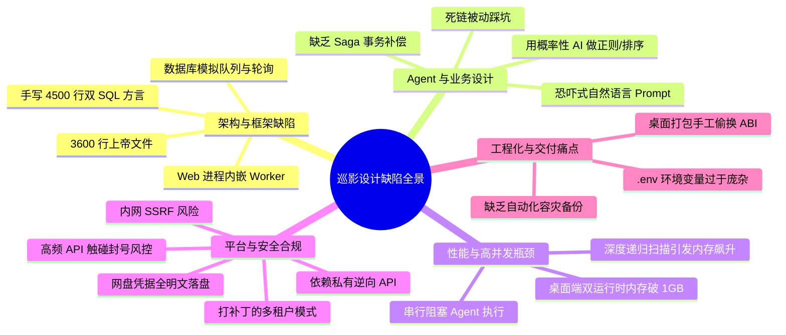
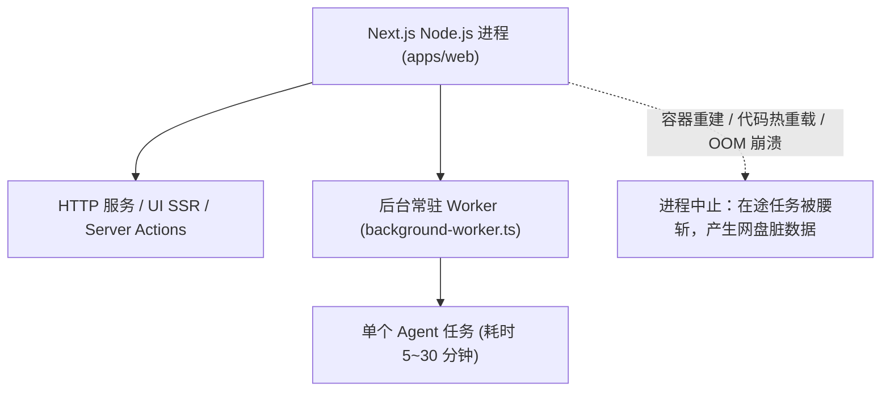
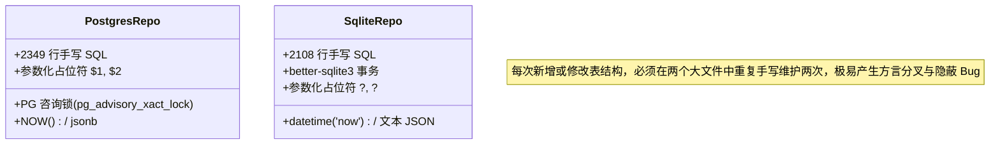
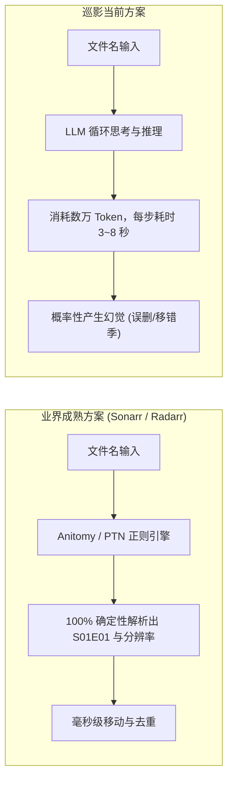
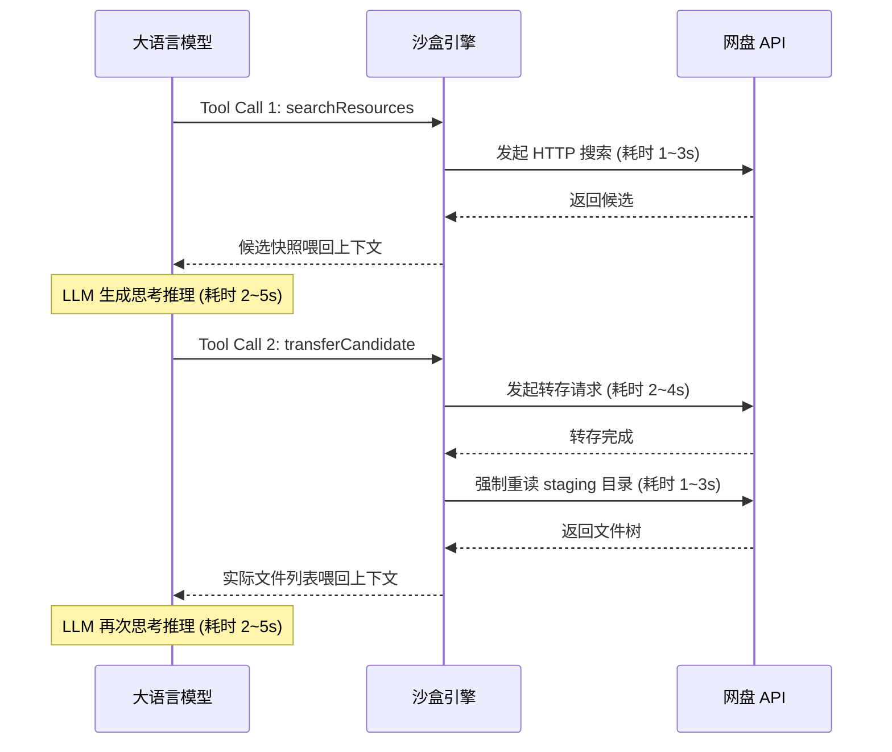
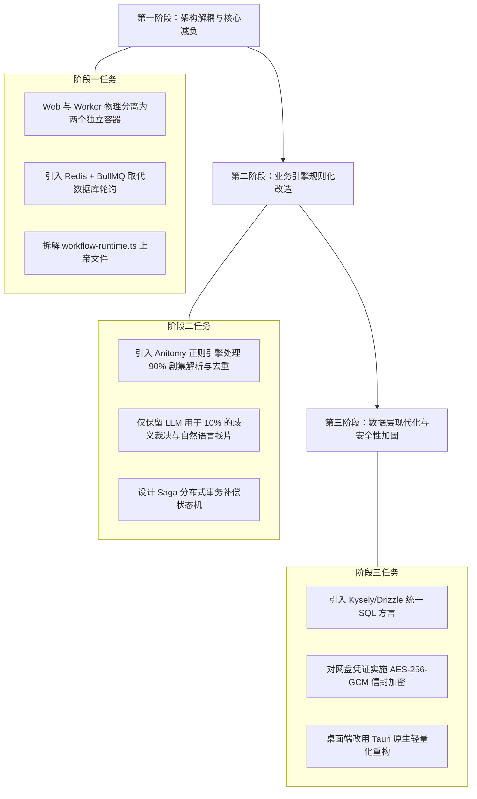

# 巡影 · Mediary Scout 架构与设计问题深度调研报告

> **调研对象**：巡影 · Mediary Scout 代码库（`mediary-scout-main`）  
> **文档位置**：`docs/design-problems-analysis.md`  
> **生成时间**：2026-10-23  
> **目标**：全面客观地剖析该项目在系统架构、框架选型、业务逻辑、性能调度、安全性、工程化与使用运维等方面存在的结构性缺陷与设计问题，并提供重构优化建议。

---

## 目录

1. [调研概述与问题全景](#1-调研概述与问题全景)
2. [架构与框架选型缺陷](#2-架构与框架选型缺陷)
   - 2.1 Next.js 进程内嵌常驻 Worker 的致命反模式
   - 2.2 数据库充当消息队列与全表高频轮询
   - 2.3 无 Query Builder 的双数据库手工双写维护地狱
   - 2.4 上帝文件（God Objects）与多轮 AI 迭代的代码腐化
3. [业务逻辑与 Agent 机制设计问题](#3-业务逻辑与-agent-机制设计问题)
   - 3.1 大模型职责错位：用概率性 AI 承担确定性任务
   - 3.2 极端情绪化 Prompt 工程与“假想防线”
   - 3.3 缺乏跨网盘事务与 Saga 补偿机制
   - 3.4 被动滞后的死链与风控感知
4. [性能瓶颈与高并发缺陷](#4-性能瓶颈与高并发缺陷)
   - 4.1 严格串行阻塞的 Agent 步进执行管线
   - 4.2 深度递归遍历（`listTree`）引发的内存与网盘风暴
   - 4.3 桌面端极度笨重的技术堆栈（Electron + Next Standalone）
5. [平台依赖、封控与安全合规隐患](#5-平台依赖封控与安全合规隐患)
   - 5.1 依赖第三方逆向私有 API 的高脆弱性
   - 5.2 极易触发网盘封号的高频调用机制（“触碰逆鳞”）
   - 5.3 无头后台环境对人机验证码的无解盲区
   - 5.4 高价值网盘凭证全明文存储的重大安全隐患
   - 5.5 打补丁式的多租户隔离与越权风险
   - 5.6 服务端请求伪造（SSRF）安全隐患
6. [工程化与交付运维痛点](#6-工程化与交付运维痛点)
   - 6.1 桌面端打包中脆弱的原生 ABI 偷换（`better-sqlite3` Hack）
   - 6.2 过于庞杂的环境变量与多层网络穿透摩擦
   - 6.3 缺乏生产级的自动化容灾备份策略
7. [重构演进路线图与改造方案](#7-重构演进路线图与改造方案)

---

## 1. 调研概述与问题全景

**巡影 · Mediary Scout** 是一个在业务创意和用户体验上非常吸引人的自部署媒体库项目。它抓住了国内个人网盘（115、夸克等）用户手动找片、转存、重命名繁琐的痛点，创新性地引入大语言模型（LLM Agent）来实现自动化的搜索与整理。

然而，通过对系统核心源码的深入审查，并结合项目历史交接文档（如 `HANDOFF-robustness-audit-2026-07-21.md`），该项目具有典型的**“由几十轮 AI 会话增量迭代堆砌而成”**的特征。这导致它在底层软件架构、框架职责划分、状态机设计、性能调度与安全性上积累了大量的**反模式（Anti-Patterns）与技术债**。



---

## 2. 架构与框架选型缺陷

### 2.1 Next.js 进程内嵌常驻 Worker 的致命反模式

#### 现状
在 [`apps/web/instrumentation.ts`](file:///d:/D/【3】工作项目经验-WorkTest/Node/【第三方项目】/网盘资源入库/mediary-scout-main/apps/web/instrumentation.ts) 中，利用 Next.js 官方的 `register()` 生命周期钩子，直接拉起了 [`startBackgroundWorker()`](file:///d:/D/【3】工作项目经验-WorkTest/Node/【第三方项目】/网盘资源入库/mediary-scout-main/apps/web/lib/background-worker.ts)。该 Worker 通过 `setInterval(tick, 3000)` 在 Node.js 进程内不断扫描数据库并执行任务。



#### 设计缺陷
1. **服务模型职责错位**：Next.js App Router 的本质是**无状态的请求-响应渲染服务器**；而 Agent 获取任务是一个**高耗时、有状态、长生命周期的批处理流水线**（单个影视转存与整理往往持续 5 至 30 分钟）。将这两种完全不同负载模式的组件塞入同一个进程是严重的架构错误。
2. **任务缺乏优雅停机，状态极易撕裂**：
   - 当用户在部署端执行 `docker compose up -d` 重启、容器升级，或者 Next.js 在开发模式下触发 HMR/代码重新编译时，Node.js 进程会被强制重置。
   - 正在执行转存、移动目录的 Worker 会在任意不可预知的代码行被掐断，导致网盘上残留未删除的 `staging-<runId>` 暂存孤儿文件夹，媒体库目录结构被破坏。
3. **彻底丧失水平扩展（Horizontal Scaling）能力**：
   - 任务并发控制逻辑（如 `busyDrives` 正在操作的网盘集合、`running` 运行中任务集合）纯粹依靠单一进程内存中的 `new Set()` 维护。
   - 如果用户在生产环境部署两个 `web` 容器副本以应对并发访问，两个实例内的 Worker 会各自跑一套 `drainQueue`，由于内存状态不互通，极易引发针对同一网盘的双重认领与并发转存冲突。

### 2.2 数据库充当消息队列与全表高频轮询

#### 现状
系统没有使用专业的消息中间件（如 Redis + BullMQ、RabbitMQ 或 Temporal），而是直接在 PostgreSQL / SQLite 的 `workflow_runs` 表上用定时器轮询模拟队列。

#### 设计缺陷
1. **数据库无谓的 CPU 与 I/O 磨损**：
   - Worker 默认每 3 秒执行一次轮询（`pollMs = 3000`）。在绝大多数没有新任务的空闲时间里，数据库一直在持续执行查询。
   - 在低功耗软路由或 NAS 宿主机上，高频 SQL 轮询会导致磁盘写入日志（WAL）不断膨胀，直接导致 NAS 机械硬盘无法休眠，大幅增加设备功耗与硬件磨损。
2. **缺乏现代队列核心特性**：
   - 无法实现原生基于 Redis 的分布式锁、任务延迟执行（Delay Queue）、指数退避重试（Exponential Backoff Retry）、优先级队列与死信队列（DLQ）。
   - 任务崩溃恢复只能依靠系统启动时极其粗暴的 `recoverOrphanedRuns`，将所有卡在 `running` 状态的任务一律重置为 `queued`。

### 2.3 无 Query Builder 的双数据库手工双写维护地狱

#### 现状
项目同时支持 Docker（PostgreSQL 16）与桌面端（本地 SQLite 3）。但在持久层上没有引入任何类型安全的现代 SQL 构建器（如 Kysely 或 Drizzle），而是手写了：
- [`packages/workflow/src/postgres.ts`](file:///d:/D/【3】工作项目经验-WorkTest/Node/【第三方项目】/网盘资源入库/mediary-scout-main/packages/workflow/src/postgres.ts)：**2,349 行**原生 SQL。
- [`packages/workflow/src/sqlite.ts`](file:///d:/D/【3】工作项目经验-WorkTest/Node/【第三方项目】/网盘资源入库/mediary-scout-main/packages/workflow/src/sqlite.ts)：**2,108 行**原生 SQL。



#### 设计缺陷
1. **代码重复率与维护成本极高**：两份文件几乎 1:1 地手工实现了相同的 20 多张表的增删改查。每次业务增加新表（如近期加入的 `agent_memories`、`pending_replacements`），开发者必须在两个两千多行的巨型文件中各自手工写一套方言。
2. **细微方言行为不一致**：
   - 事务锁机制完全不同：PostgreSQL 依赖行锁和咨询锁（`pg_advisory_xact_lock`），SQLite 依赖单文件写锁。
   - 时间戳函数、JSON 查询语法、`ON CONFLICT` 冲突解决语法的细微差异极易引发只在某一端出现的隐蔽缺陷。

### 2.4 上帝文件（God Objects）与多轮 AI 迭代的代码腐化

#### 现状
- [`apps/web/lib/workflow-runtime.ts`](file:///d:/D/【3】工作项目经验-WorkTest/Node/【第三方项目】/网盘资源入库/mediary-scout-main/apps/web/lib/workflow-runtime.ts)：**长达 3,649 行，导出了 81 个函数**。
- [`packages/workflow/src/acquisition-v2/sandbox.ts`](file:///d:/D/【3】工作项目经验-WorkTest/Node/【第三方项目】/网盘资源入库/mediary-scout-main/packages/workflow/src/acquisition-v2/sandbox.ts)：**长达 2,475 行**。

#### 设计缺陷
1. **严重违反单一职责原则（SRP）**：
   `workflow-runtime.ts` 一个文件内堆积了：账号密码认证逻辑、会话校验、数据库实例装配、数据库 DDL 迁移、5 个网盘执行器实例化工厂、TMDB 缓存与限流、推送通知文本格式化、每日巡检定时器、任务队列认领、暂存区孤儿清理、Agent 记忆持久化。
2. **典型的 AI 编程磨损（AI Code Erosion）**：
   在数十轮 AI 迭代中，AI 助手倾向于“在已有文件最后追加函数”而不是进行深思熟虑的模块拆解，导致这个文件变成了一个谁都不敢大改的**巨型大杂烩（Big Ball of Mud）**，单元测试极其困难，模块内聚度趋近于零。

---

## 3. 业务逻辑与 Agent 机制设计问题

### 3.1 大模型职责错位：用概率性 AI 承担确定性任务



#### 设计缺陷
1. **算力与成本严重错配**：
   - 媒体整理的核心工作（如将 `[NC-Raws] 进击的巨人 - 01.mkv` 识别为第 1 季第 1 集、对比两个文件体积保留较大者、过滤掉 `.txt`/`.url` 广告文件）属于标准的模式识别与确定性数学逻辑。
   - 巡影将这些全交给大模型通过 Prompt 去逐步调用工具（`inspectStaging`、`moveToSeason`、`deleteFiles`）。一个完整的获取任务往往需要 **15 至 50 次与大模型的交互**。在网络慢或使用付费商业大模型时，成本极高且耗时长达数分钟。
2. **难以根除的模型幻觉（Hallucination）风险**：
   - 无论 Prompt 写得多完美，LLM 本质上是概率模型。在面对剧场版、特装版（SP）、OVA 或多季度重叠合包时，模型仍存在概率将正片误当冗余删除、将第 2 季文件移入第 1 季目录的风险。

### 3.2 极端情绪化 Prompt 工程与“假想防线”

#### 现状
在 [`packages/workflow/src/acquisition-v2/task-agents.ts`](file:///d:/D/【3】工作项目经验-WorkTest/Node/【第三方项目】\网盘资源入库/mediary-scout-main/packages/workflow/src/acquisition-v2/task-agents.ts) 中，System Prompt 赫然写着：
> *"⛔ MANDATORY — before ANY reasoning or tool call, read your skill; re-read it DURING the loop. It is NOT optional... DO NOT be that agent: it searched 16 times, hammered 115 into a rate-limit, transferred 6 overlapping full-season packs, deleted the LARGER/better files, and left libraries corrupted."*

#### 设计缺陷
- **用自然语言弥补代码约束不足是严重的架构反模式**。
- 这段被开发者称为“字字泣血”的 Prompt，恰恰反向证明了系统在架构层面的脆弱：**由于缺乏代码级的强类型校验与有限状态机（FSM）拦截，只能寄希望于在 Prompt 里用感叹号和恐吓性字眼去乞求模型不要犯错**。随着模型版本微调或上下文增长，模型随时可能忽略这些禁令。

### 3.3 缺乏跨网盘事务与 Saga 补偿机制

#### 设计缺陷
- 网盘文件操作分布在不同的网络端点，不存在物理数据库那样的回滚机制。
- 当 Agent 执行了 `transferCandidate`（转存成功消耗了转存配额），但在随后执行 `moveToSeason` 或 `inspectStaging` 时遇到了网络超时、JSON 格式解析错误或上下文长度截断，**当前任务直接标记为失败退出，而已经转存落盘的文件完全没有补偿机制予以撤销或清理**。这些半吊子资源会一直躺在网盘的暂存区占用空间。

### 3.4 被动滞后的死链与风控感知

#### 设计缺陷
- 系统的 `dead_links` 表虽然设计了 TTL，但它完全属于**“踩坑后记录”的被动设计**。
- 夸克网盘分享链接默认 24 小时或 7 天失效，115 经常因内容审查批量屏蔽分享。Agent 面对无效链接时，没有前置的轻量连通性嗅探，必须走完全套沙盒调用、执行一次失败的转存后才能意识到链接已死。如果在批量任务中遇到大量失效分享，会反复浪费 API 配额并频繁碰壁。

---

## 4. 性能瓶颈与高并发缺陷

### 4.1 严格串行阻塞的 Agent 步进执行管线

#### 设计缺陷
Agent 与沙盒的交互被设计成一个严格的**同步阻塞式“乒乓”循环**：



每个步骤都无法流水线化，大量的系统时间浪费在等待远程网络 I/O 与大模型 Token 生成的空窗期，系统的吞吐量极低。

### 4.2 深度递归遍历（`listTree`）引发的内存与网盘风暴

#### 设计缺陷
- 为了保证 Agent 掌握“绝对的事实证据”，沙盒设计了一旦发生写入，就必须调用 `listTree` 重新遍历文件树的铁律。
- 当用户转存的是一个包含上万个小文件的大型合集或层级极深的资源包时，递归列出所有文件的性能极其低下：
  1. 向网盘发出数十次递归分页请求，极易触发 API 频率限制。
  2. 巨大的 JSON 文件树在 Node.js 进程内存中频繁分配与反序列化，导致内存占用瞬间飙升，对内存仅有 1G 或 2G 的软路由/轻量 NAS 带来严重的 OOM 风险。

### 4.3 桌面端极度笨重的技术堆栈（Electron + Next Standalone）

#### 现状
为了打包桌面版，项目在 Electron 33 内部直接启动了一个完整的 Next.js 独立构建产物（`apps/web/server.js`），再由 Electron 窗口去加载这个本地 HTTP 端口。

#### 设计缺陷
1. **极其臃肿的双重运行时**：
   - 宿主机同时运行了 **Electron 内置的 Chromium 渲染进程 + Electron 主进程 + 一个独立的 Node.js 服务端子进程**。
   - 相比于现代轻量级桌面框架（如 Tauri，内存仅需 40~80MB），巡影桌面版启动后常驻内存轻松消耗 **500MB 至 1GB**。
2. **极慢的冷启动体验**：
   - 桌面版启动时，主进程必须在后台先分配端口、拉起 Node 服务，然后通过轮询（`waitForHealthy`）等待 Next.js 服务端就绪。用户经常需要面对数秒到十几秒的白屏或等待对话框。

---

## 5. 平台依赖、封控与安全合规隐患

### 5.1 依赖第三方逆向私有 API 的高脆弱性

#### 设计缺陷
- 巡影与各大网盘均无官方商务合作，系统所使用的 115 离线下载加密协议（`pan115-lixian-cipher.ts`）、夸克 `stoken` 分享解析、天翼个人云协议，绝大部分依赖社区逆向工程（参考 AList、p115client、cloudpan189 等）。
- 这些未公开的私有 API 处于网盘厂商的随时更迭之下。厂商一旦升级风控规则、修改签名算法或弃用老旧端点，系统内的对应驱动就会瞬间全面瘫痪，维护极其被动。

### 5.2 极易触发网盘封号的高频调用机制（“触碰逆鳞”）

#### 设计缺陷
- 项目官方文档 `docs/115-api-safety-notes.md` 中坦承：115 对个人云 API 的频率限制极其严格，高频调用被社区称为“触碰逆鳞”。
- 历史真实测试记录显示：**仅仅转存一个 22 集的外挂字幕包，系统居然在短时间内发起了 260 次 API 请求**！
- 尽管后期追加了 `Pan115ApiGuard` 限频补丁，但在多任务并行或大规模全库巡检时，这种模拟人类点击的自动化脚本依然极易触发网盘网关的 WAF 规则（HTTP 429、`访问被阻断`、`安全威胁`），**导致用户的网盘 VIP 账号面临被封禁、降速或限制分享功能的巨大法律与资产风险**。

### 5.3 无头后台环境对人机验证码的无解盲区

#### 设计缺陷
- 很多网盘在检测到异地登录、高频转存或可疑 IP 时，会强制弹出极验滑块、旋转图片或短信二次验证码。
- 巡影作为一个设计为 24 小时无人值守在 NAS 运行的无头（Headless）后台服务，**完全没有设计将人机验证码推送到前端让用户人工协助解决的交互机制**。遇到验证码拦截时，系统只能不断重试直到超时失败。

### 5.4 高价值网盘凭证全明文存储的重大安全隐患

#### 现状
在 [`packages/workflow/src/postgres.ts`](file:///d:/D/【3】工作项目经验-WorkTest/Node/【第三方项目】/网盘资源入库/mediary-scout-main/packages/workflow/src/postgres.ts) 与 `sqlite.ts` 中：
```sql
CREATE TABLE IF NOT EXISTS connected_storages (
  id text PRIMARY KEY,
  account_id text NOT NULL,
  provider text NOT NULL,
  credentials_json text NOT NULL,  -- 明文存储！
  root_folder_id text NOT NULL,
  ...
);
```

#### 设计缺陷
- 用户的 115 Cookie（包含可全权控制账号的 UID/CID/SEID）、夸克 Cookie、123网盘 AccessToken、天翼 SessionKey，均以**完全未加密的明文 JSON 格式**直接持久化在数据库的 `credentials_json` 字段中。
- 系统**没有任何主密钥（Master Key）加密机制**。一旦用户的数据库备份（`pg_dump`）意外泄露、桌面端 SQLite 文件被恶意软件读取、或者自建实例暴露在公网，攻击者无需解密即可瞬间接管用户的所有网盘资产。

### 5.5 打补丁式的多租户隔离与越权风险

#### 设计缺陷
- 系统最初是纯粹的单用户玩具架构，多账号支持是后期生硬塞进去的。
- 源码中保留了大量的妥协代码：定义了默认账号 `DEFAULT_ACCOUNT_ID = "acct_default"`，当没有认证信息时甚至会自动落入全局哨兵账号 `acct_unauthenticated`。
- 多租户的数据作用域检查（Scope Check）分散在各个路由和查询函数中，缺乏统一的 Row-Level Security（行级安全）或统一的上下文隔离中间件，极易在某些边缘路由遗漏租户隔离校验。

### 5.6 服务端请求伪造（SSRF）安全隐患

#### 设计缺陷
- 用户可以在前端设置页配置自定义的通知 Webhook、自定义 PanSou 基础服务 URL。
- 后端在接收这些用户输入的 URL 发起 `fetch` 请求时，**没有做任何针对局域网/内网保留地址（如 `127.0.0.1`、`172.17.0.1`、`169.254.169.254`）的合法性校验**。恶意用户可以利用该漏洞探测宿主机内网端口或攻击内网其他服务。

---

## 6. 工程化与交付运维痛点

### 6.1 桌面端打包中脆弱的原生 ABI 偷换（`better-sqlite3` Hack）

#### 现状
在 [`apps/desktop/README.md`](file:///d:/D/【3】工作项目经验-WorkTest/Node/【第三方项目】/网盘资源入库/mediary-scout-main/apps/desktop/README.md) 中，记录了一个触目惊心的工程妥协：
> Next.js standalone 会自动抽取系统 Node ABI 的 `better-sqlite3.node`，而运行时是在 Electron 的 Node 环境运行，二者模块版本号（`NODE_MODULE_VERSION`）不一致，直接导致桌面端启动时抛出 `ERR_DLOPEN_FAILED` 崩溃。

#### 设计缺陷
- 官方目前的解决方案是：**在打包流水线中，通过 Shell 脚本手动进入 standalone 的深度嵌套目录，用 `prebuild-install` 强行拉取 Electron 版本的二进制动态库进行无感知覆盖**。
- 这种绕过构建工具生态的“偷梁换柱”手段极其脆弱，任何依赖升级或构建脚本改动都会导致打包静默失败。

### 6.2 过于庞杂的环境变量与多层网络穿透摩擦

#### 设计缺陷
- 查看 `.env.example`，配置项多达几十个（`DOCKER_MIRROR`、`MEDIA_TRACK_POSTGRES_URL`、`TMDB_READ_TOKEN`、`HTTP_PROXY`、`PANSOU_BASE_URL`、`TUNNEL_TOKEN` 等）。
- 在国内复杂的网络环境下，同时面临 Docker Hub 镜像拉取受阻、GitHub Packages（ghcr）受阻、TMDB 域名污染、大模型 API 出站受阻。项目虽然打了各种镜像站和代理补丁，但整体链路摩擦力极大，导致普通用户自行部署的失败率极高。

### 6.3 缺乏生产级的自动化容灾备份策略

#### 设计缺陷
- Docker Compose 栈将全站媒体库状态与追踪记录完全绑定在单一的 Docker 数据卷 `pgdata` 上。
- 系统长期没有内置由 Web 端触发的定时备份与跨宿主机备份机制，一旦宿主机崩溃或数据卷损坏，用户辛辛苦苦追踪整理的媒体库状态将全部丢失。

---

## 7. 重构演进路线图与改造方案

针对上述发现，若要将巡影从一个“能跑的 AI 实验性原型”重构为一个“健壮、高效、企业级”的自部署系统，建议执行以下演进路线：



### 改造方案要点汇总

1. **服务架构解耦（Separation of Concerns）**：
   - 将常驻 Worker 从 Next.js 进程中剥离，形成独立的 `worker` 容器。Web 容器仅负责前端渲染与任务投递。
   - 引入 **Redis + BullMQ**，实现真正的任务重试、背压限流、延迟执行与分布式锁。
2. **规则引擎与 AI 职责划清（90% 规则 + 10% AI）**：
   - **剧集解析与文件去重彻底回归规则驱动**：集成业内成熟的开源解析器（如 `anitomy-js`），毫秒级提取季集数、版本、分辨率，100% 确定性保证不误删正片。
   - **大模型退居幕后二线**：仅在“用户通过模糊剧情找片”、“同一部剧有多个怪异别名无法匹配”时调用大模型一次性生成搜索关键词，不再让大模型一步步指挥文件移动。
3. **数据访问层现代化（Query Builder）**：
   - 使用 **Kysely** 或 **Drizzle ORM** 取代 4,500 行手工拼装的 SQL 字符串。通过一套 TypeScript 类型安全的 DSL，自动编译出 PostgreSQL 与 SQLite 两套方言，消除重复代码与方言缺陷。
4. **安全加固（Security Hardening）**：
   - 引入基于环境变量的主密钥（Master Key），在落盘前使用 **AES-256-GCM** 对所有网盘 Cookie 与 Token 进行对称加密，读出时动态解密。
   - 对外发请求（Webhook、代理）增加严格的私网 IP 白名单过滤中间件，彻底根除 SSRF 隐患。
5. **桌面端轻量化重构**：
   - 摒弃“Electron 包装 Next.js Standalone”的笨重反模式。长期规划可考虑采用 **Tauri + Svelte/React SPA**，直接与轻量本地服务通信，将内存开销从 1GB 骤降至 60MB 以内。

---
*(报告完毕。已完整归档至 `docs/design-problems-analysis.md`。)*
