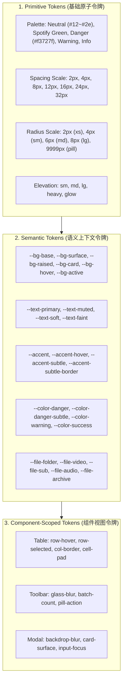
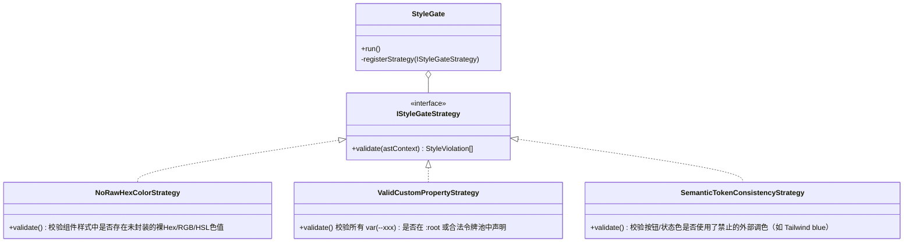

# 设计令牌（Design Tokens）与样式门禁（Style Gate）技术方案

> **状态**：已批准并执行  
> **设计模式**：适配器模式（Adapter Pattern）、策略模式（Strategy Pattern）、状态机模式（Finite State Machine）  
> **适用范围**：全局样式系统（`apps/web/app/globals.css`）、网盘管理组件（`apps/web/components/storage/*`）、门禁校验系统（`scripts/check-style-tokens.mjs`）、共享设计令牌（`packages/shared`）

---

## 一、需求背景与痛点分析

### 1.1 现状痛点
Mediary Scout 在初始设计中确立了以 **Spotify 深色沉浸式风格**（`#121212` 黑色基底、`#1ed760` 绿色主辅色、胶囊形圆角、低视觉噪音）为核心的设计语言（参考 `apps/web/DESIGN.md`）。然而随着多页面及网盘管理（Storage Manager）等业务功能的快速迭代，界面样式出现了明显的碎片化与漂移问题：

1. **硬编码颜色泛滥与视觉割裂**：
   - 样式表及各业务模块中混入了大量未经收敛的任意 Hex 色值（如 `#2a2b36`、`#383a4c`、`#94a3b8` 等冷灰/冷蓝）以及 Tailwind 默认调色盘（`#3b82f6` 鲜蓝、`#ef4444` 亮红、`#22c55e` 嫩绿），破坏了原有的 Spotify 暖灰近黑剧场质感。
2. **令牌缺失与未定义变量隐患**：
   - 存在引用未在 `:root` 声明的幽灵变量现象（如 `var(--bg)`、`var(--bg-elevated)`）。在缺少备用值时，浏览器直接回退为透明或无效，引发偶发性背景穿透或文字不可读。
   - 缺乏层级化的语义令牌（Semantic Tokens），组件无法直接基于意图（如 `--color-danger-subtle`、`--accent-subtle`）消费色彩，导致不同开发者在实现类似悬停（Hover）、选中（Selected）、警告态时各自定义一套 `rgba(...)`，视觉规范无法收敛。
3. **缺乏自动化样式门禁（Style Gate）**：
   - 现有的 `npm run gate` 包含了物理布局门禁（`gate:layout`）、依赖拓扑门禁（`gate:deps`）、ESLint 复杂度门禁及 TS 类型门禁，但**完全没有针对样式的自动化质检**。
   - 只要 CSS 语法合法，任意写死字面量、拼错自定义属性名（如 `var(--accnet)`）均能直接通过 CI 甚至合入主干，无法阻断未来的样式劣变。
4. **网盘管理页面（/storage）界面粗糙**：
   - 表格行列紧绷、快捷筛选与面包屑样式生硬、批量操作工具条缺乏悬浮毛玻璃质感、文件分类徽章色彩刺眼，亟需依照统一设计令牌进行专业级 UI/UX 重构。

---

## 二、业界主流方案调研与对比

### 2.1 设计令牌与样式门禁技术选型矩阵

| 方案 | 核心理念 | 业界代表 | 优点 | 缺点 | 在本项目的适用性 |
| :--- | :--- | :--- | :--- | :--- | :--- |
| **W3C DTCG + Style Dictionary** | JSON 作为唯一真理源，跨平台编译为 CSS/TS/iOS/Android | Figma Tokens, Amazon, Salesforce Lightning | 标准化规范，跨多端编译强，自动化程度高 | 依赖庞大编译工具链与 JSON 重复构建，对于纯 Web 前端项目偏重 | **借鉴三层分层规范（Tier 1/2/3）**，采用更轻量高效的 CSS 变量 + TS 常量适配架构 |
| **Tailwind CSS v4 CSS-First** | 全面基于 `@theme` CSS 变量生成实用类 | Tailwind Labs | 开发体验极快，原生 CSS 变量驱动 | 侵入已有大量手写语义 CSS 样式的单体应用，迁移成本高 | 借鉴其颜色明度尺度（50~950）与语义映射逻辑 |
| **Radix Colors / Shadcn UI** | 12 阶半透明与实体色阶，意图驱动 | Radix UI, Vercel, Linear | 极佳的深色模式适配度与半透明发光叠加能力 | 需成套引入色板映射体系 | **重点参考**：用于构建 `--accent-subtle`、`--color-danger-subtle` 与微交互发光 |
| **Stylelint + Strict Plugins** | 基于 PostCSS AST 解析的 CSS Linter | GitHub Primer, Airbnb, Shopify | 规则极其丰富，社区生态完整 | 依赖项多，冷启动与全量扫描耗时（约 1~3s），需配置额外规则文件 | 偏重，易受 node_modules 变动影响 |
| **轻量级零依赖 Style Gate（本项目方案）** | 极速流式词法/AST 提取器，直接嵌入 `npm run gate:style` | Linux/Node 自制轻量门禁体系（类似 `check-layout.mjs`） | **耗时 < 50ms**，零第三方运行依赖，100% 贴合项目三层设计令牌与未定义变量拦截 | **最符合本仓库轻量极致、严格门禁的自研工程规范** |

---

## 三、架构设计与设计模式应用

### 3.1 架构分层：三层设计令牌体系（Three-Tier Token Architecture）

依照 W3C DTCG 社区规范，将系统设计令牌解耦为三层：



### 3.2 设计模式 1：适配器模式（Adapter Pattern）

建立设计令牌的双向适配器 `DesignTokenAdapter`：
- **CSS 变量适配器**：将原子与语义令牌直接注入 `:root`，对历史别名（如 `--bg`、`--bg-elevated`）实现无痛向前兼容兼容。
- **TypeScript 常量适配器**：在 [`packages/shared/src/design-tokens.ts`](file:///root/mediary-scout/packages/shared/src/design-tokens.ts) 中输出强类型的令牌对象与辅助工具函数，供前端组件与图表、富交互安全调用。

### 3.3 设计模式 2：策略模式（Strategy Pattern）在样式门禁中的实现

在 [`scripts/check-style-tokens.mjs`](file:///root/mediary-scout/scripts/check-style-tokens.mjs) 中构建可插拔的校验策略矩阵：



### 3.4 设计模式 3：有限状态机（State Machine）驱动网盘 UI 交互

网盘管理页面包含复杂的文件多选与异步操作交互，采用状态机建模：
1. **多选状态机（Selection FSM）**：
   - `EMPTY`（未选择） $\to$ 单击单选 $\to$ `SINGLE` $\to$ 继续勾选 $\to$ `MULTI` $\to$ 全选 $\to$ `ALL`。
   - 工具栏根据状态机实时切换可用动作（单项支持重命名，多项仅支持批量移动/批量复制/批量删除）。
2. **操作模态框状态机（Modal Action FSM）**：
   - `IDLE` $\to$ 触发动作（`CREATE` / `RENAME` / `MOVE` / `COPY` / `DELETE`） $\to$ `SUBMITTING`（禁用关闭与再次点击，显示 Spin） $\to$ `SUCCESS`（刷新列表并复位为 `IDLE`）或 `ERROR`（展示告警条保持现场）。

---

## 四、设计令牌规范定义清单

### 4.1 核心语义色彩令牌（Semantic Colors）

```css
:root {
  /* 背景层级 */
  --bg-base: #121212;             /* 最底层画布 */
  --bg-surface: #181818;          /* 容器/卡片 */
  --bg-raised: #1f1f1f;           /* 表头/抬升面板 */
  --bg-card: #252525;             /* 模态框/卡片 */
  --bg-card-alt: #272727;         /* 交替卡片 */
  --bg-hover: rgba(255, 255, 255, 0.05); /* 通用浅色悬停 */
  --bg-active: rgba(255, 255, 255, 0.08);/* 通用按下状态 */
  --bg-backdrop: rgba(0, 0, 0, 0.75);    /* 模态遮罩 */

  /* 历史兼容别名 (防幽灵变量穿透) */
  --bg: var(--bg-base);
  --bg-elevated: var(--bg-raised);

  /* 主品牌/行动点 (Spotify Green) */
  --accent: #1ed760;
  --accent-hover: #3be477;
  --accent-press: #169c46;
  --accent-subtle: rgba(30, 215, 96, 0.12);
  --accent-subtle-border: rgba(30, 215, 96, 0.28);
  --accent-glow: 0 0 16px rgba(30, 215, 96, 0.25);

  /* 语义反馈状态 */
  --color-danger: #f3727f;
  --color-danger-hover: #ff8591;
  --color-danger-subtle: rgba(243, 114, 127, 0.12);
  --color-danger-border: rgba(243, 114, 127, 0.28);

  --color-warning: #ffa42b;
  --color-warning-subtle: rgba(255, 164, 43, 0.12);
  --color-warning-border: rgba(255, 164, 43, 0.28);

  --color-info: #539df5;
  --color-info-subtle: rgba(83, 157, 245, 0.12);
  --color-info-border: rgba(83, 157, 245, 0.28);

  /* 媒体/文件类型专属色板 */
  --file-folder: #f59e0b;
  --file-folder-bg: rgba(245, 158, 11, 0.12);
  --file-video: #38bdf8;
  --file-video-bg: rgba(56, 189, 248, 0.12);
  --file-subtitle: #a78bfa;
  --file-subtitle-bg: rgba(167, 139, 250, 0.12);
  --file-audio: #f472b6;
  --file-audio-bg: rgba(244, 114, 182, 0.12);
  --file-archive: #fb923c;
  --file-archive-bg: rgba(251, 146, 60, 0.12);
  --file-image: #34d399;
  --file-image-bg: rgba(52, 211, 153, 0.12);
  --file-generic: #94a3b8;
  --file-generic-bg: rgba(148, 163, 184, 0.12);

  /* 文字层级 */
  --text: #ffffff;
  --text-soft: #cbcbcb;
  --text-muted: #b3b3b3;
  --text-faint: #8f8f8f;

  /* 边框与阴影 */
  --border: #4d4d4d;
  --border-soft: #7c7c7c;
  --border-subtle: rgba(255, 255, 255, 0.1);
  --divider: #2a2a2a;
  --shadow-sm: 0 1px 3px rgba(0, 0, 0, 0.3);
  --shadow-md: 0 4px 12px rgba(0, 0, 0, 0.4);
  --shadow-heavy: rgba(0, 0, 0, 0.5) 0px 8px 24px;
}
```

---

## 五、网盘管理界面（/storage）优化落地

1. **表格视图优化**：
   - 采用深色抬升玻璃风格（`--bg-raised` 表头），各列宽设定弹性限制；
   - 悬停行采用柔和半透明高亮，被勾选行采用 `--accent-subtle`（Spotify 绿柔光衬底）取代刺目的冷蓝；
   - 文件类型图标及标签徽章全部接入专属文件类型语义令牌。
2. **快捷筛选与面包屑路径**：
   - 「根目录 / 电影 / 剧集 / 动漫」按钮升级为胶囊 Chip 按钮，激活态带有品牌微光与边框强化；
   - 面包屑以现代化路径斜杠与文件夹小图标组合，兼具层级感与点击反馈。
3. **批量操作工具栏（Floating Batch Bar）**：
   - 选中项统计徽章使用品牌色高亮；
   - 「批量移动」、「批量复制」、「批量删除」操作按钮分别使用标准次级胶囊与危险警示样式，提升沉浸感。
4. **模态弹窗（Modals）**：
   - 全面引入 `backdrop-filter: blur(12px)` 高级毛玻璃遮罩；
   - 输入框具备 `--accent` 聚焦边框与发光投影；
   - 目标目录选择器（Destination Picker）与当前目录有明显对比度，杜绝自移动错误操作。

---

## 六、样式门禁（Style Gate）执行与集成

1. **门禁脚本**：[`scripts/check-style-tokens.mjs`](file:///root/mediary-scout/scripts/check-style-tokens.mjs)
   - 提取全局 `:root` 中的全部合规变量集合；
   - 扫描 `apps/web` 下所有 CSS 规则中的 `var(--xxx)`，捕获任何拼写错误或幽灵引用；
   - 扫描业务选择器，严禁使用非令牌声明的硬编码 Hex 与 RGB 色值（排除 `:root` 声明区与合法内嵌 SVG）；
2. **CI 门禁打通**：
   - `npm run gate:style` 作为独立命令；
   - 集成至 `package.json` 的 `npm run gate` 链条中（`gate:layout && gate:deps && gate:style && lint && typecheck`）。
