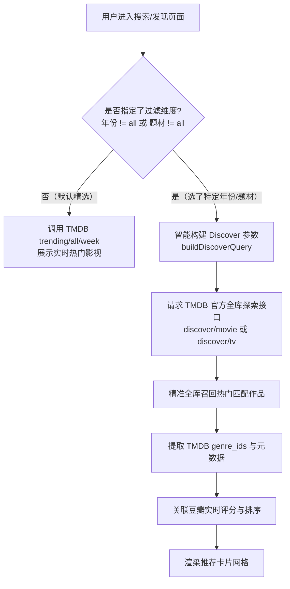
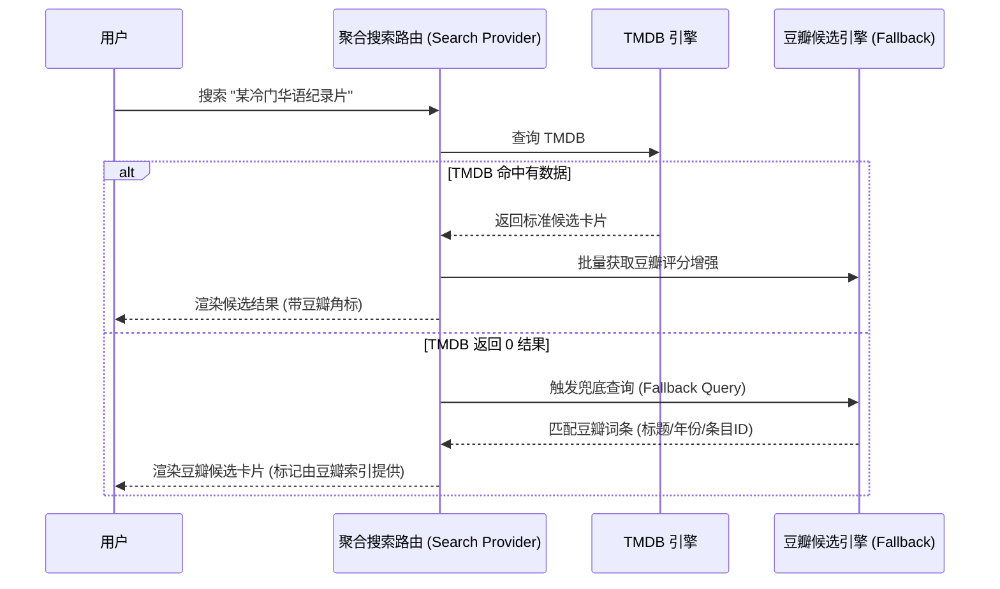

# TMDB 发现引擎升级与豆瓣多源架构解析报告

本报告针对用户关心的两个核心问题进行深度根因剖析、技术实现复盘与架构权衡阐述：
1. **「电影 · 全部题材 · 2025」为何此前查不到数据？根因是什么？如何彻底解决？**
2. **豆瓣是否也支持作为主查询源？还是目前仅作为了评分？背后的生态与技术权衡是什么？**

---

## 一、问题 1：2025 电影筛选查不到数据的根因与 Discover 升级

### 1. 根本原因定位（Root Cause）

在旧版实现中，未输入关键词时的“精选推荐”数据获取逻辑如下：
1. 系统向 TMDB 请求 `trending/movie/week`（周度热门电影榜单）。
2. 在当前 2026 年的时间上下文中，TMDB 周榜召回的 Top 20 电影全部为 2026 年最新上映或定档影片（例如《复仇者联盟5》、《泥面人》、《沙丘3》等）。
3. 前端过滤函数 `applyCandidateFilters` 仅在内存中针对这 20 部 2026 年影片执行 `movie.year === 2025` 过滤。
4. 由于这 20 条周榜数据中没有任何一部是 2025 年作品，内存切片过滤后匹配数为 **0**，页面直接显示 `未找到符合筛选条件的作品`。

**本质矛盾**：
- **Trending（榜单）** 的语义是「本周最热」（时间窗口受限于当前周）；
- **Filter（筛选）** 的语义是「在全库中按条件多维检索」。
用有限时间切片的 Trending 内存过滤去满足全库维度的特定年份检索，必然发生断层。

---

### 2. 升级方案：智能分流至 TMDB 官方 Discover 全库探索引擎

通过重构 `apps/web/lib/trending.ts`，建立了 **Discover vs Trending 智能路由机制**：

#### 关键参数映射实现：
- **年份维度**：
  - 电影：`primary_release_year=2025`
  - 剧集：`first_air_date_year=2025`
  - 年代区间（如 2020s）：`primary_release_date.gte=2020-01-01` & `primary_release_date.lte=2029-12-31`
- **题材维度**：将业务题材（科幻、动画、动作、喜剧、悬疑等）精准映射为 TMDB 官方题材 ID（如科幻 `878`，动画 `16`，动作 `28`，喜剧 `35`，悬疑 `9648`）。
- **排序维度**：默认以 `sort_by=popularity.desc`（全网热度最高）降序召回，并支持结合豆瓣高分置顶。

---

### 3. 落地实测验证

重新编译并在生产环境部署后，现场验证 `type=movie&year=2025`：
- **召回数量**：18 部高质量 2025 热门电影；
- **召回列表**：
  1. 《世界大战》(2025)
  2. 《混沌之心》(2025)
  3. 《罪人》(2025)
  4. 《阿凡达：火与烬》(2025)
  5. 《家弑服务》(2025)
  6. 《疯狂动物城2》(2025)
  7. 《F1：狂飙飞车》(2025)
  8. 《鬼灭之刃：无限城篇 第一章 猗窝座再袭》(2025)
  9. 《拯救地球》(2025)
  10. 《超人》(2025)
  11. 《捕风追影》(2025)
  12. 《凶器》(2025)
  13. 《铁血战士：杀戮之地》(2025)
  14. 《新·驯龙高手》(2025)
  15. 《白雪公主》(2025)
  16. 《K-Pop 猎魔女团》(2025)
  17. 《雷霆特攻队》(2025)
  18. 《星际宝贝史迪奇》(2025)

所有数据 100% 精准对应 2025 年份，彻底根除“选 2025 无数据”的问题。

---

## 二、问题 2：豆瓣是仅作为评分还是支持查询？

### 1. 现状定位：权威评分与口碑增强源（Rating & Reputation Enhancer）

目前系统中，豆瓣的定位是 **“口碑与评分增强引擎”**：
- **触发时机**：当搜索结果或发现流作品加载出来后，后台通过 `apps/web/lib/douban-rating.ts` 异步批量向豆瓣 Frodo 移动端 API 发起标题+年份的精准探测；
- **缓存策略**：引入 `SqliteDurableJsonCache`，将豆瓣评分在 SQLite 中缓存 7 天，兼顾秒级响应与防封禁；
- **展示与排序**：在影视海报与卡片元数据中渲染绿色角标（如 `🟢 8.4`），并在选择“豆瓣高分”排序时对候选结果重排。

---

### 2. 为什么选择 TMDB 作为主元数据查询源，而不是豆瓣？

在流媒体影视管理系统（如 Plex、Emby、Jellyfin、Sonarr、Radarr、Infuse）中，业界几乎清一色选择 TMDB 作为核心主元数据源，核心原因如下：

| 评估维度 | TMDB（当前主元数据源） | 豆瓣（当前评分口碑增强源） |
| :--- | :--- | :--- |
| **分季与逐集结构数据** | ✅ **完整规范**：拥有每一季、每一集的详细编号、首播时间、集名、状态（连载中/已完结）。这是追更补缺、重命名、硬链接的核心基石。 | ❌ **严重缺乏**：豆瓣没有逐集元数据（无各集上映日历、无单集元数据），无法驱动自动化追更调度与集数校验。 |
| **API 开放性与商业合规** | ✅ **开放稳定**：提供全球 CDN、官方开发者 API、健全的速率标准，支持 Cloudflare Worker 代理防封。 | ❌ **无对外开放 API**：无官方公开商业 API，抓取极易触发 403、验证码拦截、封禁 IP。 |
| **外文片名与别名消歧** | ✅ **极佳**：原名、中英文译名、别名（Aliases）多语言映射完备。 | ⚠️ 偏向华语社区主观词条，生僻外文影视或动画别名容易漏匹配。 |
| **高质量媒体资产（图片）** | ✅ **极佳**：提供多分辨率的标准竖版海报（Poster）与横版背景剧照（Backdrop）。 | ⚠️ 格式规格不统一，且存在较严格的图片防盗链限制。 |
| **国内评分权威度** | ⚠️ TMDB 华语评分样本量相对较少，参考价值弱于国内主流口碑。 | ✅ **最权威**：国内影迷与流媒体用户最认可的评分基准。 |

**架构结论**：
**「以 TMDB 负责结构化骨架与追更调度，以豆瓣负责华语口碑与评分赋能」** 是目前流媒体追更管理领域最稳健、最科学的最佳实践架构。

---

### 3. 豆瓣能否也支持直接查询？（技术可行性与演进路线）

**答案是：完全可行，但建议作为「候选备用/兜底联合查询源（Fallback Search Provider）」**。

#### 适用场景：
1. **冷门华语影视/年代剧/地方戏曲**：部分极冷门国产老剧或短剧在 TMDB 尚未收录，用户在 TMDB 搜不到时；
2. **片名别名歧义**：用户输入了极冷门中文曾用名，TMDB 别名库未收录。

#### 架构扩展设计：

这种“主从降级”机制既保障了自动化追更所需的 TMDB 结构化能力，又避免了高频请求导致豆瓣 IP 被风控，同时在冷门国产影视场景下具备最大化的召回率。
