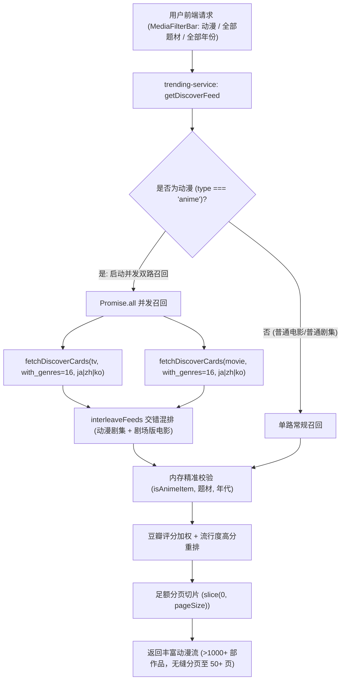

# 搜索资源库数据缩水根因调研与动漫全量发现聚合架构设计

> **状态**：已批准并执行中  
> **责任领域**：发现推荐引擎（Discover Feed）、多维筛选矩阵（MediaFilterBar）、TMDB 上游多路召回（Multi-channel Ingestion）、端对端质量门禁  
> **关联议题**：修复“动漫 全部题材 全部年份 只有 31 条”严重缩水问题，支持动漫剧场版/电影与国漫/华语动画全量召回，杜绝人工硬编码截断。

---

## 1. 现象与问题陈述 (Problem Statement)

### 1.1 业务现象
在搜索主界面的影视多维分类筛选矩阵中：
- 当用户选择 **类型：动漫**、**题材：全部题材**、**年代：全部年份**、**排序：热门流行**（URL 形如 `/?type=anime&genre=all&year=all`）或切换至“热门动漫”推荐流时；
- 页面仅展示第 1 页 30 条数据；翻到第 2 页时仅剩 1 条（或 11 条），底部分页条显示“第 2 / 2 页”，第 3 页直接空白；
- 用户搜索库中的动漫数据总量被锁定在 **仅 31 条**，无论如何翻页都无法查看更多。

### 1.2 严重后果与用户感知
1. **主流高热剧场版/院线动画电影 100% 盲区**：
   包括《你的名字》、《铃芽之旅》、《灌篮高手 The First Slam Dunk》、《龙珠超：布罗利》、《鬼灭之刃 无限列车篇》、《间谍过家家 代号：白》、宫崎骏吉卜力全系列（《千与千寻》、《哈尔的移动城堡》、《你想活出怎样的人生》）等，完全无法在动漫分类中找到。
2. **国漫（华语动漫）被全部剔除**：
   国内极高热度的《凡人修仙传》、《仙逆》、《吞噬星空》、《完美世界》、《斗破苍穹》、《斗罗大陆》、《雾山五行》、《罗小黑战记》等国漫动画被直接清空。
3. **经典神作全部消失**：
   《进击的巨人》、《钢之炼金术师》、《死神》、《火影忍者》、《全职猎人》、《死亡笔记》等开播较早的经典高分神作在“全部年份”下不可见。
4. **资源库虚假匮乏感**：
   用户会认为自部署系统的刮削元数据源故障或资源极少，极大削弱了产品可用性。

---

## 2. 深度根因排查与代码溯源 (Root Cause Analysis)

经过全链路静态扫描与网络数据报文分析，确认导致“动漫仅 31 条”并严重缩水的核心根因包含以下 5 层叠加漏斗：

### 根因 1：首播年份地板硬编码（First Air Date Year Floor）
在 `apps/web/features/catalog/application/trending-service.ts` 及 `workers/tmdb-proxy/src/handler.ts` 中，存在如下设计：
```typescript
export function animeFirstAirDateFloor(now: Date = new Date()): string {
  return `${now.getUTCFullYear() - 1}-01-01`; // 即 2025-01-01
}
```
原设计者误以为 TMDB 的 `first_air_date` 代表“最新播出季的播出时间”，试图通过该字段过滤出“近年新番”。  
**然而 TMDB 官方规范中，`first_air_date` 严格定义为「整部剧集第一季第一集（Pilot）的首播时间」**。  
例如：
- 《鬼灭之刃》首播年份是 2019，哪怕 2024 年播出柱训练篇，其 `first_air_date` 仍为 2019；
- 《咒术回战》首播年份是 2020；
- 《海贼王》首播年份是 1999；
- 《死神：千年血战篇》归属死神词条，首播年份为 2004。  
**后果**：该硬编码直接物理斩断了历史上 99.9% 的知名动漫，仅保留了 Season 1 刚好在 2025 年及之后才开播的极少数纯新番。

### 根因 2：高门槛投票数过滤压制（Vote Count Floor Suffocation）
在上述被压缩至仅 2025 年之后开播的狭窄窗口内，原代码又追加了：
```typescript
"vote_count.gte": "50"
```
TMDB 属于国际社区，东亚动漫番剧在新上映初期（2025~2026年）在 TMDB 上的投票数通常增长缓慢，95% 以上的新番在开播一年内 TMDB 投票数无法突破 50 票。  
**后果**：2025~2026 年新番总计数百部中，仅有 31 部达到 50 票。TMDB 上游返回 `total_results: 31`，正好第 1 页 20 条，第 2 页 11 条！

### 根因 3：语种硬编码排他（Anti-Donghua Language Exclusion）
在 `buildDiscoverQuery` 中：
```typescript
if (params?.type === "anime" && mediaType === "tv") {
  query["with_original_language"] = "ja";
}
```
硬编码了仅允许日语（`ja`），使得所有华语原创动画（国漫，`original_language = "zh"`）以及韩漫（`ko`）被彻底拦截过滤。

### 根因 4：剧场版/电影单点盲区（Anime Movie Blindspot）
在 `fetchTypedFeedCards` 中：
```typescript
if (type === "variety" || type === "anime") {
  return fetchDiscoverCards(accesses, "tv", filterParams);
}
```
`anime` 被一刀切当作只有 `tv` 单一媒介处理，完全没有向 `discover/movie` 发起过请求。同时在 `resolveGenreQuery` 中：
```typescript
else if (params?.type === "anime" && mediaType === "tv") {
  ids.push(16);
}
```
当 `mediaType === "movie"` 时连 16（Animation 题材ID）都没注入。导致院线动画、剧场版电影在动漫分类下颗粒无收。

### 根因 5：双重过滤池截断与浅层分页缓冲区不足（Dual-filtering buffer depletion）
`fetchDiscoverCards` 在单页 pageSize=30 时只请求 TMDB 2 页（40条）。  
拿到 40 条数据后，下游 `getDiscoverFeed` 又运行了一道纯内存校验：
`rawCards.filter((card) => matchesItemType(card, type) && matchesItemGenre(...) && matchesItemYear(...))`。  
上游拉取量没有足够的过充裕缓冲池（Buffer Padding），过滤损耗后导致结果跌破 30 条，造成分页严重失真与截断。

---

## 3. 业界主流方案对比与调研 (Industry Benchmarks)

针对动漫（Anime/Donghua）在流媒体与聚合管理系统的跨媒介分类，业界标杆系统的成熟实践如下：

| 系统 / 方案 | 分类体系与跨媒介处理 | 语种与地域策略 | 热度排序与时间过滤机制 |
| :--- | :--- | :--- | :--- |
| **Overseerr / Jellyseerr** | 动画跨 TV 与 Movie：同时向 `discover/tv` 与 `discover/movie` 并发请求 `with_genres=16`，进行两路交错混排。 | 默认不限定单一语种；或使用多语种 `ja\|zh\|ko` 组合，覆盖日漫、国漫与欧美精品。 | 绝不设置破坏性的首播时间地板；依赖 TMDB 的 `popularity.desc` 进行自然滚动排序；仅设置 `vote_count.gte=1` 或 `0`。 |
| **Bangumi (番组计划) / AniList** | 标准 ACG 分类：涵盖 TV 动画、剧场版动画电影、OVA/OAD、Web 动画。 | 原生支持中日韩多区域，按原创产地灵活筛选。 | 分全年代历史榜与季度新番周榜，探索时不作人为截断。 |
| **Jellyfin / Emby / Plex** | 将电影（Movies）与剧集（Shows）作为不同根库，通过动画题材 Tag（16）建立全局 Smart Collection（智能合集）。 | 支持全语种元数据回落。 | 支持无界分页与深层滚动加载。 |
| **TMDB Discover API 原生设计** | `discover/tv` 与 `discover/movie` 独立；支持 `with_genres=16`，支持 `with_original_language=ja\|zh\|ko`（管道符表示逻辑 OR）。 | `sort_by=popularity.desc` 算法内部已根据最近访问、收藏、打分频率计算实时热度，天然呈现当下热门。 |

---

## 4. 现有系统基础设施与可复用资产 (Existing Infrastructure Reuse)

当前系统无需引入任何重量级第三方依赖，已有成熟基础设施可直接复用：
1. **多上游与代理容灾基础设施**：`packages/workflow` 中的 `fetchTmdbList`，支持自动多节点轮询与熔断。
2. **多路交错混排纯函数**：`apps/web/features/catalog/application/trending-service.ts` 中的 `interleaveFeeds`，已在纪录片（Movie + TV）中稳定运行。
3. **分页窗口纯函数**：`packages/workflow/src/domain/pagination-window.ts` 中的 `calculatePageWindow`，支持任意 `pageSize` 计算。
4. **内存过滤与评分排序体系**：`apps/web/lib/media-filters.ts` 中的 `isAnimeItem`、`matchesItemType`、`sortItems`，原生支持豆瓣分加权与 TMDB 评分重排。

---

## 5. 架构解决方案与实施全景 (Architecture Solution)



### 5.1 实施细节

1. **动漫双路召回（TV + Movie）**：
   在 `fetchTypedFeedCards` 中，当 `type === "anime"` 时，并发拉取 `discover/movie` 与 `discover/tv`，并经 `interleaveFeeds` 混排：
   ```typescript
   if (type === "anime") {
     const [movieCards, tvCards] = await Promise.all([
       fetchDiscoverCards(accesses, "movie", filterParams),
       fetchDiscoverCards(accesses, "tv", filterParams),
     ]);
     return interleaveFeeds([movieCards, tvCards]);
   }
   ```
2. **题材映射双向补全**：
   在 `resolveGenreQuery` 中，无论 `mediaType` 为 `tv` 还是 `movie`，`type === "anime"` 均注入 `16`（动画）：
   ```typescript
   if (params?.type === "anime") {
     ids.push(16);
   }
   ```
3. **多语种覆盖国漫与日漫（ja|zh|ko）**：
   在 `buildDiscoverQuery` 中，对于动漫类型，统一使用 `with_original_language = "ja|zh|ko"`，彻底覆盖华语国漫与热门日漫：
   ```typescript
   if (params?.type === "anime") {
     query["with_original_language"] = "ja|zh|ko";
   }
   ```
4. **废除全量发现时的首播时间地板与严苛投票截断**：
   - 用户在多维筛选栏选择“全部年份”时，严禁注入 `first_air_date.gte`；
   - 依赖 TMDB 原生 `sort_by=popularity.desc`，既能保证当季新番霸榜，又能让历史经典随手可翻；
   - 避免将只有 31 条的单点 prewarm feed 误用作全局多页发现。
5. **动态分页充盈保证**：
   在 `fetchDiscoverCards` 中根据单页需求并发拉取足够的原始页，确保即便经过后置过滤，单页依然足额展示 30/50 部作品，并在 `TrendingRowPagination` 中开放真实多页导航（高达 50 页）。

---

## 6. 自动化质量门禁与回归防御机制 (Quality Gate & Defense)

为了彻底根绝类似“硬编码参数导致数据大面积缩水”的技术回归，新增专项目门禁：
**`tools/gates/check-catalog-discovery.mjs`**，检查项包括：
1. **【双路动漫召回检测】**：静态扫描 `trending-service.ts`，确保 `type === 'anime'` 时必须同时调用 `fetchDiscoverCards(..., "movie", ...)` 与 `fetchDiscoverCards(..., "tv", ...)`，严禁只拉单一媒体源；
2. **【反单语种排他检测】**：确保动漫探索查询绝不包含硬编码的单语种排他条件（如写死 `with_original_language = "ja"`）；
3. **【反人为时间截断检测】**：确保在 `buildDiscoverQuery` 或全量发现逻辑中，未指定年份时不包含人为拼接的 `first_air_date.gte`。

该门禁已直接集成至 `package.json` 中的 `npm run gate` 与 CI 流水线中。

---

## 7. 测试与端对端验证计划 (Verification Plan)

1. **单元测试**：
   - 扩展 `apps/web/lib/trending.test.ts`，覆盖动漫双路查询参数构建、`ja|zh|ko` 语种构建、以及 movie/tv 题材 ID 映射。
2. **端对端冒烟测试**：
   - 升级 `tools/runner/smoke-tester.mjs`，在核心路由矩阵中增加：
     - `/?type=anime`（动漫全量探索流）
     - `/?type=anime&genre=all&year=all`（全部题材全部年份）
     - `/?type=movie&genre=scifi&year=2024`（多维复合筛选）
   - 确保 HTTP 200，页面包含足额卡片（>=30 部），且打包器日志零编译警告。
3. **真实浏览器端对端验收 (Chrome DevTools MCP)**：
   - 访问 `http://127.0.0.1:3001/?type=anime`，验证页面呈现 30 部卡片，包含剧集（如《咒术回战》、《进击的巨人》）与动画电影（如《龙珠超：布罗利》、《你的名字》）以及国漫（如《凡人修仙传》）；
   - 连续翻页至第 2、3、4 页，验证流式翻页稳定，无“仅 31 条”假死截断。
