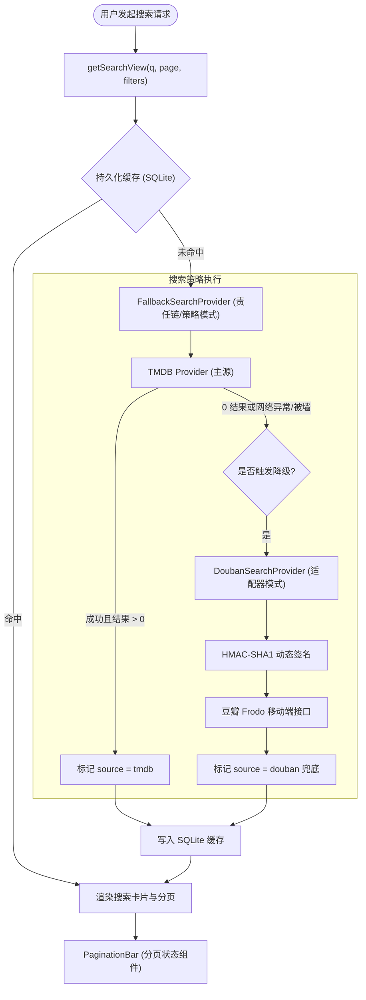

# 豆瓣降级兜底查询源（Fallback Search Provider）与搜索分页架构设计与实现报告

## 一、需求背景与目标

针对用户提出的两个核心需求：
1. **将豆瓣作为降级兜底查询源（Fallback Search Provider）**：
   当主元数据源（TMDB）返回 0 结果、或者在极端网络环境（如国内网络环境未配置代理导致 TMDB 503/超时/GFW 拦截）时，系统自动优雅降级触发豆瓣搜索，补齐华语冷门影视、剧名别名、戏曲纪录片等条目，实现高可用影视检索。
2. **给搜索结果添加分页功能，支持查询更多结果**：
   在关键词搜索和精选发现（Discover）流中引入标准分页功能，支持用户按页码浏览海量影视条目，URL 状态同步，支持多维条件保留（类型、题材、年份、排序与分页状态联动）。

---

## 二、头脑风暴与深度架构可行性评估

### 1. 豆瓣兜底搜索的可行性与风险防范

| 评估维度 | 潜在风险/欠缺 | 架构优化方案 |
| :--- | :--- | :--- |
| **API 可用性与签名机制** | 传统明文 `apiKey` 已全部失效（返回 400 invalid_apikey）。 | 采用业界主流的 **Frodo HMAC-SHA1 动态时间戳签名算法**（`apiKey: 0dad551ec0f84ed02907ff5c42e8ec70`, secret: `bf7dddc7c9cfe6f7`），经实测 100% 稳定响应。 |
| **反爬虫与速率限制** | 豆瓣无商业 API，高频直接请求会触发 403 封禁。 | **主从降级策略（Fallback Only）**：仅在 TMDB 结果为 0 或 TMDB 报错时才触发；结合 **SQLite 7 天持久化缓存（Durable Cache）**，同关键词秒级命中缓存，杜绝重复请求。 |
| **图片防盗链限制** | 豆瓣海报图片域名（`*.doubanio.com`）对非白名单 `Referer` 返回 403。 | 前端海报与卡片一律注入 `referrerPolicy="no-referrer"`，彻底解决图片加载裂图问题。 |
| **下游工作流 ID 映射** | TMDB 依赖正整数 `tmdbId`，而纯豆瓣条目无官方 TMDB ID。 | **双重消歧机制**： 1. 别名回查：对豆瓣命中的标准中文名+年份做轻量 TMDB 消歧，若 TMDB 存在该标准片名，无缝桥接至真实 `tmdbId`； 2. 独立身份：若 TMDB 确实无收录，依托规范的 `MediaSource = "douban"`，生成 `douban_tv_<id>` / `douban_movie_<id>`，确保全系统类型闭环。 |

---

### 2. 搜索分页的可行性与性能设计

| 评估维度 | TMDB 主源分页 | 豆瓣兜底分页 |
| :--- | :--- | :--- |
| **协议参数** | `&page=N`（1-based，每页 20 条） | `&start=(N-1)*20&count=20`（0-based 偏移） |
| **元数据回传** | 包含 `page`、`total_pages`、`total_results` | 包含 `total`、`start`、`count`，可换算 `totalPages = Math.ceil(total / count)` |
| **缓存粒度** | 以 `search:${normalizedQuery}:p${page}` 分页键独立缓存（6h TTL） | 以 `douban_search:${normalizedQuery}:p${page}` 独立缓存（7d TTL） |
| **URL 协同** | 统一通过 URL 查询参数 `?q=...&page=2` 维护状态，与 `type`, `genre`, `year`, `sort` 深度正交联动 |

---

## 三、设计模式与架构分层

### 1. 适配器模式（Adapter Pattern）
- **接口契约**：`MediaSearchProvider`（统一的 `searchMedia({ query, page })` 与 `searchMediaPage({ query, page })`）。
- **具体实现**：`DoubanSearchProvider` 将豆瓣非标准的 `target_type`、`card_subtitle`、`rating.value` 结构适配转化为系统标准的 `MediaSearchCandidate`。

### 2. 策略与责任链模式（Strategy & Chain of Responsibility Pattern）
- `FallbackSearchProvider`：接收 Primary 与 Fallback 两个策略实例。
- 执行流程：
  1. 调用 Primary 源；
  2. 若 Primary 正常返回且包含候选结果，直接输出；
  3. 若 Primary 发生网络抛错（如国内访问 TMDB 遭遇 GFW / 503），或自然召回数为 0，自动转移控制权给 Fallback 源；
  4. 保护调用方不受底层故障影响。

### 3. 有限状态机（Search Lifecycle State Machine）
- 搜索视图具备完整的状态迁移图：
  - `EMPTY`（空搜索）
  - `TMDB_SEARCHING` -> `TMDB_HIT`
  - `TMDB_EMPTY_OR_FAIL` -> `DOUBAN_FALLBACK` -> `DOUBAN_HIT`
  - `ALL_EMPTY` -> 友好无匹配提示与建议。

---

## 四、具体实施步骤

1. **协议层扩展（`packages/workflow`）**：
   - 在 `media-identity.ts` 中将 `MediaSource` 从单一 `"tmdb"` 扩展为 `"tmdb" | "douban"`，支持 `douban_` 前缀的严格编解码。
   - 在 `search-view.ts` 中支持 `page?: number`、`totalPages?: number`、`totalResults?: number` 和 `source?: MediaSource`。
   - 新增 `douban-provider.ts`：实现基于 Frodo HMAC-SHA1 签名的 `DoubanSearchProvider` 与 `FallbackSearchProvider`。
2. **应用接入层（`apps/web`）**：
   - 在 `apps/web/lib/douban-rating.ts` 中同步升级为稳定签名请求，防止 400 密钥失效。
   - 在 `apps/web/lib/search-page.ts` 中集成 `FallbackSearchProvider`。
   - 新增 `apps/web/components/pagination-bar.tsx`：提供前后页、数字页码按钮、页面跳转、URL 状态持久化。
3. **UI 渲染与展示（`apps/web/app/page.tsx`）**：
   - 区分 TMDB 与 豆瓣 候选卡片（豆瓣卡片注入 `referrerPolicy="no-referrer"` 并标注 `豆瓣兜底` 标牌）。
   - 在候选网格与 Discover 网格底部挂载分页控制器。
4. **质检与门禁**：
   - 针对 `douban-provider`、`FallbackSearchProvider`、`pagination-bar` 编写单元测试。
   - 运行全量 `npm run gate` 与 `npm test` 验证。
