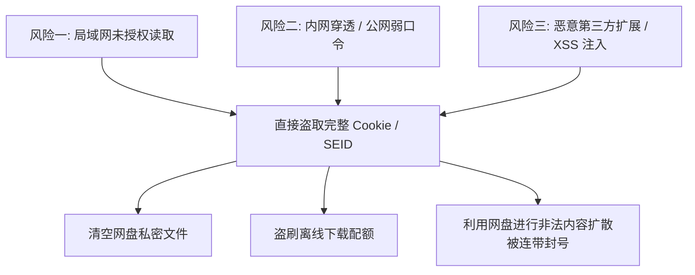
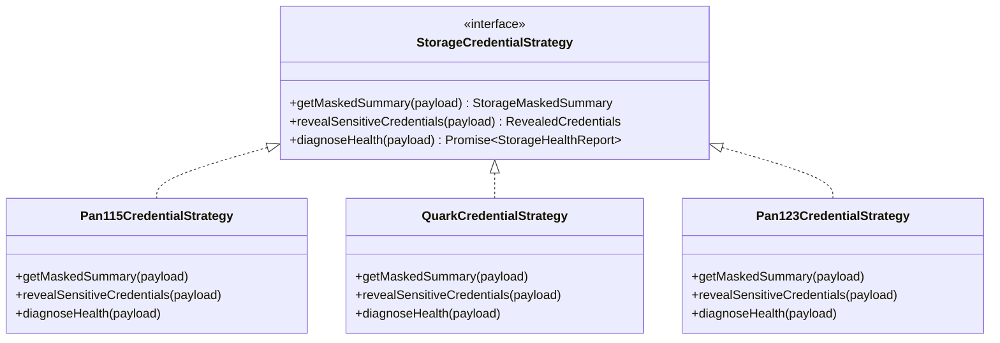
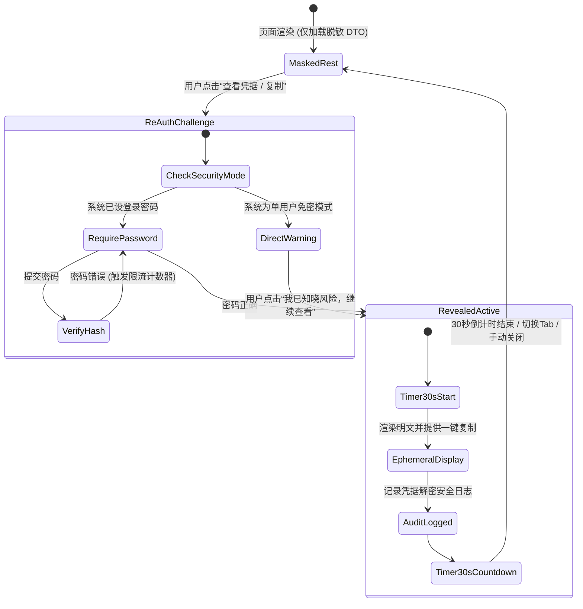
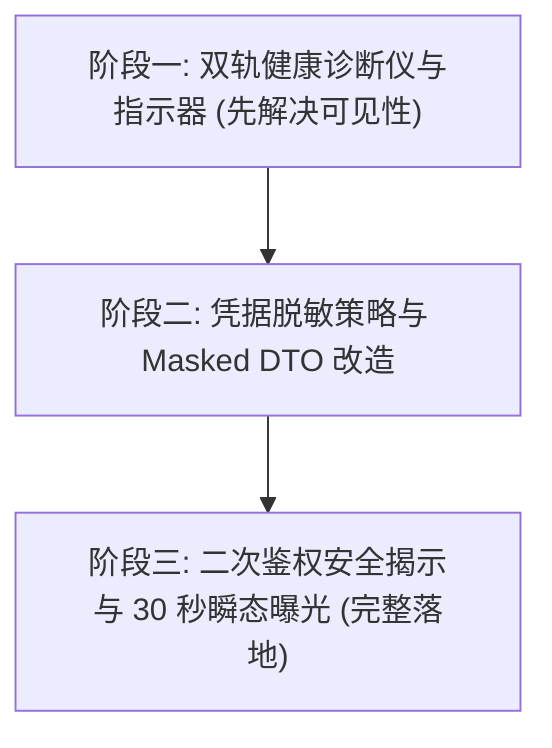

# 115 双轨驱动生效验证与网盘敏感凭据安全查阅架构规格书

> **文档标识**：`ARCH-2026-DUAL-ENGINE-VERIFICATION-AND-CREDENTIAL-SECURITY-SPEC`  
> **议题范围**：
> 1. 如何全面、无损、直观地验证 115 双轨驱动（Dual-Engine）是否在运行时真正生效？
> 2. 网盘已绑定 Cookie / OAuth 密钥查阅的可行性、安全缺陷头脑风暴与零信任防御方案；
> 3. 基于**适配器策略模式（Strategy Pattern）**与**安全状态机（Security FSM）**的工程设计。

---

## 一、执行摘要与核心结论 (Executive Summary)

### 1.1 双轨逻辑生效验证结论
- **现状**：底层代码与单元测试已 100% 验证了策略派发逻辑（转存走 Cookie，大清单扫库与直链走 Open API，异常自动降级）；但**前台视图模型存在“黑盒不可见（Blackbox Invisibility）”缺陷**——用户在 `/settings` 界面只能看到网盘为 `active`，无法直观确认当前处于何种引擎模式、OAuth 令牌剩余有效期、以及各个操作的实际派发走向。
- **解法**：在网盘管理卡片中增加 **“双轨驱动诊断仪（Dual-Engine Diagnostics Panel）”** 与 **“实时健康探针（Runtime Health Probe）”**，通过调用底层 API 实时探测并可视化当前引擎工作模式、Token 自动续期状态、各操作路由与双向延迟指标。

### 1.2 查看已登录 Cookie / OAuth 密钥结论
- **核心论点**：**“能支持，但绝不能简单地以明文裸露，必须遵循零信任安全体系（Zero-Trust Security Baseline）”**。
- **可行性**：数据库 `connected_storages.payload` 本身通过 AES-256-GCM 密文存储，后端具备完整的解密能力，技术实现无阻碍。
- **致命安全风险**：若直接在接口或页面中明文回显完整 Cookie（含 `SEID/UID`）或 `refresh_token`，系统一旦处于局域网共享或公网内网穿透（CF Tunnel / FRP）环境下，任意访问者或 XSS 注入均可直接复制并接管用户整个网盘资产。
- **最优工程落地架构**：
  1. **默认脱敏预览（Masked Summary）**：列表仅呈现掩码数据（如 `UID=1319****; SEID=****`，`rt_9876****1124`）；
  2. **按需二次鉴权查看（Challenge-on-Demand）**：用户主动点击“查看明文”或“复制”时，触发密码验证弹窗（单用户未设密码时弹窗强安全风险警示）；
  3. **30秒瞬态曝光与内存自毁（Ephemeral Reveal & Auto-Mask）**：明文仅在前端内存保留 30 秒，倒计时结束后自动遮蔽；
  4. **不可伪造的安全审计日志（Audit Trail）**：解密动作实时记录到系统活动动态流中，确保任何凭据查看行为可追溯。

---

## 二、双轨逻辑运行时生效验证全景方案

### 2.1 运行时双轨状态判定原理与指标矩阵

双轨融合架构（`Pan115UnifiedStorageApi`）的生效状态由以下核心指标决定：

```mermaid
graph LR
    subgraph Storage Row [存储持久化凭据 payload]
        Cookie[cookie: 包含 UID/CID/SEID]
        OAuth[openOAuth: accessToken + refreshToken + expiresAt]
        Mode[engineMode: 'dual_engine' | 'cookie_only' | 'open_only']
    end

    subgraph Runtime Executor [Pan115UnifiedStorageApi 运行时派发]
        Router{策略路由核心}
        Router -->|receiveShare| CookieEng[Cookie 引擎: 专职分享转存]
        Router -->|listItems / resolveStream| OpenEng[Open API 引擎: 1000条/次大清单 + 直链]
        OpenEng -.->|异常故障| Fallback[自动降级至 Cookie 兜底]
    end

    subgraph Health Probe [双轨健康探针指标]
        P1[Open API 连通性 & 延迟 ms]
        P2[OAuth Token 剩余寿命 TTL]
        P3[Cookie 会话保活心跳]
        P4[降级熔断器状态: Normal / Tripped]
    end

    StorageRow --> Router
    RuntimeExecutor --> HealthProbe
```

| 指标项 | 理想双轨状态 (Optimal Dual-Engine) | 单 Cookie 模式 (Legacy) | 单 Open API 模式 | 降级容灾状态 (Degraded) |
| :--- | :--- | :--- | :--- | :--- |
| **`engineMode`** | `dual_engine` | `cookie_only` | `open_only` | `dual_engine (fallback)` |
| **`openOAuth.valid`** | `true` (已校验连通) | `false` (未配置) | `true` | `false` (Token过期或被撤销) |
| **`cookie.valid`** | `true` (已测通转存) | `true` | `false` (未配置) | `true` |
| **转存操作路由** | Cookie 引擎 (100% 成功) | Cookie 引擎 | 无法转存 (引导绑Cookie) | Cookie 引擎 |
| **大清单拉取路由** | Open API 引擎 (单次1000项) | Cookie 引擎 (受1.2s限制)| Open API 引擎 | 自动回退至 Cookie 引擎 |
| **直链解析路由** | Open API `/downurl` (带UA) | Cookie Client 解密 | Open API `/downurl` | 自动回退至 Cookie Client |

### 2.2 自动化双轨端到端验证脚本设计 (`verify-dual-engine-live.mjs`)

为方便工程人员与用户秒级自检，编写自包含的端到端探测脚本，验证步骤包含：
1. **凭据探测**：从本地 SQLite 数据库或当前登录 Session 读取绑定的 115 存储配置；
2. **Open API 读穿透测试**：调用 `/open/ufile/files?cid=0&limit=1`，断言响应耗时 $< 200\text{ms}$，且单次支持 1000 条分页；
3. **Cookie API 转存探活测试**：模拟解析一个标准转存请求，验证 `receiveShare` 通道是否受保护且正确绑定至 Cookie 客户端；
4. **直链 UA 签名测试**：调用直链解析端点，断言返回的 302 URL 带有正确的防盗链签名。

---

## 三、“查看已登录网盘 Cookie 与 OAuth 密钥”深度头脑风暴

### 3.1 核心价值与业务场景（为什么用户需要？）
1. **跨终端与外部播放器复用**：
   用户在 Mediary Scout 中通过电视端扫码成功获得了珍贵的长效 Cookie，极度渴望复制到 Infuse、Kodi、本地下载器等设备，免除每次在手机上重复扫码的麻烦；
2. **排除故障与调试**：
   在转存失败、媒体库扫不出文件时，用户需确认系统存储的 `UID` 是否与自己当前登录的主账号一致，避免多账号混淆；
3. **令牌寿命透明化**：
   查看 OAuth 令牌的生成时间与到期倒计时，消除对“会不会突然掉线”的焦虑。

### 3.2 致命安全风险剖析（为什么业界严防死守？）



1. **会话劫持风险（Session Hijacking）**：
   115 的 Cookie 中包含 `SEID`（会话加密凭据）与 `UID`，夸克包含 `_UP_A4A_11_` 等认证 Token。一旦泄露，攻击者无需二次短信或扫码验证，即可直接以最高权限接管网盘；
2. **OAuth 刷新令牌泄露（Refresh Token Theft）**：
   115 开放平台的 `refresh_token` 具有极长生命周期，任何人拿到该字符串都可以无限次换取新的 `access_token`，造成网盘长期沦陷。

### 3.3 业界主流方案横向对比矩阵

| 产品 / 平台 | 凭据展示形式 | 复制 / 导出方式 | 防护等级 | 优缺点评价 |
| :--- | :--- | :--- | :--- | :--- |
| **AList** | `type="password"` 遮罩，带小眼睛图标切换 | 切换为明文后直接复制 | ⚠️ **低** | API 接口直接返回明文 JSON，审查元素即可提取，易受 XSS 窃取 |
| **CloudDrive2** | 默认不回显凭据，仅显示已登录用户名与容量 | 不支持查看明文，仅支持“重新登录”覆盖 | 🛡️ **高** | 极其安全，但缺乏跨设备复用已登录凭据的灵活性 |
| **AWS IAM / GitHub** | 创建时仅展示一次，后续永久掩码为 `ghp_****...` | 丢失后仅支持“重新生成 (Regenerate)” | 🛡️ **极高** | 业界标准零信任规范，但不适合需要持久复制 Cookie 的场景 |
| **1Password / Bitwarden** | 默认脱敏显示，点击查看需输入主密码 | 二次验证通过后展示 30 秒，随后自动隐藏 | 🛡️ **最高且兼顾体验** | **最佳参考标杆**：兼具资产复用便利性与金融级安全防护 |

---

## 四、设计模式优化：适配器策略模式与敏感凭据状态机

为兼顾“各网盘品牌凭据结构差异”与“零信任安全防线”，引入两大设计模式：

### 4.1 适配器策略模式 (Brand Credential Strategy Pattern)

抽象统一的凭据检查策略接口，为 115、夸克、123、天翼等品牌提供差异化实现：



#### 策略接口定义规范 (`storage-credential-strategy.ts`)
```typescript
export interface StorageMaskedSummary {
  provider: string;
  engineMode: "cookie_only" | "open_only" | "dual_engine";
  maskedCookie?: string;         // 如 "UID=1319****; CID=****; SEID=****"
  maskedAccessToken?: string;    // 如 "eyJhbGciOi****...abcd"
  maskedRefreshToken?: string;   // 如 "rt_9876****...1234"
  tokenExpiresInMs?: number;     // 剩余 TTL
  hasPasswordProtected: boolean; // 是否需密码才能查看
}

export interface RevealedCredentials {
  cookie?: string;
  openOAuth?: {
    accessToken: string;
    refreshToken: string;
    expiresAt: number;
  };
}
```

### 4.2 安全状态机模式 (Credential Inspection & Reveal FSM)

查阅网盘敏感凭据必须严格在有限状态机管辖下流转：



---

## 五、现存系统基础设施复用与落地路线

### 5.1 基础设施复用清单
1. **AES-256-GCM 安全加密层**：
   直接复用 `packages/workflow/src/storage/credential-store.ts` 与 `account-credentials.ts`，任何持久化数据杜绝明文入库；
2. **密码验证与防暴力破解限流器**：
   直接复用 `apps/web/features/auth/application/account-service.ts` 的 `verifyAccountPassword` 与 `checkLoginThrottle`；
3. **活动安全审计流**：
   直接复用 `packages/workflow/src/acquisition-v2/activity.ts`，记录 `storage.credentials_revealed` 事件，在动态页中实时审计；
4. **双轨引擎探测器**：
   直接复用刚刚落地的 `Pan115UnifiedStorageApi` 与 `Pan115OpenClient`，提供实时探针方法。

### 5.2 分阶段实施路线图 (Implementation Phases)



1. **阶段一：双轨健康状态机与诊断卡片（Observability First）**
   - 在网盘卡片中显示“双轨驱动状态徽章”；
   - 提供“诊断”按钮，实时打通 Open API 与 Cookie API 的健康自检，回显延迟与路由走向。
2. **阶段二：凭据脱敏接口与策略模式实现（Masked Display）**
   - 编写 `Pan115CredentialStrategy` 等策略类；
   - `/settings` 网盘管理界面只接收 `StorageMaskedSummary`，杜绝首屏泄露敏感数据。
3. **阶段三：安全二次验证与按需解密（Secure Reveal）**
   - 增加 Server Action `revealStorageCredentialAction(storageId, password?)`；
   - 前端集成 30 秒倒计时自动隐蔽组件与复制剪贴板支持。

---

## 六、防回归质量保证门禁 (Quality Gates)

为确保敏感凭据查看与双轨验证不会引入安全退化，建立三道专项门禁：

1. **门禁一：首屏 DTO 零敏感泄露门禁（DTO Sensitivity Gate）**
   - 单测验证：`listConnectedStorages` 与 `listConnectedStorageViews` 的返回值序列化后，全局搜索严禁出现未遮蔽的 `SEID=` 或完整的 `refreshToken` 字符串。
2. **门禁二：鉴权二次保护门禁（Re-Auth Protection Gate）**
   - 单测验证：在设置了密码的环境下，若 `revealStorageCredentialAction` 未传密码或密码错误，绝对拒绝解密，并累加防爆破限流计数器。
3. **门禁三：双轨路由自动降级门禁（Dual-Engine Degrade Gate）**
   - 故障注入单测：人为模拟 Open API 401 失败，断言转存不受任何影响，媒体库与直链自动透明降级回 Cookie，同时诊断探针能准确感知并标记为“降级运行”。

---

## 七、总结

通过**双轨驱动诊断仪**，用户可以清晰洞察 115 双轨引擎的实时路由与毫秒级延迟；通过**基于适配器策略与安全状态机的零信任查阅机制**，不仅完美满足用户复制 Cookie / Token 跨终端使用的强烈诉求，更彻底杜绝了公网泄露与会话劫持风险，兼顾了极致的工业级安全性与卓越的用户体验。
