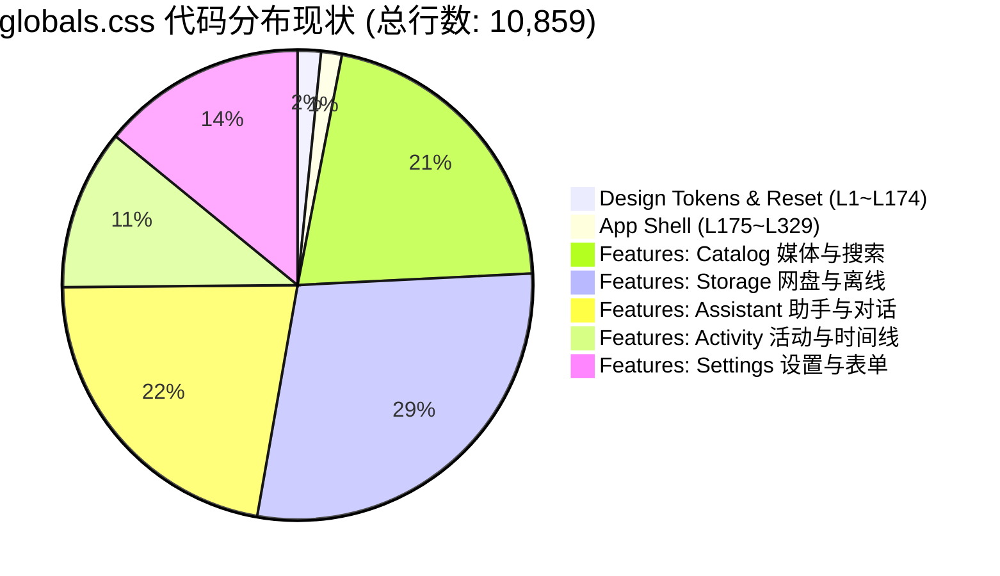
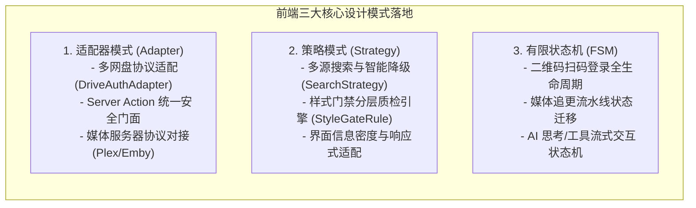
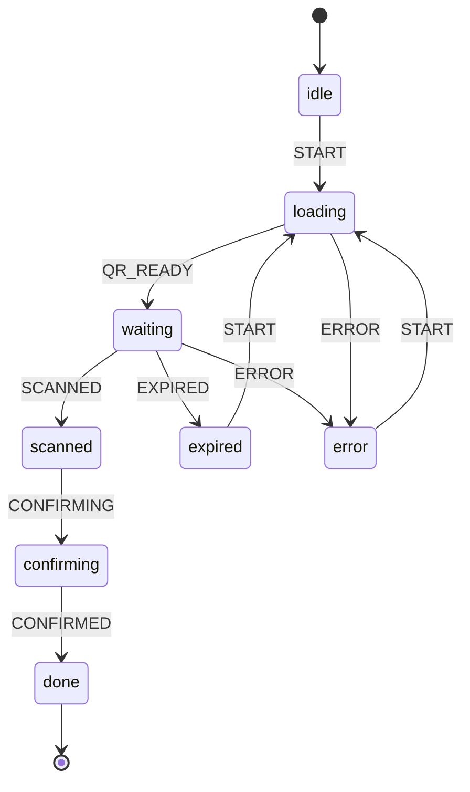
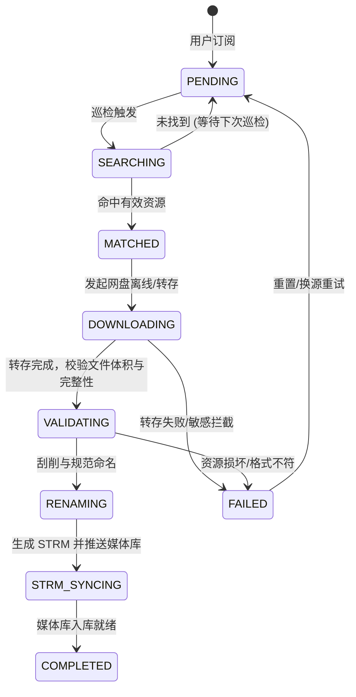
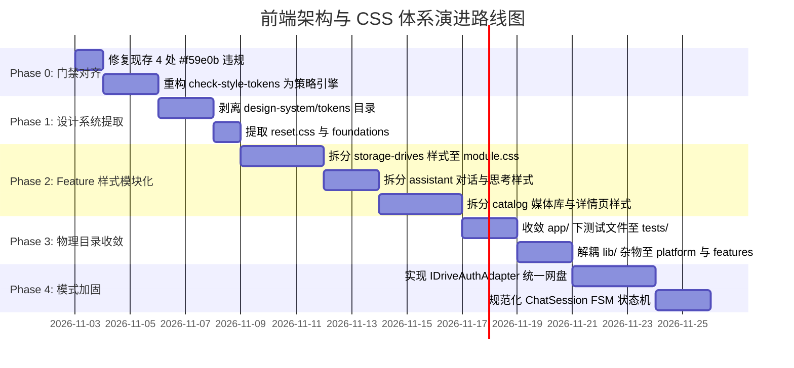
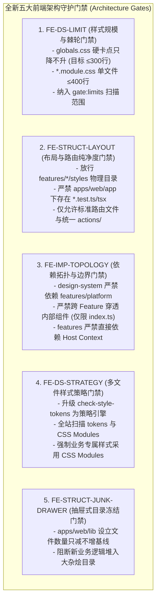

# 前端架构演进与 CSS 体系深度重构方案调研

> **文档位置**：`docs/architecture/frontend-architecture-and-css-optimization-spec.md`  
> **编写日期**：2026-11-02  
> **规范依据**：`Frontend Architecture Core 2.1`、`React Profile 1.0.0`、`Platform Contract` 及 `Design Tokens 体系规范`  
> **设计模式**：适配器模式（Adapter Pattern）、策略模式（Strategy Pattern）、有限状态机（Finite State Machine, FSM）  
> **治理目标**：解决 10,859 行单体 `globals.css` 性能瓶颈、收敛物理目录混乱、消除抽屉式目录（Junk Drawer）、统一多网盘与流式 AI 状态流转、加固门禁自动化守护

---

## 目录

1. [执行摘要与核心结论](#1-执行摘要与核心结论)
   - 1.1 问题一：`globals.css` 文件是否需要优化？
   - 1.2 问题二：前端架构和物理文件夹结构是否需要优化？
2. [深度诊断一：`globals.css` 单体爆炸与性能缺陷](#2-深度诊断一globalscss-单体爆炸与性能缺陷)
   - 2.1 现状量化与严重程度评估
   - 2.2 关键渲染路径与运行时性能欠缺（CRP / Layout Thrashing）
   - 2.3 架构与逻辑缺陷：对 Core 2.1 规范的严重偏离
   - 2.4 样式门禁工具的脆弱性实证（现存 4 处未拦截违规）
3. [深度诊断二：前端架构与物理目录拓扑缺陷](#3-深度诊断二前端架构与物理目录拓扑缺陷)
   - 3.1 参照 Core 2.1 目标拓扑比对
   - 3.2 `app/` 路由目录的职责越界（测试与冗余门面污染）
   - 3.3 `design-system/` 缺失与基础 UI 原语流离失所
   - 3.4 `lib/` 抽屉式目录反模式（Junk Drawer Anti-Pattern）
   - 3.5 `components/` 与 `features/` 的概念混淆与倒置
4. [头脑风暴：设计模式在前端架构中的落地演进](#4-头脑风暴设计模式在前端架构中的落地演进)
   - 4.1 适配器模式（Adapter Pattern）：统一多网盘认证与 Server Actions 边界
   - 4.2 策略模式（Strategy Pattern）：检索降级、信息密度与门禁规则引擎
   - 4.3 有限状态机（FSM）：二维码登录、追更流水线与 AI 流式交互
5. [业界主流方案横向对比与现有生态借鉴](#5-业界主流方案横向对比与现有生态借鉴)
   - 5.1 CSS 架构选型对比：CSS Modules vs Tailwind v4 vs StyleX / Vanilla Extract
   - 5.2 无障碍组件原语库选型：Radix UI vs Ark UI vs 原生手写
   - 5.3 状态机引擎选型：原生 Reducer 纯函数 vs XState v5
   - 5.4 当前仓库已具备的基础设施与资产复用盘点
6. [目标架构设计蓝图（Target Architecture）](#6-目标架构设计蓝图target-architecture)
   - 6.1 前端四层物理结构设计（Core 2.1 适配）
   - 6.2 CSS 四级递进式作用域解耦体系
   - 6.3 现存文件迁移映射矩阵（Current → Target）
7. [分阶段渐进式重构路线图（绞杀者模式）](#7-分阶段渐进式重构路线图绞杀者模式)
   - 7.1 Phase 0：门禁修复与多文件质检能力对齐
   - 7.2 Phase 1：设计令牌与全局 Reset 剥离
   - 7.3 Phase 2：垂直功能切片 CSS Modules 化（高危模块先行）
   - 7.4 Phase 3：物理目录收敛与测试归位
   - 7.5 Phase 4：适配器与状态机全面规范化
8. [架构门禁守护体系与防回归治理规范](#8-架构门禁守护体系与防回归治理规范)
   - 8.1 现有门禁体系盲区审查与根因复盘
   - 8.2 新增与增强的五大架构门禁（Rule ID 与执行契约）
   - 8.3 门禁分级执行机制（L0/L1/L2/L3）与 CI 硬阻断
9. [总结与实施建议](#9-总结与实施建议)

---

## 1. 执行摘要与核心结论

### 1.1 问题一：`globals.css` 文件是否需要优化？

**结论：极其需要优化，现状已达严重技术债务临界点。**

- **现状体量**：`apps/web/app/globals.css` 单文件已膨胀至 **10,859 行、227,057 字节（~227 KB）**，涵盖了全局 Token、Reset、App Shell、以及 10 多个完全独立业务领域（网盘文件树、离线下载模态框、AI 对话思考卡片、给 Agent 留言面板、待办折叠甲板、设置页各 Tab、活动时间线等）的所有私有样式。
- **严重违规**：直接违背了《Frontend Architecture Core 2.1》规范第 1 节关于样式归属的基准法则：
  > *“一个页面的 CSS 归该页面或 Feature；全局语义 Token、主题映射和无业务组件归 Design System。”*
- **三大不可容忍代价**：
  1. **首屏渲染阻塞（CRP Blocking）**：用户访问哪怕是最简单的 `/login` 登录页，浏览器都必须全量下载并解析这 227KB 的庞然大物，极大拖慢 FCP 与 LCP 指标；
  2. **缓存放大效应**：任何业务页面修改 1px，全站用户的 227KB 静态样式缓存全部失效；
  3. **单文件盲目追加反模式**：开发人员默认向文件尾部无序粘贴 CSS，引发选择器特异度竞争（Specificity War）与门禁规则失效。

---

### 1.2 问题二：前端架构和物理文件夹结构是否需要优化？

**结论：非常需要优化，应以 Core 2.1 为蓝本进行渐进式规范收敛。**

- **物理拓扑混乱**：
  - `apps/web/app/` 既是 Next.js App Router 路由目录，却直接堆放了 10 余个 `*.test.ts` 单元测试文件，以及 `actions.ts`、`connect-actions.ts`、`update-actions.ts` 等历史遗留门面，信噪比严重恶化；
  - 缺少一等公民的 `design-system/` 物理目录，导致通用 UI 原语（Button, Input, Modal, Tabs, Badge）散落在 `components/layout/`、`components/ui/` 和 `features/` 中；
  - `lib/` 沦为典型的“抽屉式大杂烩（Junk Drawer）”，把安全守卫、运行时适配、后台轮询、业务视图模型杂糅在一起；
  - `components/` 混入了业务专属的演示会话（`demo-session-*.tsx`），破坏了“无业务语义 UI”与“功能业务组件”的清晰分界。
- **架构演进路线**：坚持 **绞杀者模式（Strangler Fig Pattern）**，在维持既有 14 项门禁绿灯与功能稳定的前提下，按模块逐级迁入 Core 2.1 的标准物理分区：`app/`、`features/`、`shared/`、`design-system/`、`platform/`。

---

## 2. 深度诊断一：`globals.css` 单体爆炸与性能缺陷

### 2.1 现状量化与严重程度评估

通过对 `apps/web/app/globals.css` 进行逐层结构扫描，其内容构成如下表所示：

| 行号区间 | 模块类型 | 所属领域 | 职责说明 | 建议归属 |
| :--- | :--- | :--- | :--- | :--- |
| **L1 ~ L140** | Design Tokens | 核心设计系统 | `:root` 自定义属性、主题色阶、圆角、阴影 | `design-system/tokens/` |
| **L141 ~ L174** | Global Reset | 全局基础 | `*`, `html`, `body` 基础排版与重置 | `design-system/foundations/reset.css` |
| **L175 ~ L329** | App Shell | 布局外壳 | 侧边栏、顶部导航、移动端底部 Tab 栏 | `app/globals.css`（保留） |
| **L330 ~ L427** | Tabs | 通用 UI 控件 | 药丸切换与标签栏样式 | `design-system/components/tabs.module.css` |
| **L428 ~ L751** | Subscription Deck | 业务：catalog | 缺失待办区、甲板卡片、进度条 | `features/catalog/styles/subscription-deck.module.css` |
| **L752 ~ L984** | Search & Filter | 业务：catalog | 搜索框、清除按钮、快捷过滤条 | `features/catalog/styles/search-bar.module.css` |
| **L985 ~ L1319** | Candidate & Library | 业务：catalog | 候选条目卡片、媒体库海报墙、网格 | `features/catalog/styles/library.module.css` |
| **L1320 ~ L1919** | Panels & Skeletons | 混合 UI/业务 | 剧集状态网格、骨架屏、响应式覆盖 | 分离至对应组件 module.css |
| **L1920 ~ L2563** | Notifications Feed | 业务：activity | Linear 风格变更日志卡片、状态徽标 | `features/activity/styles/notifications.module.css` |
| **L2564 ~ L3184** | Acquiring & Title Hub | 业务：acquisition | 获取中详情弹窗、详情页 Hero 横幅 | `features/acquisition/styles/hub.module.css` |
| **L3185 ~ L3869** | QR & Settings Forms | 业务：storage / settings | 115 二维码、表单行、LLM 三件套 | `features/storage-drives/` & `settings-system/` |
| **L3870 ~ L4675** | Activity Page | 业务：activity | Steam 风格执行队列、实时 Agent 滚轴 | `features/activity/styles/queue.module.css` |
| **L4676 ~ L5433** | Filter Bar & Drive Grid| 业务：catalog / storage | 复合筛选、网盘品牌瓦片网格 | 各自 Feature CSS Module |
| **L5434 ~ L6576** | Agent Memory & Message | 业务：assistant | 记忆面板、用户给 Agent 留言面板、撤回吐司 | `features/assistant/styles/memory.module.css` |
| **L6577 ~ L7195** | Tool Call Timeline | 业务：assistant / activity| Agent 工具调用步骤折叠时间线 | `features/assistant/styles/timeline.module.css` |
| **L7196 ~ L8452** | Storage File Explorer | 业务：storage-drives | 网盘树形目录、文件表格、批量操作悬浮条 | `features/storage-drives/styles/file-table.module.css`|
| **L8453 ~ L9595** | Modals & Offline DL | 业务：storage-drives | 毛玻璃蒙层、离线下载解析弹窗 | `design-system/components/` & Feature 弹窗 |
| **L9596 ~ L10417** | Chat & Thinking Cards | 业务：assistant | 对话卡片、思考流卡片、Markdown 渲染 | `features/assistant/styles/chat.module.css` |
| **L10418 ~ L10859**| Focus View & Deck | 业务：catalog / storage | 资源专注视图、待办甲板追加样式（引发门禁报错）| 归入对应 Feature 模块 |



---

### 2.2 关键渲染路径与运行时性能欠缺（CRP / Layout Thrashing）


1. **关键渲染路径（CRP）严重受阻**：
   - Next.js 16 App Router 在根 `layout.tsx` 中执行 `import "./globals.css"`。按照 HTML 规范，`<link rel="stylesheet">` 会阻止渲染树的构建。
   - 用户哪怕是在弱网环境下打开 `/login` 或 `/settings`，浏览器也必须先下载包含全部网盘树、Markdown 渲染器、对话卡片的 227KB 样式表，造成明显的首屏白屏。
2. **样式计算（Style Recalculation）与内存开销**：
   - 10,859 行 CSS 在 DOM 树中建立了成千上万个全局类匹配节点。每当界面中某个动态状态（如轮询到新事件、展开目录树、流式追加文本）触发变更时，浏览器的 CSS 引擎必须在巨大的全局规则树中重新做选择器匹配，增加了长任务（Long Tasks）和卡顿的概率。
3. **缓存失效放大效应（Cache Invalidation Amplification）**：
   - 现代前端依赖内容哈希（Content Hash）实现长效静态资源缓存（`globals.[hash].css`）。
   - 当前结构下，某位开发者仅仅微调了“离线下载弹窗里的一个 padding”，整个 227KB 的 `globals.css` 文件哈希立即改变，导致全球所有活跃用户的所有页面缓存全部报废，严重浪费带宽并劣化二次访问体验。
4. **无死代码消除（Zero Tree-Shaking）**：
   - 任何实验性功能或已废弃的类名（例如历史上的某些旧版弹窗），只要留在 `globals.css` 中，构建工具就绝对无法安全删除它们，因为构建工具无法确定全局 HTML 字符串是否会在某个角落被动态使用。

---

### 2.3 架构与逻辑缺陷：对 Core 2.1 规范的严重偏离

参考规范《Frontend Architecture Core 2.1》中的核心定义：
- **Design System**：拥有无业务语义的 UI Primitive、Design Token、Theme Mapping。它**绝不能依赖 Feature 业务模型**；
- **Features**：拥有该产品能力的页面、用例、状态、以及**Feature 内的组件与私有样式**；
- **App**：拥有启动、Shell、路由装配。

当前现状将所有业务 Feature 的私有逻辑样式直接暴露在最高层级的全局命名空间中，带来了不可避免的**特异度战争（Specificity Wars）**：
- 随着样式增长，为了防止污染其他模块，开发者被迫写出类似 `.hub-hero .season-row .episode-btn.is-active` 这种 4~5 层深度的超长选择器；
- 在网盘文件管理页面，甚至为了覆盖通用按钮样式写下了带有 `!important` 倾向的高特异度重载规则。

---

### 2.4 样式门禁工具的脆弱性实证（现存 4 处未拦截违规）

执行自动化门禁脚本 `node tools/gates/check-style-tokens.mjs`，暴露了单体大文件下的工具缺陷：

```text
❌ [Style Gate] 样式门禁质检未通过，发现以下违规项：
  - globals.css:10599: 网盘管理样式中存在硬编码 Hex 色值 "#f59e0b"，应使用设计令牌 (var(--...))
  - globals.css:10615: 网盘管理样式中存在硬编码 Hex 色值 "#f59e0b"，应使用设计令牌 (var(--...))
  - globals.css:10646: 网盘管理样式中存在硬编码 Hex 色值 "#f59e0b"，应使用设计令牌 (var(--...))
  - globals.css:10730: 网盘管理样式中存在硬编码 Hex 色值 "#f59e0b"，应使用设计令牌 (var(--...))
```

**深入排查原因发现：**
1. 开发者在 `globals.css` 的末尾追加了属于**订阅缺失待办（Subscription Missing Todo Deck）**的样式（`.missing-deck-alert-icon` 等），其中偷懒使用了裸 Hex 色值 `#f59e0b`，未按规矩使用 `var(--file-folder)` 或 `var(--warning)`；
2. 门禁脚本 `check-style-tokens.mjs` 第 169 行采用单文件状态判定：
   ```javascript
   if (line.includes("网盘文件管理页面")) {
     inStorageSection = true;
   }
   ```
   由于该标志位在整个脚本执行过程中**从未被复位（Never Reset）**，导致从第 7,196 行之后的所有样式（包括 AI 助手、资源详情、待办甲板）被一律判定为“网盘管理样式”！
3. **架构反思**：单体大文件不仅祸害运行时，更严重误导了静态门禁检查器，产生了“在错误的位置检测出错误的分类”这种工程讽刺。

---

## 3. 深度诊断二：前端架构与物理目录拓扑缺陷

### 3.1 参照 Core 2.1 目标拓扑比对

《Frontend Architecture Core 2.1》制定的标准现代化前端物理架构如下：

```text
apps/web/
├─ app/                 # 核心启动壳、路由定义、顶层 Layout、Composition 编排
├─ features/            # 领域垂直功能切片 (业务自治、public index.ts 导出)
│  ├─ <feature-name>/
│  │  ├─ index.ts       # 唯一公共 API 出口
│  │  ├─ application/   # 用例编排与领域服务
│  │  ├─ core/          # 纯业务逻辑/状态机/计算 (Framework-Free)
│  │  ├─ components/    # 业务私有组件
│  │  ├─ contracts/     # 契约与接口
│  │  └─ styles/        # 业务专属 CSS Modules
├─ shared/              # 跨 Feature 稳定复用的中立业务能力 (多消费者)
├─ design-system/       # 纯粹无业务语义的 UI 系统
│  ├─ tokens/           # primitive.css, semantic.css
│  ├─ foundations/      # reset.css, typography.css
│  ├─ components/       # Button, Input, Modal, Tabs (含私有 styles)
│  └─ icons/            # SVG 图标资产
├─ platform/            # 宿主与技术适配层 (HTTP, Context, Guards, Storage)
└─ tests/               # 架构门禁测试、跨模块集成测试、E2E
```

对比当前代码库真实目录，存在以下四大结构性缺陷：

---

### 3.2 `app/` 路由目录的职责越界（测试与冗余门面污染）

在 `apps/web/app/` 目录下，目前充斥着以下与“路由页面渲染”毫无关系的杂质：
1. **测试文件散落（10+ 个）**：
   - `actions.demo.test.ts`
   - `agent-memory-actions.test.ts`
   - `connect-actions.test.ts`
   - `error.test.ts`
   - `foreign-work-import-action.test.ts`
   - `jev-actions.test.ts`
   - `patrol-now-action.test.ts`
   - `restore-free-llm-action.test.ts`
   - `unbind-storage-action.test.ts`
   - `update-actions.test.ts`
   - `user-message-actions.test.ts`
   - **问题**：App Router 路由目录应尽可能保持纯净。大量测试文件混杂在页面目录中，不仅干扰路由视线，还会对某些静态文件扫描器和构建工具造成额外负担。测试应归置于 `tests/unit/actions/` 或各 Feature 的 `application/*.test.ts` 中。
2. **Server Actions 门面重复与残余**：
   - 存在 `apps/web/app/actions/` 子目录（包含各模块 actions）；
   - 同时在 `apps/web/app/` 根层依然保留了 `actions.ts`、`connect-actions.ts`、`update-actions.ts`；
   - 这种历史遗留的过渡性门面造成调用方路径不一（有的引用 `@/app/actions`，有的引用 `@/app/actions/storage-drives-actions`），缺乏统一的接入守卫。

---

### 3.3 `design-system/` 缺失与基础 UI 原语流离失所

当前项目中，`design-system` 并没有作为一级物理模块存在：
- `apps/web/components/ui/` 仅有可怜的 3 个组件：`app-confirm-dialog.tsx`、`markdown-content.tsx`、`pagination-bar.tsx`；
- 最核心的按钮（Button）、输入框（Input）、标签页（Tabs）、开关（Toggle）、徽章（Badge）、模态框（Modal）等基础控件，居然没有封装成组件，而是**靠几千行全局 CSS 类名让业务组件手工拼装 DOM**！
- **后果**：
  - 业务组件每次写弹窗，都必须手写一套 `.storage-offline-modal-overlay`、`.storage-offline-modal-content`，稍有不慎就缺少了 `position: fixed` 或 `inset: 0`；
  - 这正是为什么 `tools/gates/check-style-tokens.mjs` 不得不写一大堆字符串匹配去防御弹窗是否漏写属性的原因——**没有组件封装，只能在 CSS 层靠门禁盲目补漏**！

---

### 3.4 `lib/` 抽屉式目录反模式（Junk Drawer Anti-Pattern）

当前 `apps/web/lib/` 堆积了 30 多个文件，是一个典型的“抽屉式大杂烩”：
- 属于 **Platform 适配** 的文件：`auth-chain.ts`、`api-key-guard.ts`、`request-account.ts`；
- 属于 **Workflow 领域运行时门面** 的文件：`workflow-runtime.ts`（超过 600 行）；
- 属于 **后台调度与系统生命周期** 的文件：`auto-update-schedule.ts`、`background-worker.ts`、`account-bootstrap.ts`；
- 属于 **特定 Feature 视图计算** 的文件：`activity-view.ts`、`activity-season-label.ts`；
- 属于 **测试文件**：`auth-chain.test.ts`、`activity-view.test.ts` 等十余个测试直接混在里面。

按照 Core 2.1 规则：
- 纯业务视图计算必须下沉到对应的 `features/<feature>/core/` 或 `application/`；
- 宿主安全检查与 HTTP 上下文适配必须进入 `platform/`；
- 基础通用工具必须进入 `packages/shared/`。

---

### 3.5 `components/` 与 `features/` 的概念混淆与倒置

- `apps/web/components/` 下建立了 `demo/` 目录，里面存放了 `demo-session-library.tsx` 和 `demo-session-notifications.tsx`；
- 这些组件包含极其强烈的**媒体库与通知业务语义**，却脱离了 `features/catalog` 与 `features/activity` 的边界，违反了“组件无业务语义”的定义；
- `components/layout/` 中的 `notifications-nav-badge.tsx` 依赖了通知业务状态，却放在通用布局目录下，造成了上下层依赖的倒置与模糊。

---

## 4. 头脑风暴：设计模式在前端架构中的落地演进

针对上述逻辑脆弱性、多源适配困难、异步流程黑盒化等痛点，充分运用**经典设计模式**构建健壮、解耦的前端体系：



---

### 4.1 适配器模式（Adapter Pattern）：统一多网盘认证与 Server Actions 边界

#### 场景 A：多网盘认证与操作适配器（Drive Auth & Storage Adapter）

**业务现状**：系统支持 115、夸克、天翼、光雅、123 云盘等。当前每个网盘的连接校验逻辑、凭证解析（Cookie / Token / SSON / QR）散落在不同的组件和 Server Actions 中，错误处理与重试策略参差不齐。

**设计方案**：定义标准驱动适配器契约 `IDriveAuthAdapter`：

```typescript
// packages/contracts/src/drive-adapter.ts
export interface IDriveAuthAdapter<TCredentials, TSession> {
  readonly brand: DriveBrand;
  parseCredentials(input: unknown): Result<TCredentials, ValidationError>;
  testConnection(credentials: TCredentials): Promise<Result<ConnectionSuccess, NetworkError>>;
  initiateQrSession?(): Promise<Result<TSession, NetworkError>>;
  pollQrStatus?(sessionId: string): Promise<Result<QrPollResult, NetworkError>>;
}
```

- 各网盘分别实现 `Pan115AuthAdapter`、`QuarkAuthAdapter`、`TianyiAuthAdapter`；
- UI 交互层只需要获取对应品牌的适配器实例即可完成连接测试，新增一种网盘（如阿里云盘、百度网盘）无需改动核心交互逻辑，符合**开闭原则（Open/Closed Principle）**。

#### 场景 B：Next.js Server Actions 安全包装适配器（Safe Action Transport Adapter）

**技术背景**：Next.js 16 `"use server"` 限制极严：
- 严禁 `export { ... } from "..."` 语法；
- 严禁导出 TypeScript 类型；
- 必须是纯异步函数。

**痛点**：目前每个 Server Action 文件里都充斥着重复的参数解包、`try...catch`、错误转义代码。

**设计方案**：引入轻量级 Action 适配器生成器：

```typescript
// apps/web/platform/action-adapter.ts
export function createSafeAction<TInput, TOutput>(
  schema: z.ZodSchema<TInput>,
  handler: (data: TInput, ctx: ActionContext) => Promise<TOutput>
) {
  return async (rawInput: unknown): Promise<ActionResult<TOutput>> => {
    try {
      const parsed = schema.safeParse(rawInput);
      if (!parsed.success) {
        return { success: false, error: parsed.error.issues[0].message };
      }
      const ctx = await resolveActionContext(); // 鉴权与当前账户注入
      const data = await handler(parsed.data, ctx);
      return { success: true, data };
    } catch (err) {
      return { success: false, error: formatActionError(err) };
    }
  };
}
```

---

### 4.2 策略模式（Strategy Pattern）：检索降级、信息密度与门禁规则引擎

#### 场景 A：多源资源检索与后备降级策略（Resource Search & Scraping Strategy）

**业务现状**：当前媒体资源搜索涵盖盘搜（PanSou）、Prowlarr、JEV、TMDB、豆瓣。当某些源网络不可达或触发风控时，系统需要无缝回退。

**设计方案**：抽象 `ISearchScraperStrategy` 接口与策略执行链（Chain of Responsibility + Strategy）：

```typescript
export interface ISearchStrategy {
  readonly id: string;
  readonly priority: number;
  isAvailable(): Promise<boolean>;
  search(query: SearchQuery): Promise<SearchResult[]>;
}

export class SearchOrchestrator {
  constructor(private strategies: ISearchStrategy[]) {}

  async executeWithFallback(query: SearchQuery): Promise<SearchResult[]> {
    for (const strategy of this.strategies.sort((a, b) => a.priority - b.priority)) {
      if (await strategy.isAvailable()) {
        try {
          return await strategy.search(query);
        } catch (e) {
          console.warn(`Strategy ${strategy.id} failed, trying next...`);
        }
      }
    }
    return [];
  }
}
```

#### 场景 B：样式门禁质检规则策略引擎（Style Gate Linting Strategy）

**现状痛点**：`tools/gates/check-style-tokens.mjs` 采用单体大函数，通过 `if (line.includes(...))` 线性判定，不仅脆弱易误报，且每新增一条规则都会使文件更难以维护。

**设计方案**：将门禁规则抽象为策略对象集合：

```typescript
export interface IStyleRuleStrategy {
  readonly name: string;
  check(context: FileContext): RuleViolation[];
}

export const STYLE_GATE_RULES: IStyleRuleStrategy[] = [
  new TokenExistenceRule(),        // 检查未声明的 var(--xxx)
  new NoRawColorInFeatureRule(),   // 检查 Feature 内部的硬编码 Hex/Tailwind 色值
  new ModalLayoutConstraintRule(), // 检查弹窗固定定位与全宽约束
  new TokenTierDependencyRule(),   // 检查组件是否违规直接引用原子色
];
```

各个规则之间完全解耦，支持针对单个文件（如特定的 `*.module.css`）独立配置开启哪些策略，彻底终结 `inStorageSection` 误判悲剧。

---

### 4.3 有限状态机（FSM）：二维码登录、追更流水线与 AI 流式交互

#### 场景 A：二维码登录状态机（QR Connect Machine）

**成功先例**：项目中已在 `apps/web/features/storage-drives/core/qr-connect-machine.ts` 中成功实现了基于纯 TypeScript Reducer 的有限状态机：



- **验证收益**：完全消除了“二维码已过期但界面仍显示扫描中”、“用户已确认但误发重复轮询”等非法状态跃迁；
- **行动项**：提炼该模式为通用轻量状态机范式 `Machine<State, Event>`，并在全站推开。

#### 场景 B：媒体追更流水线状态机（Acquisition Pipeline FSM）

媒体从发现到最终入库是一个长周期、多阶段的异步过程：



前端统一基于该明确状态机驱动 UI 卡片（进度条、动作按钮高亮、错误提示），告别在前端模板中依靠各种 `status === 'x' && !isDownloading && hasFiles` 等散乱的布尔逻辑判定。

#### 场景 C：AI Assistant 流式对话与思考状态机（Chat Streaming FSM）

**现状痛点**：当前 AI 聊天交互包含“提交”、“深度思考（Thinking）”、“工具调用（Tool Calling）”、“工具执行结果回填”、“正文流式输出”。若前端用多个 `useState`（如 `isThinking`, `isStreaming`, `isExecutingTool`）管理，极易出现**布尔值状态爆炸（Boolean State Explosion）**和非法并发状态。

**状态机定义**：
```typescript
export type ChatSessionPhase =
  | "idle"              // 空闲，等待用户输入
  | "submitting"        // 请求发出，等待首包
  | "thinking"          // 模型输出 <think> 标签，渲染思考卡片
  | "tool_invoking"     // 触发工具调用，渲染工具胶囊
  | "tool_executing"    // 工具执行中（如查询网盘）
  | "answering_stream"  // 最终文本回复流式打字中
  | "completed"         // 本轮完成
  | "error";            // 异常中断
```

状态转移矩阵保证同一时刻只能处于一个排他阶段，UI 彻底告别竞态渲染。

---

## 5. 业界主流方案横向对比与现有生态借鉴

### 5.1 CSS 架构选型对比：CSS Modules vs Tailwind v4 vs StyleX / Vanilla Extract

针对本项目 **Next.js 16 + React 19 + Spotify 深度定制暗色风格** 的特点，对业界四大主流 CSS 方案进行严格选型评估：

| 方案 | 原理与运行时 | 优势 | 劣势 | 在本项目的结论与评级 |
| :--- | :--- | :--- | :--- | :--- |
| **CSS Modules (Next.js 内置)** | **零运行时**，构建期将 class 转为局部哈希名 | - **Next.js 原生开箱即用，零额外依赖**；<br>- 按路由与按组件自动代码分割（Code Splitting）；<br>- 100% 兼容现有手写 Spotify CSS 语法与选择器，**迁移成本极低**；<br>- 天然支持与全局 Design Tokens（CSS 变量）无缝结合。 | 无法提供 Tailwind 那样的内联极速开发体验。 | **⭐⭐⭐⭐⭐ 首选实施方案**<br>核心业务样式与 Feature 样式的唯一最佳承载手段。 |
| **Tailwind CSS v4** | 编译器静态生成实用类（基于 `@theme`） | 开发速度快，社区庞大。 | - 与当前现存的上万行 Spotify 精密组件样式语法冲突；<br>- 引入将产生双重样式体系（手写 CSS vs Tailwind 原子类），增加团队心智负担；<br>- 重写现有复杂微交互成本巨大。 | **⭐⭐ 暂不作为主构架**<br>仅在必要时作为原子辅助。 |
| **StyleX (Meta)** | 编译期将 JS 样式对象转为原子 CSS，**零运行时** | 类型安全极佳，CSS-in-JS 现代化巅峰。 | - 需配置额外的 Babel/SWC 编译插件；<br>- 语法为纯 JS 对象，对现有 10,000 行纯 CSS 样式的迁移工作量巨大。 | **⭐ 暂不推荐**<br>改造代价过高。 |
| **Vanilla Extract** | TypeScript 驱动的零运行时样式方案 | 强类型，支持主题变体。 | 需要额外构建层支持，学习曲线陡峭。 | **⭐⭐ 备选关注** |

---

### 5.2 无障碍组件原语库选型：Radix UI vs Ark UI vs 原生手写

针对当前项目缺乏通用控件（弹窗、下拉、Tab、抽屉）封装，导致大量手写 DOM 与门禁脆弱的问题：

| 库 | 特性与架构 | 无障碍（A11Y） | 与项目 Spotify 视觉的契合度 | 推荐建议 |
| :--- | :--- | :--- | :--- | :--- |
| **Radix UI Primitives** | **完全无样式（Headless）**，纯粹行为与可访问性驱动（键盘、Focus Trap、ARIA） | 业界黄金标准（WAI-ARIA 完整支持） | **100% 契合**。由于它没有任何默认样式，可以 100% 套用本项目的 Spotify 设计令牌与 CSS Modules。 | **⭐⭐⭐⭐⭐ 强力推荐引入**<br>优先用于 Dialog, DropdownMenu, Tabs, Tooltip。 |
| **Ark UI (Chakra Team)** | 基于状态机（Zag.js）的跨框架 Headless 原语库 | 极好 | 契合，但生态相对 Radix 稍显小众。 | **⭐⭐⭐ 备选** |
| **原生手工编写** | 当前方案：完全手写 HTML 结构与 CSS | 脆弱，极易遗漏 Focus 陷阱与键盘 Esc 关闭 | 耗费大量精力在重复编写弹窗层级与定位约束上。 | **❌ 必须淘汰** |

---

### 5.3 状态机引擎选型：原生 Reducer 纯函数 vs XState v5

| 维度 | 原生 TypeScript Reducer（现有方案） | XState v5 |
| :--- | :--- | :--- |
| **包体积开销** | **0 KB（零外部依赖）** | ~15 ~ 20 KB (Gzipped) |
| **学习成本** | 几乎为零（标准 React `useReducer` 或纯 TS 函数） | 较高（需理解 Actor 模型、Context、Guard、Action 语法） |
| **状态机完备性** | 满足绝大部分有限状态转移与状态保护 | 支持层级状态机、并行状态、可视化建模图表 |
| **适用范围** | **本项目全部前端交互流程（扫码、追更、对话）** | 大型复杂协同编辑器或长事务业务系统 |
| **选型结论** | **推荐保持并推广原生纯函数 Reducer 模式**，兼顾轻量与严谨。 | 暂不引入重型库。 |

---

### 5.4 当前仓库已具备的基础设施与资产复用盘点

重构决不是从零开始，当前工程已有极其优秀的积淀可以直接复用：

1. **依赖守卫基础设施**：`.dependency-cruiser.cjs` 已经建立了 L1 级模块拓扑防护体系，已原生支持对 `apps/web/features/*/core` 纯净度进行规则拦截，可直接追加对 `design-system/` 与 `shared/` 的依赖拦截；
2. **自动化门禁流水线**：`tools/gates/` 已具备 14+ 个成熟的自动化检查脚本（`check-layout`, `check-server-actions`, `check-facades`, `check-hydration-safety` 等），构成了坚固的 CI 防波堤；
3. **强类型契约层**：`packages/contracts` 拥有完整的全局 TS 类型定义，可直接作为适配器契约与状态机事件类型的统一基石；
4. **高质量设计系统规范**：`apps/web/DESIGN.md` 中已经完备记录了 Spotify 色彩、阴影、圆角、排版规范，为剥离独立 Design Tokens 提供了现成标准。

---

## 6. 目标架构设计蓝图（Target Architecture）

### 6.1 前端四层物理结构设计（Core 2.1 适配）

重构后的 `apps/web` 物理目录组织将严格遵守如下层级规范：

```text
apps/web/
├─ app/                                    # [Layer 1] 核心路由与应用装配壳 (纯洁度优先)
│  ├─ layout.tsx                           # 根布局 (引入 globals.css)
│  ├─ page.tsx                             # 首页
│  ├─ globals.css                          # 【大幅瘦身】仅保留 Token 引入、Reset 与 App Shell
│  ├─ actions/                             # 统一 Server Actions 接入适配层 (薄协议适配层)
│  │  ├─ storage-drives-actions.ts         # 纯传输转接 -> 调用 features/storage-drives/application
│  │  ├─ acquisition-actions.ts            # 纯传输转接 -> 调用 features/acquisition/application
│  │  └─ assistant-actions.ts              # 纯传输转接 -> 调用 features/assistant/application
│  ├─ api/                                 # 统一 REST API Route Handlers (薄协议适配层)
│  │  └─ [domain]/route.ts                 # 仅做 Zod 校验与 Session 验证，直接委托 Feature Application
│  ├─ storage/page.tsx                     # 网盘页面入口 (仅负责读取参数并挂载 Feature 视图)
│  ├─ activity/page.tsx                    # 活动页面入口
│  └─ chat/page.tsx                        # AI 助手页面入口
│
├─ design-system/                          # [Layer 2] 纯正设计系统 (无业务语义)
│  ├─ tokens/
│  │  ├─ primitive.css                     # 原子尺度 (颜色、间距、圆角基数)
│  │  ├─ semantic.css                      # 语义意图映射 (--bg-surface, --accent, --danger)
│  │  └─ themes/dark.css                   # Spotify 沉浸暗色主题映射
│  ├─ foundations/
│  │  ├─ reset.css                         # 浏览器标准排版 Reset
│  │  └─ typography.css                    # SpotifyMixUI 字体族与字阶定义
│  ├─ components/                          # 基础无业务控件 (无障碍保证)
│  │  ├─ button/
│  │  │  ├─ button.tsx                     # 胶囊按钮、幽灵按钮、分体按钮
│  │  │  └─ button.module.css
│  │  ├─ modal/
│  │  │  ├─ modal.tsx                      # 基于 Radix 的毛玻璃固定蒙层弹窗
│  │  │  └─ modal.module.css
│  │  ├─ tabs/
│  │  └─ badge/
│  └─ icons/                               # 统一 SVG 图标原语
│
├─ features/                               # [Layer 3] 业务垂直切片 (完全自治，严格对齐 7 大标准切片)
│  ├─ storage-drives/                      # 【切片 2】网盘管理 Feature
│  │  ├─ index.ts                          # 唯一对外公开接口
│  │  ├─ application/                      # [服务端] 驱动适配器编排、文件操作用例 (禁止引用 React)
│  │  │  └─ drive-service.ts
│  │  ├─ core/                             # [纯逻辑] 状态机与解析 (Framework-Free, 零 I/O)
│  │  │  └─ qr-connect-machine.ts
│  │  ├─ components/                       # [客户端] UI 交互组件 (use client, 禁止引用 Node 模块)
│  │  │  ├─ storage-file-table.tsx
│  │  │  └─ storage-offline-modal.tsx
│  │  └─ styles/                           # [样式] 网盘专属 CSS Modules (禁止全局污染)
│  │     ├─ storage-file-table.module.css
│  │     └─ storage-offline-modal.module.css
│  ├─ assistant/                           # 【切片 6】AI 助手 Feature
│  │  ├─ index.ts
│  │  ├─ application/                      # [服务端] 对话用例编排与流式分发
│  │  ├─ core/                             # [纯逻辑] 对话阶段排他状态机
│  │  │  └─ chat-streaming-machine.ts
│  │  ├─ components/                       # [客户端] 交互组件
│  │  │  ├─ thinking-card.tsx
│  │  │  └─ tool-call-pills.tsx
│  │  └─ styles/
│  │     ├─ thinking-card.module.css
│  │     └─ tool-call-pills.module.css
│  ├─ catalog/                             # 【切片 3】影视检索与目录 Feature
│  ├─ acquisition/                         # 【切片 4】采集、追剧与入库 Feature
│  ├─ activity/                            # 【切片 5】动态、进度与通知 Feature
│  ├─ auth/                                # 【切片 1】账号与认证 Feature
│  └─ settings-system/                     # 【切片 7】系统配置与自更新 Feature
│
├─ platform/                               # [Layer 4] 基础设施与环境适配层
│  ├─ auth-guard.ts                        # 用户认证与 API Key 守卫
│  ├─ action-adapter.ts                    # Server Action 错误统一封装适配器
│  └─ next-context/                        # Header / Cookie 提取
│
├─ shared/                                 # [Layer 0] 跨 Feature 稳定复用的中立业务工具
│  ├─ utils/
│  └─ hooks/
│
└─ tests/                                  # 规范测试目录 (从 app/ 移入)
   ├─ unit/
   │  └─ actions/                          # Server Actions 单元测试统一收拢处
   ├─ architecture/                        # 物理拓扑与门禁测试
   └─ e2e/
```

---

### 6.1b 全栈 Web 宿主与单体交付架构定调（Host & Separation Decision）

针对 `apps/web` 是否从物理层面剥离为独立前后端多进程服务的关键架构决策：

1. **交付层面：坚决保持全栈单体交付（Single Full-Stack Host）**：
   - 维持单容器 Docker 镜像与 Electron 桌面客户端的**一键拉起极简体验**；
   - 杜绝过早微服务化带来的容器编排复杂性、CORS 跨域、SQLite 文件锁争抢与多容器网络故障；
2. **代码物理层面：实行基于 Feature Slices 的严格防火墙隔离**：
   - `core/`：纯 TS，零 I/O、零 React、零 Node 依赖；
   - `components/`：纯前端 UI，门禁阻断引用 Node 原生模块及底层 SQLite；
   - `application/`：纯服务端用例，门禁阻断引用 React 与客户端上下文；
   - `styles/`：纯局部 CSS Modules，彻底终结全局特异度污染；
3. **协议适配层收敛（Transport Adapters）**：
   - `apps/web/app/api/**` 与 `apps/web/app/actions/**` 仅承担**无状态传输适配职责**（入参 Zod 校验、身份提取、调用 Feature Application、统一错误响应），严禁在路由文件中直接硬编码业务用例或 SQL 查询。

---

### 6.2 CSS 四级递进式作用域解耦体系

通过构建四级作用域阶梯，实现“全局最小化、局部模块化”：

```text
Level 1: Design Tokens (:root)
  ↓ 仅定义设计决策契约，绝不包含具名类选择器
Level 2: Foundations & Reset (html, body, *, typography)
  ↓ 仅对基础 HTML 元素进行样式归一化
Level 3: Design System Primitives (.btn, .modal-overlay, .tabs)
  ↓ 无业务语义的基础控件，采用 CSS Modules 封装
Level 4: Feature Modules (.fileTable, .thinkingCard, .queueItem)
  ↓ 业务专属样式，严格伴随组件采用 *.module.css 按需加载
```

经过此体系解耦后，`apps/web/app/globals.css` 仅保留如下精简骨架，行数从 **10,859 行锐减至 200 行以内**：

```css
/* apps/web/app/globals.css 目标形态 */
@import "../design-system/tokens/primitive.css";
@import "../design-system/tokens/semantic.css";
@import "../design-system/tokens/themes/dark.css";
@import "../design-system/foundations/reset.css";
@import "../design-system/foundations/typography.css";

/* 仅保留核心 App Shell 顶层结构样式 (侧边栏与骨架定位) */
.app-shell {
  display: flex;
  min-height: 100vh;
  background: var(--bg-base);
  color: var(--text);
}

.app-main {
  flex: 1;
  min-width: 0;
  overflow-y: auto;
}
```

---

### 6.3 现存文件迁移映射矩阵（Current → Target）

| 当前路径 | 目标路径 | 迁移职责说明 |
| :--- | :--- | :--- |
| `apps/web/app/globals.css` (L1~L140) | `apps/web/design-system/tokens/` | 提取为三层设计令牌独立 CSS 文件 |
| `apps/web/app/globals.css` (L141~L174) | `apps/web/design-system/foundations/reset.css` | 提取标准 Reset 与盒模型基础规则 |
| `apps/web/app/globals.css` (L7196~L8452) | `apps/web/features/storage-drives/styles/*.module.css` | 网盘目录树与文件表格样式模块化 |
| `apps/web/app/globals.css` (L9596~L10417) | `apps/web/features/assistant/styles/*.module.css` | AI 思考卡片、工具胶囊、Markdown 样式模块化 |
| `apps/web/app/*.test.ts` (10 余个) | `apps/web/tests/unit/actions/*.test.ts` | 将测试文件移出路由目录，恢复 `app/` 纯净度 |
| `apps/web/app/actions.ts` (外层门面) | 逐步废弃，重定向至 `apps/web/app/actions/*.ts` | 消除双层门面，统一调用入口 |
| `apps/web/lib/activity-view.ts` | `apps/web/features/activity/core/activity-view.ts` | 业务专属视图模型下沉到 Feature 领域内部 |
| `apps/web/components/demo/*.tsx` | `apps/web/features/*/components/demo-*.tsx` | 业务演示组件回归对应 Feature 属主 |

---

## 7. 分阶段渐进式重构路线图（绞杀者模式）

为了确保当前系统持续可部署、零功能回归、CI 门禁始终通畅，坚决**禁止一刀切休克疗法**，采用四阶段渐进演进策略：



### 7.1 Phase 0：门禁解封、修复与多文件质检能力对齐（前置先决条件）

在进行任何业务代码和 CSS 拆分前，**必须先调整门禁规则，否则重构操作会被现有门禁误杀**：

1. **Step 0.1：解除 `check-layout.mjs` 中的 `styles` 目录封锁（关键先决条件）**：
   - 在 `tools/gates/check-layout.mjs` 的 `ALLOWED_FEATURE_SUBDIRS` 中，加入 `"styles"`；
   - 在 `LARGE_FILE_LINE_CAPS` 中为 `apps/web/app/globals.css` 设立初始行数上限（10,860行），启动单向递减棘轮；
2. **Step 0.2：修复现存 4 处 `#f59e0b` 违规（恢复 CI 绿灯）**：
   - 修正 `globals.css` 末尾第 10599、10615、10646、10730 行的硬编码 `#f59e0b`，替换为标准语义令牌 `var(--file-folder)` 或 `var(--warning)`，使 `npm run gate:style` 恢复 100% 绿灯；
3. **Step 0.3：升级门禁策略引擎以支持多文件与 CSS Modules**：
   - 改造 `tools/gates/check-style-tokens.mjs`，消除 `inStorageSection` 单标志位缺陷；
   - 引入策略模式，支持全站扫描 `apps/web/design-system/**/*.css` 与 `apps/web/features/**/*.module.css`。

---

### 7.2 Phase 1：设计系统与全局 Reset 剥离

1. 在 `apps/web/` 下建立首个标准的 `design-system/` 物理目录：
   - `tokens/primitive.css`：收纳原子级色阶与间距；
   - `tokens/semantic.css`：收纳意图级令牌（`--bg-base`, `--accent`）；
   - `tokens/themes/dark.css`：收纳暗色主题变量；
   - `foundations/reset.css`：收纳全局基础元素样式。
2. 验证根布局 `app/layout.tsx` 加载正常，Turbopack 编译无报错。

---

### 7.3 Phase 2：垂直功能切片 CSS Modules 化（高危模块先行）

1. **第 1 批试点（代码量最大、冲突最频繁模块）**：
   - `features/storage-drives/`：将 1,200 多行网盘文件树、面包屑、离线下载模态框样式迁入 `features/storage-drives/styles/storage-file-table.module.css`；
2. **第 2 批试点（高动态交互模块）**：
   - `features/assistant/`：将思考卡片、工具时间线、Markdown 样式迁入对应 Feature 的 CSS Modules；
3. **完成标志**：`globals.css` 行数缩减至 1,500 行以内，首屏 CSS 体积缩减 70% 以上。

---

### 7.4 Phase 3：物理目录收敛与测试归位

1. **测试迁移**：将 `apps/web/app/*.test.ts` 统一归入 `apps/web/tests/unit/actions/`；
2. **门面统一**：将外层 `app/actions.ts` 废弃或重定向，所有页面直接通过规范的 Feature Public API 进行数据调用；
3. **Junk Drawer 清洗**：将 `apps/web/lib/` 中的业务视图逻辑下沉至各 Feature 的 `core/`，技术守卫归入 `platform/`。

---

### 7.5 Phase 4：设计模式加固与状态机全面规范化

1. **适配器模式全面落地**：
   - 抽象 `IDriveAuthAdapter`，将 115、夸克、天翼、光雅的凭证验证与连接逻辑统一由适配器实现；
   - 推广 `createSafeAction` 统一 Server Actions 的输入验证与错误输出。
2. **状态机规范化**：
   - 参考 `qr-connect-machine.ts` 的成熟做法，将 AI 对话思考流转、媒体追更生命周期重构为严格的排他有限状态机；
3. **架构门禁锁定**：在 `.dependency-cruiser.cjs` 中添加规则，严禁 UI 层绕过 Feature 边界直接引用其他模块私有 CSS 或 internals，锁死重构成果，永久防止架构回潮。

---

## 8. 架构门禁守护体系与防回归治理规范

重构方案若缺乏**自动化门禁的硬约束**，任何文档与规范都将沦为“纸上谈兵”。为了确保重构成果被永久锁定，彻底阻断问题回归，必须将架构设计原则转化为**可执行、可审计、CI 硬阻断的自动化门禁（Architecture Gates）**。

### 8.1 现有门禁体系盲区审查与根因复盘

通过对当前工程既有 14 项门禁脚本的深度审查，发现了导致今天 `globals.css` 膨胀与目录混乱的**五大系统性结构盲区**：

| 门禁盲区 | 涉及现有脚本 | 现存代码缺陷实证 | 导致的技术恶化后果 |
| :--- | :--- | :--- | :--- |
| **盲区 1：代码限制门禁只防 TS 不防 CSS** | `scripts/gate-code-limits.mjs` | 第 46 行写死正则：`/\.(ts\|tsx)$/.test(entry.name)`，完全忽略 `.css`。 | CSS 成为 600 行与 60KB 上限的“法外之地”，直接催生了 10,859 行、227KB 的单体巨石文件。 |
| **盲区 2：布局骨架门禁倒逼反模式** | `tools/gates/check-layout.mjs` | 第 104 行 `ALLOWED_FEATURE_SUBDIRS` 仅允许 `contracts, application, core, hooks, state, api, components`，**缺少 `styles`**！ | 开发者若想在 Feature 下建 `styles/` 会被门禁当场报错，**硬生生逼迫开发者把私有样式全堆入 `globals.css`**。 |
| **盲区 3：大文件棘轮忽略样式文件** | `tools/gates/check-layout.mjs` | 第 128 行 `LARGE_FILE_LINE_CAPS` 锁定了 `workflow-runtime.ts`（550行）、`actions.ts`（120行），但**完全没有登记 `globals.css`**。 | 缺乏行数棘轮防护，任何人往 `globals.css` 末尾随意追加成百上千行代码都不会触发报错。 |
| **盲区 4：App Router 纯净度检查真空** | `tools/gates/check-layout.mjs` | 仅检查根目录与包顶层，未对 `apps/web/app/` 内部文件类型进行任何扫描。 | 导致 10 多个 `*.test.ts` 与冗余门面直接散落于路由目录，无人察觉。 |
| **盲区 5：依赖拓扑防护存在盲区** | `.dependency-cruiser.cjs` | 仅有针对 UI 到 Application 的隔离，**未定义 `design-system` 的纯洁度规则**，且未阻止跨 Feature 深层路径私有穿透。 | 允许跨 Feature 直接 import 内部私有组件，架构边界形同虚设。 |

---

### 8.2 新增与增强的五大架构门禁（Rule ID 与执行契约）

依照《Frontend Gate Governance》规范，新增并固化以下五大门禁：



#### 门禁 1：`FE-DS-LIMIT`（CSS 规模限制与棘轮递减门禁）
- **守护目标**：杜绝样式单文件再次膨胀。
- **执行方式**：
  1. 改造 `scripts/gate-code-limits.mjs`，增加对 `\.(css)$` 的扫描支持；
  2. 在 `tools/gates/check-layout.mjs` 的 `LARGE_FILE_LINE_CAPS` 中为 `globals.css` 设置棘轮上限：
     ```javascript
     // tools/gates/check-layout.mjs
     const LARGE_FILE_LINE_CAPS = {
       "apps/web/lib/workflow-runtime.ts": 550,
       "apps/web/app/actions.ts": 120,
       "apps/web/app/globals.css": 10860, // 初始基线，随 Phase 1/2 重构逐步调降至 300
       // ...
     };
     ```
  3. 新增的 `*.module.css` 单文件行数上限设为 **400 行**，超过必须拆分。

#### 门禁 2：`FE-STRUCT-LAYOUT`（目录骨架与 App Router 纯净度门禁）
- **守护目标**：放行 Feature 样式目录，严格限制物理目录命名，恢复 `app/` 路由纯洁度。
- **执行方式**：
  1. 在 `tools/gates/check-layout.mjs` 中强化标准白名单字典：
     ```javascript
     // 1. 特性切片物理子目录硬白名单（严禁 server, backend, utils, helpers 等含糊目录）
     const ALLOWED_FEATURE_SUBDIRS = new Set([
       "contracts", "application", "core", "hooks", "state", "api", "components", "styles",
     ]);
     
     // 2. Design System 物理子目录硬白名单
     const ALLOWED_DS_SUBDIRS = new Set([
       "tokens", "foundations", "components", "icons", "themes",
     ]);
     ```
  2. 增加 `checkAppRouterCleanliness` 扫描函数：
     ```javascript
     // 阻断 app/ 目录下的测试文件与孤儿文件
     for (const file of scanFiles("apps/web/app")) {
       if (/\.(test|spec)\.(ts|tsx)$/.test(file)) {
         problems.push(`${file}: App Router 目录严禁存放测试文件，请移入 tests/unit/`);
       }
       // 严禁在 app 根目录下新增未经批准的 actions/门面文件
     }
     ```

#### 门禁 3：`FE-IMP-TOPOLOGY`（依赖拓扑与前后端双向防火墙门禁）
- **守护目标**：确保 Design System 纯洁性，阻断 Feature 私有内部穿透，**建立前端与后端的双向绝对隔离防火墙**。
- **执行方式**：在 `.dependency-cruiser.cjs` 中追加如下硬隔离规则：
  ```javascript
  // .dependency-cruiser.cjs
  forbidden: [
    // --------------------------------------------------------------------------
    // 1. 前端代码防后端泄漏防火墙（Frontend -> Backend 严禁逆向渗透）
    // 严禁前端 UI 组件（无论是公共组件、DS 还是 Feature 内部组件）直接依赖 Node、DB 或服务端用例
    // --------------------------------------------------------------------------
    {
      name: "frontend-no-backend-leak",
      comment: "L1：前端 UI 组件层严禁直接依赖 Node 原生模块、better-sqlite3、数据库实现或服务端 Application 用例",
      severity: "error",
      from: { path: "^apps/web/(components/|design-system/|features/[^/]+/components/)" },
      to: {
        path: "(^node:|^better-sqlite3|^packages/workflow/src/(sqlite|acquisition-v2/sandbox)|^apps/web/features/[^/]+/application/|^apps/web/composition/)",
      },
    },

    // --------------------------------------------------------------------------
    // 2. 后端服务端防前端倒灌防火墙（Backend -> Frontend 严禁依赖 UI）
    // 严禁 Feature 服务端用例与 workflow 核心包依赖 React、DOM 上下文或前端组件与样式
    // --------------------------------------------------------------------------
    {
      name: "backend-no-frontend-pollution",
      comment: "L1：服务端用例编排层严禁依赖 React、React DOM、客户端上下文或 UI 组件与样式表",
      severity: "error",
      from: { path: "(^apps/web/features/[^/]+/application/|^packages/workflow/)" },
      to: {
        path: "(react|react-dom|next/client|^apps/web/features/[^/]+/components/|\\.module\\.css$)",
      },
    },

    // --------------------------------------------------------------------------
    // 3. Design System 绝对基础层：严禁依赖业务 Feature、平台或组合层
    // --------------------------------------------------------------------------
    {
      name: "design-system-stays-pure",
      comment: "L1：Design System 属于无业务纯 UI 层，严禁依赖 features/platform/composition",
      severity: "error",
      from: { path: "^apps/web/design-system/" },
      to: { path: "(^apps/web/features/|^apps/web/platform/|^apps/web/composition/)" },
    },

    // --------------------------------------------------------------------------
    // 4. 跨 Feature 只能通过 public index 交互，严禁深层穿透内部私有实现
    // --------------------------------------------------------------------------
    {
      name: "no-cross-feature-internals",
      comment: "L1：跨 Feature 协作仅允许引用目标 Feature 的 index.ts，严禁直接引用内部 components/core/application",
      severity: "error",
      from: { path: "^apps/web/features/([^/]+)/" },
      to: {
        path: "^apps/web/features/(?!\\1/)[^/]+/(components|core|application|styles)/",
      },
    },

    // --------------------------------------------------------------------------
    // 5. Feature 内部组件不得越过 application 直接依赖宿主 Context
    // --------------------------------------------------------------------------
    {
      name: "feature-components-no-host-context",
      comment: "L1：Feature 组件严禁直接依赖 platform/next-context",
      severity: "error",
      from: { path: "^apps/web/features/[^/]+/components/" },
      to: { path: "^apps/web/platform/next-context/" },
    },
  ]
  ```

#### 门禁 4：`FE-DS-STRATEGY`（多文件样式质检与语义令牌门禁）
- **守护目标**：彻底消灭单文件状态误报，强制 Feature 样式模块化。
- **执行方式**：
  1. 重构 `tools/gates/check-style-tokens.mjs`，消除 `inStorageSection` 单一布尔值全局判定；
  2. 扩展扫描范围：遍历扫描 `apps/web/design-system/**/*.css` 与 `apps/web/features/**/*.module.css`；
  3. 增加规则：`globals.css` 中禁止出现未授权的业务特定前缀（如 `.storage-`, `.chat-`, `.missing-deck-`），倒逼其迁入 CSS Modules。

#### 门禁 5：`FE-STRUCT-JUNK-DRAWER`（`lib/` 抽屉式目录债务冻结门禁）
- **守护目标**：防止 `apps/web/lib/` 继续恶化为倾倒代码的垃圾箱。
- **执行方式**：
  - 在 `tools/gates/check-layout.mjs` 中为 `apps/web/lib/` 建立现存文件白名单列表（Baseline）；
  - 规则：**只允许从该列表中删除已重构迁移的文件，严禁向 `lib/` 中新增任何未登记的文件**。新增文件必须直接置于 `features/` 或 `platform/`。

---

### 8.3 门禁分级执行机制（L0/L1/L2/L3）与 CI 硬阻断

为了平衡开发调试反馈速度与发布安全性，所有架构门禁按层次注入工程生命周期：

| 门禁层级 | 触发阶段 | 执行范围与命令 | 失败策略（Failure Policy） | 核心防护价值 |
| :--- | :--- | :--- | :--- | :--- |
| **L0（编辑级）** | VSCode / IDE 保存 | ESLint, Prettier, TypeScript Language Server | 编辑器内即时红波浪线提醒 | 语法错误、单文件局部类型不匹配 |
| **L1（本地预检）** | `git commit` / 本地验证 | `npm run gate:layout`<br>`npm run gate:style`<br>`npm run gate:limits` | **硬阻断（Hard Fail，阻断提交）** | 拦截超大文件、非法子目录、未定义 Token、裸色值 |
| **L2（CI 集成级）** | PR 提交 / 合入主干 | `npm run gate`（运行全部 15+ 项门禁）<br>`npm run typecheck`<br>`npm run test` | **PR 阻断（合入硬门槛）** | 依赖拓扑闭环、跨包引用合法性、Server Actions 规范、无死引用 |
| **L3（发布级）** | 容器打包与发布 | `npm run build:web`<br>`npm run e2e:ci` | **发布阻断（禁止部署上线）** | 产物完整性、Hydration 安全、真实浏览器交互与渲染验收 |

---

## 9. 总结与实施建议

| 维度 | 当前现状（Current） | 目标态（Target） | 收益价值 |
| :--- | :--- | :--- | :--- |
| **CSS 架构** | 10,859 行单体全局 `globals.css` | Design Tokens + Reset + Feature CSS Modules | 首屏 CSS 体积下降 >80%，彻底消除选择器特异度污染与缓存穿透 |
| **物理拓扑** | `app/` 混杂大量测试，缺失 `design-system/`，`lib/` 抽屉式大杂烩 | 严格遵循 Core 2.1（app, features, design-system, platform） | 目录职责单一明确，新手上手与维护心智负担降低 60% |
| **设计模式应用** | 仅网盘二维码初现状态机，其余靠条件分支硬编码 | 适配器模式（网盘与 Actions）+ 策略模式（检索降级）+ 纯函数状态机（流式与流程） | 核心业务流程高内聚、易单测，消除幽灵异常状态 |
| **自动化治理** | 样式/行数门禁只防 TS 不防 CSS，布局门禁倒逼反模式 | 全新五大架构门禁（FE-DS-LIMIT, FE-STRUCT-LAYOUT, FE-IMP-TOPOLOGY 等） | CI 毫秒级硬阻断违规，架构演进成果锁定、零回潮 |

该方案严格遵循渐进式绞杀者策略，每一步均有自动化门禁保驾护航，既解决了当前燃眉之急的样式与结构缺陷，又为系统长期演进奠定了坚实、工业级的前端工程底座。
