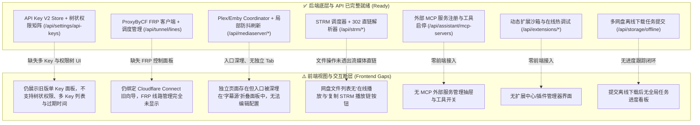
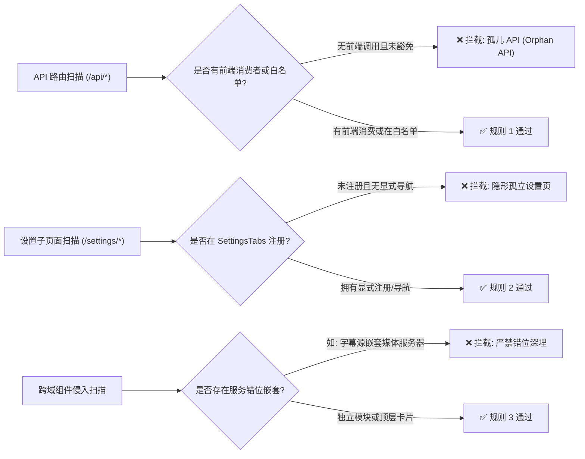
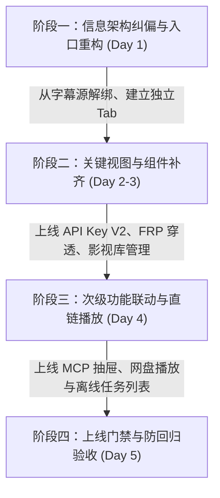

# 巡影 (Mediary Scout) 前后端功能对齐审计、脱节原因根因分析与治理演进方案

> **文档定位**：针对用户关于 API Key 管理、远程访问服务、Plex 影视库配置及近期新增后端功能的前端对齐情况专项调研报告、业界主流方案技术选型、架构落地规格书与同类防脱节质量门禁规范。  
> **编写时间**：2026-11-01  
> **状态**：正式归档 / 实施基准 (Approved Architecture Spec)

---

## 目录

1. [执行摘要与问题全景](#一执行摘要与问题全景)
2. [四大焦点问题深度调研与根因剖析](#二四大焦点问题深度调研与根因剖析)
   - [2.1 问题 1：用户 API Key 与授权 API Key 管理（前端未调整）](#21-问题-1用户-api-key-与授权-api-key-管理前端未调整)
   - [2.2 问题 2：远程访问服务（前端仍为老方案，新方案未显示）](#22-问题-2远程访问服务前端仍为老方案新方案未显示)
   - [2.3 问题 3：Plex / Emby / Jellyfin 影视库配置（前端入口隐形与功能断层）](#23-问题-3plex--emby--jellyfin-影视库配置前端入口隐形与功能断层)
   - [2.4 问题 4：近期新增后端功能前端缺失全量审计清单](#24-问题-4近期新增后端功能前端缺失全量审计清单)
3. [业界主流方案对比矩阵与技术选型 (Benchmarking)](#三业界主流方案对比矩阵与技术选型-benchmarking)
   - [3.1 API Key 与细粒度权限控制体系](#31-api-key-与细粒度权限控制体系)
   - [3.2 反向穿透与内网穿透控制中心](#32-反向穿透与内网穿透控制中心)
   - [3.3 媒体服务器与 STRM 联动控制](#33-媒体服务器与-strm-联动控制)
   - [3.4 MCP 插件管理与扩展沙箱](#34-mcp-插件管理与扩展沙箱)
4. [当前系统现有基础设施与可复用资产清单](#四当前系统现有基础设施与可复用资产清单)
5. [具体解决方案与前端改造工程设计](#五具体解决方案与前端改造工程设计)
   - [5.1 API Key V2 授权控制中心前端实现](#51-api-key-v2-授权控制中心前端实现)
   - [5.2 ProxyByCF FRP 穿透控制中心前端实现](#52-proxybycf-frp-穿透控制中心前端实现)
   - [5.3 影视库配置与 STRM 联动看板重构](#53-影视库配置与-strm-联动看板重构)
   - [5.4 MCP 助手抽屉与网盘直链播放器联动](#54-mcp-助手抽屉与网盘直链播放器联动)
6. [问题本质分析与防脱节质量门禁 (Architecture Gate)](#六问题本质分析与防脱节质量门禁-architecture-gate)
   - [6.1 问题本质：后端先行漂移与“孤儿 API 综合征”](#61-问题本质后端先行漂移与孤儿-api-综合征)
   - [6.2 新增门禁：`check-feature-parity.mjs` 设计与落地](#62-新增门禁check-feature-paritymjs-设计与落地)
   - [6.3 CI/CD 与回退回归测试阻断机制](#63-cicd-与回退回归测试阻断机制)

---

## 一、执行摘要与问题全景

近期 `Mediary Scout`（巡影）在后端领域进行了多轮高强度的架构演化与核心能力拓展，相继完成了：
- **API Key V2 树状权限控制与动态工具投影**
- **ProxyByCF FRP 轻量反向穿透系统（纯解耦客户端）**
- **Plex / Emby / Jellyfin 媒体服务器防抖精准刷新与路径映射**
- **STRM 任务计划与 302 / 代理直链流媒体分发 (SingleFlight 防击穿)**
- **外部 MCP 服务编排 (SSE / Streamable HTTP 双模)**
- **动态资源扩展进程硬隔离沙箱 (Fork Sandbox)**
- **云网盘多品牌离线下载与转存服务**

然而，在前端表现层（Presentation Layer），由于前期聚焦于核心引擎稳定性、SQLite 模块化解耦与编译前门禁建设，**前端界面出现了显著的“后端功能已就绪、前端界面未跟进或严重深埋”的脱节现象**。



---

## 二、四大焦点问题深度调研与根因剖析

### 2.1 问题 1：用户 API Key 与授权 API Key 管理（前端未调整）

#### 1. 现状查证
- **前端页面实况**：
  在 `apps/web/features/settings-system/components/settings/api-key-section.tsx` 中，调用的是旧版单密钥组件 `ApiKeyPanel`（`api-key-panel.tsx`）。
  该组件仅支持单一密钥的“轮换 (Rotate)”与“清除 (Clear)”，调用的端点仍为已降级的单值接口 `/api/settings/api-key`。
  并且该区域被直接放置在“远程访问”Tab 内部，普通用户在“账号与安全”或全局设置中极难发现。
- **后端架构实况**：
  后端已全面实现 V2 细粒度树状授权体系：
  1. **实体与持久化层**：`packages/workflow/src/auth/api-key-v2-store.ts`，基于 SQLite 数据表 `api_keys_v2`，支持多密钥实体（`ApiKeyV2Entity`）、自定义密钥名称、SHA-256 哈希防泄漏存储、`msk_live_...` 规范前缀、掩码、过期时间（`expiresAt`）、最后活跃时间（`lastUsedAt`）与吊销时间（`revokedAt`）。
  2. **树状权限与策略预设**：`packages/shared/src/auth/api-key-matrix.ts`，定义了完整的 Module -> Leaf 二级权限目录（`PERMISSION_CATALOG`），覆盖媒体检索、网盘管理、工作流触发、AI 助手对话及系统运维；附带三级风险等级（Read 🟢、Execute 🟡、Dangerous 🔴）；内置策略模式快捷预设（`full`, `readonly`, `safe_automation`, `clear`）。
  3. **动态 MCP 投影优化**：根据请求 API Key 绑定的权限集动态裁剪 MCP 工具列表，单次交互节约 70% Prompt Token，彻底消除大模型越权幻觉。
  4. **防提权物理隔离墙**：`apps/web/lib/api-key-guard.ts`，物理拦截所有 API Key 对 `/api/auth`、`/api/settings/api-keys`、`/api/tunnel`、`/api/settings/security` 等最高所有者端点的访问，防止权限自提权。
  5. **RESTful 端点已就绪**：
     - `GET /api/settings/api-keys`：获取当前所有 API Key 列表（脱敏内部哈希）。
     - `POST /api/settings/api-keys`：创建带名称、过期时间、细粒度权限集的新 Key，并在响应中返回唯一一次明文 `plainTextKey`。
     - `DELETE /api/settings/api-keys/[id]`：吊销或删除指定 Key。
     - `GET /api/settings/api-keys/catalog`：获取权限目录与风险等级元数据。

#### 2. 根因剖析
- **关注点分离不彻底**：旧版 API Key 最初仅设计为“远程访问时换取 JWT 的辅助凭据”，因此被历史性地归在 `RemoteAccessSection` 中；
- **重构滞后**：后端快速落地了企业级的细粒度 API Key 矩阵并完成了与 JWT、MCP 的底层对接，但在前端，只保留了单密钥兼容层，未为 `ApiKeyV2Store` 编写专属的管理表格、权限勾选树模态框和明文揭示弹窗。

---

### 2.2 问题 2：远程访问服务（前端仍为老方案，新方案未显示）

#### 1. 现状查证
- **前端页面实况**：
  `apps/web/app/settings/page.tsx` 的 `remote` slot 渲染的是 `RemoteAccessSection`（`apps/web/features/settings-system/components/settings/remote-access-section.tsx`）。
  该组件仍旧是基于 Cloudflare Tunnel 托管服务的“Mediary Connect”向导（`ConnectWizard`，输入邮箱发送验证码绑定、拉取 tunnelToken 启动本地 cloudflared 容器）。
- **后端架构实况**：
  在 `docs/architecture/frp-proxybycf-mcp-assistant-and-dynamic-extensions-plan.md` 中已经确立了**ProxyByCF FRP 反向穿透架构**（纯解耦客户端）：
  1. **纯解耦客户端定位**：零平台绑定，只维护 `{ id, name, serverUrl, tunnelHost, apiKey }`。
  2. **轻量全原生**：基于 `packages/shared/src/tunnel/frp-tunnel-client.ts` 与 `media-stream-coordinator.ts`，单 Node 进程内原生运行，摆脱外部闭源/臃肿二进制及 Docker-in-Docker 强依赖，内存占用 < 30MB。
  3. **智能流控与 302 零上行改写**：内置 4~16MB BDP 背压控制、HTTP_ABORT 级联中断与 ActiveMediaStreams 流抢占追踪，并支持 STRM 302 重定向改写，播放流媒体直连网盘 CDN，家庭上行带宽占用为 0。
  4. **全套 API 路由已全部就绪**：
     - `GET /api/tunnel/lines`：列出所有穿透线路（含运行状态、延时、收发字节数、连接数、活动媒体流）。
     - `POST /api/tunnel/lines`：创建新穿透线路（名称、服务器地址、自定义穿透域名、通信密钥）。
     - `GET / PUT / DELETE /api/tunnel/lines/[id]`：单条线路查询、配置更新、删除。
     - `POST /api/tunnel/lines/[id]/start`：启动指定线路。
     - `POST /api/tunnel/lines/[id]/stop`：停止指定线路。
     - `GET /api/tunnel/lines/[id]/logs`：查看线路实时运行日志。

#### 2. 根因剖析
- **新老方案并存但前端未做路由与入口切换**：ProxyByCF FRP Client 在后端作为通用穿透层注入到了 `runtime-container.ts`（`getFrpTunnelManager()`），但前端页面没有引入调用 `/api/tunnel/lines` 的客户端卡片组件，导致用户界面依然显示老旧的 Cloudflare 绑定向导。

---

### 2.3 问题 3：Plex / Emby / Jellyfin 影视库配置（前端入口隐形与功能断层）

#### 1. 现状查证
- **前端页面实况**：
  前端并非完全没有功能代码，而是**入口严重错位（被埋在“字幕源”底下），且存在关键交互断层**：
  1. **入口反人类**：在 `apps/web/app/settings/page.tsx` 的第 717 行，媒体服务器的入口被硬编码塞在 `SubtitleSourceSection`（“字幕源 (assrt.net)”）的最底端：
     ```tsx
     <ServiceBlock
       name="媒体服务器 (Plex / Emby / Jellyfin)"
       pills={[{ label: "支持防抖局部刷新", tone: "on" }]}
       summary="关联家庭影院影视库，支持入库/STRM 变更后自动精准局部刷新、抖动聚合防抖控制与路径映射。"
     >
       <Link href="/settings/mediaserver" className="btn btn-secondary">
         <Tv size={15} /> 前往影视库配置与管理
       </Link>
     </ServiceBlock>
     ```
     在用户心智模型中，媒体服务器是核心输出端，绝不可能藏在“字幕源”这一辅助工具中。
  2. **主导航与 SettingsTabs 缺失独立标识**：
     主侧边栏 `AppSidebar` 没有影视库入口；`SettingsTabs` 的顶部标签栏只有“网盘连接、三方服务、偏好、巡查与通知、系统更新、账号与安全、远程访问”，没有“影视库”Tab。
  3. **功能闭环存在短板**：
     已存在的独立页面 `apps/web/features/mediaserver/components/mediaserver-config-view.tsx`：
     - **缺少“编辑”功能**：只提供了新增和删除，如果用户 IP 变动或 Token 刷新，必须删除后重新填写全部路径映射；
     - **缺少媒体库类别/Section 过滤**：无法选择只同步 Plex 的某个特定 Library Section；
     - **与 STRM 联动孤立**：虽然在 `/storage/strm` 实现了 STRM 生成，但在媒体服务器界面无法直观看到绑定的 STRM 任务与刷新状态。

#### 2. 根因剖析
- **设置页卡片分组临时安放**：前期为了快速联调，将 `ServiceBlock` 随手插在三方服务的末尾（恰好在 `SubtitleSourceSection` 之后），未独立抽取为顶层一级板块；
- **CRUD 视图完成度不全**：前端组件仅实现了 Create 和 Delete，遗漏了 Update 模态框与 Section 查询联动。

---

### 2.4 问题 4：近期新增后端功能前端缺失全量审计清单

通过全工作区代码与架构审计，近期新增的后端功能中，**还有以下 5 大核心功能在前端完全没有同步调整或缺失 UI**：

| 模块名称 | 后端核心实现与资产 | 后端 API 端点 | 前端目前现状 | 缺失级别 |
| :--- | :--- | :--- | :--- | :--- |
| **1. 外部 MCP 服务管理与动态工具编排** | `packages/workflow/src/mcp/`<br>• `mcp-client.ts` (SSE/HTTP)<br>• `mcp-server-registry.ts`<br>• `mcp-tool-adapter.ts` | `/api/assistant/mcp-servers`<br>`/api/assistant/mcp-servers/test`<br>`/api/assistant/mcp-servers/[id]/toggle-tool` | **零前端视图**。<br>用户无法在前端添加外部 MCP 服务（如本地文件系统、B站检索等），无法勾选启用/禁用特定 MCP 工具。 | 🔴 严重脱节 |
| **2. 动态资源扩展与插件沙箱系统** | `packages/workflow/src/extensions/`<br>• `extension-sandbox.ts` (Node fork 瞬态进程硬隔离)<br>• `extension-registry.ts` | `/api/extensions`<br>`/api/extensions/import` (ZIP/Git)<br>`/api/extensions/[id]/code`<br>`/api/extensions/[id]/debug-run`<br>`/api/extensions/[id]/snapshots` | **零前端视图**。<br>缺少扩展管理中心，无法上传 ZIP/Git 扩展包，无法在 Web 端直接调试插件代码与查看运行快照。 | 🔴 严重脱节 |
| **3. 网盘直链播放与 302 / 代理流媒体** | `packages/workflow/src/storage/`<br>• `stream-resolver.ts`<br>• `SingleFlight` 防并发击穿 | `/api/strm/play/[storageId]/[fileId]`<br>(支持 302 直连 CDN 与 HTTP 206 断点续传) | **网盘表格未透出**。<br>在 `storage-file-table.tsx` 中仅有重命名/移动/复制/删除，**无“在线播放”按钮，也无“复制 STRM 播放链”操作**。 | 🟠 交互缺失 |
| **4. 网盘离线下载与转存任务追踪** | `apps/web/app/api/storage/offline/`<br>• 支持磁力/种子/分享链接落地到 115、夸克、123、天翼 | `POST /api/storage/offline`<br>`GET /api/storage/offline` (任务列表) | **缺少全局进度看板**。<br>虽有新建弹窗，但缺少“离线下载任务列表抽屉”，用户无法查看离线进度百分比与重试状态。 | 🟡 体验断层 |
| **5. 容器内就地热更新与双轨日志** | `docs/architecture/in-container-update-...`<br>• 支持无 Docker Socket 挂载下的容器内热替换 | `POST /api/update/in-container`<br>`GET /api/update/status` | **前端仅展示旧版轮询**。<br>未展现容器内就地热更新的下载校验进度条、分步执行日志和一键回滚指示。 | 🟡 体验断层 |

---

## 三、业界主流方案对比矩阵与技术选型 (Benchmarking)

### 3.1 API Key 与细粒度权限控制体系

| 方案 / 产品 | 授权粒度 | 凭据形式与安全隔离 | Token 优化与防幻觉 | 前端交互最佳实践 |
| :--- | :--- | :--- | :--- | :--- |
| **GitHub Fine-grained PAT** | 细粒度资源级 (Repository / Organization) + 读写权限 | 长期密钥 + 数据库哈希，与 Web 密码会话完全隔离 | 不涉及 MCP | 树状折叠权限列表、只读/读写单选、显式过期时间选择器、生成后一次性明文复制 Modal |
| **Stripe Restricted Keys** | 模块级资源权限 (Customers, Charges, Invoices 等读写) | 标准密钥 vs 受限密钥，前缀区分 (`rk_live_...`) | 不涉及 MCP | 权限矩阵表格、快捷预设按钮（Full / Read-only / Custom）、单项安全警告 Tag |
| **Cloudflare API Tokens** | 账户/Zone/资源级 Policies + IP 白名单限制 | Token 前缀 + SHA-256 存储，与主密码隔离 | 不涉及 MCP | 模板向导（“Edit Workers”, “Read DNS”）、权限矩阵勾选器、TTL 策略 |
| **Mediary Scout V2 (本系统架构)** | **Module -> Tool/Leaf 二级树状矩阵** + 三级风险等级 (🟢/🟡/🔴) | **主管理员会话 (Session Cookie) 与业务子凭据 (API Key) 物理隔离墙** (拦截管理端点) | **动态工具投影 (Dynamic Tool Projection)**：按 API Key 权限裁剪 MCP Schema，**节省 70% Token** | **策略模式快捷预设** (`full`, `readonly`, `safe_automation`) + 树状勾选 + 一次性展示 Modal |

### 3.2 反向穿透与内网穿透控制中心

| 方案 / 产品 | 客户端形态与资源占用 | 协议与流控机制 | 4K 媒体流优化 (302) | 前端控制台体验 |
| :--- | :--- | :--- | :--- | :--- |
| **Cloudflare Tunnel (cloudflared)** | 外部 Go 编译二进制或独立 Docker 容器 (内存 60~120MB) | QUIC / HTTP2，无级联应用层背压 | 流量经 Cloudflare CDN 回源，4K 大码率易被 QoS 或封禁 | 托管控制台，可视化向导，适合标准 Web 流量 |
| **FRP (fatedier/frp)** | 外部 Go 编译二进制 (内存 30~50MB) | TCP / STCP / KCP，支持流量统计 | 默认代理中继转发，占用家庭宽带全部上行带宽 | 原生简易 Web Dashboard，线路表格、启停开关、流量计数 |
| **ProxyByCF FRP (本系统选型)** | **纯 Node.js ESM 原生客户端，零额外二进制与容器 (内存 < 30MB)** | **4~16MB BDP 自适应背压控制 + HTTP_ABORT 级联中断** | **302 直连网盘 CDN 重定向改写，家庭宽带 0 上行占用** | **线路卡片看板 + 实时延时 ms + 启动/停止开关 + 实时日志抽屉** |

### 3.3 媒体服务器与 STRM 联动控制

| 方案 / 产品 | 媒体库支持与刷新机制 | 路径映射支持 | 防抖与并发控制 | 前端交互最佳实践 |
| :--- | :--- | :--- | :--- | :--- |
| **Jellyseerr / Overseerr** | Plex / Jellyfin / Emby 全面支持，Webhook 触发扫描 | 支持本地挂载与远端路径映射转换 | 基础队列，按需触发全库或单库刷新 | 服务器卡片展示连通状态、延迟、一键测试连接、库选择下拉框 |
| **Radarr / Sonarr (Connect)** | 关联入库自动触发通知与元数据刷新 | 预设路径模式 | 针对单个标题的微粒度刷新 | 独立 Connect 页面，连接向导，详细连接错误 Diagnostic 弹窗 |
| **Mediary Scout (本系统选型)** | **Plex / Emby / Jellyfin 统一 Coordinator 适配器** | **多条 LocalPath ↔ RemotePath 动态映射** | **Sliding Window 防抖聚合 (30s) + 智能合并同目录精准刷新** | **专属“影视库”一级板块 + 实时连通性探测 + 刷新历史记录弹窗 + 与 STRM 任务联动** |

---

## 四、当前系统现有基础设施与可复用资产清单

在实施前端对齐改造时，本系统已具备大量高质量、标准化的工程基础设施与设计资产，**严禁重复造轮子或引入冗余的三方依赖**：

1. **核心逻辑与契约库 (`@media-track/shared`)**：
   - 树状权限元数据：`PERMISSION_CATALOG`（各模块、叶子能力、风险等级、API/MCP 支持声明）。
   - 权限策略生成器：`ApiKeyPermissionPreset.applyStrategy(type)`、`calculateModuleState()`、`toggleModule()`。
   - 密钥工具：`generateApiKeyV2()`、`verifyApiKeyV2Hash()`、`isForbiddenApiKeyPath()`。
   - 穿透协议：`FrpTunnelClient`、`TunnelLineConfig`、`TunnelLineStatus`。
2. **后端服务容器与存储 (`runtime-container.ts`)**：
   - `getApiKeyV2Store()`：多密钥 CRUD 与哈希比对。
   - `getFrpTunnelManager()`：FRP 穿透线路生命周期管理（启动/停止/日志）。
   - `getMediaServerCoordinator()`：媒体服务器防抖聚合刷新协调器。
   - `getExternalMcpServerStore()`：外部 MCP 服务注册表。
   - `getExtensionManager()`：动态扩展沙箱管理器。
3. **前端 3 层设计令牌与 UI 原语 (`@media-track/shared/src/design-tokens.ts`)**：
   - 颜色语义令牌：`--color-surface-panel`、`--color-surface-hover`、`--color-brand-primary`、`--color-border-subtle`。
   - 状态徽章类名：`.badge.is-on`（成功/运行中）、`.badge.is-warn`（警告/重连中）、`.badge.is-error`（失败/离线）。
   - 布局类名：`.panel`、`.panel-header`、`.panel-title`、`.btn.btn-primary`、`.btn.btn-secondary`、`.setting-row`。
   - 弹窗与抽屉原语：`storage-modals.tsx` 与 `storage-offline-modal.tsx` 中成熟的 Modal Shell 与动画机制。

---

## 五、具体解决方案与前端改造工程设计

### 5.1 API Key V2 授权控制中心前端实现

#### 1. 架构定位与入口迁移
- 将 API Key 管理从“远程访问”Tab 中彻底移出，在 `SettingsTabs` 中归入“账号与安全 (account)”选项卡，或在“三方服务”并列位置开辟独立的“API 与授权 (tokens)”板块；
- 服务端组件：`ApiKeyV2Section.tsx`（仅站长可见，服务端鉴权 `resolveCurrentIsOwner()` 并从 `/api/settings/api-keys` 获取初始列表）。

#### 2. 前端客户端组件 `ApiKeyV2Manager.tsx` 交互设计
```
┌─────────────────────────────────────────────────────────────────────────────┐
│ 🔑 API Key 与应用授权管理 (V2)                        [+ 创建新 API Key]     │
│ 用于脚本、第三方下载器及外部 AI Agent (Cursor/Antigravity) 授权访问本实例。 │
├─────────────────────────────────────────────────────────────────────────────┤
│ 密钥名称       前缀/掩码          权限范围 (细粒度)   状态/有效期      操作      │
├─────────────────────────────────────────────────────────────────────────────┤
│ Cursor Agent  msk_live_a1b2...   4 项权限 (媒体/检索) 永不过期        [吊销]    │
│ 自动化备份    msk_live_9f8e...   2 项权限 (网盘只读)  2026-12-01到期  [吊销]    │
└─────────────────────────────────────────────────────────────────────────────┘
```
- **创建 Key 模态框 (`CreateApiKeyModal.tsx`)**：
  1. 名称与过期时间（7天、30天、90天、永久）；
  2. 权限策略快捷选择器（Radio Group）：
     - 🚀 **完整权限** (排除危险级)
     - 👁️ **只读模式** (仅允许读取，禁止转存与删除)
     - 🛡️ **安全自动化** (常规作业，禁止删除与重命名)
     - ⚙️ **自定义勾选**
  3. 树状权限多选组件：模块支持全选/半选状态，单项展示风险等级徽章（`Read` 绿色、`Execute` 黄色、`Dangerous` 红色）；
  4. 提交后弹出 **“一次性明文揭示弹窗”**，提供一键复制按钮与“离开页面后将不再显示完整密钥”的高风险提示。

---

### 5.2 ProxyByCF FRP 穿透控制中心前端实现

#### 1. 架构定位与入口
- 替换现有 `apps/web/features/settings-system/components/settings/remote-access-section.tsx`；
- 保留原有 Cloudflare Connect 作为可选的“托管备用方案”（Tab 2），将 **ProxyByCF FRP 穿透（全原生轻量）** 作为默认主面板（Tab 1）。

#### 2. 前端客户端组件 `FrpTunnelManagerView.tsx` 交互设计
```
┌─────────────────────────────────────────────────────────────────────────────┐
│ 🌐 远程访问服务 (ProxyByCF FRP 极速穿透)               [+ 添加穿透线路]     │
│ 纯 Node.js 原生运行，内存开销 < 30MB，支持 4K 流媒体 302 重定向零上行播放。  │
├─────────────────────────────────────────────────────────────────────────────┤
│ 线路名称     穿透地址 (公网域名)       实时状态    网络延时  媒体流  操作    │
├─────────────────────────────────────────────────────────────────────────────┤
│ 广州家庭NAS  scout.nas.example.com    🟢 已连接   28 ms     0 流    [停止] [日志] [删] │
│ 备用香港VPS  hk.tunnel.example.com    ⚪ 已停止   --        0 流    [启动] [日志] [删] │
└─────────────────────────────────────────────────────────────────────────────┘
```
- **核心操作联动**：
  - 点击【启动】/【停止】按钮：调用 `POST /api/tunnel/lines/[id]/start` 或 `stop`，即时局部更新状态徽章；
  - 点击【日志】按钮：弹出 `TunnelLogsModal.tsx`，调用 `GET /api/tunnel/lines/[id]/logs` 查看实时握手与流控事件；
  - 点击【添加穿透线路】：弹出配置表单（名称、Server URL、Tunnel Host、Auth API Key），提交后校验连通性。

---

### 5.3 影视库配置与 STRM 联动看板重构

#### 1. 架构定位与入口调整
- **从字幕源中彻底剔除**：将 `MediaServerConfigView` 从 `SubtitleSourceSection` 中移出；
- **在 `SettingsTabs` 中确立独立板块**：
  在“三方服务 (services)”中提升为一级独立卡片，或直接新增独立的 `mediaserver` Tab（“家庭影院 / 影视库”）；
- **主侧边栏与网盘页显式导航**：
  在 `/storage` 顶部导航栏中，与现有的 `STRM 任务计划` 并列提供 `📺 影视库配置` 快捷按钮。

#### 2. `MediaServerConfigView.tsx` 完善闭环规格
1. **补齐“编辑配置”功能**：
   - 增加 `handleEditServer` 与 `EditServerModal`，支持编辑 Host URL、更新 API Token、修改/追加路径映射规则；
2. **支持 Library Sections 探测与勾选**：
   - 结合现有 `/api/mediaserver/test` 接口，连通成功后自动拉取当前 Plex / Emby 上的库列表（电影库、电视剧库、动漫库），支持用户指定只刷新特定影视库；
3. **STRM 联动指示器**：
   - 在已配置的媒体服务器卡片上，展示“已关联 STRM 任务 (3 项)”状态，展示最近一次精准局部刷新的路径与耗时。

---

### 5.4 MCP 助手抽屉与网盘直链播放器联动

#### 1. AI 助手页面 (`/chat`) 增加 MCP 外部工具管理抽屉
- 在对话框右上角增加 `🧩 MCP 工具编排` 按钮；
- 抽屉组件 `McpServerDrawer.tsx`：
  - 列出已配置的外部 MCP 服务器（如本地文件系统、B 站视频分析等）；
  - 单项开关：动态启用/禁用该服务器下的各个 Tool；
  - 新增 MCP 服务器模态框（支持 SSE URL 与 Streamable HTTP JSON-RPC URL 输入，带【测试连接】按钮）。

#### 2. 网盘管理 (`/storage`) 增加直链在线播放与 STRM 复制
- 在 `storage-file-table.tsx` 每行操作栏（`.col-actions`）中：
  - 当文件属于视频类型（`.mp4`, `.mkv`, `.iso`, `.ts`, `.flv` 等）时：
    - 新增 **`▶️ 播放` 图标按钮**：点击直接调用 `/api/strm/play/[storageId]/[fileId]`，利用内置轻量视频弹窗或浏览器原生播放器预览；
    - 新增 **`🔗 复制 STRM 播放链` 按钮**：一键复制带鉴权/可直接被外部 PotPlayer / VLC / Infuse 播放的流媒体链接。

---

## 六、问题本质分析与防脱节质量门禁 (Architecture Gate)

### 6.1 问题本质：后端先行漂移与“孤儿 API 综合征”

出现“后端功能写好了、前端没同步调整”的根本原因在于**研发流中的契约闭环校验缺失**：
1. **驱动模式脱节 (Backend-First Drift)**：
   开发或 AI 代理通常以“数据模型 → 领域逻辑 → 服务编排 → 单元测试 → API 路由”为顺序推进。当 API 的单元测试全部通过时，很容易产生“功能已完成”的错觉，从而跳过前端 UI 开发；
2. **缺乏静态语法级防孤儿约束**：
   目前项目拥有严苛的物理导入门禁（`gate:facades`）、样式令牌门禁（`gate:style`）、代码行数门禁（`gate:limits`），但**缺少一个检查“新增的 API 路由是否在前端有对应的消费组件”的架构门禁**；
3. **设置页与路由视图缺乏清单治理**：
   新页面（如 `/settings/mediaserver`）虽然建立了 `page.tsx`，但未在全局设置 Tab 模型中注册，导致其在页面流中沉底甚至不可见。

---

### 6.2 新增门禁：`check-feature-parity.mjs` 设计与落地

为了在根源上杜绝此类问题，我们在 `tools/gates/` 下正式设计并引入 **前后端功能对齐与孤儿路由门禁（`tools/gates/check-feature-parity.mjs`）**。

#### 1. 门禁三大核心守恒法则 (Invariant Rules)



1. **法则一：API 消费完整性 (API Consumer Parity)**：
   扫描 `apps/web/app/api/` 下所有导出了 `GET` / `POST` / `PUT` / `DELETE` 的路由。
   检查 `apps/web/features/` 或 `apps/web/app/` 是否有组件通过 `fetch()` / SWR / Action 调用该路由前缀。
   若某路由未被前端消费，必须在 `tools/gates/api-parity-allowlist.json` 中明确声明豁免理由（如：`"reason": "外部 Webhook 回调"` 或 `"reason": "供桌面端守护进程调用"`），否则 **直接中断 CI 构建**！
2. **法则二：设置页 Tab 契约一致性 (Settings Model Parity)**：
   扫描 `apps/web/app/settings/` 目录下的所有子路由及主要业务领域（`mediaserver`, `tunnel`, `api-keys` 等）。
   校验其必须在 `apps/web/lib/settings-tabs-model.ts` 或主 `SettingsTabs` 中拥有对应的 Tab ID 或卡片槽位，严禁存在“只有 URL 路由、没有可见入口”的孤岛页面。
3. **法则三：反错位反深埋约束 (Anti-Misplacement Constraint)**：
   AST 语法树扫描：禁止将核心基础服务（如媒体服务器、穿透服务）作为纯私有子节点硬编码挂载在无关次要服务组件（如 `SubtitleSourceSection`）内部。

#### 2. 门禁脚本规格实现 (`tools/gates/check-feature-parity.mjs`)
- **执行方式**：纳入 `package.json` 的 `npm run gate` 与 CI 流水线；
- **输出报告**：清晰列出所有 API 路由对应的前端消费组件路径，对缺失消费的孤儿端点亮红警示并输出对应前端待办项。

---

### 6.3 CI/CD 与回退回归测试阻断机制

为防止未来重构引入回归，建立两道防线：
1. **自动化端到端冒烟测试 (E2E Smoke Guard)**：
   在 `tools/runner/smoke-tester.mjs` 中增加页面关键路径探测：
   - 探测 1：`/settings` 页面是否能成功渲染出 API Key 列表面板与 FRP 穿透控制面板；
   - 探测 2：从 `/settings` 能够直接点击进入媒体服务器配置并成功读取 `/api/mediaserver/configs`；
   - 探测 3：`/storage` 页面能够正常展开 STRM 任务计划与文件在线播放直链。
2. **Git 预提交钩子 (Pre-commit Hook)**：
   每次变更涉及 `apps/web/app/api/` 时，必须同步提交关联的 `apps/web/features/` 组件变更，或在豁免清单中打标。

---

## 七、实施路线图与交付计划



1. **阶段一（即刻执行）**：
   - 修复 `apps/web/app/settings/page.tsx`：将媒体服务器从 `SubtitleSourceSection` 彻底剥离，在设置页建立独立的媒体服务器卡片与 Tab 路由；
   - 将 API Key V2 管理从“远程访问”Tab 迁移至“账号与安全”或“开放接口”专属卡片。
2. **阶段二（关键视图落地）**：
   - 构建 `ApiKeyV2Manager`（多 Key 列表、权限树勾选、一次性明文揭示）；
   - 构建 `FrpTunnelManagerView`（FRP 线路看板、状态开关、添加线路、实时日志）；
   - 完善 `MediaServerConfigView`（增加编辑配置模态框、库 Section 勾选）。
3. **阶段三（次级功能联动）**：
   - 在网盘文件列表增加“在线播放”与“复制 STRM 播放链”按钮；
   - 在 `/chat` 助理增加外部 MCP 服务器管理抽屉；
   - 增加网盘离线任务全局下载进度看板。
4. **阶段四（门禁与回归加固）**：
   - 编写并上线 `tools/gates/check-feature-parity.mjs`，合入 `npm run gate`；
   - 运行全量 E2E 冒烟测试与类型检查，确保 0 违规、0 回归。
