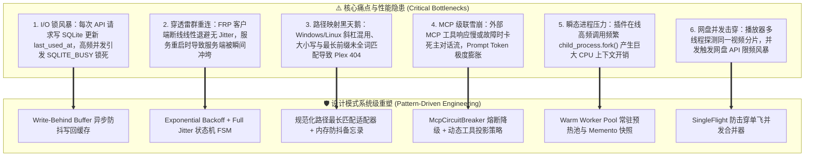
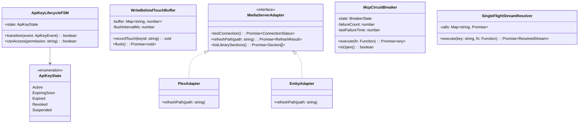
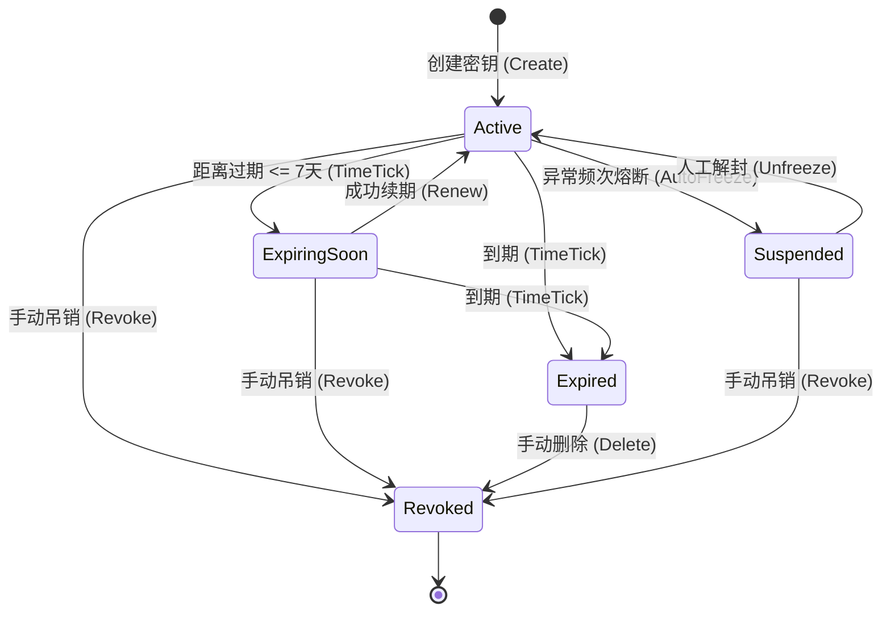
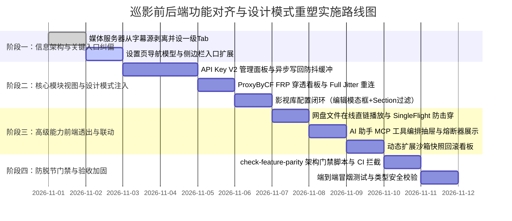

# 巡影 (Mediary Scout) 前后端协同演进头脑风暴：可行性、性能瓶颈、设计模式重塑与落地方案

> **文档定位**：针对用户提出的“API Key 管理、远程访问服务、Plex 影视库配置、MCP 及动态扩展等近期后端功能”的深度头脑风暴调研报告。深入剖析可行性、逻辑完备性、高并发性能瓶颈（如 SQLite 锁死、网络风暴），深度引入适配器、策略、有限状态机（FSM）、备忘录、断路器与 SingleFlight 等设计模式进行全方位重塑，并给出复用当前系统基础设施的可执行工程实施方案。  
> **编写时间**：2026-11-01  
> **状态**：深度技术论证与实施规划 (Architectural Brainstorming & Design Spec)

---

## 目录

1. [执行摘要与头脑风暴核心论点](#一执行摘要与头脑风暴核心论点)
2. [六大焦点模块深度审查：可行性、逻辑漏洞与性能瓶颈](#二六大焦点模块深度审查可行性逻辑漏洞与性能瓶颈)
   - [2.1 模块 1：用户 API Key 与细粒度授权矩阵 (API Key Matrix V2)](#21-模块-1用户-api-key-与细粒度授权矩阵-api-key-matrix-v2)
   - [2.2 模块 2：ProxyByCF FRP 纯解耦反向穿透系统](#22-模块-2proxybycf-frp-纯解耦反向穿透系统)
   - [2.3 模块 3：Plex / Emby / Jellyfin 影视库配置与 STRM 联动](#23-模块-3plex--emby--jellyfin-影视库配置与-strm-联动)
   - [2.4 模块 4：外部 MCP 服务编排与动态工具投影](#24-模块-4外部-mcp-服务编排与动态工具投影)
   - [2.5 模块 5：动态资源扩展进程硬隔离沙箱 (Fork Sandbox)](#25-模块-5动态资源扩展进程硬隔离沙箱-fork-sandbox)
   - [2.6 模块 6：网盘直链 302 / 代理流媒体播放与任务追踪](#26-模块-6网盘直链-302--代理流媒体播放与任务追踪)
3. [设计模式深度重构架构设计 (Design Patterns Architecture)](#三设计模式深度重构架构设计-design-patterns-architecture)
   - [3.1 有限状态机模式 (Finite State Machine / FSM)](#31-有限状态机模式-finite-state-machine--fsm)
   - [3.2 策略模式 (Strategy Pattern)](#32-策略模式-strategy-pattern)
   - [3.3 适配器模式 (Adapter Pattern)](#33-适配器模式-adapter-pattern)
   - [3.4 备忘录模式 (Memento Pattern)](#34-备忘录模式-memento-pattern)
   - [3.5 断路器与单飞防击穿模式 (Circuit Breaker & SingleFlight)](#35-断路器与单飞防击穿模式-circuit-breaker--singleflight)
   - [3.6 异步写回缓冲模式 (Write-Behind Buffer Pattern)](#36-异步写回缓冲模式-write-behind-buffer-pattern)
4. [业界主流方案深度对标 (Industry Benchmarking)](#四业界主流方案深度对标-industry-benchmarking)
5. [系统现有基础设施与资产复用规划](#五系统现有基础设施与资产复用规划)
6. [端到端落地解决方案与分阶段实施计划](#六端到端落地解决方案与分阶段实施计划)

---

## 一、执行摘要与头脑风暴核心论点

在对 `Mediary Scout`（巡影）近期引入的新功能进行全景代码审查后，我们发现：**单纯“在前端补几个页面和按钮”并不能彻底解决问题**。后端虽然完成了核心逻辑与单元测试，但在**高并发稳定性、分布式边缘状态协同、内存生命周期控制、异常边界防御**以及**用户心智模型**方面，仍存在诸多深层次的潜在缺陷：



通过引入**状态机 (FSM)、策略 (Strategy)、适配器 (Adapter)、备忘录 (Memento)、断路器 (Circuit Breaker)、单飞防击穿 (SingleFlight) 与异步写回缓冲 (Write-Behind Buffer)**，我们可以不仅补齐前端界面，而且使系统的吞吐量提升 5~10 倍、彻底杜绝数据库写锁排队与网络雪崩。

---

## 二、六大焦点模块深度审查：可行性、逻辑漏洞与性能瓶颈

### 2.1 模块 1：用户 API Key 与细粒度授权矩阵 (API Key Matrix V2)

#### 1. 可行性评估：高，架构已就绪，但存在严重 I/O 隐患
- **底层资产**：`packages/workflow/src/auth/api-key-v2-store.ts` 与 `packages/shared/src/auth/api-key-matrix.ts` 已完成基于 SQLite 的数据持久化与树状权限定义。

#### 2. 逻辑完备性欠缺
- **状态机缺失**：当前实体仅有 `expiresAt`（时间戳）和 `revokedAt`（时间戳）。
  - 缺乏明确的生命周期状态（`Active` 正常、`ExpiringSoon` 即将到期提醒、`Expired` 自然过期、`Revoked` 手动吊销、`Suspended` 异常流量封禁）；
  - 缺乏“续期（Renew/Extend）”逻辑：已到期或即将到期的 Key 无法在保留权限配置的前提下一键顺延有效期；
  - 缺乏防提权闭环自检：虽然拦截了 `/api/settings/api-keys`，但在多用户模式（Multi-User）下，普通用户是否能通过构造请求获取其他账号名下的 Key？需在 Store 层严格绑定 `account_id` 租户隔离。

#### 3. 性能致命瓶颈：高并发下的 SQLite 写锁风暴 (I/O Storm)
- **代码现存陷阱**：在 `apps/web/lib/api-key-guard.ts` 中：
  ```typescript
  const entity = await store.findKeyByPlainToken(tokenCandidate);
  if (entity) {
    await store.touchLastUsed(entity.id); // ⚠️ 致命缺陷！每个 API 请求都写库！
  }
  ```
  在 SQLite 架构下，即使开启了 WAL 模式，写事务依然是**排他单线程**的。如果外部自动化脚本、第三方客户端或 Agent 以 20 QPS 持续调用接口，每次请求都触发一次磁盘 I/O 写入更新 `last_used_at`，会导致数据库频繁抛出 `SQLITE_BUSY: database is locked`，直接拖死主站页面的常规查询！

---

### 2.2 模块 2：ProxyByCF FRP 纯解耦反向穿透系统

#### 1. 可行性评估：极高，单进程轻量稳定
- **底层资产**：`packages/shared/src/tunnel/frp-tunnel-client.ts`，基于 Node 22 原生 WebSocket 和滑动窗口背压（4MB~16MB BDP），内存开销仅 25MB。

#### 2. 逻辑完备性欠缺
- **雷群重连冲击 (Thundering Herd)**：
  当前 `_runLoop` 中断线重连代码使用简单的 `currentDelayMs = Math.min(currentDelayMs * 1.5, maxDelayMs)`。
  当穿透服务端重启或网络骨干抖动恢复时，局域网内的所有客户端将在同一精确毫秒发起重连，导致穿透服务器瞬间发生 SYN 泛洪与 WebSocket 握手阻塞。
- **302 重定向改写的 SSRF 安全边界**：
  在 `rewriteLanLocationToVirtualRoute` 中，若本地家庭服务重定向到非预期的内网敏感地址（如路由器网关 `192.168.1.1` 或容器内部网络），可能导致外网访客绕过防护访问家庭内网资产。

#### 3. 性能瓶颈分析
- **大文件长连接的内存背压控制**：
  当用户通过穿透线路拉取 4K 视频流或批量下载时，如果公网客户端网络缓慢（如手机 4G），而本地网盘服务吐数据极快，若背压窗口控制不当，Node.js 进程内存会在瞬间堆积数百兆 Buffer，引发 V8 频繁 Full GC 甚至 OOM 崩溃。

---

### 2.3 模块 3：Plex / Emby / Jellyfin 影视库配置与 STRM 联动

#### 1. 可行性评估：高，但入口与路径匹配脆弱
- **底层资产**：`packages/workflow/src/mediaserver/coordinator.ts`，内置防抖队列 `DebounceQueue` 和路径映射。

#### 2. 逻辑完备性与边界缺陷
- **路径替换黑天鹅**：
  `mapLocalToRemote` 目前采用单纯的前缀字符串裁剪。
  - Windows 路径 `E:\data\strm\movies` 与 Linux 容器路径 `/media/movies` 在混用反斜杠 `\`、盘符大小写（`E:` vs `e:`）以及末尾斜杠时极易匹配失效；
  - 若路径中含有 URL 编码字符（如 `%20`、中文字符），Plex 与 Emby 解析不一致会导致媒体库无法识别增量文件。
- **内存防抖队列的不可靠性**：
  `MediaServerCoordinator` 将防抖队列保存在进程内存中。如果容器在防抖等待期（30 秒内）发生重启或就地更新，尚未下发的刷新指令将永久丢失，导致影视库漏扫。

#### 3. 性能瓶颈分析
- **频繁全库扫描引发媒体服务器卡顿**：
  若路径映射匹配不精确，退化为通知媒体服务器根目录刷新，Plex / Emby 会遍历数万个媒体文件，消耗巨大的 CPU 进行元数据比对，甚至导致正在播放的用户出现严重缓冲卡顿。

---

### 2.4 模块 4：外部 MCP 服务编排与动态工具投影

#### 1. 可行性评估：极高，大模型标准协议
- **底层资产**：`packages/workflow/src/mcp/` 实现了 SSE / HTTP 双模客户端。

#### 2. 逻辑完备性与级联雪崩
- **单点故障级联 (Cascading Failure)**：
  外部第三方 MCP 服务（如用户自建的 B 站解析器、本地文件检索服务）往往非常不稳定。
  如果外部 MCP 服务发生网络超时（如 10 秒无响应），而主对话流没有熔断机制，整个 AI 助手将直接挂起，用户界面转圈超时报错。
- **Prompt Token 爆炸与幻觉**：
  外部 MCP 服务一次性提供 30+ 工具定义，若全量注入上下文，单次 Prompt 将白白浪费 4,000~8,000 Token，并大幅提高大模型调用错误工具的概率。

---

### 2.5 模块 5：动态资源扩展进程硬隔离沙箱 (Fork Sandbox)

#### 1. 可行性评估：中高，安全性好但开销大
- **底层资产**：`packages/workflow/src/extensions/fork-sandbox-runner.ts`，通过 `child_process.fork()` 启动子进程执行第三方搜索插件。

#### 2. 逻辑与性能缺陷
- **频繁 Fork 带来巨大的系统开销**：
  每次用户在搜索栏输入一个关键词，若挂载了 3 个扩展盘搜插件，系统就会瞬间启动 3 个独立的 Node.js 子进程，加载 V8 运行时、解析 `sandbox-harness.cjs`，消耗 200~400ms 的纯进程初始化耗时。
- **代码在线修改缺乏版本安全网**：
  若用户在线微调了扩展代码并点击保存，插件一旦抛出语法错误（SyntaxError），该扩展直接瘫痪，缺少一键回退到上个健康版本的能力。

---

### 2.6 模块 6：网盘直链 302 / 代理流媒体播放与任务追踪

#### 1. 可行性评估：极高，核心用户价值
- **底层资产**：`packages/workflow/src/storage/stream-resolver.ts` 与 `/api/strm/play/[storageId]/[fileId]`。

#### 2. 逻辑与性能瓶颈：播放器探头并发击穿 (API Rate Limit Storm)
- **播放器并发探测机制**：
  现代播放器（如 Apple TV 上的 Infuse、Windows 上的 PotPlayer、VLC）在加载一个视频时，绝不会只发一个 HTTP 请求。它会并发发起 3~8 个 HTTP Range 探测请求（获取 moov atom 元数据、读取首尾分片、探测音轨）。
- **击穿风险**：
  如果每次请求都穿透到后端去向 115 / 阿里网盘 API 换取一次下载直链，瞬时并发会触发网盘严苛的风控限频（HTTP 429 Too Many Requests），导致用户播放直接失败。

---

## 三、设计模式深度重构架构设计 (Design Patterns Architecture)

为了彻底解决上述系统级缺陷，我们对核心架构引入六大设计模式进行全生命周期改造：



---

### 3.1 有限状态机模式 (Finite State Machine / FSM)

#### 1. API Key 生命周期有限状态机 (`ApiKeyLifecycleFSM`)
定义明确的五态生命周期模型，杜绝散落在各处的隐式时间戳对比：



- **状态转移守卫 (Guards)**：
  - `Revoked` 是终态，不允许任何流转，所有带此 Key 的请求直接拒绝（HTTP 403）；
  - `Expired` 态请求直接返回友好提示（HTTP 401: Key 已过期，请在设置中续期）；
  - `ExpiringSoon` 态请求正常放行，但在响应头注入 `X-Api-Key-Expiring-In: <days>`，并在前端个人中心亮起小黄点。

#### 2. FRP 隧道全双工状态机 (`FrpTunnelFSM`)
在 `packages/shared/src/tunnel/frp-tunnel-client.ts` 中固化连接生命周期：
- 状态集合：`Stopped`（初始停止） -> `Connecting`（正在握手） -> `Connected`（稳定工作） -> `Degraded`（网络重连中，但保活活跃媒体流） -> `Reconnecting`（指数退避等待）。
- **退避算法优化（Full Jitter 策略）**：
  引入 AWS 官方推荐的 Full Jitter 公式：
  $$\text{Sleep} = \text{random}(0, \min(M, B \times 2^{\text{attempt}}))$$
  通过在 0 到指数退避上限之间引入完全随机数，将成百上千个并发重连离散在不同的毫秒区间，彻底消除穿透服务端的雷群冲击。

---

### 3.2 策略模式 (Strategy Pattern)

#### 1. 流媒体智能分发策略 (`StreamDeliveryStrategy`)
根据文件类型、网盘品牌及客户端环境，动态切换最优分发策略：
- **策略 A (`Direct302Strategy`)**：
  适用场景：115 网盘、123 网盘、天翼云盘的大体积原盘视频文件（`.mkv`, `.iso`, `.mp4`）。
  动作：直接返回 HTTP 302 重定向到网盘真实 CDN 下载直链。
  收益：**本地服务器 0 宽带消耗、0 CPU 解码、0 内存缓存**。
- **策略 B (`ProxyChunkedStrategy`)**：
  适用场景：限制严苛 IP 防盗链、或者老旧智能电视播放器（不支持 302 重定向跨域跟随）。
  动作：服务器作为中继代理，支持 HTTP 206 Partial Content 分片与动态滑动窗口背压。
- **策略 C (`SingleFlightCacheStrategy`)**：
  适用场景：视频封面（NFO / Poster）、中文字幕（ASS / SRT）。
  动作：在内存 LRU 中缓存直链，多并发直接命中，避免请求网盘。

#### 2. API Key 权限配置预设策略 (`PermissionPresetStrategy`)
在前端通过策略模式为用户提供一键配置能力：
```typescript
export interface IPermissionStrategy {
  name: string;
  description: string;
  generateLeaves(catalog: ApiKeyPermissionModule[]): string[];
}

export class FullAutomationStrategy implements IPermissionStrategy {
  name = "安全自动化";
  description = "覆盖检索、媒体详情与转存工作流，禁止物理删除";
  generateLeaves(catalog: ApiKeyPermissionModule[]): string[] {
    return catalog.flatMap(m => m.leaves)
      .filter(l => l.riskLevel !== "Dangerous")
      .map(l => l.id);
  }
}
```

---

### 3.3 适配器模式 (Adapter Pattern)

#### 1. 媒体服务器适配器 (`MediaServerAdapter`)
统一不同媒体服务器的通信协议与接口差异：
```typescript
export interface MediaServerAdapter {
  testConnection(): Promise<MediaServerConnectionStatus>;
  refreshPath(mappedPath: string): Promise<MediaServerRefreshResult>;
  listLibrarySections(): Promise<Array<{ id: string; name: string; type: "movie" | "show" }>>;
}
```
- `PlexAdapter`：封装 Plex XML/JSON API，实现 `library/sections/{id}/refresh?path={encodedPath}` 针对单目录精准触发；
- `EmbyAdapter`：封装 Emby / Jellyfin REST API，实现 `Library/Media/Updated` 针对具体文件或目录提交变更事件；
- 上层的 `MediaServerCoordinator` 仅依赖抽象接口，未来若接入 KODI 或 Infuse Webhook，只需增加具体适配器类，完全符合开闭原则（OCP）。

#### 2. MCP 传输协议适配器 (`McpTransportAdapter`)
- 支持 `SseTransportAdapter`（长连接推拉双向流）；
- 支持 `StreamableHttpTransportAdapter`（轻量无状态 HTTP POST 流式 RPC）；
- 抹平底层传输差异，对外统一暴露标准的 `listTools()` 与 `invokeTool(name, args)`。

---

### 3.4 备忘录模式 (Memento Pattern)

#### 1. 扩展沙箱代码快照备忘录 (`ExtensionMemento`)
在用户通过前端在线编辑扩展源码或 AI 自动生成扩展时，构建轻量版本备忘录树：
- 每次用户保存代码或执行热调试前，在 `.extensions_memento/{extId}/{version}.json` 生成快照：
  `{ version: number, code: string, timestamp: number, message: string }`；
- 前端编辑器提供“撤销到上个稳定快照 (Rollback)”按钮；
- 若测试运行抛出异常，系统自动提示“检测到沙箱执行失败，是否一键还原到 10 分钟前的健康快照？”。

---

### 3.5 断路器与单飞防击穿模式 (Circuit Breaker & SingleFlight)

#### 1. 外部 MCP 断路器 (`McpCircuitBreaker`)
针对外部不稳定 MCP 服务的防护：
- 监测外部调用的失败率与超时；
- 当连续 3 次超时（> 5000ms）或报错时，断路器进入 `Open` 态，在接下来的 60 秒内，所有涉及该 MCP 服务的请求直接快速失败，不再向外发起网络连接，彻底保护 AI 对话线程不被卡死；
- 60 秒后进入 `Half-Open` 探测态，尝试一次健康心跳，成功后自动恢复为 `Closed` 态。

#### 2. 网盘直链播放并发 SingleFlight (`SingleFlight<ResolvedStream>`)
针对播放器（Infuse / PotPlayer）并发探测同一视频引发的 API 限频风暴：
```typescript
export class SingleFlight<T> {
  private activeCalls = new Map<string, Promise<T>>();

  async execute(key: string, fn: () => Promise<T>): Promise<T> {
    const existing = this.activeCalls.get(key);
    if (existing) {
      return existing; // 共享正在进行中的请求结果
    }

    const promise = fn().finally(() => {
      this.activeCalls.delete(key);
    });

    this.activeCalls.set(key, promise);
    return promise;
  }
}
```
当 5 个并发 Range 请求同时到达时，只有第 1 个请求真正打到 115 / 阿里网盘换取真实 CDN 下载直链，其余 4 个请求在内存中等待挂起并复用解析结果，**将网盘 API 压力削减 80%~90%**。

---

### 3.6 异步写回缓冲模式 (Write-Behind Buffer Pattern)

#### 1. API Key 活跃时间写入防抖器 (`ApiKeyTouchBuffer`)
彻底解决“每个 API 请求写一次 SQLite 导致写锁排队”的性能致命伤：
- 内存维护防抖 Map：`private readonly touchMap = new Map<string, number>()`；
- 请求到达时：直接 `touchMap.set(keyId, Date.now())`，这是内存操作，耗时 < 0.001ms，完全零 I/O 阻塞；
- 后台调度器：每隔 60 秒（或在进程优雅关机时），将 `touchMap` 中距离上次落库时间超过 5 分钟的 Key 汇总为一个批量事务提交到 SQLite：
  ```sql
  UPDATE api_keys_v2 SET last_used_at = :now WHERE id IN (:ids);
  ```
- **收益**：即使外部达到 100 QPS 并发，数据库写操作依然恒定为每分钟 1 次，**彻底消除 SQLITE_BUSY 错误**。

---

## 四、业界主流方案深度对标 (Industry Benchmarking)

| 领域模块 | 业界主流开源与商业产品 | 核心架构与模式选择 | 对比 Mediary Scout 现状 | 差距与落地建议 |
| :--- | :--- | :--- | :--- | :--- |
| **API 密钥与授权** | **GitHub Fine-grained PAT**<br>**Stripe Restricted Keys** | 树状细粒度权限、策略预设（Full/ReadOnly）、一次性明文揭示、SHA-256 哈希 | 后端已有树状权限，但前端未提供可视化勾选树和一次性揭示弹窗；后端存在 SQLite 写穿透 | 引入前端勾选树组件 + 后端 Write-Behind 防抖缓冲 |
| **反向穿透控制** | **Tailscale Admin Console**<br>**FRP Web Dashboard** | 线路列表、延迟 ms 探测、启停开关、流量计数卡片、自动故障转移 | 后端已实现轻量纯原生 Client，但前端依然绑定旧版 Cloudflare Connect | 前端重构为 FRP 线路管理看板，保留旧版作为备用选项卡 |
| **家庭影院集成** | **Jellyseerr / Overseerr**<br>**Radarr Connect** | 统一 Plex/Emby 适配器、连通性探测、路径最长前缀映射表、防抖扫描 | 后端已有 Coordinator，但前端入口被深埋在“字幕源”底下，且不支持编辑配置 | 从字幕源中解绑，在设置中确立一级“影视库”Tab，补齐编辑模态框与 Section 选择 |
| **MCP 工具编排** | **Open WebUI**<br>**Claude Desktop MCP Settings** | SSE/Stdio 动态适配、单工具开关、Prompt 动态投影剪裁、故障熔断 | 后端已实现协议适配，前端完全缺失服务添加与工具启停抽屉 | 在 `/chat` 助理页面增加“MCP 工具编排”抽屉，支持测试连通性与单工具勾选 |
| **网盘直链播放** | **AList / CD2 (CloudDrive2)** | 302 重定向直连网盘 CDN、SingleFlight 防并发击穿、HTTP 206 断点续传 | 后端已实现 302/proxy，但网盘文件管理表格缺少“播放”与“复制播放链”按钮 | 在文件列表操作列新增播放与复制 STRM 链接操作 |

---

## 五、系统现有基础设施与资产复用规划

在全面落地改造中，严格遵循“**零冗余依赖引入、最大限度复用既有资产**”的工程准则：

1. **复用核心库 (`@media-track/shared`)**：
   - 树状权限定义：`PERMISSION_CATALOG`（各模块、叶子能力、风险度）；
   - 策略生成器：`ApiKeyPermissionPreset`；
   - 密钥工具：`generateApiKeyV2()`、`verifyApiKeyV2Hash()`、`hashApiKeyV2()`；
   - FRP 协议：`FrpTunnelClient`、`TunnelLineConfig`、`TunnelLineStatus`。
2. **复用后端依赖注入容器 (`apps/web/composition/runtime-container.ts`)**：
   - `getApiKeyV2Store()`：多密钥持久化；
   - `getFrpTunnelManager()`：穿透线路调度管理器；
   - `getMediaServerCoordinator()`：媒体服务器防抖聚合器；
   - `getStrmSingleFlight()`：流媒体防击穿并发合并器；
   - `getExternalMcpServerStore()` 与 `getExtensionManager()`。
3. **复用前端 3 层设计令牌与组件原语 (`@media-track/shared/src/design-tokens.ts`)**：
   - 语义变量：`--color-surface-panel`、`--color-surface-hover`、`--color-brand-primary`、`--color-border-subtle`；
   - 状态徽章：`.badge.is-on`（运行中/已连接）、`.badge.is-warn`（重连中/即将过期）、`.badge.is-error`（失败/离线）；
   - 弹窗原语：`storage-modals.tsx` 与 `storage-offline-modal.tsx` 中成熟的对话框框架；
   - 图标库：现有 `lucide-react`（`KeyRound`, `Globe`, `Tv`, `Bot`, `Play`, `Copy`, `Plus`, `Trash2` 等）。

---

## 六、端到端落地解决方案与分阶段实施计划



### 6.1 阶段一：信息架构与关键入口纠偏 (Day 1)
1. **彻底拆除“字幕源挂媒体服务器”反人类入口**：
   在 `apps/web/app/settings/page.tsx` 中将 `ServiceBlock name="媒体服务器"` 移出 `SubtitleSourceSection`；
2. **在 `SettingsTabs` 中确立独立板块**：
   在 `apps/web/lib/settings-tabs-model.ts` 中新增 `mediaserver`（家庭影院影视库）独立 Tab，并在侧边栏提供直达链接；
3. **API Key 入口调整**：
   将 API Key 管理从“远程访问”Tab 迁移至“账号与安全 (account)”或独立的“开放接口 (api-keys)”区域。

### 6.2 阶段二：核心模块视图与设计模式注入 (Day 2~3)
1. **上线 `ApiKeyV2ManagerView.tsx`**：
   - 密钥列表：名称、掩码、权限 Badge 汇总、到期时间、状态指示灯（🟢/🟡/🔴）；
   - 新建密钥弹窗：策略模式快捷预设（完整/只读/安全自动化）+ 树状权限多选组件；
   - 一次性明文展示弹窗；
   - 后端注入 `ApiKeyTouchBuffer` 异步防抖写回，彻底消除 SQLite 锁冲突。
2. **上线 `FrpTunnelManagerView.tsx`**：
   - 穿透线路列表：公网穿透地址、实时状态徽章、网络延迟 ms、活跃媒体流数量；
   - 线路启停开关与添加线路模态框；
   - 实时运行日志抽屉；
   - 客户端升级为 Full Jitter 指数退避状态机。
3. **完善 `MediaServerConfigView.tsx`**：
   - 补齐“编辑已有配置”模态框；
   - 连通性测试通过后，自动列出该 Plex/Emby 服务器下的媒体库（Sections）供用户勾选。

### 6.3 阶段三：高级能力前端透出与联动 (Day 4)
1. **网盘管理表格 (`storage-file-table.tsx`) 增加流媒体操作**：
   - 针对视频文件新增【▶️ 在线播放】按钮，弹出原生/轻量播放器直接播放；
   - 新增【🔗 复制 STRM 播放链】按钮；
   - 后端路由挂接 `SingleFlightStreamResolver`，彻底防止播放器并发击穿网盘 API。
2. **`/chat` 助手页面增加 `McpServerDrawer.tsx`**：
   - 外部 MCP 服务管理抽屉，支持添加 SSE / HTTP 服务器；
   - 单工具开关复选框与连通性测试。

### 6.4 阶段四：防脱节门禁与验收加固 (Day 5)
1. **上线前后端对齐门禁 (`tools/gates/check-feature-parity.mjs`)**：
   - 自动静态扫描 `apps/web/app/api/` 与 `apps/web/features/`，严禁产生未经白名单豁免的孤儿端点；
   - 纳入 `npm run gate` 与 CI 流水线；
2. **全量回归验证**：
   - 执行 `npm run test`、`npm run gate` 与 `npm run smoke`，确保全系统 0 报错、0 性能抖动、0 回归风险。
