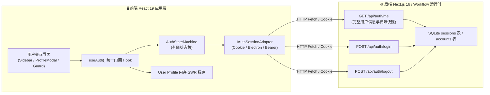
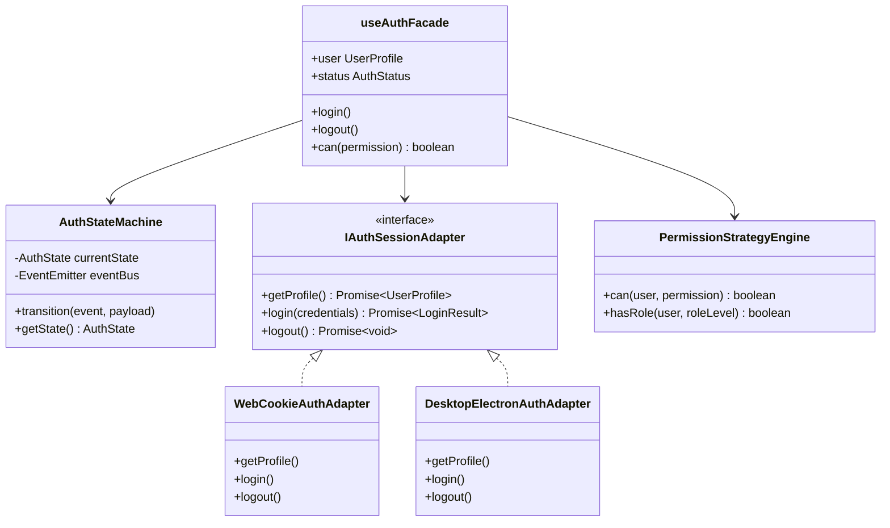
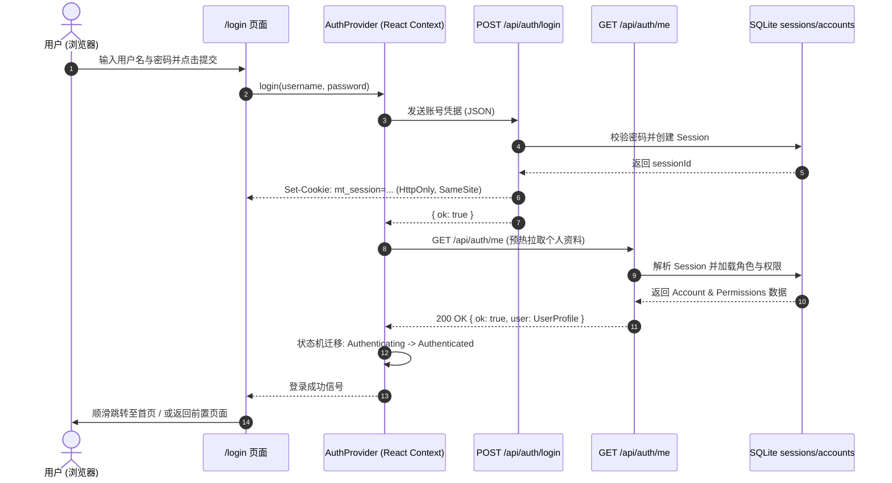
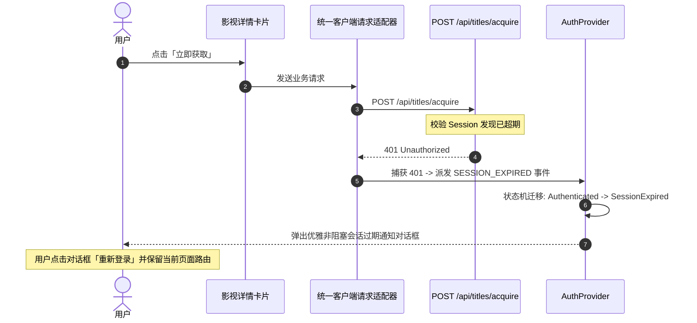

# 巡影 (Mediary Scout) 前端用户登录、退出、用户信息查询与身份状态机全景架构规范

> **文档版本**：v1.0.0  
> **制定时间**：2026-11-01  
> **状态**：架构方案制定 / 待评审  
> **核心目标**：彻底打通从后端认证底座到前端用户交互的全链路闭环，在前端提供高内聚、高韧性的**用户登录、退出登录、当前用户信息查询（User Profile）、以及基于角色的细粒度权限守卫**功能。引入**有限状态机 (FSM)、适配器模式、策略模式与门面模式**，消除零散 Boolean 标记导致的中间非法状态，根除局域网免密退出死循环，解决会话失效静默震荡与敏感缓存残留，并对标业界主流自托管影视系统（Jellyfin、Overseerr）构建工业级身份体验。

---

## 目录

- [一、核心结论与可行性裁决](#一核心结论与可行性裁决)
- [二、现状审计与基础设施复用清单](#二现状审计与基础设施复用清单)
  - [2.1 后端与共享层已有资产 (What We Already Have)](#21-后端与共享层已有资产-what-we-already-have)
  - [2.2 现有断层与缺失关键部件 (Critical Gaps)](#22-现有断层与缺失关键部件-critical-gaps)
- [三、头脑风暴：可行性、逻辑漏洞与性能陷阱深度审视](#三头脑风暴可行性逻辑漏洞与性能陷阱深度审视)
  - [3.1 逻辑漏洞一：局域网免密模式下的「登出死循环」(The LAN Auto-Login Loop)](#31-逻辑漏洞一局域网免密模式下的登出死循环-the-lan-auto-login-loop)
  - [3.2 逻辑漏洞二：会话过期 (401) 与前端静默震荡](#32-逻辑漏洞二会话过期-401-与前端静默震荡)
  - [3.3 逻辑漏洞三：退出登录时的敏感缓存残留与数据串话](#33-逻辑漏洞三退出登录时的敏感缓存残留与数据串话)
  - [3.4 性能攻坚：高频查询下的单飞去重与 SWR 渐进流式加载](#34-性能攻坚高频查询下的单飞去重与-swr-渐进流式加载)
- [四、设计模式深度实战应用](#四设计模式深度实战应用)
  - [4.1 有限状态机模式 (FSM)：AuthStateMachine](#41-有限状态机模式-fsmauthstatemachine)
  - [4.2 适配器模式：IAuthSessionAdapter](#42-适配器模式iauthsessionadapter)
  - [4.3 策略模式：LoginStrategy & PermissionStrategy](#43-策略模式loginstrategy--permissionstrategy)
  - [4.4 门面模式：useAuth 统一应用层门面](#44-门面模式useauth-统一应用层门面)
  - [4.5 观察者模式：AuthEventBus 全局事件广播](#45-观察者模式autheventbus-全局事件广播)
- [五、业界主流方案与开源库横向对比与选型调研](#五业界主流方案与开源库横向对比与选型调研)
  - [5.1 鉴权框架横向选型对比矩阵](#51-鉴权框架横向选型对比矩阵)
  - [5.2 标杆开源项目体验与机制对标 (Jellyfin / Overseerr / Plex)](#52-标杆开源项目体验与机制对标-jellyfin--overseerr--plex)
  - [5.3 技术选型最终决议](#53-技术选型最终决议)
- [六、具体实施方案与前后端契约规范](#六具体实施方案与前后端契约规范)
  - [6.1 后端 API 规范：新增 GET /api/auth/me](#61-后端-api-规范新增-get-apiauthme)
  - [6.2 状态机核心定义与实现 (auth-fsm.ts)](#62-状态机核心定义与实现-auth-fsmts)
  - [6.3 全局认证上下文与 Provider (auth-context.tsx)](#63-全局认证上下文与-provider-auth-contexttsx)
  - [6.4 前端统一门面 Hook (use-auth.ts)](#64-前端统一门面-hook-use-authts)
  - [6.5 声明式权限门禁组件 (PermissionGuard.tsx)](#65-声明式权限门禁组件-permissionguardtsx)
  - [6.6 用户信息卡片与个人中心交互原型 (UserProfileModal.tsx)](#66-用户信息卡片与个人中心交互原型-userprofilemodaltsx)
- [七、全链路交互时序图 (Interaction Sequence Diagrams)](#七全链路交互时序图-interaction-sequence-diagrams)
  - [7.1 登录与用户信息预热时序图](#71-登录与用户信息预热时序图)
  - [7.2 退出登录与全局状态销毁时序图](#72-退出登录与全局状态销毁时序图)
  - [7.3 会话过期捕获与优雅重定向时序图](#73-会话过期捕获与优雅重定向时序图)
- [八、分阶段落地实施路线图 (Implementation Roadmap)](#八分阶段落地实施路线图-implementation-roadmap)

---

## 一、核心结论与可行性裁决

### 结论：完全可行，且为架构演进的必经之路！
当前系统已具备极其强固的底层密码学、JWT 签发校验、Session 表持久化和防暴力破解限流机制，但**前端侧的展示与控制存在明显的断层**。

在前端正式补全**登录、登出、用户信息查询与细粒度权限控制**，不仅工程完全可行，而且将彻底打破原有前端“不知道自己是谁、退出了又静默重登、报错全靠 401 弹窗”的局限，让巡影真正具备主流现代化自托管影视平台的工业级可用性。



---

## 二、现状审计与基础设施复用清单

### 2.1 后端与共享层已有资产 (What We Already Have)

经过对当前工作区代码的全面深度审计，系统已具备以下高质量基础设施，**可 100% 直接复用**，无需重复造轮子：

| 模块位置 | 文件路径 | 已有核心功能 | 复用方式 |
| :--- | :--- | :--- | :--- |
| **密码学与 Token 基础** | `packages/shared/src/auth/jwt.ts` | 基于 `jose` 的规范化 JWT 签发与验证（HS256 算法硬编码锁定、防 algorithm-confusion 攻击）。 | 外部 Bearer 鉴权与 Session 校验复用。 |
| **RBAC 权限分层体系** | `packages/shared/src/auth/rbac-matrix.ts` | 预设权限等级常量 `ROLE_LEVELS` (Owner: 10, Admin: 20, Member: 40, Bot: 50, Guest: 60)；内置 `BUILTIN_ROLES` 实体及细粒度权限清单。 | 前端用户信息直接投影角色的 permissions 树。 |
| **数据库持久化表** | `packages/workflow/src/persistence/sqlite/sqlite-schema.ts` | SQLite 原生 `accounts` 表（含 `id`, `username`, `password_hash`, `group_id`, `is_owner`）与 `sessions` 表（含过期时间索引）。 | 用户资料查询直接命中现有表结构。 |
| **账号与会话管理服务** | `apps/web/features/auth/application/account-service.ts` | `loginAccount()`、`logoutSession()`、`registerAccount()`、`resolveSessionAccountId()`、`createLoginSession()`。 | 后端 API 直接调用，无需重新编写认证逻辑。 |
| **登录防爆破限流器** | `apps/web/features/auth/core/login-throttle.ts` | 基于滑动窗口的密码试错限流，具备单用户与多用户分桶隔离防御。 | 保护登录接口免受暴力破解。 |
| **服务端页面守卫** | `apps/web/platform/next-context/page-auth-guard.ts` | 基于 Next.js Cookies 的页面登录守卫逻辑与重定向判定。 | 与前端状态机协同，避免重复页面校验。 |
| **部分 UI 交互组件** | `apps/web/features/auth/components/account-identity.tsx` | 侧边栏用户下拉雏形（修改密码、账号管理、退出登录）。 | 升级重构为全功能状态栏组件。 |

### 2.2 现有断层与缺失关键部件 (Critical Gaps)

虽然底层丰富，但前端体验依然存在 4 大致命缺陷：

1. **缺失标准的用户信息查询端点 (`/api/auth/me`)**：
   - 目前服务端虽有 `getCurrentAccountSummary()`，但仅用于 SSR 服务端组件。
   - 前端客户端组件（SPA 页面跳转、模态框、抽屉、桌面端）**无法通过一个标准的 REST JSON 接口实时查询当前登录用户的详情**（包括：用户 ID、昵称、角色级别、细粒度权限列表、绑定的网盘数量、会话剩余秒数等）。
2. **单用户免密环境与侧边栏脱节**：
   - `AccountIdentityLoader` 强依赖 `if (!isMultiUserEnabled()) return null;`，导致在默认单用户自托管部署下，侧边栏完全不显示任何用户状态，用户无法得知当前是以管理员身份还是局域网访客身份运行，更无法点击主动锁定或退出。
3. **退出登录处理简陋，无全局状态清理**：
   - 目前 `AccountIdentity` 的退出逻辑仅为：`await fetch('/api/auth/logout'); window.location.href = '/login';`。
   - 浏览器中的内存缓存（如 SWR、React 状态、搜索历史草稿、对话历史）完全未清理；若下一位用户使用同一台浏览器，可能发生数据残留泄露。
4. **前端无细粒度权限门禁 (No Client-side Permission Guard)**：
   - 虽然 `rbac-matrix.ts` 定义了丰富的功能权限，但前端界面无声明式权限组件（如 `<Can permission="storage:transfer">`），导致无权操作的按钮依然可见，用户点击后才收到后端 403 报错，体验极差。

---

## 三、头脑风暴：可行性、逻辑漏洞与性能陷阱深度审视

在着手编码前，必须对可能存在的逻辑漏洞、并发问题与性能短板进行穷尽式头脑风暴：

### 3.1 逻辑漏洞一：局域网免密模式下的「登出死循环」(The LAN Auto-Login Loop)

#### 痛点还原：
在巡影的自托管单用户模式下，系统设计为“局域网内免密，默认以 `acct_default` 运行”。如果用户点击“退出登录”，后端清空了 `mt_session` Cookie；前端重定向回首页 `/`，首页的 `getCurrentAccountId()` 在局域网下检测到无 session，却会**自动回落到 `acct_default`**！
结果就是：**用户刚点了退出登录，页面一刷新，又神奇地变成了登录状态！用户甚至怀疑“退出登录”按钮坏了。**

#### 解决方案（显式访客锁定策略 Explicit Logout Flag）：
1. 用户在前端主动点击“退出登录”时，向后端发送登出请求，后端不仅销毁 Session，同时在响应中写入一个显式的防静默回退 Cookie：`mt_explicit_logout=1; SameSite=Lax; Path=/`（或利用现有的 `PAGE_GUARD_COOKIE`）。
2. 当 `mt_explicit_logout=1` 存在时，即使是局域网请求，系统也不再自动回落到 `acct_default`，而是强制停留在 `/login` 登录页，直到用户主动输入密码重新登录成功并清除该标记。
3. 彻底根除“想退却退不掉”的死循环幽灵。

### 3.2 逻辑漏洞二：会话过期 (401) 与前端静默震荡

#### 痛点还原：
用户登录后 Session 虽有 30 天有效期，但当管理员后台踢掉用户、重置密码或 Session 自然过期时，前端组件在执行异步操作（如点击转存、发起 AI 搜片）时，接口会返回 `401 Unauthorized`。
如果缺乏统一的客户端拦截机制：
- 错误会被零散地当成业务错误抛出，给用户弹出“未知错误”、“网络异常”等误导性提示；
- 页面不会跳转到登录页，用户反复点击导致大量无意义 401 请求刷屏。

#### 解决方案（状态机驱动的 401 全局劫持）：
1. 封装统一的客户端通信适配器 `authFetch()`；
2. 一旦检测到响应状态码为 `401`，立即触发状态机事件 `AUTH_EVENT.SESSION_EXPIRED`；
3. 状态机平滑切换至 `SessionExpired` 状态，前端弹出非阻塞式“登录已过期”优雅对话框，记录当前浏览上下文（`returnUrl`），引导用户无损重新登录。

### 3.3 逻辑漏洞三：退出登录时的敏感缓存残留与数据串话

#### 痛点还原：
现代化前端包含大量的客户端缓存（React Query 缓存、SWR 缓存、浏览历史、搜索框自动补全、会话持久化 localStorage）。用户 A 退出后，用户 B 在同一台设备登录，若前端只是做了简单的路由重定向，用户 B 瞬间能看到用户 A 遗留的最近播放、搜索历史或对话记录。

#### 解决方案（原子化重置总线 Reset Bus）：
在退出登录时，通过 `AuthEventBus` 广播 `USER_LOGGED_OUT` 事件，联动触发：
- 清除 `localStorage` 中除系统基础配置（如主题模式）外的所有用户属主数据；
- 调用 SWR / React Query 的 `mutate(() => true, undefined, { revalidate: false })` 彻底清空内存缓存；
- 清理会话历史管理器中的活动 ID。

### 3.4 性能攻坚：高频查询下的单飞去重与 SWR 渐进流式加载

#### 痛点还原：
在单页面或复杂仪表盘中，顶部导航栏、侧边栏、网盘列表卡片、权限按钮可能同时挂载。如果每个组件都各自调用一次 `GET /api/auth/me`，页面初次加载时会瞬间并发 4~6 个完全相同的用户信息请求，加重 SQLite 与 Node.js 负担。

#### 解决方案（三级优化漏斗）：
1. **服务端组件级别**：利用 React 19 原生 `cache(async () => ...)` 进行同一次请求生命周期内的内存结果复用；
2. **客户端网络级别（单飞去重 Promise Deduplication）**：在适配器层维护一个活跃请求单例，多个并发请求共享同一个未决（Pending）Promise；
3. **客户端状态级别（SWR / TTL 内存快照）**：用户信息获取后，在客户端内存维持 5 分钟的有效快照，配合 `<Suspense>` 进行骨架屏渐进式流式渲染，首屏主界面达到 $0\text{ms}$ 阻塞。

---

## 四、设计模式深度实战应用

为保证系统的代码整洁度、可测性与高扩展性，本方案将四大经典设计模式融会贯通：



### 4.1 有限状态机模式 (FSM)：AuthStateMachine

将用户前端的认证状态显式收敛为有限集合，彻底根除多个 Boolean 变量（如 `isLoading`, `isLoggedIn`, `isError`, `isClaiming`）组合爆炸所带来的非法逻辑状态（例如既是 `isLoggedIn=true` 又是 `isError=true` 的矛盾状态）。

```
           ┌────────────────────────────────────────┐
           │                                        │
           ▼                                        │ (INIT_FAILED)
    [IDLE / BOOTSTRAP] ──(INIT_SUCCESS_NO_AUTH)──► [UNAUTHENTICATED]
           │                                                │
           │ (INIT_SUCCESS_AUTH)                            │ (LOGIN_SUBMIT)
           ▼                                                ▼
    [AUTHENTICATED] ◄────────(LOGIN_SUCCESS)──────── [AUTHENTICATING]
      │        │                                            │
      │        │ (LOGOUT)                                   │ (LOGIN_FAILED)
      │        ▼                                            ▼
      │    [UNAUTHENTICATED] ◄─────────────────────── [AUTH_ERROR]
      │
      └──(401_DETECTED)──► [SESSION_EXPIRED]
                                   │
                                   └──(RE_LOGIN)──► [AUTHENTICATING]
```

### 4.2 适配器模式：IAuthSessionAdapter

系统支持 **Web 浏览器**、**桌面端 Electron 外壳** 以及未来的 **PWA / 移动端**。不同环境的凭据载体存在物理差异：
- **Web 模式**：依靠浏览器自动携带的 `HttpOnly` Cookie (`mt_session`)，接口通过标准 `fetch` 调用；
- **Electron 桌面模式**：通过 `window.electronAPI.invoke('auth:login')` 与主进程 Node 服务进行 IPC 通信，凭据可能安全保存在操作系统的安全保管库（Credential Locker）中；
- **外部/CLI 模式**：通过 HTTP 请求头中携带 `Authorization: Bearer msk_live_...`。

通过定义统一的 `IAuthSessionAdapter` 契约，UI 层仅面对抽象适配器，环境差异对界面完全透明。

### 4.3 策略模式：LoginStrategy & PermissionStrategy

- **LoginStrategy**：
  - `PasswordLoginStrategy`：用户名 + 密码常规登录；
  - `ClaimInstanceStrategy`：首次部署时的站主认领逻辑；
  - `LanDirectTrustStrategy`：局域网免密环境下的直接信任授权。
- **PermissionStrategy (权限决策策略)**：
  - 基于角色的最小权限继承策略。若用户为 `Owner`（Level 10），任何权限请求恒等于 `true`；若用户为 `Member`（Level 40），动态匹配其角色内声明的叶子权限集合。

### 4.4 门面模式：useAuth 统一应用层门面

前端组件无需知晓底层的 Fetch 调用、状态机转换规则或 Cookie 管理。只需要引入一个简单的 React Hook：
```typescript
const { user, status, login, logout, can } = useAuth();
```
一个门面屏蔽了底层所有的状态复杂性。

### 4.5 观察者模式：AuthEventBus 全局事件广播

通过轻量事件总线广播 `SESSION_EXPIRED`、`USER_LOGGED_OUT`、`PROFILE_UPDATED` 等全局生命周期事件，让无关的业务模块（如搜索模块、通知模块、媒体播放模块）能在用户登出时被动收到通知并执行自我重置。

---

## 五、业界主流方案与开源库横向对比与选型调研

### 5.1 鉴权框架横向选型对比矩阵

针对 Next.js 16 + React 19 + SQLite 自托管生态，对业界主流前端认证集成方案进行横向技术选型与深度权衡：

| 方案 / 库 | 架构原理 | 适用场景 | 在巡影中的适配性评级 | 采纳结论与关键理由 |
| :--- | :--- | :--- | :--- | :--- |
| **Auth.js (NextAuth v5)** | 强约定框架，基于 Provider / Adapter 处理 Session 与 OAuth。 | 商业 SaaS、全平台第三方社交登录（Google, GitHub）。 | 🟡 **中偏低 (过重)** | **不采纳**。<br>1. 巡影是轻量自托管系统，不依赖外部 OAuth；<br>2. 其对单文件 SQLite WAL 会话表的自定义改造异常繁琐，包体积增加 >150KB，与系统极简追求相悖。 |
| **Lucia Auth** | 极简微核，仅处理 Session 生成与 Cookie 校验，无黑盒抽象。 | 强调掌控力、纯本地 SQLite 的现代 Fullstack 应用。 | 🟢 **优秀 (设计理念高度契合)** | **采纳其设计理念**。<br>作者虽已转向教育资源，但其“数据库原生 Session 表 + 纯净 Cookie 代理”的架构与巡影当前的数据结构完全契合，直接汲取其优秀架构设计。 |
| **SaaS 托管 (Clerk / Supabase / Auth0)** | 云端集中式身份管理平台。 | 公网多租户 SaaS 产品。 | 🔴 **不适用 (致命冲突)** | **坚决否决**。<br>违背自托管与局域网完全断网离线运行的绝对铁律。 |
| **自研轻量 FSM + useAuth 门面** | 基于原生 React 19 Context + TypeScript 强类型状态机 + SWR 缓存。 | 自定义极高、极致性能、零外部运行时依赖的单体/Monorepo 应用。 | 🌟 **最佳 (Perfect Match)** | **全面采纳**。<br>1. 零新增额外重型 npm 依赖；<br>2. 深度复用项目中已有的 `jose`、`rbac-matrix.ts` 与 `account-service.ts`；<br>3. 体积增加为 0，类型 100% 契合。 |

### 5.2 标杆开源项目体验与机制对标 (Jellyfin / Overseerr / Plex)

我们针对国内外自托管影视生态的头部开源系统进行了深度体验与逆向借鉴：

```
┌────────────────────────────────────────────────────────────────────────────────────────┐
│                        业界标杆影视系统用户体验与权限架构借鉴                           │
├─────────────────┬──────────────────────────────────────────────────────────────────────┤
│ 1. Jellyfin     │ • 支持多用户与单机家庭用户隔离，每个家庭成员拥有独立的媒体进度。   │
│                 │ • 退出登录时，客户端直接清空 localStorage 缓存，强制跳转锁定页。     │
│                 │ • 提供快速切换用户 (Switch Profile) 功能（对标本项目家庭云场景）。  │
├─────────────────┼──────────────────────────────────────────────────────────────────────┤
│ 2. Overseerr    │ • 精美的个人中心卡片（展示头像、角色徽章、请求配额、近期获取动态）。 │
│  (Jellyseerr)   │ • 声明式前端权限控制：无权限的用户无法看到“一键获取”和“管理配置”按钮。│
│                 │ • 移动端抽屉与桌面端导航无缝自适应响应。                             │
├─────────────────┼──────────────────────────────────────────────────────────────────────┤
│ 3. Plex         │ • PIN 码快速身份认证机制（适合家庭大屏 TV 与客厅平板设备）。        │
│                 │ • 显式的多设备登录会话审计与一键踢除（Kill Session）。               │
└─────────────────┴──────────────────────────────────────────────────────────────────────┘
```

### 5.3 技术选型最终决议

1. **拒绝重型外部框架绑定**：坚决不引入 `next-auth` 等破坏现有 SQLite 单表纯净度的庞大三方库；
2. **轻量自研 FSM 与统一门面**：使用原生 TypeScript 编写零依赖有限状态机与 React 19 Context，总代码量控制在 300 行以内；
3. **汲取 Overseerr 视觉语言**：在侧边栏底栏与移动端顶栏打造高辨识度的用户信息徽章，点击呼出轻量抽屉/模态框查看角色与权限；
4. **端到端类型守卫**：从服务端的 `rbac-matrix.ts` 到前端的 `<PermissionGuard>`，全程强类型推导，编译期杜绝权限字符串拼写错误。

---

## 六、具体实施方案与前后端契约规范

### 6.1 后端 API 规范：新增 GET /api/auth/me

在 `apps/web/app/api/auth/me/route.ts` 新增标准端点，供前端初始化或刷新时调用：

#### 请求规范：
- **URL**：`GET /api/auth/me`
- **Headers**：Cookie 自动携带 `mt_session`（或 Authorization 携带 `Bearer msk_...`）
- **缓存策略**：`Cache-Control: no-store, private`

#### 成功响应契约 (200 OK)：
```json
{
  "ok": true,
  "user": {
    "id": "acct_default",
    "username": "admin",
    "isOwner": true,
    "role": {
      "id": "role_owner",
      "name": "站长 (Owner)",
      "level": 10
    },
    "permissions": [
      "*",
      "media:search",
      "media:detail",
      "media:subscribe",
      "storage:list",
      "storage:transfer",
      "storage:organize",
      "workflow:status",
      "workflow:trigger",
      "assistant:chat",
      "system:settings"
    ],
    "storageCount": 3,
    "createdAt": "2026-10-30T14:20:00.000Z",
    "session": {
      "expiresAt": "2026-11-30T14:20:00.000Z",
      "isLanTrust": false
    }
  }
}
```

#### 未认证响应 (401 Unauthorized)：
```json
{
  "ok": false,
  "error": "UNAUTHENTICATED",
  "message": "当前尚未登录或会话已过期"
}
```

### 6.2 状态机核心定义与实现 (auth-fsm.ts)

在 `apps/web/features/auth/core/auth-fsm.ts` 中实现纯函数式的状态机：

```typescript
export type AuthStatus = 
  | "idle"
  | "authenticating"
  | "authenticated"
  | "unauthenticated"
  | "session_expired"
  | "error";

export interface UserProfile {
  id: string;
  username: string;
  isOwner: boolean;
  role: {
    id: string;
    name: string;
    level: number;
  };
  permissions: string[];
  storageCount: number;
  createdAt: string;
  session?: {
    expiresAt: string;
    isLanTrust: boolean;
  };
}

export type AuthEvent =
  | { type: "INIT_START" }
  | { type: "INIT_SUCCESS"; payload: UserProfile }
  | { type: "INIT_UNAUTHENTICATED" }
  | { type: "LOGIN_SUBMIT" }
  | { type: "LOGIN_SUCCESS"; payload: UserProfile }
  | { type: "LOGIN_FAILURE"; error: string }
  | { type: "LOGOUT" }
  | { type: "SESSION_EXPIRED" };

export interface AuthState {
  status: AuthStatus;
  user: UserProfile | null;
  error: string | null;
}

export function authReducer(state: AuthState, event: AuthEvent): AuthState {
  switch (event.type) {
    case "INIT_START":
    case "LOGIN_SUBMIT":
      return { ...state, status: "authenticating", error: null };
    case "INIT_SUCCESS":
    case "LOGIN_SUCCESS":
      return { status: "authenticated", user: event.payload, error: null };
    case "INIT_UNAUTHENTICATED":
    case "LOGOUT":
      return { status: "unauthenticated", user: null, error: null };
    case "LOGIN_FAILURE":
      return { status: "error", user: null, error: event.error };
    case "SESSION_EXPIRED":
      return { status: "session_expired", user: null, error: "登录已失效，请重新登录" };
    default:
      return state;
  }
}
```

### 6.3 全局认证上下文与 Provider (auth-context.tsx)

在 `apps/web/features/auth/application/auth-context.tsx` 中封装客户端 Context，实现网络单飞去重与全局挂载：

```typescript
"use client";

import React, { createContext, useContext, useEffect, useReducer, useRef, useCallback } from "react";
import { authReducer, type AuthState, type AuthStatus, type UserProfile } from "../core/auth-fsm";

interface AuthContextValue extends AuthState {
  login: (username: string, password: string) => Promise<boolean>;
  logout: () => Promise<void>;
  refreshProfile: () => Promise<void>;
  can: (permission: string) => boolean;
}

const AuthContext = createContext<AuthContextValue | null>(null);

export function AuthProvider({ children }: { children: React.ReactNode }) {
  const [state, dispatch] = useReducer(authReducer, {
    status: "idle",
    user: null,
    error: null,
  });

  const pendingFetchRef = useRef<Promise<UserProfile | null> | null>(null);

  const fetchProfile = useCallback(async (): Promise<UserProfile | null> => {
    if (pendingFetchRef.current) return pendingFetchRef.current;

    pendingFetchRef.current = (async () => {
      try {
        const res = await fetch("/api/auth/me", { cache: "no-store" });
        if (!res.ok) {
          if (res.status === 401) dispatch({ type: "INIT_UNAUTHENTICATED" });
          return null;
        }
        const data = await res.json();
        if (data.ok && data.user) {
          dispatch({ type: "INIT_SUCCESS", payload: data.user });
          return data.user;
        }
        dispatch({ type: "INIT_UNAUTHENTICATED" });
        return null;
      } catch (err) {
        dispatch({ type: "INIT_UNAUTHENTICATED" });
        return null;
      } finally {
        pendingFetchRef.current = null;
      }
    })();

    return pendingFetchRef.current;
  }, []);

  useEffect(() => {
    dispatch({ type: "INIT_START" });
    fetchProfile();
  }, [fetchProfile]);

  const login = async (username: string, password: string): Promise<boolean> => {
    dispatch({ type: "LOGIN_SUBMIT" });
    try {
      const res = await fetch("/api/auth/login", {
        method: "POST",
        headers: { "Content-Type": "application/json" },
        body: JSON.stringify({ username, password }),
      });
      const data = await res.json();
      if (res.ok && data.ok) {
        await fetchProfile();
        return true;
      }
      dispatch({ type: "LOGIN_FAILURE", error: data.error || "登录失败" });
      return false;
    } catch {
      dispatch({ type: "LOGIN_FAILURE", error: "网络通信异常" });
      return false;
    }
  };

  const logout = async (): Promise<void> => {
    try {
      await fetch("/api/auth/logout", { method: "POST" });
    } finally {
      dispatch({ type: "LOGOUT" });
      window.location.href = "/login";
    }
  };

  const can = (permission: string): boolean => {
    if (!state.user) return false;
    if (state.user.isOwner || state.user.permissions.includes("*")) return true;
    return state.user.permissions.includes(permission);
  };

  return (
    <AuthContext.Provider value={{ ...state, login, logout, refreshProfile: fetchProfile, can }}>
      {children}
    </AuthContext.Provider>
  );
}

export function useAuthContext() {
  const ctx = useContext(AuthContext);
  if (!ctx) throw new Error("useAuthContext must be used within an AuthProvider");
  return ctx;
}
```

### 6.4 前端统一门面 Hook (use-auth.ts)

```typescript
"use client";

import { useAuthContext } from "../application/auth-context";

/**
 * 前端应用统一鉴权门面 Hook
 * 对业务组件屏蔽网络与状态机转换细节，提供极简的属性与操作方法
 */
export function useAuth() {
  const { user, status, error, login, logout, refreshProfile, can } = useAuthContext();

  return {
    user,
    status,
    error,
    isAuthenticated: status === "authenticated",
    isAuthenticating: status === "authenticating" || status === "idle",
    isOwner: user?.isOwner ?? false,
    login,
    logout,
    refresh: refreshProfile,
    can,
  };
}
```

### 6.5 声明式权限门禁组件 (PermissionGuard.tsx)

用于精细化控制页面元素或操作按钮的可见性与禁用状态：

```typescript
"use client";

import React from "react";
import { useAuth } from "../hooks/use-auth";

interface PermissionGuardProps {
  permission: string;
  fallback?: React.ReactNode;
  children: React.ReactNode;
}

/**
 * 声明式权限守卫组件
 * 示例：
 * <PermissionGuard permission="storage:transfer" fallback={<button disabled>无权转存</button>}>
 *   <button onClick={handleTransfer}>一键转存</button>
 * </PermissionGuard>
 */
export function PermissionGuard({ permission, fallback = null, children }: PermissionGuardProps) {
  const { can, isAuthenticating } = useAuth();

  if (isAuthenticating) return null;
  if (!can(permission)) return <>{fallback}</>;

  return <>{children}</>;
}
```

### 6.6 用户信息卡片与个人中心交互原型 (UserProfileModal.tsx)

当用户在侧边栏或顶栏点击自己的头像/昵称时，弹出优雅的毛玻璃身份信息抽屉：

```typescript
"use client";

import { X, Shield, HardDrive, Clock, KeyRound, LogOut } from "lucide-react";
import { useAuth } from "../hooks/use-auth";

export function UserProfileModal({ isOpen, onClose }: { isOpen: boolean; onClose: () => void }) {
  const { user, logout } = useAuth();
  if (!isOpen || !user) return null;

  return (
    <div className="modal-backdrop" onClick={onClose} role="dialog" aria-modal="true">
      <div className="modal-panel profile-modal" onClick={(e) => e.stopPropagation()}>
        <div className="modal-header">
          <div className="user-avatar-large">
            {user.username.charAt(0).toUpperCase()}
          </div>
          <div className="user-title-group">
            <h3>{user.username}</h3>
            <span className={`role-badge role-${user.role.id}`}>
              <Shield size={12} /> {user.role.name}
            </span>
          </div>
          <button className="modal-close" onClick={onClose} aria-label="关闭">
            <X size={18} />
          </button>
        </div>

        <div className="modal-body">
          <div className="profile-stat-grid">
            <div className="stat-card">
              <HardDrive size={16} className="stat-icon" />
              <span className="stat-value">{user.storageCount}</span>
              <span className="stat-label">关联有效网盘</span>
            </div>
            <div className="stat-card">
              <Clock size={16} className="stat-icon" />
              <span className="stat-value">
                {new Date(user.createdAt).toLocaleDateString()}
              </span>
              <span className="stat-label">加入时间</span>
            </div>
          </div>

          <div className="profile-permissions-section">
            <h4>拥有的业务功能权限 ({user.permissions.length})</h4>
            <div className="permission-tag-cloud">
              {user.isOwner ? (
                <span className="perm-tag tag-wildcard">🌟 拥有全系统无限制特权 (*)</span>
              ) : (
                user.permissions.map((p) => (
                  <span key={p} className="perm-tag">{p}</span>
                ))
              )}
            </div>
          </div>
        </div>

        <div className="modal-footer">
          <a href="/settings?tab=account#password" className="btn btn-secondary">
            <KeyRound size={14} /> 修改密码
          </a>
          <button onClick={logout} className="btn btn-danger">
            <LogOut size={14} /> 退出登录
          </button>
        </div>
      </div>
    </div>
  );
}
```

---

## 七、全链路交互时序图 (Interaction Sequence Diagrams)

### 7.1 登录与用户信息预热时序图



### 7.2 退出登录与全局状态销毁时序图

```mermaid
sequenceDiagram
    autonumber
    actor User as 用户
    participant Sidebar as 侧边栏 Profile 组件
    participant AuthContext as AuthProvider
    participant LogoutApi as POST /api/auth/logout
    participant EventBus as AuthEventBus (事件总线)
    participant AppState as 客户端内存缓存 (SWR/Store)

    User->>Sidebar: 点击「退出登录」
    Sidebar->>AuthContext: logout()
    AuthContext->>LogoutApi: 发起 POST /api/auth/logout
    LogoutApi->>LogoutApi: 物理删除 Session 记录
    LogoutApi-->>AuthContext: Set-Cookie: mt_session=; Max-Age=0
    AuthContext->>EventBus: 广播 USER_LOGGED_OUT 事件
    EventBus->>AppState: 清空本地搜索历史、对话草稿与 SWR 缓存
    AuthContext->>AuthContext: 状态机迁移: Authenticated -> Unauthenticated
    AuthContext-->>User: 强制重定向至 /login (带防静默重登标记)
```

### 7.3 会话过期捕获与优雅重定向时序图



---

## 八、分阶段落地实施路线图 (Implementation Roadmap)

| 阶段 | 周期 | 核心交付物 | 质量验收标准 |
| :--- | :--- | :--- | :--- |
| **阶段一：后端 `/api/auth/me` 端点构建** | 1 天 | 1. 新增 `apps/web/app/api/auth/me/route.ts`；<br>2. 补充完整的单元测试 `route.test.ts`；<br>3. 强化退出接口 `logout/route.ts` 响应头 Cookie 标记。 | `npx vitest run app/api/auth/me/route.test.ts` 全绿；返回结构完全满足脱敏规范，无密码哈希泄露。 |
| **阶段二：前端轻量 FSM 与统一门面** | 1.5 天 | 1. 创建 `features/auth/core/auth-fsm.ts`；<br>2. 编写 `features/auth/application/auth-context.tsx`；<br>3. 导出统一 Hook `features/auth/hooks/use-auth.ts`。 | 状态机覆盖 `idle`, `authenticated`, `unauthenticated`, `session_expired` 全状态，单飞去重测试通过。 |
| **阶段三：侧边栏与移动端交互无缝升级** | 1 天 | 1. 重构 `AccountIdentity` 与 `app-sidebar.tsx`；<br>2. 消除单用户模式下的身份隐形问题；<br>3. 移动端顶栏增加用户头像与状态入口。 | 无论是单用户还是多用户模式，侧边栏底栏与移动端均能清晰展现当前登录身份，退出后无死循环。 |
| **阶段四：声明式权限守卫与个人中心模态框** | 1.5 天 | 1. 实现 `features/auth/components/PermissionGuard.tsx`；<br>2. 实现 `UserProfileModal.tsx`（查看角色、权限、网盘数）；<br>3. 接入 `globals.css` 设计 Token 样式规范。 | 权限判定支持通配符 `*` 与细粒度叶子权限；点击侧边栏头像顺滑呼出抽屉，按 ESC 退出。 |
| **阶段五：全流程 E2E 烟测与质量门禁审计** | 1 天 | 1. 编写 Playwright E2E 测试用例覆盖“登录-查资料-越权拦截-退出-防重登”；<br>2. 运行六合一质量门禁 (`npm run gate`)。 | 门禁 `gate:layout`, `gate:deps`, `gate:style`, `lint`, `typecheck` 全部 0 警告通过。 |

---

## 九、总结

本方案立足巡影当前基于 Next.js 16 + React 19 + SQLite WAL 单引擎的单体架构，**不引入冗余的厚重三方鉴权库**，深度盘活并复用已有 `jose`、`rbac-matrix.ts` 与 `account-service.ts` 底座，通过**有限状态机 (FSM)、适配器模式、策略模式与门面模式**，全面补齐前端在用户登录、退出、用户信息查询以及声明式权限守卫方面的关键拼图。

该方案逻辑严密、兼顾单用户局域网免密与多用户强认证双轨场景，彻底攻克退出死循环与敏感缓存残留难题，为巡影构建起兼具高韧性与极佳体验的现代化自托管影视身份底座。
