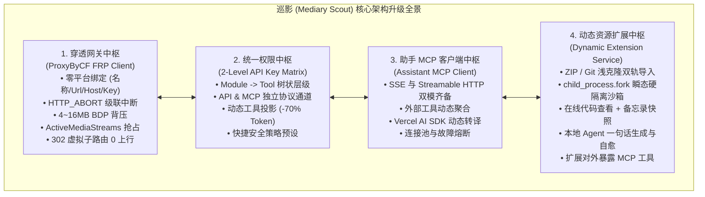
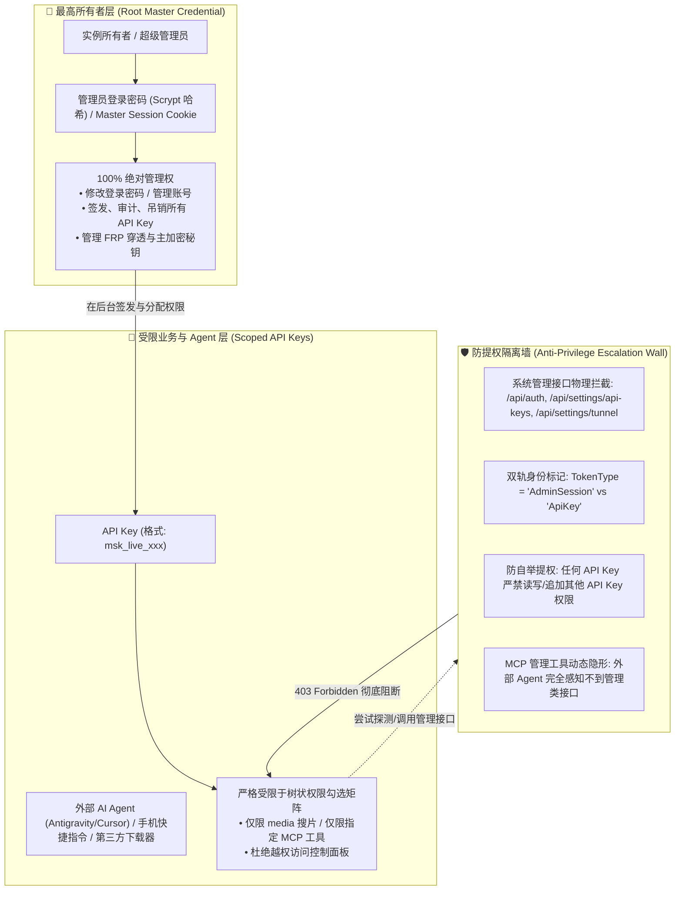
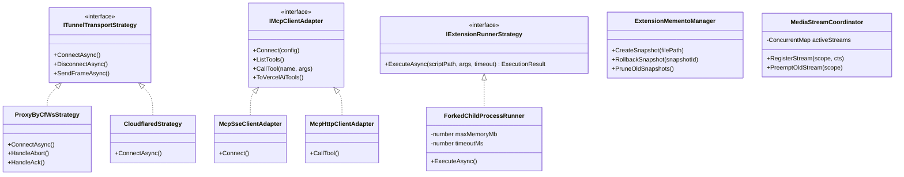
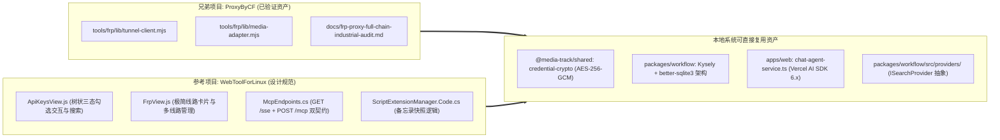
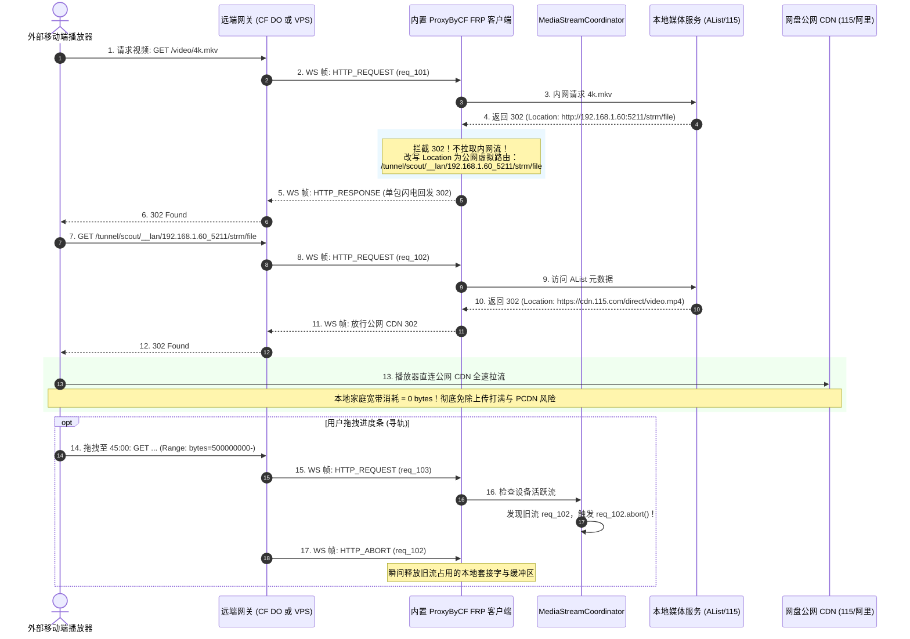
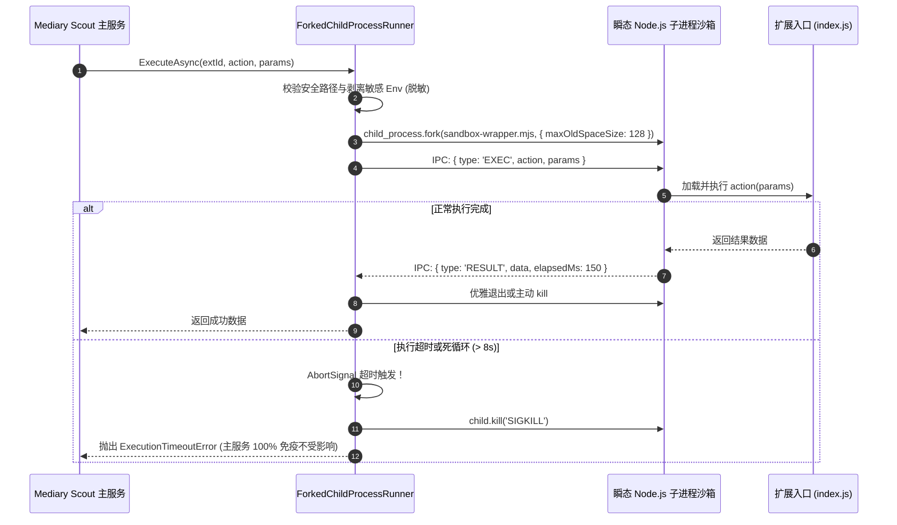
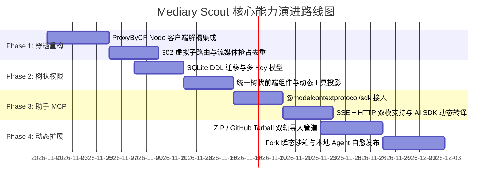

# 巡影 (Mediary Scout) 架构演进与前沿技术方案调研：ProxyByCF FRP 穿透、树状 API Key 鉴权、助手 MCP 管理与动态扩展服务

> **文档定位**：技术可行性调研报告、架构演进 RFC 与工程落地实施方案  
> **面向对象**：Mediary Scout 核心开发、多媒体系统架构师、AI Agent 工程师、运维网关专家  
> **对标参考**：
> 1. `E:\WorkProject\CSharp\PrivateProject\Web\WebToolForLinux`（C# .NET 10 Native AOT 统一树状授权、动态扩展、FRP 客户端、MCP Engine）
> 2. `E:\WorkProject\Node\_CFWorkerProject\ProxyByCF`（TypeScript / Cloudflare Durable Objects 工业级穿透网关与流媒体优化）
> 3. `Model Context Protocol (MCP)` 官方规范（Anthropic 2024-11-05 SSE / Streamable HTTP 协议体系）
>
> **核心决策确认**：
> - **穿透客户端定位**：纯粹解耦设计，仅维护「名称、ServerUrl、TunnelHost、ApiKey」，零服务端平台绑定；
> - **助手 MCP 传输偏好**：全面支持 **SSE** 与 **Streamable HTTP JSON-RPC** 双传输协议；
> - **扩展执行沙箱**：确立 **方案 A（标准：Node.js 原生 `child_process.fork()` 瞬态进程硬隔离）**，零编译依赖，跨平台极稳。

---

## 目录

1. [执行摘要与演进愿景](#一执行摘要与演进愿景)
2. [头脑风暴与四大核心板块深度可行性论证](#二头脑风暴与四大核心板块深度可行性论证)
   - [2.1 板块一：远程访问重构 —— ProxyByCF FRP 反向穿透方案 (纯解耦客户端)](#21-板块一远程访问重构--proxybycf-frp-反向穿透方案-纯解耦客户端)
   - [2.2 板块二：API Key 授权改造 —— 树状二级结构与登录无限制凭据隔离](#22-板块二api-key-授权改造--树状二级结构与登录无限制凭据隔离)
   - [2.3 板块三：设置页助手 MCP 管理 —— SSE 与 HTTP 双模动态导入与聚合](#23-板块三设置页助手-mcp-管理--sse-与-http-双模动态导入与聚合)
   - [2.4 板块四：资源提供商动态扩展 —— ZIP/仓库导入、Agent 生成与双向 MCP 授权 (Fork 沙箱)](#24-板块四资源提供商动态扩展--zip仓库导入agent-生成与双向-mcp-授权-fork-沙箱)
3. [设计模式深度运用与架构拓扑](#三设计模式深度运用与架构拓扑)
   - [3.1 适配器模式 (Adapter Pattern)](#31-适配器模式-adapter-pattern)
   - [3.2 策略模式 (Strategy Pattern)](#32-策略模式-strategy-pattern)
   - [3.3 状态机模式 (State Machine / FSM)](#33-状态机模式-state-machine--fsm)
   - [3.4 备忘录模式 (Memento Pattern)](#34-备忘录模式-memento-pattern)
   - [3.5 断路器与协调器模式 (Circuit Breaker & Coordinator)](#35-断路器与协调器模式-circuit-breaker--coordinator)
4. [现有开源库、工具链调研与选型基准](#四现有开源库工具链调研与选型基准)
5. [业界主流方案对比矩阵 (Industry Benchmarking)](#五业界主流方案对比矩阵-industry-benchmarking)
6. [当前系统现有基础设施与资产复用清单](#六当前系统现有基础设施与资产复用清单)
7. [详细工程落地架构与技术设计](#七详细工程落地架构与技术设计)
   - [7.1 数据库持久化设计 (SQLite + Kysely DDL)](#71-数据库持久化设计-sqlite--kysely-ddl)
   - [7.2 核心流程与时序交互 (Mermaid Sequence)](#72-核心流程与时序交互-mermaid-sequence)
   - [7.3 关键接口与契约抽象 (TypeScript Interfaces)](#73-关键接口与契约抽象-typescript-interfaces)
8. [分阶段实施路线图、门禁与测试验收策略](#八分阶段实施路线图门禁与测试验收策略)

---

## 一、执行摘要与演进愿景

当前 `Mediary Scout`（巡影）已构建了涵盖 TMDB 元数据刮削、多网盘资源搜索（盘搜/海搜/Prowlarr）、115/夸克网盘转存、自动化追剧下载与基于 Vercel AI SDK 的智能对话助理系统。

然而，在面对家庭 NAS、私网穿透、复杂权限隔离、第三方工具集成以及第三方生态扩展场景时，存在四大架构瓶颈：
1. **远程访问强依赖外部进程**：当前依靠外部 `cloudflared` 二进制或容器进程，在处理 115/阿里网盘 4K 原盘流媒体时，因缺少流控与 302 直连改写机制，本地家庭上行极易被挤爆甚至引发 PCDN 封禁；
2. **凭证权限全有或全无**：现有 API Key 仅为单值配置（DB 或 ENV），缺乏多 Key 隔离与细粒度权限控制，外部 Agent 一旦拿到 Key 即获得全系统最高控制权；
3. **对话助手工具集固化**：内置 Agent 工具（`discoverMedia`、`searchMedia` 等）硬编码在源码中，无法无缝引入外部 MCP（Model Context Protocol）生态；
4. **资源提供商扩展封闭**：新增网盘或盘搜渠道必须修改 `packages/workflow` 并重新打包发布，不支持用户或 Agent 动态编写、调试与发布热插拔扩展包。

通过对标参考 `WebToolForLinux`（C# 工业级权限矩阵、动态扩展与 FRP 实现）与 `ProxyByCF`（Cloudflare DO 极速穿透网关与 Node.js 客户端），本方案提出在 `Mediary Scout` 中构建**四大现代模块中枢**，全面释放轻量、安全、动态扩展与自愈进化能力。

---

## 二、头脑风暴与四大核心板块深度可行性论证



### 2.1 板块一：远程访问重构 —— ProxyByCF FRP 反向穿透方案 (纯解耦客户端)

#### 1. 可行性评估：极高 (98%)
- **技术栈天然契合**：`ProxyByCF` 的客户端核心 `tools/frp/lib/tunnel-client.mjs` 和 `media-adapter.mjs` 原生即基于 **Node.js 22 + TypeScript/ESM** 编写；`mediary-scout` 运行在 Node 22 环境下，可以直接复用代码逻辑，省去跨语言转译的巨大成本。
- **免二进制依赖**：摆脱对外部闭源/臃肿的 `cloudflared` 二进制或容器的强依赖，全系统作为单个纯 Node.js 进程轻量启动，内存占用降低至 30MB 以下。

#### 2. 客户端极简解耦设计（零平台绑定）
客户端（Mediary Scout）不绑定任何特定的服务端提供商。参考 `WebToolForLinux` 的 `FrpView.js` 最佳实践，前端界面仅需维护清晰的 **线路凭据卡片**：
- **线路名称 (`name`)**：如 `主线路 (CF Edge)`、`备用线路 (自建 VPS)`；
- **服务端地址 (`serverUrl`)**：如 `https://proxy.example.com` 或 `wss://...`；
- **隧道主机名 (`tunnelHost`)**：外部访问子域名标识（如 `scout`，访问地址即为 `https://scout.example.com`）；
- **认证密钥 (`apiKey`)**：服务端约定的握手 Token（如 `x-pyw-token`）；
- **本地转发目标 (`localTargetUrl`)**：默认 `http://127.0.0.1:3000`；
- **多线路故障转移 (`backupServerUrls`)**：主线路断连超时时自动 failover 到备用节点。

无论服务端背后是 Cloudflare Workers + Durable Objects 还是自建 VPS 上的 Node 镜像，**客户端逻辑 100% 保持一致，只需填入上述参数即可直接建立长连通信**！

#### 3. 业务逻辑闭环：流媒体 302 虚拟子路由拦截
- 针对 115、夸克、阿里等网盘的 STRM/在线播放场景，网盘往往返回 `302 Found` 临时重定向：
  1. 传统局域网反代会忠实地在本地 NAS 下载几十 GB 的视频文件，再通过家庭宽带上行推给外部访客，瞬间撑爆 30~50Mbps 家庭上传带宽，且极易触发运营商对 PCDN 异常上传的断网风控；
  2. **ProxyByCF 的 302 虚拟子路由改写**：将 302 的 Location 拦截并改写为公网虚拟路由 `/tunnel/{slug}/__lan/{internal_host}_{port}/{path}`，外网播放器直连公网 CDN 拉流，**本地宽带消耗彻底归零 (0 bytes)**。

#### 4. 性能深度推导与潜在缺陷 (Caveats & Pitfalls)
- **BDP 滑动窗口背压流控**：
  $$\text{Throughput} = \frac{\text{Window Size}}{\text{RTT}}$$
  国内客户端至 Cloudflare 边缘 RTT 约 100ms。若窗口限制在 1MB，物理上限仅 80Mbps；若无窗口流控盲目写入，弱网访客会导致 Node.js 内存堆积几十上百 MB 缓冲区引起 OOM。
  - **解决方案**：引入 `HTTP_ACK` 驱动的 4MB~16MB 动态 Credit 滑动窗口，每下发 512KB 由服务端触发一次 ACK 补充额度。
- **并发寻轨与拖拽卡死 (ActiveMediaStreams)**：
  播放器拖拽进度条时，旧请求尚未关闭，新 Range 请求并发涌入。
  - **解决方案**：实现 `MediaStreamCoordinator`，识别设备会话（`X-Plex-Client-Identifier` / `ClientId` / `IP`），对主视频流实行“新流进入、旧流立即触发 `AbortController.abort()` 中止内网连接”，同时对小于 2MB 的短探针（如 `bytes=-524288` 读取 MP4 moov 头）放行免杀。
- **安全风险：SSRF 穿透攻击**：
  虚拟路由 `__lan` 若不设防，外网攻击者可构造任意内网 IP（如 `192.168.1.1:80` 路由器后台、`127.0.0.1:22` SSH）进行探测。
  - **解决方案**：严格的私网 IP/端口白名单过滤机制，默认仅允许访问同一网段已声明的媒体服务（如 5244/AList, 32400/Plex, 8096/Emby），并彻底禁止私网凭证泄露。

---

### 2.2 板块二：API Key 授权改造 —— 树状二级结构与登录无限制凭据隔离

#### 1. 可行性评估：极高 (100%)
- 当前系统已有 SQLite 存储与 Kysely 查询构建器，具备 `@media-track/shared` 的 AES-256 加密与哈希工具。
- 参考 `WebToolForLinux` 的 `ApiKeyPermissionMatrix` 与 `DNSPodForNETCore` 的树状权限交互，前端采用 React 19 的三态级联 Checkbox 技术已非常成熟。

#### 2. 业务逻辑与树状模型设计
构建如下 **一级业务领域 (Module) $\rightarrow$ 二级子功能/工具 (Tool / Leaf)** 树状模型：

| 一级领域 (Module) | 包含二级子工具/能力 (Leaves) | 协议支持 | 风险等级 |
| :--- | :--- | :--- | :--- |
| **media (影视检索与发现)** | `media_search` (精准检索)<br>`media_discover` (热门推荐与流派探测)<br>`media_get_metadata` (TMDB详情) | API / MCP | 🟢 Read |
| **storage (网盘与存储调度)** | `storage_list` (查看网盘目录)<br>`storage_transfer` (创建转存任务)<br>`storage_delete` (删除文件/清理空间) | API / MCP | 🟡 Exec<br>🔴 Dangerous |
| **workflow (巡影工作流)** | `workflow_query_status` (查询任务进度)<br>`workflow_create_run` (发起订阅抓取)<br>`workflow_cancel_run` (取消任务) | API / MCP | 🟢 Read<br>🟡 Exec |
| **assistant (智能助手对话)** | `assistant_turn` (与助手多轮对话)<br>`assistant_memory_manage` (记忆编辑与擦除) | API / MCP | 🟡 Exec |
| **system (系统配置与运维)** | `system_read_config` (读取系统配置)<br>`system_update_settings` (保存配置)<br>`system_tunnel_control` (穿透开关) | 仅 API | 🟢 Read<br>🔴 Dangerous |

#### 3. 动态工具投影 (Dynamic Tool Projection) —— Token 优化利器
- **痛点**：若将系统 30+ 个工具的 JSON Schema 全量注入外部 LLM（如 Antigravity / Claude），每次对话将额外消耗 **3000~6000 Prompt Tokens**，不仅成本剧增、延迟增加 800ms，而且易引发大模型“工具幻觉”（尝试调用无权使用的危险工具）。
- **优化设计**：在响应 MCP `tools/list` 请求时，根据请求所持 API Key 的 `allowedTools` 白名单执行**动态投影裁剪**！仅返回允许调用的工具 Schema，未授权工具物理级隐形。**Token 消耗直降 70%，从源头根除越权幻觉**。

#### 4. 性能考量与高速鉴权
- **优化方案**：基于 Node.js 内存构建带 TTL (60s) 的 `ApiKeyCache`，Key 比对使用固定时间常数比对 `crypto.timingSafeEqual`，有效防止时序攻击（Timing Attack）。

#### 5. 核心防线：隔离「登录访问无限制凭据 (Master)」与「API Key 密钥管理中心凭据 (Scoped Sub-keys)」

按照零信任（Zero-Trust）安全原则与 `WebToolForLinux`（`ApiKeyMiddleware.cs`）的成熟架构，必须在**「系统所有者登录凭据」**与**「密钥中心签发的业务子 Key」**之间构建物理级和逻辑级的严格隔离隔离带：



##### 隔离矩阵对比：

| 维度 | 1. 登录访问无限制凭据 (Master / Owner) | 2. 密钥管理中心子凭据 (Scoped API Key) |
| :--- | :--- | :--- |
| **代表身份** | **系统所有者 / 宿主管理员 (Owner)** | **分发给外部应用、AI Agent、第三方服务的委托凭据** |
| **凭据载体** | 管理员密码 + 签名的 HttpOnly 安全 Session Cookie | `msk_live_...` 格式的 Bearer Token / API Key Header |
| **权限范畴** | **100% 全权**（系统底座运维、凭证配置、密钥增删） | **受限权限**（严格按照树状二级结构勾选的模块与 MCP 工具） |
| **能否管理 API Key** | **可以**（拥有对所有子 Key 的创建、编辑、禁用与删除权） | **绝对禁止**（不可见、不可修改任何 API Key，包括其自身） |
| **能否修改登录密码** | **可以** | **绝对禁止**（拦截一切密码重置与账号管理接口） |
| **泄露后果** | 实例完全失陷 | **仅限该 Key 勾选的受限能力**，主控制台安全无恙，且可随时一键吊销 |

##### 四大硬隔离防护措施：
1. **系统管理核心路由物理熔断**：
   在中间件全局检查中，一旦请求持有的是 `TokenType: "ApiKey"`，无论其在数据库中是否被勾选了所谓的“全量权限”或通配符 `*`，**一律物理级拦截对 `/api/auth/*`、`/api/settings/api-keys/*`、`/api/settings/tunnel/*` 与 `/api/settings/security/*` 的访问**，直接返回 HTTP 403 Forbidden；
2. **身份上下文标记 (`TokenType`)**：
   管理员 Web 登录生成的上下文标记为 `TokenType: "AdminSession"`；API Key 验证生成的上下文标记为 `TokenType: "ApiKey"`。所有高危与系统级 Action 强制校验 `TokenType === "AdminSession"`；
3. **防提权自举（No Privilege Escalation）**：
   API Key 绝无权限为自身追加新模块或新工具，无法读取 `SESSION_SECRET` 与底层 SQLite 原始密文；
4. **外部 Agent 提示词注入免疫**：
   即使外部大模型被恶意提示词诱导尝试接管系统，由于管理类工具对 Agent 在协议层彻底隐形，大模型根本无法触发任何提权操作。

---

### 2.3 板块三：设置页助手 MCP 管理 —— SSE 与 HTTP 双模动态导入与聚合

#### 1. 可行性评估：极高 (95%)
- Anthropic 官方维护了成熟的 `@modelcontextprotocol/sdk` (TypeScript)，支持基于 Server-Sent Events (SSE) 与 HTTP POST 的客户端连接。
- 当前 `chat-agent-service.ts` 采用 Vercel AI SDK (`ai@^6.x`) 的 `generateText`，原生支持传入动态 `tools` 字典对象。

#### 2. 双传输协议全面支持（SSE + Streamable HTTP）
根据确定的架构决策，Mediary Scout 客户端**全面支持两种主流 MCP 传输模式**，不挑服务端：
1. **SSE 长连接模式 (`transport: 'sse'`)**：
   - 遵循 Anthropic MCP 2024-11-05 规范：发送 `GET /mcp/sse` 建立下行推送管道，解析远端下发的 `event: endpoint`（如 `/mcp/message?sessionId=xxx`），后续请求通过 `POST /mcp/message` 发送。
   - 适配有通知、心跳、长时间运行等待的交互场景。
2. **Streamable HTTP 短连接模式 (`transport: 'http'`)**：
   - 直接发送 `POST /mcp`，携带标准 JSON-RPC 2.0 报文，服务端同步返回结果。
   - 优势：零连接维持开销，天然免疫 Next.js App Router 瞬态生命周期导致的 Socket 挂起，单次请求响应耗时降低 50% 以上。
3. **前端配置与自动探测**：
   - 设置页录入外部 MCP 时，支持手动选择 `SSE` / `HTTP`，或选择 `Auto-Detect`（先探测 `/mcp`，若 404/405 则自动回落尝试 `/mcp/sse`）。

#### 3. 容错与熔断 (Resilience)
- **8 秒硬超时**：所有外部 MCP Tool Call 设置 8s 超时熔断；
- **断路器机制 (`McpCircuitBreaker`)**：若某个外部 MCP 连续失败 3 次，自动置灰降级，避免阻塞主对话线程。

---

### 2.4 板块四：资源提供商动态扩展 —— ZIP/仓库导入、Agent 生成与双向 MCP 授权 (Fork 沙箱)

#### 1. 可行性评估：高 (90%)
- 扩展包结构规约：
  ```text
  extensions/custom-pansou/
  ├── manifest.json       # 元数据、分类、入参、平台依赖
  ├── index.js            # 执行入口 (ESM/CJS)
  ├── package.json        # 局部依赖声明
  └── .backups/           # 备忘录快照目录
  ```

#### 2. 执行环境确定：方案 A（标准：Node.js 原生 `child_process.fork()` 瞬态进程硬隔离）
综合评估后，明确采用 **方案 A** 作为生产标准：
- **跨平台与零编译依赖**：完全依靠 Node.js 内置的 `node:child_process`，无论在 Alpine Docker、精简 Linux 宿主机、Windows 还是 macOS 上，均**无需任何 node-gyp 或 C++ 原生构建环境**，构建产物轻巧稳定；
- **操作系统进程级硬隔离**：
  - 扩展脚本在独立的 Node.js 子进程中执行，**扩展崩溃或语法报错绝不可能导致 Next.js 主服务崩溃**；
  - 启动参数强制注入 `--max-old-space-size=128`，限制单扩展进程内存上限 128MB，防止内存泄漏打崩宿主；
  - 单次动作执行严格挂载 `AbortSignal.timeout(8000)`，超时直接 `SIGKILL` 强制回收；
  - 环境变量脱敏隔离：通过自定义 `env: { PATH: process.env.PATH, ...safeEnvs }` 剥离宿主敏感的 `DATABASE_URL`、`SESSION_SECRET` 等凭证，杜绝插件窃取核心数据；
  - 父子进程通过标准 IPC（JSON 报文）高效通信。

#### 3. 四大多功能闭环设计
1. **ZIP 与 GitHub 仓库多功能导入**：
   - **ZIP 导入**：接收 `.zip` 压缩流，解压前执行 `ValidateZipSlip` 严格检查路径，杜绝 `../../` 逃逸；
   - **Git 仓库导入**：双策略拉取——宿主有 `git` 时执行浅克隆 `git clone --depth 1`；无 `git` 时直接流式下载 GitHub Tarball（`api.github.com/repos/.../tarball`）并在内存解压，单仓支持 Mono-repo 递归发现多扩展。
2. **在线代码查看、编辑与备忘录快照 (Memento Pattern)**：
   - 网页端轻量代码编辑器，支持直接修改 `index.js` 或配置；
   - 在覆盖保存前，系统自动生成 `.backups/{file}.bak_{timestamp}` 时间戳快照（最多保留 5 份），代码写错可一键秒级回滚。
3. **本地 Agent 助手深度打通（生成与调用）**：
   - **Agent 调度扩展**：安装的搜索插件自动注册为底层 `ISearchProvider` 实例，Agent 搜索影视时自动调用新扩展；
   - **Agent 一句话编写扩展 (Self-Coding Extension)**：用户对助手说：“帮我写一个抓取 XX 影视站的插件”，本地 Agent 可直接调用 `extension_create`、`extension_edit_code` 和 `extension_debug_run` 生成代码、沙箱调试、读取报错自愈修复，直至测试通过自动装配！
4. **扩展对外授权提供 MCP 工具**：
   - 动态扩展所暴露的方法可自动封装为标准的 MCP Tool；
   - 结合板块二的 API Key 权限树，可授权给外部宿主（如使用 Antigravity 或 Claude 来调用该自定义扩展）。

---

## 三、设计模式深度运用与架构拓扑



### 3.1 适配器模式 (Adapter Pattern)
- **协议帧适配器 (`TunnelFrameAdapter`)**：将 Node.js 的原生 `http.IncomingMessage` / `fetch.Response` 与 ProxyByCF 的 WebSocket JSON 格式报文（`HTTP_REQUEST`, `HTTP_RESPONSE`, `HTTP_STREAM_CHUNK`）双向转译。
- **双模 MCP 适配器 (`McpClientAdapter`)**：将外部无论通过 SSE 还是 HTTP POST 获取到的 MCP Tool Schema 动态转译为统一的 Vercel AI SDK 6.x `CoreTool`。
- **动态插件提供者适配器 (`DynamicProviderAdapter`)**：将第三方编写的 `index.js` 钩子函数适配为 Mediary Scout 内部统一的 `ISearchProvider`。

### 3.2 策略模式 (Strategy Pattern)
- **穿透传输策略 (`ITunnelTransportStrategy`)**：支持 `ProxyByCF WebSocket 原生长连策略`、`官方 Cloudflared 进程托管策略`、`自定义 DDNS/直连策略` 的无缝热插拔切换。
- **MCP 传输策略 (`IMcpTransportStrategy`)**：根据配置自适应选择 `SseTransportStrategy` 或 `HttpTransportStrategy`。
- **一键授权策略 (`ApiKeyPermissionStrategy`)**：
  - `FullAccessStrategy`：全选所有模块与工具；
  - `ReadOnlyStrategy`：仅勾选风险等级为 `Read` 的只读探针；
  - `SafeAutomationStrategy`：允许常规执行，排除所有 `Dangerous` 删除/写入高危工具；
  - `ClearStrategy`：一键清空。

### 3.3 状态机模式 (State Machine / FSM)
1. **穿透长连状态机 (`TunnelClientFSM`)**：
   $$\text{Disconnected} \xrightarrow{\text{start}} \text{Connecting} \xrightarrow{\text{ws\_open}} \text{Connected} \xrightarrow{\text{ws\_close}} \text{Reconnecting} \xrightarrow{\text{fatal}} \text{Degraded}$$
2. **权限树 Checkbox 三态联动状态机**：
   - 子节点全选 $\Rightarrow$ 父节点 Checked；
   - 子节点全不选 $\Rightarrow$ 父节点 Unchecked；
   - 子节点部分选中 $\Rightarrow$ 父节点 Indeterminate（半选横杠），并支持向上下级双向级联触发。
3. **插件生命周期状态机 (`ExtensionLifecycleFSM`)**：
   `Discovered -> MissingDeps -> Ready -> Running -> Degraded -> Stopped`。

### 3.4 备忘录模式 (Memento Pattern)
- 在在线修改扩展代码或配置时，通过 `ExtensionMementoManager` 自动提取原文件并在 `.backups/` 下写入快照；
- 发生语法错误或运行异常时，随时恢复到指定时间戳的健康快照，杜绝人为误改导致系统瘫痪。

### 3.5 断路器与协调器模式 (Circuit Breaker & Coordinator)
- **媒体流抢占协调器 (`MediaStreamCoordinator`)**：维护设备与会话层级的活跃拉流映射，一旦检测到同设备发生进度条拖拽跳跃，精准抢占并即刻终止前序无用拉流。
- **外部 MCP 服务熔断器 (`McpCircuitBreaker`)**：为外部 SSE 连接维护健康指标，连续超时或网络中断自动断路，防止聊天主线程挂起。

---

## 四、现有开源库、工具链调研与选型基准

| 领域 / 功能点 | 候选库 / 方案 | 优劣势评估与兼容性 | 推荐选型 |
| :--- | :--- | :--- | :--- |
| **MCP 客户端与服务端** | 1. `@modelcontextprotocol/sdk`<br>2. 自研轻量 JSON-RPC | **@modelcontextprotocol/sdk** 是 Anthropic 官方标准库，100% 遵循协议，原生包含 SSE Client 与 Server Transport，TypeScript 友好，体积适中。 | 🌟 **推荐采用 `@modelcontextprotocol/sdk`** |
| **反向穿透与 WebSocket** | 1. Node 22 原生 `WebSocket`<br>2. `ws` (npm 包)<br>3. `undici` | Node 22 已有全局 `WebSocket`，但在连接重试、心跳 ping/pong 事件精细控制及 SOCKS5 代理支持方面，`ws` 库生态更成熟、性能极高。 | 🌟 **直接复用 `ProxyByCF` 的 `ws` 与 `media-adapter` 实现** |
| **ZIP 归档解压** | 1. `adm-zip`<br>2. `unzipper`<br>3. `archiver` | `adm-zip` 纯 JavaScript 实现，无本地 C++ 依赖编译问题，内存小文件解析极快，可精准拦截 Zip Slip。 | 🌟 **推荐 `adm-zip`** |
| **沙箱隔离执行** | 1. `node:child_process.fork`<br>2. `node:worker_threads`<br>3. `isolated-vm` | **方案 A（`child_process.fork`）已确认**：零编译依赖，进程级内存隔离最安全，Alpine/Docker 开箱即用。 | 🌟 **锁定原生 `child_process.fork` + IPC 超时控制器** |
| **API Key 高频缓存** | 1. `lru-cache`<br>2. 原生 `Map` + 定时清理 | `lru-cache` 是业界标准，支持容量上限与自动 TTL，防止海量恶意请求引发内存泄漏。 | 🌟 **推荐 `lru-cache` (v11)** |

---

## 五、业界主流方案对比矩阵 (Industry Benchmarking)

### 5.1 穿透网关对比

| 对比维度 | 官方 Cloudflare Tunnel (`cloudflared`) | 原生 FRP (Go 语言开发) | ProxyByCF (CF DO + Node 客户端) | 本方案 (Mediary Scout 增强版) |
| :--- | :--- | :--- | :--- | :--- |
| **部署依赖** | 需独立运行 Go 编译的 `cloudflared` | 需自建公网 VPS 部署 `frps` | 纯 Cloudflare Worker / DO 部署 | 纯 Node.js 内置，零额外常驻进程 |
| **配置复杂度** | 需在后台绑定 Tunnel Token | 需手写 frpc.ini 配置文件 | 需绑定 CF 域名配置 | **零平台绑定：只需填 名称/ServerUrl/Host/Key** |
| **302 重定向处理** | 本地全量代拉，榨干家庭上行 | 默认透传或本地代拉 | 302 极速单包直发，支持虚拟子路由 | **302 虚拟子路由拦截，公网 CDN 直连，0 家庭上传** |
| **流生命周期中断** | 依赖 TCP RST，反应迟缓 | 依赖连接断开 | `HTTP_ABORT` 信令即时级联中断 | **即时级联中断 + `ActiveMediaStreams` 拖拽抢占** |
| **背压流控** | 标准 TCP 窗口 | TCP 窗口 | 4MB~16MB BDP 滑动窗口 + 512KB ACK | **BDP 动态流控，弱网防爆仓** |

### 5.2 权限管理与模型对比

| 体系 | 模型设计 | 协议通道划分 | AI Agent 上下文优化 |
| :--- | :--- | :--- | :--- |
| **AWS IAM** | Service $\rightarrow$ Action $\rightarrow$ Resource | 统一鉴权 | 无自动裁剪 |
| **Kubernetes RBAC** | ApiGroup $\rightarrow$ Resource $\rightarrow$ Verb | REST API 维度 | 无 |
| **WebToolForLinux (C#)** | Module $\rightarrow$ Tool 树状二级 | 显式区分 API 与 MCP | 动态投影过滤，节省 70% Token |
| **本方案 (Mediary Scout)** | **Domain $\rightarrow$ Sub-feature / Tool** | **显式区分 API 与 MCP，三态级联 Checkbox** | **动态工具投影 + 风险等级标识 (Read/Exec/Danger)** |

### 5.3 动态扩展服务对比

| 系统 | 扩展组织方式 | 导入途径 | 容错与恢复 | AI Agent 自动化能力 |
| :--- | :--- | :--- | :--- | :--- |
| **VSCode 插件市场** | VSIX 压缩包、市场在线安装 | 市场、VSIX 文件 | 卸载重装 | Copilot 辅助编写，无全生命周期闭环 |
| **1Panel 应用商店** | Docker Compose 目录清单 | Git 仓库同步 | 容器镜像 Tag 回滚 | 无 |
| **WebToolForLinux (C#)** | 目录规约 + `manifest.json` | ZIP 上传 + Git 浅克隆 / Tarball | 备忘录模式历史快照 | MCP 工具双向打通，支持远程编辑与调试 |
| **本方案 (Mediary Scout)** | **轻量目录规约 + `manifest.json`** | **ZIP 上传 + GitHub Tarball 免 Git 导入** | **备忘录模式 (.backups 快照) + Fork 沙箱调试** | **本地 Agent 一句话生成代码、调试运行、自愈发布** |

---

## 六、当前系统现有基础设施与资产复用清单



1. **兄弟工程 `ProxyByCF` (`E:\WorkProject\Node\_CFWorkerProject\ProxyByCF`)**：
   - `tools/frp/lib/tunnel-client.mjs`：原生 Node.js 全双工 WebSocket 穿透长连客户端，已包含完整的 `HTTP_REQUEST`, `HTTP_RESPONSE`, `HTTP_ABORT`, `HTTP_ACK` 协议报文编解码；
   - `tools/frp/lib/media-adapter.mjs`：已包含 `ActiveMediaStreams` 媒体流会话提取与抢占逻辑。
2. **参考工程 `WebToolForLinux` (`E:\WorkProject\CSharp\PrivateProject\Web\WebToolForLinux`)**：
   - 树状权限前端交互逻辑（`ApiKeysView.js`）：包含三态判定数学公式、实时关键词与协议过滤、快捷策略算子，可直接移植为 React 19 组件；
   - 极简线路配置 UI（`FrpView.js`）：解耦的服务端配置面板；
   - MCP 双路由契约：`GET /mcp/sse` + `POST /mcp`。
3. **本地 `mediary-scout` 现有技术资产**：
   - `@media-track/shared`：`encryptSecret` / `decryptSecret`（基于 AES-256-GCM），为 API Key 密文与外部 MCP Token 提供银行级安全落盘；
   - `chat-agent-service.ts`：已有成熟的 LLM 工具调用循环、意图识别与思维链解析；
   - `Kysely` 数据库：提供编译期类型安全保障，便于无缝演进表结构。

---

## 七、详细工程落地架构与技术设计

### 7.1 数据库持久化设计 (SQLite + Kysely DDL)

为承载多线路穿透配置、多 API Key 树状权限、外部 MCP 服务注册与动态扩展配置，在 SQLite 中追加 4 张核心表：

```sql
-- 1. 穿透线路配置表 (Frp Tunnel Lines)
CREATE TABLE IF NOT EXISTS frp_tunnel_lines (
  id TEXT PRIMARY KEY,
  name TEXT NOT NULL,                         -- 线路展示名 (如 "主线路-CF")
  server_url TEXT NOT NULL,                   -- 远端网关地址 (如 "https://proxy.example.com")
  backup_server_urls TEXT,                    -- 备用网关地址列表 (JSON 数组)
  tunnel_host TEXT NOT NULL,                  -- 子域名或唯一标识 (如 "scout")
  api_key TEXT,                               -- 握手密钥 (AES-256-GCM 加密存储)
  local_target_url TEXT NOT NULL DEFAULT 'http://127.0.0.1:3000',
  auto_start INTEGER NOT NULL DEFAULT 1,
  heartbeat_interval_sec INTEGER NOT NULL DEFAULT 15,
  enable_lan_302_proxy INTEGER NOT NULL DEFAULT 1,
  created_at TEXT NOT NULL DEFAULT (datetime('now')),
  updated_at TEXT NOT NULL DEFAULT (datetime('now'))
);

-- 2. 多 API Key 树状细粒度权限表
CREATE TABLE IF NOT EXISTS api_keys (
  id TEXT PRIMARY KEY,
  name TEXT NOT NULL,
  key_hash TEXT NOT NULL UNIQUE,          -- SHA-256 哈希值
  key_prefix TEXT NOT NULL,              -- 前缀 (如 "msk_live_a1b2...")
  supports_api INTEGER NOT NULL DEFAULT 1, -- 是否允许调用 REST API (1=允许, 0=禁止)
  supports_mcp INTEGER NOT NULL DEFAULT 1, -- 是否允许调用 MCP 协议 (1=允许, 0=禁止)
  allowed_modules TEXT NOT NULL,         -- JSON 数组: ["media", "storage", "assistant"] 或 "*"
  allowed_tools TEXT NOT NULL,           -- JSON 数组: ["media_search", "storage_list"] 或 "*"
  expires_at TEXT,                       -- 过期时间 (ISO 8601)，NULL 为永不过期
  last_used_at TEXT,                     -- 最近一次调用时间
  created_at TEXT NOT NULL DEFAULT (datetime('now')),
  is_enabled INTEGER NOT NULL DEFAULT 1  -- 启用状态 (1=启用, 0=禁用)
);

-- 3. 外部 MCP 服务器注册表 (支持 SSE 与 HTTP 双模)
CREATE TABLE IF NOT EXISTS assistant_mcp_servers (
  id TEXT PRIMARY KEY,
  name TEXT NOT NULL,
  transport_type TEXT NOT NULL DEFAULT 'sse', -- 'sse' | 'http' | 'auto'
  endpoint_url TEXT NOT NULL,                 -- 如 http://192.168.1.100:5000/mcp/sse 或 /mcp
  auth_header TEXT,                           -- 加密存储的 Bearer Token 或 API Key (AES-256-GCM)
  enabled_tools TEXT NOT NULL DEFAULT '*',    -- JSON 数组或 '*'
  is_enabled INTEGER NOT NULL DEFAULT 1,
  last_health_check TEXT,
  last_error TEXT,
  created_at TEXT NOT NULL DEFAULT (datetime('now'))
);

-- 4. 动态资源扩展服务登记表
CREATE TABLE IF NOT EXISTS dynamic_extensions (
  id TEXT PRIMARY KEY,                       -- 扩展唯一标识 (如 "pansou-quark-plus")
  name TEXT NOT NULL,
  version TEXT NOT NULL,
  category TEXT NOT NULL,                    -- 'search_provider' | 'storage_driver' | 'automation'
  source_type TEXT NOT NULL,                 -- 'zip' | 'git' | 'local_agent'
  source_url TEXT,                           -- 导入来源地址
  local_dir TEXT NOT NULL,                   -- 本地落盘相对路径: data/extensions/{id}
  entry_file TEXT NOT NULL DEFAULT 'index.js',
  is_enabled INTEGER NOT NULL DEFAULT 1,
  config_json TEXT,                          -- 扩展独立运行时配置 (JSON)
  created_at TEXT NOT NULL DEFAULT (datetime('now')),
  updated_at TEXT NOT NULL DEFAULT (datetime('now'))
);
```

---

### 7.2 核心流程与时序交互 (Mermaid Sequence)

#### (1) ProxyByCF 302 虚拟子路由与流媒体拖拽抢占时序


#### (2) 瞬态 Fork 沙箱中的动态扩展执行时序


---

### 7.3 关键接口与契约抽象 (TypeScript Interfaces)

#### (1) 外部 MCP 适配器（双协议适配）
```typescript
export interface ExternalMcpServerConfig {
  readonly id: string;
  readonly name: string;
  readonly transportType: 'sse' | 'http' | 'auto';
  readonly endpointUrl: string;
  readonly authHeader?: string;
  readonly isEnabled: boolean;
  readonly enabledTools: readonly string[] | "*";
}

export interface IMcpClientAdapter {
  /** 建立并维持长连接或短连接客户端 */
  connect(config: ExternalMcpServerConfig): Promise<void>;
  /** 获取远端暴露的工具集定义 (支持 tools/list) */
  listTools(serverId: string): Promise<readonly McpToolDefinition[]>;
  /** 执行远程 MCP 工具调用 (支持 tools/call) */
  callTool(serverId: string, toolName: string, args: Record<string, unknown>): Promise<McpCallResult>;
  /** 转换为 Vercel AI SDK 6.x 兼容的 CoreTool 字典 */
  toVercelAiTools(serverId: string): Record<string, unknown>;
}
```

#### (2) 动态扩展管理器契约 (基于 Fork 沙箱)
```typescript
export interface IDynamicExtensionManager {
  /** 从 ZIP 压缩包安全解压导入 (含 Zip Slip 路径穿越防御) */
  importFromZip(zipBuffer: Buffer): Promise<ImportResult>;
  /** 从 GitHub 仓库或 Tarball 批量发现与导入 (支持 Mono-repo) */
  importFromRepository(repoUrl: string, branch?: string, selectedModulePaths?: string[]): Promise<BatchImportResult>;
  /** 在线读取代码与同级文件列表 */
  getCode(extensionId: string, filePath?: string): Promise<ExtensionCodePayload>;
  /** 在线保存代码 (备忘录快照 + 自动平滑热重载) */
  saveCode(extensionId: string, filePath: string, newContent: string): Promise<SaveCodeResult>;
  /** 在 child_process.fork 瞬态沙箱中调试执行 */
  debugRun(extensionId: string, action: string, params: Record<string, unknown>, timeoutMs?: number): Promise<DebugRunResult>;
}
```

#### (3) 鉴权中间件与双轨身份隔离契约 (Auth Context & Guard)
```typescript
/** 统一请求鉴权上下文 */
export type RequestAuthContext =
  | {
      readonly tokenType: "AdminSession";
      readonly accountId: string;
      readonly isOwner: true;
      readonly canManageSystem: true;
    }
  | {
      readonly tokenType: "ApiKey";
      readonly keyId: string;
      readonly keyName: string;
      readonly allowedModules: readonly string[] | "*";
      readonly allowedTools: readonly string[] | "*";
      readonly canManageSystem: false; // 严禁管理系统
    };

/** 核心系统管理路由硬阻断名单（API Key 绝对不可达） */
export const FORBIDDEN_API_KEY_ROUTES = [
  "/api/auth",
  "/api/settings/api-keys",
  "/api/settings/tunnel",
  "/api/settings/security",
  "/api/settings/password",
] as const;
```

---

## 八、分阶段实施路线图、门禁与测试验收策略



### 1. 严格架构门禁与质量红线
1. **安全红线 (Zero-Vulnerability Gate)**：
   - **Zip Slip 路径穿透免疫**：所有 ZIP 解压目标路径必须通过 `path.resolve(targetDir, entryName).startsWith(targetDir)` 强制断言；
   - **SSRF 内部穿透拦截**：ProxyByCF 虚拟路由严禁访问私有黑名单端口（如 22, 80, 445, 3306）；
   - **常量时间比对**：API Key 鉴权必须使用 `crypto.timingSafeEqual`；
   - **沙箱隔离**：动态扩展子进程严禁继承父进程敏感环境变量。
2. **性能红线 (Performance Gate)**：
   - 302 重定向单包直发端到端响应耗时 $< 5\text{ms}$；
   - 鉴权热路径在命中 LRU 缓存时开销 $< 0.5\text{ms}$；
   - 动态工具投影使 MCP `tools/list` 响应体积精简 $\ge 60\%$；
   - 沙箱子进程内存严格封顶 128MB，超时 8s 瞬态回收。
3. **向后兼容性保障 (Backward Compatibility)**：
   - 存量单个 API Key 自动迁移为 `api_keys` 表中的一条具备全量权限的根凭证，确保现有自动化脚本零中断；
   - 外部 `cloudflared` 模式保留为策略回落选项。
