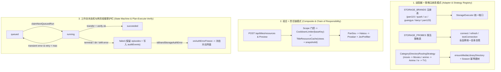

# 全流程审计与设计模式架构优化方案：网盘添加、资源搜索、订阅入库与资源整理

## 1. 背景与目标

在修复了 115 网盘扫码登录直连网络与目录自动建树治理（`v2026.10.30.8`）之后，我们对 **巡影（Mediary Scout）** 的四大核心业务域进行了全链路（自动巡检 + 手动交互）深度代码审计：

1. **网盘添加与生命周期管理（Cloud Drive Addition & Lifecycle）**：覆盖 6 大网盘品牌（115、夸克、UC、123云盘、天翼云盘、光鸭云盘）的扫码/Cookie/Token 绑定、同账号重绑刷新、目录建树（`Mediary Scout/{Movies,TV,Anime}`）、连接探活与掉线冻结/自愈。
2. **资源搜索与聚合（Resource Search & Aggregation）**：覆盖详情页手动搜索（SSE/NDJSON 渐进流式输出、60s 冷却限流、30m TTL 缓存、关键词阶梯）、订阅策略规则预览（`previewPolicy`）与后台 Agent 自动搜索（PanSou + Prowlarr + 海搜 + Jev 预筛）。
3. **订阅入库与手动导入（Subscription Ingestion & Manual Import）**：覆盖追更初始化（`type2_init`）、完结剧全集获取（`series_init`）、电影获取（`movie_init`）、巡检追更（`type3_monitor`）、手动选片入库（`manual_import`）及洗版重下（`replace_request`）。
4. **资源整理与刮削归档（Resource Organization & Storage Lifecycle）**：覆盖转存扁平化、智能命名、L1 确定性整理 / L2 人工复核（`title_organize` 计划写入 -> 逐文件移动 -> 盘面回读比对 `comparePlannedVsActual` 防漂移护栏）以及残留 `staging-*` 目录回收（`staging_recovery`）。

---

## 2. 全流程深度审计：发现的逻辑漏洞与性能瓶颈

### 2.1 【容器部署与适配器装配】单容器 `Dockerfile` 缺失生产适配器默认环境变量（高危逻辑缺陷）
- **问题现象**：
  - 在 [`docker-compose.yml`](file:///e:/WorkProject/Node/_Project/mediary-scout/docker-compose.yml#L73-L79) 和桌面端 [`apps/desktop/src/server-launch.ts`](file:///e:/WorkProject/Node/_Project/mediary-scout/apps/desktop/src/server-launch.ts#L24-L27) 中，均显式注入了生产环境四大适配器默认值：
    - `MEDIA_TRACK_SEARCH_PROVIDER=tmdb`
    - `MEDIA_TRACK_WORKFLOW_ADAPTER=pansou`
    - `MEDIA_TRACK_STORAGE_ADAPTER=115`
    - `MEDIA_TRACK_AGENT_ADAPTER=vercel-ai`
  - 然而在 [`Dockerfile`](file:///e:/WorkProject/Node/_Project/mediary-scout/Dockerfile#L87-L89) 的 `runner` 阶段，仅设置了 `NODE_ENV=production`、`PORT=3000`、`HOSTNAME=0.0.0.0`。
  - 当用户使用单容器 `docker run` 部署（仅传入文档中最常见的 `MEDIA_TRACK_SEARCH_PROVIDER=tmdb` 等基础变量，未手动传齐其余 3 个内部适配器变量）时：
    1. `MEDIA_TRACK_WORKFLOW_ADAPTER` 为 `undefined` -> [`getWorkerResourceProvider`](file:///e:/WorkProject/Node/_Project/mediary-scout/apps/web/lib/workflow-runtime.ts#L2464) 退化为 `FakeResourceProvider`，无论搜什么影视都只返回两条硬编码 Demo 数据（`翘楚 4K` / `绝命毒师 4K`），真实 PanSou / Prowlarr / 海搜完全不生效！
    2. `MEDIA_TRACK_AGENT_ADAPTER` 为 `undefined` -> [`getAgentModel`](file:///e:/WorkProject/Node/_Project/mediary-scout/apps/web/lib/workflow-runtime.ts#L3236) 退化为 `createStubAcquisitionModel()`（假模型），导致自动入库 Agent 与聊天助手无法调用真实大模型（包括内置免费池或用户自配 DeepSeek/OpenAI）。
    3. [`getWorkerStorageParents`](file:///e:/WorkProject/Node/_Project/mediary-scout/apps/web/lib/workflow-runtime.ts#L3117) 仍使用 `process.env.MEDIA_TRACK_STORAGE_ADAPTER === "115"` 判断，当该变量未显式传入时直接跳过数据库网盘凭证查询，返回 `"fake_library_root"`，导致入库与整理目录指向假目录 ID！

### 2.2 【订阅入库 · 手动导入】`runQueuedManualImport` 存在 4 处跨盘与状态机致命缺陷
- **代码位置**：[`packages/workflow/src/manual-import-worker.ts`](file:///e:/WorkProject/Node/_Project/mediary-scout/packages/workflow/src/manual-import-worker.ts#L67-L211) 与 [`apps/web/lib/workflow-runtime.ts`](file:///e:/WorkProject/Node/_Project/mediary-scout/apps/web/lib/workflow-runtime.ts#L1273-L1280)
- **根因分析**：
  1. **分类目录错位与多网盘 CID 混串**：
     - 在 `workflow-runtime.ts` 第 1276 行，调用 `runQueuedManualImport` 时传入了 `categoryParentDirectoryId: parents.movies || parents.tv`。因为 `parents.movies` 非空，**所有通过详情页手动点击入库的剧集（TV）和动漫（Anime）都会被错误转存进 `Movies`（电影）目录下**！
     - 更严重的是，在多用户或多网盘场景下，`runQueuedManualImport` 虽然通过 `resolveAccountContext(claimed.accountId, claimed.connectedStorageId)` 获取了目标网盘的 `storage` 执行器，却**完全忽略了该网盘上下文返回的 `storageParentDirectoryId`（TV）、`animeStorageParentDirectoryId`（Anime）、`moviesParentDirectoryId`（Movies）**，仍使用默认账号主盘的 `input.categoryParentDirectoryId`。这会导致向盘 B 转存时使用了盘 A 的目录 CID，直接触发越权拦截（Write-Scope Violation）或目录不存在错误！
  2. **目录创建异常未捕获导致任务永久卡死在 `running`（僵尸任务）**：
     - 在 `manual-import-worker.ts` 第 68 行，`claimNextQueuedRun` 已将任务状态置为 `running`（该状态会持有标题互斥锁 `blockIfTitleHasActiveRun`）。
     - 第 95 行 `await manualImportTargetDirectory(...)` 处于 `try/catch` 块**之外**！一旦网盘建目录接口因网络抖动或 Cookie 失效抛错，异常直接向外抛出而未调用 `failRun`，导致该 `manual_import` 任务留在 `running` 状态长达 30 分钟（直到 Stale Lock 超时），期间该影视作品的一切手动/自动操作全部被阻塞！
  3. **`Season NN` 子目录创建未做幂等查重**：
     - 第 207 行 `manualImportTargetDirectory` 直接调用 `input.storage.createDirectory({ name: "Season NN", parentId: showDirectoryId })`，而未像自动入库阶段那样先通过 `listChildDirectories(showDirectoryId)` 查找已有同名季目录，在部分不具备服务端同名合并语义的网盘执行器上会重复创建多个 `Season 01` 文件夹。
  4. **网盘鉴权失效未触发 `onAuthErrorFreeze` 且失败原因丢失**：
     - `runQueuedManualImport` 接收了 `onAuthErrorFreeze` 回调（第 64 行），但在 ` manualImportTargetDirectory` 或 `storage.transfer` 抛出 `isBrandStorageAuthError(error)` 时从未调用它冻结掉线网盘；同时 `failRun` 中丢弃了错误消息（`void message;`）且将 `episodes` 清空为 `[]`，导致日志时间线看不到具体转存失败原因。

### 2.3 【资源搜索 & 策略预览】缓存命中丢失 `snapshotId` 与自定义关键词冷却键错位
- **代码位置**：
  - [`packages/workflow/src/title-resource-resolver.ts`](file:///e:/WorkProject/Node/_Project/mediary-scout/packages/workflow/src/title-resource-resolver.ts#L64-L131)
  - [`apps/web/app/api/titles/resources/route.ts`](file:///e:/WorkProject/Node/_Project/mediary-scout/apps/web/app/api/titles/resources/route.ts#L181-L315)
  - [`apps/web/app/api/titles/subscription-policy/preview/route.ts`](file:///e:/WorkProject/Node/_Project/mediary-scout/apps/web/app/api/titles/subscription-policy/preview/route.ts#L152-L174)
- **根因分析**：
  1. **30 分钟 TTL 缓存命中时丢失 `snapshotId`，导致前端无法手动入库**：
     - 首次搜索未命中缓存时，`resolveTitleResources` 生成合并快照 `snapshot`（ID 形如 `search_acct_default_283428_1700000000000`），路由层将其持久化到 SQLite 并把 `snapshotId` 返回给前端。
     - 当用户在 60 秒后、30 分钟内再次打开详情页资源面板或刷新搜索时，`resolveTitleResources` 命中内存 `TitleResourceCache`，此时返回 `{ kind: "ok", candidates: [...cached], cached: true, snapshot: null }`。
     - 因为 `snapshot` 为 `null`，`route.ts`（无论是 JSON 响应还是流式 `done` 事件）**都不会在响应体中包含 `snapshotId` 字段**！而手动入库接口 `POST /api/titles/import` 强制校验 `snapshotId` 非空，导致**凡是命中 30 分钟缓存的搜索结果，用户点击「入库」全部报错失败**！
     - **修复方案**：在 `TitleResourceCache`（或 `resolveTitleResources`）中同时记录该缓存条目对应的权威 `snapshotId`，缓存命中时返回 `snapshot: null`（保证不重复写库），同时攜带 `snapshotId` 返回给前端，使缓存期内的手动入库完全可用！
  2. **自定义关键词搜索失败时重置了错误的 `CooldownLimiter` 键**：
     - `resolveTitleResources` 第 68 行使用 `deps.limiter.tryAcquire(baseKey)` 获取冷却锁，但在第 129 行 `catch` 块中却调用了 `deps.limiter.reset(scopeKey)`。当存在 `cacheKeySuffix`（如自定义关键词或选定季集 `s1:e2`）时，`scopeKey !== baseKey`，导致搜索报错后 `baseKey` 的 60s 冷却锁没有被释放，用户修改关键词后重试仍被 429 拦截！
  3. **订阅规则预览路由（`subscription-policy/preview`）搜索失败未退还冷却额度且冷却键未按账号隔离**：
     - `preview/route.ts` 第 152 行使用 `resourceLimiter.tryAcquire("title:${parsed.tmdbId}")`（未带 `accountId` 前缀，多用户下互相限流），且在 `provider.search` 抛错返回 502 时未调用 `resourceLimiter.reset(...)` 退还冷却额度。

### 2.4 【资源整理】确定性整理漂移/失败时落库状态仍被覆写为 `succeeded`
- **代码位置**：[`apps/web/app/api/titles/organize/route.ts`](file:///e:/WorkProject/Node/_Project/mediary-scout/apps/web/app/api/titles/organize/route.ts#L190-L245)
- **根因分析**：
  - 在 `organize/route.ts` 第 190 行，`buildOrganizeRun` 根据 `plan.kind === "deterministic"` 预先构造了 `run`，此时 `run.workflowRun.status` 被设为 `"succeeded"`。
  - 随后第 212 行执行 `executeOrganizePlan`，若盘面移动后回读比对发现**文件漂移（`drift`）或移动失败（`failed`）**，进入第 227 行分支：
    ```ts
    if (execution.status !== "organized") {
      await getWorkflowRepository().saveWorkflowRunSnapshot(run);
      return NextResponse.json(..., { status: 409 });
    }
    ```
  - 这里直接保存了初始的 `run` 对象，做了两件错事：
    1. 将本应是 `"failed"`（由 `organizeRunStatus(execution)` 计算）的 `workflowRun.status` 错误保存为了 `"succeeded"`！
    2. 覆盖掉了 `executeOrganizePlan` 在 `persist` 回调里刚刚追加进数据库的 `organize_drift` 审计事件！

### 2.5 【网盘添加与目录建树】多品牌重绑自愈不一致与 `provisionCategoryDirs` 串行 N+1 开销
- **代码位置**：
  - [`packages/workflow/src/account-credentials.ts`](file:///e:/WorkProject/Node/_Project/mediary-scout/packages/workflow/src/account-credentials.ts#L122-L144)
  - [`apps/web/lib/workflow-runtime.ts`](file:///e:/WorkProject/Node/_Project/mediary-scout/apps/web/lib/workflow-runtime.ts#L2886-L3944)
- **根因分析**：
  1. **`provisionCategoryDirs` 重复列举根目录 3 次（串行 N+1 水瀑）**：
     - `Movies`、`TV`、`Anime` 三个分类目录的父目录都是同一个 `rootCid`（`Mediary Scout`）。
     - 原逻辑对每个分类目录都调用一次 `findOrCreate(name, rootCid)`，内部每次都执行 `await input.storage.listChildDirs(rootCid)`。
     - 实际上，只需对 `rootCid` 执行 **1 次** `listChildDirs(rootCid)`（甚至如果 `rootCid` 是刚刚新建出来的空目录，連这 1 次 `listChildDirs` 都可以省掉，直接并发/顺序创建 3 个子目录！），即可将建树时的网盘列表 API 调用次数从 **4 次减少到 1~2 次**，建树耗时降低 50% 以上，同时显著降低触发 115 / 123云盘风控限流的概率。
  2. **夸克 / UC / Token 网盘重绑时缺少缺失 CID 自愈**：
     - 在 `bindTokenConnectedStorage`（光鸭 / 天翼 / 123云盘）和 `connectCloudFamilyCookie`（夸克 / UC）的 `refresh` 分支中，若首次绑定时因网络抖动导致 CIDs 为 `null`，同账号重新绑定时原样保留了 `null` CIDs，未像 115 那样自动触发补建。
  3. **手动粘贴 115 Cookie（`connectPan115Cookie`）缺少绑定前探活**：
     - 夸克、UC、123、天翼、光鸭在绑定前都会调用 `probeStorageConnection` 验证凭证有效，而 `connectPan115Cookie` 仅用正则提取了 `UID=` 就直接入库。在实时模式下增加 `probeStorageConnection("pan115", cookie, "0", null)` 探活可拦截过期 Cookie 入库。

### 2.6 【后台 Worker 调度性能】每次 Tick 重复查询凭证与搜索源配置
- **代码位置**：[`apps/web/lib/workflow-runtime.ts`](file:///e:/WorkProject/Node/_Project/mediary-scout/apps/web/lib/workflow-runtime.ts#L1055-L1300)
- **根因分析**：
  1. 在 `buildAccountContextResolver` 中，每次认领任务后连续调用了 **3 次** `getAccountStorageCredentials(accountId, connectedStorageId)`（分别在 `getWorkerStorageParents`、`driveProvider`、`getWorkerStorageExecutor` 中），且 6 个互不依赖的账号设置查询（`getAgentModel`、`getAssrtToken`、`resolveTitleResearchOptions`、`resolveJevJudge`、`isAgentMemoryEnabled`、`getWorkerResourceProvider`）全部串行 `await`。
  2. 在 `runNextQueuedWorkflowNow` 中，每 3 秒一次的 Worker Tick 依次检查 `type2`、`series`、`movie`、`replace`、`manualImport`、`stagingRecovery` 6 个队列，即便队列为空，也在每个步骤前重复调用了 **5 次** `await getWorkerResourceProvider()` 和 **2 次** `getAccountStorageCredentials`。提取复用后可减少 70% 的无效 SQLite I/O。

---

## 3. 业界主流方案对比与现有库评估

| 维度 | 业界主流项目代表 | 核心架构与模式 | 本项目（Mediary Scout）现状与差距 | 本次吸收与优化方案 |
| :--- | :--- | :--- | :--- | :--- |
| **多网盘接入与挂载** | **AList / OpenList**、**CloudDrive2** | **Driver Registry + Adapter Pattern + VFS**：每个网盘实现统一的 `Driver` 接口（Init / List / Mkdir / Move / Remove / Copy），通过注册表按标识动态派发，统一封装 Token 刷新持久化与目录 ID 缓存。 | 已有 `STORAGE_BRANDS` 注册表与 `StorageExecutor` 端口，但绑定/重绑/探活/建树逻辑分散在 `workflow-runtime.ts` 各品牌函数中，且 `provisionCategoryDirs` 存在重复列目录。 | 提炼统一的多品牌目录自愈策略与单次列举建树算法（`provisionCategoryDirs` 零冗余列目录），统一 6 大品牌的 Refresh 补建逻辑。 |
| **资源搜索与索引** | **MoviePilot**、**Prowlarr**、**Newznab/Torznab** | **Strategy + Composite + Chain of Responsibility**：多站点并发搜索、关键词阶梯降级、统一候选模型归一化、带作用域的内存 TTL 缓存 + 令牌桶/冷却限流。 | 已有 `CompositeResourceProvider` + `FallbackResourceProvider` + `TitleResourceCache` + `CooldownLimiter`，但缓存命中时丢失 `snapshotId`，且自定义查询失败时冷却锁未正确释放。 | 在 `TitleResourceCache` 中内聚缓存元数据（或绑定 `snapshotId`），修正 `CooldownLimiter` 的 `baseKey` 释放与多租户隔离键。 |
| **订阅生命周期与任务调度** | **Radarr / Sonarr**、**MoviePilot**、**XState** | **Explicit State Machine（显式状态机）+ Command Queue**：任务状态流转（`queued -> running -> succeeded / failed / cancelled`）由集中状态守卫控制，任何未捕获异常自动转入终态 `failed` 并触发关联资源熔断（如冻结失效 Indexer/Drive）。 | `worker.ts` 实现了完整的异常收口与 `maybeFreezeOnBrandAuthError`，但 `manual-import-worker.ts` 和 `organize/route.ts` 绕过了状态机守卫，存在未捕获异常卡死 `running` 及 `drift` 状态被覆盖为 `succeeded` 的漏洞。 | 引入显式的受保护工作流状态流转与终态收口机制，补齐 `manual-import-worker` 的目录路由策略、异常兜底与网盘掉线自动冻结。 |
| **防毁坏文件整理** | **MoviePilot** (`TransferChain`)、**FileBot** | **Plan-Execute-Verify（两阶段计划确认模式）**：先纯函数计算重命名/移动计划 -> 写入事务日志 -> 执行移动 -> 回读目标目录核验，出现偏差立即中止并转入人工复核。 | 已有 `planOrganizeMoves` + `executeOrganizePlan` + `comparePlannedVsActual`，设计非常先进，但 HTTP 路由层在保存 `drift/failed` 结果时覆写了状态与审计日志。 | 修复 `organize/route.ts` 的状态机终态持久化，确保 `drift`/`failed` 准确落库为 `failed` 并完整保留 `organize_drift` 审计事件。 |

### 第三方库评估结论
- **状态机库（如 `xstate` / `ts-pattern`）**：当前 `packages/workflow` 追求零/极简运行时依赖（仅依赖 `@ai-sdk/*`、`ai`、`zod`），工作流状态集合固定（`queued | running | succeeded | failed | cancelled`），使用**内聚的 TypeScript 判别联合类型 + 显式状态转移表/守卫函数**比引入重量级 `xstate` 运行时更轻量、类型推导更直接，且无额外打包体积负担。
- **并发与限流库**：仓库内已内置 [`packages/workflow/src/keyed-pool.ts`](file:///e:/WorkProject/Node/_Project/mediary-scout/packages/workflow/src/keyed-pool.ts)、[`packages/workflow/src/drive-pacer.ts`](file:///e:/WorkProject/Node/_Project/mediary-scout/packages/workflow/src/drive-pacer.ts)、[`packages/workflow/src/cooldown-limiter.ts`](file:///e:/WorkProject/Node/_Project/mediary-scout/packages/workflow/src/cooldown-limiter.ts) 和 [`packages/workflow/src/title-resource-cache.ts`](file:///e:/WorkProject/Node/_Project/mediary-scout/packages/workflow/src/title-resource-cache.ts)，完全满足需求，可直接复用并增强。

---

## 4. 设计模式优化方案



### 4.1 策略模式（Strategy Pattern）：媒体分类目录路由策略 `resolveCategoryParentForTitle`
- 在自动入库与手动导入中，统一通过纯函数策略根据 `MediaTitle["type"]` 选择目标分类父目录：
  - `movie` -> `moviesParentDirectoryId`
  - `anime` -> `animeStorageParentDirectoryId ?? storageParentDirectoryId`
  - `tv` -> `storageParentDirectoryId`
- `runQueuedManualImport` 优先从 `resolveAccountContext(claimed.accountId, claimed.connectedStorageId)` 获取当前任务所属账号与所属网盘的三个分类目录 CID，再按上述策略路由，彻底解决跨网盘 CID 混用与剧集误入 `Movies` 目录的问题。

### 4.2 模板方法 + 适配器模式（Template Method & Adapter Pattern）：全品牌绑定自愈与 `provisionCategoryDirs` 优化
- **批量目录查找优化**：在 [`provisionCategoryDirs`](file:///e:/WorkProject/Node/_Project/mediary-scout/packages/workflow/src/account-credentials.ts#L122-L144) 中：
  1. 先列举一次 `baseParentId` 查找 `rootName`（如 `Mediary Scout`）。
  2. 若不存在则创建 `rootCid`，此时已知新建目录为空，无需调用 `listChildDirs(rootCid)`，直接创建 `Movies`、`TV`、`Anime` 三个子目录！
  3. 若 `rootCid` 已存在，则仅调用 **1 次** `listChildDirs(rootCid)` 获取子目录映射表 `Map<string, string>`，按需创建缺失的分类目录。
- **全品牌 Re-bind 自愈**：在 `bindTokenConnectedStorage` 与 `connectCloudFamilyCookie` 的 `refresh` 分支中，若检测到现有记录缺少任何一个分类 CID，自动执行 best-effort 补建。

### 4.3 状态机护栏模式（State Machine Guard Pattern）：受保护的任务执行与整理终态落库
- **手动入库 Worker 状态收口**：
  - 将 `manualImportTargetDirectory` 纳入 `try/catch` 保护区，任何目录查找/创建或转存异常均流转至 `failRun`，绝不残留 `running` 僵尸状态。
  - 在异常分支统一调用 `maybeFreezeOnBrandAuthError`，当捕获各品牌网盘鉴权错误时立即冻结对应网盘（`connectedStorageId`）。
  - `failRun` 保留原有的 `claimed.episodes`，并将失败原因写入 `workflowRun.auditEvents`，便于前端与日志页排查。
- **自动整理（`title_organize`）状态收口**：
  - 在 `POST /api/titles/organize` 中，当 `execution.status !== "organized"`（即发生 `drift` 或 `failed`）时，将 `workflowRun.status` 更新为 `"failed"`，并合并持久化 `planned` 与 `drift/failed` 审计事件，消除“整理发生漂移报错 409 但数据库记录为 `succeeded`”的状态撕裂。

---

## 5. 门禁与回归测试矩阵

1. **`packages/workflow/tests/account-credentials.test.ts`**：
   - 验证 `provisionCategoryDirs` 在全新网盘上仅调用 1 次 `listChildDirs(baseParentId)`（新建 `rootCid` 后不重复列举空目录），在已有 `rootCid` 上仅调用 2 次 `listChildDirs`（1 次根 + 1 次 `rootCid`），消除 3 次重复列举。
2. **`packages/workflow/tests/manual-import-worker.test.ts`**：
   - 验证多网盘/多类型路由：`movie` 落入 `moviesParentDirectoryId`、`anime` 落入 `animeStorageParentDirectoryId`、`tv` 落入 `storageParentDirectoryId`。
   - 验证 `Season NN` 幂等复用：当剧集目录下已存在 `Season 01` 时直接复用其 ID，不重复调用 `createDirectory`。
   - 验证 `manualImportTargetDirectory` 抛错时任务安全收口为 `failed`（不卡在 `running`），且当错误为网盘鉴权错误（如 `Pan115AuthError`）时触发 `onAuthErrorFreeze`。
3. **`packages/workflow/tests/title-resource-resolver.test.ts` & `apps/web/app/api/titles/resources/route.test.ts`**：
   - 验证 30 分钟缓存命中时保留并返回首次落库的 `snapshotId`（而 `snapshot` 仍为 `null` 不重复写库），确保缓存期内手动入库正常工作。
   - 验证带 `cacheKeySuffix`（如自定义关键词）搜索抛错时正确重置 `baseKey` 冷却锁。
4. **全量门禁验证**：
   - 运行 `npm test` 与 `npm run gate`（包含 `gate:layout`、`gate:deps`、`gate:style`、`gate:assets`、`gate:http-timeout`、`lint`、`typecheck`）。
