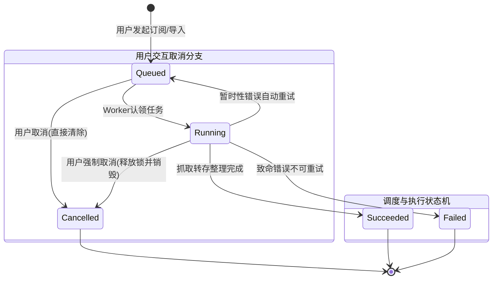

# 获取中订阅状态查询、具体进度展示与任务取消技术方案

> **状态**：已批准并执行  
> **设计模式**：状态机模式（Finite State Machine）、策略模式（Strategy Pattern）、适配器模式（Adapter Pattern）  
> **适用范围**：首页订阅库（`apps/web/components/library-quick-find.tsx`）、影视详情页（`apps/web/app/show/[tmdbId]/page.tsx`）、活动中心（`apps/web/components/activity-feed.tsx`）、核心工作流引擎（`packages/workflow`）

---

## 一、需求背景与痛点分析

### 1.1 现存痛点
在自建网盘媒体自动化流程中，用户发起获取或手动转存后，订阅库页面与详情页会显示「获取中 2」（例如《不存在的罪人》、《孤独摇滚 (下)》）。然而当前系统存在以下核心问题：
1. **纯黑盒状态，用户无从感知进度**：
   - 首页 `InProgressCard` 仅为静态占位（`aria-disabled`），无法点击进入。
   - 占位卡仅显示旋转 Loading 和「正在获取」，用户不知道任务处于排队、搜索、转存、还是解包整理阶段，产生焦虑。
2. **缺乏取消能力，异常任务永久死锁**：
   - 后台工作流若因网络抖动、索引器报错或关联快照失效导致任务挂起在 `running` 状态，系统原有的 `cancelQueuedWorkflowRun` 仅允许 `queued` 状态取消。
   - 对 `running` 状态直接返回 `not_cancellable`，弹窗提示「已开始处理，无法取消」，导致用户完全无法自救，条目被永久困在「获取中」。
3. **详情页与首页体验割裂**：
   - 详情页在 `acquiring === true` 时禁用所有按钮，仅有后台 Poller 轮询，缺乏进度透视与取消操作入口。

---

## 二、业界主流方案调研与对比

| 维度 | Sonarr / Radarr (Usenet/BT主流) | MoviePilot (网盘媒体主流) | 本系统优化方案 (Mediary Scout) |
| :--- | :--- | :--- | :--- |
| **任务感知** | Queue 弹窗 / 详情浮层：显示 Grabbed $\to$ Downloading $\to$ Importing 分阶段进度、实时速度与 ETA | 下载/转存任务抽屉：分步展示「检索 $\to$ 过滤 $\to$ 转存 $\to$ 整理 $\to$ 刮削」执行树 | **交互式卡片 + 进度抽屉/弹窗**：显示阶段徽章、百分比进度条、当前动作及审计事件时间轴 |
| **状态推进机制** | 依赖外部客户端（Qbittorrent/SABnzbd）的进度轮询与事件回调 | 依赖网盘异步转存轮询 + 本地整理进程状态机 | **三层渐进式进度推演**：优先读实时 `progress`，无实时进度则由 `auditEvents` 推演，保底为阶段状态机 |
| **取消策略 (Cancel)** | 支持从 Queue 移除；支持选择是否加入黑名单、是否删除下载文件、是否取消监控 | 支持「取消任务」，异步中止转存 API，清理临时目录 | **双模安全取消策略**：支持 `queued` 快速销毁与 `running` 强制撤销熔断，自动安全回收独占锁与追踪记录 |
| **容错自愈** | 任务卡死后提供 Force Remove / Delete | 提供手动重试与清理死任务 | **孤儿与挂起任务强行熔断**：解除标题锁，恢复用户可操作状态 |

---

## 三、架构设计与设计模式应用

### 3.1 状态机模式（Finite State Machine）

将获取任务的形式化生命周期定义为两层状态机：



#### 获取阶段（Phases）与进度权重表

| Phase 编码 | 业务含义 | 典型中文提示 | 预估权重 |
| :--- | :--- | :--- | :--- |
| `queued` | 排队调度中 | 排队等待执行（第 N 位） | 5% |
| `search` | 索引与资源匹配 | 正在检索可用网盘资源... | 25% |
| `pick` | 策略过滤与选优 | 已匹配候选资源，策略评分中... | 40% |
| `transfer` | 网盘转存与校验 | 正在提交网盘转存任务... | 70% |
| `organize` | 目录结构与刮削整理 | 正在整理媒体库目录结构... | 90% |
| `finalize` | 完成归档 | 任务完成，正在入库... | 100% |

### 3.2 策略模式（Strategy Pattern）

#### 1. 取消执行策略（`CancellationStrategy`）
根据当前任务状态与类型，派发不同清理逻辑：
- `QueuedCancellationStrategy`：未对网盘造成文件变动，直接物理删除任务记录；若是首创新增订阅（`tearsDownTrackingOnCancel` 为 true），同步清理 `tracked_seasons`，恢复未追踪纯净状态。
- `RunningCancellationStrategy`：允许用户主动中止；清理独占运行记录，解除 `blockIfTitleHasActiveRun`，使标题立即解除锁定，恢复自由状态。
- `ReplaceRequestCancellationStrategy`：换源任务取消不影响原已有媒体文件与订阅，仅撤销换源锁。

#### 2. 进度推演策略（`ProgressInferenceStrategy`）
- **第一级（权威进度）**：若 `workflowRun.progress` 存在，直接采用其 `percent`、`activity` 与 `phase`。
- **第二级（审计回溯）**：若无实时 progress，扫描 `auditEvents`：
  - 含有 `transfer_attempt` $\to$ 认定为 `transfer`（进度 70%）；
  - 含有 `workflow_claimed` $\to$ 认定为 `processing`（进度 20%）；
  - 含有 `manual_import_queued` $\to$ 认定为 `queued`（进度 10%）。
- **第三级（兜底推演）**：依据 `status === "running"` 兜底为 35% 处理中。

### 3.3 适配器模式（Adapter Pattern）

构建 `AcquiringTaskViewAdapter`，抹平 `type1_package_init`、`type2_init`、`movie_init`、`manual_import`、`replace_request` 的底层属性差异，向前端统一呈现为标准视图对象：

```typescript
export interface AcquiringTaskStatusView {
  runId: string;
  tmdbId: number;
  title: string;
  year: number | null;
  type: "movie" | "tv" | "anime";
  posterPath: string | null;
  status: "queued" | "running";
  queuePosition: number | null;
  phase: string;
  phaseLabel: string;
  percent: number;
  activity: string;
  startedAt: string;
  elapsedSeconds: number;
  steps: Array<{ time: string; message: string }>;
  cancellable: boolean;
}
```

---

## 四、具体实现方案

1. **核心仓储层（`packages/workflow`）**：
   - 升级 `cancelQueuedWorkflowRun` 契约，支持 `cancelWorkflowRun(workflowRunId, scope, options?: { allowRunning?: boolean })`。
   - `allowRunning: true` 时放行 `running` 状态取消，统一事务删除任务记录并触发 `teardownSeasonScoped`（若符合无其他引用条件）。
2. **服务端接口层（`apps/web`）**：
   - 扩展 `/api/activity/cancel` 路由，支持传参 `{ runId, allowRunning: true }`。
   - 新增 `/api/activity/status?tmdbId=xxx` 接口，提供指定影视的单体实时进度查询。
3. **前端呈现层（`apps/web`）**：
   - 重构 `InProgressCard`，变为带微交互的进度卡片（显示当前状态胶囊）。
   - 实现 `AcquiringDetailModal`，包含：
     - 海报与标题摘要；
     - 阶段状态栏与动态进度条；
     - 实时动作描述与执行日志流水；
     - 「取消获取」危险操作按钮（带二次确认保护与防重复提交处理）。
   - 在详情页 `apps/web/app/show/[tmdbId]/page.tsx` 中嵌入进度弹窗触发器，与首页保持一致体验。
