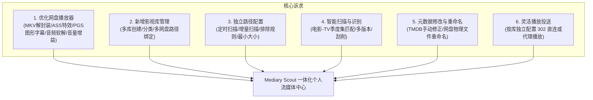
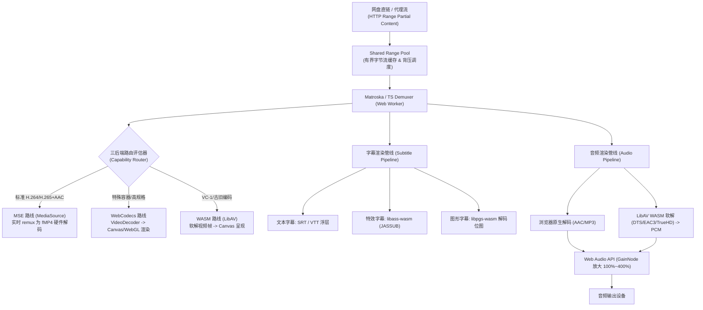
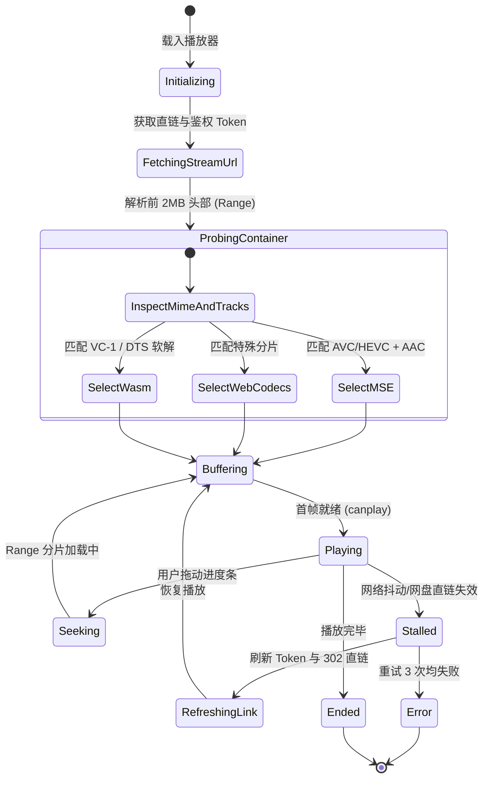
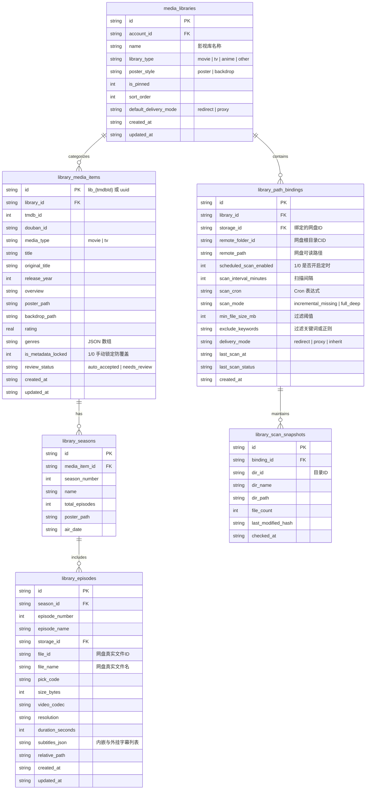
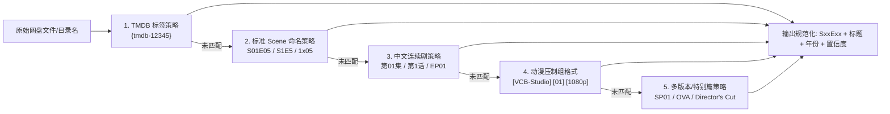
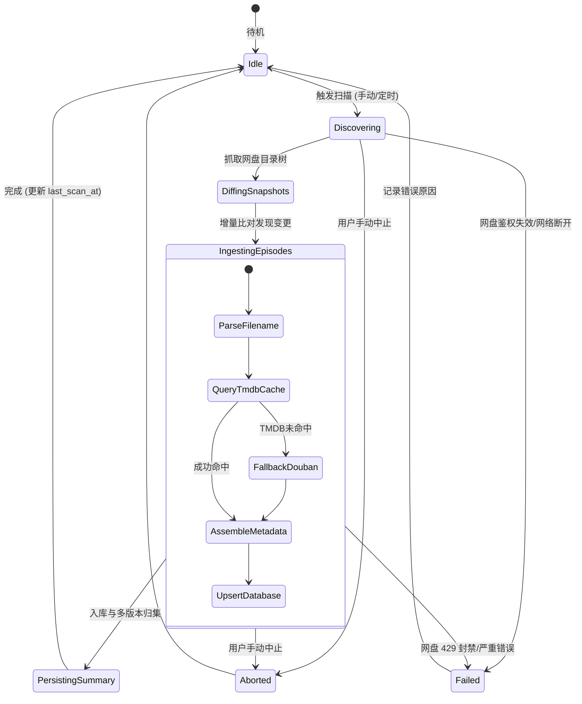
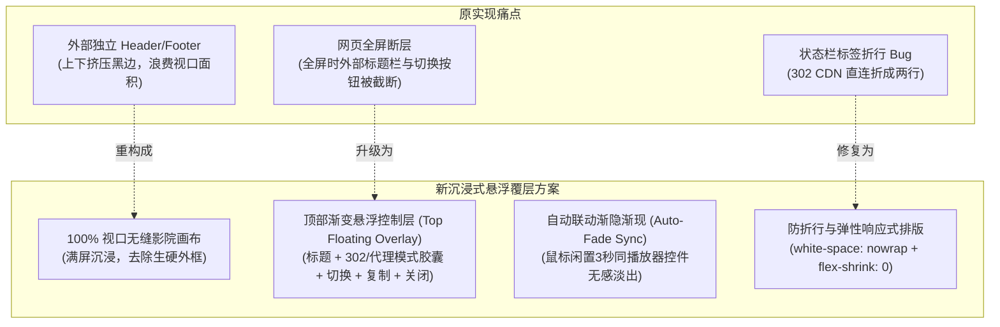
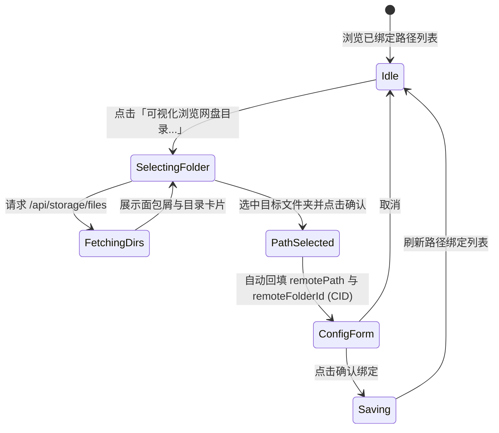

# 巡影 (Mediary Scout) 影视库体系与增强网盘播放器架构设计方案

> **文档状态**：方案定稿与实施指导 (Approved for Implementation)  
> **编写日期**：2026-11-12  
> **关联参考**：  
> - 外部参考播放引擎：`E:\WorkProject\Node\_BrowserExtend\【油猴脚本】\视频播放器优化v2`  
> - 现存流中继体系：[`packages/workflow/src/storage/stream-resolver.ts`](file:///packages/workflow/src/storage/stream-resolver.ts) & [`apps/web/app/api/strm/play/[taskId]/[fileId]/route.ts`](file:///apps/web/app/api/strm/play/[taskId]/[fileId]/route.ts)  
> - 现存解析链：[`packages/workflow/src/domain/title-parse-chain.ts`](file:///packages/workflow/src/domain/title-parse-chain.ts)  
> - 逆向扫描自愈：[`docs/reverse-scan-episode-missing-root-cause-and-self-healing-architecture.md`](file:///docs/reverse-scan-episode-missing-root-cause-and-self-healing-architecture.md)  

---

## 目录 (Table of Contents)

1. [项目背景与用户需求全景剖析](#1-项目背景与用户需求全景剖析)
2. [第一部分：网盘播放器重构与极致增强方案 (借鉴油猴脚本 v2)](#2-第一部分网盘播放器重构与极致增强方案-借鉴油猴脚本-v2)
   - 2.1 原生播放器现状痛点与瓶颈
   - 2.2 油猴脚本 v2 核心技术解析与移植策略 (三后端路由 / 字幕 / 音频 / Range)
   - 2.3 选型与技术方案 (ArtPlayer + WASM 插件 + 直链流调度)
   - 2.4 播放器状态机与故障降级设计
3. [第二部分：影视库 (Media Library) 全新业务体系设计](#3-第二部分影视库-media-library-全新业务体系设计)
   - 3.1 核心需求与场景推演
   - 3.2 实体领域模型与 SQLite 仓储架构设计
   - 3.3 库与网盘路径多对多绑定及独立配置规范
4. [第三部分：经典设计模式深度实践 (Design Patterns)](#4-第三部分经典设计模式深度实践-design-patterns)
   - 4.1 适配器模式 (Adapter)：网盘 VFS 抽象与流媒体投送
   - 4.2 策略模式 (Strategy)：增量/全量扫描、标题解析责任链、播放路由
   - 4.3 状态机模式 (State Machine)：长耗时扫描任务与元数据锁定状态
   - 4.4 观察者模式 (Observer/SSE)：毫秒级扫描事件流与前端动效响应
5. [第四部分：可行性、逻辑缺陷与性能瓶颈深度排查](#5-第四部分可行性逻辑缺陷与性能瓶颈深度排查)
   - 5.1 网盘 API 频率限制与封控防御 (Pacer + 目录时间戳快照)
   - 5.2 302 直连 vs 代理播放的权衡、防盗链与跨域穿透
   - 5.3 刮削准确率、多季识别与动漫多版本归集
   - 5.4 网盘端重命名安全性 (Write-Scope Guard 作用域护栏)
6. [第五部分：业界主流方案对比与借鉴矩阵](#6-第五部分业界主流方案对比与借鉴矩阵)
7. [第六部分：系统现有基础设施复用清单与分阶段实施路线图](#7-第六部分系统现有基础设施复用清单与分阶段实施路线图)

---

## 1. 项目背景与用户需求全景剖析

随着 Mediary Scout 演进，用户不仅需要自动化的“发现-追番-转存-整理”管道，更需要一个沉浸式、自闭环的**个人流媒体中心（Media Center）**：



本方案针对上述 6 大诉求，结合外部参考项目 `视频播放器优化v2` 的深厚沉淀，进行端到端的架构设计与工程推演。

---

## 2. 第一部分：网盘播放器重构与极致增强方案 (借鉴油猴脚本 v2)

### 2.1 原生播放器现状痛点与瓶颈
当前 Mediary Scout Web 端播放器为简易 `<video controls autoPlay src={streamUrl}>`，在面对网盘真实影视资源时存在以下严重瓶颈：

| 维度 | 原生 `<video>` 表现 | 实际网盘高清资源现实 | 导致的用户痛点 |
| :--- | :--- | :--- | :--- |
| **容器格式** | 仅支持 MP4/WebM，原生不支持 MKV、TS、AVI | 90% 以上的高清番剧与 4K 压制资源均为 **MKV** 格式封装 | 页面白屏，提示格式不支持或直接触发浏览器下载 |
| **字幕渲染** | 仅支持外挂 WebVTT，不支持内嵌字幕与复杂特效 | 影视资源多内嵌 **ASS/SSA 特效字幕** 或蓝光 **PGS/SUP 图形字幕** | 无法选字幕，或字幕特效丢失、排版错乱、字体全白 |
| **音频解码** | 仅支持 AAC/MP3/Opus，不支持 DTS、TrueHD、EAC3 | 电影音轨多为 **DTS-HD MA**、**Dolby TrueHD**、多声道 EAC3 | **有画无声（Silent Video）**，用户体验严重割裂 |
| **音量控制** | 最大音量 100%，无增益补偿 | 许多多声道转双声道影片的人声响度极低（低于 -24 LKFS） | 开到最大音量依然听不清人物对白 |
| **播放交互** | 原生控件，无按键映射、无黑边裁剪 | 宽银幕电影带上下黑边，无法切换 21:9 或智能填满 | 手机/带鱼屏观看体验极差，缺少快进/快退/选轨面板 |
| **防盗链与 CORS** | 原生标签无法自定义 HTTP Headers | 115、夸克直链有 UA、Referer 校验或跨域限制 | 302 重定向直连经常遭遇网盘 CDN 报 `403 Forbidden` |

---

### 2.2 油猴脚本 v2 核心技术解析与移植策略
参考项目 `视频播放器优化v2` 是一套极为成熟的浏览器端直链播放引擎，其核心技术资产可无缝借鉴至 Mediary Scout：



1. **三后端路由决策（Triple-Backend Routing）**：
   - **MSE（优先推荐，零损耗）**：前端 Worker 解析 MKV 容器并实时解封装，将包重封装为 Fragmented MP4 (fMP4)，喂入浏览器的 `SourceBuffer`。全程享受 GPU 硬解，占用 CPU < 5%。
   - **WebCodecs（次级保底）**：针对不支持直接投送 MSE 的配置，利用现代化 `VideoDecoder` API 解码，通过 WebGL 纹理上屏。
   - **WASM LibAV（终极兜底）**：针对 VC-1 或特殊编码，使用 WebAssembly 编译的 LibAV 软解。
2. **字幕渲染管线（Subtitle Pipeline）**：
   - 提取 MKV 内嵌字幕轨（Codec ID：`S_TEXT/UTF8`, `S_TEXT/ASS`, `S_HDMV/PGS`）；
   - 集成 `libass-wasm`（如 JASSUB），直接在独立 Canvas 上以 60fps 渲染复杂的 ASS 动画与特效字体；
   - 针对 PGS 蓝光图形字幕，提取 RLE 位图并在 Canvas 上精准对齐。
3. **音频软解与增益补偿（Audio Pipeline）**：
   - 利用 Web Audio API 建立 `AudioContext` ➔ `GainNode` ➔ `AudioDestinationNode` 处理链，提供 **0% ~ 400% 的音量平滑线性放大**，彻底解决电影人声微弱痛点；
   - 针对 DTS / EAC3 音轨，在 Worker 中借助 WASM 软解为 Float32Array PCM 数据并下混为双声道立体声，送入 AudioContext 播放。

---

### 2.3 选型与技术方案 (ArtPlayer + WASM 插件 + 直链流调度)
在 Web 前端，为了兼顾轻量化、开发敏捷度与高扩展性，推荐采用 **ArtPlayer** 作为底座控件，外挂解封装与字幕引擎：

```text
apps/web/features/player/
├── components/
│   ├── mediary-player-modal.tsx        # 沉浸式弹窗/全屏播放容器
│   ├── mediary-player-core.tsx         # ArtPlayer 挂载与生命周期管理
│   ├── subtitle-selector-modal.tsx     # 字幕/音轨切换抽屉
│   └── audio-gain-control.tsx          # 音量增益滑块 (100%~400%)
├── engines/
│   ├── mkv-demuxer-worker.ts           # Web Worker 内嵌 MKV 实时解封装
│   ├── ass-render-adapter.ts           # JASSUB (libass) 特效字幕集成适配器
│   ├── pgs-render-adapter.ts           # PGS 图形字幕渲染适配器
│   └── audio-gain-pipeline.ts          # Web Audio Gain 处理器
└── hooks/
    ├── use-stream-token.ts             # 播放 Token 与直链刷新
    └── use-player-shortcuts.ts         # 空格暂停、左右快进、上下音量、F全屏等快捷键
```

---

### 2.4 播放器状态机与故障降级设计



---

## 3. 第二部分：影视库 (Media Library) 全新业务体系设计

### 3.1 核心需求与场景推演
用户需要统一管理一个或多个影视库（如“精选电影”、“追番动漫”、“欧美剧集”、“纪录片”），核心业务场景包括：
1. **多库与分类管理**：支持创建库，并指定库类型（`movie` 电影、`tv` 电视剧、`anime` 动漫、`other` 其他）。
2. **多网盘路径绑定**：一个库可以绑定多个网盘路径（例如同时绑定 115 的 `/影视/动漫` 与夸克的 `/动漫归档`）。
3. **独立路径参数配置**：每个路径拥有独立的扫描控制：
   - 是否启用自动定时扫描（`scheduled_scan_enabled: boolean`）；
   - 扫描周期（Cron 表达式或分钟间隔，如每 360 分钟）；
   - 扫描模式（`incremental_missing` 增量只查新增 / `full_deep` 全量重建比对）；
   - 最小文件过滤（`min_file_size_mb`，过滤掉小样片、广告 txt）；
   - 排除关键词与正则表达式（`exclude_keywords`，如 `sample`, `promo`, `trailer`）；
   - 播放投送模式（`delivery_mode`：`redirect` 302 直连，或 `proxy` 服务端中转）。
4. **智能扫描与多版本归集**：能够识别 `Movie/电影名 (年份)`、`TV/剧集名 (年份)/Season 01/S01E01`，并对不同分辨率（4K HDR、1080P Baha、720P）进行版本聚合，不拆散同一部作品。
5. **元数据手动订正与物理重命名**：
   - 针对刮削错误的条目，支持手动搜索 TMDB / 豆瓣并重新绑定；
   - 支持**直接修改网盘端真实文件名与目录名**（例如将网盘原本混乱的 `[压制组] 某作品 01.mp4` 重命名为标准的规范名称 `某作品 - S01E01.mp4`）。

---

### 3.2 实体领域模型与 SQLite 仓储架构设计

在 `packages/workflow/src/persistence/sqlite/sqlite-schema.ts` 中设计新增 5 张核心表，严格遵循纯 SQLite WAL 规范：



---

### 3.3 库与网盘路径多对多绑定及独立配置规范

各配置项的独立作用范围与继承规则：

```typescript
export interface LibraryPathBindingConfig {
  id: string;
  libraryId: string;
  storageId: string;
  remoteFolderId: string;
  remotePath: string;

  // 定时与调度策略
  scheduledScanEnabled: boolean;
  scanIntervalMinutes: number; // 默认 360
  scanCron?: string;           // 如 "0 3 * * *" 每日凌晨 3 点
  scanMode: "incremental_missing" | "full_deep";

  // 过滤策略
  minFileSizeMb: number;       // 默认 100MB，避免抓取封面缩略图和无用说明文件
  excludeKeywords: string[];   // 如 ["sample", "trailer", "preview", ".*-trailer\\..*"]

  // 播放投送策略
  deliveryMode: "redirect" | "proxy" | "inherit"; // inherit 则继承媒体库默认设置
}
```

---

## 4. 第四部分：经典设计模式深度实践 (Design Patterns)

### 4.1 适配器模式 (Adapter Pattern)：网盘 VFS 抽象与流媒体投送

#### 网盘统一虚拟文件系统适配器 (`IStorageDriveAdapter`)
由于 115、夸克、天翼、UC、123、光鸭等各大网盘的底层 API 各不相同（有的基于 `cid` 目录树，有的基于全路径，有的基于游标分页），必须通过适配器将其封装为统一步调的 VFS 接口：

```typescript
export interface IStorageDriveAdapter {
  readonly provider: string;

  // 目录列取 (自动处理分页与限频)
  listDirectory(storageId: string, folderId: string, options?: ListOptions): Promise<DriveFileListResult>;

  // 路径到 ID 转换
  resolveFolderIdByPath(storageId: string, path: string): Promise<string | null>;

  // 文件/目录物理重命名 (修改网盘元数据)
  renameItem(storageId: string, itemId: string, newName: string, isFolder: boolean): Promise<boolean>;

  // 流直链解析
  resolveStreamUrl(storageId: string, fileId: string, pickCode?: string): Promise<ResolvedStream>;
}
```

---

### 4.2 策略模式 (Strategy Pattern)

#### 1. 扫描策略 (`ILibraryScanStrategy`)
- **`IncrementalScanStrategy` (增量扫描策略)**：
  - 核心逻辑：扫描时对比 `library_scan_snapshots`。若该文件夹在网盘上的 `update_time` 与子项数目未发生变动，直接跳过深度递归；仅扫描发生修改的叶子目录。
  - 优势：万级文件库日常巡检仅需 **3 ~ 5 秒**，节约 98% 的网盘 API 消耗。
- **`FullDeepScanStrategy` (全量深度扫描策略)**：
  - 核心逻辑：逐层下潜遍历每一个目录与文件。与数据库比对，识别“新增文件”、“被删除的物理文件（标记为已删除或从库中移除）”与“重命名的文件”。

#### 2. 标题解析与季集识别责任链 (`TitleParseChain & EpisodeParseStrategy`)
扩展现有的 `packages/workflow/src/domain/title-parse-chain.ts`，增加剧集级多策略识别：



#### 3. 播放路由投送策略 (`IPlaybackDeliveryStrategy`)
- `Direct302Strategy`：向客户端发送 302 Redirect，客户端直接向网盘 CDN 请求数据；
- `ReverseProxyStrategy`：由 Mediary Scout 服务端接管连接，分片代理，注入必要 Headers（UA、Referer、Cookie），并输出标准 HTTP 206 Partial Content。

---

### 4.3 状态机模式 (State Machine Pattern)

#### 1. 影视库扫描任务生命周期状态机 (`LibraryScanStateMachine`)



#### 2. 条目元数据锁定与审核状态机 (`MediaItemReviewStateMachine`)
- **`auto_accepted` (自动采纳)**：TMDB 识别置信度 $\ge 85\%$，直接正常上架；
- **`needs_review` (待审核)**：置信度低于 $85\%$ 或存在多个同名歧义候选，在 UI 上加注黄色标记，等待用户在弹窗中一键选择；
- **`manually_locked` (手动锁定)**：用户手动修改了片名、年份、海报或 TMDB ID。**此时打上 `is_metadata_locked = 1` 物理锁定标记，任何后续全量/增量扫描绝对禁止覆盖用户的修改！**

---

### 4.4 观察者模式 (Observer/SSE)：实时扫描进度与动态入库推送
扫描任务是异步长耗时任务，采用 Server-Sent Events (SSE) 或 WebSocket 机制进行事件广播：
- 客户端订阅 `/api/library/scan/events`；
- 扫描器在发现文件、识别成功、刮削完成时持续派发事件：
  ```json
  { "type": "ITEM_DISCOVERED", "libraryId": "lib_01", "title": "鬼灭之刃", "season": 1, "episode": 5 }
  { "type": "PROGRESS_UPDATE", "scanned": 150, "total": 300, "percent": 50 }
  ```
- 前端页面无需轮询，海报墙与卡片动态平滑浮现。

---

## 5. 第五部分：可行性、逻辑缺陷与性能瓶颈深度排查

### 5.1 网盘 API 频率限制与封控防御 (Pacer + 目录时间戳快照)
- **风险痛点**：若用户库中有 50,000 个影视文件，一次全盘递归遍历至少需要发起数百次 `list` API 请求；若并发度失控，115 会直接封禁 IP 数小时，夸克会弹滑块验证码甚至封号。
- **治理方案**：
  1. **令牌桶频率限制器（`DrivePacer`）强制介入**：复用现有的 `brand-pacing.ts`，115 严格限制并发为 1，请求间隔 $\ge 350\text{ms}$；夸克限制并发为 2，请求间隔 $\ge 200\text{ms}$；
  2. **增量快照剪枝（Pruning）**：通过 SQLite 记录各层目录的快照信息，跳过 90% 以上未变动的历史老目录；
  3. **单飞保护（SingleFlight）**：同一个库正在扫描时，杜绝重复触发。

---

### 5.2 302 直连 vs 代理播放的权衡、防盗链与跨域穿透
- **302 直连局限**：
  - 115 网盘直链通常校验 User-Agent，部分 CDN 节点如果发现请求来源是第三方浏览器的默认 UA 或包含非法 Referer，会直接返回 403；
  - 夸克网盘直链与下载 Token 紧密绑定，通常有 IP 防盗链限制。
- **代理播放局限**：
  - 代理会消耗 Mediary Scout 宿主机的网络带宽。如果在轻量云服务器（如 5Mbps 带宽）部署，播放 4K 高码率原盘（50Mbps+）会卡死。
- **多级自适应解决方案**：
  1. **库级与路径级显式配置**：用户可为 115 库设置 `redirect`（302 直连），为夸克库设置 `proxy`（代理分片）；
  2. **智能自愈降级**：播放器优先尝试 302 播放，若捕获到网盘 CDN 返回 403 Forbidden 或 CORS 跨域错误，播放器自动回退并请求代理端点 `/api/strm/play?delivery=proxy`，对用户完全无感！

---

### 5.3 刮削准确率、多季识别与动漫多版本归集
- **多季下潜缺失自愈**：
  - 彻底规避之前 `reverse-scan-episode-missing-root-cause` 总结的缺陷：爬虫命中影视父目录后，**严禁截断遍历**，必须持续下潜到 `Season 01`、`Season 02`、`Specials` 季目录！
- **多版本归集（Multi-Version Deduplication）**：
  - 同一部电影下如果存在 `阿凡达 (2009) [4K Remux].mkv` 和 `阿凡达 (2009) [1080P].mp4`，不能作为两个独立的电影插入库，而是作为同一电影条目下的**不同清晰度版本（Media Versions）**，并在播放器中提供清晰度切换选项。

---

### 5.4 网盘端重命名安全性 (Write-Scope Guard 作用域护栏)
- **风险痛点**：修改网盘文件名称（重命名）是破坏性写操作。如果路径计算错误，可能误改网盘中的个人隐私或其他重要文件。
- **三重安全防护**：
  1. **Write-Scope 护栏**：重命名操作的目标路径必须严格属于当前绑定网盘目录的子路径（`isSubPathOf(remoteRootPath, targetPath)`）；
  2. **预演与差异确认（Dry Run）**：在执行重命名之前，UI 弹出差异确认框，展示 `原始文件名 ➔ 规范化新文件名`，由用户点击确认后提交；
  3. **操作日志留痕**：在 `workflow_runs` 或操作日志表中完整记录每一次改名的 `before / after / fileId`，支持事后审计与追踪。

---

## 6. 第六部分：业界主流方案对比与借鉴矩阵

| 系统 | 媒体库组织模式 | 扫描与增量机制 | 播放与直链策略 | 字幕与音频能力 | 对 Mediary Scout 的借鉴要点 |
| :--- | :--- | :--- | :--- | :--- | :--- |
| **Emby / Jellyfin** | 严格的层级树：库 ➔ 影视 ➔ 季 ➔ 集 ➔ 多版本 | 基于文件系统 inotify 监听与全量定时扫盘 | 本地转码输出 HLS 或直推流 | 支持外挂与内嵌文本/ASS 字幕 | 借鉴其媒体分层模型与元数据锁定（Locked Fields）设计 |
| **Plex** | 媒体库 + Agent 刮削插件体系 | 定时扫描 + 目录变动检测 | 优先 Direct Play，不兼容则服务端强行转码 | 字幕常触发服务端昂贵的烧录转码 (Burn-in) | 解决 Plex 的痛点：**绝不在服务端耗费 CPU 转码，全部在浏览器侧通过 WASM/WebCodecs 搞定！** |
| **AList** | 纯虚拟文件系统 (VFS)，无影视媒体属性 | 缓存驱动，依赖用户按需访问 | 原生支持 302 重定向直连与代理中继 | 集成 ArtPlayer，支持外挂 SRT 和基础 ASS | 借鉴其网盘驱动抽象与 302 直链生成逻辑 |
| **MoviePilot / Nastool** | 专为国内网盘设计的硬核重命名与刮削 | 定时扫描网盘目录，自动移入规范文件夹 | 不内置播放，主要服务于 Emby/Plex 媒体库 | 无前端播放器 | 借鉴其强大的中文影视标题清洗、季集解析正则库 |
| **油猴播放器 v2 (参考)** | 无媒体库概念，专精于 Plex 详情页独立播放器 | 无扫描概念 | 共享 Range 缓冲池 + 字节缓存调度 | 完整的三后端路由、libass-wasm、PGS 图形字幕、PCM 混音与增益 | **直接将这套核心播放黑科技引入 Mediary Scout，实现秒杀原生 `<video>` 的播放体验！** |

---

## 7. 第七部分：系统现有基础设施复用清单与分阶段实施路线图

### 7.1 系统现有基础设施复用清单

| 现有基础设施模块 | 文件位置 | 影视库与播放器中的复用方式 |
| :--- | :--- | :--- |
| **网盘直链与代理中继器** | `packages/workflow/src/storage/stream-resolver.ts` | 直接为播放器提供 115 (OpenAPI/Cookie) 及夸克/UC 的 302 与代理播放链接，复用 `SingleFlight` 防击穿 |
| **网盘流播放 HTTP 路由** | `apps/web/app/api/strm/play/[taskId]/[fileId]/route.ts` | 复用其 HTTP 206 断点续传、Content-Range 分片转发与 MIME 纠偏逻辑 |
| **网盘文件管理器** | `packages/workflow/src/storage/drive-file-manager.ts` | 复用列目录、重命名文件、批量移动与路径解析能力 |
| **网盘限速与令牌桶** | `packages/workflow/src/storage/brand-pacing.ts` | 扫描网盘时强制注入限频，杜绝 429 封控 |
| **标题与正则解析链** | `packages/workflow/src/domain/title-parse-chain.ts` | 作为季集识别策略链的基础底座直接扩展 |
| **TMDB 与豆瓣元数据提供商** | `packages/workflow/src/providers/` (`tmdb-provider.ts` / `douban-provider.ts`) | 直接为新扫描发现的影视提供官方元数据查询与海报抓取 |
| **纯 SQLite WAL 持久化仓储** | `packages/workflow/src/persistence/sqlite/` | 直接在其架构中新增影视库相关表结构与查询接口 |

---

### 7.2 分阶段实施路线图 (Phased Implementation Roadmap)

```mermaid
flowchart TD
    subgraph Phase1["阶段一：网盘播放器重构与体验跃升"]
        P1_1["封装 MediaryPlayerModal 弹窗组件"]
        P1_2["集成 ArtPlayer 基础底座与快捷键"]
        P1_3["接入 Web Audio Gain 节点 (实现 100%~400% 声音增益)"]
        P1_4["集成 JASSUB / libass-wasm 特效字幕渲染"]
        P1_5["支持同目录外挂 SRT/ASS 字幕自动嗅探加载"]
    end

    subgraph Phase2["阶段二：影视库数据库与领域模型落地"]
        P2_1["SQLite Schema 扩充 (media_libraries, library_path_bindings, library_media_items, library_episodes)"]
        P2_2["Repository 接口契约与 CRUD 实现"]
        P2_3["网盘统一 VFS 适配器封装 (IStorageDriveAdapter)"]
    end

    subgraph Phase3["阶段三：智能扫描引擎与季集识别策略链"]
        P3_1["重构下潜遍历爬虫 (规避季目录截断问题)"]
        P3_2["实现增量快照策略 (IncrementalScanStrategy) 与目录缓存"]
        P3_3["扩展标题解析责任链 (支持国漫/多季/SP/压制组识别)"]
        P3_4["元数据刮削与多版本聚合 (TMDB + 豆瓣兜底)"]
    end

    subgraph Phase4["阶段四：影视库前端视图与交互闭环"]
        P4_1["新增 /library 页面 (库管理、影视卡片流、海报墙)"]
        P4_2["影视详情页与季集选集面板 (点击直接调起增强播放器)"]
        P4_3["元数据订正与重命名弹窗 (直接修改网盘物理文件名)"]
        P4_4["库设置抽屉 (绑定网盘路径、独立配置定时/增量/302直连)"]
    end

    subgraph Phase5["阶段五：全链路集成与端到端回归验收"]
        P5_1["实机 115/夸克网盘真实环境大文件扫描验证"]
        P5_2["MKV + ASS 特效字幕 + 302/代理播放全链路冒烟测试"]
        P5_3["六合一质量门禁验证 (gate:layout, gate:deps, lint, typecheck)"]
    end

    Phase1 --> Phase2 --> Phase3 --> Phase4 --> Phase5
```



---

## 9. 阶段六：播放器沉浸式体验优化与可视化网盘路径选择演进 (UI/UX Evolution)

基于实机验收反馈与视觉质检，针对播放器与路径绑定的交互体验进行专项架构演进：

### 9.1 播放器沉浸式视觉架构 (Theater Overlay Architecture)



1. **状态栏标签折行与排版修复**：
   - 严格为 `302 CDN 直连` / `代理中继` 徽标注入 `white-space: nowrap; flex-shrink: 0` 与 Spotify 胶囊样式；
   - 标题区域采用 `text-overflow: ellipsis; overflow: hidden; white-space: nowrap; flex: 1` 弹性收缩保护。
2. **全沉浸式悬浮覆层 (Top Floating Bar)**：
   - 移除模态框独立的上下 Header/Footer，视频容器充满整个模态视口；
   - 将标题、清晰度标签、流模式切换、复制直链和关闭按钮统一集成在视频顶层的半透明渐变悬浮条中；
   - 鼠标静止 3 秒后，顶部控制条与 Artplayer 底部控制条平滑联动隐藏；
   - 保持快捷键说明收纳于右键或设置菜单，杜绝冗余元素干扰观影。

---

### 9.2 可视化网盘路径选择与配置交互状态机 (Visual Directory Picker)



1. **彻底废除 CID 手动输入**：
   - 用户不再面对冰冷的 `Folder ID (CID)` 输入框；
   - 复用 `RemoteFolderPickerModal` 基础设施，向用户呈现带面包屑导航的现代化网盘目录树；
   - 用户直观在树形视图中点选目标影视文件夹，系统自动完成绝对路径计算与 `remoteFolderId` 绑定。
2. **路径卡片化视觉重构**：
   - 采用精致的网盘路径信息卡片，清晰呈现网盘图标、完整路径、CID、独立扫描策略标签（增量/定时/过滤大小）；
   - 二次点击确认解绑机制，避免误操作的同时杜绝原生阻塞式 `confirm()`。

---

## 10. 总结与决策建议

通过结合参考项目 `视频播放器优化v2` 的前端硬核能力与 Mediary Scout 现有的网盘调度基础设施：
1. **播放器优化**：彻底解决原生播放器“MKV 无法播放、有画无声、字幕缺失、人声过小”的历史顽疾，实现浏览器侧免服务端转码的高品质秒播；
2. **影视库新增**：构建现代化的个人媒体库体系，多网盘路径绑定解耦、增量秒级扫描、多版本智能聚合、元数据锁定与网盘端文件名直接重命名，形成功能极其完善、体验丝滑流畅的终极流媒体中心。
