# 影视库“无绑定路径仍存内容”与“同名卡片重复”根因剖析与治理方案 (RFC)

> **文档状态**：已批准并落地实施  
> **责任领域**：媒体库持久化架构、扫描器数据生命周期、多版本聚合策略、前端状态机与 API 防线  
> **脱敏与安全准则**：严格遵循 `AGENTS.md` 凭据脱敏红线，文档与示例严禁泄露真实密钥、Token 与私网 IP，网络示例一律使用 RFC 5737 占位符（如 `192.168.1.100` 或 `127.0.0.1`）。

---

## 1. 问题背景与实机异常现象

用户在实机使用“巡影 (Mediary Scout)”影视库模块时，反馈并上传了如下异常截图：

```
+---------------------------------------------------------------------------------------------------+
| 影视库: [全部影视] [测试电影库] [+ 新建库]                                                          |
| [立即扫描库] [库设置与路径] [全部] [电影] [文件夹] [待审核] [批量管理]              [Q 搜索影视标题...]   |
+---------------------------------------------------------------------------------------------------+
| 扫描异常: 当前影视库尚未绑定任何网盘路径                                                            |
+---------------------------------------------------------------------------------------------------+
| [海报: 新汉普夏饭店] [海报: 新汉普夏饭店] [海报: 新汉普夏饭店] [海报: 新汉普夏饭店] ... (重复 6 次)   |
| 1984 | 5.7★          1984 | 5.7★          1984 | 5.7★          1984 | 5.7★          ...           |
+---------------------------------------------------------------------------------------------------+
```

该截图揭示出两个互相矛盾且违背用户直觉的严重架构与业务逻辑缺陷：
1. **认知割裂（Cognitive Dissonance）**：页面顶栏明确报出红色告警——`扫描异常: 当前影视库尚未绑定任何网盘路径`，表明当前选中的“测试电影库”没有任何网盘路径映射；然而其下方海报网格却陈列了满屏的电影海报，形成了“系统宣称无源，视觉却有内容”的荒谬现象。
2. **条目雪崩重复（Redundant Ingestion Anomaly）**：同一部电影《新汉普夏饭店》（1984）一模一样地重复出现了整整 6 次独立卡片，未能聚拢为同一部电影的不同清晰度版本或不同文件副本。

---

## 2. 根本原因深度剖析 (Root Cause Deep Dive)

通过对全链路调用栈（前端状态机 -> Next.js API Route -> SQLite 领域模型 -> 扫描器识别引擎）的逐层审查，定位到三大根因：

### 2.1 根因一：API 查询层与领域模型缺乏“活跃源所有权守卫”（Active Source Ownership Guard）
- **现象还原**：当用户切换到“测试电影库”时，前端调用 `/api/library/[id]/items`。
- **代码缺陷**：该 API 仅执行简单的 SQL 过滤：
  ```sql
  SELECT m.* FROM library_media_items m WHERE m.library_id = ? ORDER BY m.created_at DESC
  ```
- **核心漏洞**：
  - 查询层**从未校验该影视库当前是否存在有效且活跃的路径绑定（`library_path_bindings`）**。
  - 在媒体服务器领域模型中，影视库（Media Library / Virtual Folder）属于虚拟聚合容器。当一个虚拟容器的物理或网盘路径全部被解绑（即 `bindings.length === 0`）时，该库在逻辑上处于**未初始化的空库状态（Unbound / Inactive State）**。
  - 由于查询层缺乏活跃源守卫，无论该库处于何种配置状态，只要 SQLite 表里曾残留过历史条目，就会被无差别抛给前端，造成严重的逻辑矛盾。

### 2.2 根因二：路径解绑级联清理逻辑存在死角，导致孤儿数据永久泄露（Orphan Data Leakage）
- **现存逻辑审查**：在 `SqliteMediaLibraryRepository.deletePathBinding(id)` 中：
  ```typescript
  // 1. 查找受到影响的主条目 ID
  const affectedItems = this.db.prepare(`
    SELECT DISTINCT s.media_item_id
    FROM library_episodes e
    JOIN library_seasons s ON e.season_id = s.id
    WHERE e.binding_id = ?
  `).all(id);

  // 2. 级联删除该 binding_id 的所有分集
  this.db.prepare(`DELETE FROM library_episodes WHERE binding_id = ?`).run(id);

  // 3. 清理无分集的季度
  this.db.prepare(`DELETE FROM library_seasons WHERE id NOT IN (SELECT DISTINCT season_id FROM library_episodes)`).run();

  // 4. 仅针对 affectedItems 检查剩余季度并清理
  for (const { media_item_id } of affectedItems) {
    const remaining = this.db.prepare(`SELECT COUNT(*) as count FROM library_seasons WHERE media_item_id = ?`).get(media_item_id);
    if (remaining.count === 0) {
      this.db.prepare(`DELETE FROM library_media_items WHERE id = ?`).run(media_item_id);
    }
  }
  ```
- **致命盲区**：
  1. **历史脏数据弱引用断裂**：如果历史版本扫描入库时，`library_episodes.binding_id` 曾为 `null`、空字符串 `''` 或指向了已被遗弃的旧 ID，步骤 1 的 `affectedItems` 集合为空，步骤 2 删除 0 行。绑定被删除了，但底下的视频分集、季度与主海报卡片被永久遗弃在数据库中，沦为永久孤儿！
  2. **非分集衍生主条目遗漏**：部分由元数据刮削、预建草稿或未完成入库的主条目（没有建立 `library_seasons` 关系），在步骤 1 中无法被捕获，因此永远无法触发步骤 4 的清理逻辑。
  3. **缺乏库级全量清空机制（Purge on Last Binding Removed）**：当用户删除了影视库中的**最后一个路径绑定**时，系统未针对该库执行全量垃圾回收，导致无源条目继续陈列。

### 2.3 根因三：扫描入库去重机制缺失与精确匹配穿透（Deduplication & Multi-Version Failure）
- **现象还原**：同一部电影《新汉普夏饭店》（1984）重复生成了 6 个独立卡片。
- **扫描器代码审查**（`packages/workflow/src/library/library-scanner.ts`）：
  ```typescript
  // 1. 查找或创建媒体项 (MediaItem)
  let mediaItem = identified.tmdbId
    ? this.deps.repo.findMediaItemByTmdb(library.id, identified.tmdbId)
    : this.deps.repo.findMediaItemByTitleYear(library.id, identified.title, identified.year);
  ```
- **核心缺陷剖析**：
  1. **字符串精确匹配脆弱性**：`findMediaItemByTitleYear` 执行的是 `title = ? AND release_year = ?` 精确匹配。在网盘目录中，同部电影往往存在多种命名格式：
     - 文件 1: `The Hotel New Hampshire (1984) 1080p.mkv` (识别出 `The Hotel New Hampshire`)
     - 文件 2: `新汉普夏饭店.1984.BluRay.mkv` (识别出 `新汉普夏饭店`)
     - 文件 3: `The.Hotel.New.Hampshire.1984.Remux.mkv`
     - 文件 4: `[国英双语] 新汉普夏饭店 1984.mp4`
     若在扫描初期未命中 TMDB 刮削缓存，或者刮削过程中发生网络波动、中英文别名未归一，这 6 个文件在入库时每次都被视为全新的影片！
  2. **缺乏唯一防重约束与内存聚合映射**：
     - SQLite `library_media_items` 表未建立 `(library_id, tmdb_id)`（非空时）或 `(library_id, normalized_title, release_year)` 的唯一索引约束。
     - 扫描器在批量遍历时，每处理一个未命中项便立即执行 `itemId = item_${Date.now()}_${Math.random()}` 插入新记录，而非将它们收归为同一个电影条目下的不同画质版本（如 1080p、4K、Remux）。

---

## 3. 业界主流方案调研与对比 (Industry Benchmarking)

对比当今主流私有流媒体与影视库系统，其在处理“路径解绑”与“多文件归集”上的成熟架构规范如下：

| 系统 / 方案 | 虚拟库与路径关系 | 路径解绑时的清理策略 | 多文件/多版本归集机制 |
| :--- | :--- | :--- | :--- |
| **Jellyfin** | `VirtualFolder` 映射 1 到 N 个物理目录 | 当物理目录移除时，触发 `CleanMediaSource`，通过存储路径前缀强制级联移除所有 Item；若目录数清零，库状态直接进入 `NotConfigured`，API 不返回任何悬空数据。 | 同一文件夹或同片名文件通过 TMDB/IMDB ID 聚类，折叠为单一详情页下的 `MediaStreams`。 |
| **Plex** | `Library Section` 绑定文件夹路径 | 开启 `Empty trash automatically after every scan`。当扫描检测到文件路径不可达或目录被移除，条目被置为 `Unavailable` 并直接由 Trash 机制 Purge，库立即呈现标准 Empty 引导。 | 强依赖 Agent GUID 聚类。多文件自动识别为 Multi-Version（例如 `Plex Versions/Optimized for Mobile`），在前端通过版本切换器选择播放。 |
| **Emby** | 类似 Jellyfin，虚拟文件夹容器化 | 移除路径时执行数据库收缩与孤儿清理任务，严禁无物理对应关系的记录留在前台。 | 自动版本归拢，支持版本折叠与单文件多音频轨道/字幕分离。 |
| **Sonarr / Radarr** | Root Folder 强绑定机制 | Root Folder 不可达或解绑时，系统标记严重健康告警，并冻结/移除关联的所有受管影视元数据。 | `One Movie, Multiple Files` 铁律，绝对不允许同一个 TMDB ID 在主网格中分裂为多张海报。 |

---

## 4. 当前系统可复用基础设施分析

在进行架构重构与加固时，系统内部已有高度契合的基础设施可供直接复用，避免引入额外第三方库：

1. **事务持久化引擎**：`SqliteMediaLibraryRepository` 继承自 `BaseSqliteModule`，底层直接支持 `this.db.transaction()`。可用于保证“路径删除 -> 关联分集清理 -> 孤儿季度清理 -> 孤儿条目清除”的原子性与零残留。
2. **画质与版本适配器（`FilenameQualityAdapter`）**：系统中已有成熟的静态解析适配器，可秒级从文件名中提取分辨率（4K、1080p、720p）、编码格式（HEVC、AVC、AV1）及发布标签（BluRay、Remux、WEB-DL），能完美支撑版本归拢后的 `displayBadge` 与画质标签展示。
3. **分集多版本字段支持（`library_episodes`）**：数据表已包含 `version_tag`、`is_default_version` 字段，架构设计本身就支持同一主条目下挂载多个版本的单集，此前仅因扫描器聚类断层导致被错误分流。
4. **统一认证与拦截链（`requireApiAccount`）**：现成 API 安全守卫，可直接嵌入多库租户隔离与权限拦截。

---

## 5. 综合解决方案架构：三道防线设计 (Three-Tier Defense Architecture)

为彻底斩断“无路径展示孤儿内容”与“同名卡片雪崩重复”的隐患，系统构建 **三道坚固防线**：

```mermaid
flowchart TD
    subgraph Defense1 ["第一道防线：API 查询层与 UI 状态机守卫"]
        A["客户端请求 /api/library/[id]/items"] --> B{"id === 'all' ?"}
        B -- 是 --> C["全局汇总查询"]
        B -- 否 --> D["查询该库活跃路径 bindings"]
        D --> E{"bindings.length === 0 ?"}
        E -- 是 (无绑定路径) --> F["自动执行全库孤儿清理 (Auto Purge)"]
        F --> G["直接返回空集 { items: [], total: 0, hasBindings: false }"]
        E -- 否 (有活跃路径) --> H["正常分页查询库内媒体条目"]
        G --> I["前端感知 hasBindings=false，渲染 Empty State 绑定引导卡片"]
    end

    subgraph Defense2 ["第二道防线：解绑深度级联与全库垃圾回收引擎"]
        J["用户删除路径绑定 deletePathBinding"] --> K["开启 SQLite 原子事务"]
        K --> L["全量清理属于该 binding_id 的 episodes"]
        L --> M["清理全局或本库丢失 episodes 的孤儿 seasons"]
        M --> N["清理全局或本库丢失 seasons 的孤儿 media_items"]
        N --> O{"该库是否已无任何 binding ?"}
        O -- 是 --> P["全量 Purge 本库残留的所有历史脏数据"]
        O -- 否 --> Q["完成精准级联解绑"]
    end

    subgraph Defense3 ["第三道防线：扫描入库智能聚类与去重锁"]
        R["扫描器发现视频文件"] --> S["提取 normalized_title + release_year + TMDB"]
        S --> T{"内存聚类缓存 inMemoryItemsCache 是否命中 ?"}
        T -- 是 --> U["直接复用已有 mediaItem，仅新增/更新 episode 版本"]
        T -- 否 --> V{"数据库是否存在同名/同TMDB条目 ?"}
        V -- 是 --> W["写入缓存并复用已有 mediaItem"]
        V -- 否 --> X["创建全新的单一 mediaItem，并加锁写入内存缓存"]
        U --> Y["画质适配器挂载 VersionTag (如 1080p BluRay)"]
        W --> Y
        X --> Y
    end
```



### 5.1 第一道防线：API 查询层活跃源所有权守卫与 UI 空状态机
1. **API 层拦截与自愈**：
   - 在 `apps/web/app/api/library/[id]/items/route.ts` 中：
     当 `id !== "all"` 时，首先查询 `repo.mediaLibraryStore.listPathBindings(id)`。
     如果结果为空数组（`bindings.length === 0`）：
     - 自动触发原子级孤儿清理 `repo.mediaLibraryStore.purgeOrphanedLibraryItems(id)`，从源头扫除任何历史脏数据。
     - 响应结构附带状态标志：`{ items: [], total: 0, hasBindings: false }`。
2. **前端 UI 状态机自适应**：
   - 在 `apps/web/features/library/components/library-view.tsx` 中：
     当检测到当前选中库的 `currentBindings.length === 0` 时，海报网格不再渲染孤儿内容，而是优雅展示**未配置路径的引导卡片**：
     > “当前影视库尚未绑定网盘目录。请点击上方‘库设置与路径’添加目录，系统将自动开始扫描并刮削影视内容。”
   - 彻底消灭“顶部红字报警，下方却有 6 张重复海报”的认知割裂。

### 5.2 第二道防线：解绑深度级联与全库垃圾回收引擎 (Purge Orphan Engine)
在 `SqliteMediaLibraryRepository` 中新增标准级联与全库清理引擎：
```typescript
purgeOrphanedLibraryItems(libraryId?: string): { deletedEpisodes: number; deletedSeasons: number; deletedItems: number } {
  return this.db.transaction(() => {
    let deletedEpisodes = 0;
    let deletedSeasons = 0;
    let deletedItems = 0;

    if (libraryId) {
      // 若指定了影视库，且该库没有任何有效路径绑定，执行该库的全量清空
      const bindings = this.listPathBindings(libraryId);
      if (bindings.length === 0) {
        const epRes = this.db.prepare(`
          DELETE FROM library_episodes
          WHERE season_id IN (
            SELECT s.id FROM library_seasons s
            JOIN library_media_items m ON s.media_item_id = m.id
            WHERE m.library_id = ?
          )
        `).run(libraryId);
        deletedEpisodes += epRes.changes;

        const sRes = this.db.prepare(`
          DELETE FROM library_seasons
          WHERE media_item_id IN (
            SELECT id FROM library_media_items WHERE library_id = ?
          )
        `).run(libraryId);
        deletedSeasons += sRes.changes;

        const mRes = this.db.prepare(`
          DELETE FROM library_media_items WHERE library_id = ?
        `).run(libraryId);
        deletedItems += mRes.changes;

        return { deletedEpisodes, deletedSeasons, deletedItems };
      }
    }

    // 针对全局或跨库的通用孤儿无死角清理：
    // 1. 清理 binding_id 不存在于 active bindings 表中的悬空分集
    const epClean = this.db.prepare(`
      DELETE FROM library_episodes
      WHERE binding_id != '' AND binding_id NOT IN (SELECT id FROM library_path_bindings)
    `).run();
    deletedEpisodes += epClean.changes;

    // 2. 清理没有任何分集的悬空季度
    const sClean = this.db.prepare(`
      DELETE FROM library_seasons
      WHERE id NOT IN (SELECT DISTINCT season_id FROM library_episodes)
    `).run();
    deletedSeasons += sClean.changes;

    // 3. 清理没有任何季度的悬空主条目
    const mClean = this.db.prepare(`
      DELETE FROM library_media_items
      WHERE id NOT IN (SELECT DISTINCT media_item_id FROM library_seasons)
    `).run();
    deletedItems += mClean.changes;

    return { deletedEpisodes, deletedSeasons, deletedItems };
  })();
}
```

### 5.3 第三道防线：扫描入库智能聚类与去重锁 (Deduplication & Multi-Version Clustering)
在 `packages/workflow/src/library/library-scanner.ts` 中改造多文件扫描流程：
1. **标题归一化与复合聚类键**：
   - 提取规范化标题 `normalizeTitle(title)`：剥离标点符号、去除常见多余词缀、转小写，配合发布年份（如 `thehotelnewhampshire_1984`）。
2. **扫描会话级内存缓存（`inMemoryItemsCache`）**：
   - 在扫描单个路径绑定的整个会话中，维护内存 Map：`Map<string, LibraryMediaItem>`。
   - 键名采用复合键：优先使用 `tmdb_${tmdbId}`，次优先使用 `title_${normalizedTitle}_${year}`。
   - 当第 2 到第 6 个同片名但不同画质的文件被扫描到时，直接命中内存缓存中的同一个 `mediaItem`！
3. **版本折叠（Multi-Version Ingestion）**：
   - 该文件的单集信息（`library_episodes`）挂载到同一个 `mediaItem` 下的对应季度中，并使用 `FilenameQualityAdapter` 写入独立的 `versionTag`（如 `1080p BluRay`、`Remux`）。
   - 最终呈现给用户的只有 1 张电影海报卡片，右上角标明多版本角标，点击卡片后可自由选择播放哪个版本。

---

## 6. 防回归测试与同类质量门禁规范

为确保本缺陷彻底杜绝且后续功能迭代不发生退化，制定以下门禁与测试规范：

### 6.1 单元与集成测试（`packages/workflow/tests/library/media-library-lifecycle.test.ts`）
1. **无绑定路径守卫测试**：
   - 创建新影视库（0 bindings），直接向数据库注入脏条目，通过 API/查询接口查询，断言必须返回 0 条记录且触发自愈清空。
2. **解绑级联清空测试**：
   - 创建影视库并绑定路径，模拟入库 5 部影片共 12 个分集；
   - 调用 `deletePathBinding` 移除该路径绑定；
   - 校验 `library_media_items`、`library_seasons`、`library_episodes` 对应记录全量归零。
3. **多版本自动聚合去重测试**：
   - 构造 6 个具有不同清晰度修饰词的同名电影文件名（模拟用户场景《新汉普夏饭店》）；
   - 执行扫描器入库；
   - 断言 `library_media_items` 仅产生 1 条记录，而该记录关联的 `version_count` 准确为 6，每个版本具备差异化的 `version_tag`。

### 6.2 凭据安全与架构规范检查
- 文档与测试代码中严禁包含任何真实内网 IP 与私有鉴权 Token。
- 所有路径变更与数据清理均限定在本地 SQLite 数据库维度，**严禁触碰或调用任何网盘物理文件删除 API**，确保用户云端资产绝对安全。

---

## 7. 演进路线与执行检查清单 (Action Checklist)

- [x] **架构方案与根因调研技术 RFC 文档编写** (`docs/architecture/media-library-empty-path-content-anomaly-root-cause-and-solution.md`)
- [ ] **数据层与领域模型落地** (`packages/workflow/src/persistence/sqlite/sqlite-media-library.ts`):
  - 实现 `purgeOrphanedLibraryItems(libraryId?: string)`
  - 增强 `deletePathBinding` 的全量无死角级联
- [ ] **扫描器多文件智能聚类与去重** (`packages/workflow/src/library/library-scanner.ts`):
  - 引入内存聚合缓存与标题归一化键
  - 统一收归为单条目多版本
- [ ] **API 路由活跃路径守卫落地** (`apps/web/app/api/library/[id]/items/route.ts`):
  - 引入 0 bindings 拦截与自动清空，返回 `hasBindings: false`
- [ ] **前端 UI 状态机适配** (`apps/web/features/library/components/library-view.tsx`):
  - 增加未绑定路径时的友好空状态指引
- [ ] **防回归自动化测试编写** (`packages/workflow/tests/library/media-library-lifecycle.test.ts`)
- [ ] **全量代码质量门禁与远程 Linux 实机部署验收**
