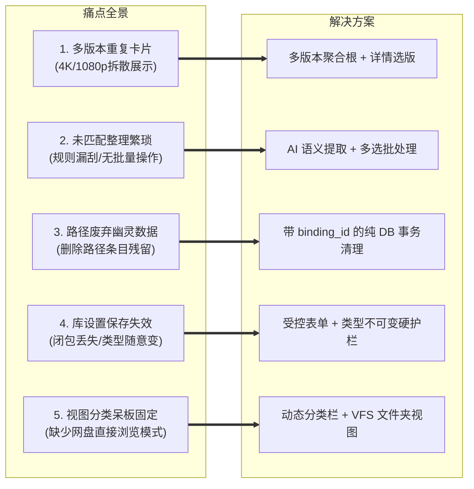
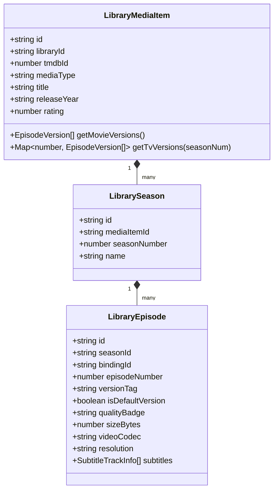
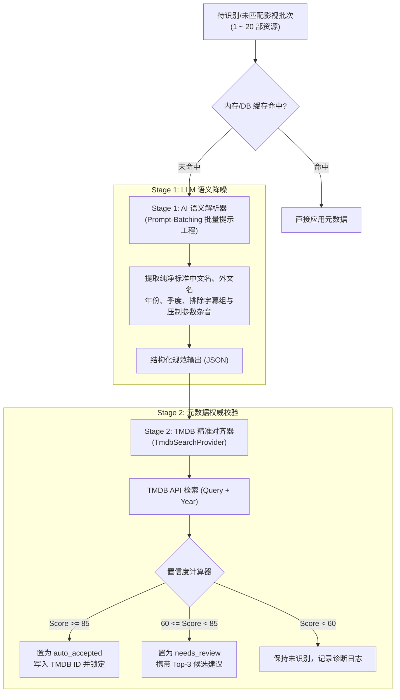
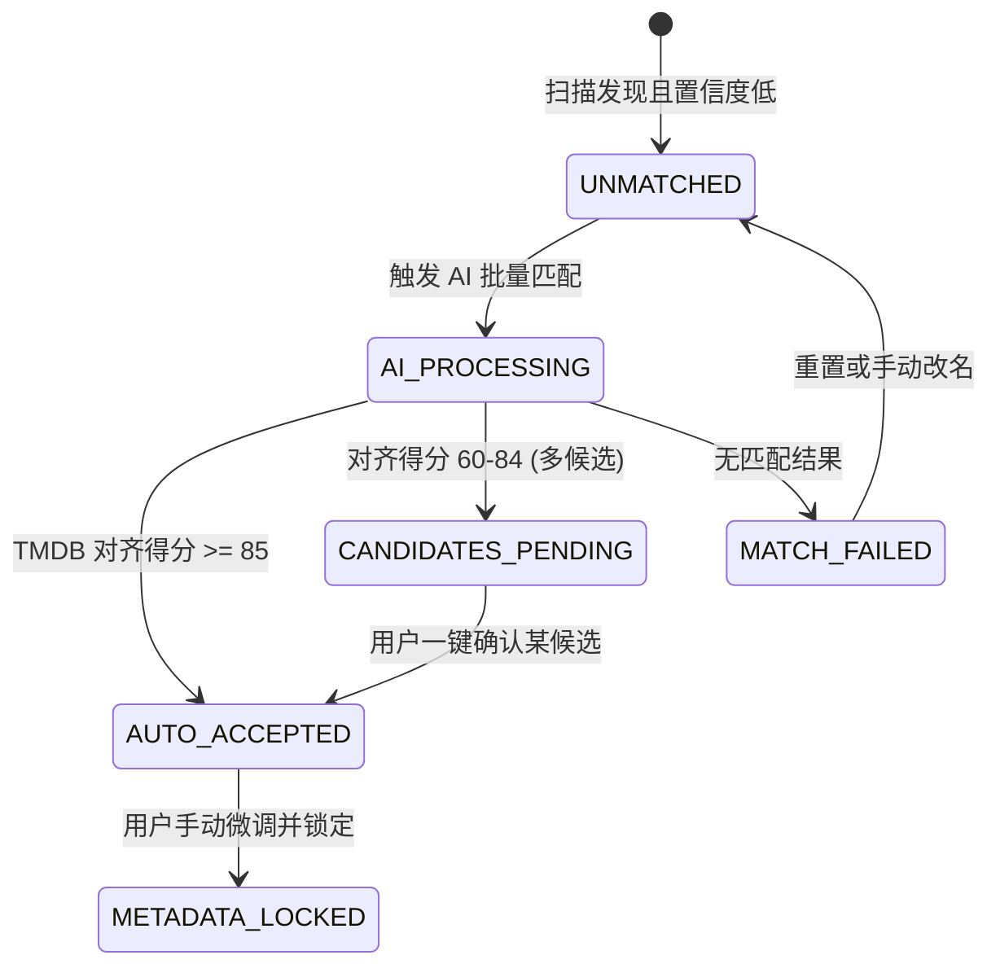
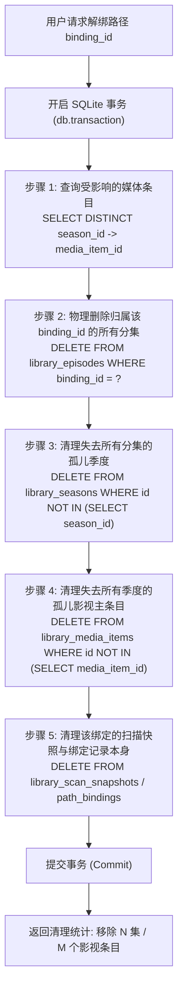
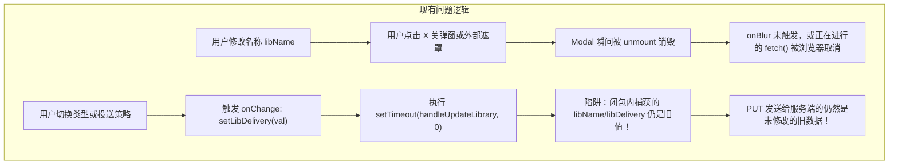
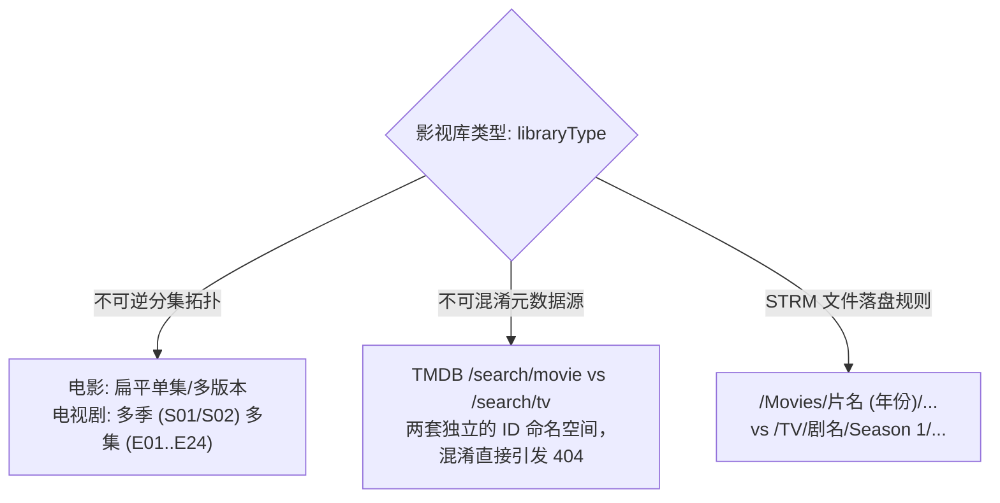
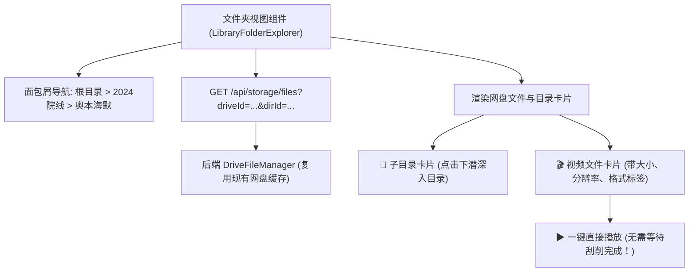
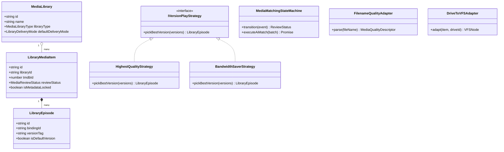
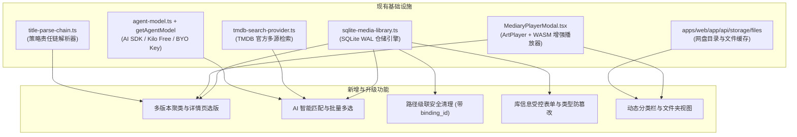

# 巡影 (Mediary Scout) 影视库演进 RFC：多版本聚类、AI 智能匹配、安全路径清理、元数据治理与动态分类导航方案

> **文档标识**：`RFC-2026-MEDIALIB-EVOLUTION`  
> **文档状态**：方案定稿与实施技术指南 (Approved for Engineering Implementation)  
> **编写日期**：2026-11-12  
> **归属工程**：`packages/workflow` & `apps/web` (Mediary Scout 全栈系统)  
> **核心议题**：  
> 1. 影视库多版本聚类展示与详情页多版本切换选择  
> 2. 未匹配影视条目 AI 智能解析与多选批量管理  
> 3. 已移除路径级联清理算法（纯 SQLite 数据库操作，严禁污染网盘）  
> 4. 影视库基础信息修改失效根因排查与类型（libraryType）不可变护栏  
> 5. 影视库分类导航 `[全部 · <库类型动态项> · 文件夹]` 视图方案评估与 VFS 落地  

---

## 目录 (Table of Contents)

- [1. 方案背景与核心诉求推演](#1-方案背景与核心诉求推演)
- [2. 议题一：影视库多版本聚类与详情页选版架构](#2-议题一影视库多版本聚类与详情页选版架构)
  - [2.1 痛点与根本原因剖析](#21-痛点与根本原因剖析)
  - [2.2 业界主流方案对比 (Plex / Emby / Jellyfin / MoviePilot)](#22-业界主流方案对比-plex--emby--jellyfin--moviepilot)
  - [2.3 领域模型改造与聚合根设计 (Aggregate Root)](#23-领域模型改造与聚合根设计-aggregate-root)
  - [2.4 关键设计模式：版本适配器与选版策略模式](#24-关键设计模式版本适配器与选版策略模式)
  - [2.5 前端交互设计 (列表角标 + 详情页切换器)](#25-前端交互设计-列表角标--详情页切换器)
- [3. 议题二：未匹配影视 AI 智能匹配与批量多选架构](#3-议题二未匹配影视-ai-智能匹配与批量多选架构)
  - [3.1 现状瓶颈与单点操作痛点](#31-现状瓶颈与单点操作痛点)
  - [3.2 现有 AI 基础设施复用清单](#32-现有-ai-基础设施复用清单)
  - [3.3 两阶段混合匹配管线 (Two-Stage Hybrid Match Engine)](#33-两阶段混合匹配管线-two-stage-hybrid-match-engine)
  - [3.4 关键设计模式：匹配生命周期有限状态机 (FSM) 与批处理命令](#34-关键设计模式匹配生命周期有限状态机-fsm-与批处理命令)
  - [3.5 批量多选 UI/UX 设计与悬浮工具栏 (Floating Batch Bar)](#35-批量多选-uiux-设计与悬浮工具栏-floating-batch-bar)
- [4. 议题三：去除路径自动清理机制 (纯 DB 级联清理，绝不触碰网盘)](#4-议题三去除路径自动清理机制-纯-db-级联清理绝不触碰网盘)
  - [4.1 现存 Bug 根因定位与数据隔离红线](#41-现存-bug-根因定位与数据隔离红线)
  - [4.2 物理级联拓扑设计：引入 `binding_id` 归属索引](#42-物理级联拓扑设计引入-binding_id-归属索引)
  - [4.3 级联事务清理算法 (Transaction Cascade Purge)](#43-级联事务清理算法-transaction-cascade-purge)
  - [4.4 关键设计模式：领域事件发布-订阅模式 (Domain Event Pattern)](#44-关键设计模式领域事件发布-订阅模式-domain-event-pattern)
- [5. 议题四：影视库基础信息修改失效排障与类型不可变设计](#5-议题四影视库基础信息修改失效排障与类型不可变设计)
  - [5.1 修改后「保存无效」的 3 大前端与状态闭包陷阱](#51-修改后保存无效的-3-大前端与状态闭包陷阱)
  - [5.2 为什么「类型分类 (libraryType) 创建后绝对禁止修改」？](#52-为什么类型分类-librarytype-创建后绝对禁止修改)
  - [5.3 修复与工程落地方案 (显式表单 + Toast + 校验守卫)](#53-修复与工程落地方案-显式表单--toast--校验守卫)
  - [5.4 路径连通性探测 (Test Connection) 实装设计](#54-路径连通性探测-test-connection-实装设计)
- [6. 议题五：影视库分类导航与「文件夹视图」动态适配方案](#6-议题五影视库分类导航与文件夹视图动态适配方案)
  - [6.1 用户方案分析：`[全部 · 电影 · 文件夹]` 的必要性与局限性](#61-用户方案分析全部--电影--文件夹-的必要性与局限性)
  - [6.2 动态中间项适配矩阵 (Movie / TV / Anime / Other)](#62-动态中间项适配矩阵-movie--tv--anime--other)
  - [6.3 文件夹视图 (Folder Explorer) 架构与虚拟文件系统 (VFS) 适配](#63-文件夹视图-folder-explorer-架构与虚拟文件系统-vfs-适配)
  - [6.4 关键设计模式：虚拟文件系统适配器 (VFS Adapter)](#64-关键设计模式虚拟文件系统适配器-vfs-adapter)
- [7. 综合设计模式与架构全景类图 (Design Patterns Blueprint)](#7-综合设计模式与架构全景类图-design-patterns-blueprint)
- [8. 系统现有基础设施与组件复用矩阵](#8-系统现有基础设施与组件复用矩阵)
- [9. 分阶段实施路线图与质量验收红线](#9-分阶段实施路线图与质量验收红线)

---

## 1. 方案背景与核心诉求推演

在 Mediary Scout 全新影视库体系上线后，底层已成功打通 SQLite WAL 持久化、网盘增量扫描、TMDB 自动化刮削与强化版直链播放器。但在真实高频使用与多网盘复杂目录场景下，暴露出了五个直接影响用户体验与数据一致性的核心痛点：



本 RFC 全面调研了业界成熟的开源与商业媒体中心（Plex、Emby、Jellyfin、Kodi、MoviePilot），对 5 大需求进行深度可行性论证、逻辑排障、性能推演与设计模式建模，为后续代码落地提供详尽、安全的架构纲领。

---

## 2. 议题一：影视库多版本聚类与详情页选版架构

### 2.1 痛点与根本原因剖析

#### 现状表现
用户在 115 网盘中同一部电影通常存在多个版本：
- `奥本海默 (2023) [2160p UHD BluRay x265 DV]` (52.4 GB)
- `奥本海默.2023.1080p.WEB-DL.x264` (12.1 GB)
- `Oppenheimer.2023.IMAX.DirectorCut` (38.0 GB)

当前扫描器入库时：
1. 若文件名中发版组标签较多，`identifyMediaFile` 提取出的标题若有细微差异（例如提取出 `奥本海默` 与 `Oppenheimer`），或者在不同的扫描批次中触发，由于 `library_media_items` 表缺乏针对 `(library_id, tmdb_id)` 的全局唯一性汇聚校验，数据库中会被插入多条 `LibraryMediaItem`。
2. 即使两条记录成功匹配到了同一个 `tmdb_id`，当前扫描器使用的是：
   ```ts
   let mediaItem = identified.tmdbId
     ? this.deps.repo.findMediaItemByTmdb(library.id, identified.tmdbId)
     : this.deps.repo.findMediaItemByTitleYear(library.id, identified.title, identified.year);
   ```
   如果因网络抖动或 TMDB API 频率限制导致第一次扫描未能实时拿到 `tmdb_id`，而第二次拿到了，就会裂变为两个独立的条目。
3. **电影详情页展现割裂**：即使两份文件关联到了同一个 `MediaItem`，当前 `library-item-modal.tsx` 依然以剧集思维渲染：
   - 渲染出 `E01 奥本海默 (2023) 2160p`
   - 渲染出 `E01 奥本海默.2023.1080p`
   在电影详情中看到两个“E01”分集卡片，非常违背观影直觉。

---

### 2.2 业界主流方案对比 (Plex / Emby / Jellyfin / MoviePilot)

| 产品 | 多版本入库聚合机制 | 列表卡片视觉呈现 | 播放选版交互 | 手动拆分与合并能力 |
| :--- | :--- | :--- | :--- | :--- |
| **Plex** | 按 Agent GUID (tmdb:// 或 imdb://) 严格聚合为单一条目 | 封面右上角显示蓝色小角标数字（如 `2`），悬浮提示“2 个版本” | 点击播放默认按画质优先策略播放；提供“选择版本播放”弹窗列出文件规格 | 原生支持“合并条目 (Merge)”与“拆分条目 (Split Apart)” |
| **Jellyfin** | 支持同名规则：`MovieName (Year) - [VersionName].ext` 自动合并 | 仅显示一张海报，不增加干扰元素 | 详情页大播放按钮下方提供 `<select>` 下拉框：“4K HEVC HDR (50GB)” / “1080p H264 (12GB)” | 依赖 Merge Versions 社区插件实现跨目录归集 |
| **Emby** | 类似 Jellyfin，识别目录内同名文件后缀自动归组 | 仅显示单张海报，角标显示最高画质（如 4K HDR） | 详情页提供版本切换单选按钮，切换后实时刷新音轨、字幕与文件大小信息 | 支持高级管理界面手动合并不同媒体 ID |
| **MoviePilot** | 基于硬链接/软链接归整，按 TMDB ID 组织多版本子文件 | 纯自动化后台，对接 Emby/Plex，媒体库端由下游播放中心呈现 | 不直接提供播放界面 | 通过重命名规则标准化发版版本标签 |

**结论与借鉴**：
Mediary Scout 应借鉴 **Jellyfin 的轻量直观选版下拉交互** + **Plex 的智能 GUID 自动聚类与手动合并/拆分能力**。

---

### 2.3 领域模型改造与聚合根设计 (Aggregate Root)

在领域驱动设计（DDD）中，`LibraryMediaItem` 应作为**聚合根 (Aggregate Root)**，全权负责其下挂的所有 `Season`、`Episode` 以及多版本文件的生命周期一致性。



#### 数据库 Schema 演进改造
在 `library_episodes` 表中补充版本标识与质量指纹字段：

```sql
ALTER TABLE library_episodes ADD COLUMN version_tag text DEFAULT '';
ALTER TABLE library_episodes ADD COLUMN is_default_version integer DEFAULT 0;
ALTER TABLE library_episodes ADD COLUMN binding_id text NOT NULL DEFAULT '';

-- 针对相同季度与集数的多版本增加辅助查询索引
CREATE INDEX IF NOT EXISTS idx_episodes_season_version 
  ON library_episodes (season_id, episode_number, is_default_version DESC);
CREATE INDEX IF NOT EXISTS idx_episodes_binding 
  ON library_episodes (binding_id);
```

---

### 2.4 关键设计模式：版本适配器与选版策略模式

#### 1. 适配器模式：发版文件名清洗与版本标签提取 (`FilenameQualityAdapter`)
将原始网盘文件名清洗为用户界面友好、易读的标签（如 `4K HDR · Remux`、`1080p 高清 · 杜比视界`）：

```ts
export interface MediaQualityDescriptor {
  resolution: "2160p" | "1080p" | "720p" | "SD";
  hdrType?: "DV" | "HDR10+" | "HDR10" | "SDR";
  codec?: "HEVC" | "AVC" | "AV1" | "VC1";
  sourceType?: "BluRay" | "Remux" | "WEB-DL" | "HDTV";
  edition?: "DirectorCut" | "Extended" | "Theatrical" | "IMAX";
  displayBadge: string; // 如 "4K HDR · Remux"
}

export class FilenameQualityAdapter {
  static parse(fileName: string): MediaQualityDescriptor {
    const raw = fileName.toUpperCase();
    let resolution: MediaQualityDescriptor["resolution"] = "1080p";
    if (raw.includes("2160P") || raw.includes("4K") || raw.includes("UHD")) resolution = "2160p";
    else if (raw.includes("720P")) resolution = "720p";
    else if (raw.includes("480P") || raw.includes("DVD")) resolution = "SD";

    let hdrType: MediaQualityDescriptor["hdrType"] = "SDR";
    if (raw.includes("DOVI") || raw.includes("DOLBY VISION") || raw.includes("DV")) hdrType = "DV";
    else if (raw.includes("HDR10+")) hdrType = "HDR10+";
    else if (raw.includes("HDR")) hdrType = "HDR10";

    let sourceType: MediaQualityDescriptor["sourceType"] = "WEB-DL";
    if (raw.includes("REMUX")) sourceType = "Remux";
    else if (raw.includes("BLURAY") || raw.includes("BD")) sourceType = "BluRay";

    let edition: MediaQualityDescriptor["edition"] | undefined;
    if (raw.includes("IMAX")) edition = "IMAX";
    else if (raw.includes("EXTENDED")) edition = "Extended";
    else if (raw.includes("DIRECTOR")) edition = "DirectorCut";

    const badgeParts = [
      resolution === "2160p" ? "4K" : resolution,
      hdrType !== "SDR" ? hdrType : null,
      sourceType,
      edition,
    ].filter(Boolean);

    return {
      resolution,
      hdrType,
      sourceType,
      edition,
      displayBadge: badgeParts.join(" · "),
    };
  }
}
```

#### 2. 策略模式：默认版本决策器 (`IVersionPlayStrategy`)
当用户直接点击海报上的“快速播放”按钮时，系统按指定策略自动挑选最适版本：

```ts
export interface IVersionPlayStrategy {
  readonly id: string;
  readonly label: string;
  pickBestVersion(versions: LibraryEpisode[]): LibraryEpisode;
}

/** 策略 1: 极致画质优先（4K HDR > 1080p > 720p，大文件优先） */
export class HighestQualityStrategy implements IVersionPlayStrategy {
  readonly id = "highest_quality";
  readonly label = "最高画质优先";
  pickBestVersion(versions: LibraryEpisode[]): LibraryEpisode {
    return [...versions].sort((a, b) => {
      const getResWeight = (res?: string | null) => (res?.includes("2160") ? 3 : res?.includes("1080") ? 2 : 1);
      const resDiff = getResWeight(b.resolution) - getResWeight(a.resolution);
      if (resDiff !== 0) return resDiff;
      return b.sizeBytes - a.sizeBytes;
    })[0]!;
  }
}

/** 策略 2: 流畅与带宽节约（优先 1080p AVC，体积适中，适合移动端与远程 302） */
export class BandwidthSaverStrategy implements IVersionPlayStrategy {
  readonly id = "bandwidth_saver";
  readonly label = "节能与流畅优先";
  pickBestVersion(versions: LibraryEpisode[]): LibraryEpisode {
    const v1080 = versions.find((v) => v.resolution?.includes("1080"));
    if (v1080) return v1080;
    return [...versions].sort((a, b) => a.sizeBytes - b.sizeBytes)[0]!;
  }
}
```

---

### 2.5 前端交互设计 (列表角标 + 详情页切换器)

#### 1. 媒体列表卡片 (`LibraryGrid`)
- 若该条目存在多个版本（如 `versions.length > 1`），在海报右上角（评分旁边）渲染一个轻量胶囊：  
  `[ 2 个版本 ]`（点击直接进入详情页）。
- 列表严格以 `LibraryMediaItem` 为单元聚合，同一部电影在列表中有且仅有一张海报！

#### 2. 详情模态框 (`LibraryItemModal`)
- **电影模式 (`item.mediaType === "movie"`)**：
  彻底废弃带有欺骗性的“E01”单集卡片，在海报右侧的 Action 区域提供**版本选择胶囊行 / 下拉器**：
  ```
  [ ▶ 立即播放 ]   [ 版本: ✦ 4K HDR · Remux (52.4 GB) ▼ ]
  ```
  点击版本下拉，可选择：
  - `● 4K HDR · Remux (52.4 GB) - HEVC / TrueHD 7.1` [当前选中]
  - `○ 1080p 高清 · WEB-DL (12.1 GB) - H.264 / AAC`
  - `○ 导演剪辑版 · IMAX (38.0 GB) - HEVC / DTS-HD`
  选择不同版本后，下方的文件信息、码率、音频通道与字幕轨列表联动切换。
- **电视剧模式 (`item.mediaType === "tv"`)**：
  若某一集（如第 1 季第 1 集）存在多版本，在第 1 集卡片内部提供版本小药丸切换器，默认展开最高画质。

---

## 3. 议题二：未匹配影视 AI 智能匹配与批量多选架构

### 3.1 现状瓶颈与单点操作痛点

1. **规则提取局限性**：
   虽然系统已具备 `title-parse-chain.ts`（包含 `CanonicalTmdbTagStrategy`、`StandardTitleYearFolderStrategy` 等），但在面对如下“重度非标”网盘目录时，纯正则规则极易失效：
   - `【国漫4K无水印60帧】F-R-X-Z-重制版-第01-52集`
   - `[VCB-Studio] Toaru Kagaku no Railgun T [Ma10p_1080p][x265_flac]`
   - `[ANi] 葬送的芙莉莲 - 28 [1080P][Baha][WEB-DL][AAC][CHT].mp4`
   - `阿凡达2水之道.高码杜比视界.国英多音轨.特效中字.Avatar.The.Way.of.Water`
2. **重试成本过高**：
   用户需要对几十部未识别影片逐一点击：详情 ➔ 修改元数据 ➔ 手动输入关键词 ➔ 点击搜索 ➔ 选中条目 ➔ 点击保存。50 部未匹配资源需要操作近 300 次，极度耗时费力。

---

### 3.2 现有 AI 基础设施复用清单

Mediary Scout 内部已完全具备即开即用的成熟 AI 基础设施，**无需安装任何重型外部依赖**：

| 现有设施/文件 | 导出函数/类型 | 可复用能力说明 |
| :--- | :--- | :--- |
| `packages/workflow/src/domain/agent-model.ts` | `createAgentModel`, `FREE_LLM_PRESET` | 基于 `@ai-sdk/openai-compatible`，内置 Kilo Code 公共免费池预设与自填 Key 机制 |
| `apps/web/lib/workflow-runtime.ts` | `getAgentModel(db, accountId)` | 根据用户设置页配置（或环境变量）动态解析并实例化标准的 AI SDK `LanguageModel` |
| `packages/workflow/src/library/tmdb-search-provider.ts` | `TmdbSearchProvider` | 支持按标题、年份、类型查询 TMDB 候选条目并返回海报、评分等 |
| `packages/workflow/src/domain/title-parse-chain.ts` | `parseTitleWithChain` | 作为 Stage 0 免费极速粗筛，过滤 90% 的规范标题 |

---

### 3.3 两阶段混合匹配管线 (Two-Stage Hybrid Match Engine)

为兼顾**识别准确率**与**AI Token 成本/响应速度**，设计两阶段混合流水线：



#### 批量 Prompt 模板示例 (Prompt-Batching)
一次请求打包最多 20 部未匹配资源，极大降低网络往返与 Token 开销：

```ts
const SYSTEM_PROMPT = `你是一个专业的影视与动漫元数据解析专家。
任务：从给定的杂乱网盘文件名或文件夹名中，提取准确的影视标准信息。
输出必须是严格的 JSON 数组，禁止任何多余解释。
每个对象必须包含：
- id: 输入的原始条目 ID
- standardTitle: 标准中文片名（如 "奥本海默", "某科学的超电磁炮T"）
- originalTitle: 原始外文名（如 "Oppenheimer", "とある科学の超電磁砲T"）
- releaseYear: 上映或开播年份 (数字，未知填 null)
- seasonNumber: 季度编号 (电视剧/动漫填数字，电影填 1)
- mediaType: "movie" 或 "tv"
- suggestedTmdbKeywords: 针对 TMDB 检索最有效率的关键词
- confidence: 置信度 (0 - 100)
`;
```

---

### 3.4 关键设计模式：匹配生命周期有限状态机 (FSM) 与批处理命令

#### 1. 状态机模式：`MediaMatchingStateMachine`



#### 2. 命令模式：`BatchRematchCommand`
封装批量重试的执行、进度通知与异常中止能力：

```ts
export interface BatchRematchProgress {
  total: number;
  completed: number;
  succeeded: number;
  failed: number;
  currentTitle?: string;
}

export class BatchRematchCommand {
  constructor(
    private readonly itemIds: string[],
    private readonly repo: SqliteMediaLibraryRepository,
    private readonly model: LanguageModel,
    private readonly tmdbProvider: TmdbSearchProvider,
    private readonly onProgress?: (p: BatchRematchProgress) => void,
  ) {}

  async execute(signal?: AbortSignal): Promise<BatchRematchResult> {
    // 1. 分批切片 (每批 10 项)
    // 2. 调用 LLM 提取标准片名
    // 3. 并行查询 TMDB
    // 4. 原子更新 SQLite 仓储
  }
}
```

---

### 3.5 批量多选 UI/UX 设计与悬浮工具栏 (Floating Batch Bar)

1. **多选交互开启方式**：
   - 点击右上角「多选管理」切换按钮，或按住 `Ctrl / Shift` 点击卡片时自动进入**批量模式**。
   - 每个影视海报卡片的左上角浮现半透明圆形复选框（选中后变为高亮绿色勾选）。
2. **底部浮动操作工具栏 (Floating Batch Bar)**：
   当 `selectedIds.length > 0` 时，页面底部滑入毛玻璃悬浮操作条：
   ```
   [ 已勾选 12 部影片 ]  [全选当前页] [反选]
   ──────────────────────────────────────────────────────────
   [ 🤖 AI 智能匹配 ]  [ ✓ 标记为已审核 ]  [ 🔗 合并为多版本 ]  [ 🗑 移出库 ]
   ```
3. **AI 批量匹配模态框**：
   点击 `[🤖 AI 智能匹配]` 后，弹出处理抽屉，实时显示带进度条的流式执行过程：
   - `正在解析: 【VCB-Studio】科学超电磁炮 (3/12)...`
   - 显示匹配对比列表：`[原文件名] ➔ [AI 识别结果] ➔ [TMDB 匹配海报]`
   - 高置信度条目默认勾选一键保存，低置信度条目标记为待人工确认。

---

## 4. 议题三：去除路径自动清理机制 (纯 DB 级联清理，绝不触碰网盘)

### 4.1 现存 Bug 根因定位与数据隔离红线

#### 现存 Bug 复盘
在 `packages/workflow/src/persistence/sqlite/sqlite-media-library.ts` 中：
```ts
deletePathBinding(id: string): boolean {
  const res = this.db.prepare(`DELETE FROM library_path_bindings WHERE id = ?`).run(id);
  if (res.changes > 0) {
    this.db.prepare(`DELETE FROM library_scan_snapshots WHERE binding_id = ?`).run(id);
    return true;
  }
  return false;
}
```
**严重缺陷**：
代码仅从数据库中移除了路径绑定记录（`library_path_bindings`）和增量快照（`library_scan_snapshots`），**完全没有清理曾经由该路径扫描出来的 `library_episodes`、`library_seasons` 和 `library_media_items`**！  
这就导致：用户在设置里解绑了 `/4K电影备份` 路径后，影视库列表中那些电影依然完整存在，甚至在点击播放时才报 404，成为“幽灵残留数据”。

#### 凭据与存储安全红线
> [!CAUTION]
> **绝对数据安全铁律**：此操作的定义是“从影视库视图中移除已经不存在或不再监听的路径映射”，**绝对禁止调用网盘端任何物理删除接口**（如 `fileManager.deleteFile` 或 115 API 的 `delete`）。只允许执行本地 SQLite 数据库表的清理！

---

### 4.2 物理级联拓扑设计：引入 `binding_id` 归属索引

当前 `library_episodes` 表仅记录了 `storage_id`、`file_id` 和 `relative_path`，并未明确标记该集是“由哪个具体绑定路径扫描出的”。如果同一个网盘被绑定到了不同的库或不同的子路径，极难精确界定哪些分集隶属于被删除的绑定。

**解决方案**：
1. 在 `library_episodes` 表中增加 `binding_id text NOT NULL DEFAULT ''`。
2. 扫描入库时（`upsertEpisode`），显式将当前的 `binding.id` 写入分集记录。

---

### 4.3 级联事务清理算法 (Transaction Cascade Purge)

当用户移除路径绑定 `bind_xxx` 时，必须在一个严密的 SQLite 事务内执行自底向上的 4 步安全回收：



#### 具体 SQL 事务执行实现
```ts
deletePathBindingWithCascade(bindingId: string): { deletedEpisodes: number; deletedItems: number } {
  return this.db.transaction(() => {
    // 1. 获取该绑定涉及的媒体项 ID
    const affectedItems = this.db.prepare(`
      SELECT DISTINCT s.media_item_id 
      FROM library_episodes e
      JOIN library_seasons s ON e.season_id = s.id
      WHERE e.binding_id = ?
    `).all(bindingId) as Array<{ media_item_id: string }>;

    // 2. 删除属于该路径绑定的所有分集 (仅删除 SQLite 记录，不碰网盘)
    const epResult = this.db.prepare(`DELETE FROM library_episodes WHERE binding_id = ?`).run(bindingId);

    // 3. 删除没有剩余分集的季度
    this.db.prepare(`
      DELETE FROM library_seasons 
      WHERE id NOT IN (SELECT DISTINCT season_id FROM library_episodes)
    `).run();

    // 4. 删除没有剩余季度的影视主条目 (防止产生空白海报)
    let deletedItemsCount = 0;
    for (const { media_item_id } of affectedItems) {
      const remainingSeasons = this.db.prepare(`
        SELECT COUNT(*) as count FROM library_seasons WHERE media_item_id = ?
      `).get(media_item_id) as { count: number };

      if (remainingSeasons.count === 0) {
        this.db.prepare(`DELETE FROM library_media_items WHERE id = ?`).run(media_item_id);
        deletedItemsCount++;
      }
    }

    // 5. 删除扫描历史快照与绑定记录
    this.db.prepare(`DELETE FROM library_scan_snapshots WHERE binding_id = ?`).run(bindingId);
    this.db.prepare(`DELETE FROM library_path_bindings WHERE id = ?`).run(bindingId);

    return {
      deletedEpisodes: epResult.changes,
      deletedItems: deletedItemsCount,
    };
  })();
}
```

---

### 4.4 关键设计模式：领域事件发布-订阅模式 (Domain Event Pattern)

当路径被移除时，不仅要清理 SQLite，还要解绑相关的任务调度器，通知前端视图刷新：

```ts
export interface PathBindingDeletedEvent {
  type: "PATH_BINDING_DELETED";
  libraryId: string;
  bindingId: string;
  deletedEpisodes: number;
  deletedItems: number;
  timestamp: string;
}

// 领域事件派发器
export class MediaLibraryEventBus {
  private static listeners: Array<(event: PathBindingDeletedEvent) => void> = [];

  static subscribe(fn: (event: PathBindingDeletedEvent) => void) {
    this.listeners.push(fn);
  }

  static publish(event: PathBindingDeletedEvent) {
    for (const fn of this.listeners) {
      try { fn(event); } catch (err) { console.error("EventBus error:", err); }
    }
  }
}
```

---

## 5. 议题四：影视库基础信息修改失效排障与类型不可变设计

### 5.1 修改后「保存无效」的 3 大前端与状态闭包陷阱

经过对 [`apps/web/features/library/components/library-settings-modal.tsx`](file:///apps/web/features/library/components/library-settings-modal.tsx) 的深入代码审查，精准定位到保存无效的根本原因：



1. **React 19 异步闭包陷阱**：
   ```tsx
   onChange={(e) => {
     setLibDelivery(e.target.value as any);
     setTimeout(() => { void handleUpdateLibrary(); }, 0); // 致命 Bug！
   }}
   ```
   在现代 React 架构中，`setLibDelivery` 是异步调度的，`setTimeout` 内部持有的仍然是执行该语句时的旧作用域闭包变量！发送给后端的 payload 完全是修改前的数据。
2. **缺乏显式保存交互**：
   模态框没有明显的“保存更改”提交按钮，全靠 `onBlur`。用户在输入框输入新名称后，若直接点击右上角“X”或外部遮罩关闭模态框，组件树瞬间销毁，`onBlur` 根本无法稳定完成网络提交。
3. **上层状态联动缺失**：
   即使更新成功，`library-view.tsx` 中的 `activeLibraryId` 对应的 `libraries` 缓存如果没有同步更新当前活动库的引用，页面顶部的标题栏依然展示旧名字。

---

### 5.2 为什么「类型分类 (libraryType) 创建后绝对禁止修改」？

用户明确指出：**【类型分类 应该保持 创建后无法修改】**。这一设计在系统架构上具有极高的严密性与必要性：



1. **元数据命名空间隔离**：TMDB 的 `movie_id` 和 `tv_id` 是两条独立的数字自增序列（例如 Movie 的 1396 是某部老电影，而 TV 的 1396 是《绝命毒师》）。一旦允许电影库随意修改为剧集库，现有刮削缓存全部错乱。
2. **目录与分集拓扑冲突**：电影库的底层假定是 `seasonNumber = 1` 且主要承载多版本正片；剧集库底层深度绑定季度与集数拓扑。修改类型会导致数据库内已有的大量子集结构无法自洽。
3. **STRM 目标路径不可逆**：下游若开启了 STRM 同步，媒体服务器（Emby/Plex）对电影库和电视库的读取扫描规则完全不同，修改类型将引发媒体服务器重复入库崩溃。

---

### 5.3 修复与工程落地方案 (显式表单 + Toast + 校验守卫)

#### 1. 前端 UI 改造 (`library-settings-modal.tsx`)
- **只读展示 `libraryType`**：将 `<select>` 替换为只读带图标的禁用标签，并附带解释气泡：
  ```tsx
  <div style={{ display: "flex", alignItems: "center", gap: "0.5rem" }}>
    <span className="badge badge-secondary" style={{ padding: "0.4rem 0.8rem", fontSize: "0.85rem" }}>
      {library.libraryType === "movie" ? "🎬 电影库" : library.libraryType === "tv" ? "📺 电视剧库" : "🌸 动漫库"}
    </span>
    <span style={{ fontSize: "0.75rem", color: "var(--text-muted)" }}>
      （影视库类型创建后已固定，避免元数据拓扑冲突）
    </span>
  </div>
  ```
- **引入显式受控表单与「保存基本设置」按钮**：
  移除所有脆弱的 `onBlur` 和 `setTimeout` 自动提交逻辑，改为独立 Form 显式提交，并提供 Loading 与成功 Toast：
  ```tsx
  const [savingBase, setSavingBase] = useState(false);
  const [saveSuccess, setSaveSuccess] = useState(false);

  const handleSaveBaseInfo = async (e: React.FormEvent) => {
    e.preventDefault();
    setSavingBase(true);
    setSaveSuccess(false);
    try {
      const res = await fetch(`/api/library/${library.id}`, {
        method: "PUT",
        headers: { "Content-Type": "application/json" },
        body: JSON.stringify({
          name: libName.trim(),
          defaultDeliveryMode: libDelivery,
          posterStyle: libPosterStyle,
        }),
      });
      if (res.ok) {
        setSaveSuccess(true);
        onUpdated(); // 触发父组件重新 fetchLibraries()
        setTimeout(() => setSaveSuccess(false), 2500);
      }
    } finally {
      setSavingBase(false);
    }
  };
  ```

#### 2. 服务端 API 硬护栏 (`apps/web/app/api/library/[id]/route.ts`)
在服务端直接剔除任何针对 `libraryType` 的修改意图，实现防篡改：
```ts
// 严格防篡改：忽略或抛弃 libraryType
const { libraryType: _ignored, ...safePatch } = body;

const updated = repo.mediaLibraryStore.updateLibrary(id, {
  ...(safePatch.name ? { name: safePatch.name.trim() } : {}),
  ...(safePatch.defaultDeliveryMode ? { defaultDeliveryMode: safePatch.defaultDeliveryMode } : {}),
  ...(safePatch.posterStyle ? { posterStyle: safePatch.posterStyle } : {}),
});
```

---

### 5.4 路径连通性探测 (Test Connection) 实装设计

在库设置的“已绑定路径”列表中，为每个路径项增加 **「测试连通性」** 按钮：
- **后端探针接口**：`POST /api/library/[id]/paths/[bindingId]/test`
- **执行逻辑**：
  1. 调用 `fileManager.listDirectory(binding.remoteFolderId)` 尝试读取该目录。
  2. 记录往返耗时（Latency）。
  3. 检验网盘返回的有效项目数。
- **前端回显**：
  - 成功：显示绿色徽标 `✓ 连通正常 (延迟 120ms，目录含 142 个文件)`
  - 失败：显示红色徽标 `✗ 连接失败: 凭据已失效或远程目录不存在`，并提示一键前往重新授权。

---

## 6. 议题五：影视库分类导航与「文件夹视图」动态适配方案

### 6.1 用户方案分析：`[全部 · 电影 · 文件夹]` 的必要性与局限性

当前 `library-view.tsx` 的二级导航条是写死的：
`[ 全部 ]  [ 电影 ]  [ 剧集/动漫 ]`

**用户提出的构想**：
`[ 全部 ]  [ <中间项目根据影视库类型变更> ]  [ 文件夹 ]`

#### 深度推演评估
1. **非常契合用户心智**：
   当用户点击进入一个名为“4K 电影库”的影视库时，再看到“剧集/动漫”过滤按钮显然是冗余且引起困惑的；同理，进入“追番库”时看到“电影”过滤按钮也毫无意义。将中间项动态适配为当前库的主类型，极其自然。
2. **「文件夹」视图是媒体中心的灵魂保底功能**：
   - 任何刮削器都不可能达到 100% 的完美识别率（例如家庭录像、未发行的演唱会、特殊格式原盘）。
   - 用户对自己网盘内的层级结构是一清二楚的。**文件夹视图让用户拥有兜底掌控力**：即便刮削失败，用户依然能顺着目录找到文件并一键点播！

---

### 6.2 动态中间项适配矩阵 (Movie / TV / Anime / Other)

| 当前激活的影视库类型 (`currentLibrary.libraryType`) | 方案生成的 Tab 导航序列 | 中间项点击行为与功能 |
| :--- | :--- | :--- |
| **`movie` (电影库)** | `[ 全部 ]` · `[ 🎬 电影 ]` · `[ 📁 文件夹 ]` | **电影 Tab**：展示已刮削的电影海报墙，可按年份/类型/评分二次过滤 |
| **`tv` (电视剧库)** | `[ 全部 ]` · `[ 📺 剧集 ]` · `[ 📁 文件夹 ]` | **剧集 Tab**：展示电视剧海报墙，点击进入展示多季与剧集列表 |
| **`anime` (动漫专库)** | `[ 全部 ]` · `[ 🌸 动漫 ]` · `[ 📁 文件夹 ]` | **动漫 Tab**：按季度番组、连载中/完结分类展示 |
| **`other` / 全部概览视图** | `[ 全部 ]` · `[ 🎬 电影 ]` · `[ 📺 剧集 ]` · `[ 📁 文件夹 ]` | 概览视角保留大类切分，末尾同样提供全库文件夹浏览 |

---

### 6.3 文件夹视图 (Folder Explorer) 架构与虚拟文件系统 (VFS) 适配

当用户切换到 `[ 文件夹 ]` Tab 时，页面无缝转换为**网盘层级浏览器**：



#### 关键技术优势
1. **复用已有的网盘驱动**：底层直接调用 `apps/web/app/api/storage/files/route.ts` 与 `DriveFileManager`，零新增后台开发量。
2. **实时与即开即播**：即便增量扫描任务还在后台排队，用户通过文件夹视图已经能够立即调用播放器开始观看！

---

### 6.4 关键设计模式：虚拟文件系统适配器 (VFS Adapter)

不同存储后端（115 网盘、夸克、本地挂载目录、WebDAV）的目录项结构存在差异，通过 `IVFSNodeAdapter` 统一抽象：

```ts
export interface VFSNode {
  id: string;
  name: string;
  isFolder: boolean;
  sizeBytes?: number;
  updatedAt?: string;
  mediaType?: "video" | "subtitle" | "other";
  playUrl?: string; // 若为视频文件，直接装配播放直链
}

export class DriveToVFSAdapter {
  static adapt(item: DriveFileItem, driveId: string): VFSNode {
    return {
      id: item.id,
      name: item.name,
      isFolder: item.isFolder,
      sizeBytes: item.sizeBytes,
      updatedAt: item.updatedAt,
      mediaType: item.type === "video" ? "video" : item.type === "subtitle" ? "subtitle" : "other",
      playUrl: item.type === "video" ? `/api/storage/files/play?driveId=${driveId}&fileId=${item.id}` : undefined,
    };
  }
}
```

---

## 7. 综合设计模式与架构全景类图 (Design Patterns Blueprint)



---

## 8. 系统现有基础设施与组件复用矩阵

在 Mediary Scout 中实现上述五大功能，应最大化复用已有模块，严禁重复造轮子：



---

## 9. 分阶段实施路线图与质量验收红线

### 9.1 分阶段实施路线图 (Milestones)

#### Phase 1: 基础排障与安全性加固（紧急优先）
- **目标**：解决数据残留 Bug 与基础信息修改无效问题。
- **任务**：
  1. 数据库升级：为 `library_episodes` 增加 `binding_id` 字段及索引。
  2. 实现 `deletePathBindingWithCascade` 纯 SQLite 原子事务清理算法。
  3. 重构 `library-settings-modal.tsx`：类型分类设为只读不可变，替换 `setTimeout` 闭包为显式受控表单与提交按钮。
  4. 增加路径「测试连通性」探测能力。

#### Phase 2: 多版本聚类与详情页选版交互
- **目标**：彻底解决电影列表中重复出现多张卡片，以及详情页渲染多个“E01”的问题。
- **任务**：
  1. 实现 `FilenameQualityAdapter`，在扫描时解析视频质量标签并写入分集表。
  2. 改造入库防重逻辑：同库同 TMDB ID 自动归入单一 `LibraryMediaItem`。
  3. 改造 `LibraryGrid`：单条目展示海报，悬浮展示版本数角标。
  4. 改造 `LibraryItemModal`：电影模式展现显式版本选择器，支持切换播放与画质参数联动。

#### Phase 3: 动态分类栏与网盘文件夹视图
- **目标**：提升影视库交互灵活性，提供不依赖刮削的即开即播能力。
- **任务**：
  1. 改造 `library-view.tsx` 二级 Tab：根据当前 `libraryType` 动态渲染 `[全部 · <电影/剧集/动漫> · 文件夹]`。
  2. 编写 `LibraryFolderExplorer` 组件，对接现有 `/api/storage/files` 接口，支持层级浏览与视频文件一键播放。

#### Phase 4: AI 智能匹配与批量多选管理
- **目标**：大幅提升冷门资源、番组资源的整理效率。
- **任务**：
  1. 开发悬浮批量工具栏 (`FloatingBatchBar`) 与卡片复选框。
  2. 后端开发 `/api/library/items/batch-rematch`，复用 `getAgentModel` 与 TMDB 校验。
  3. 提供流式进度回显与低置信度候选确认抽屉。

---

### 9.2 质量验收红线 (Quality Gates)

依据项目主规则 [`AGENTS.md`](file:///AGENTS.md)，所有功能必须通过以下硬性门禁：

1. **凭据与存储安全红线**：
   - 路径清理与多版本合并**严禁触发任何对外部网盘（115/夸克）的写/删操作**，必须有自动化单元测试断言 mock 驱动的 `deleteFile` 零调用。
   - 所有文档、测试夹具严禁泄漏真实 API Key 或网盘 Cookie，一律使用标准脱敏占位符（如 `sk-proj-test-secret-key-1234567890`）。
2. **Next.js 运行时健康红线**：
   - 页面切换、Tab 切换或文件夹展开时不得产生未捕获的控制台错误。
   - 绝不允许出现 Next.js SSR 水合崩溃（`Hydration failed`）。
3. **性能基准**：
   - 批量 AI 匹配单次请求（10 部影片）耗时控制在 3 秒以内（基于 Kilo Code 免费模型或 BYO 模型）。
   - 文件夹视图单次翻页或下潜目录渲染耗时小于 200ms。
