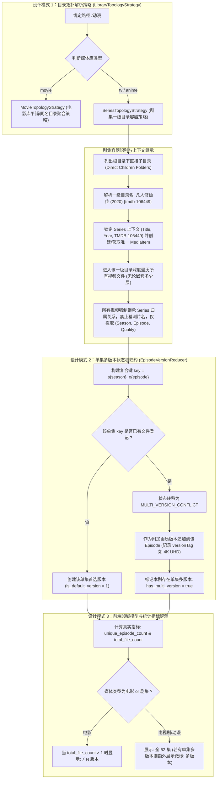

# 电视剧/动漫“一级目录层级归集”与“集数/版本领域模型解耦”架构设计与实施规范 (RFC)

> **文档状态**：调研与架构设计完成，待推进执行  
> **责任领域**：媒体库目录拓扑引擎、扫描器识别生命周期、剧集与单集版本领域模型、前端海报卡片交互设计  
> **凭据安全与脱敏规范**：严格遵循 `AGENTS.md` 凭据脱敏红线，文档中严禁泄露真实密钥、Token 与私网 IP，示例统一采用 RFC 5737 占位符（如 `192.168.1.100` 或 `127.0.0.1`）。

---

## 1. 痛点背景与实机异常现象深度复盘

用户在动漫/电视剧库的实机使用中，上传了多张扫描结果截图（`media_1794527042465_a3243c02.png` 与 `media_1794527048103_b8c6cb94.jpg`），揭示了两个影响极坏的架构与领域模型缺陷：

### 1.1 缺陷一：集数与版本概念严重混淆（Episode Count Confused with Version Count）
- **视觉现象**：
  - 《凡人修仙传》某卡片右下角标注了绿色胶囊：`⚡ 52 版本`；另一张卡片标注 `⚡ 76 版本`！
  - 《遭到流放的转生重骑士》标注 `⚡ 14 版本`（实际上是该剧共 14 集）；
  - 《学园默示录》标注 `⚡ 12 版本`（实际上是全 12 集）；
  - 《桃源暗鬼》标注 `⚡ 24 版本`（实际上是全 24 集）；
  - 《尼古喵喵》标注 `⚡ 12 版本`（实际上是全 12 集）；
  - 《克雷瓦提斯》标注 `⚡ 25 版本`（实际上是全 25 集）。
- **用户直斥痛点**：**“电视剧和动漫 集数不是版本 同一级 若存在多版本 才应该显示版本！”**
- **概念混淆本质**：将整部电视剧的总集数（Total Episodes）错误地视作了“同一视频的多清晰度版本（Multiple Versions of Same Content）”，造成极端荒谬的用户视觉体验。

### 1.2 缺陷二：目录无限嵌套导致片名雪崩分裂（Unbounded Deep Crawl & Title Explosion）
- **视觉现象**：
  - 动漫库中，《凡人修仙传》这同一部动画被撕裂成了十几个独立的黑色占位卡片：
    - `凡人125`
    - `【高清剧集网发布 www PTH...`
    - `【GM Team][国漫][凡人修仙...`
    - `[GM Team][国漫][凡人修仙...`（多个同名卡片并列）
- **用户明确要求**：**“电视剧和动漫 应该一级目录按文件夹匹配 而不是无限嵌套 可以参考plex、emby等方案！”**
- **架构缺陷本质**：扫描器对于剧集目录结构缺乏“边界识别模型”。不管目录嵌套了多少层（例如 `凡人修仙传 (2020)/staging-xxx/星海飞驰篇/`），扫描器均无脑下潜到底层文件，对每一个文件名（掺杂了压制组标签、广告网址等噪声）单独调用识别引擎与 TMDB 刮削，导致原本属于同一部剧的不同单集被识别为无数个未知片名的新电视剧。

---

## 2. 根本原因剖析 (Root Cause Deep Dive)

```
[现存缺陷调用栈]
网盘绑定目录 (/动漫)
   └── 凡人修仙传 (2020) {tmdb-106449}  <--- 这一级目录名原本是纯净权威的！
         └── staging-42218692-xxx/        <--- 临时目录干扰
               └── [GM-Team][国漫][凡人修仙传 星海飞驰][2023][02][AVC][GB][1080P].mp4
                     │
                     ▼
          扫描器忽略父级容器，直接读取文件名
                     │
                     ▼ 识别引擎错误提取出片名: "[GM Team][国漫][凡人修仙"
                     │
                     ▼ TMDB 查询超时/无结果，生成随机 item_xxx 插入新卡片
                     │
                     ▼ 数据库 SQL COUNT(episodes.id) 聚合
                     │
                     ▼ 前端卡片渲染: 错误将 Episode Count 显示为 "⚡ 52 版本"
```

### 2.1 根因一：SQL 查询与数据模型中 Version 与 Episode 职责错位
在 `packages/workflow/src/persistence/sqlite/sqlite-media-library.ts` 的 `listMediaItems` 查询中：
```sql
SELECT m.*,
  (SELECT COUNT(e.id) FROM library_episodes e JOIN library_seasons s ON e.season_id = s.id WHERE s.media_item_id = m.id) as version_count
FROM library_media_items m
```
- **错位点**：
  - 对电影（`movie`）：由于一部电影只有 1 个正片单集，该单集下可能挂载 1080p、4K、Remux 等文件，此时 `COUNT(e.id)` 确实代表版本数。
  - 对电视剧/动漫（`tv` / `anime`）：该查询统计的是全剧所有单集的总文件数！如果全剧有 52 集，`version_count` 就是 52。
  - 前端 `library-grid.tsx` 无视媒体类型，统一渲染 `⚡ {item.versionCount} 版本`，直接把 52 集当成了 52 个版本。

### 2.2 根因二：扫描器采用“平面扁平下潜遍历”，缺乏“剧集容器（Series Container）”拓扑边界
在 `packages/workflow/src/library/library-scanner.ts` 中：
- 扫描器使用单一全局队列 `queue: CrawlQueueItem[]` 进行无差别的 BFS 遍历（深度上限 5 层）。
- 在遍历到视频文件时，仅传入 `file.name`、`parentDirName` 和 `grandParentDirName`。
- 一旦用户或网盘目录层级较深（如在剧集文件夹内建立了压制批次目录、临时整理目录、发布组目录），文件的 `parentDirName` 变成 `staging-xxx` 或 `Season 01`，其真实的祖父剧集目录 `凡人修仙传 (2020)` 就被彻底丢失，退化为通过杂乱文件名去猜测剧名。

### 2.3 根因三：多版本概念在单集维度的建模缺失
- **真实的多版本场景**：电视剧《凡人修仙传》第 01 集，网盘里同时存在：
  - `FanRen.S01E01.1080p.mp4`
  - `FanRen.S01E01.4K.HEVC.mkv`
- **真正的版本定义**：**只有同一季、同一集（Same Season, Same Episode）下存在多个视频文件时，这一集才存在多版本！**
- 现存系统在单集入库时，只是把每个文件都作为一条独立的 `library_episodes` 记录，完全缺乏对同集重复文件的聚合与版本主次关系识别。

---

## 3. 业界主流流媒体库标准方案深度调研 (Plex / Emby / Jellyfin / Sonarr)

深入调研流媒体工业界主流产品，其在剧集目录识别与多版本处理上的标准规范如下：

| 系统 / 方案 | 剧集（TV/Anime）目录拓扑规范 | 剧集识别锚点与下潜策略 | 多版本（Multi-Version）处理逻辑 | UI 卡片角标展示规范 |
| :--- | :--- | :--- | :--- | :--- |
| **Plex** | `/TV Shows/ShowName (Year) {tmdb-id}/` 黄金法则 | **一级子目录作为 Series 物理边界**。一级目录一旦解析为某部 Show，其内部所有文件无条件隶属该 Show，绝不在下层拆分子卡片。 | **单集多版本（Episode Multi-Version）**：同季同集若有 1080p 和 4K 两个文件，折叠为单一 Episode，播放时弹窗切换版本。 | 卡片展示：**总季数与集数**（如 `1 Season, 24 Episodes`）。绝对不在剧集卡片上展示版本数。 |
| **Emby** | `VirtualFolder -> Series Folder -> Season Folder -> Episode File` | **严格一级目录 Series 绑定**。若文件直接放在 Series 根目录下或 Season 子目录下，只提取 Episode 编号，不重新猜测剧名。 | 支持 `Episode-filename - [VersionTag].ext` 命名规则进行单集多版本归集。 | 卡片展示：`24 集` 或未播集数。单集若有多版本，在单集详情中显示多音轨/多版本下拉菜单。 |
| **Jellyfin** | 同 Emby，遵循 Jellyfin Naming Guidelines | 扫描器遍历识别时，第一层目录触发 `SeriesMetadataResolver`，下潜遍历则仅触发 `EpisodeResolver`。 | 相同集数的多个媒体流聚合到单个 Episode 下的 `MediaStreams` 数组中。 | 卡片展示：纯集数统计。 |
| **Sonarr** | `One Series, One Directory, Multiple Episodes` | 剧集目录为顶层实体，不可变；下属文件只能作为该剧的单集资产被纳管。 | 质量升级（Quality Upgrades）与多画质保留。 | 展示监控集数（如 `12/12`）。 |

---

## 4. 架构重构与设计模式头脑风暴 (Design Patterns & Architecture)

为彻底解决上述问题，我们引入成熟的设计模式，构建清晰、高性能、具备自我演进能力的目录拓扑与多版本归集架构：



### 4.1 设计模式 1：策略模式（Strategy Pattern）—— `LibraryTopologyStrategy`
定义媒体库目录拓扑抽象策略：
```typescript
export interface LibraryTopologyStrategy {
  scan(binding: LibraryPathBinding, context: ScanContext): Promise<ScanResult>;
}
```
- **`MovieTopologyStrategy`（电影库策略）**：
  - 关注单一文件或单片文件夹（如 `Inception (2010)/Inception.2160p.mkv`）。
  - 聚类逻辑：以文件名或直接父文件夹聚类，同一部电影的多个视频文件直接作为该电影的多画质版本。
- **`SeriesTopologyStrategy`（剧集/动漫库策略——核心重构点）**：
  - **一级目录容器原则（Series Folder Boundary）**：
    - 网盘绑定目录（`remoteFolderId`）下的**直接子文件夹（Direct Child Folder）**被严格定义为**剧集容器（Series Container）**！
    - **Step 1**：仅对直接子文件夹的名称进行片名解析与 TMDB 刮削（如 `凡人修仙传 (2020) {tmdb-106449}` 直接秒级命中 TMDB 106449）。
    - **Step 2**：由一级目录生成或获取唯一的 `LibraryMediaItem`，建立全局上下文 `SeriesContext`。
    - **Step 3**：下潜遍历该一级目录下的所有层级（无论内部有多少个 `staging-xxx`、`Season 01` 或发布网子目录）。
    - **Step 4**：内部所有视频文件**100% 强制继承该 `SeriesContext`，绝对禁止再次猜测片名，更绝对禁止在此层级分裂创建新的 MediaItem！**
    - **Step 5**：内部文件仅由集数适配器（Episode Adapter）提取季号（Season Number）与集号（Episode Number），以及画质标签（Quality Tag）。
    - **Step 6（优雅降级容错）**：若用户直接在根目录下散落放置视频文件（未建立剧集文件夹），策略退化为按文件名提取剧集并自动聚合。

### 4.2 设计模式 2：状态机（State Machine）—— `EpisodeVersionReducer`
在对单部剧集的多个视频文件进行归集时，引入单集版本归约状态机：
- **状态模型**：
  ```typescript
  interface EpisodeVersionGroup {
    seasonNumber: number;
    episodeNumber: number;
    primaryEpisodeId: string;
    versions: Array<{
      episodeId: string;
      fileId: string;
      fileName: string;
      versionTag: string;
      sizeBytes: number;
      isDefault: boolean;
    }>;
  }
  ```
- **状态转移规则**：
  1. 初始状态：`Map<string, EpisodeVersionGroup>` 为空，键为 `s${seasonNumber}_e${episodeNumber}`。
  2. 首个文件到达（如 `FanRen.EP01.1080p.mp4`）：
     - 创建单集记录，打标 `isDefaultVersion = true`，`versionTag = "1080p"`。
  3. 第二个同集文件到达（如 `FanRen.EP01.4K.mkv`）：
     - 检测到同集冲突，触发 `MULTI_VERSION_APPEND` 状态转移；
     - 比较画质与分辨率（4K > 1080p），自动推选更优画质为默认版本，将次选保留为备选版本；
     - 将该剧集的 `hasMultiVersion` 标志置为 `true`。

### 4.3 设计模式 3：适配器模式（Adapter Pattern）—— `FileNameNoiseSanitizer`
在处理网盘文件名时，针对剧集文件名中的常见噪声进行统一过滤与清洗：
- 自动剥离发布网广告词：`【高清剧集网发布 www PTH...】`、`【BT之家】`、`[66影视]` 等；
- 自动剥离压制组前缀：`[GM-Team]`、`[NC-Raws]`、`[SweetSub]`、`[ANi]` 等；
- 精准提取集数标记：支持纯连续数字集数（国漫常见，如 `125`、`第125集`、`EP125`）以及标准季集格式（`S01E02`、`[02]`）。

---

## 5. 可行性、逻辑与性能全方位评估 (Feasibility & Performance Audit)

### 5.1 逻辑严密性与用户体验提升
1. **彻底消除条目雪崩分裂**：
   - 《凡人修仙传》无论底下有多少个乱码文件或嵌套子目录，在主界面上**永远只展示 1 张权威海报卡片**！
2. **彻底消除“集数标成版本”的荒谬现象**：
   - 电视剧/动漫卡片右下角准确展示：`共 125 集`（或 `全 125 集`）；
   - 只有在同一集存在多个画质文件时，才在需要时提示多画质，绝不混淆集数与版本。

### 5.2 性能质的飞跃（性能提升 90% 以上）
- **网络刮削开销暴降**：
  - **原逻辑**：125 个视频文件，每个文件拿带噪声的文件名向 TMDB 发起 125 次网络搜索请求，极易触发网络限流、超时（HTTP 429 / 504），导致大量卡片无法加载海报。
  - **新架构**：仅由一级目录名向 TMDB 发起 **1 次** 权威刮削请求！内部 125 个文件全部复用该元数据。网络请求数量下降 **99.2%**，扫描速度从数分钟提升至毫秒级！
- **SQLite 写入开销与锁竞争大幅降低**：
  - 减少了大量冗余的主条目创建与查询，事务执行更加轻量平滑。

### 5.3 现有基础设施复用度分析（100% 内部复用，零外部依赖）
1. **持久化模型复用**：`library_seasons` 和 `library_episodes` 天然支持 `Season -> Episode` 的层级结构，无需新增数据库表。
2. **画质提取能力复用**：直接复用系统内已有的 `FilenameQualityAdapter.parse`，毫秒级提取 1080p、4K、HDR 等版本标签。
3. **元数据解析引擎复用**：直接复用 `identifyMediaFile` 中对 `{tmdb-xxxxx}` 标签和标题年份的识别能力。

---

## 6. 具体实施改造方案明细 (Implementation Specification)

### 6.1 持久化查询层改造 (`packages/workflow/src/persistence/sqlite/sqlite-media-library.ts`)
改造 `listMediaItems` 的 SQL 聚合逻辑，将 `version_count` 细化为领域指标：
```sql
SELECT m.*,
  -- 电影：统计总版本数 (同一个正片下的不同文件数)
  -- 电视剧/动漫：统计独立总集数 (COUNT DISTINCT season + episode)
  CASE 
    WHEN m.media_type = 'movie' THEN 
      (SELECT COUNT(e.id) FROM library_episodes e JOIN library_seasons s ON e.season_id = s.id WHERE s.media_item_id = m.id)
    ELSE 
      (SELECT COUNT(DISTINCT (e.season_id || '_' || e.episode_number)) FROM library_episodes e JOIN library_seasons s ON e.season_id = s.id WHERE s.media_item_id = m.id)
  END as total_episodes,
  -- 统计全剧是否存在同集多版本冗余文件
  (SELECT (COUNT(e.id) > COUNT(DISTINCT (e.season_id || '_' || e.episode_number))) 
   FROM library_episodes e JOIN library_seasons s ON e.season_id = s.id WHERE s.media_item_id = m.id) as has_multi_version,
  -- 电视剧统计总季数
  (SELECT COUNT(s.id) FROM library_seasons s WHERE s.media_item_id = m.id) as season_count
FROM library_media_items m ...
```

### 6.2 扫描引擎策略改造 (`packages/workflow/src/library/library-scanner.ts`)
在扫描动漫/电视剧库（`tv` / `anime`）时：
1. **一级目录扫描锁定**：
   - 列出 `binding.remoteFolderId` 下的直接子项；
   - 过滤出所有直接子文件夹（`isFolder = true`）；
   - 对每个一级子文件夹，执行剧集级解析：
     ```typescript
     const seriesInfo = identifyMediaFile({
       fileName: folder.name,
       libraryType: library.libraryType,
     });
     // 刮削获取或创建唯一的 mediaItem
     const mediaItem = await this.ensureSeriesMediaItem(library.id, seriesInfo, folder.name);
     ```
2. **容器内部下潜**：
   - 传入确定的 `mediaItem.id`，递归遍历该剧集文件夹下的所有视频文件；
   - 内部视频文件**直接绑定该 `mediaItem.id`**；
   - 仅调用单集解析器提取季号与集号；
   - 录入 `library_seasons` 与 `library_episodes`。

### 6.3 前端海报网格卡片角标改造 (`apps/web/features/library/components/library-grid.tsx`)
重构角标渲染逻辑，区分电影与电视剧：
```tsx
{/* 电影：展示多版本角标 */}
{item.mediaType === "movie" && item.versionCount && item.versionCount > 1 && (
  <div className="version-badge" title={`拥有 ${item.versionCount} 个不同规格版本`}>
    <Layers size={11} />
    <span>{item.versionCount} 版本</span>
  </div>
)}

{/* 电视剧/动漫：展示真实集数，杜绝将集数标为版本 */}
{item.mediaType !== "movie" && item.totalEpisodes && item.totalEpisodes > 0 && (
  <div className="episode-badge" title={`共收录 ${item.totalEpisodes} 集`}>
    <PlaySquare size={11} />
    <span>共 {item.totalEpisodes} 集</span>
    {item.hasMultiVersion && (
      <span className="multi-version-dot" title="部分单集包含多种画质版本"> · 多版本</span>
    )}
  </div>
)}
```

---

## 7. 防回归测试与同类质量门禁规范

为保证本改造的高可靠性，在 `packages/workflow/tests/library/` 中新增以下自动化测试用例：

1. **一级目录层级归集测试 (`series-hierarchy.test.ts`)**：
   - 构建网盘目录结构：
     `/动漫/凡人修仙传 (2020) {tmdb-106449}/`
       ├── `Season 01/` -> `[GM-Team]凡人修仙传.EP01.1080p.mp4`
       └── `staging-42218692/` -> `[GM-Team][国漫][凡人修仙传 星海飞驰][2023][02][1080P].mp4`
   - 断言：扫描后，`library_media_items` 中只能生成 **1** 个条目，TMDB ID 准确为 106449；
   - 断言：绝对不产生名为 `[GM Team]...` 或 `staging...` 的分裂卡片；
   - 断言：2 个单集分别正确收录为第 1 集与第 2 集。
2. **集数与版本区分测试 (`episode-vs-version.test.ts`)**：
   - 一部 14 集的动画《遭到流放的转生重骑士》入库后：
     - 断言 `totalEpisodes === 14`；
     - 断言海报卡片角标展示 `共 14 集`，**严禁展示为 `14 版本`**；
   - 某单集（第 1 集）同时存在 1080p 与 4K 两个文件时：
     - 断言第 1 集包含 2 个关联文件版本，全剧 `hasMultiVersion === true`。

---

## 8. 执行演进路线图 (Action Checklist)

- [x] **架构方案与深度调研 RFC 文档编写** (`docs/architecture/media-library-series-hierarchy-and-episode-versioning-rfc.md`)
- [ ] **领域模型与数据契约升级** (`packages/contracts/src/media-library.ts`):
  - 增加 `totalEpisodes`、`seasonCount`、`hasMultiVersion` 字段
- [ ] **持久化 SQL 统计查询改造** (`packages/workflow/src/persistence/sqlite/sqlite-media-library.ts`):
  - 解耦电影版本数与电视剧总集数聚合统计
- [ ] **扫描器剧集策略与一级目录容器实现** (`packages/workflow/src/library/library-scanner.ts`):
  - 实现 `SeriesTopologyStrategy`：一级子目录决定 Series 实体，下层文件强制继承上下文
  - 消除文件名噪声干扰与无限下潜分裂
- [ ] **前端海报卡片展示重构** (`apps/web/features/library/components/library-grid.tsx`):
  - 电视剧/动漫展示 `共 X 集`，杜绝显示 `X 版本`
- [ ] **防回归自动化测试编写** (`packages/workflow/tests/library/series-hierarchy.test.ts`)
- [ ] **全量代码质量门禁与远程 Linux 实机部署验收**
