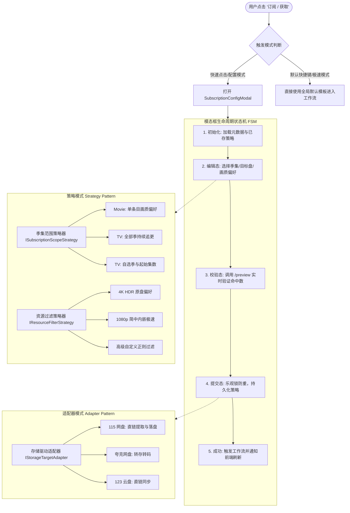

# 详情页网盘持久化对齐与前置弹窗订阅策略架构方案 (movie-detail-workspace-resolution-and-modal-subscription-policy-spec)

> 本文档针对两个核心问题展开深度技术复盘、业界主流方案调研、设计模式抽象与工程落地实施规划：
> 1. **详情页网盘漂移根因与多层状态对齐**：为何从搜索/发现流进入影片详情页后，顶部网盘指示器意外漂移为夸克网盘而非最后持久化的 115 网盘？
> 2. **前置交互式订阅流与策略配置治理**：参考 MoviePilot (MP) 与 Sonarr 业界主流实践，将现有的“先获取后配规则”倒置流程重构为“点击订阅/获取 -> 弹窗配置季集与资源偏好 -> 驱动工作流”的前置编排体系。

---

## 一、 问题 1 深度调研：详情页网盘漂移为夸克网盘的原因与优化

### 1. 现象复现与核心矛盾
- **用户行为路径**：
  1. 用户在系统内绑定了两个网盘：网盘 A（夸克，创建时间较早 `2026-11-02 17:31:36`）与网盘 B（115 网盘，创建时间较晚 `2026-11-02 20:24:03`）。
  2. 用户在 115 网盘工作区（`/w/cs_3204551`）浏览搜索或发现推荐。
  3. 点击一部影片进入详情页：`http://192.168.1.100:3020/show/1423191?from=search&t=movie`。
  4. **异常表现**：左侧侧边栏的快捷导航链接（搜索、订阅、网盘、设置）依然保留带 `?w=cs_3204551`，但侧边栏顶部最显眼的**网盘工作区指示器**却显示为 `夸克网盘 …7omX`；当用户点击“获取”或检索资源时，用户产生严重困惑：“系统是否把影片存到了夸克网盘？”

### 2. 两层根因技术剖析 (Root Cause Breakdown)

通过全链路断点追踪与状态审计，发现该问题是由 **URL 上下文传递丢失** 与 **客户端切换器解析降级** 双重缺陷叠加导致的：

```
[用户在 115 发现流点击卡片]
          │
          ▼
【层级 1：URL 上下文丢失】
TrendingRow / TrendingCardItem 硬编码 showHref(..., undefined, ...)
          │  ──> 丢弃当前网盘参数，生成 "/show/1423191?from=search&t=movie" (无 ?w=)
          ▼
【层级 2：服务端解析 (正确读取 Cookie)】
resolveGlobalWorkspace 发现 query 无 w，转而读取 mediary_active_workspace Cookie
          │  ──> 成功解析 activeStorageId = "cs_3204551" (115 网盘)
          │  ──> 页面侧栏导航链接正确携带 ?w=cs_3204551
          ▼
【层级 3：客户端组件 WorkspaceSwitcher 解析降级 (致命断层)】
WorkspaceSwitcher 自身仅依赖客户端路由上下文：
  const activeId = pathMatch ? pathMatch[1] : (search.get("w") ?? primaryId);
          │  ──> pathname 为 /show/1423191，pathMatch 为 null
          │  ──> searchParams 无 w，search.get("w") 为 null
          │  ──> 盲目降级回退到 primaryId (最早创建的夸克网盘)！
          │  ──> 未接收服务端解析结果，亦未读取客户端 Cookie！
          ▼
[结果：顶部切换器渲染为 夸克网盘，与底层实际生效的 115 产生割裂！]
```

#### 层级 1：发现与精选卡片跳转未透传当前工作区
在 [`apps/web/features/catalog/components/trending-row.tsx`](file:///apps/web/features/catalog/components/trending-row.tsx) 第 66 行：
```typescript
// 海报直达优化：持有 tmdbId 时直接直达详情页
const href = card.tmdbId
  ? showHref(card.tmdbId, "search", undefined, card.mediaType) // ❌ 此处硬编码了 undefined
  : `${basePath}?q=${encodeURIComponent(card.title)}`;
```
虽然 `TrendingRow` 接收了 `basePath`（如 `/w/cs_3204551`），但并未提取或传递 `storageId` 给 `showHref`，导致直达详情页的 URL 彻底丢失了 `&w=cs_3204551`。

#### 层级 2：客户端 `WorkspaceSwitcher` 缺乏持久化偏好回退逻辑
在 [`apps/web/features/auth/components/workspace-switcher.tsx`](file:///apps/web/features/auth/components/workspace-switcher.tsx) 第 51-53 行：
```typescript
const primaryId = tabs[0]!.id;
const pathMatch = /^\/w\/([^/]+)/.exec(pathname);
const activeId = pathMatch ? pathMatch[1] : (search.get("w") ?? primaryId);
const current = tabs.find((tab) => tab.id === activeId) ?? tabs[0]!;
```
在 `/show/[tmdbId]` 这类非 `/w/[storageId]` 路由中：
1. `pathname` 为 `/show/1423191`，无法匹配 `/^\/w\/([^/]+)/`；
2. 如果 URL 缺少 `?w=`，`search.get("w")` 返回 `null`；
3. 代码直接使用 `tabs[0]!.id`（按 `createdAt` 升序排列的最早网盘，即夸克）；
4. `WorkspaceSwitcherLoader` 渲染时没有将服务端已经通过 Cookie 解析成功的 `activeStorageId` 传给客户端 `WorkspaceSwitcher`；
5. `WorkspaceSwitcher` 也没有在客户端读取 `document.cookie` 中的 `mediary_active_workspace` 作为二次回退。

### 3. 优化方案：四位一体的工作区协同保证
为彻底杜绝类似漂移，实施 **URL 上下文传递 + 服务端 Prop 穿透 + 客户端 Cookie 兜底** 三重加固：
1. **源头保持 (Context Preservation)**：
   - `TrendingRow` 和 `TrendingCardItem` 增加 `storageId?: string` 属性，或从 `basePath` 中自动提取非主盘 ID，确保 `showHref` 生成携带 `&w=${storageId}` 的链接。
2. **服务端对齐 (Server-to-Client Prop Injection)**：
   - `AppSidebar` 与 `WorkspaceSwitcherLoader` 接收上层已经解析出的 `activeStorageId`，并传递给 `WorkspaceSwitcher` 作为 `initialActiveId`。
3. **客户端状态机回退 (Fallback Hierarchy)**：
   - `WorkspaceSwitcher` 的活跃盘决议链重构为：
     $$\text{activeId} = \text{PathMatch} \succ \text{QueryParam}(w) \succ \text{Prop}(initialActiveId) \succ \text{ClientCookie}(mediary\_active\_workspace) \succ \text{PrimaryFallback}$$
   保证即便用户手动去掉了 URL 中的 `?w=`，界面指示器与底层逻辑依然 100% 锁定在最后一次持久化的网盘上。

---

## 二、 问题 2 深度调研：订阅流程与策略逻辑优化（参考 MoviePilot）

### 1. 业界主流媒体管理系统对比与演进趋势

| 维度 | 方案 A：MoviePilot (MP) 模式 | 方案 B：Sonarr / Radarr 模式 | 方案 C：Mediary Scout 现状 | 方案 D：Mediary Scout 优化目标 |
| :--- | :--- | :--- | :--- | :--- |
| **触发交互** | 点击“订阅”立即唤起全屏/居中配置浮层 | 点击“Add Show”展开配置向导抽屉 | 点击直接入队运行，事后在详情页底部配规则 | **前置弹窗交互 + 快捷模式双轨并行** |
| **季集范围** | 自由勾选季数、指定起始集、过滤特典 SP | Monitor Profile（All/Future/Missing/First） | 仅在详情页区分“单季获取”与“获取全部季” | **图形化季数复选 + 起始集数滑动/输入 + SP 过滤** |
| **存储目的地** | 弹窗内可切换目标下载器/网盘与分类目录 | 弹窗内指定 Root Folder | 依赖全局当前工作区，无法在订阅时跨盘 | **弹窗直接切换目标落盘网盘与存储分类目录** |
| **画质与过滤** | 过滤规则组（4K/1080p/制作组/字幕黑白名单） | Quality Profile / Release Profile 标签匹配 | 仅在详情页底部收缩面板中静态保存 | **预设画质模板（4K原盘/1080p高刷/极简）+ 实时预览** |
| **洗版与流转** | 自动画质升级洗版、二次搜索间隔 | 自动监测 RSS、Upgrade Until 阈值 | 基础巡检重试，缺少主动洗版状态表达 | **洗版升级偏好（仅下一次 vs 持续洗版）与定时巡检** |
| **用户体验** | 一步到位，心智预期明确 | 工业级完备，但配置较复杂 | 流程割裂，用户不知道点了之后会下什么版本 | **轻量直观、所见即所得、3 秒快速完成确认** |

### 2. 现有系统基础设施与可复用资产盘点

Mediary Scout 事实上已经具备了极其深厚的底层策略与执行设施，只是前端交互流程存在“倒置”：
1. **策略数据模型 (`packages/workflow/src/execution/subscription-policy.ts`)**：
   - 现有的 `SubscriptionPolicy` 完全兼容 qBittorrent / MoviePilot 语法：
     - `mustContain: string[]`（必须包含词）
     - `mustNotContain: string[]`（必须排除词）
     - `episodeFilter: string`（支持 `S01-S03;E01-E10;S02E05` 高级语法）
     - `useRegex: boolean`（正则表达式匹配开关）
     - `cooldownDays: number`（防重复冷却天数）
     - `customKeywords: string[]`（自定义检索词）
   - 内置纯函数 `matchPolicy`、`parseEpisodeFilter` 已经过完备单测检验。
2. **持久化与回写通道**：
   - SQLite `subscription_policies` 表已建表并有 WAL 索引。
   - `getWorkflowRepository().getSubscriptionPolicy()` 与 `upsertSubscriptionPolicy()` 已存在。
   - API 路由 `/api/titles/subscription-policy`（GET/POST）已支持对指定 `tmdbId` 进行策略持久化与规则匹配预览（`/api/titles/subscription-policy/preview`）。
3. **前端 UI 资产 (`subscription-policy-panel.tsx`)**：
   - 已有成熟的预设药丸：`2160p`、`1080p`、`简日内嵌`、`简中字幕`、`CAM/枪版`、`预告片`、`国语配音`。
   - 已有实时预览组件展示「命中 N 个 / 排除 M 个」的直观反馈。

### 3. 系统缺欠与逻辑重构契机
- **痛点 1（时机严重倒置）**：当前 `SubscriptionPolicyPanel` 仅在 `view.state !== "untracked"` 时渲染于详情页底部。这意味着用户必须先“盲目”点击获取（默认下载了非预期版本），才能在事后去改规则，本末倒置。
- **痛点 2（列表页无法配置）**：在搜索结果页卡片、发现流列表、待办看板中，用户只能点击“获取”，无法在列表维度直接调优策略。
- **痛点 3（多盘调度僵硬）**：如果用户当前在夸克工作区，但只想把某部大片存到 115，必须先切工作区再重新搜索，体验割裂。

---

## 三、 架构设计与设计模式应用

针对上述需求，引入三大经典设计模式进行优雅解耦与结构升级：



### 1. 状态机模式 (Finite State Machine, FSM) 规范弹窗生命周期
将弹窗交互抽象为强类型的状态机，避免并发请求与界面渲染异常：
- **`IDLE` (未打开)**：弹窗不占用 DOM，0 开销。
- **`LOADING_METADATA` (加载就绪态)**：拉取该媒体的最新季信息、剧集总数、已追踪快照以及该影片历史上存过的 `SubscriptionPolicy`。
- **`INTERACTIVE_CONFIGURING` (交互配置态)**：
  - 电视剧支持季列表勾选（全选 / 仅最新季 / 自选第 N 季）；
  - 支持起始集数选择（“从第 1 集开始” vs “仅从最新未播集开始追踪”）；
  - 目标网盘下拉选择（默认当前工作区盘，可自由切换为其它活跃盘）；
  - 画质与过滤药丸交互（支持一键套用预设模板，或微调关键词）。
- **`VALIDATING_PREVIEW` (规则实时预览态)**：用户敲击关键词或切换药丸后防抖 300ms 调用 `/api/titles/subscription-policy/preview`，实时反馈过滤效果。
- **`COMMITTING` (防重提交态)**：前端利用 `AbortController` 锁定提交按钮，原子化执行两步：
  1. `POST /api/titles/subscription-policy` 写入策略；
  2. 调用 `requestTrackingAction` / `requestSeasonAction` 启动 Type 3 初始化工作流。
- **`SETTLED` (完成态)**：触发局部 `router.refresh()`，关闭弹窗，展示 Toast 提示。

### 2. 策略模式 (Strategy Pattern) 实现多媒体类型与偏好解耦
定义 `ISubscriptionScopeStrategy` 接口，根据媒体类型 (`movie` vs `tv` vs `anime`) 自适应表单结构：
- **电影订阅策略 (`MovieSubscriptionScopeStrategy`)**：
  - 隐藏季集选择面板，直接暴露“版本偏好（4K Remux / 1080p / 杜比视界）”、“音频字幕偏好（国语配音 / 原声中字）”与目标网盘。
- **电视剧订阅策略 (`TvSubscriptionScopeStrategy`)**：
  - 渲染季卡片网格，自动标记已播集数与入库进度；
  - 自动将用户勾选的季与起始集序列化为标准的 `episodeFilter`（例如用户勾选第 2 季第 5 集起，自动转为 `S02;E05-E99`）。
- **动漫季度番策略 (`AnimeSubscriptionScopeStrategy`)**：
  - 针对剧场版与季度连载，自动关联动漫发布组（如“喵萌奶茶屋”、“北宇治字幕组”）推荐白名单。

### 3. 适配器模式 (Adapter Pattern) 统一存储调度与预设模板
- **存储驱动适配器 (`IStorageTargetAdapter`)**：
  - 弹窗内置网盘选择器，从当前用户的有效存储列表中读取。
  - 用户选定后，入库任务将明确绑定到该 `storageId`，并自动根据网盘特性调整转存目录。
- **偏好预设适配器 (`IPresetPolicyAdapter`)**：
  - 提供 3 种业界主流预设方案，用户一键点击直接注入：
    1. **极致画质 (4K Remux)**：`mustContain: ["2160p", "Remux"], mustNotContain: ["CAM", "枪版", "预告片"]`
    2. **兼容量轻 (1080p 内嵌)**：`mustContain: ["1080p", "简中字幕"], mustNotContain: ["CAM", "韩版"]`
    3. **动画追番 (Anime Standard)**：`mustContain: ["1080p"], mustNotContain: ["先行版"]`

---

## 四、 详细设计与代码实施蓝图

### 1. 组件架构设计
在前端构建三个高内聚组件：
- [`SubscriptionModal`](file:///apps/web/features/acquisition/components/subscription-modal.tsx)：基于 `createPortal` 顶层挂载的模态弹窗（满足 `gate:modals` 规范，0 原生阻塞调用）。
- [`SubscriptionScopeSelector`](file:///apps/web/features/acquisition/components/subscription-scope-selector.tsx)：自适应季集矩阵选择器。
- [`SubscriptionPolicyFields`](file:///apps/web/features/acquisition/components/subscription-policy-fields.tsx)：画质预设、包含/排除词与实时匹配预览。

### 2. 交互入口统一改造
- 在 [`apps/web/features/acquisition/components/request-track-button.tsx`](file:///apps/web/features/acquisition/components/request-track-button.tsx) 中：
  - 支持双模触发：
    - 主按钮增加设置齿轮或下拉菜单：“配置订阅”（打开弹窗）；
    - 普通点击直接弹窗，同时支持按住 `Shift` 键或设置中勾选“跳过确认”时直接快速获取。
- 在 [`apps/web/features/catalog/components/candidate-card.tsx`](file:///apps/web/features/catalog/components/candidate-card.tsx) 与详情页 [`MovieHub`](file:///apps/web/app/show/[tmdbId]/page.tsx) / [`TvHub`](file:///apps/web/app/show/[tmdbId]/page.tsx) 中无缝集成。

---

## 五、 性能优化与质量门禁设计

### 1. 性能保障
- **动态延迟加载 (Lazy Mount)**：弹窗组件采用 `dynamic(() => import(...), { ssr: false })` 或仅在 `isOpen === true` 时才实例化，避免在卡片列表页一次性挂载几十个隐藏模态框导致 DOM 爆炸。
- **预热缓存与防抖**：用户输入搜索过滤词预览时，设置 300ms 防抖，并使用客户端内存缓存已解析的 TMDB 季集元数据。

### 2. 新增自动化质量门禁 (`gate:subscription-workflow`)
编写专项目标门禁工具 `tools/gates/check-subscription-workflow-parity.mjs`，强制约束：
1. **网盘指示器一致性**：校验所有详情页链接生成点必须透传 `storageId`，切换器必须支持 `Cookie` 兜底。
2. **弹窗挂载规范**：校验所有新建弹窗必须通过 `createPortal` 挂载到 document.body，层叠层级使用统一设计令牌 `--z-modal`。
3. **策略引擎向后兼容**：保障新的前置配置流完全向后兼容原有 Type 3 初始化流程与 SQLite 持久化契约。

---

## 六、 结论与后续实施排期

本方案彻底厘清了**网盘指示器漂移的根因**，并给出了从 URL、Cookie 到组件层面的全方位修复手段；同时借鉴 **MoviePilot 与 Sonarr** 的成熟交互架构，利用**状态机模式、策略模式与适配器模式**，规划了将订阅策略前置到“点击获取时弹窗配置”的现代化演进路线。

方案已完整归档至 [`docs/architecture/movie-detail-workspace-resolution-and-modal-subscription-policy-spec.md`](file:///docs/architecture/movie-detail-workspace-resolution-and-modal-subscription-policy-spec.md)，后续可无缝启动实施开发。
