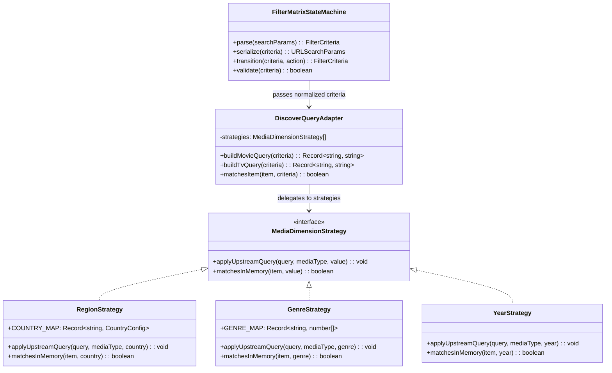

# 多维影视分类筛选矩阵与国家/地区策略架构设计

> **状态**：已批准并执行中  
> **责任领域**：流媒体检索架构、分类发现矩阵（MediaFilterBar）、TMDB Discover 适配器、策略模式与状态机重构  
> **关联需求**：增加更多题材（剧情/恐怖/战争/历史/武侠等）、扩充年代范围（2022/2021/2000年代/90年代/80年代前）、引入国家与地区过滤维度（华语/大陆/港台/日韩/美欧等），并采用设计模式优化架构。

---

## 1. 头脑风暴与核心维度调研 (Brainstorming & Dimensional Expansion)

### 1.1 需求背景与用户心智模型
在影视聚合与自动化追更系统中，用户的发现与检索诉求遵循清晰的分层心智模型：
1. **想看什么形式？（媒介形态）**：电影 vs 剧集 vs 动漫 vs 纪录片 vs 综艺；
2. **来自哪里？（文化圈与产地）**：国产剧/华语片 vs 港片经典 vs 日漫/日剧 vs 韩剧 vs 好莱坞美剧/美影 vs 欧洲小众文艺；
3. **什么风格？（题材基调）**：科幻、悬疑、剧情、恐怖、战争、武侠修仙、动作冒险；
4. **年代印记？（时代背景）**：当季最新（2026~2024）、前几年热剧（2023~2021）、黄金千禧年代（2000s）、90年代香港与好莱坞经典（90s）、80年代及更早（80s）；
5. **品质标准？（排序与口碑）**：热门流行（流行度） vs 豆瓣高分（口碑榜） vs 最新上映（时间倒序）。

此前系统仅覆盖了基础的“类型 + 10个题材 + 7个粗年份”，缺少最核心的“**国家/地区**”过滤，且缺失了如**剧情（Cinema 最大类目）、恐怖（Horror 独立流派）、战争（War 史诗大类）、武侠/仙侠（中国独有特色文化）**等高频题材标签，年代也截断在 2010 年前。

---

### 1.2 业界主流方案横向对比 (Industry Benchmarks)

| 系统 / 平台 | 地区 / 国家维度 | 题材维度扩展 | 年代分段颗粒度 | 架构与实现特性 |
| :--- | :--- | :--- | :--- | :--- |
| **豆瓣电影 (Douban)** | 全部 / 华语 / 中国大陆 / 中国香港 / 中国台湾 / 美国 / 韩国 / 日本 / 英国 / 法国 / 德国 / 其它 | 剧情 / 喜剧 / 动作 / 爱情 / 科幻 / 悬疑 / 惊悚 / 恐怖 / 犯罪 / 战争 / 历史 / 传记 / 纪录 / 动画等 20+ 标签 | 全部 / 2026 / 2025 / 2024 / 2023 / 2020年代 / 2010年代 / 2000年代 / 90年代 / 80年代 / 70年代以前 | 标签树与多重倒排索引，URL 纯语义化哈希组合。 |
| **Bilibili / 腾讯 / 爱奇艺** | 大陆 / 日本 / 韩国 / 美国 / 英国 / 其它 | 按国漫、日番、古装武侠、仙侠、都市悬疑分类 | 最近三年按年单选，更早按“2020-2023 / 2010-2019 / 2000-2009 / 90年代前”分段 | 单行 Pill 滚动筛选，SSR 预渲染结合客户端浅路由。 |
| **Jellyseerr / Overseerr** | 原生基于 TMDB `with_origin_country` | TMDB 标准 19 个官方 Genre ID 矩阵 | 年份滑块与精确年份过滤 | REST 参数通过适配器直通上游，支持多 ISO-3166-1 国家码联合。 |
| **TMDB Discover API 规范** | 支持 `with_origin_country`（ISO-3166-1 alpha-2：`CN,HK,TW,JP,KR,US,GB,FR,DE` 等，支持 `\|` OR 运算）与 `with_original_language` | `with_genres`（支持单个 ID 或多 ID `\|` 逻辑或） | `primary_release_year`（单年）、`primary_release_date.gte/.lte`（区间） | 原生支持多维度组合索引，并发请求延迟 <300ms。 |

---

### 1.3 可行性、逻辑与性能深度评估 (Feasibility & Performance Analysis)

1. **逻辑自洽性**：
   - 当用户组合筛选 `类型: 动漫 + 地区: 华语` 时，自动映射为 **国漫专区**（`discover/tv + discover/movie`, `with_genres=16`, `with_origin_country=CN`），准确命中《凡人修仙传》、《仙逆》、《罗小黑战记》等；
   - 当用户组合筛选 `类型: 动漫 + 地区: 日本` 时，自动映射为 **日漫番剧池**（`with_origin_country=JP`）；
   - 当用户组合筛选 `类型: 电影 + 地区: 中国香港 + 题材: 动作 + 年代: 90年代` 时，精准召回 90 年代黄金港产动作片（成龙、李连杰、周星驰经典）。
2. **性能与上游负载**：
   - TMDB Discover 对 `with_origin_country` 与 `with_genres` 的查询索引为 B-Tree 复合索引，上游执行速度极快（通常 <250ms）；
   - 筛选完全由 URL 查询参数驱动，无本地数据库昂贵的实时全文扫描，对本地 SQLite 数据库零负荷；
   - 前端采用 SSR 纯导航与 Suspense 分段渲染，单页体积增量 <2KB。
3. **极端边界防守**：
   - 某些组合在上游可能极其稀疏（例如“综艺 + 80年代”），前端已具备平滑的 `SearchEmptyQuietState` 优雅退避，提示“未找到符合筛选条件的作品，可以尝试放宽题材或年份限制”，绝不崩溃。

---

## 2. 软件设计模式的应用 (Design Patterns Optimization)

为了避免在代码中堆砌数十个 `if/else` 面条代码，采用三种经典设计模式重构筛选与发现子系统：

### 2.1 策略模式 (Strategy Pattern)：解耦各维度规则
将每个筛选维度抽象为独立的策略对象，各策略负责：
- 前端标签展示字典（ID、显示名称、图标）；
- 上游 TMDB Discover 查询参数生成（Movie 专有参数 vs TV 专有参数）；
- 内存候选卡片精准匹配谓词（处理豆瓣降级源或缓存池）。

### 2.2 适配器模式 (Adapter Pattern)：双向协议映射
- **Upstream Adapter**：将统一的领域筛选对象 `{ type, country, genre, year, sort, page }` 适配转换为 TMDB REST 规范（`with_origin_country`, `with_genres`, `primary_release_date.gte` 等）；
- **Memory Adapter**：将同一套筛选对象适配应用到 `FilterableMediaItem` 内存集合，支持无缝热过滤。

### 2.3 状态机模式 (State Machine Pattern)：参数归一化与安全跳转
- 维度联动状态机（State Transition）：
  - 当切换媒体类型为“全部”或非动漫时，自动收敛特定参数；
  - 自动剔除 `"all"` 默认冗余键，保持 URL 极度纯净（SEO 与书签友好）；
  - 防死循环与非法参数消毒（防非法年份注入、非法国家码注入）。

---

## 3. 具体字段字典与映射规范 (Taxonomy & Specifications)

### 3.1 国家/地区维度 (Country / Region Tags)

| ID | 显示标签 | TMDB `with_origin_country` | TMDB `with_original_language` | 内存识别与关键词匹配 |
| :--- | :--- | :--- | :--- | :--- |
| `all` | 全部地区 | *(不传)* | *(不传)* | *(全部通过)* |
| `cn` | 华语 / 大陆 | `CN` | `zh` | `["中国", "内地", "大陆", "国漫", "国产"]` |
| `hk` | 中国香港 | `HK` | `zh` | `["香港", "TVB", "港片", "粤语"]` |
| `tw` | 中国台湾 | `TW` | `zh` | `["台湾", "台剧", "公视"]` |
| `jp` | 日本 | `JP` | `ja` | `["日本", "日漫", "日剧", "东京"]` |
| `kr` | 韩国 | `KR` | `ko` | `["韩国", "韩剧", "首尔"]` |
| `us` | 美国 | `US` | `en` | `["美国", "好莱坞", "美剧"]` |
| `eu` | 欧洲 / 英国 | `GB\|FR\|DE\|IT\|ES` | `en\|fr\|de\|it\|es` | `["英国", "法国", "德国", "意大利", "西班牙", "欧洲"]` |
| `other` | 其它地区 | *(排除主流或宽容匹配)* | *(不传)* | 其它国家 |

### 3.2 扩充题材标签 (Expanded Genre Tags)

在原有 10 个题材基础上，新增业界核心高频类目：

| ID | 显示标签 | TMDB 题材 ID (Movie / TV) | 内存关键词扩展 |
| :--- | :--- | :--- | :--- |
| `drama` *(新增)* | **剧情** | `18` / `18` | `["剧情", "人生", "社会", "家庭", "成长"]` |
| `horror` *(新增)* | **恐怖** | `27` / `9648` | `["恐怖", "惊悚", "鬼怪", "丧尸", "中邪", "幽灵"]` |
| `war` *(新增)* | **战争** | `10752` / `10768` | `["战争", "军旅", "战役", "抗战", "二战", "特种兵"]` |
| `history` *(新增)* | **历史** | `36` / `10768` | `["历史", "史诗", "古装", "王朝", "传记"]` |
| `wuxia` *(新增)* | **武侠修仙** | `28, 14` / `10759, 10765` | `["武侠", "修仙", "仙侠", "玄幻", "江湖", "剑侠", "金庸"]` |
| `music` *(新增)* | **音乐歌舞** | `10402` / `10402` | `["音乐", "歌舞", "摇滚", "演唱会", "乐团"]` |
| `scifi` | 科幻 | `878` / `10765` | `["科幻", "sci-fi", "太空", "外星", "未来"]` |
| `action` | 动作 | `28` / `10759` | `["动作", "打斗", "热血", "功夫"]` |
| `mystery` | 悬疑 | `9648` / `9648` | `["悬疑", "推理", "解谜", "侦探"]` |
| `comedy` | 喜剧 | `35` / `35` | `["喜剧", "搞笑", "幽默", "爆笑"]` |
| `romance` | 爱情 | `10749` / `10749` | `["爱情", "恋爱", "偶像", "言情"]` |
| `crime` | 犯罪 | `80` / `80` | `["犯罪", "刑侦", "警匪", "黑帮", "卧底"]` |
| `animation` | 动画 | `16` / `16` | `["动画", "二次元", "动漫"]` |
| `fantasy` | 奇幻 | `14` / `10765` | `["奇幻", "魔幻", "玄幻", "魔法"]` |
| `adventure` | 冒险 | `12` / `10759` | `["冒险", "探险", "宝藏"]` |
| `thriller` | 惊悚 | `53` / `53` | `["惊悚", "心理", "犯罪惊悚"]` |

### 3.3 扩充年代标签 (Expanded Year Tags)

| ID | 显示标签 | TMDB Movie 参数 | TMDB TV 参数 |
| :--- | :--- | :--- | :--- |
| `all` | 全部年份 | *(不传)* | *(不传)* |
| `2026` ~ `2021` | 单独按年 | `primary_release_year: YYYY` | `first_air_date_year: YYYY` |
| `2020s` | 2020年代 | `gte: 2020-01-01, lte: 2029-12-31` | `gte: 2020-01-01, lte: 2029-12-31` |
| `2010s` | 2010年代 | `gte: 2010-01-01, lte: 2019-12-31` | `gte: 2010-01-01, lte: 2019-12-31` |
| `2000s` *(新增)* | 2000年代 | `gte: 2000-01-01, lte: 2009-12-31` | `gte: 2000-01-01, lte: 2009-12-31` |
| `90s` *(新增)* | 90年代 | `gte: 1990-01-01, lte: 1999-12-31` | `gte: 1990-01-01, lte: 1999-12-31` |
| `80s` *(新增)* | 80年代前 | `lte: 1989-12-31` | `lte: 1989-12-31` |

---

## 4. 其它维度的头脑风暴与演进规划 (Future Dimension Roadmap)

除了国家、题材、年代之外，评估未来可无缝接入的高阶维度：
1. **评分阶梯维度（Rating Tier）**：
   - 标签：全部 / 豆瓣8.5+神作 / 豆瓣8.0+优质 / 7.0+及格；
   - 价值：满足高审美挑片需求，直接复用现有的豆瓣评分缓存表 (`douban_ratings`)。
2. **追更/完结状态维度（Series Status - 剧集与动漫专有）**：
   - 标签：全部 / 连载追更中 / 已完结；
   - 上游对应 TMDB `with_status: 0|1`（In Production/Returning Series）与 `with_status: 3`（Ended）。

---

## 5. 执行计划与验证门禁 (Execution & Verification)

1. **核心模型扩展**：在 `apps/web/lib/media-filters.ts` 中实现策略与适配器纯函数；
2. **Discover 上游拉取对接**：在 `apps/web/features/catalog/application/trending-service.ts` 接入地区适配器；
3. **前端交互与 SSR 渲染**：在 `MediaFilterBar` 中无缝呈现地区行，优化自适应流式排版；
4. **门禁与自动化测试**：
   - 升级 `tools/gates/check-catalog-discovery.mjs`；
   - 编写单元测试验证所有策略维度的正确映射；
   - 运行 E2E 冒烟测试并使用 Chrome DevTools MCP 验证页面渲染效果。
