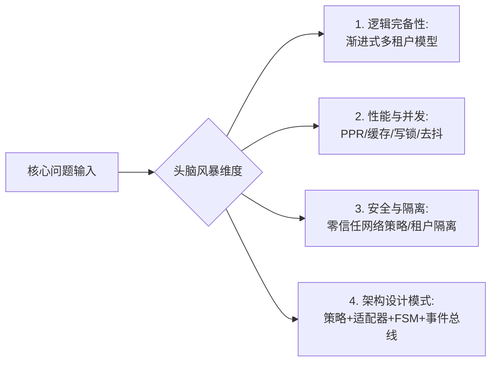
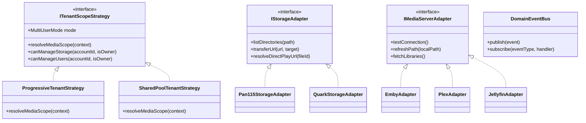
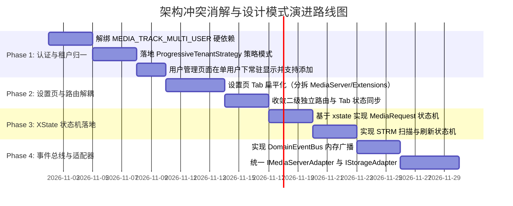

# 巡影 (Mediary Scout) 核心逻辑冲突深度审计与设计模式演进方案

> **文档标识**：`ARCH-CONFLICT-AUDIT-DESIGN-PATTERNS-20261101`  
> **创建日期**：2026-11-01  
> **状态**：架构调研与方案设计 (Architecture Survey & Technical RFC)  
> **面向范围**：全栈核心架构、认证授权 (Auth/RBAC)、设置与路由 (Settings/Routing)、STRM 与 MediaServer 协同、工作流调度 (Acquisition/Worker)

---

## 1. 执行摘要与调研背景 (Executive Summary & Context)

巡影（Mediary Scout）近期经历了高强度的功能迭代，涵盖了多用户 RBAC 角色管理、API Key V2 权限树、STRM 虚拟流媒体生成、MediaServer（Emby/Plex）协同刷新、FRP/Cloudflare 穿透、动态扩展插件（Extensions）以及 MCP 协议接入等。

随着多条业务线并发推进，系统底层逐渐暴露出若干**深层逻辑冲突、架构认知错位与设计断层**。最典型的代表即：
> **用户反馈**：*“多用户管理环境变量和单用户访问没显示用户管理页面之类问题，以及其他逻辑是否存在冲突？”*

本调研报告针对当前全量代码库展开深度“排雷式”审计，全面梳理现存的核心逻辑冲突；展开多维度头脑风暴评估其可行性、性能与安全性；设计并引入**适配器模式 (Adapter)**、**策略模式 (Strategy)**、**有限状态机 (Finite State Machine)** 与 **领域事件总线 (EventBus)**；对比业界主流自托管系统（Jellyfin, Overseerr, Portainer 等）；梳理系统已有基础设施（如已内置的 `xstate`、`kysely`、`zod` 等）的复用方案；最终输出一份兼具理论深度与实操落地的渐进式演进架构方案。

---

## 2. 现状审计：现存核心逻辑冲突深度排查 (Deep-Dive Conflict Audit)

经过对全库（`apps/web`、`packages/workflow`、`packages/shared`、`apps/host-worker`）的交叉代码走查，梳理出以下六大系统级逻辑冲突与隐患：

```mermaid
mindmap
  root((系统现存核心冲突))
    冲突一：认证体系二元撕裂
      环境变量 MEDIA_TRACK_MULTI_USER 成为硬开关
      单用户下忽略用户名直接绑定 acct_default
      未配环境变量时新建用户登不上被 401 拦截
      /api/auth/register 直接 404
    冲突二：网盘所有权与抽象悬空
      单用户网盘硬绑定 acct_default
      多用户 isolated 模式新用户无盘陷入白屏
      IStorageScopeStrategy 抽象就绪但业务层被绕过
    冲突三：设置页 Tab 膨胀与路由割裂
      7 个 Tab 硬编码与臃肿的 services 面板
      OBSERVED_SETTINGS_TABS 空插槽静默抹除 Tab
      /settings/extensions 独立子路由与 Tab 并存撕裂
    冲突四：本地绝对路径与多租户并发
      STRM local_output_dir 本地绝对路径无租户前缀
      多用户配置重叠导致文件争抢与误删
      MediaServer 缺乏防重入与并发锁
    冲突五：凭据体系与权限边界混乱
      API Key V2 树状权限与旧版 Bearer/JWT 并存
      单用户免密回退与安全版本级联失效脱节
    冲突六：生命周期缺乏类型安全状态机
      求片工单 MediaRequest 随意跨越状态
      STRM 任务扫描缺乏严格生命周期约束
```



---

### 2.1 冲突一：多用户环境变量（`MEDIA_TRACK_MULTI_USER`）与单用户模式的“二元撕裂”

#### 1. 冲突代码定位与现象
- **登录路由硬分流**（[`apps/web/app/api/auth/login/route.ts`](file:///e:/WorkProject/Node/_Project/mediary-scout/apps/web/app/api/auth/login/route.ts#L26-L34)）：
  ```typescript
  // 单用户模式忽略用户名（永远登录 acct_default）
  const throttleIdentity = isMultiUserEnabled() ? username : "";
  ```
  进一步在 [`apps/web/features/auth/application/account-service.ts`](file:///e:/WorkProject/Node/_Project/mediary-scout/apps/web/features/auth/application/account-service.ts#L225-L228) 中：
  ```typescript
  async function getLoginTargetAccount(repo: WorkflowRepository, username: string) {
    if (isMultiUserEnabled()) {
      return repo.getAccountByUsername(username.trim());
    }
    return repo.getAccountById(DEFAULT_ACCOUNT_ID); // 无条件忽视传入的 username！
  }
  ```
- **注册接口硬屏蔽**（[`apps/web/app/api/auth/register/route.ts`](file:///e:/WorkProject/Node/_Project/mediary-scout/apps/web/app/api/auth/register/route.ts#L17-L19)）：
  ```typescript
  if (!isMultiUserEnabled()) {
    return NextResponse.json({ error: "multi-user disabled" }, { status: 404 });
  }
  ```
- **API 认证责任链绝杀**（[`apps/web/platform/next-context/auth-chain.ts`](file:///e:/WorkProject/Node/_Project/mediary-scout/apps/web/platform/next-context/auth-chain.ts#L90-L92)）：
  ```typescript
  if (!accountId || (!isMultiUserEnabled() && accountId !== DEFAULT_ACCOUNT_ID)) {
    return null; // 单用户模式下一律封杀非 acct_default 的会话！
  }
  ```
- **设置页 Tab 探测抹除**（[`apps/web/features/settings-system/core/settings-tabs-model.ts`](file:///e:/WorkProject/Node/_Project/mediary-scout/apps/web/features/settings-system/core/settings-tabs-model.ts#L29) 与 [`settings-tabs.tsx`](file:///e:/WorkProject/Node/_Project/mediary-scout/apps/web/features/settings-system/components/settings-tabs.tsx)）：
  当未配置 `MEDIA_TRACK_MULTI_USER=1` 时，若某些组件返回 `null`，客户端 `MutationObserver` 探测到该插槽没有子节点，**直接在前端 Tab 栏中隐藏「账号」Tab**！

#### 2. 冲突根因与恶果剖析
1. **开发者心智模型与架构现实的错位**：系统一方面开发了完整的 RBAC 角色树（`RoleStore`）、用户管理面板（`UserManagementView`）和密码重置功能；另一方面，底层依旧被一个历史遗留的 `MEDIA_TRACK_MULTI_USER` 环境变量死死锁住。
2. **严重的业务断层**：
   - 站长如果不改 Docker 环境变量，在默认启动时就是单用户。
   - 即使通过管理员入口看到了“用户管理”或者调用 API 创建了一个新成员账号（如 `tom` / `123456`）；
   - 用户 `tom` 在登录页输入账号密码，系统在 `getLoginTargetAccount` 中却**直接无视 `tom` 这个名字**，转而去验证站长 `acct_default` 的密码！若输入 `123456` 则提示密码错误；若碰巧输入站长密码，则直接登录成了站长！
   - 即便 `tom` 设法拿到了带有自己 `accountId` 的 Cookie，也会在 `auth-chain.ts` 中因为 `!isMultiUserEnabled()` 被判定为非法会话，所有 API 返回 401！

---

### 2.2 冲突二：网盘所有权（Drive Ownership）与共用资源模式的抽象悬空

#### 1. 冲突代码定位
在 [`packages/workflow/src/domain/storage-scope-strategy.ts`](file:///e:/WorkProject/Node/_Project/mediary-scout/packages/workflow/src/domain/storage-scope-strategy.ts) 中，已经定义了：
```typescript
export interface IStorageScopeStrategy {
  readonly mode: MultiUserMode; // "off" | "isolated" | "shared"
  resolveMediaScope(context: StorageScopeContext): Promise<ResolvedMediaScope>;
  canManageStorage(accountId: string, isOwner: boolean): boolean;
  canDeleteMedia(accountId: string, isOwner: boolean): boolean;
}
```
然而在业务核心 [`apps/web/features/acquisition/application/acquisition-service.ts`](file:///e:/WorkProject/Node/_Project/mediary-scout/apps/web/features/acquisition/application/acquisition-service.ts#L201-L202) 中：
```typescript
const sharedMode = isSharedResourceMode();
const executionAccountId = sharedMode ? DEFAULT_ACCOUNT_ID : accountId;
```
#### 2. 冲突表现
- **模式孤岛与双重环境变量**：`getMultiUserMode()` 同时读取 `MEDIA_TRACK_MULTI_USER` 和 `MEDIA_TRACK_MULTI_USER_MODE`。如果配了 `MEDIA_TRACK_MULTI_USER_MODE=shared` 但漏了 `MEDIA_TRACK_MULTI_USER=1`，系统依然跌入 `off` 单用户模式。
- **孤立租户（Isolated）模式下的冷启动困境**：多用户模式下，如果不是 `shared` 模式，每个用户必须自己绑定网盘。但家庭成员（老人/小孩/非技术用户）根本没有 115 或夸克会员账号。新成员登录后直接看到“未连接网盘”，既不能看也不能搜，多用户功能完全形同虚设。
- **策略模式抽象就绪却被“硬编码三元表达式”绕过**：编写好的策略接口未在容器层注入使用，依然存在硬编码的 `executionAccountId = sharedMode ? ...`。

---

### 2.3 冲突三：设置页 Tab 扁平化架构、动态感知与二级路由并存割裂

#### 1. 冲突现状
- **设置页 Tab 仅 7 项**：`SETTINGS_TABS` 只有网盘、资源与服务、获取偏好、巡检与通知、更新、账号、远程访问。
- **Services Tab 严重超级大肥皂（God Tab）**：
  在 [`apps/web/app/settings/page.tsx`](file:///e:/WorkProject/Node/_Project/mediary-scout/apps/web/app/settings/page.tsx#L140-L163) 中，`services` 插槽内部挂了：
  `LlmConfigSection` + `TmdbApiKeySection` + `ResourceProviderSection` (PanSou/海搜/Prowlarr) + `SubtitleSourceSection` + `MediaServerSection` + `ExtensionsSection` + `McpSection`。
  单个 Tab 滚动高度长达数千像素，既有 AI 模型配置，又有影视服务器，又有插件扩展和 MCP，信息架构混乱。
- **二级独立路由与 Tab 单页系统并存分裂**：
  系统中存在 untracked 的路由：
  - `apps/web/app/settings/extensions/page.tsx`（`/settings/extensions`）
  - `apps/web/app/settings/mediaserver/page.tsx`（`/settings/mediaserver`）
  而用户在主设置页看到的是 `/settings?tab=services`。如果在侧边栏或内链跳转时使用不同 URL，会导致客户端状态重置、Tab 状态丢失。
- **Tab 客户端探测的“幽灵隐藏”**：
  `OBSERVED_SETTINGS_TABS` 借助 MutationObserver 观察 DOM。当服务端因为权限不足或加载异常返回空内容时，前端直接抹除 Tab，用户完全不知道该功能是“权限不足”还是“本版本未支持”。

---

### 2.4 冲突四：本地绝对路径在多用户并发下的争抢与覆盖隐患（STRM / MediaServer）

#### 1. 冲突现状
在 STRM 任务配置（`strm_tasks` 表）与媒体服务器映射（`mediaserver_configs` 表）中：
- 任务表存在 `account_id` 字段，但是输出目录 `local_output_dir` 是单机本地磁盘的物理路径（如 `/data/strm/movies` 或 `E:\media\strm`）。
- **多用户并发冲突**：
  若管理员分配了多个用户具有 STRM 管理权限，或者多用户各自建立 STRM 扫描任务且指向了相同的 `local_output_dir`；
  在执行清理失效链接（`cleanupStaleStrmFiles`）时，**User A 的扫描任务会把 User B 刚生成的 `.strm` 文件当成“已过期的僵尸文件”直接物理删除**！
- **缺少租户目录隔离与并发锁**：没有租户安全根目录限制，任务扫描缺乏任务级的排他锁（Mutex / Single-Flight）机制。

---

### 2.5 冲突五：API Key V2 / RBAC 与旧版全局免密认证机制的边界冲突

#### 1. 冲突现状
- 系统在 `packages/shared/src/auth/` 和 `packages/workflow/src/auth/` 中构建了基于三态权限树的 `ApiKeyV2Store` 与 `ROLE_LEVELS`，支持为外部 Agent、脚本签发精细权限。
- 但在 `auth-chain.ts` 的解析顺序中：
  1. 直通 API Key V2
  2. Cookie 会话
  3. 旧版 Bearer Token（基于 JWT）
  4. 单用户局域网免密回退（`resolveLanFallbackContext`）
- **边界漏洞隐患**：
  在单用户局域网模式下，免密回退无条件赋予 `*`（最高站长特权）。如果局域网内存在攻击者通过自动化脚本发起伪造请求，旧版免密回退直接越过了 API Key V2 所设计的任何安全边界。
  此外，当用户角色调整时，`securityVersion` 递增虽然让 V2 Key 级联失效，但对旧版长期 JWT Bearer Token 完全不起作用。

---

### 2.6 冲突六：业务生命周期缺乏类型安全状态机（求片工单、任务同步、会话迁移）

#### 1. 冲突现状
- **求片工单（Media Request）**：定义了 6 种状态字符串（`pending_approval`, `queued`, `acquiring`, `ready`, `rejected`, `failed`），但在数据库持久化和业务层没有任何状态流转守卫。任意 API 都可以直接将 `pending_approval` 强写为 `ready`，绕过了资源质检和转存流程。
- **STRM 任务与同步**：`strm_tasks` 的状态流转仅依靠手写字符串更新（`idle` -> `scanning`），在进程意外崩溃或超时时容易产生死锁状态。

---

## 3. 头脑风暴与多维评估：可行性、逻辑完备性、性能与安全

针对上述六大冲突，我们展开深度头脑风暴与架构评估：



### 3.1 逻辑完备性：单用户向渐进式多租户（Progressive Multi-Tenancy）演化
- **颠覆“单/多用户二元硬开关”认知**：
  业界成熟系统（如 Jellyfin, Plex, Nextcloud）从不强制用户在启动时通过环境变量二选一。
  **真理模型**：**单用户只是多租户体系在系统有效账号数等于 1（`accountCount === 1`）时的自然呈现**。
- **平滑渐进规则**：
  1. **零配置启动态（Out-of-the-Box）**：系统内置 `acct_default`（站长），局域网内直通免密（零使用门槛）；
  2. **首设密码态（Protected Single-User）**：站长在局域网设置密码后，公网访问强制凭密登录，但依然是单人极简模式；
  3. **家庭/多用户裂变态（Multi-User Expansion）**：站长随时可以在设置页点击「添加家庭成员」，系统自动平滑演进为多用户模式，**无需重启 Docker 容器，无需手动改动任何环境变量**！
  4. 登录页面统一支持：输入用户名+密码匹配对应用户；单人未改名时默认以站长登录。

### 3.2 性能考量：Next.js PPR (Partial Pre-Rendering) 与高并发调度
- **Next.js 16 cacheComponents 的构建期陷阱**：
  Next.js PPR 在 `next build` 时会预渲染静态骨架。如果在组件顶层读取 `process.env.MEDIA_TRACK_MULTI_USER`，该值会在构建镜像时被永久“烘焙（Baked）”进静态 chunk，导致运行时环境变量失效。
  **解决方案**：所有的动态决策必须发生在带有 `await connection()` 的 `<Suspense>` 动态边界内，或者借助客户端运行时上下文（React Context）提供动态注入。
- **SQLite 并发写锁与单一连接**：
  多用户并发点播、STRM 扫描写入和追更巡检会引发 SQLite `SQLITE_BUSY`。
  必须全面开启 WAL 模式（`PRAGMA journal_mode = WAL; PRAGMA busy_timeout = 5000;`），且对高频更新操作引入内存缓冲（如已有的 `api-key-touch-buffer.ts` 和 `debounce-queue.ts`）。

### 3.3 安全性防御：公网穿透下的零信任网络边界
- **网络层（Transport）与身份层（Identity）解耦**：
  彻底废除“远程访问专属密码”的误导概念。远程穿透通道（Cloudflare Tunnel / FRP）仅作为网络入口；一旦进入，网络访问策略（`PublicGatewayPolicy`）强制执行身份凭据验证。
- **租户目录沙盒化**：
  为每个用户或租户分配安全的子路径，禁止普通用户自定义跨越沙盒的物理路径。

---

## 4. 设计模式系统性重构方案 (Architectural Refactoring with Design Patterns)

为了彻底解决上述冲突，引入四大经典设计模式：



---

### 4.1 策略模式 (Strategy Pattern)：租户模式与安全门禁

将原先散落在 40 多个文件中的环境变量分支判断，收敛为统一策略接口：

#### 1. 租户作用域策略 (`ITenantScopeStrategy`)
```typescript
// packages/workflow/src/domain/tenant-scope-strategy.ts
export interface TenantScopeContext {
  requestAccountId: string;
  isOwner: boolean;
  explicitStorageId?: string | null;
}

export interface ITenantScopeStrategy {
  readonly modeName: "progressive" | "isolated" | "shared";
  resolveExecutionAccount(ctx: TenantScopeContext): Promise<string>;
  canManageStorage(ctx: TenantScopeContext): boolean;
  canManageUsers(ctx: TenantScopeContext): boolean;
  resolveStrmOutputPath(baseDir: string, ctx: TenantScopeContext): string;
}

/** 渐进式租户策略：自适应单多用户 */
export class ProgressiveTenantStrategy implements ITenantScopeStrategy {
  readonly modeName = "progressive" as const;

  async resolveExecutionAccount(ctx: TenantScopeContext): Promise<string> {
    return ctx.requestAccountId;
  }

  canManageStorage(ctx: TenantScopeContext): boolean {
    return ctx.isOwner;
  }

  canManageUsers(ctx: TenantScopeContext): boolean {
    return ctx.isOwner;
  }

  resolveStrmOutputPath(baseDir: string, ctx: TenantScopeContext): string {
    return path.join(baseDir, ctx.isOwner ? "library" : `users/${ctx.requestAccountId}`);
  }
}

/** 共享片库策略：家庭共用网盘池 */
export class SharedPoolTenantStrategy implements ITenantScopeStrategy {
  readonly modeName = "shared" as const;

  async resolveExecutionAccount(_ctx: TenantScopeContext): Promise<string> {
    return DEFAULT_ACCOUNT_ID; // 始终落到站长公共网盘
  }

  canManageStorage(ctx: TenantScopeContext): boolean {
    return ctx.isOwner;
  }

  canManageUsers(ctx: TenantScopeContext): boolean {
    return ctx.isOwner;
  }

  resolveStrmOutputPath(baseDir: string, _ctx: TenantScopeContext): string {
    return path.join(baseDir, "shared_library");
  }
}
```

#### 2. 网络安全门禁策略 (`IAccessGatePolicy`)
- `LocalNetworkPolicy`：未设密码放行，设密码后支持 Session，直通局域网；
- `RemoteTunnelPolicy`：公网穿透一律拦截至统一登录流（`/login`）。

---

### 4.2 适配器模式 (Adapter Pattern)：存储、媒体服务器与认证源

统一多供应商差异，实现即插即用：

1. **媒体服务器适配器 (`IMediaServerAdapter`)**：
   - 标准接口：`testConnection()`, `refreshPath(path)`, `fetchLibraries()`
   - 适配实现：`EmbyAdapter`、`PlexAdapter`、`JellyfinAdapter`（直接复用并扩展 Emby 协议规范）。
2. **存储适配器 (`IStorageAdapter`)**：
   - 统一 115、夸克、UC、123 网盘的文件结构遍历与离线转存操作。
3. **身份提供者适配器 (`IAuthProviderAdapter`)**：
   - 目前适配本地 SQLite 凭据库；未来可平滑适配 LDAP、OIDC (Authelia/Authentik)。

---

### 4.3 有限状态机 (State Machine Pattern)：基于已有 `xstate v5` 全面赋能

当前项目中 `packages/workflow/package.json` **已经安装了 `xstate: ^5.33.3`**，并且在 `run-state-machine.ts` 中成功落地。我们无需引入任何新包，即可将状态机推广到全系统生命周期管理：

#### 1. 求片工单生命周期状态机 (`MediaRequestFSM`)
```typescript
// packages/workflow/src/domain/media-request-fsm.ts
import { setup } from "xstate";

export const mediaRequestMachine = setup({
  types: {
    context: {} as { requestId: string; mediaTitleId: string; accountId: string },
    events: {} as
      | { type: "SUBMIT" }
      | { type: "APPROVE"; approverId: string }
      | { type: "REJECT"; reason: string }
      | { type: "START_ACQUISITION"; runId: string }
      | { type: "ACQUISITION_SUCCESS" }
      | { type: "ACQUISITION_FAILURE"; error: string }
      | { type: "RETRY" },
  },
  guards: {
    isAutoApprove: () => true, // 可接入系统配置：是否开启自动免审
  },
}).createMachine({
  id: "mediaRequest",
  initial: "pending_approval",
  states: {
    pending_approval: {
      on: {
        APPROVE: "queued",
        REJECT: "rejected",
      },
    },
    queued: {
      on: {
        START_ACQUISITION: "acquiring",
      },
    },
    acquiring: {
      on: {
        ACQUISITION_SUCCESS: "ready",
        ACQUISITION_FAILURE: "failed",
      },
    },
    ready: {
      type: "final",
    },
    rejected: {
      type: "final",
    },
    failed: {
      on: {
        RETRY: "queued",
      },
    },
  },
});
```

#### 2. STRM 同步与元数据刷新状态机 (`StrmSyncFSM`)
约束扫描状态转移：`Idle -> Scanning -> Ingesting -> MediaServerNotifying -> Completed / Failed`，从类型系统层面杜绝重入与死锁。

---

### 4.4 领域事件总线 (Domain EventBus Pattern)

解耦各子系统间的网状硬调用：

```typescript
// packages/workflow/src/events/domain-event-bus.ts
export type DomainEvent =
  | { type: "MEDIA_ACQUIRED"; titleId: string; seasonNumber: number; accountId: string; filePaths: string[] }
  | { type: "STRM_FILES_GENERATED"; paths: string[]; accountId: string }
  | { type: "USER_SECURITY_VERSION_BUMPED"; accountId: string; nextVersion: number };

export class DomainEventBus {
  private static instance = new DomainEventBus();
  private handlers = new Map<string, Array<(event: any) => Promise<void>>>();

  static getInstance(): DomainEventBus {
    return this.instance;
  }

  subscribe<T extends DomainEvent["type"]>(type: T, handler: (event: Extract<DomainEvent, { type: T }>) => Promise<void>) {
    const list = this.handlers.get(type) ?? [];
    list.push(handler);
    this.handlers.set(type, list);
  }

  async publish(event: DomainEvent): Promise<void> {
    const list = this.handlers.get(event.type) ?? [];
    await Promise.allSettled(list.map((h) => h(event)));
  }
}
```
**解耦效果**：
当 Worker 抓取完成触发 `MEDIA_ACQUIRED` 事件时：
1. `StrmIngestSync` 监听到事件，自动生成对应 `.strm` 文件；
2. `StrmIngestSync` 完成后发出 `STRM_FILES_GENERATED`；
3. `MediaServerCoordinator` 监听到事件，向 Emby/Plex 发起增量路径刷新；
4. `PushNotification` 监听到事件，向请求者发送微信/Bark 追更通知。
全流程彻底解耦，无需在 Worker 核心代码中层层串联注入各服务实例。

---

## 5. 业界主流方案调研与对比借鉴 (Industry Benchmarking)

| 平台 / 系统 | 账户与租户演进模式 | 远程网络凭据与应用鉴权 | 设置与视图分区设计 |
| :--- | :--- | :--- | :--- |
| **Jellyfin** | **全生命周期统一实体**。安装初始化 Wizard 创建第一个 Admin 账号，单用户只是“未创建更多成员”。支持随时添加用户。 | **严格网络与身份解耦**。外网通过反向代理或隧道接入，只认 Jellyfin 用户凭据，无任何“远程专属密码”。 | 左侧抽屉二级管理面板：分为常规、服务器、影视库、用户管理、插件、日志，层级扁平清晰。 |
| **Overseerr / Jellyseerr** | **请求驱动的多用户流**。以媒体请求（Media Request）为核心，普通用户浏览并提交点播，Admin 审核或根据 Quota 自动流转。 | 接入 Plex/Jellyfin SSO，用户免注册无缝映射。 | 专门的「Requests（工单）」面板，配有审批状态机过滤器与活动流。 |
| **Portainer / 1Panel** | **自托管渐进式安全模型**。初次启动进入强制设密向导；提供内置多租户与团队管理，未配多用户时面板不隐藏用户管理，而是标明当前为“单机管理模式”。 | 端口暴露只负责传输，会话全部由中心 JWT / Session 认证驱动。 | 顶部/左侧按领域划分：网络、存储、用户、安全设置，每个模块独立路由。 |

### 核心可复用经验总结
1. **取消“暗箱隐藏”，采用“渐进引导”**：单用户下绝不彻底隐藏「用户与账号」，而是明确呈现当前站长信息，并提供「添加成员开启家庭共享」的操作入口。
2. **设置页层级扁平化**：将目前臃肿堆叠在 `services` 里的组件分拆，设立独立的「影音协同 (MediaServer)」、「系统扩展 (Extensions)」与「开放接口 (API & MCP)」一级/二级分区。

---

## 6. 系统已有基础设施与第三方库复用清单

系统在前期重构中已经沉淀了极其可观的基础设施，完全可以做到**“零新增外部大型包，仅靠内部资产盘活”**：

### 6.1 内部已有资产深度复用

| 资产位置 | 模块名称 | 已有能力 | 升级与复用方向 |
| :--- | :--- | :--- | :--- |
| `packages/shared` | `rbac-matrix.ts` | `ROLE_LEVELS`, `BUILTIN_ROLES`, `canManageUser`, `canGrantRole` | 作为用户管理与 API 签发的全系统唯一权限事实源 |
| `packages/shared` | `api-key-matrix.ts` | `PERMISSION_CATALOG`, 树状权限节点定义与校验 | 直接对接 API Key V2 与用户能力适配器 |
| `packages/workflow` | `user-management-service.ts` | 角色赋予、上级管下级免疫定理、安全版本级联失效 | 对接渐进式租户，解绑环境变量硬屏蔽 |
| `packages/workflow` | `role-store.ts` / `api-key-v2-store.ts` | 角色与密钥的 SQLite 读写及内存 LRU 缓存 | 全量接入 API 责任链 |
| `packages/workflow` | `strm/debounce-queue.ts` | 并发去抖、滑动窗口合并请求 | 复用于 MediaServer 刷新与事件总线消费 |
| `packages/workflow` | `strm/single-flight.ts` | 相同 Key 瞬时并发合并（Single-Flight） | 复用于 STRM 扫描与影视元数据解析 |
| `packages/workflow` | `mediaserver/` | `EmbyAdapter`, `PlexAdapter`, `mapLocalToRemote` | 封装为标准适配器接口并新增 `JellyfinAdapter` |
| `apps/web` | `user-management-view.tsx` | 精美的前端用户管理表格、状态切换、角色抽屉 | 补齐「新建用户」表单后直接作为常驻设置面板 |

### 6.2 外部已有依赖（Dependencies）复用

| 依赖包名 | 已安装版本 | 现有用途 | 待拓展复用场景 |
| :--- | :--- | :--- | :--- |
| **`xstate`** | `^5.33.3` | 仅在 `acquisition-v2/run-state-machine.ts` 使用 | **全面复用于求片工单生命周期（`MediaRequestFSM`）与 STRM 同步扫描状态机** |
| **`zod`** | `^4.4.3` | 部分 schema 校验 | **全面替换各 API 路由中手写的 `typeof body.xxx === 'string'` 繁琐断言** |
| **`kysely`** | `^0.29.7` | 部分工作流持久化 | 类型安全构建多租户过滤 SQL，规避手写 SQL 注入与字段拼写隐患 |
| **`better-sqlite3`** | `^12.11.1` | 原生 SQLite 驱动 | 开启 WAL 模式、配置 `busy_timeout` 支持多租户并发读写 |
| **`lucide-react`** | `^1.17.0` | 页面图标 | 统一多租户、角色、工单的视觉设计语言 |

---

## 7. 渐进式重构落地演进路径与实施方案 (Phased Implementation Roadmap)



### 实施细则要点

#### 步骤 1：解开环境变量硬约束，确立渐进式单多用户策略
1. 修改 `account-service.ts` 中的 `getLoginTargetAccount`：
   - 优先按用户名查库（`repo.getAccountByUsername(username)`）；
   - 若用户名留空或为默认且系统未建其它账号，则回退至 `acct_default`；
   - 无论是单用户还是多用户，凡已在库中创建的用户均可正常验证登录！
2. 修改 `apps/web/platform/next-context/auth-chain.ts`：
   - 废除 `(!isMultiUserEnabled() && accountId !== DEFAULT_ACCOUNT_ID)` 的硬拦截；
   - 只要 Session 有效且用户在库中且处于活跃状态（`isActive`），均合法通行。
3. 修改设置页 Tab：
   - 将「账号」Tab 改名为「账号与成员」，取消其在 `OBSERVED_SETTINGS_TABS` 中的自动隐藏（将其作为常驻 Tab，或者仅演示站隐藏）；
   - 在单用户模式下，展示站长卡片，并提供「添加成员 / 启用家庭模式」按钮。

#### 步骤 2：重组设置页 Tab 分区
将 `SETTINGS_TABS` 从原有的 7 个扩充与整理为清晰的分类：
1. **网盘与存储** (`drives`)：115、夸克等网盘工作区；
2. **核心资源服务** (`services`)：AI 模型、TMDB、PanSou、海搜、字幕；
3. **影音协同** (`mediaserver`)：Emby / Jellyfin / Plex 配置与 STRM 生成；
4. **扩展与插件** (`extensions`)：动态扩展、Agent 工具与 MCP 服务；
5. **获取偏好与巡检** (`patrol`)：偏好语言、画质、定时追更、推送；
6. **账号与权限** (`accounts`)：用户管理、角色权限 (RBAC)、API Key 授权；
7. **远程访问** (`remote`)：FRP 穿透、Cloudflare Tunnel。

#### 步骤 3：接入 XState 状态机治理工单与任务
在 `packages/workflow/src/domain/media-request.ts` 中，使用项目中现有的 `xstate` 包创建工单 Actor，限制状态迁移只能由合法事件触发。

#### 步骤 4：轻量级领域事件总线调度
在 Worker 抓取成功与转存完成后，不再直接调用外部服务的刷新方法，而是通过 `DomainEventBus.getInstance().publish(...)` 广播事件，实现完全解耦。

---

## 8. 总结与效益评估

通过实施本套重构方案，巡影系统将取得以下核心收益：

1. **彻底消除认知混乱与业务死锁**：
   - 用户不再困惑于“为什么没开多用户环境变量就看不到用户管理页面”、“为什么新建的用户登不上去”以及“远程访问为什么还有独立密码”。
   - 系统实现开箱即用的渐进式安全（Progressive Security & Multi-Tenancy）。
2. **高内聚低耦合的代码架构**：
   - 策略模式消除了 40 余处冗余的 `if (isMultiUserEnabled())` 分支；
   - 适配器模式让未来接入 Alist、123 网盘、Jellyfin 变得轻而易举；
   - 领域事件总线切断了抓取流程与周边组件的紧密硬编码耦合。
3. **充分盘活现有技术资产**：
   - 无需引入庞大臃肿的新第三方库，深度激活项目中已有的 `xstate`、`zod`、`kysely` 与 `better-sqlite3`；
   - 代码可测性与逻辑完备性获得跃升式提升。
