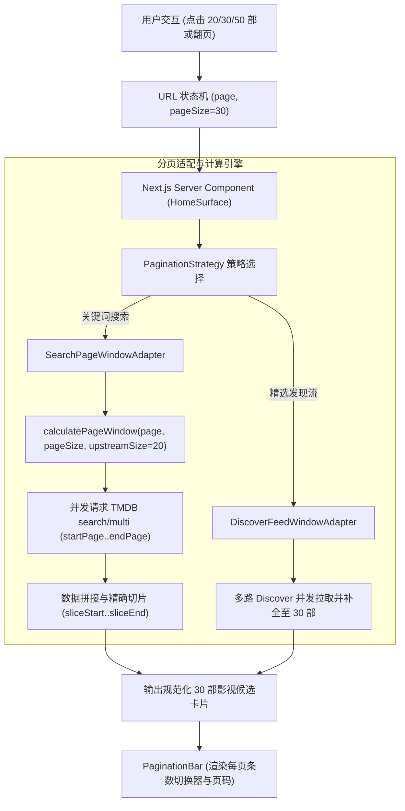

# 动态分页大小切换与默认 30 部影视展示架构设计方案

## 1. 需求与目标

1. **核心诉求**：
   - 分页支持用户自主切换每页数量（Page Size Switcher），例如支持 `[20, 30, 50]` 部；
   - 系统全局默认分页大小由原先的 18/20 部改为 **默认 30 部**；
   - 兼顾「精选发现流（Discover Feed）」与「关键词搜索（Search Results）」双重场景。
2. **非功能性诉求**：
   - **设计模式赋能**：运用策略模式（Strategy Pattern）、适配器模式（Adapter Pattern）与状态机（State Transition），抹平外部定长数据源（如 TMDB 强绑定 20 条/页）与前端动态分页大小之间的阻抗失配；
   - **极致性能与缓存复用**：利用并发窗口请求（Concurrent Window Fetching）将上游多页合并召回的延迟控制在单个 RTT 级别，并与持久化缓存（Durable Cache）无缝结合；
   - **业界主流体验**：参考 Ant Design、Element Plus、Netflix 与 TMDB 现代分页体验，URL 状态驱动、切换分页大小自动安全重置回第 1 页。

---

## 2. 业界主流方案调研与对比

| 方案 | 代表产品/规范 | 优势 | 局限与挑战 | 本项目落地适配 |
| :--- | :--- | :--- | :--- | :--- |
| **URL SearchParams 驱动模式** | Next.js Server Components, GitHub, Ant Design | SSR 友好、支持书签与链接分享、浏览器前进后退状态完美恢复、0 水合开销 | 每次切换需要服务端重新解析，需控制默认参数冗余 | **采纳**：`pageSize` 进 URL；当 `pageSize === 30` 时作为隐式默认值自动省略，保持 URL 简洁干净 |
| **滑动窗口适配器模式（Sliding Window Adapter）** | 微服务聚合层 (BFF), GraphQL 聚合 | 客户端自由定义 `pageSize`，服务端负责向上游固定 page 接口分发与裁剪 | 上游分页越界时需要精准的全局坐标计算 | **采纳**：实现 `WindowedPaginationAdapter`，自动将 `(page, pageSize)` 映射为 TMDB 物理分页 `[startPage..endPage]` |
| **游标无限滚动（Cursor-based Infinite Scroll）** | 移动端 App, Instagram, Twitter | 连续浏览顺畅 | 无法跳页、无法直接定位、不适合大屏桌面端精准检索 | 不适合本项目已有选集/网盘资源转存的工作流场景 |

---

## 3. 设计模式优化与架构设计

### 3.1 窗口分页适配器（Windowed Pagination Adapter）
由于 TMDB API v3 严格固定每页 20 条（且不支持自定义 `page_size` 参数），本方案采用数学映射窗口算法：

$$ \text{globalStart} = (\text{page} - 1) \times \text{pageSize} $$
$$ \text{globalEnd} = \text{page} \times \text{pageSize} $$
$$ \text{startPage} = \lfloor \frac{\text{globalStart}}{\text{upstreamSize}} \rfloor + 1 $$
$$ \text{endPage} = \lfloor \frac{\text{globalEnd} - 1}{\text{upstreamSize}} \rfloor + 1 $$

- **当 pageSize = 30, page = 1 时**：
  $\text{globalStart} = 0, \text{globalEnd} = 30$；$\text{startPage} = 1, \text{endPage} = 2$。
  并发请求 TMDB 第 1 页与第 2 页（共 40 条），切片 `[0..30]`，即得精准第 1 页的 30 部。
- **当 pageSize = 30, page = 2 时**：
  $\text{globalStart} = 30, \text{globalEnd} = 60$；$\text{startPage} = 2, \text{endPage} = 3$。
  并发请求 TMDB 第 2 页与第 3 页，偏移 10 条切片 `[10..40]`，即得精准第 2 页的 30 部。
- **当 pageSize = 20, page = 1 时**：
  $\text{startPage} = 1, \text{endPage} = 1$。仅请求 TMDB 1 页，0 冗余开销。
- **总页数重算**：
  $$ \text{totalPages} = \max(1, \lceil \frac{\text{totalResults}}{\text{pageSize}} \rceil) $$

### 3.2 分页状态机转换规范（State Machine）
- **状态转移规则**：
  - `(page=X, pageSize=30) --[用户切换 pageSize -> 50]--> (page=1, pageSize=50)`
  - 切换分页大小严格遵循业界标准，强制将当前页码重置为 1，防止目标页在更大分页下越界空屏；
  - 翻页仅变更 `page`，保留当前激活的 `pageSize` 与全部分类筛选标签（`type`, `genre`, `year`, `sort`）。

---

## 4. 实施清单

1. **核心计算纯函数**：在 `packages/workflow/src/search-view.ts` 抽取 `calculatePageWindow` 窗口纯函数并补充单元测试。
2. **上游搜索适配**：`TmdbSearchProvider.searchMediaPage` 接入 `calculatePageWindow`，支持任意 `pageSize` 的并发拉取与精确切片。
3. **豆瓣兜底适配**：`DoubanSearchProvider` 接入 `pageSize`，直接传递 `count=pageSize`。
4. **精选发现流适配**：`apps/web/lib/trending.ts` 默认返回 30 部卡片，支持 `pageSize` 动态窗口切片。
5. **UI 组件升级**：`apps/web/components/pagination-bar.tsx` 增加 `.pagination-size-switcher` 药丸按钮组（20部、30部、50部），并接入样式令牌。
6. **全量门禁与测试**：执行 ESLint、Style Gate、TS 检查及 Vitest 单元测试，并在 3001 端口热更实测截屏交付。
