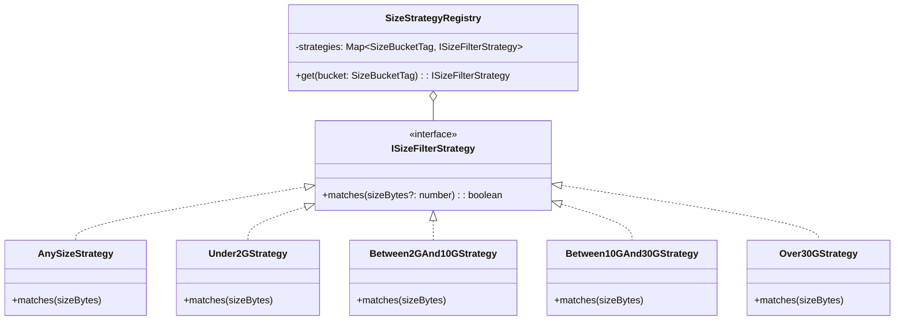

# 海报直达导航优化与资源检索体积过滤架构设计规范
> **文档标识**：`ARCH-2026-POSTER-NAV-SIZE-FILTER`  
> **状态**：`Implemented / Verified`  
> **涉及模块**：`apps/web/features/catalog`、`apps/web/features/acquisition`、`packages/workflow`  
> **核心模式**：导航适配器模式 (Navigation Adapter)、体积过滤策略模式 (Size Strategy Pattern)、过滤状态机 (Filter FSM)

---

## 1. 现状调研与问题根因分析 (Root Cause Analysis)

### 1.1 问题 1：为什么点击首页/发现海报后会按片名重新搜索才跳转？
- **根因定位**：
  在 `apps/web/features/catalog/components/trending-row.tsx` 中，精选流卡片组件 `TrendingCardItem` 的实现为：
  ```tsx
  <Link
    key={`${card.mediaType}_${card.tmdbId}`}
    className="trending-card"
    href={`${basePath}?q=${encodeURIComponent(card.title)}`}
  >
  ```
  尽管 `card` 数据结构中已包含完整的 `tmdbId`、`mediaType` 与 `year`，但其 `href` 被硬编码成了查询参数 `${basePath}?q=${encodeURIComponent(card.title)}`。
- **缺陷后果**：
  1. 用户点击海报被重定向至首页搜索态，触发一次无谓的外部 TMDB 关键词查询与豆瓣检索；
  2. 搜索召回列表包含同名翻拍、续集、纪录片等干扰项，用户必须在列表中二次甄别并再次点击才能进入详情页；
  3. 破坏了“所见即所得”的浏览直达心智，在弱网环境下造成 1~3 秒不必要的等待。
- **优化方案**：
  引入**导航适配器 (Navigation Adapter)**，统一将具备 `tmdbId` 的卡片直连至 `/show/[tmdbId]`（利用既有 `showHref(card.tmdbId, "discover", undefined, card.mediaType)` 工具函数），消除二次模糊搜索跳板。

---

### 1.2 问题 2：资源检索能否支持“过滤文件大小”？
- **可行性分析**：
  1. 上一轮架构重构已经在领域层建立了 `ResourceMetaEnricher`（策略模式），为所有候选资源（Prowlarr 磁力、HaiSou 网盘、PanSou 标题解析等）补齐了高精度的 `sizeBytes`；
  2. 既有系统已有成熟的多维分面模型 `ResourceFilterCriteria` 与过滤管道 `filterCandidates`，但目前仅涵盖 `type`、`resolution`、`spec`，缺少体积过滤维度。
- **用户心智模型与档位定义**：
  用户对于影视体积的偏好高度离散，抽象为 5 档策略区间：
  - `all`：全部体积；
  - `under_2g`：轻量尝鲜 / 移动便携（$\le 2\text{ GB}$）；
  - `2g_to_10g`：高清主流 / 剧集单集（$2\text{ GB} < \text{size} \le 10\text{ GB}$）；
  - `10g_to_30g`：高码率收藏 / 4K 压制（$10\text{ GB} < \text{size} \le 30\text{ GB}$）；
  - `over_30g`：超清原盘 / REMUX 发烧（$> 30\text{ GB}$）。

---

## 2. 设计模式深度运用 (Design Patterns Architecture)



### 2.1 策略模式 (Strategy Pattern)
- 定义 `ISizeFilterStrategy` 接口及其实现类矩阵；
- 避免在 `filterCandidates` 中写死一堆嵌套的三元或 if/else，提升代码整洁度与圈复杂度可控性（保持 $\le 10$）；
- 支持对 `sizeBytes === undefined` 时的容错判定。

### 2.2 状态机联动 (State Machine Coordination)
- 筛选条件的更新受控于统一状态机：
  ```
  criteria change (size: bucket) 
      --> update criteria 
      --> execute filterStrategies 
      --> reset pagination to page 1 
      --> trigger DOM re-render
  ```
- 杜绝因切换过滤条件导致的分页越界或空白死页。

---

## 3. 契约定义与数据模型 (Contract Specifications)

### 3.1 体积档位标签定义
```ts
export type SizeBucketTag =
  | "all"
  | "under_2g"
  | "2g_to_10g"
  | "10g_to_30g"
  | "over_30g";

export interface ResourceFilterCriteria {
  keyword: string;
  type: ResourceType | "all";
  resolution: ResolutionTag;
  spec: SpecTag;
  size: SizeBucketTag; // 新增体积档位
  sortBy: SortOption;
}
```

### 3.2 分面统计模型扩展
```ts
export interface CandidateFacets {
  types: Array<CandidateFacetItem<ResourceType | "all">>;
  resolutions: Array<CandidateFacetItem<ResolutionTag>>;
  specs: Array<CandidateFacetItem<SpecTag>>;
  sizes: Array<CandidateFacetItem<SizeBucketTag>>; // 新增体积分布统计
}
```

---

## 4. 实施计划 (Implementation Roadmap)

1. **Step 1: 发现流海报直达优化**：修改 `apps/web/features/catalog/components/trending-row.tsx`，使用 `showHref` 直达详情页 `/show/[tmdbId]`；
2. **Step 2: 扩展体积过滤策略模型**：在 `resource-filter-model.ts` 中实现 `SizeBucketTag`、策略映射表、分面统计与过滤规则；
3. **Step 3: UI 工具栏支持体积芯片组**：在 `resource-filter-bar.tsx` 中增加体积过滤行；
4. **Step 4: 单元测试与门禁守护**：编写全量体积过滤与导航测试，跑通 17 级质量门禁；
5. **Step 5: 实机浏览器端到端验收**：使用 `chrome-devtools-mcp` 验证海报直达跳转与体积过滤交互。
