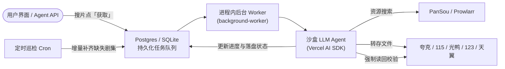
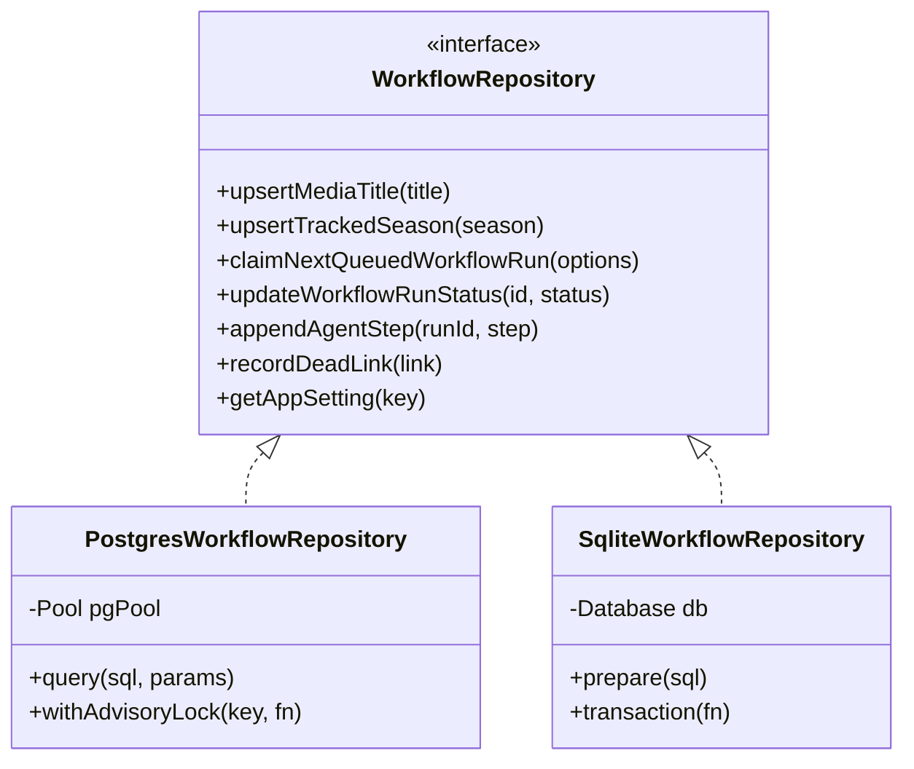
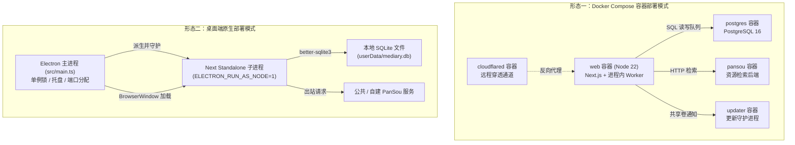
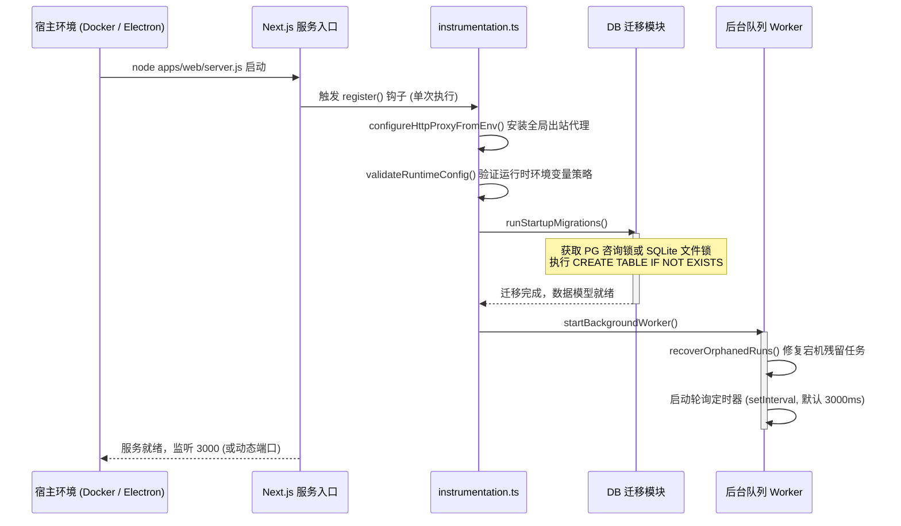
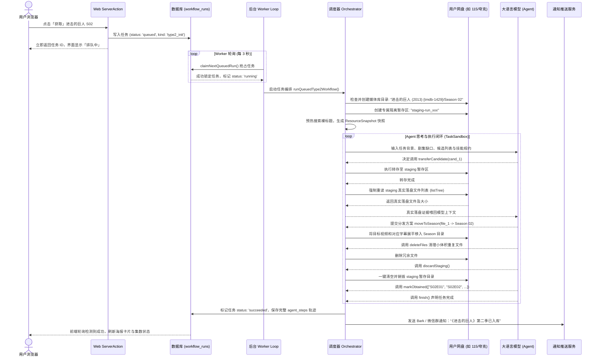
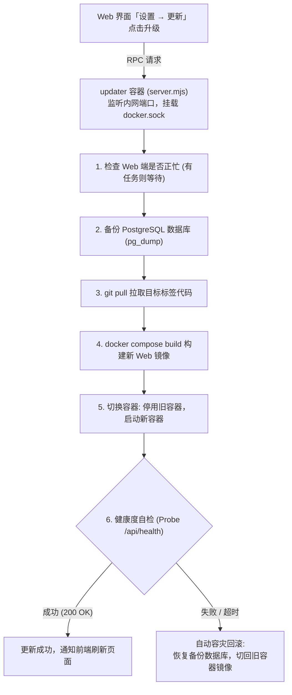

# 巡影 · Mediary Scout 架构与技术深度调研报告

> **调研对象**：巡影 · Mediary Scout（代码库：`mediary-scout-main`）  
> **文档位置**：`docs/project-survey.md`  
> **编写时间**：2026-10-23  

---

## 目录

1. [项目概览与业务功能全景](#1-项目概览与业务功能全景)
   - 1.1 项目定位与核心愿景
   - 1.2 核心业务功能流转
   - 1.3 关键业务特性一览
2. [代码仓库结构与层级依赖分析](#2-代码仓库结构与层级依赖分析)
   - 2.1 整体文件与目录树形结构
   - 2.2 Monorepo 模块划分与职责
   - 2.3 层级依赖关系与模块拓扑
3. [开发语言、运行平台与依赖类型](#3-开发语言运行平台与依赖类型)
   - 3.1 编程语言与规范
   - 3.2 运行宿主平台与形态
   - 3.3 依赖类型分类全景（框架/AI/数据库/桌面）
4. [平台与框架 API 深度调研](#4-平台与框架-api-深度调研)
   - 4.1 Node.js 运行时平台 API
   - 4.2 Electron 桌面平台框架 API
   - 4.3 Next.js 16 与 React 19 全栈框架 API
   - 4.4 Vercel AI SDK 智能体 API
   - 4.5 双数据库抽象引擎 API（PostgreSQL & SQLite）
   - 4.6 五大网盘平台第三方 API（115/夸克/123/光鸭/天翼）
   - 4.7 外部元数据与检索 API（TMDB/PanSou/Prowlarr/Shooter）
5. [开发环境与功能开发指南](#5-开发环境与功能开发指南)
   - 5.1 本地开发环境配置与依赖逻辑
   - 5.2 编译、构建与工作区联动流程
   - 5.3 核心开发入口与启动指令
   - 5.4 典型功能开发全流程指南
6. [运行时结构与全生命周期流转](#6-运行时结构与全生命周期流转)
   - 6.1 运行时依赖层级与双形态架构（Docker 服务端 vs Electron 桌面端）
   - 6.2 运行时入口与启动初始化时序
   - 6.3 资源获取任务（Acquisition）端到端执行全生命周期
   - 6.4 每日定时巡检与补漏（Patrol Type 3）机制
   - 6.5 一键安全更新与容灾回滚架构（Updater Daemon）
7. [核心架构设计精髓与安全防线](#7-核心架构设计精髓与安全防线)

---

## 1. 项目概览与业务功能全景

### 1.1 项目定位与核心愿景

**巡影 · Mediary Scout** 是一个专为个人网盘量身打造的 **AI Agent 驱动的自部署智能媒体库系统**。

其核心哲学为：**“用户不应监督 Agent，用户只需表达意图、连接网盘，然后静候资源落盘。”**
传统工具要么依赖硬编码抓取规则（极易因网页改版失效），要么需要用户人工对话引导通用 AI（费时费力且容易产生破坏性操作）。巡影将 Agent 限制在严格设计的**确定性安全沙盒（Sandbox Permission Cage）**内，赋能 Agent 拥有自主搜索、转存、校验落盘与整理媒体库的能力。



### 1.2 核心业务功能流转

整个系统的业务运作围绕媒体生命周期展开：

1. **媒体检索与识别**：
   - 用户在 Web UI 搜索电影、电视剧或番剧，系统实时查询 **TMDB** 获取标准元数据（支持中文别名、原名、年份、季集信息、海报背景图）。
   - 内置 **TMDB 代理 Worker**（Cloudflare Worker），国内网络无须自行申请 Key 或挂代理即可开箱即用。
   - 未上映电影自动进入“预约（Reserved）”状态，到达上映日期后由定时巡检自动触发转存。
2. **多源资源检索与候选评分**：
   - **PanSou**：聚合 Telegram 频道公开网盘分享链接（夸克、115、123、光鸭、天翼）。
   - **Prowlarr**：聚合 PT/BT 磁力（Magnet）与种子资源。
   - **JEV 评估器（Jev Judge）**：对候选资源进行前置过滤与画质/字幕评分。
   - **射手网（Assrt/Shooter）**：外挂中文字幕检索与自动补齐。
3. **多网盘存储适配与秒传转存**：
   - 深度集成 **夸克、115、123网盘、光鸭云盘、天翼云盘** 五大国内主力网盘。
   - 自动在网盘根目录初始化规范的媒体库目录：`Mediary Scout/{Movies,TV,Anime}`。
   - 严格在独立的临时暂存区（`staging-<workflowRunId>`）进行转存，彻底隔离既有媒体库。
4. **沙盒 Agent 决策与整理**：
   - Agent 调用受限工具集，核对暂存区真实落盘文件（绝不信任文件名字面预测）。
   - 剔除宣传片、花絮、广告、无关剧集或不同作品（Foreign works）。
   - 实施“保留大文件（Keep-Big）”去重准则，提取并展平文件到标准季目录（`Title (Year) {tmdb-N}/Season NN`）。
   - 彻底清空并销毁暂存目录（`discardStaging`），保证网盘干净清爽。
5. **在追剧集持续巡检（Patrol Type 3）**：
   - 针对未完结剧集与每周更新的番剧，每日在预设时间唤醒巡检。
   - 对比 TMDB 最新播出状态与网盘实际已有集数，仅对缺失剧集发起定向精准检索与补录。
6. **用户反馈与记忆纠错（Feedback & Agent Memory）**：
   - 用户若发现某集画质不佳或音轨/字幕有误，可在详情页提出“更换（Replace Request）”。
   - Agent 会废弃现有坏资源、清理该文件、重新搜索更佳资源，并将用户偏好（如特定压制组、字幕要求）记录至 `agent_memories` 表，供后续任务自动应用。
7. **多用户与外网穿透管理**：
   - 支持多账号模式（多用户数据隔离、各自绑定专属网盘）。
   - 集成 **Cloudflare Tunnel**（`cloudflared`），配合 **Mediary Connect** 控制平面，无需公网 IP 和路由端口映射即可实现远程安全访问。

---

## 2. 代码仓库结构与层级依赖分析

### 2.1 整体文件与目录树形结构

项目采用 **npm workspaces** 构建单代码仓库（Monorepo），整体结构如下：

```text
mediary-scout-main/
├── .github/workflows/ci.yml       # GitHub Actions CI 工作流 (Node 22, PG, Vitest)
├── apps/
│   ├── desktop/                   # 【桌面端】Electron 包装层 (macOS / Windows)
│   │   ├── build/                 # 图标与 macOS 授权 entitlements
│   │   ├── scripts/               # 发布戳记脚本 (stamp-release.cjs)
│   │   ├── src/                   # Electron 主进程源码 (main.ts, server-launch.ts 等)
│   │   ├── tests/                 # 桌面端功能单元测试
│   │   ├── electron-builder.yml   # 打包配置文件 (DMG, NSIS, ASAR, extraResources)
│   │   └── package.json           # @media-track/desktop 配置 (CommonJS)
│   └── web/                       # 【核心 Web 应用】Next.js 16 App Router + 进程内 Worker
│       ├── app/                   # App Router 路由定义 (页面与 /api 端点)
│       ├── components/            # React 19 UI 组件 (44+ 个高内聚组件)
│       ├── lib/                   # 服务端胶水层 (workflow-runtime, background-worker 等)
│       ├── public/                # 静态静态资源 (网盘品牌图标等)
│       ├── instrumentation.ts     # Next.js 服务启动钩子 (注册 Worker 与代理)
│       ├── next.config.ts         # Next.js 配置 (Standalone 模式, transpilePackages)
│       └── package.json           # @media-track/web
├── packages/
│   └── workflow/                  # 【核心领域与引擎】纯 TypeScript 业务逻辑包
│       ├── src/
│       │   ├── acquisition-v2/    # 🔥 Agent 驱动获取引擎 V2 (核心沙盒、Loop、工具集)
│       │   ├── auth/              # 用户认证、密码哈希 (scrypt) 与 Session 签名
│       │   ├── domain.ts          # 核心领域实体与类型系统
│       │   ├── ports.ts           # 六边形架构端口定义 (ResourceProvider, StorageExecutor)
│       │   ├── repository.ts      # 仓储端口与内存测试桩
│       │   ├── postgres.ts        # PostgreSQL 生产仓储实现 (含咨询锁并发迁移)
│       │   ├── sqlite.ts          # SQLite 桌面端仓储实现 (better-sqlite3)
│       │   ├── storage-brands.ts  # 五大网盘品牌注册表与能力矩阵
│       │   ├── pan115-*.ts        # 115网盘客户端、离线下载加密与执行器
│       │   ├── quark-*.ts         # 夸克网盘客户端、扫码登录与执行器
│       │   ├── pan123-*.ts        # 123网盘客户端、扫码登录与执行器
│       │   ├── guangya-*.ts       # 光鸭云盘客户端与执行器
│       │   ├── tianyi-*.ts        # 天翼云盘客户端、扫码登录与执行器
│       │   ├── pansou-provider.ts # PanSou 检索适配器
│       │   ├── prowlarr-provider.ts # Prowlarr 磁力检索适配器
│       │   ├── tmdb-provider.ts   # TMDB 元数据检索适配器
│       │   ├── notify.ts          # 多渠道推送服务 (Bark/Server酱/企微/Webhook)
│       │   └── worker.ts          # 队列任务 Claim 与执行调度器
│       ├── tests/                 # workflow 单元测试与集成测试
│       └── package.json           # @media-track/workflow
├── workers/                       # 【Cloudflare Workers 边缘函数】
│   ├── scout-connect/             # 远程穿透与支付控制平面 (mediaryconnect.app)
│   └── tmdb-proxy/                # TMDB 请求边缘代理与 KV 缓存
├── updater/                       # 【容器更新守护进程】独立 Docker 更新容器
│   ├── Dockerfile                 # updater 镜像定义 (docker-cli + node)
│   ├── run-update.sh              # 容器更新与回滚核心 Shell 脚本
│   └── server.mjs                 # 接收 Web 端更新指令的 HTTP 守护服务
├── scripts/                       # 运维、测试探针与辅助脚本 (Python/Node/Shell)
├── references/                    # Agent 行为约束与安全规约手册 (SKILL 指南)
├── site/                          # 官方展示站与说明文档源码 (mediaryscout.app)
├── skills/                        # 编程 Agent CLI 技能包 (Claude Code / Codex 适配)
├── tests/                         # 原型期 Python 单元测试集
├── .env.example                   # 环境变量模板
├── docker-compose.yml             # Docker 官方单机编排模版
├── Dockerfile                     # Next.js Standalone 多阶段镜像构建定义
├── package.json                   # 根工作区 package.json
└── tsconfig.json                  # 全局 TypeScript 基础编译配置
```

### 2.2 Monorepo 模块划分与职责

| 模块路径 | 模块名称 | 职责与技术边界 |
|---|---|---|
| `packages/workflow` | 核心领域逻辑包 | **完全不依赖 UI 与 Web 框架**。包含领域模型、网盘 API 驱动、搜索源适配器、Agent 沙盒与决策循环、双数据库持久化。输出 CommonJS 与 ESM 兼容产物。 |
| `apps/web` | 网页应用与服务宿主 | 基于 Next.js 16 App Router 构建的前后端一体化应用。承载 Web UI、用户 API、Agent 外部操控 API，并通过 `instrumentation.ts` 启动进程内 Worker 驱动 `packages/workflow`。 |
| `apps/desktop` | 桌面端外壳 | Electron 包装器。不包含业务逻辑，负责拉起 `apps/web` 独立构建包作为子进程，管理原生系统托盘、系统通知、单例锁与本地 SQLite 数据库路径。 |
| `workers/tmdb-proxy` | TMDB 边缘代理 | Cloudflare Worker。解决国内 TMDB 阻断问题，注入作者公用 Token，利用 Cloudflare KV 缓存影视元数据。 |
| `workers/scout-connect`| 穿透与控制平面 | Cloudflare Worker + D1 数据库。自动化配置 Cloudflare Tunnel、Ingress 规则与动态域名解析。 |
| `updater` | 安全更新守护进程 | 容器化轻量服务。唯一挂载 `/var/run/docker.sock` 的组件，受 Web 端指令驱动执行镜像拉取、容器重建、健康自检与失败回滚。 |

### 2.3 层级依赖关系与模块拓扑

```
[ 用户端 / CLI Agent ]
       │
       ▼ (HTTP)
┌────────────────────────────────────────────────────────┐
│                      apps/desktop                      │
│   (Electron 33 主进程: 单例锁 / 托盘 / 探测健康度)        │
└──────────────────────────┬─────────────────────────────┘
                           │ 进程派生 (ELECTRON_RUN_AS_NODE)
                           ▼
┌────────────────────────────────────────────────────────┐
│                        apps/web                        │
│   (Next.js 16 Standalone Server / React 19 UI / API)   │
│   ├── instrumentation.ts (服务入口与初始化)             │
│   ├── background-worker.ts (任务队列监听与分发)         │
│   └── workflow-runtime.ts (胶水装配中心)               │
└──────────────────────────┬─────────────────────────────┘
                           │ npm workspace 内部依赖
                           ▼
┌────────────────────────────────────────────────────────┐
│                   packages/workflow                    │
│   ├── acquisition-v2/ (Agent 决策与沙盒笼子)           │
│   ├── storage-brands/ (115 / 夸克 / 123 / 光鸭 / 天翼) │
│   ├── providers/      (PanSou / Prowlarr / TMDB)       │
│   └── repository/     (PostgreSQL / SQLite 驱动)       │
└────────────┬─────────────────────────────┬─────────────┘
             │                             │
             ▼                             ▼
┌─────────────────────────┐   ┌──────────────────────────┐
│       数据持久层        │   │        外部网络交互      │
│  PostgreSQL 16 (Docker) │   │  - 5 大网盘 OpenAPI/Web   │
│  better-sqlite3 (桌面)  │   │  - Vercel AI SDK (LLM)   │
│  Cloudflare D1 (Worker) │   │  - TMDB / PanSou / Assrt │
└─────────────────────────┘   └──────────────────────────┘
```

---

## 3. 开发语言、运行平台与依赖类型

### 3.1 编程语言与规范

1. **TypeScript (v5.9.0)**：
   - 核心开发语言，覆盖 `packages/workflow`、`apps/web`、`apps/desktop` 及 `workers/*`。
   - 开启极致严格模式（`strict: true`、`noUncheckedIndexedAccess: true`、`exactOptionalPropertyTypes: true`），坚决杜绝隐式 `any` 和空指针陷阱。
2. **JavaScript / Node.js**：
   - 全仓库以 **ES Module（ESM）** 规范为主（根目录 `"type": "module"`）。
   - `apps/desktop` 使用 **CommonJS（CJS）** 规范构建，以完美兼容 Electron 主进程机制与本地 C++ 原生扩展（`better-sqlite3`）。
3. **Bash / Shell 脚本**：
   - 用于 Docker 构建、镜像部署（`scripts/deploy.sh`）、数据备份（`scripts/pg-backup.sh`）以及更新守护进程（`updater/run-update.sh`）。
4. **Python (v3.10+)**：
   - 存在于初期原型验证阶段（`requirements.txt`、`tests/test_pan115_client.py` 等），负责早期协议逆向与逻辑 PoC，**生产环境完全运行在 Node.js 上，无需 Python 运行库**。
5. **SQL**：
   - 编写于 `postgres.ts`、`sqlite.ts` 及 `workers/scout-connect/schema.sql`，直接以纯 SQL 脚本管理表结构定义与迁移，不使用重型 ORM。

### 3.2 运行宿主平台与形态

| 部署形态 | 目标操作系统 | 运行环境与载体 | 数据存储引擎 | 典型应用场景 |
|---|---|---|---|---|
| **桌面版 (Desktop)** | macOS (Apple Silicon arm64 / Intel x64)<br>Windows (x64) | Electron 33 + Node.js (内置)<br>打包为 `.dmg` 与 `.exe` | **SQLite 3** (`better-sqlite3`) 本地文件持久化 | 个人电脑开箱即用，无需配置服务器与数据库。 |
| **容器版 (Docker Compose)** | Linux (x86_64 / arm64)<br>支持群晖/威联通/Unraid/OpenWrt | Docker Engine + Docker Compose<br>基础镜像 `node:22-slim` | **PostgreSQL 16** (独立容器) | NAS、软路由、私有云服务器，24 小时常驻运行与追剧。 |
| **边缘服务 (Edge Worker)** | Cloudflare 全球边缘网络 | Cloudflare Workers (V8 Isolates)<br>通过 `wrangler` 发布 | **Cloudflare D1** (SQLite) + **Cloudflare KV** | 全球元数据加速中继、自建穿透域名解析与支付控制台。 |

### 3.3 依赖类型分类全景

#### 运行时生产依赖（Production Dependencies）
- **Web 全栈框架**：`next` (v16.2.9), `react` (v19.2.7), `react-dom` (v19.2.7)。
- **AI 智能体引擎**：`ai` (Vercel AI SDK v6.0.201), `@ai-sdk/openai-compatible` (v2.0.48)。
- **数据结构校验**：`zod` (v4.4.3)。
- **数据库驱动**：`pg` (v8.13.0, PostgreSQL 客户端), `better-sqlite3` (v12.11.1, 高性能 C++ 原生 SQLite 驱动)。
- **桌面包装器**：`electron` (v33.4.11), `@electron/fuses` (v1.8.0)。
- **UI 与工具库**：`lucide-react` (图标库), `qrcode` (二维码生成), `@waffo/pancake-ts`。

#### 开发与测试依赖（Dev Dependencies）
- **语言与类型**：`typescript` (v5.9.0), `@types/node` (v22.12.0), `@types/react`, `@types/react-dom`。
- **静态代码检查**：`eslint` (v10.5.0), `typescript-eslint` (v8.61.1), `@next/eslint-plugin-next`。
- **测试框架**：`vitest` (v4.0.0), `playwright` (v1.60.0)。
- **桌面打包工具**：`electron-builder` (v25.1.8), `@electron/rebuild` (v3.7.2)。

---

## 4. 平台与框架 API 深度调研

### 4.1 Node.js 运行时平台 API

项目严格设定 `engines: { "node": ">=22.13.0" }`，充分利用了现代 Node.js 内置能力：

- **`node:child_process` (`spawn`, `execFile`)**：
  - 在 Electron 桌面端（`apps/desktop/src/main.ts`），主进程通过 `spawn(process.execPath, [entry], { env: { ELECTRON_RUN_AS_NODE: "1" } })` 启动 Next.js 独立服务进程。
  - 在更新助手（`updater/server.mjs`），通过 `execFile` 调用 `docker` CLI 执行容器编排操作。
- **`node:crypto` (`scrypt`, `randomBytes`, `timingSafeEqual`, `createHash`)**：
  - 密码安全存储：使用 `node:crypto` 的 `scrypt` 算法进行高强度哈希加盐（见 `packages/workflow/src/auth/password.ts`）。
  - 会话管理：通过安全伪随机数生成会话 ID，并采用 `timingSafeEqual` 防御时序侧信道攻击。
  - 快照去重：对资源链接和文件指纹生成 SHA-256 哈希作为唯一键。
- **全局 `fetch` 与 `undici` 代理分发器**：
  - Node 22 原生提供全局 `fetch`。为解决国内服务器通过代理访问 TMDB、PanSou 的需求，项目在 `apps/web/lib/http-proxy.ts` 中针对 `undici` 配置了全局 `ProxyAgent` 分发器，使 Node 的底层网络请求能够准确识别并走 `HTTP_PROXY` / `HTTPS_PROXY` 环境变量。

### 4.2 Electron 桌面平台框架 API

`apps/desktop` 使用 Electron 33 构建了一个精炼、健壮的原生容器：

- **单例进程锁 (`app.requestSingleInstanceLock`)**：
  - 确保一台电脑上只能运行一个巡影实例，防止两个进程同时读写同一个 SQLite 数据库引发死锁。若检测到第二个实例启动，自动唤醒并激活已有窗口（`app.on("second-instance")`）。
- **生命周期管控 (`app.on('before-quit')`, `app.on('will-quit')`)**：
  - 退出前向子进程发送 `SIGTERM` 信号，确保 SQLite WAL 模式安全提交脏页，避免数据库损坏。
- **原生系统托盘与动态菜单 (`Tray`, `Menu`)**：
  - 托盘常驻，支持最小化到托盘、动态展示服务运行状态、一键启动/重启服务进程以及显示更新提示徽标。
- **原生操作系统通知 (`Notification`)**：
  - 桌面通知接口，在剧集入库完成或发现软件新版本时，向 macOS 通知中心或 Windows Action Center 推送系统级横幅。
- **安全外部链接跳转 (`shell.openExternal`, `webContents.setWindowOpenHandler`)**：
  - 拦截渲染页面的外链点击，强制调用操作系统默认浏览器打开 GitHub、赞助或第三方文档，禁止在 Electron 内部随意跳转不受信任的外链。

### 4.3 Next.js 16 与 React 19 全栈框架 API

- **服务启动生命周期钩子 (`apps/web/instrumentation.ts` 的 `register()`)**：
  - 利用 Next.js 官方的 `instrumentation` 规范，在 Node.js 服务实例启动且处理首个 HTTP 请求前被执行一次。项目在此处执行环境检查、注册代理分发器、运行数据库迁移并拉起 `startBackgroundWorker()`。
- **部分预渲染与缓存组件 (`cacheComponents: true`)**：
  - 在 `next.config.ts` 中开启 Next.js 前沿的 Cache Components 特性。静态外壳在构建时预渲染，动态数据（如正在进行的转存进度）则通过 React 19 Suspense 异步注水。
- **Server Components & Server Actions (`"use server"`)**：
  - 界面操作（如点击“获取”、切换网盘配置、清除死链）通过类型安全的 Server Actions 直接提交至服务端逻辑，减少不必要的 REST API 样板代码。
- **安全跨域防护 (`allowedOrigins`)**：
  - 通过 `experimental.serverActions.allowedOrigins` 防御反向代理和 Cloudflare Tunnel 场景下的 CSRF 跨域提交攻击。

### 4.4 Vercel AI SDK 智能体 API

项目使用 Vercel AI SDK（`ai` v6）作为 Agent 驱动引擎：

- **`generateText({ model, system, tools, maxSteps, abortSignal })`**：
  - 驱动 Agent 的观察-思考-行动循环。
- **`tool()` 与 Zod 规范 (`inputSchema: z.object({...})`)**：
  - 沙盒中的每一个权限工具（如 `searchResources`、`transferCandidate`、`moveToSeason`）均通过 Zod 进行严格的入参 Schema 校验与序列化，保证模型传参完全受控。
- **OpenAI 兼容协议适配 (`@ai-sdk/openai-compatible`)**：
  - 抽象出标准接口，用户可无缝切换 DeepSeek、OpenAI、通义千问、Kilo Code 公共模型池或本地运行的 Ollama（`http://localhost:11434/v1`）。

### 4.5 双数据库抽象引擎 API（PostgreSQL & SQLite）

项目在 `packages/workflow` 中抽象了统一的 `WorkflowRepository` 接口，支持两套底层存储引擎透明切换：



1. **PostgreSQL 16 实现 (`packages/workflow/src/postgres.ts`)**：
   - 采用标准 `pg` 连接池。
   - **咨询锁（Advisory Lock）并发控制**：在执行建表与增量变更脚本时，通过 `pg_advisory_xact_lock` 保证多容器实例启动时绝对不会产生 DDL 死锁（Deadlock 40P01）。
2. **SQLite 3 实现 (`packages/workflow/src/sqlite.ts`)**：
   - 采用 C++ 原生扩展 `better-sqlite3` 实现同步高性能调用。
   - 自动开启 WAL 模式（`PRAGMA journal_mode = WAL`），大幅提升读写并发性能。
   - 自动处理 SQL 方言差异（如 PostgreSQL 的 `ON CONFLICT (...) DO UPDATE` 与 SQLite 的语法映射、时间戳函数差异等）。

### 4.6 五大网盘平台第三方 API（115/夸克/123/光鸭/天翼）

通过 `packages/workflow/src/ports.ts` 定义统一的 `StorageExecutor` 接口，抹平网盘差异：

| 网盘品牌 | 认证机制 | 核心能力 API 与实现方式 | 目录作用域检查策略 |
|---|---|---|---|
| **115 网盘** | Cookie (UID/CID/SEID)<br>支持扫码登录 | • 扫码登录轮询接口<br>• 离线下载加密协议 (`pan115-lixian-cipher.ts`)<br>• 分享链接转存与目录树读取 | `parents`<br>向上回溯父级目录是否处于白名单内 |
| **夸克网盘** | Cookie<br>支持扫码登录 | • 分享链接提取码解析 (`stoken`)<br>• 批量转存接口<br>• 目录扁平化移动与删除 | `parents`<br>回溯父链是否在授权根下 |
| **123网盘** | JWT Bearer Token<br>支持客户端扫码 | • OpenAPI 驱动<br>• 离线下载支持磁力与 ED2K<br>• 分享转存与文件树重构 | `listed`<br>仅允许写入当前运行中实际罗列或创建过的目录 |
| **光鸭云盘** | AccessToken + RefreshToken<br>Token 登录 | • AList Driver 协议适配<br>• `restore_share` 分享转存<br>• 离线磁力下载 | `listed`<br>严格校验目录是否从根逐级遍历到达 |
| **天翼云盘** | SessionKey + AccessToken<br>扫码登录 | • 个人云 RESTful 接口体系<br>• 分享提取码兑换与转存 | `listed`<br>严格校验目录所有权 |

### 4.7 外部元数据与检索 API

- **TMDB API (v3/v4)**：影视元数据基石，提供海报、中文翻译、季度分集列表、演职员表。
- **PanSou API**：全文检索引擎，抓取并结构化各大网盘公开分享资源。
- **Prowlarr API**：Newznab/Torznab 统一协议，检索 PT/BT 站点的 Magnet 磁力哈希。
- **射手网 API（Assrt）**：自动化检索外挂中文字幕，并将字幕直链推送给网盘离线引擎。
- **推送通道 API**：Bark（iOS 原生即时推送）、Server酱（微信通知）、企业微信群机器人 Webhook、自定义 Webhook。

---

## 5. 开发环境与功能开发指南

### 5.1 本地开发环境配置与依赖逻辑

#### 开发前置要求
1. **Node.js**：版本 `>= 22.13.0`（推荐使用 `nvm` 或 `fnm` 安装 LTS 版本）。
2. **包管理器**：`npm`（遵循 Node 内置版本，需支持 npm workspaces）。
3. **数据库环境**：
   - Docker 开发：本地安装 Docker 并运行 PostgreSQL 16，或者使用桌面端的本地 SQLite 模式。
4. **编译依赖（Windows / macOS）**：
   - Windows：安装 Visual Studio C++ 生成工具（用于编译 `better-sqlite3` 原生模块）。
   - macOS：安装 Xcode Command Line Tools。

### 5.2 编译、构建与工作区联动流程

根目录 `package.json` 的 `workspaces` 配置管理了项目的编译依赖层级：

```mermaid
flowchart TD
    WorkflowSrc["packages/workflow/src/**/*.ts"] -->|tsc 编译| WorkflowDist["packages/workflow/dist/ (编译产物)"]
    WorkflowDist -->|工作区软链| WebApp["apps/web (Next.js)"]
    WebApp -->|next build (standalone)| WebStandalone["apps/web/.next/standalone"]
    WebStandalone -->|extraResources 拷贝| DesktopApp["apps/desktop (Electron 打包)"]
```

- **关键约束**：`apps/web` 引用的是 `@media-track/workflow` 的源码/构建引用。在运行 Web 端或执行打包前，必须先编译 workflow 包：
  ```bash
  npm run build:workflow
  ```

### 5.3 核心开发入口与启动指令

所有指令均建议在代码库**根目录**执行：

```bash
# 1. 依赖安装 (自动执行工作区依赖链接与原生模块构建)
npm install

# 2. 编译核心工作流引擎
npm run build:workflow

# 3. 启动 Web 开发环境 (包含 TurboPack 极速增量热重载)
npm run dev:web
# 访问地址: http://localhost:3000

# 4. 执行全量单元测试与集成测试 (基于 Vitest)
npm test

# 5. 监视模式运行测试 (开发驱动 TDD)
npm run test:watch

# 6. 全局 TypeScript 静态类型检查
npm run typecheck

# 7. 全局代码规范检查
npm run lint

# 8. 桌面端开发调试 (需进入 apps/desktop)
cd apps/desktop
npm run build
npm run start
```

### 5.4 典型功能开发全流程指南

#### 场景 A：新增一个网盘支持（以新增“XX网盘”为例）
1. **实现客户端协议**：在 `packages/workflow/src/` 下创建 `xxpan-client.ts`，封装其登录、文件列表、移动、删除与转存 HTTP 接口。
2. **实现统一执行器**：创建 `xxpan-storage-executor.ts`，实现 `StorageExecutor` 接口的所有必需方法。
3. **注册网盘品牌**：在 `packages/workflow/src/storage-brands.ts` 的 `STORAGE_BRANDS` 数组中追加该网盘的定义（配置其 `provider` 标识、授权类型、作用域校验规则等）。
4. **接入执行器工厂**：在 `apps/web/lib/workflow-runtime.ts` 的 `createExecutorForBrand` 函数中挂载新执行器的实例化逻辑。
5. **UI 扫码/配置对接**：在 `apps/web/app/api/` 中增加对应的扫码/登录端点，并在 `apps/web/components/settings/` 中增加对应的网盘绑定面板。

#### 场景 B：增加一种新的资源搜索提供源
1. **实现检索接口**：在 `packages/workflow/src/` 中创建 `mysearch-provider.ts`，实现 `ResourceProvider` 接口（`search({ keyword, workflowRunId })` 方法）。
2. **复合源挂载**：在 `packages/workflow/src/composite-provider.ts` 中将新提供源纳入检索链路，或在 `fallback-provider.ts` 中设定降级回退策略。
3. **设置项开放**：在 `apps/web/components/settings/` 中增加新搜索源的开关与 URL/Token 配置项。

---

## 6. 运行时结构与全生命周期流转

### 6.1 运行时依赖层级与双形态架构

巡影在生产环境提供两种互斥且高度对齐的运行时架构形态：



### 6.2 运行时入口与启动初始化时序

无论处于哪种形态，Next.js 服务的核心启动逻辑均由 `apps/web/instrumentation.ts` 统一调度：



### 6.3 资源获取任务（Acquisition）端到端执行全生命周期

当用户在界面点击“获取”一部电视剧时，系统端到端的流转时序如下：



### 6.4 每日定时巡检与补漏（Patrol Type 3）机制

在 `background-worker.ts` 的每个周期中，除了处理队列任务外，还会调用 `runScheduledType3()`：

1. **自闭环防抖（Self-Gated）**：
   - 系统检查 `app_settings` 中记录的上次巡检时间。只有跨越了设定的每日巡检时间点（默认凌晨），且当天尚未执行过时，才触发巡检。
2. **增量比对策略**：
   - 查询所有处于 `active`（在追）状态的季度。
   - 请求 TMDB 元数据获取当前该剧的最新播出集数（`latestAiredEpisode`）。
   - 查询本地 `episode_states` 表，仅筛选出**已播出但未落盘（`airStatus === 'aired' && status !== 'obtained'`）**的剧集。
3. **定向派发微任务**：
   - 自动生成 `type3_monitor` 类型的工作流任务入队，仅针对缺失剧集发起搜索与转存，绝不重新下载已有的全季大包。

### 6.5 一键安全更新与容灾回滚架构（Updater Daemon）

为了让 Docker 自部署用户实现无缝升级，项目设计了独立的 `updater` 架构：



---

## 7. 核心架构设计精髓与安全防线

1. **字字泣血的 Agent 规约约束（Skill Invariant）**：
   - 系统吸取了历史版本“机械转存器频繁触发 115 封控、转存多个重叠大包挤爆空间、误删大文件保留小样本”的惨痛教训。
   - 在 Agent 的 System Prompt 中硬编码了强制规约：**Agent 在行动前必须通过 `readSkill` 查阅特定网盘的避坑指南**，把规范转化为强制性的领域知识注入。
2. **绝对证据驱动（Evidence-Driven Truth）**：
   - 永远不信外部资源宣称的文件名（例如压缩包内真实内容可能与分享标题完全不符）。
   - 任何转存动作后，沙盒必须调用网盘底层 API **重新真实列出文件大小与扩展名**，并以此作为证据交付 Agent 决策。
3. **“暂存区隔离”与“一次性擦除”（Staging Isolation & Wipe）**：
   - 任何资源均不得直接转存至最终的季目录中。
   - 所有外部资源先落盘于临时暂存区 `staging-<runId>`。Agent 挑出确认正确的媒体文件移入季目录后，暂存区直接全量物理删除，彻底杜绝广告、死链文件残留。
4. **死链 TTL 记忆机制（Dead Link Store）**：
   - 转存失败、报废、封禁的分享链接自动计入 `dead_links` 表，并赋予动态过期时间（TTL）。后续同部剧搜索时，在数据进入沙盒前自动剔除坏链，避免 Agent 重复踩坑。
5. **双引擎无缝统一**：
   - 同一套业务逻辑无缝运行在 Docker（PostgreSQL 16）与桌面端（SQLite 3）。在无任何重型 ORM 的前提下，通过底层细致的 SQL 适配器完美兼顾了生产服务器的高吞吐与桌面单机的高便携。

---
*(报告撰写完毕，已全面覆盖项目结构、开发语言、框架 API、开发流程与运行时全景。)*
