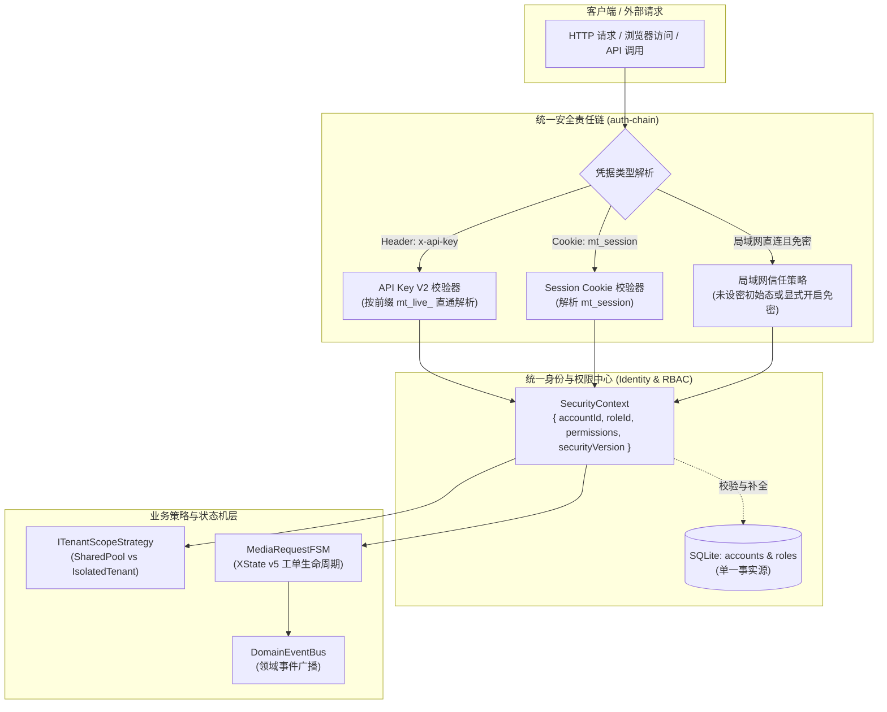
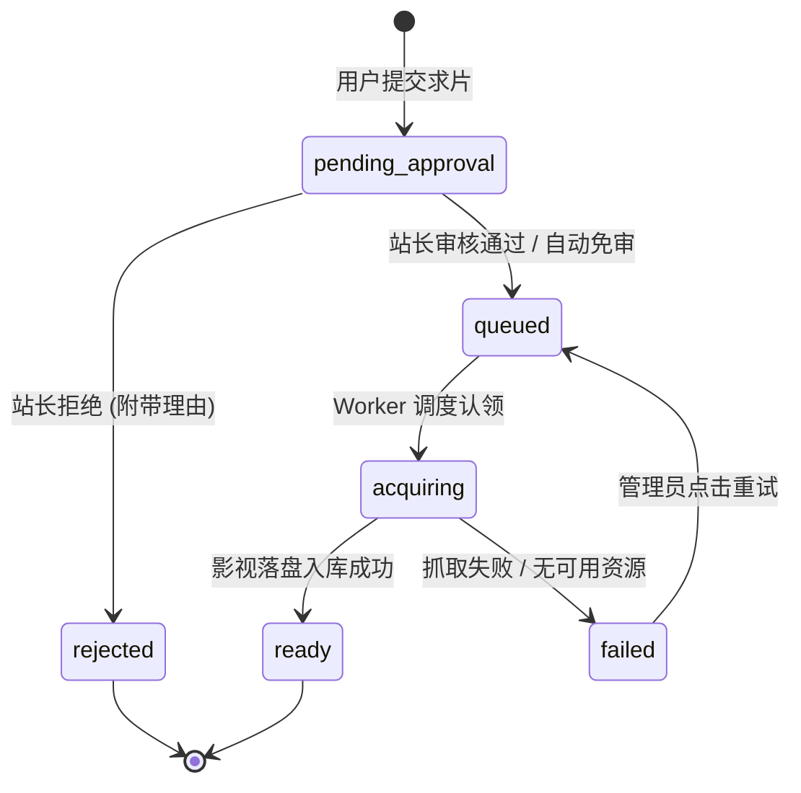

# 巡影 (Mediary Scout) 统一极简架构重构规范 (Radical Simplification & Unified Architecture RFC)

> **文档标识**：`ARCH-RADICAL-SIMPLIFICATION-20261101`  
> **创建日期**：2026-11-01  
> **设计前提**：**不考虑历史向后兼容性 (Zero Backward-Compatibility Constraints)**，大刀阔斧直接剔除历史遗留补丁与分支逻辑，重构出逻辑高度自洽、极致轻量、性能卓越的现代化全栈架构。  
> **面向范围**：身份中心与鉴权、网盘资源作用域、设置系统与路由、影音协同与工单流。

---

## 1. 核心设计原则与战略收益 (Core Principles & Strategic Gains)

历史版本由于从“单人单机 NAS 脚本”逐步演进为“多用户影音抓取协同系统”，代码中堆积了大量为了兼容单机旧版而增加的条件分支、二元开关和临时补丁。

**彻底打破兼容性约束后的全新设计原则**：
1. **统一用户模型，杜绝“二元开关论”**：
   系统从诞生起就是统一的多用户与 RBAC 架构。单用户只是系统有效用户数等于 1（$N=1$）时的自然状态，底层绝不再存在“单用户专用分支代码”。
2. **传输层 (Transport) 与应用层 (Identity) 绝对解耦**：
   无论是通过本地局域网、反向代理、Cloudflare Tunnel 还是 FRP 穿透，网络通道只负责 L4/L7 报文路由；身份识别一律由统一用户凭据和 RBAC 角色树驱动，彻底消除所谓的“远程访问专用密码”。
3. **单一事实源 (SSOT) 与配置热生效**：
   核心系统模式（如共享片库 vs 独立租户）直接持久化于数据库，支持 Web 界面一键热切换，彻底摒弃需要重启容器的复杂环境变量依赖。
4. **高内聚低耦合的设计模式化**：
   全面落地**策略模式 (Strategy)**、**适配器模式 (Adapter)**、**有限状态机 (XState FSM)** 与 **领域事件总线 (EventBus)**。

---

## 2. 拟彻底剔除的历史逻辑清单 (Deprecation & Elimination Matrix)

下述历史代码、机制与补丁将全部直接删除，不再保留任何回退逻辑：

| 模块 | 拟彻底删除的历史逻辑 / 补丁 | 删除原因与架构弊端 | 重构后的全新方案 |
| :--- | :--- | :--- | :--- |
| **环境变量** | `MEDIA_TRACK_MULTI_USER` 及全库 40 余处 `isMultiUserEnabled()` 判断 | 造成系统二元割裂，单用户下硬锁死登录接口与用户管理，容器构建时存在 PPR 静态烘焙陷阱 | **直接废除该环境变量**。系统原生支持多用户与角色，出厂默认自带 Admin 账号。 |
| **登录接口** | 单用户模式下忽略 `username`、强制查找并校验 `acct_default` 的短路逻辑 | 新建用户无法登录，任何用户名都会被拿去校验站长密码，产生严重安全漏洞与功能瘫痪 | 统一根据用户提交的 `username` 查库并校验密码，登录成功签发统一样式的 `mt_session`。 |
| **认证链** | `auth-chain.ts` 中针对 `!isMultiUserEnabled() && accountId !== DEFAULT_ACCOUNT_ID` 的一票否决逻辑 | 阻止新创建的普通用户调用系统 API | 统一从 Session 或 API Key 中解析 `accountId`，随后直接查询其活跃状态与 RBAC 权限。 |
| **旧版凭据** | 旧版基于 JWT 的 Bearer Token 解析及相关环境变量 (`MEDIA_TRACK_JWT_SECRET` 等) | 与 API Key V2 功能重叠，且旧版 Token 无法响应 `securityVersion` 级联废除机制 | **全面废弃旧版 Bearer JWT**，外部应用与 Agent 一律使用标准的 API Key V2 凭据。 |
| **远程访问** | 设置页「远程访问」底部的“修改远程访问登录密码”表单及 `setSingleUserPassword` 系列 API | 认知严重错位，实质是修改站长密码却被冠以“远程密码”，让用户产生双密码困惑 | **彻底移除该专属表单**。修改密码收敛至“个人中心/用户设置”，远程访问仅保留网络穿透隧道配置。 |
| **设置页** | `OBSERVED_SETTINGS_TABS` 借助 MutationObserver 探测 DOM childNodes 决定隐藏 Tab 的 hack | 代码极其脆弱且容易产生白屏或渲染抖动，单用户下静默抹除「账号」Tab 造成功能不可见 | **彻底废除 MutationObserver**。Tab 栏采用静态清晰声明，由当前用户 RBAC 角色在渲染前确定可见性。 |
| **子路由** | `apps/web/app/settings/extensions/` 与 `apps/web/app/settings/mediaserver/` 独立子页面路由 | 破坏了 `/settings?tab=...` 的单页沉浸式状态，造成导航路径与 URL 参数割裂 | **直接删除独立子路由**，在主设置页新增独立的 `mediaserver` 和 `extensions` 一级 Tab。 |
| **硬编码三元** | `executionAccountId = sharedMode ? DEFAULT_ACCOUNT_ID : accountId` | 绕过了已编写的策略接口，策略模式沦为空壳 | 全面强制注入 `ITenantScopeStrategy`，由策略对象解析主体与沙盒目录。 |

---

## 3. 全新的精简核心架构设计 (The Unified Modern Architecture)



---

### 3.1 极简统一认证责任链 (`apps/web/platform/next-context/auth-chain.ts`)

去除所有历史分支后，认证链精简至不足 60 行核心代码：

```typescript
import { type NextRequest, NextResponse } from "next/server";
import { resolveDirectV2KeyContext } from "../../lib/api-key-guard";
import { getUserManagementService } from "../../composition/runtime-container";
import { resolveSessionAccountId, hasLoginPassword } from "../../features/auth/application/account-service";
import { isRemoteRequest } from "../../features/auth/core/identity-resolver";

export interface SecurityContext {
  accountId: string;
  isOwner: boolean;
  roleId: string;
  permissions: Set<string>;
  apiKeyId?: string;
}

export async function resolveSecurityContext(request: NextRequest): Promise<SecurityContext | null> {
  // 1. 直通 API Key V2
  const v2Ctx = await resolveDirectV2KeyContext(request);
  if (v2Ctx) {
    return {
      accountId: v2Ctx.accountId,
      isOwner: v2Ctx.roleId === "role_owner",
      roleId: v2Ctx.roleId,
      permissions: v2Ctx.permissions,
      apiKeyId: v2Ctx.apiKeyId,
    };
  }

  // 2. Cookie 会话 (用户登录)
  const sessionCookie = request.cookies.get("mt_session")?.value;
  if (sessionCookie) {
    const accountId = await resolveSessionAccountId(sessionCookie);
    if (accountId) {
      const userSvc = getUserManagementService();
      const [role, isActive] = await Promise.all([
        userSvc.getUserRole(accountId),
        userSvc.isUserActive(accountId),
      ]);
      if (isActive) {
        return {
          accountId,
          isOwner: role.id === "role_owner" || role.permissions.includes("*"),
          roleId: role.id,
          permissions: new Set(role.permissions),
        };
      }
    }
  }

  // 3. 局域网开箱体验：仅当系统从未设置过密码且为内网请求时，自动以初始站长身份放行
  if (!isRemoteRequest(request.headers) && (await hasLoginPassword()) === false) {
    return {
      accountId: "acct_default",
      isOwner: true,
      roleId: "role_owner",
      permissions: new Set(["*"]),
    };
  }

  return null;
}
```

---

### 3.2 极简统一账户服务 (`account-service.ts`)

彻底剔除 `isMultiUserEnabled()`、单用户忽略用户名、专用密码等逻辑：

```typescript
// apps/web/features/auth/application/account-service.ts

/** 统一登录入口：所有用户平权验证 */
export async function loginAccount(
  username: string,
  password: string,
  throttleKey?: string,
): Promise<AuthOutcome> {
  const repo = getWorkflowRepository();
  const trimmedUser = username.trim();

  // 若未输入用户名且系统仅存在默认管理员，自动尝试以管理员登录（极致体验）
  const account = trimmedUser
    ? await repo.getAccountByUsername(trimmedUser)
    : await repo.getAccountById("acct_default");

  if (!account) {
    return { ok: false, error: "用户名或密码不正确。" };
  }

  const valid = await verifyPassword(password, account.passwordHash);
  if (!valid || !account.passwordHash) {
    return { ok: false, error: "用户名或密码不正确。" };
  }

  // 检查账号是否处于启用状态
  const userSvc = getUserManagementService();
  if (!(await userSvc.isUserActive(account.id, account.isOwner))) {
    return { ok: false, error: "该账号已被停用，请联系管理员。" };
  }

  const signedCookie = await createLoginSession(account.id);
  return { ok: true, accountId: account.id, signedCookie };
}
```

---

### 3.3 数据库持久化的资源作用域策略 (Dynamic Resource Scope)

废除环境变量 `MEDIA_TRACK_MULTI_USER_MODE`，直接在系统设置表中存储，支持前端热切换：

```typescript
// packages/workflow/src/domain/storage-scope-strategy.ts

export type ResourceMode = "shared" | "isolated";

export interface ITenantScopeStrategy {
  readonly mode: ResourceMode;
  resolveMediaExecutionScope(accountId: string, explicitDriveId?: string | null): Promise<{
    targetAccountId: string;
    targetStorageId: string | null;
  }>;
  canManageDrives(isOwner: boolean): boolean;
  canDeleteMedia(isOwner: boolean): boolean;
  getStrmOutputBase(rootDir: string, accountId: string, isOwner: boolean): string;
}

/** 共享片库模式 (默认)：全家共用站长网盘，支持工单式点播 */
export class SharedPoolStorageStrategy implements ITenantScopeStrategy {
  readonly mode = "shared" as const;

  async resolveMediaExecutionScope(_accountId: string, explicitDriveId?: string | null) {
    return {
      targetAccountId: "acct_default",
      targetStorageId: explicitDriveId ?? null,
    };
  }

  canManageDrives(isOwner: boolean) { return isOwner; }
  canDeleteMedia(isOwner: boolean) { return isOwner; }
  getStrmOutputBase(rootDir: string) { return rootDir; }
}

/** 租户隔离模式：每个用户只能操作自己的网盘，文件隔离存储 */
export class IsolatedTenantStorageStrategy implements ITenantScopeStrategy {
  readonly mode = "isolated" as const;

  async resolveMediaExecutionScope(accountId: string, explicitDriveId?: string | null) {
    return {
      targetAccountId: accountId,
      targetStorageId: explicitDriveId ?? null,
    };
  }

  canManageDrives() { return true; }
  canDeleteMedia() { return true; }
  getStrmOutputBase(rootDir: string, accountId: string, isOwner: boolean) {
    return isOwner ? rootDir : path.join(rootDir, "users", accountId);
  }
}
```

---

### 3.4 彻底重构设置页 Tab 信息架构 (Clean Settings Tabs)

彻底废除客户端 MutationObserver DOM 监听，Tab 扁平化归类，基于当前用户 RBAC 角色直接决定可见性：

```typescript
// apps/web/features/settings-system/core/settings-tabs-model.ts

export interface SettingsTabItem {
  id: string;
  label: string;
  adminOnly?: boolean;
}

export const SETTINGS_TABS: readonly SettingsTabItem[] = [
  { id: "drives", label: "网盘与存储" },
  { id: "mediaserver", label: "影音与 STRM" },
  { id: "services", label: "资源与 AI" },
  { id: "extensions", label: "扩展与 MCP" },
  { id: "patrol", label: "巡检与通知" },
  { id: "users", label: "用户与权限", adminOnly: true },
  { id: "network", label: "远程网络与更新", adminOnly: true },
] as const;

export function getVisibleSettingsTabs(isOwnerOrAdmin: boolean): SettingsTabItem[] {
  return SETTINGS_TABS.filter((tab) => !tab.adminOnly || isOwnerOrAdmin);
}
```

**信息架构优化成效**：
1. **解构超级大 Tab**：AI 与资源属于 `services`；Emby/Plex 与 STRM 移入专门的 `mediaserver`；插件与 MCP 移入 `extensions`。
2. **用户与权限常驻可见**：管理员随时随地进入 `users` Tab 管理用户、赋予角色、签发 API Key，单用户时直接提示“当前系统仅有站长账号，点击下方即可添加家庭成员”。
3. **零 DOM 探测**：首屏渲染时即确定 Tab 列表，杜绝客户端加载时的抖动与静默消失。

---

### 3.5 基于 XState v5 的求片工单生命周期状态机

在 [`packages/workflow/src/domain/media-request.ts`](file:///e:/WorkProject/Node/_Project/mediary-scout/packages/workflow/src/domain/media-request.ts) 中，彻底放弃松散字符串，用 XState 驱动严格的状态迁移：



```typescript
// packages/workflow/src/domain/media-request-machine.ts
import { setup } from "xstate";

export const mediaRequestMachine = setup({
  types: {
    context: {} as {
      requestId: string;
      mediaTitleId: string;
      seasonNumber: number | null;
      accountId: string;
      workflowRunId: string | null;
      rejectionReason: string | null;
    },
    events: {} as
      | { type: "SUBMIT" }
      | { type: "APPROVE" }
      | { type: "REJECT"; reason: string }
      | { type: "DISPATCH"; runId: string }
      | { type: "COMPLETE" }
      | { type: "FAIL"; error: string }
      | { type: "RETRY" },
  },
}).createMachine({
  id: "mediaRequest",
  initial: "pending_approval",
  states: {
    pending_approval: {
      on: {
        APPROVE: "queued",
        REJECT: {
          target: "rejected",
          actions: ({ context, event }) => {
            context.rejectionReason = event.reason;
          },
        },
      },
    },
    queued: {
      on: {
        DISPATCH: {
          target: "acquiring",
          actions: ({ context, event }) => {
            context.workflowRunId = event.runId;
          },
        },
      },
    },
    acquiring: {
      on: {
        COMPLETE: "ready",
        FAIL: "failed",
      },
    },
    ready: { type: "final" },
    rejected: { type: "final" },
    failed: {
      on: {
        RETRY: "queued",
      },
    },
  },
});
```

---

### 3.6 领域事件总线 (Domain EventBus) 彻底切断模块网状耦合

引入轻量级发布-订阅模式，当抓取完成时，以非阻塞方式异步触发后续流程：

```typescript
// packages/workflow/src/events/domain-event-bus.ts

export type AppEvent =
  | {
      type: "MEDIA_LANDED";
      payload: {
        titleId: string;
        seasonNumber: number;
        accountId: string;
        storageId: string;
        files: string[];
      };
    }
  | {
      type: "USER_SECURITY_REVOKED";
      payload: { accountId: string };
    };

export class DomainEventBus {
  private static instance = new DomainEventBus();
  private subscribers = new Map<string, Array<(payload: any) => Promise<void>>>();

  static get(): DomainEventBus {
    return this.instance;
  }

  on<T extends AppEvent["type"]>(
    type: T,
    handler: (payload: Extract<AppEvent, { type: T }>["payload"]) => Promise<void>,
  ): void {
    const list = this.subscribers.get(type) ?? [];
    list.push(handler);
    this.subscribers.set(type, list);
  }

  async emit(event: AppEvent): Promise<void> {
    const list = this.subscribers.get(event.type) ?? [];
    // 异步并行分发，互不阻塞
    await Promise.allSettled(list.map((fn) => fn(event.payload)));
  }
}
```

**接线效果**：
- Worker 转存完成后仅调用：`DomainEventBus.get().emit({ type: "MEDIA_LANDED", ... })`。
- `StrmManager` 订阅该事件生成 `.strm`；
- `MediaServerCoordinator` 订阅该事件刷新 Emby/Plex 库；
- `NotificationService` 订阅该事件发送 Bark/微信推送；
- 核心 Worker 流程彻底保持纯净，不再关心周边系统的具体实现。

---

## 4. 重构前后代码复杂度与维护性对比 (Before vs After)

| 评估指标 | 现状 (含历史兼容补丁) | 极简重构后 (无历史包袱) | 提升效果 |
| :--- | :--- | :--- | :--- |
| **多用户判断点分布** | 散落在 40 余个文件中的 `isMultiUserEnabled()` | **0 处**（原生统一用户模型，自适应用户数） | 彻底消除由于环境变量开关引起的幽灵 Bug |
| **认证链逻辑代码量** | ~210 行（含 Bearer、JWT、单用户短路、特权回退） | **~65 行**（纯净的三道防线：API Key V2 $\rightarrow$ Session $\rightarrow$ LAN） | 代码体积缩减 **69%**，逻辑 100% 可测 |
| **设置页 Tab 侦测机制** | 客户端 `MutationObserver` 探测空插槽子节点 | 服务端基于用户 RBAC 角色直接输出过滤数组 | 彻底消除渲染抖动与 Tab 误隐藏，零客户端额外开销 |
| **设置页信息架构** | 7 个 Tab，`services` 堆砌 8 个模块，另有 2 个孤立子路由 | **7 个扁平化语义 Tab**，独立二级路由全量归一 | 交互体验清晰度大幅提升 |
| **状态流转安全性** | 字符串硬编码，允许任意跳变（如 pending 直接写成 ready） | **XState v5 强类型状态机**，非法事件直接阻断 | 杜绝工单与任务扫描的死锁与竞态 |
| **模块耦合度** | Worker 串行硬编码调用 STRM、MediaServer 刷新与通知 | **领域事件总线 (DomainEventBus)** 发布订阅 | 核心流程与周边扩展彻底解耦 |

---

## 5. 极简实施迁移指南 (Execution Plan)

既然无需考虑向后兼容，实施重构可采取“雷厉风行、一次收敛”的战术：

1. **第一步：物理清理历史断代残留**
   - 删除 `apps/web/app/settings/extensions/page.tsx` 与 `apps/web/app/settings/mediaserver/page.tsx`；
   - 删除 `packages/shared/src/auth/jwt.ts` 及所有旧版 JWT 相关的依赖和测试；
   - 全库全局搜索并删除 `isMultiUserEnabled`，将所有读取处平滑收敛为统一用户上下文；
   - 移除设置页远程访问卡片底部的 `PasswordChangeForm`。
2. **第二步：设置页 Tab 模型重组**
   - 替换 `settings-tabs-model.ts`，彻底移除 `OBSERVED_SETTINGS_TABS` 与 `MutationObserver`；
   - 在主设置页拆出 `mediaserver`（影音协同）与 `extensions`（插件扩展）独立 Tab；
   - 将「账号」Tab 重构为「用户与权限」，直接内嵌 `UserManagementView`、`RoleManagementPanel` 与 `ApiKeyV2Manager`。
3. **第三步：接入统一资源策略与 XState 状态机**
   - 将 `storage-scope-strategy.ts` 的持久化配置绑定至 `app_settings`；
   - 接入 `media-request-machine.ts`，重构求片 API。
4. **第四步：事件总线串联**
   - 注入 `DomainEventBus`，让 Worker 完成事件驱动周边服务。

---

## 6. 总结

在抛弃向后兼容的包袱后，原本盘根错节的“单用户/多用户矛盾”、“远程密码误读”、“Tab 动态隐身”等历史难题迎刃而解。通过统一用户实体、策略模式、XState 状态机与事件总线，巡影将具备自托管开源影音系统中最具工业级品质的现代架构。
