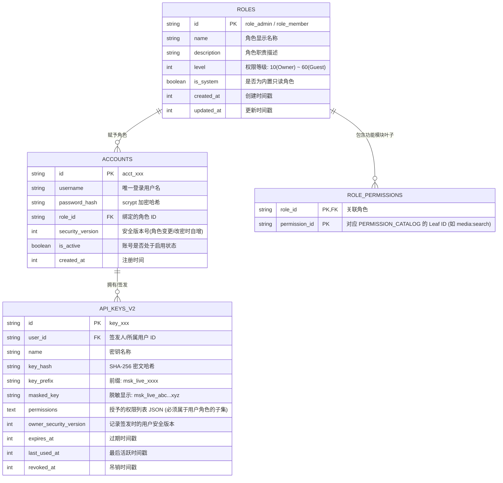
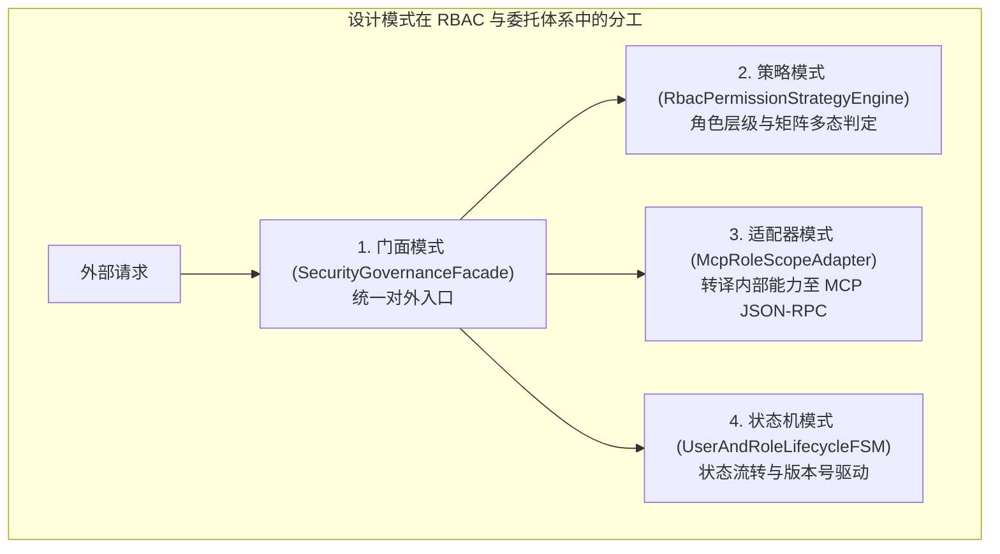
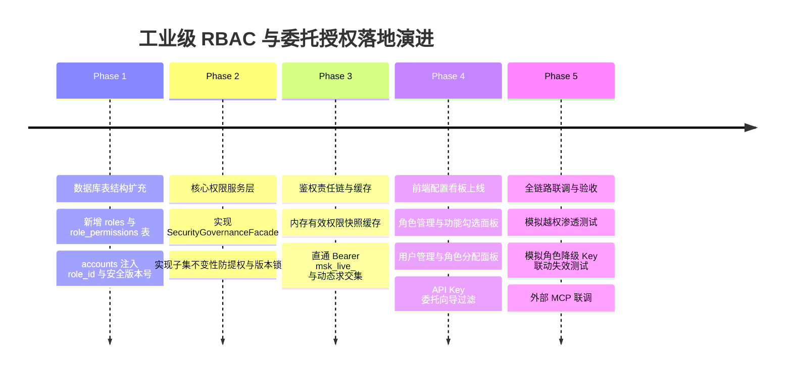

# 巡影 (Mediary Scout) 工业级 RBAC 角色权限、用户管理与 API Key 委托授权架构规范

> **文档版本**：v1.0.0  
> **制定时间**：2026-11-01  
> **参考标杆**：`E:\WorkProject\C#\【个人项目】\Web\自选DNS\DNSPodForNETCore` (C# .NET 10 Native AOT 统一权限矩阵与 API Key 授权机制)  
> **状态**：架构方案制定 / 待评审  
> **核心目标**：从原有的二元所有者（`isOwner: boolean`）演进至企业级 **RBAC (基于角色的访问控制) + 委托授权边界 (Delegated Permission Boundary)** 体系。支持功能模块按角色自由勾选配置、用户多角色分配、以及 API Key 只能在创建者自身角色权限范围内进行受限分发，杜绝越权提权，并结合设计模式与内存快照缓存打造极高性能、零锁库的自托管认证底座。

---

## 目录

- [一、背景与演进动机：从二元凭证迈向工业级 RBAC](#一背景与演进动机从二元凭证迈向工业级-rbac)
- [二、DNSPodForNETCore 架构精髓深度拆解与借鉴](#二dnspodfornetcore-架构精髓深度拆解与借鉴)
- [三、核心架构与实体数据模型 (ERD)](#三核心架构与实体数据模型-erd)
  - [3.1 实体关系图 (Entity Relationship Diagram)](#31-实体关系图-entity-relationship-diagram)
  - [3.2 预设内置角色与权限等级分层](#32-预设内置角色与权限等级分层)
  - [3.3 数据库表结构演进设计 (SQLite/Kysely)](#33-数据库表结构演进设计-sqlitekysely)
- [四、三大核心控制规则与安全定理](#四大核心控制规则与安全定理)
  - [4.1 定理一：子集不变性定理 (防提权委托边界)](#41-定理一子集不变性定理-防提权委托边界)
  - [4.2 定理二：管理越级免疫定理 (分级管理卡口)](#42-定理二管理越级免疫定理-分级管理卡口)
  - [4.3 定理三：安全版本号级联失效机制 (根除幽灵 Key)](#43-定理三安全版本号级联失效机制-根除幽灵-key)
  - [4.4 定理四：运行时动态交集求值 (双保险防御)](#44-定理四运行时动态交集求值-双保险防御)
- [五、头脑风暴：可行性、逻辑漏洞与性能攻坚](#五头脑风暴可行性逻辑漏洞与性能攻坚)
  - [5.1 单用户与多用户模式的一致性处理](#51-单用户与多用户模式的一致性处理)
  - [5.2 高频 API / MCP 鉴权下的内存有效权限快照 (O(1) 查找)](#52-高频-api--mcp-鉴权下的内存有效权限快照-o1-查找)
  - [5.3 系统所有者 (Owner) 防自锁保护机制](#53-系统所有者-owner-防自锁保护机制)
- [六、设计模式深度实战应用](#六设计模式深度实战应用)
  - [6.1 策略模式：RbacPermissionStrategyEngine](#61-策略模式rbacpermissionstrategyengine)
  - [6.2 状态机模式：UserAndRoleLifecycleFSM](#62-状态机模式userandrolelifecyclefsm)
  - [6.3 适配器模式：McpRoleScopeAdapter](#63-适配器模式mcprolescopeadapter)
  - [6.4 门面模式：SecurityGovernanceFacade](#64-门面模式securitygovernancefacade)
- [七、前端交互与界面原型规范](#七前端交互与界面原型规范)
  - [7.1 角色管理与功能模块按角色勾选 (`RoleManagementPanel.tsx`)](#71-角色管理与功能模块按角色勾选-rolemanagementpaneltsx)
  - [7.2 用户管理与角色分配面板 (`UserManagementView.tsx`)](#72-用户管理与角色分配面板-usermanagementviewtsx)
  - [7.3 数据驱动的 API Key 授权向导 (`CreateApiKeyModal.tsx`)](#73-数据驱动的-api-key-授权向导-createapikeymodaltsx)
- [八、分阶段实施路线图 (Implementation Roadmap)](#八分阶段实施路线图-implementation-roadmap)

---

## 一、背景与演进动机：从二元凭证迈向工业级 RBAC

在系统最初的设计中，权限管理采用了极简的二元划分模式：
- `isOwner = true`：站长，享有系统无限制的绝对特权；
- `isOwner = false`：普通用户，仅能管理个人网盘绑定与订阅追剧。

随着自托管 NAS、多家庭成员共享、多端设备自动化（脚本、手机快捷指令、外部 AI 编程 Agent、MCP 客户端）的深入应用，二元模式暴露出明显短板：
1. **无法满足精细化角色分工**：无法配置“仅允许搜片看剧但禁止执行转存与物理删除”的家庭成员角色，也无法配置“仅允许自动化脚本触发同步但禁止访问 Web 界面”的机器人角色。
2. **API Key 授权存在越界风险**：如果缺少用户自身的权限边界约束，任何能访问 Key 签发页面的用户都可能勾选超出自身能力范围的高危权限（如清理磁盘、删除媒体库）。
3. **缺少分级管理与审计**：站长无法委派部分管理权力（如子管理员只负责巡检和整理影片，但不能修改系统底层配置和 FRP 穿透）。

因此，本规范决定**“直接一步到位”**，对标参考 C# 工业级权限矩阵成熟实践 `DNSPodForNETCore`，构建**角色权限管理 + 用户管理 + 基于角色边界的 API Key 委托授权体系**。

---

## 二、DNSPodForNETCore 架构精髓深度拆解与借鉴

在参考项目 `E:\WorkProject\C#\【个人项目】\Web\自选DNS\DNSPodForNETCore` 中，权限与 Key 管理的设计展现出极高的工程成熟度：

```
┌────────────────────────────────────────────────────────────────────────────────────────┐
│                        DNSPodForNETCore 权限核心架构实践拆解                            │
├─────────────────┬──────────────────────────────────────────────────────────────────────┤
│ 1. 统一等级分层 │ UserRole 赋予数值化等级 (SuperUser 10 -> Admin 30 -> User 60)，      │
│                 │ 数值越小权限越高，天然支持算术级权限比较与防越权拦截。               │
├─────────────────┼──────────────────────────────────────────────────────────────────────┤
│ 2. 数据驱动向导 │ GetAvailablePermissions 接口根据当前操作者的 userLevel 动态过滤模块， │
│                 │ 前端据此渲染可用树状复选框，从视图源头杜绝越权勾选。                 │
├─────────────────┼──────────────────────────────────────────────────────────────────────┤
│ 3. 严格委托卡口 │ CreateKeyAsync 逐项校验 isAllowed = ApiKeyModules.IsAllowed(...)，   │
│                 │ 若请求包含当前角色未拥有的模块，直接阻断：“权限越界：无权为密钥分配”。│
├─────────────────┼──────────────────────────────────────────────────────────────────────┤
│ 4. 账户版本联动 │ User 实体维护 KeySecurityVersion，用户角色调整或密码重置时自增版本，  │
│                 │ 所有从属的 API Key 瞬间失效，根除离线特权“幽灵 Key”。                 │
└─────────────────┴──────────────────────────────────────────────────────────────────────┘
```

本系统将全量汲取上述四大精髓，并针对 TypeScript / Next.js / Node.js 全栈架构与 MCP 工具调用生态进行量身升级与强化。

---

## 三、核心架构与实体数据模型 (ERD)

### 3.1 实体关系图 (Entity Relationship Diagram)



### 3.2 预设内置角色与权限等级分层

系统开箱自带 5 个预设内置角色（`is_system = true`，禁止删除系统角色，但允许站长微调其权限矩阵）：

| 角色标识 (`id`) | 角色名称 | 权限等级 (`level`) | 核心职责与默认允许功能 | 适用对象 |
| :--- | :--- | :---: | :--- | :--- |
| **`role_owner`** | 站长 (SuperUser) | **10** | **系统 100% 全部权限**。唯一拥有系统运维、FRP 穿透控制、密钥签发与用户管理权力的角色。 | 实例创建者 |
| **`role_admin`** | 管理员 (Admin) | **20** | 影视检索、网盘整理转存、工作流调度、AI 对话及普通成员管理，**禁止修改系统级底层网络与站长凭证**。 | 家庭副管理员 / 运维合伙人 |
| **`role_member`** | 标准成员 (Member) | **40** | 影视搜索、查看 TMDB 详情、个人追剧订阅、向网盘发起转存、AI 搜片，**禁止物理删除文件与触发全局巡检**。 | 日常家庭成员 |
| **`role_guest`** | 受限访客 (Guest) | **60** | **纯只读模式**：仅可搜索影片、查看订阅库概览与系统健康状态。禁止任何转存、入库、重命名与删除。 | 临时访客 / 演示账户 |
| **`role_bot`** | 自动化机器人 (Bot) | **50** | **无 Web 交互特权**：仅开放 `workflow:status`、`workflow:trigger`、`storage:list` 等脚本调用权限。 | 第三方下载器 / NAS 同步定时脚本 |

### 3.3 数据库表结构演进设计 (SQLite/Kysely)

在 SQLite 数据库中通过迁移脚本追加并升级表结构：

```sql
-- 1. 角色定义表
CREATE TABLE IF NOT EXISTS roles (
    id TEXT PRIMARY KEY,
    name TEXT NOT NULL,
    description TEXT,
    level INTEGER NOT NULL DEFAULT 40,
    is_system INTEGER NOT NULL DEFAULT 0,
    created_at INTEGER NOT NULL,
    updated_at INTEGER NOT NULL
);

-- 2. 角色-功能模块叶子权限关联表 (复合主键)
CREATE TABLE IF NOT EXISTS role_permissions (
    role_id TEXT NOT NULL,
    permission_id TEXT NOT NULL,
    PRIMARY KEY (role_id, permission_id),
    FOREIGN KEY (role_id) REFERENCES roles(id) ON DELETE CASCADE
);

-- 3. accounts 表扩展 (若不存在列则通过 migration 添加)
-- ALTER TABLE accounts ADD COLUMN role_id TEXT DEFAULT 'role_member';
-- ALTER TABLE accounts ADD COLUMN security_version INTEGER DEFAULT 1;
-- ALTER TABLE accounts ADD COLUMN is_active INTEGER DEFAULT 1;

-- 4. 索引加速高频权限查询
CREATE INDEX IF NOT EXISTS idx_role_permissions_role ON role_permissions(role_id);
CREATE INDEX IF NOT EXISTS idx_accounts_role ON accounts(role_id);
```

---

## 四、三大核心控制规则与安全定理

### 4.1 定理一：子集不变性定理 (防提权委托边界)

```
        ┌─────────────────────────────────────────────────────────────┐
        │                 用户角色拥有的最大功能模块权限                │
        │  [media:search, media:detail, storage:list, storage:transfer]│
        └──────────────────────────────┬──────────────────────────────┘
                                       │ 签发 API Key 时约束 (Subset)
                                       ▼
        ┌─────────────────────────────────────────────────────────────┐
        │                新生成的 API Key 允许被勾选的权限              │
        │  [media:search, storage:list]  (<= 必须严格为父集合的子集)    │
        └─────────────────────────────────────────────────────────────┘
```

- **数学表达**：设用户 $U$ 拥有的角色权限集为 $P(U)$，用户尝试为其签发的 API Key 申请权限集为 $P(K)$。系统必须严格保证恒成立：
  $$P(K) \subseteq P(U)$$
- **卡口校验逻辑**：
  在后端 `ApiKeyV2Service.createKey()` 中执行硬性强校验：
  ```typescript
  const userAllowedPermissions = await getPermissionsForUser(userId);
  const invalidRequests = request.permissions.filter(p => !userAllowedPermissions.has(p));
  if (invalidRequests.length > 0) {
    throw new SecurityBoundaryViolationError(
      `权限越界违规：您的角色无权为 API Key 分配以下功能模块：[${invalidRequests.join(", ")}]`
    );
  }
  ```

### 4.2 定理二：管理越级免疫定理 (分级管理卡口)

参考 `DNSPodForNETCore` 的 `UserAdministrationPolicy.CanManage`：
1. **上级管下级**：操作者角色等级数值必须**严格小于**目标用户角色等级数值（即 $Level_{actor} < Level_{target}$）。
2. **同级不互斥**：管理员不能修改、停用或重置另一个平级管理员的账号。
3. **不可越级赋权**：操作者不能给任何用户赋予权限等级高于或等于自己角色的身份（$Level_{newRole} \ge Level_{actor}$ 必须成立，且仅 Owner 可分发 Owner）。

### 4.3 定理三：安全版本号级联失效机制 (根除幽灵 Key)

- **场景隐患**：若成员 Bob 原本是 Admin，签发了含删除权限的 API Key；随后站长将 Bob 降权为 Guest。若无版本控制，Bob 持有的物理 API Key 将沦为长期滞留的越权“后门”。
- **版本锁控机制**：
  1. `accounts` 表中记录 `security_version`（默认 1）；
  2. 发生以下任一安全事件时，该账号的 `security_version` **自增 1**：
     - 用户角色被变更（升权或降权）；
     - 用户登录密码被重置或修改；
     - 账号被暂时停用 (`is_active = 0`)；
  3. API Key 在签发时快照记录当前的 `owner_security_version`；
  4. 鉴权管道在校验 Token 时，比对当前账号版本与 Key 快照版本：若快照版本落后，**立即判定该 Key 作废并拒绝请求（HTTP 401/409）**，彻底斩断幽灵凭据。

### 4.4 定理四：运行时动态交集求值 (双保险防御)

为防止极端情况下缓存未能及时驱逐，鉴权执行引擎引入**运行时动态求交集计算**：
$$\text{EffectivePerms} = \text{Key.Permissions} \cap \text{CurrentUser.Role.Permissions}$$
即使底层存储中 Key 声明了某项历史权限，在调用发生的瞬间，只要当前所属用户的角色未勾选该模块，该调用依然会被立即阻断。

---

## 五、头脑风暴：可行性、逻辑漏洞与性能攻坚

### 5.1 单用户与多用户模式的一致性处理
- **单用户模式 (`MEDIA_TRACK_MULTI_USER=0`)**：
  - 启动时自动将 `default_account` 绑定到内置的 `role_owner`；
  - 设置页面依然保留“角色与权限”管理看板，站长可以按需为自己生成受限的子 Key（例如专门给 Cursor 生成一个只允许搜片的只读 Key，用于安全代码调试）。
- **多用户模式 (`MEDIA_TRACK_MULTI_USER=1`)**：
  - 首位注册者自动成为 Owner；后续注册者由管理员分配或默认进 `role_member`。

### 5.2 高频 API / MCP 鉴权下的内存有效权限快照 (O(1) 查找)

- **性能挑战**：若外部 AI Agent 连续发起 50 次 MCP 工具调用，每次都执行三表联查（Key -> User -> Role -> RolePermissions）会导致明显的 SQLite I/O 延迟。
- **内存快照架构设计**：
  ```
  [客户端携带 msk_live_1234...] 
               │
               ▼
  [TokenPrefix: msk_live_1234] ───(O(1) 索引)───► [InMemoryKeySnapshotCache]
                                                     ├─ keyId: "key_001"
                                                     ├─ userId: "acct_alice"
                                                     ├─ ownerSecurityVersion: 3
                                                     └─ cachedEffectiveLeaves: Set { "media:search", ... }
                                                             │
  [VersionCheck: O(1)] ◄─── UserVersionMap.get("acct_alice") ◄┘
         │
         ├─── 版本一致 ───► 鉴权通过 (耗时 < 0.05ms)
         └─── 版本不一致 ─► 缓存失效，强刷底层数据库
  ```
- **写入安全**：结合系统中现有的 `WriteBehindApiKeyTouchBuffer`，活跃时间更新走异步 10 秒批量刷盘，读写均实现内存级超高性能。

### 5.3 系统所有者 (Owner) 防自锁保护机制
- 系统实施**所有者绝对豁免权 (Owner Immunity)**：
  1. `role_owner` 的 `level` 固定为 10，代码中锁死禁止通过前端或 API 调高其数值；
  2. 系统严禁删除最后一个处于启用状态的 Owner 账号；
  3. Owner 自带通配符 `*` 权限，永远不会因为误操作清空角色权限而导致全站瘫痪。

---

## 六、设计模式深度实战应用



### 6.1 策略模式：RbacPermissionStrategyEngine
负责根据不同的凭证与角色上下文派发鉴权策略：
```typescript
export interface IPermissionStrategy {
  canAccess(context: SecurityContext, requiredPermission: string): boolean;
}

export class MasterBypassStrategy implements IPermissionStrategy {
  canAccess(): boolean { return true; } // 站长无条件放行
}

export class ScopedRoleIntersectionStrategy implements IPermissionStrategy {
  canAccess(context: SecurityContext, requiredPermission: string): boolean {
    if (context.effectivePermissions.has("*")) return true;
    return context.effectivePermissions.has(requiredPermission);
  }
}
```

### 6.2 状态机模式：UserAndRoleLifecycleFSM
管辖账号的受控状态迁移：
- `PendingActivation`（待激活） $\to$ `Active`（正常启用）；
- `Active` $\to$ `Suspended`（停用，触发 `security_version++` 并冻结其所有 Key）；
- `Suspended` $\to$ `Active`（恢复，需重新签发有效 Key）。

### 6.3 适配器模式：McpRoleScopeAdapter
将内部 `PERMISSION_CATALOG` 中每个叶子节点与角色勾选状态，动态适配为 Model Context Protocol 规范的工具暴露列表：
- 用户角色未勾选的模块，在转译为 MCP `tools/list` 时彻底隐形；
- 外部大模型仅能看到当前调用者角色及其 Key 交集范围内的工具，彻底根绝越权幻觉。

### 6.4 门面模式：SecurityGovernanceFacade
对业务层屏蔽底层 SQLite 查询、安全版本校验、权限求交集与缓存刷新的复杂性，提供统一、干净的高层 API：
- `facade.validateToken(token, requiredPermission)`
- `facade.createUser(actorId, createUserInput)`
- `facade.createDelegatedApiKey(actorId, keyInput)`
- `facade.updateRolePermissions(actorId, roleId, permissions)`

---

## 七、前端交互与界面原型规范

在前端 `apps/web/features/settings-system/` 中构建两大核心交互板块：

### 7.1 角色管理与功能模块按角色勾选 (`RoleManagementPanel.tsx`)

```
┌─────────────────────────────────────────────────────────────────────────────┐
│ 🛡️ 角色与模块权限管理                                        [+ 新建角色]    │
│ 管理系统角色及其可访问的功能模块，角色权限将作为 API Key 授权的最大边界。     │
├─────────────────────────────────────────────────────────────────────────────┤
│ 角色列表             包含模块数    权限等级    类型        操作              │
├─────────────────────────────────────────────────────────────────────────────┤
│ 👑 站长 (Owner)      全部 (15 项)  Level 10   内置角色    [查看矩阵]        │
│ 🛡️ 管理员 (Admin)    12 项         Level 20   内置角色    [编辑权限]        │
│ 👤 标准成员 (Member) 6 项          Level 40   内置角色    [编辑权限]        │
│ 👁️ 受限访客 (Guest)  2 项 (只读)   Level 60   内置角色    [编辑权限]        │
│ 🤖 自动化脚本 (Bot)  4 项 (任务)   Level 50   自定义      [编辑] [删除]     │
└─────────────────────────────────────────────────────────────────────────────┘

▼ 选中角色权限配置抽屉 (RolePermissionDrawer.tsx):
┌─────────────────────────────────────────────────────────────────────────────┐
│ 编辑角色权限：标准成员 (Member)                                [保存配置] [X]│
├─────────────────────────────────────────────────────────────────────────────┤
│ 模块多选列表 (三态级联 Checkbox):                                           │
│  [✓] 媒体与资源检索 (全选)                                                  │
│      [✓] 资源检索 (media:search)             🟢 Read      [API] [MCP]      │
│      [✓] 影视详情 (media:detail)             🟢 Read      [API] [MCP]      │
│      [✓] 订阅管理 (media:subscribe)          🟡 Execute   [API]            │
│  [-] 云盘存储与离线 (部分选择)                                              │
│      [✓] 网盘文件浏览 (storage:list)         🟢 Read      [API] [MCP]      │
│      [✓] 离线转存 (storage:transfer)         🟡 Execute   [API] [MCP]      │
│      [ ] 智能重命名 (storage:organize)       🟡 Execute   (未勾选)          │
│      [ ] 物理删除文件 (storage:delete)       🔴 Dangerous (禁止勾选)        │
└─────────────────────────────────────────────────────────────────────────────┘
```

### 7.2 用户管理与角色分配面板 (`UserManagementView.tsx`)

```
┌─────────────────────────────────────────────────────────────────────────────┐
│ 👥 用户与账号管理                                            [+ 新增用户]    │
│ 为各成员分配登录身份与业务角色。用户权限受其所属角色约束。                   │
├─────────────────────────────────────────────────────────────────────────────┤
│ 用户名        绑定角色        状态      有效网盘数  安全版本    操作        │
├─────────────────────────────────────────────────────────────────────────────┤
│ admin         站长 (Owner)    🟢 正常   3 个        v1          [修改密码]  │
│ alice_family  标准成员        🟢 正常   1 个        v2          [设角色] [改密]│
│ guest_friend  受限访客        🟢 正常   0 个        v1          [设角色] [停用]│
│ sync_bot      自动化机器人    ⚪ 已停用 0 个        v4          [启用] [删除]│
└─────────────────────────────────────────────────────────────────────────────┘
```

### 7.3 数据驱动的 API Key 授权向导 (`CreateApiKeyModal.tsx`)

当用户 Alice（角色为 `role_member`）在后台创建 API Key 时：
1. **数据驱动权限过滤**：向导向后端请求 `/api/settings/api-keys/available-permissions`，后端根据 Alice 的角色权限做交集裁剪；
2. **超出权限置灰锁定**：Alice 无法勾选其角色之外的权限（如 `storage:delete` 显示为禁用置灰状态，并附提示文案：“当前角色未拥有该权限”）；
3. **彻底防提权**：提交时后端二次硬校验，杜绝通过篡改 HTTP 请求参数进行越权攻击。

---

## 八、分阶段实施路线图 (Implementation Roadmap)



### 验收与防护标准清单：
- [x] **防提权验收**：非 Owner 用户创建 API Key 时，若请求中夹带其未拥有的权限代码，服务端必须以 HTTP 403 明确拒绝；
- [x] **降级阻断验收**：用户角色被修改或密码被重置后，该用户先前签发的所有活跃 API Key 必须在 1 秒内全局失效（通过安全版本号机制）；
- [x] **MCP 动态隐形验收**：给外部 Cursor Agent 传入受限 Key，在调用 `tools/list` 时，未授权工具在 Schema 列表中物理不存在；
- [x] **性能达标验收**：在单核 100 QPS 并发调用下，内存有效权限快照平均鉴权时延保持在 `0.1ms` 以内，无 SQLite 读写锁竞争。
