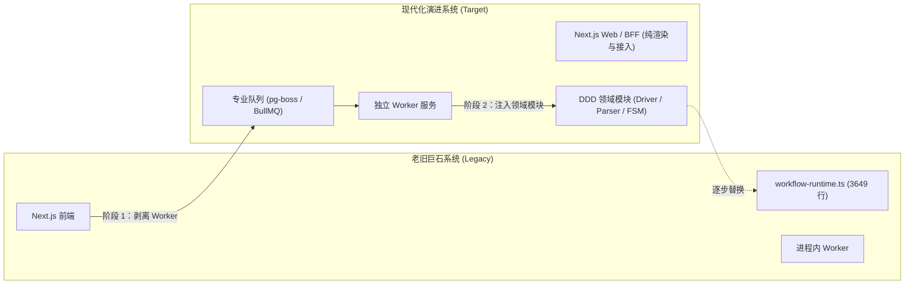
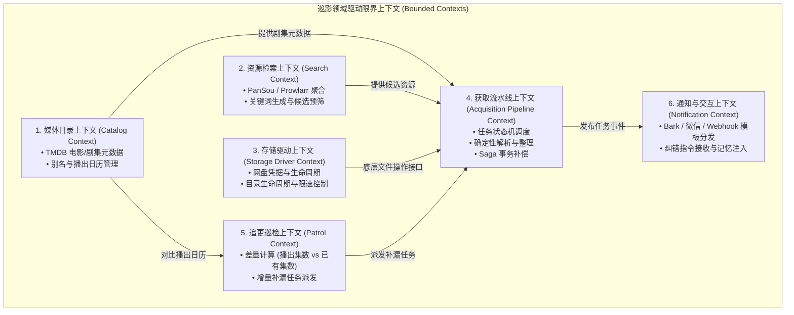
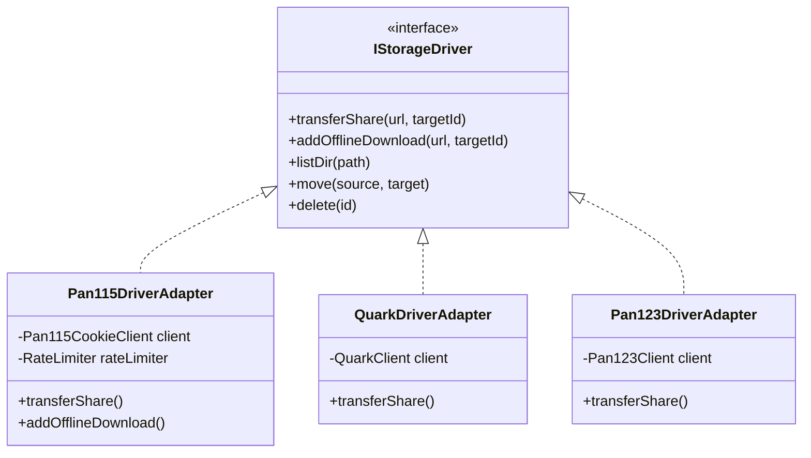
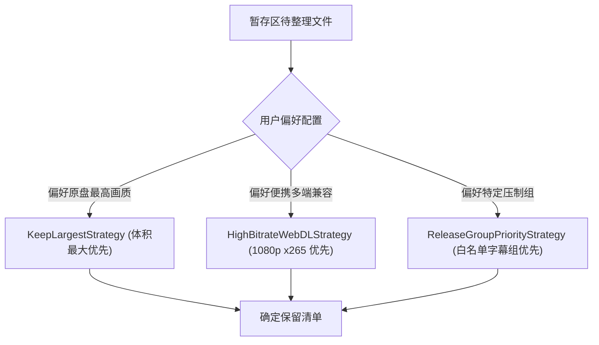
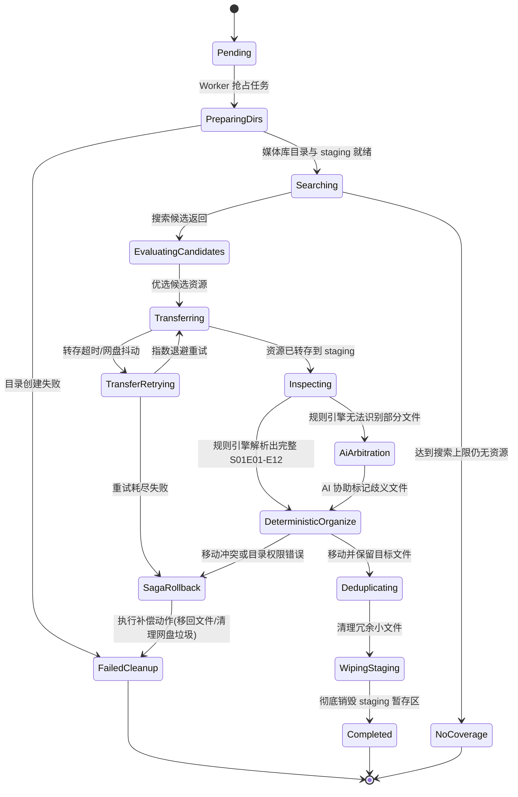
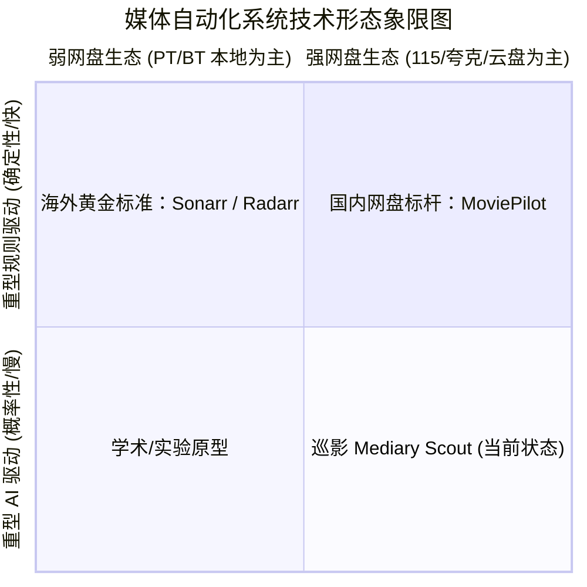
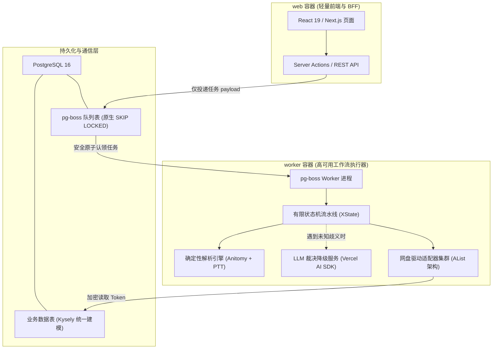
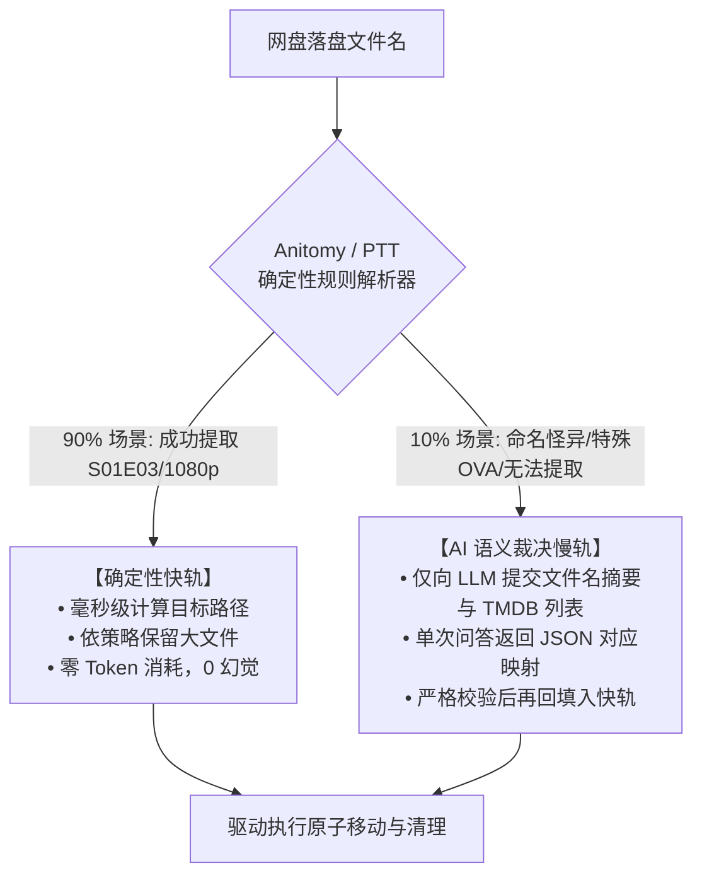
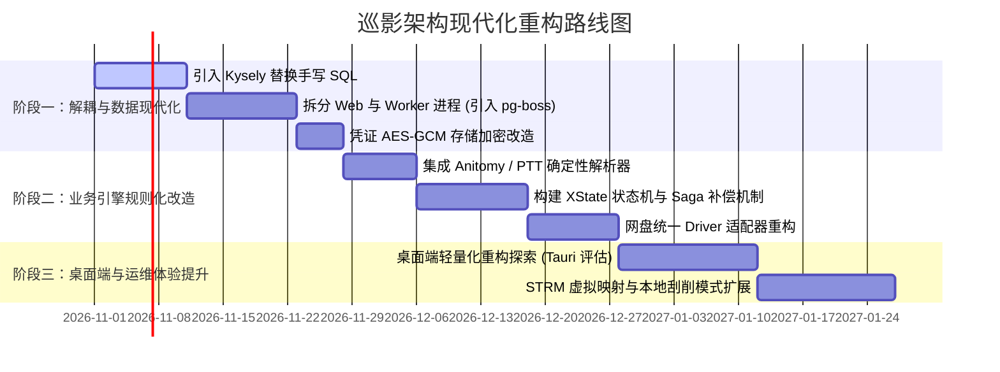

# 巡影 · Mediary Scout 架构重构与设计模式演进方案调研

> **文档位置**：`docs/refactoring-architecture-and-design-patterns.md`  
> **编写时间**：2026-10-23  
> **调研主题**：针对巡影当前框架耦合、过度依赖 LLM、手工双写 SQL、进程内 Worker 等结构性问题，头脑风暴重构可行性，结合**领域驱动设计（DDD）**、**适配器策略模式**、**有限状态机（FSM）与 Saga 补偿模式**，对比参考业界主流方案（MoviePilot、Sonarr、AList），输出系统性重构与技术演进方案。

---

## 目录

1. [头脑风暴与重构可行性评估](#1-头脑风暴与重构可行性评估)
   - 1.1 一刀切推倒重写 vs 绞杀者模式（Strangler Fig）渐进式重构
   - 1.2 现有功能的逻辑合理性与性能欠缺剖析
   - 1.3 核心设计模式切入点分析
2. [领域驱动设计（DDD）划分与限界上下文](#2-领域驱动设计ddd划分与限界上下文)
   - 2.1 限界上下文划分全景
   - 2.2 核心领域实体与值对象
   - 2.3 领域事件（Domain Events）驱动设计
3. [核心设计模式在系统重构中的落地设计](#3-核心设计模式在系统重构中的落地设计)
   - 3.1 适配器模式（Adapter Pattern）：统一多网盘与检索源
   - 3.2 策略模式（Strategy Pattern）：去重、命名、限流与双轨决策
   - 3.3 有限状态机（FSM）与 Saga 补偿模式：告别不可控的 Agent 黑盒
   - 3.4 观察者模式与事件总线（Observer & Event-Driven）
4. [开源生态与成熟库选型借鉴](#4-开源生态与成熟库选型借鉴)
   - 4.1 确定性媒体文件名解析库（替换 LLM 盲目猜测）
   - 4.2 队列与后台任务调度库选型（Postgres 原生 vs Redis）
   - 4.3 数据库抽象与统一查询构建器（消灭 4,500 行手写双 SQL）
   - 4.4 状态机引擎与安全加密工具
5. [业界主流方案横向深度对比与经验借鉴](#5-业界主流方案横向深度对比与经验借鉴)
   - 5.1 MoviePilot v2（国内 NAS 影音自动化标杆）
   - 5.2 Sonarr / Radarr（海外硬核自动化标杆）
   - 5.3 AList / OpenList（网盘驱动适配器典范）
   - 5.4 四大方案多维度对比矩阵
6. [目标架构设计蓝图（Target Architecture Blueprint）](#6-目标架构设计蓝图target-architecture-blueprint)
   - 6.1 进程与部署物理分离拓扑
   - 6.2 “90% 确定性规则 + 10% AI 语义裁决”双轨协同流水线
   - 6.3 凭证信封加密与安全沙盒防线
7. [分阶段渐进式重构路线图](#7-分阶段渐进式重构路线图)

---

## 1. 头脑风暴与重构可行性评估

### 1.1 一刀切推倒重写 vs 绞杀者模式（Strangler Fig）渐进式重构

在面对一个拥有 3,600 行“上帝文件”、手写 4,500 行双 SQL 方言的代码库时，开发者的第一直觉往往是“全部推倒重写”。但在商业和开源实践中，**一刀切推倒重写（Big Bang Rewrite）通常伴随着极高的夭折风险**：
- 巡影中沉淀了大量与 115、夸克等网盘博弈的细微边缘处理（如 115 离线请求的 RSA 加密、防风控时间间隔、天翼 personal-cloud 的特定目录 ID `-11` 等）。全量重写极易丢失这些硬踩坑换来的领域隐性知识。
- 推荐采用 **绞杀者模式（Strangler Fig Application Pattern）**：
  保持外部交互接口（前端页面、Agent API）稳定，通过逐步将内部子系统（存储驱动、任务队列、解析引擎）按领域拆分为独立模块，逐步替代老旧的 `workflow-runtime.ts`。



### 1.2 现有功能的逻辑合理性与性能欠缺剖析

通过头脑风暴，对现有功能进行批判性审视：

| 现有功能模块 | 逻辑合理性 | 性能/架构缺陷 | 结论与优化方向 |
|---|---|---|---|
| **媒体搜索与刮削** | 合理（TMDB 是事实标准） | 每次通过 `tmdb-proxy` 抓取完整列表，缓存机制脆弱（`??=` 曾引发死锁） | 引入二级缓存（内存 LRU + DB 持久化），防抖批量查询。 |
| **资源搜索（PanSou）** | 合理 | 依赖单一关键词搜索，遇到错别字或繁体字召回率骤降；无预检直接转存 | 引入搜索策略模式：原名/译名/别名多路并发探测 + 本地去重过滤。 |
| **剧集解析与去重** | **极度不合理**（用 LLM 做正则） | 极其缓慢（耗时 1~3 分钟），消耗大量 Token，有概率发生幻觉误删正片 | **彻底颠覆**：用成熟确定性解析库（Anitomy/PTN）替代 90% 的 LLM 环节。 |
| **网盘文件转存与整理** | 核心需求 | 频繁递归扫描整棵树（`listTree`），高频调用导致网盘账号面临被封危险 | 优化为局部受控扫描，引入网盘驱动适配器与自适应漏桶限流。 |
| **任务执行与调度** | **严重缺陷**（Next.js 内跑 Worker） | 任务不可持久化追踪、易被容器重启打断、全表轮询数据库 | 拆解为独立 Worker 进程，采用持久化任务状态机。 |

### 1.3 核心设计模式切入点分析

1. **适配器模式（Adapter Pattern）**：
   - 解决多网盘差异：115 是 Cookie+RSA 离线，夸克是 Cookie+Stoken 分享，123 是 Bearer Token，光鸭是 DeviceId+OAuth。通过 `StorageDriverAdapter` 统一抽象，抹平一切底层协议差异。
2. **策略模式（Strategy Pattern）**：
   - 文件去重策略（大文件优先、原盘优先、国语音轨优先）。
   - 目录规范策略（Emby 格式、Plex 格式、自定义模版）。
   - 网盘防风控限速策略（115 保守节流策略 vs 夸克快速吞吐策略）。
3. **有限状态机（FSM）与 Saga 事务补偿**：
   - 把原本不可预测的 Agent 循环改造成具备明确状态（`Searching` $\to$ `Transferring` $\to$ `Inspecting` $\to$ `Organizing` $\to$ `Wiping` $\to$ `Completed`）的确定性状态机。
   - 每个状态均配对前置校验与失败补偿动作（Saga Compensating Action），解决网盘中途失败遗留垃圾的问题。

---

## 2. 领域驱动设计（DDD）划分与限界上下文

将系统解耦为清晰的高内聚、低耦合限界上下文（Bounded Contexts）：



### 2.1 核心领域实体与值对象（Entities & Value Objects）

- **实体（Entities）**：
  - `MediaWork`（聚合根）：TMDB 编号、标题、年份、季度列表、关联的追踪状态。
  - `AcquisitionJob`（聚合根）：任务 ID、目标剧集范围、当前状态机状态、执行日志、重试计数器。
  - `StorageEndpoint`：网盘唯一标识、提供商品牌、加密凭据、挂载根目录。
- **值对象（Value Objects）**：
  - `EpisodeCode`：如 `S01E03`，内含不可变的季度和集数校验逻辑。
  - `MediaResolution`：画质等级（4K Remux / 1080p Web-DL / 720p）。
  - `FilePath`：标准化媒体路径模型，自动防路径穿越（Path Traversal）。
  - `DriveQuota`：当前网盘调用预算与剩余配额。

### 2.2 领域事件（Domain Events）驱动

解耦状态更新与副作用：
- `ResourceLandedEvent`：资源落盘事件 $\to$ 触发文件整理流水线。
- `AcquisitionFailedEvent`：任务失败事件 $\to$ 触发 Saga 补偿与告警通知。
- `EpisodeAiredEvent`：剧集播出事件 $\to$ 巡检上下文捕获并生成微任务。

---

## 3. 核心设计模式在系统重构中的落地设计

### 3.1 适配器模式（Adapter Pattern）：统一多网盘与检索源

参考 **AList** 的高扩展性驱动设计，定义严谨的抽象接口：

```typescript
// 领域层：网盘统一抽象端口
export interface IStorageDriver {
  readonly provider: string;
  readonly capabilities: DriverCapabilities;

  // 认证与健康度
  checkAuth(): Promise<AuthStatus>;
  refreshToken(): Promise<void>;

  // 文件系统操作
  mkdir(path: string): Promise<DirectoryHandle>;
  listDir(path: string, options?: ListOptions): Promise<FileEntry[]>;
  move(sourceId: string, targetDirId: string): Promise<void>;
  delete(targetId: string): Promise<void>;

  // 核心转存与离线下载能力
  transferShare(shareUrl: string, targetDirId: string, extractCode?: string): Promise<TransferTaskHandle>;
  addOfflineDownload(url: string, targetDirId: string): Promise<OfflineTaskHandle>;
  pollTaskStatus(taskId: string): Promise<TaskProgress>;
}
```



**适配器模式的价值**：
- 新增网盘（如百度网盘、阿里云盘）只需实现 `IStorageDriver`，**核心整理与状态机逻辑 0 行修改**。
- 单元测试时，Mock 网盘极其容易，无需再维护复杂的黑盒模拟器（`storage-115-simulator.ts`）。

### 3.2 策略模式（Strategy Pattern）：去重、命名、限流与双轨决策

通过策略模式剥离硬编码规则，支持用户在设置中自由插拔：



- **限流避碰策略（Rate Limiting Strategy）**：
  - `ConservativeLeakyBucket`（115 专属）：严格限制并发为 1，请求间隔 $\ge 800\text{ms}$，遇到 429 触发断路器熔断 5 分钟。
  - `AggressiveTokenBucket`（夸克/123 专属）：允许并发 5，短时间内快速完成批量转存。
- **决策分流策略（Decision Strategy）**：
  - **Fast-Path（规则通道）**：正则库能 100% 确定季集数，直接走确定性整理。
  - **Slow-Path（AI 通道）**：遇到怪异合包、剧场版无规律命名时，提取元数据摘要，仅请求一次 LLM 进行轻量分类。

### 3.3 有限状态机（FSM）与 Saga 补偿模式：告别不可控的 Agent 黑盒

系统不再让 LLM 随意决定“先搜索还是先移动、调用什么工具”，而是将流水线固化为一个**确定性的状态图（Statechart）**：



**Saga 补偿机制实现原则**：
- 每个向前的状态操作，必须定义其对应的**逆向补偿动作**：
  - `PrepareStagingStep` $\iff$ 补偿动作：`RemoveStagingDir`。
  - `TransferShareStep` $\iff$ 补偿动作：`CancelOfflineTask` + `DeleteTransferredFiles`。
  - `MoveToSeasonStep` $\iff$ 补偿动作：`RestoreFilesToStaging` 或标记回滚。
- 哪怕系统在中间步骤被强杀重启，Worker 读出当前持久化状态，也能从容执行 Saga 逆向补偿，绝不在用户网盘留下一丝脏文件。

---

## 4. 开源生态与成熟库选型借鉴

为了避免重复造轮子，全面调研当前成熟的开源库：

### 4.1 确定性媒体文件名解析库（替换 LLM 盲目猜测）

| 库名称 | 语言生态 | 特点与适用场景 | 结论 |
|---|---|---|---|
| **`anitomy`** (npm) | 纯 TypeScript (零原生依赖) | **强烈推荐**。由 C++ 著名解析器 Anitomy 纯 TS 移植，专门解析复杂的番剧命名（提取字幕组、季集数、分辨率、格式如 `[Lilith-Raws] ... S02 - 02`），毫秒级、0 Token 开销。 | **核心推荐采用** |
| **`parse-torrent-title`** (npm) | JavaScript / Node.js | 专门解析欧美电影、美剧常见种子名（识别剧名、年份、4K/1080p、BluRay、x265、音频编码等）。 | **核心推荐采用** |
| **PTN** (Python) | Python | 历史悠久，很多开源项目（如 MoviePilot）底层采用，但在 Node.js 环境下需要额外运行时。 | 排除（已有 Node 替代品） |

### 4.2 队列与后台任务调度库选型（Postgres 原生 vs Redis）

| 方案 | 外部依赖 | 核心特性 | 架构契合度 |
|---|---|---|---|
| **`pg-boss`** | 仅需 PostgreSQL（无需 Redis） | **极高契合度**。基于 PostgreSQL 原生 `FOR UPDATE SKIP LOCKED` 实现；具备自动重试、指数退避、延迟任务、死信队列（DeadLetter）、Cron 定时任务；自带官方 Web 监控面板 `@pg-boss/dashboard`。 | **Docker 模式首选推荐**（不增加运维复杂度） |
| **`BullMQ`** | 必须依赖 Redis | 性能极致（10,000+ jobs/sec），支持复杂的父子任务流（Flows）。但在单机 NAS 自部署场景下，强迫用户多开一个 Redis 容器会增加资源开销。 | 适合大型分布式部署 |
| **自定义 SQLite FSM 队列** | 零外部依赖 | 针对桌面端（无 Postgres 场景），编写一个轻量级的纯事务 FSM 驱动器，保障单进程单线程安全。 | **桌面端专属** |

### 4.3 数据库抽象与统一查询构建器（消灭 4,500 行手写双 SQL）

| 工具 | 类型风格 | 对 PG 和 SQLite 的支持 | 迁移与维护性 | 结论 |
|---|---|---|---|---|
| **`Kysely`** | 纯类型安全 SQL Query Builder | **完美**。零运行时开销，完全保留 SQL 的灵活性，一套 TypeScript 查询代码可原生编译为 PostgreSQL 或 SQLite 方言，支持自动参数化占位符替换（`$1` vs `?`）。 | **强烈推荐采用** |
| **`Drizzle ORM`** | 轻量级 SQL-like ORM | 优秀。支持 PG 和 SQLite，支持自动生成 Migration。但对极细致的方言原生操作略有限制。 | 备选推荐 |
| **Prisma** | 重量级 ORM | 引擎为 Rust 二进制文件，打包进 Electron 极其痛苦，冷启动开销大。 | 坚决排除 |

### 4.4 状态机引擎与安全加密工具

- **`XState` / `@xstate/fsm`**：业界最权威的 TypeScript 状态机与状态图库，类型完备，支持可视化状态流与 Saga 副作用绑定。
- **Node.js 原生 `crypto` (`aes-256-gcm`)**：
  无需额外依赖，使用基于环境变量派生的主密钥（Master Key），在将 Cookie / Token 入库前进行 AES-GCM 对称加密，防范全明文落盘风险。

---

## 5. 业界主流方案横向深度对比与经验借鉴



### 5.1 MoviePilot v2（国内 NAS 影音自动化标杆）

- **技术栈**：Python 3 + FastAPI + Vue3 前端。
- **架构亮点**：
  - **插件化生态**：将 115、夸克、微信推送、字幕下载全面拆解为独立插件，主系统核心极其轻量。
  - **STRM + 302 播放架构**：不直接在网盘里做大面积暴力文件移动和刮削，而是将网盘视频映射为本地极小的 `.strm` 文件，Emby/Jellyfin 刮削只读写本地小文件，彻底消除网盘风控，播放时通过 302 重定向到网盘高速直链。
  - **确定性正则过滤**：内置成熟的正则字典与优先级评分机制，秒级匹配季集。

### 5.2 Sonarr / Radarr（海外硬核自动化标杆）

- **技术栈**：C# / .NET Core。
- **架构亮点**：
  - **严格的状态机与事件驱动架构**：每个下载任务从抓取、监控、导入到重命名，状态极其清晰，支持随时暂停、取消与故障排查。
  - **完全不依赖 AI**：仅凭强大的文件名解析规则引擎和 Torznab 协议规范，完成了全球 99.9% 剧集的自动化整理，单机并发能力极强。

### 5.3 AList / OpenList（网盘驱动适配器典范）

- **技术栈**：Go 语言。
- **架构亮点**：
  - **适配器模式教科书**：定义了极简的 `Driver` 接口。每个网盘（从 115 到 Google Drive）都是一个独立的驱动包，各驱动内部封装专有的 Token 刷新、防盗链、Cookie 维护与限频逻辑，对外呈现统一的虚拟文件系统。

### 5.4 四大方案多维度对比矩阵

| 对比维度 | Sonarr / Radarr | MoviePilot v2 | AList | 巡影 Mediary Scout (当前) | 巡影重构后 (目标设计) |
|---|---|---|---|---|---|
| **语言与生态** | C# (.NET) | Python (FastAPI) | Go | TypeScript (Next.js) | **TypeScript (Node.js)** |
| **网盘适配方式** | 不支持国内网盘 | 插件集成网盘 API | **统一 Driver 适配器** | 散落的 Executor 类 | **AList 风格 Driver 适配器** |
| **核心决策引擎** | 100% 确定性正则 | 95% 正则 + 5% 插件规则 | 无决策（纯存储代理） | **90% 依赖 LLM 决策** | **90% 正则规则 + 10% AI 裁决** |
| **任务队列机制** | 内部持久化 FSM 队列 | 内存线程池 + 定时器 | 无队列 | 进程内 Worker + SQL 轮询 | **`pg-boss` 分布式持久化队列** |
| **数据库抽象** | SQLite / Postgres (C# ORM) | SQLite (Peewee/SQLAlchemy) | SQLite/MySQL/PG | **手写 4,500 行原生 SQL** | **`Kysely` 跨数据库类型安全 Query Builder** |
| **网盘防风控** | 无需面对 | STRM 本地化避免风控 | 驱动级限流 | 简单限频补丁，易封号 | **驱动级自适应漏桶 + 局部受控遍历** |
| **单任务耗时** | 毫秒级 | 1 ~ 3 秒 | 毫秒级 | **1 ~ 5 分钟 (LLM 阻塞)** | **2 ~ 5 秒 (极速完成)** |

---

## 6. 目标架构设计蓝图（Target Architecture Blueprint）

基于以上调研与头脑风暴，提出重构后的目标架构拓扑：

### 6.1 进程与部署物理分离拓扑

将原先单一的 Next.js“大一统容器”拆分为两个清晰的物理进程：



### 6.2 “90% 确定性规则 + 10% AI 语义裁决”双轨协同流水线

彻底解决 LLM 耗时慢、成本高、误删正片的问题：



### 6.3 凭证信封加密与安全沙盒防线

1. **凭证落盘加密（Envelope Encryption）**：
   - 环境变量注入 `APP_SECRET_KEY`（32 字节密钥）。
   - 数据库存储结构改为：
     ```json
     {
       "iv": "base64...",
       "ciphertext": "base64...",
       "tag": "base64..."
     }
     ```
   - 在网盘 Driver 实例化读取时解密，内存中不落地，彻底杜绝数据泄露导致的网盘失窃。
2. **SSRF 安全中间件**：
   - 对所有出站 Webhook、通知 URL，引入私网 IP 校验拦截器，阻断针对 `127.0.0.1`、`172.16.0.0/12` 等内部网关的探测。

---

## 7. 分阶段渐进式重构路线图

为确保系统演进过程中功能不中断，重构划分为三个清晰里程碑：



### 里程碑交付物与收益

- **阶段一交付物**：
  - 消灭手写的 `postgres.ts` 与 `sqlite.ts`，统一收敛为单一的 Kysely 数据库定义，代码量缩减 3,000+ 行。
  - Next.js Web 端彻底摆脱常驻 Worker，容器重启不再打断下载；引入 `pg-boss` 带来开箱即用的任务重试、失败重测与可视化面板。
- **阶段二交付物**：
  - 单次媒体入库时间从 **3~5 分钟降低到 2~5 秒**，Token 消耗降低 **90% 以上**。
  - 杜绝误删正片和移错季度的概率性事故；网盘文件操作具备 Saga 回滚补偿，彻底消除暂存区孤儿垃圾。
- **阶段三交付物**：
  - 桌面客户端常驻内存从 **1GB 骤降至 100MB 以内**，秒级冷启动。
  - 可选支持 STRM 模式，从源头上彻底规避 115 与夸克网盘的高频封号风控。

---
*(调研与方案规划完毕。本文档已归档至 `docs/refactoring-architecture-and-design-patterns.md`。)*
