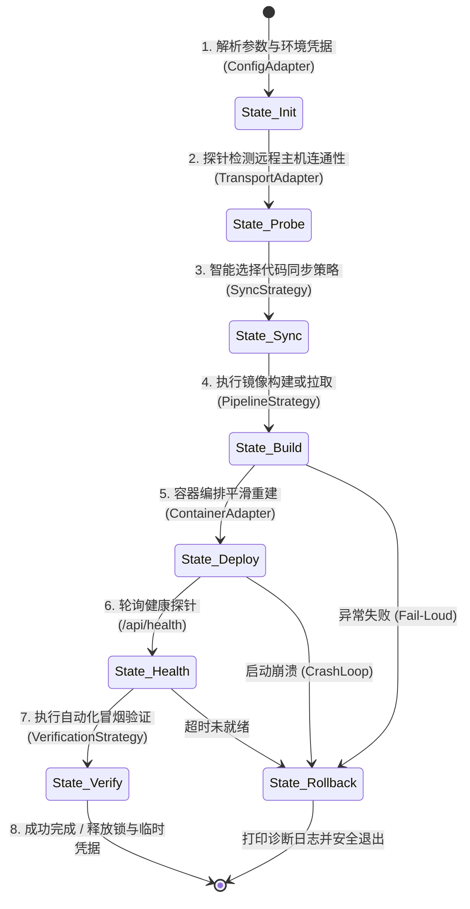

# 巡影 (Mediary Scout) 本地 Linux 开发部署与自动化验证架构方案 (Specification)

> **文档定位**：本文档针对当前 Node.js / Next.js / SQLite 单体与多包单体仓库 (Monorepo)，系统性推演、论证并规范从本地 Windows 智能体工作区向远程 Linux 宿主机进行**极速开发部署**、**双轨制隔离**与**全链路自动化实机验证**的完整架构方案。

---

## 1. 背景、痛点与核心诉求

### 1.1 现状与痛点
巡影（Mediary Scout）是一个基于 Next.js (App Router, Turbopack)、TypeScript、独立 Worker、PanSou 检索微服务与 SQLite (WAL) 的综合影视媒体库与网盘自动化编排系统。在日常迭代开发中，存在以下核心矛盾：

1. **环境与原生模块差异 (OS & Binary Mismatch)**：
   - Windows 与 Linux 在文件系统路径、大小写敏感度、进程组管理（`setsid` vs `taskkill`）以及原生 C++ 绑定库（如 `better-sqlite3`、`bindings`）上存在本质差异。在 Windows 本地能跑通的代码，移至 Linux 容器中常因 glibc/musl、软链接或权限问题发生非预期崩溃。
2. **正式构建与发布反馈周期过长 (Slow Official Pipeline)**：
   - 官方正式发版依赖 GitHub Actions 构建多架构 Docker 镜像并推送至 GHCR（约需 5~10 分钟），若每个日常改动都走“提交代码 -> 打 Tag -> 等 CI -> 远程拉取”的完整循环，敏捷调试与 Bug 排查成本极高。
3. **生产环境与日常验证的脏数据冲突 (Production Safety)**：
   - 远程宿主机往往常驻着提供实际服务的生产容器（端口 3000，卷 `mediaray-data`）。任何未经验证的实验性代码、数据库迁移或测试任务若直接在生产容器上执行，存在严重的数据污染或停机风险。
4. **Git 分支绑定的开发阻抗 (Git Coupling Resistance)**：
   - 传统的 `git pull` 部署强依赖于分支推送与未提交改动的暂存，开发者或 AI Agent 在尝试临时修改或补丁测试时，无法直接将当前工作区实时代码秒级投递至实机验证。

### 1.2 架构目标
- **双轨制并行部署 (Dual-Track Isolation)**：
  - **开发环境 (`-Mode Dev`)**：独立端口 (3010)、独立隔离数据卷 (`mediary-dev-data`)、独立容器 (`mediary-dev`)，生产服务 100% 零停机、零影响。
  - **正式发布 (`-Mode Official`)**：官方 GHCR 镜像平滑更新、生产数据卷挂载、提交哈希强校验（`BUILD_COMMIT`）。
- **极速代码流式直推 (Sub-Second Code Streaming)**：
  - 解耦 Git 提交，利用 Windows 10/11 原生 `tar.exe` 与 `OpenSSH` 流式管道传输实时工作区，传输耗时 `< 1s`。
- **静态资源秒级热更 (Asset HotSync)**：
  - 针对 `public/` 等静态资源的修改，提供免构建、免重启容器的 2 秒级热补丁。
- **全自动自愈与闭环验证 (Automated Verification Gates)**：
  - 容器启动后自动执行 HTTP 健康探针探测、路由矩阵冒烟测试，并支持 Playwright / Chrome DevTools MCP 浏览器端全页面无异常验收。

---

## 2. 业界主流方案对比调研与技术选型

在实现“本地代码向远程 Linux/容器环境快速投递与验证”的技术路线上，业界存在数种主流实践，下表对其关键维度进行对比：

| 方案 | 核心原理 | 优势 | 劣势 / 瓶颈 | 适用场景 | 巡影技术栈匹配度 |
| :--- | :--- | :--- | :--- | :--- | :--- |
| **Skaffold / Tilt** | 基于 Kubernetes 资源定义，监听代码变动增量构建镜像并推送到集群同步 | 生态完善、支持多服务编排与复杂拓扑、自动化声明式管理 | 必须依赖 Kubernetes / Minikube；学习曲线陡峭；资源占用大（宿主机 4GB 内存难以承受） | 企业级大型 K8s 微服务集群 | ❌ 极度过重，单机自部署不可取 |
| **Docker Compose Watch (`develop.watch`)** | Docker Compose v2.22+ 内置，按规则双向同步文件或触发镜像重构 | 官方原生支持、无需第三方客户端、配置写在 YAML 中 | 针对本地 Docker Desktop 体验良好；但在 Windows 跨远程 SSH 宿主机时，需要暴露 Docker 远程 TCP/TLS 端口或反向隧道，安全风险大；且对 monorepo 跨包编译感知弱 | 本地 Docker Desktop 容器化开发 | ⚠️ 远程跨网络部署支持脆弱 |
| **Mutagen / Rsync Daemon** | 在客户端与远程主机分别运行守护进程，通过高效增量 diff 算法同步文件 | 文件同步延迟极低（百毫秒级）、带宽消耗小 | Windows 原生环境缺乏免配置的 rsync；需要在远程宿主机安装常驻守护进程并监听额外端口；维护成本与故障点增加 | 跨国长距离跨机器文件常驻同步 | ⚠️ 侵入性强，需要远端装常驻服务 |
| **VS Code / Cursor Remote-SSH** | 在远程 Linux 宿主机注入 node agent，IDE 核心直接跑在远程 | 远端直接拥有 Linux 原生环境，无任何跨平台编译差异 | 消耗远程服务器可观的 CPU/内存（TS Server 需 1~2GB RAM）；无法直接支撑 AI Coding Agent 本地 CLI 全自动流水线调度 | 纯人工远程开发与断点调试 | ⚠️ 无法被自动化脚本无感知编排 |
| **SSH 流式压缩打包管道 (SSH Tar Streaming Pipeline)** | **本地 `tar.exe` 压缩标准输出 -> SSH 管道 -> 远程 `tar -xzf -` 实时解压** | **零外部依赖（Win10/11 自带 OpenSSH 与 bsdtar）；传输极快（<1s）；严格解耦 Git；零常驻守护进程；凭据安全隔离** | 需要脚本维护一套排除规则（排除 node_modules 等），需远程 Docker 参与构建 | **轻量级 NAS/VPS 自部署与 AI Agent 自动化** | **✅ 最佳选型 (100% 契合)** |

### 选型结论
我们选用 **SSH 流式压缩打包管道 (SSH Tar Streaming Pipeline)** 架构，配合适配器模式与策略模式，既免除了在远程宿主机安装额外守护进程的负担，又彻底发挥 Windows 原生工具链的高性能。

---

## 3. 头脑风暴：可行性、逻辑漏洞与性能瓶颈深度推演

### 3.1 可行性深度分析 (Feasibility)
从 C# .NET（LWT 项目）迁移到 Node.js / Next.js（Mediary Scout 项目），存在技术栈特性的本质差异：

| 维度 | C# .NET 10 (LWT 参考工程) | Node.js 22 / Next.js (Mediary Scout 当前工程) | 应对设计决策 |
| :--- | :--- | :--- | :--- |
| **前端架构** | 纯 ESM 原生 Vanilla JS，零打包工具，放于 `wwwroot` | React 19 + Next.js App Router，JSX/TSX 需 Turbopack/Webpack 编译烘焙 | 开发模式采用 `Dockerfile.dev` 进行服务端镜像打包，静态目录 `public/` 支持热更补丁 |
| **编译机制** | JIT 快速编译约 15 秒，Native AOT 耗时 10 分钟 | `next build` 约 40~60 秒；进程内 Worker 模式极速拉起 | 开发态启用 `MEDIA_TRACK_WORKER_MODE=inprocess`，免除独立 worker 容器网络损耗 |
| **依赖体积** | NuGet 全局缓存与二进制引用，无庞大 node_modules | `node_modules` 包含成千上万小文件，且含跨平台 C++ 原生动态库 | **严禁同步 Windows 的 `node_modules`**；远程镜像通过分层缓存 `package.json` 复用依赖 |
| **数据引擎** | SQLite / 单文件直接挂载卷 | SQLite (WAL 模式)，需持久化单文件 `/app/data/mediary.db` | 开发环境使用独立卷 `mediary-dev-data`，绝对禁止与生产卷共用 |

### 3.2 逻辑欠缺与潜在风险预判 (Logic Edge Cases)
1. **Windows CRLF 换行符污染 Linux 脚本**：
   - *问题*：Windows Git 默认检出换行符可能为 `\r\n`。若把包含 CRLF 的 `.sh` 脚本推送到 Linux 容器执行，会报 `\r: command not found` 语法错误。
   - *防御*：根目录 `.gitattributes` 强制 `*.sh text eol=lf`；在部署脚本与 Dockerfile 中设置自动清洗防御：`sed -i 's/\r$//' /app/scripts/*.sh`。
2. **构建缓存投毒与代码未生效伪绿 (Build Cache Poisoning)**：
   - *问题*：Docker 的 `COPY . .` 在极少数非 BuildKit 或特定层级缓存下可能产生缓存命中导致新改动未被打入镜像。
   - *防御*：自验证机制。构建时向镜像写入当前 Git Commit 或随机防重时间戳 `BUILD_COMMIT`，部署后通过 `docker exec cat BUILD_COMMIT` 与预期值比对，不匹配立即报错中断。
3. **并发部署竞争态 (Deployment Race Condition)**：
   - *问题*：若多个终端或 AI Agent 同时触发 `deploy-remote.ps1`，会导致远程 `/opt/mediary-dev` 解压冲突或 Docker 端口争抢。
   - *防御*：部署前在远程主机设立基于 `flock` 的排他文件锁 `/tmp/mediary-deploy.lock`，并发时优雅拒绝并告警。
4. **中国大陆网络环境依赖下载超时 (GFW & Mirror)**：
   - *问题*：远程 Linux 主机在拉取 Docker Hub 镜像（如 `node:22-slim`）或 `npm ci` 时可能因网络阻断超时。
   - *防御*：支持在 `env/.envdev` 中注入 `NPM_REGISTRY=https://registry.npmmirror.com`、`DOCKER_MIRROR`、以及宿主机已验证的局域网代理 `HTTP_PROXY=http://127.0.0.1:7890`。

### 3.3 性能瓶颈分析与极致压榨 (Performance Optimization)
1. **打包吞吐瓶颈**：
   - 源码树若不加节制全量打包，体积常突破 300MB（含 `.next`、`node_modules`、`.git`）。
   - 经过严格的排除参数：
     ```powershell
     --exclude=.git --exclude=node_modules --exclude=.next --exclude=run --exclude=data --exclude=env --exclude=*.tmp --exclude=*.tar.gz
     ```
     压缩包体积骤降至 **1.8MB ~ 3.5MB**。在千兆局域网内传输仅需 **0.2 ~ 0.4 秒**。
2. **镜像重构分层加速**：
   - `Dockerfile.dev` 中将 `package.json` 与 `package-lock.json` 的 COPY 放在最前端。只要依赖清单未变，`npm ci` 步骤 100% 命中 Docker Cache（耗时 0 秒），整机增量编译时长压缩至 30 秒以内。
3. **前端/静态文件零编译热补丁**：
   - 若仅修改 `public/` 内的 SVG 图标、公共脚本或本地静态说明，触发 `-PublicOnly`，直接流式推送到运行中容器 `/app/apps/web/public`，耗时仅需 **1.5 秒**。

---

## 4. 设计模式工程化重构方案

本项目部署管线全面践行**适配器模式 (Adapter)**、**策略模式 (Strategy)** 与**有限状态机模式 (FSM)**。



### 4.1 适配器模式 (Adapter Pattern)
- **`ConfigAdapter` (环境配置适配器)**：
  - 屏蔽单行与多行私钥字符串的解析差异，从 `env/.envdev` 提取配置并做强类型校验与默认值回退（如未提供端口时默认 22、未提供工作目录时默认 `/opt/mediary-dev`）。
- **`TransportAdapter` (跨平台安全传输适配器)**：
  - 屏蔽不同操作系统 SSH 行为差异：在 Windows 环境自动在系统 `%TEMP%` 创建临时密钥文件，并调用 Windows `icacls` 去除多余用户继承权限（防止 OpenSSH 抛出 `Permissions are too open` 致命错误），在 `finally` 阶段保证安全物理擦除。
- **`ContainerAdapter` (容器生命周期适配器)**：
  - 统一封装 Docker CLI 指令集，屏蔽 `docker run` 与 `docker compose` 的差异，提供容器运行状态判定、健康探针轮询、日志抓取与端口映射。

### 4.2 策略模式 (Strategy Pattern)
- **代码同步策略 (`SyncStrategy`)**：
  - `Auto`（自适应推荐）：自动扫描 `git status --porcelain`。若工作区干净（Clean），选用 `GitArchive` 策略，打包最新的 HEAD Commit 并记录版本标签；若存在未暂存或未提交代码（Dirty），自动切换为 `Direct` 策略，以毫秒级打包当前实时工作区（包含未提交代码，彻底解耦 Git）。
  - `Direct`：强制实时工作区打包直推。
  - `GitArchive`：强制本地 Git 最新提交打包。
  - `GitPull`：指示远程宿主机直接从 GitHub 远程仓库拉取分支。
- **部署管线策略 (`PipelineStrategy`)**：
  - `Dev`（极速开发管线）：目标容器 `mediary-dev`，端口 3010，独立卷 `mediary-dev-data`，启用进程内 worker，挂载开发调试参数。
  - `Official`（官方发版管线）：目标容器 `mediary`，端口 3000，生产卷 `mediaray-data`，拉取 GHCR 官方镜像，校验 Git Commit SHA 严格对齐。
- **验证策略 (`VerificationStrategy`)**：
  - `HealthOnly`：快速探测 `/api/health` 端口 200 OK。
  - `SmokeSuite`：调用项目内置的 `tools/runner/smoke-tester.mjs` 扫描核心 SSR 路由与 REST 接口。
  - `BrowserE2E`：驱动 Playwright 验收首页、订阅库、STRM 调度等关键视图并捕获控制台水合/未捕获异常。

### 4.3 有限状态机 (Finite State Machine - FSM)
将部署生命周期切分为 8 个离散确定的状态，每个状态具有明确的前置守卫条件与超时熔断：
1. `INIT`：加载 `.envdev`，验证必要字段，初始化凭据沙箱。
2. `PROBE`：探测远程 SSH 通信，校验远程 Docker 守护进程活性与磁盘剩余容量。
3. `SYNC`：打包本地源码，流式传输至远程工作目录并解包。
4. `BUILD`：在远端执行 Docker 构建（Dev 模式）或拉取最新镜像（Official 模式）。
5. `RECREATE`：平滑销毁旧容器并拉起新容器，注入环境变量与隔离卷。
6. `HEALTHCHECK`：以 2 秒为周期轮询 `/api/health` 探针，超时上限 40 秒。若发现容器处于 `exited` 或 `restarting` 状态，立刻终止并打印错误日志。
7. `VERIFY`：执行冒烟验收与提交哈希防伪核验。
8. `TEARDOWN`：安全清理 Windows 临时密钥与远程传输临时文件，输出可交互 Web 访问地址。

---

## 5. 架构实现细节与双轨制环境规范

### 5.1 端口与容器拓扑对照表

| 维度 | 开发/验证实例 (`-Mode Dev`) | 官方/生产实例 (`-Mode Official`) |
| :--- | :--- | :--- |
| **容器名称** | `mediary-dev` | `mediary` |
| **宿主机监听端口** | **3010** (`-p 3010:3000`) | **3000** (`-p 3000:3000`) |
| **数据持久化卷** | `mediary-dev-data` (`/app/data`) | `mediaray-data` (`/app/data`) |
| **数据库文件路径** | `/app/data/mediary.db` (卷内独立) | `/app/data/mediary.db` (生产数据) |
| **Worker 运行模式** | `MEDIA_TRACK_WORKER_MODE=inprocess` | 生产标准编排（external 或 inprocess） |
| **PanSou 服务连接** | 连接宿主常驻 pansou (`http://192.168.1.100:5280`) | 内部网络服务或宿主端口 |
| **构建方式** | 远程 Linux Docker 本地快速构建 (`Dockerfile.dev`) | 官方 GitHub Actions CI/CD 多架构镜像发布 |
| **镜像标签** | `mediary:dev` | `ghcr.io/xixjohan/mediary-scout:latest` |
| **典型发布耗时** | **30 ~ 50 秒** (静态热更 ~2 秒) | **约 20 秒** (直接 pull 镜像) |
| **生产影响** | **100% 零影响** (3000 端口持续服务用户) | 重建生产容器 |

### 5.2 目录与文件布局规范
在当前仓库中新增/维护以下基础设施：
```text
mediary-scout/
├── AGENT.md                                      # AI Agent 跨会话协作指南 (核心入口)
├── Dockerfile.dev                                # 极速开发与验证专属 Dockerfile
├── env/
│   ├── .env.example                              # 模板说明文件
│   └── .envdev                                   # 敏感密钥与远程宿主机连接配置 (严格 gitignore)
├── scripts/
│   └── deploy-remote.ps1                         # 本地一键流式部署与全自动验证主控脚本
├── docs/
│   └── architecture/
│       └── remote-linux-dev-deploy-and-verification-spec.md  # 本架构规范文档
└── tools/
    └── runner/
        ├── smoke-tester.mjs                      # 路由与编译冒烟测试器
        └── acceptance-suite.mjs                  # Playwright 浏览器自动化验收套件
```

---

## 6. 自动化验收体系与质量守卫 (Quality Gates)

部署完成后，管线无缝衔接多级自动化验证：

1. **第 1 级：HTTP 基础探针 (/api/health)**
   - 验证 Node.js 进程、Next.js 运行时及底层 SQLite 数据库连接读写正常。
2. **第 2 级：代码提交指纹校验 (BUILD_COMMIT Guard)**
   - 读取容器内 `/app/BUILD_COMMIT`，确认当前容器运行的代码与本地构建指令完全吻合，阻断一切构建静默未生效。
3. **第 3 级：核心路由冒烟矩阵 (Smoke Matrix Probe)**
   - 探测关键 SSR 路由与 REST 接口，确保无 Next.js App Router 水合失控或编译级死循环。
4. **第 4 级：内置浏览器自动化巡检 (Chrome DevTools MCP / Playwright)**
   - 支持开发者或 Agent 针对 `http://<DEPLOY_HOST>:3010/` 运行无头浏览器巡检：
     - 检查页面未产生致命控制台错误（`pageerror`）；
     - 检查 Suspense 骨架屏平稳水合；
     - 检查 STRM 计划管理与网盘关联配置。

---

## 7. 总结与落地演进
通过本架构方案的落地实施，巡影工程彻底补齐了本地 Windows 开发环境与远程 Linux 生产环境之间的鸿沟。AI Coding Agent 与开发者能够在不破坏任何生产数据的前提下，在数十秒内将工作区最新代码投递至真实 Linux 容器中执行端到端验证，使高风险的架构改动、系统重构与新功能研发具备坚如磐石的质量门禁保障。
