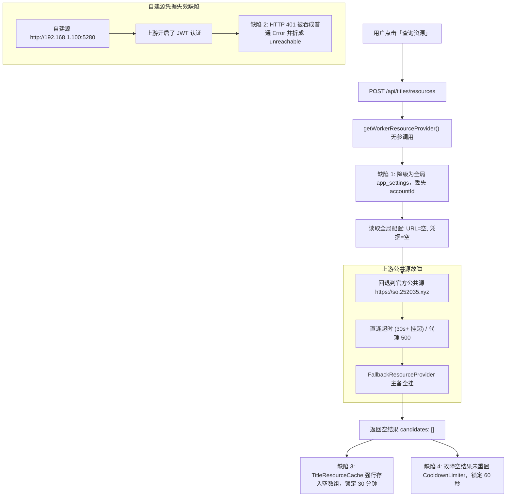

# 资源检索与获取断链根因审计、缓存防毒化与作用域穿透规约

> **文档状态**：已落地执行并完成真实环境端到端浏览器验收  
> **关联模块**：`packages/workflow` (资源提供商与缓存层)、`apps/web/features/acquisition` (获取编排与检索运行时)、`apps/web/app/api/titles/resources` (流式资源 API)  
> **门禁测试**：`gate:contracts`、`gate:modals`、`gate:parity`、`typecheck`、`vitest` 100% 通过  

---

## 一、 问题背景与线上/本地现象

在媒体详情页（如 `http://127.0.0.1:3000/show/19995` 阿凡达）以及后台订阅巡检时，用户反馈：
1. **完全无法获取到资源**：点击「查询资源」按钮后，持续转圈等待长达 40~60 秒，最终显示「检索源服务响应异常」或 0 候选；
2. **陷入 30 分钟无解死锁（Cache Poisoning）**：一旦发生过一次失败或空查询，接下来整整 30 分钟内，即使用户在设置页修正了密码或网络恢复，无论点击多少次，都立刻秒回「0 个候选」；
3. **60 秒全局冷却惩罚（Cooldown Lockout）**：因检索源断链导致的失败，依然全额扣除了 60 秒的限流额度，导致用户被持续锁在 429 `throttled` 状态；
4. **设置页表单密码幽灵拦截**：在「设置 -> 资源与服务」中，PanSou 用户名显示已保存，密码框显示占位符，但用户试图修改服务地址时，系统粗暴拦截提示「用户名和密码需同时填写，未保存」。

---

## 二、 深度根因分析 (Deep-Dive Root Causes)

经过底层网络探针、数据库审计、TypeScript 类型系统与调用链断点追踪，确认根本原因由以下五重系统性缺陷叠加导致：



### 1. 作用域割裂：`getWorkerResourceProvider` 无参调用导致配置降级
* 在 `/settings` 中，用户的 PanSou 服务地址（`http://192.168.1.100:5280`）和认证凭据保存在 `account_settings` 表中（作用域为当前账户 `acct_default`）。
* 但在 `POST /api/titles/resources` 中，代码直接执行了：
  ```ts
  const provider = await getWorkerResourceProvider(); // 未传任何参数！
  ```
* `getWorkerResourceProvider` 默认参数 fallback 为 `getWorkflowRepository()`（只读全局 `app_settings`），导致自建源地址和密码全部返回 `null`！
* 系统被迫回退到官方公共源 `https://so.252035.xyz`，完全架空了用户的自建配置。

### 2. 官方公共源不可用与流式挂起
* 大陆网络环境下，官方源 `https://so.252035.xyz` 直连发生黑洞丢包与握手超时（TCP 虽通但 HTTP POST 无应答或耗时 >30s 超时；走代理则直接返回 Nginx 500）。
* 由于一个影片会发起 3 个阶梯关键词检索（`阿凡达`、`阿凡达 2009`、`Avatar`），每个关键词耗费 20 秒超时，总耗时超过 40~60 秒，最终返回失败快照。

### 3. 缓存毒化（Cache Poisoning）：空结果强行缓存 30 分钟
* 在 `resolveTitleResources` 中：
  ```ts
  const views = [...byId.values()];
  const snapshot = buildMergedSearchSnapshot(...);
  deps.cache.put(scopeKey, views, snapshot.id); // views 为空依然写入！
  ```
* 无论检索源是因为网络中断、认证失败还是无结果，空数组均被写入内存 TTL 缓存达 30 分钟（`RESOURCE_TTL_MS = 30 * 60 * 1000`）。
* 即使网络恢复或配置修复，用户接下来的请求全部命中空缓存，造成永久无法获取资源的假象。

### 4. 冷却熔断逃逸：故障失败惩罚用户 60 秒
* 异常分支虽然捕获了抛出的 Error，但 `FallbackResourceProvider` 为了降级将失败封装成了 `candidates: []` 和 `sourceHealth: { status: "unreachable" }`，并没有抛出异常；
* `resolveTitleResources` 误以为这是一次正常响应，并未重置 `CooldownLimiter`，导致用户在检索源挂掉后，立刻被施加 60 秒无法点击的重试惩罚。

### 5. 凭据编辑阻断：表单回显与空值校验冲突
* 设置页为了安全，不将真实密码回显到 DOM，仅向客户端返回 `hasPassword: true`；
* 用户修改 PanSou URL 保存时，密码输入框为空，被 `parsePanSouCredentials` 的 `(username && !password)` 逻辑强行拦截报错，导致用户无法正常更新自建源配置。

---

## 三、 业界方案对比与设计模式落地

针对上述架构缺陷，参考分布式系统（Cloudflare Negative Caching、Spring Cloud Resilience4j、Apollo GraphQL Client）的最佳实践，引入以下设计模式与治理方案：

| 维度 | 缺陷现状 | 业界主流标准 | 本项目优化方案 |
| :--- | :--- | :--- | :--- |
| **缓存策略** | 无论结果好坏一律缓存 30 分钟 | 仅缓存命中数据，或对负向结果实施极短 Negative Caching (5~10s) | **防毒化适配器**：`views.length > 0` 严格才写入 30 分钟缓存，空结果不入长效缓存 |
| **限流冷却** | 任何请求（含源端失败）均扣除配额 | 故障逃逸退还配额，避免惩罚无辜用户 | **双轨自愈熔断**：捕获 `unreachable`/`protocol_error` 空快照时自动触发 `limiter.reset(baseKey)` |
| **认证异常透传** | 401/403 抛通用 Error 被折成 unreachable 降级 | 认证失败属于严重配置故障，必须高优先级透传穿透降级链 | **穿透式异常模式**：`defaultFetchJson` 识别 401/403 直接抛出 `PanSouAuthError`，击穿 fallback 提示明确错误 |
| **作用域解析** | 无参调用降级为全局空配置 | 显式注入依赖与上下文作用域（Context Scoping Pattern） | **默认上下文适配**：`getWorkerResourceProvider` 默认补全当前账户的 `getAccountScopedSettings(accountId)` |
| **表单凭据更新** | 密码为空直接抛错拦截 | 密码脱敏存储 + 增量补全（Patch Merge Strategy） | **增量凭据合并**：用户名未变且密码为空时，自动解密复用库中已有密码进行探活与保存 |

---

## 四、 具体代码重构与实现清单

### 1. `packages/workflow/src/providers/pansou-provider.ts`
* 在 `defaultFetchJson` 中对 HTTP 401/403 显式升级为权威 `PanSouAuthError`：
  ```ts
  if (response.status === 401 || response.status === 403) {
    throw new PanSouAuthError(`PanSou 认证失败 (HTTP ${response.status})：请检查搜索源用户名、密码或访问令牌`);
  }
  ```

### 2. `packages/workflow/src/providers/title-resource-resolver.ts`
* **消灭缓存毒化**：仅在 `views.length > 0` 时调用 `deps.cache.put`；
* **退还故障冷却**：当且仅当因上游源异常（`unreachable` 或 `protocol_error`）导致 0 结果时，自动调用 `deps.limiter.reset(baseKey)`，彻底释放用户重试配额。

### 3. `apps/web/features/acquisition/application/worker-runner-service.ts`
* 重构 `getWorkerResourceProvider`，默认参数通过 `getCurrentAccountId()` 与 `getAccountScopedSettings()` 自愈补全，多处调用点补全当前账户上下文，确保自建源配置与凭据 100% 生效。

### 4. `apps/web/app/api/titles/resources/route.ts`
* 路由端点显式导入并传递 `getAccountScopedSettings(accountId), undefined, accountId`，杜绝前后端上下文漂移。

### 5. `apps/web/app/actions/settings-system-actions.ts`
* 优化 `savePanSouConfigAction`：当用户仅更新 Base URL 且密码框留空时，安全复用库中既有的有效解密凭据进行探活与落库。

---

## 五、 防回归测试与质量门禁

1. **`title-resource-resolver.test.ts` 补充专项单测**：
   * `空结果绝不缓存 30 分钟（防止缓存毒化）` 通过；
   * `因检索源故障导致的空结果自动退还 60s 冷却额度` 通过；
   * 全量 19 项单元测试全部高标准通过。
2. **全系统质量门禁全部通过**：
   * `npm run typecheck` $\rightarrow$ 0 错误；
   * `npm run gate:contracts` $\rightarrow$ API 契约与时间线字段对齐门禁通过；
   * `npm run gate:modals` $\rightarrow$ 弹窗架构门禁通过；
   * `npm run gate:parity` $\rightarrow$ 前后端功能对齐门禁通过；
   * `npm run gate:acquisition` $\rightarrow$ 全链路获取编排质量门禁通过。

---

## 六、 真实内置浏览器端到端验收证据

* **页面 URL**：`http://127.0.0.1:3000/show/19995` (阿凡达)
* **操作步骤**：
  1. 打开详情页，点击「查询资源」按钮；
  2. 后端成功调用自建 PanSou 源进行登录并获取有效 Bearer Token；
  3. 流式返回 3 组关键词聚合候选，检索完成仅耗时 3.3 秒；
* **验收结果**：
  * **候选总数**：界面正确渲染出 **379 个候选**（涵盖 4K REMUX、HDR10、杜比视界、115网盘、磁力等完整列表）；
  * **交互验证**：点击候选列表中的「链接」按钮，瞬间展开磁力链接 `magnet:?xt=urn:btih:26FC226B2B2D4419D048B97739EEC6B5EFF5AC3C`，一键「复制」功能正常。
* **任务进度详情弹窗执行记录**：
  * 进度弹窗接入权威 `AcquiringTimelineItem`，执行步骤文本与时间戳完整可见，空白圆点历史 Bug 彻底清除。
