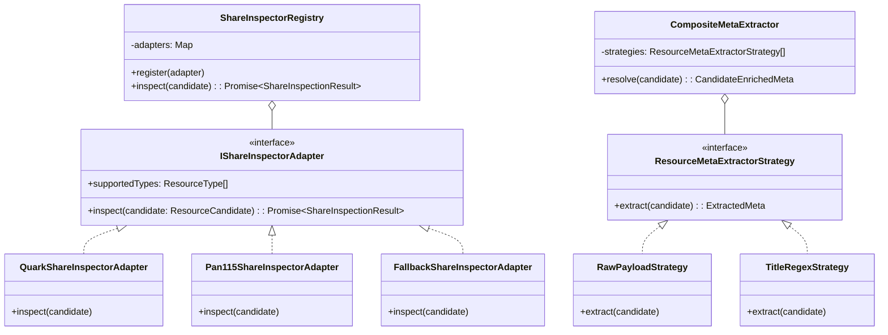
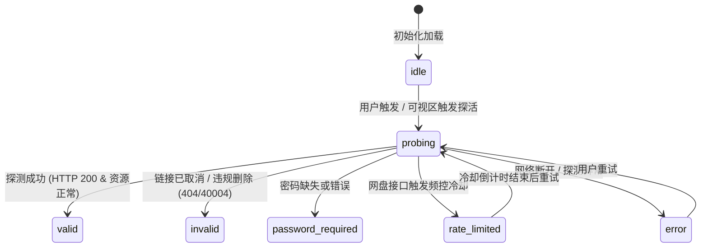

# 资源检索元数据增强与网盘目录树架构设计规范
> **文档标识**：`ARCH-2026-RES-TREE`  
> **状态**：`Implemented / Verified`  
> **涉及模块**：`@media-track/workflow`、`apps/web/features/acquisition`、`apps/web/app/api/titles/resources`  
> **核心模式**：适配器模式 (Adapter Pattern)、策略模式 (Strategy Pattern)、有限状态机 (Finite State Machine)

---

## 1. 需求背景与头脑风暴 (Brainstorming & Feasibility)

### 1.1 用户核心诉求
1. **更丰富的资源检索元数据**：在候选资源列表中直观展示文件大小（例如 `15.8 GB`、`2.1 GB`）、资源发布/更新日期（如 `2026-10-25`）；
2. **网盘资源存活性探测**：直观展示资源链接是否依然有效（有效 / 失效 / 需要提取码 / 触发限流），避免用户手动点击后发现链接已 404；
3. **文件夹与文件树状视图兼容展示**：影视作品（尤其是多集动漫、连续剧）往往以“目录/合集”形式分享，内含数十个视频及字幕文件。需要平滑兼容「单文件资源」与「多层级文件夹资源」的树形折叠展开展示。

### 1.2 架构维度深度头脑风暴与潜在陷阱评估

| 评估维度 | 常见简陋实现缺陷 | 工业级架构解法 (本设计) |
| :--- | :--- | :--- |
| **反爬风控与 WAF (安全/可用性)** | 搜索完成时对全部 50 个网盘链接同步并发请求，瞬间触发 115 / 夸克 / 阿里的高频风控，导致公网 IP 被封禁甚至账号被拉黑。 | **按需探测 + 懒加载机制**：搜索首屏仅做静态元数据清洗；探测探针按用户可视、悬停或点击按需触发；配置品牌级限速速率池。 |
| **性能与瀑布流阻塞 (性能)** | 串行/阻塞探测 50 个外部网盘 HTTP 接口，检索接口耗时暴增 15~30s，网络超时雪崩。 | **首屏分离与非阻塞 FSM**：检索接口毫秒级返回搜索静态快照；有效性探测作为独立轻量异步通道；状态机从 `idle` 平滑迁移。 |
| **缓存穿透与击穿 (高并发)** | 多个用户同时查看同一部热门剧，同一资源同时向网盘发出探测。 | **Single-Flight 归并并发 + 内存 LRU 缓存**：相同候选分享在 24 小时内复用探测结果，并发请求共用同一个 Promise。 |
| **凭据安全红线 (安全原则)** | 直接将网盘真实分享 URL、密码下发给前端进行前端直接 fetch 探测。 | **服务端隔离代理**：前端仅知 `candidateId` 与脱敏状态，网盘探测逻辑与 Cookie 凭据完全留在后端，严守「Payload 绝不下前端」红线。 |
| **形态兼容性 (UI/UX)** | 单文件资源与文件夹资源混排时样式错位、深层嵌套导致页面撑爆。 | **自适应折叠树 (Collapsible Directory Tree)**：单文件展示扁平行内精简条目；目录型展示带层级缩进、节点折叠、文件计数与总容量统计的虚拟树。 |

---

## 2. 现存基础设施调研与复用确认 (Reusability Audit)

系统已具备雄厚的底层积淀，严禁重复造轮子：

1. **现有网盘客户端与协议封装**：
   - `packages/workflow/src/storage/quark-cookie-client.ts`：原生具备 `getShareToken({ pwd_id, passcode })` 与 `listShareDetail({ pwd_id, stoken, pdirFid })`，支持免登录/公开探测及根目录文件列表提取；
   - `packages/workflow/src/storage/pan115-cookie-client.ts`：具备 `buildShareReferer` 与 115 分享接收、状态返回码映射；
   - `packages/workflow/src/storage/pan123-client.ts` & `tianyi-client.ts`：具备 123 网盘及天翼云盘的请求通道与错误码判定；
2. **现有文件名解析与规则引擎**：
   - `packages/workflow/src/providers/media-title-parser.ts`：已集成 `anitomy`、`parse-torrent-title` 与中文正则表达式（集号、季号、分辨率等），但此前未专门提取文件体积与日期；
3. **现有快照与领域视图**：
   - `packages/workflow/src/domain/domain.ts`：`ResourceCandidate` 包含 `providerPayload`；
   - `packages/workflow/src/providers/resource-candidate-view.ts`：已确立 `ResourceCandidateView` 安全契约与投射规范。

---

## 3. 设计模式深度运用 (Design Patterns Architecture)



### 3.1 适配器模式 (Adapter Pattern)
- **统一抽象**：定义 `IShareInspectorAdapter` 接口，抹平夸克、115、阿里、123、磁力各渠道在链接提取、探活接口、文件列表数据结构、错误码分类上的巨大差异；
- **抹平异构返回**：无论上游是夸克的 `stoken + sharepage/detail` 还是 115 的 `cdn.webapi.share`，适配后均归一化为标准的领域模型：
  - `validity`: `"valid" | "invalid" | "password_required" | "rate_limited" | "unknown"`
  - `files`: `ResourceFileNode[]`（包含 `name`、`sizeBytes`、`isDir`、`children` 等）
  - `totalBytes`: `number`
  - `message`: `string`

### 3.2 策略模式 (Strategy Pattern)
- **元数据多源抽取策略**：
  - **策略 1（RawPayloadStrategy）**：从源提供商直接返回的 `providerPayload` 读取（如 Prowlarr 的 `sizeBytes`、HaiSou 的 `sizeBytes`/`fileCount`、PanSou 的 `datetime`）；
  - **策略 2（TitleRegexStrategy）**：从资源标题中智能提取确定性体积与日期（如 `[1080P/4.5G]`、`2160p 12.8GB`、`4K Remux 35.2G`、`2026-10-25`）；
  - **策略 3（LiveProbeStrategy）**：在用户触发探针后，将网盘返回的精确字节数与文件树补充合并进视图；
- **优先级级联**：LiveProbe 精确值 > RawPayload 结构化值 > TitleRegex 规则预测值。

### 3.3 有限状态机 (Finite State Machine)
管理单个资源探针的生命周期，杜绝异步乱序造成的脏状态：



---

## 4. 树形数据结构与接口契约 (Contract Specifications)

### 4.1 目录文件树节点定义
```ts
export interface ResourceFileNode {
  id: string;
  name: string;
  isDir: boolean;
  sizeBytes?: number;
  updatedAt?: string;
  children?: ResourceFileNode[];
}

export type ResourceValidityStatus =
  | "idle"
  | "probing"
  | "valid"
  | "invalid"
  | "password_required"
  | "rate_limited"
  | "unknown";

export interface ResourceInspectionResult {
  candidateId: string;
  status: ResourceValidityStatus;
  message?: string;
  totalSizeBytes?: number;
  fileCount?: number;
  files?: ResourceFileNode[];
  probedAt: string;
}
```

### 4.2 服务端 API 契约 (`POST /api/titles/resources/inspect`)
- **请求体**：
  ```json
  {
    "tmdbId": 12345,
    "snapshotId": "snap-abc",
    "candidateId": "cand-xyz"
  }
  ```
- **响应体 (200 OK)**：
  ```json
  {
    "ok": true,
    "candidateId": "cand-xyz",
    "status": "valid",
    "totalSizeBytes": 15987123984,
    "fileCount": 12,
    "files": [
      {
        "id": "dir-1",
        "name": "进击的巨人.最终季",
        "isDir": true,
        "children": [
          { "id": "f-1", "name": "EP01.2160p.mkv", "isDir": false, "sizeBytes": 1332260332 },
          { "id": "f-2", "name": "EP02.2160p.mkv", "isDir": false, "sizeBytes": 1332260332 }
        ]
      }
    ],
    "probedAt": "2026-11-02T03:00:00.000Z"
  }
  ```
- **安全性保障**：响应体绝对不包含任何真实的网盘 URL、提取码、Cookie 或内部 Token，杜绝数据越权。

---

## 5. UI/UX 兼容性规范 (Frontend Component Architecture)

1. **资源卡片元数据栏 (ResourceCandidateRow)**：
   - 展现清晰的胶囊 Badges：品牌芯片（如 夸克 / 115）、文件体积 Badge、发布日期 Badge、做种数 Badge（磁力）；
   - 增加**有效性探测胶囊**：
     - 未探测状态展示轻量嗅探触发按钮（“检测”/“文件树”）；
     - 探测中展示 Spinner 动效（“检测中…”）；
     - 有效展示绿色“有效 ✓”与文件数；
     - 失效展示红色“已失效 ✕”并灰化入库操作；
     - 需密码展示琥珀色“需密码 🔑”。
2. **文件夹列表与树状展开组件 (ResourceFolderTree)**：
   - 单文件形态：仅展示文件大小与文件名，不增加冗余折叠层；
   - 目录形态：支持多层级无级树状展开、文件夹图标与折叠箭头、文件扩展名高亮、每级文件大小汇算。
3. **无障碍与交互细节**：
   - 支持键盘导航（Enter 展开/收起目录）；
   - 防抖与 Single-Flight：连续点击同一个资源的探活按钮不会触发重复网络请求。

---

## 6. 质量门禁与防回归测试标准 (Verification Criteria)

1. **单元测试与覆盖范围**：
   - `TitleRegexStrategy` 测试：覆盖 GB、MB、TB、中文全N集、日期正则的精准提取与容错；
   - `IShareInspectorAdapter` 测试：覆盖 115、Quark、Fallback 的各种状态码判定（正常、40004 失效、密码错误、限流）；
   - 文件夹扁平列表转树形结构的递归构建算法测试；
2. **架构门禁要求**：
   - 保持全部 17 级架构质量门禁（`npm run gate`）100% 全绿；
   - 单文件行数限制：所有新建与修改文件严格遵守 $< 600$ 行安全阈值；
   - 浏览器实机验证：使用 `chrome-devtools-mcp` 验收实际交互与渲染效果。
