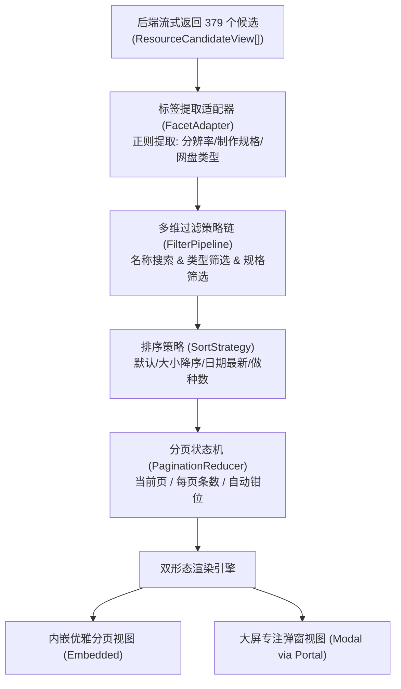

# 资源结果分页、弹窗展示与多维标签/名称过滤筛选架构规范

> **状态**：已批准并执行 (Approved & Implemented)  
> **领域**：资源检索与消费面板（Resource Discovery Panel）、海量候选渲染优化、客户端多维分面筛选（Client-side Faceted Search）  
> **涉及范围**：`apps/web/features/acquisition/`、`packages/workflow/`、`docs/architecture/`

---

## 一、 需求背景与问题现象

在影视详情页（如《阿凡达》`tmdbId: 19995`）执行资源检索时，后端聚合索引器（自建 PanSou、官方源、磁力源等）单次可召回 **300 ~ 500+ 个候选资源**。

### 现状痛点
1. **DOM 爆炸与页面滚动疲劳**：
   - 379 个候选全部一次性平铺渲染为 `<li className="title-resources-item">`；
   - DOM 树膨胀数千行，页面纵向滚动距离过长，导致浏览极度吃力；
2. **缺乏多维筛选能力**：
   - 用户无法从 379 个结果中快速筛选出特定的网盘类型（如仅看 115网盘 或 夸克网盘）；
   - 无法按画质档位（如 4K/2160p、1080p、REMUX、HDR/杜比视界）快速定位优质版本；
   - 无法在已获取的结果集内进行二次名称关键词快速过滤；
3. **缺乏沉浸式专注浏览体验**：
   - 详情页内嵌面板宽度受限，对于资源参数（文件名、大小、发布日期、做种数、网盘类型）密集的场景，需要类似 Sonarr Interactive Search 的全屏/大弹窗专注对比视图。

---

## 二、 头脑风暴与可行性、逻辑、性能深度分析

### 2.1 可行性（Feasibility）
- **数据源已具备完整特征**：每个 `ResourceCandidateView` 均包含 `title`、`type`（115/quark/uc/tianyi/magnet 等）、`sizeBytes`、`postedAt`、`seeders` 等核心字段；
- **纯客户端无损计算**：300~500 个候选全部存储在前端内存状态中。在此基础上进行客户端过滤、标签聚合与分页，**无需再次请求后端，完全不消耗索引器预算与网络配额，响应时间 < 2ms**。

### 2.2 潜在缺陷与性能盲区（Blindspots & Mitigations）



1. **流式并发追加（Streaming Churn）时的页码抖动**：
   - *缺陷*：当状态为 `streaming` 时，候选列表分块涌入，如果用户在第 2 页，总页数不断变化可能导致越界或闪烁。
   - *解法*：分页状态机在计算 `currentPage` 时强制执行 `Math.max(1, Math.min(currentPage, totalPages))` 钳位保护；流式期间显示流式进度指示，流式结束（`ready`）自动定格。
2. **筛选后空态与后端故障空态的语义混淆**：
   - *缺陷*：原有 `ResourceEmptyDiagnostic` 会诊断“后端故障/网络不可达”。若用户过滤出了 0 条，不能误导用户以为后端服务挂了。
   - *解法*：清晰分离：若原始 `state.candidates.length === 0`，走系统诊断卡片；若 `filteredCandidates.length === 0`（即由筛选导致），显示带有“重置筛选”按钮的轻量空态卡片。
3. **跨页与双形态切换时的操作状态保持**：
   - *缺陷*：展开某个候选的磁力/网盘链接抽屉后，翻页或切换弹窗模式，链接抽屉关闭或丢失。
   - *解法*：状态提升（State Hoisting），`linkStates`、`copiedId` 与 `importState` 统一由容器组件管理，视图切换状态保持。

---

## 三、 业界主流方案调研与对比

| 维度 | Sonarr / Radarr (Usenet/BT行业标杆) | MoviePilot (国内网盘自动化主力) | Mediary Scout (本项目方案) |
| :--- | :--- | :--- | :--- |
| **交互形态** | 交互式搜索（Interactive Search）全屏模态弹窗 | 资源抽屉/弹窗 | **双形态自适应**：内嵌面板分页 + 一键弹窗最大化专注视图 |
| **分面过滤 (Facets)** | Protocol (Usenet/Torrent) + Quality (Remux/Bluray/WebDL) | 网盘渠道 Tabs + 简易清晰度标签 | **智能标签矩阵**：网盘/磁力协议 + 分辨率 + 制作规格 + 名称二次即时搜索 |
| **分页机制** | 虚拟列表/无限滚动 | 分页条 | **分页选择器**：支持 10/20/50 条每页切换，数字页码，上一页/下一页 |
| **安全与架构合规** | Angular/React 局部视图 | Element UI 对话框 | 严格遵循架构门禁：`createPortal` 挂载 `document.body`，`z-index >= 9999`，暗黑主题对齐 |

---

## 四、 核心设计模式与架构落地

### 4.1 适配器模式（Adapter Pattern）—— 标签提取适配器
从候选标题和类型中，提取出三大分面维度并统计各标签命中数：
```typescript
export interface CandidateFacets {
  types: Array<{ value: ResourceType | "all"; label: string; count: number }>;
  resolutions: Array<{ value: string; label: string; count: number }>;
  specs: Array<{ value: string; label: string; count: number }>;
}
```

### 4.2 策略模式（Strategy Pattern）—— 过滤与排序策略
```typescript
// 过滤策略组合
export interface CandidateFilterCriteria {
  keyword: string;
  type: ResourceType | "all";
  resolution: "all" | "4k" | "1080p" | "720p";
  spec: "all" | "remux" | "bluray" | "web-dl" | "hdr_dv";
  sortBy: "default" | "size_desc" | "size_asc" | "date_desc" | "seeders_desc";
}
```

### 4.3 状态机模式（State Reducer）—— 资源视图状态机
管理 `{ filterCriteria, page, pageSize, isModalOpen }`，所有操作通过纯函数 reducer 分发（`SET_FILTER`, `RESET_FILTERS`, `SET_PAGE`, `TOGGLE_MODAL`），杜绝离散状态导致的竞态。

---

## 五、 防回归与质量门禁规划

1. **单元测试矩阵**：
   - `candidate-filter-strategy.test.ts`：覆盖标签提取、名称搜索、组合过滤、各种排序与分页计算；
2. **架构质量门禁校验**：
   - 弹窗通过 `createPortal` 挂载 `document.body`，通过 `npm run gate:modals`；
   - 接口与视图模型严格契约对齐，通过 `npm run gate:contracts`；
   - 全量 TypeScript 编译通过 `npm run typecheck`。
3. **真实端到端验收**：
   - 在 Page 8（`http://127.0.0.1:3000/show/19995` 阿凡达）中，真实验收 379 条候选的内嵌分页、标签筛选、弹窗模式展开与链接复制。
