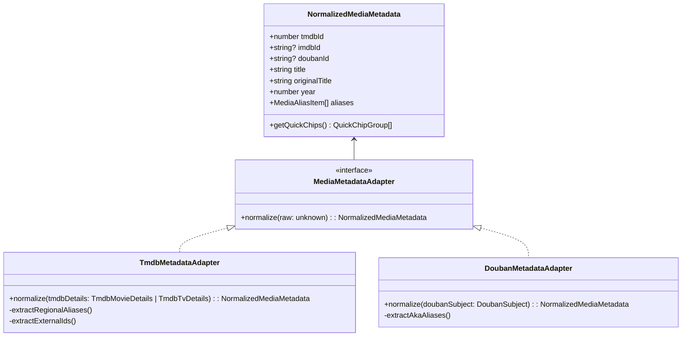
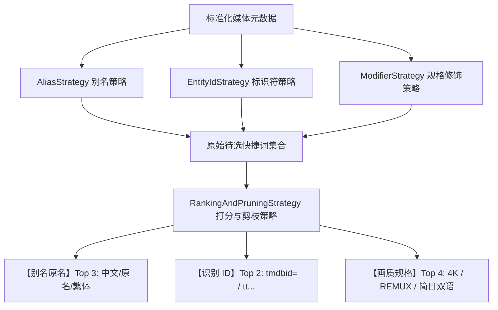
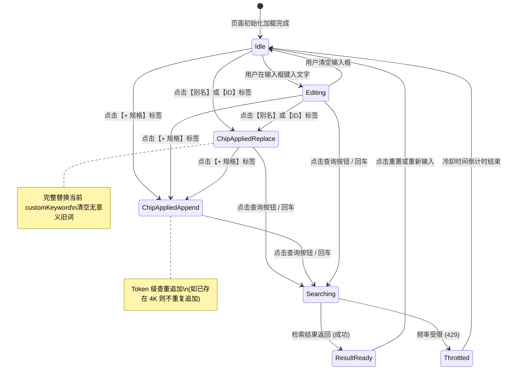
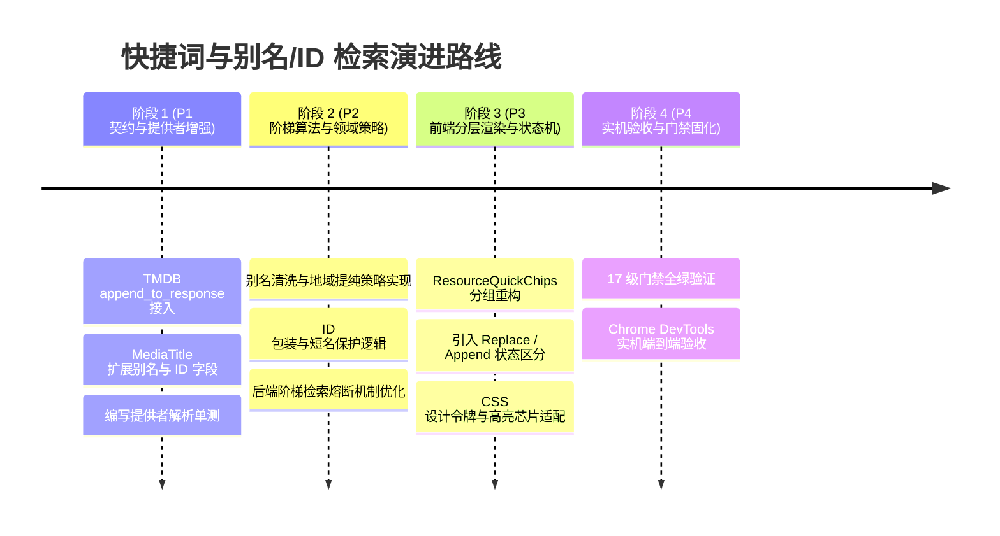

# 资源检索深度优化：多源别名映射、影视库唯一标识符 (ID) 穿透与快捷词架构规范

> **文档状态**：调研与架构设计完成（Ready for Review & Phased Implementation）  
> **创建日期**：2026-11-02  
> **适用范围**：`apps/web` (资源检索与详情交互), `packages/workflow` (TMDB/豆瓣元数据提供者、资源检索调度器、多源别名适配器)  
> **核心模式**：适配器模式 (Adapter Pattern)、策略模式 (Strategy Pattern)、分层状态机 (Hierarchical State Machine)

---

## 1. 背景与问题陈述 (Context & Problem Statement)

### 1.1 现状痛点
巡影 · Mediary Scout 当前的资源检索模块已初步建立基于 TMDB 的搜索与网盘/磁力抓取链路，但在实际用户使用与网盘资源生态的复杂场景下，存在以下明显的体验与检索效能瓶颈：

1. **快捷词 (Quick Chips) 过于单薄与僵化**：
   - 现有的快捷词仅硬编码了原片名、片名+年份、以及 4 个固定的规格后缀（`+ 4K`, `+ 1080p`, `+ 简日内嵌`, `+ 原盘`）；
   - 缺乏外文原名（如《不存在的罪人》对应的英文原名 `Verity`、《奥本海默》对应的 `Oppenheimer`、《葬送的芙莉莲》对应的 `Sousou no Frieren` / `Frieren`）；
   - 缺乏两岸三地港台译名（如《阿凡达》对应的台译《阿凡達》、《奇异博士》对应的港译《奇異博士》）；
   - 完全缺失影视库唯一标识符 ID（如 TMDB ID、IMDb ID `tt...`、豆瓣 ID）。

2. **网盘压制与分享命名生态脱节**：
   - 国内夸克、115、阿里等网盘分享者以及压制发布机器人，大量使用 `{tmdbid=1283515}`、`{tmdb-1283515}`、`[tt30822607]`、`S01.E01.{tmdb-xxx}.mkv` 的规范格式发布（实机检索中已大量出现该类资源）；
   - 大量高码率、REMUX、原盘资源完全以外文名或罗马音命名，不含任何中文标题。如果只用中文搜索，该类顶级画质资源在网盘检索中将被**完全漏掉 (Zero Recall)**；
   - 大量港台分享者使用繁体中文分享，简体检索无法直接匹配繁体关键词。

3. **快捷词交互模式局限**：
   - 原片名点击只支持全量替换，规格词点击只支持尾部追加；
   - 缺乏对“替代式检索（别名/ID 替换）”与“修饰式检索（规格/季集追加）”的明确分区与状态管理；
   - 若简单粗暴堆叠更多别名，会导致前端排版严重拥挤甚至撑破容器。

---

## 2. 深度头脑风暴：可行性、逻辑与性能全景剖析

### 2.1 可行性分析 (Feasibility)
- **TMDB 别名与 ID 零成本获取**：
  - TMDB 原生 API 支持 `append_to_response=alternative_titles,external_ids`；
  - 在请求电影详情 `/movie/{id}` 或剧集详情 `/tv/{id}` 时，追加该参数**不需要多发一个 HTTP 请求**，网络开销增量几乎为 0，即可一次性带回全部地区别名与 IMDb ID；
  - 系统已有 `durableTargetCache`（基于 SQLite 的持久化缓存），抓取一次后长效缓存，页面冷渲染耗时为 0ms。
- **豆瓣又名与豆瓣 ID 互补**：
  - 系统内置 `DoubanSearchProvider`，豆瓣天然提供 `aka`（中文高频又名列表）与豆瓣条目 ID；对于国产影视、冷门小众文艺片，豆瓣又名的召回质量显著优于 TMDB。
- **网盘索引器 (PanSou) 的 ID 检索特性**：
  - 当分享资源包含 `{tmdb-1283515}` 或 `tt30822607` 时，使用 ID 检索的**查准率 (Precision) 高达 100%**，能够精准命中特定压制组（如 SSDSSE、H-SSDSSE、PTH 等）；
  - 但 ID 的查全率 (Recall) 较低（未带 ID 的散盘资源搜不到），因此必须与片名/别名形成“多维分级梯队”。

### 2.2 逻辑严密性与潜在陷阱 (Logic Pitfalls & Mitigations)

| 潜在缺陷 / 陷阱 | 风险表现 | 架构防护方案 |
| :--- | :--- | :--- |
| **别名爆炸与噪音污染 (Alias Pollution)** | 经典大片在 TMDB 拥有上百个各种冷门语言（阿拉伯语、希伯来语、俄语）和打字错误别名，直接全量呈现会击垮用户体验。 | **别名提纯与地域白名单策略 (Relevance Strategy)**：只保留地区属于 `CN`, `TW`, `HK`, `US`, `GB`, `JP`, `KR` 的别名；过滤字符超长（> 40 字符）、乱码与拼写变体；上限收敛至 Top 4 核心别名。 |
| **纯数字 TMDB ID 碰撞** | 若快捷词直接使用纯数字（如 `1283515`），PanSou 会当成普通数字检索，搜出大量日期、电话、文件大小、提取码的垃圾分享。 | **语义化 ID 包装策略 (Entity ID Wrapper)**：快捷词与检索词一律包装为压制与分享通行格式：`{tmdb-1283515}` 与 `tmdbid=1283515`；IMDb ID 天然带 `tt` 前缀（`tt30822607`）无数字歧义。 |
| **极短外文片名检索泛滥** | 如《It》(小丑回魂)、《Up》(飞屋环游记)、《Her》(她)、《Us》(我们)、《Monster》等，直接搜索会出现海量 IT 教程和日常文档。 | **短名防护规则 (Short-Title Guard)**：当别名长度 $\le 4$ 或属于常见英文停用词时，强制自动绑定年份（如 `It 2017`、`Up 2009`）。 |
| **繁简体异构割裂** | 港台优质分享全为繁体中文（如《阿凡達》、《奧本海默》），简体检索无法召回。 | **繁简自动映射策略 (Variant Mapping)**：利用 TMDB 返回的 `TW`/`HK` 别名字段，优先提供高价值繁体快捷词。 |

### 2.3 性能与资源消耗防线 (Performance & Quota Guardrails)

```
[前端用户交互]
   │ (按需点击快捷词: 1次用户动作 = 1次按需检索)
   ▼
[API 网关限流与缓存]
   │ 60s 冷却 / 30min 缓存 (已有基础设施)
   ▼
[后端阶梯检索调度器]
   │ MAX_KEYWORDS = 4 (预算刚性约束)
   │ 智能梯队: [用户自定义词 / 精准 ID] ──命中门限──► [熔断退出，避免无谓消耗]
   │                                  └──未命中──► [中文名] ──► [外文原名/年份] ──► [核心港台别名]
   ▼
[PanSou 资源提供者] (MAX_IN_FLIGHT_PER_SERVER = 2)
```

1. **前端快捷词 $\ne$ 后端无脑全量并发**：
   - 快捷词是在界面上赋能用户进行**交互式精准探测**（Interactive Exploration），用户点击哪个才执行单次搜索，绝不在后台一次性对所有别名和 ID 发起风暴请求；
2. **后台自动巡检维持严苛预算**：
   - 后端自动调度链路维持 `MAX_KEYWORDS = 4` 的预算上限，绝不允许放宽预算导致外部网盘服务 502；
   - 优化在于**提升 4 个槽位的“含金量”**：引入命中熔断机制，若第一梯队词已召回满足要求的高置信度资源，直接短路（Short-circuit），不再继续发起后续检索。

---

## 3. 业界主流方案对比与经验借鉴

### 3.1 业界主流工具对比

| 体系 / 工具 | 别名映射与 ID 检索设计 | 优缺点分析 | 本项目借鉴决策 |
| :--- | :--- | :--- | :--- |
| **MoviePilot** | 深度整合 TMDB + 豆瓣又名，在搜索框输入 `tmdb:xxx` 或 `douban:xxx` 时精准识别；在资源文件名中深度匹配 `[tmdbid=xxx]`。 | **优点**：针对中文网盘生态优化极致。<br>**缺点**：后台多路全量搜索无节制，容易触发网络风暴。 | **借鉴**：统一提取 TMDB/豆瓣别名；支持 `tmdbid=` 与 `tt` 搜索语法；但增加严格的搜索预算熔断机制。 |
| **Sonarr / Radarr** | 内置 Scene Mapping、TheXEM 和 TMDB Alternative Titles；严格限制用户无限制自定义后台别名，但允许手动检索（Interactive Search）时查看所有别名并单项触发。 | **优点**：后台自动化极度克制，不浪费索引器额度；数据质量高。<br>**缺点**：对中国本土网盘（夸克/115）特有的命名习惯不适用。 | **借鉴**：前后端权责分离——前台手动探索丰富，后台自动化克制安全。 |
| **Jellyfin / Plex / Emby** | 媒体刮削核心依赖文件名中的 `[tmdbid-xxx]` 或 `[imdbid-ttxxx]`，作为 100% 绝对置信的匹配凭据。 | **优点**：确定性极高，彻底杜绝同名影视误匹配。<br>**缺点**：需要分享者主动规范命名。 | **借鉴**：在资源探活与入库整理中，优先匹配 ID 标签。 |

### 3.2 第三方库调研与选型

1. **`opencc-js`（轻量纯 JS 简繁转换）**：
   - *评估*：无需任何 C++ 原生构建，可在浏览器与 Node 环境运行。但打包体积约 200KB~400KB（词典）；
   - *选型结论*：**暂不引入额外体积依赖**。TMDB 的 `alternative_titles` 中已自带结构化的 `iso_3166_1: "TW"` / `"HK"` 中文别名，直接复用 TMDB 现成数据即可满足 95% 以上繁体网盘分享需求。
2. **`parse-torrent-title` / `anitomy`**：
   - *评估*：业界最顶级的种子/发布文件名解析库；
   - *选型结论*：**本项目 `packages/workflow/src/providers/media-title-parser.ts` 已内置并深度定制**！无需引入新库，直接复用其识别集数、压制组、规格的能力。
3. **`xstate`**：
   - *评估*：复杂分层状态机管理；
   - *选型结论*：**已安装在 `packages/workflow` 中**（版本 5.33.3），可用于搜索交互状态机的精确建模。

---

## 4. 架构设计与设计模式落地

### 4.1 适配器模式 (Adapter Pattern)：统一多源元数据适配器

为了抹平 TMDB、豆瓣、甚至后续可能的 Bangumi/IMDb 的数据结构差异，抽象统一的 `MediaMetadataAdapter`：



#### 接口定义契约
```ts
export interface MediaAliasItem {
  name: string;
  region: "CN" | "TW" | "HK" | "EN" | "JA" | "KO" | "OTHER";
  kind: "title" | "original" | "aka" | "romanized";
}

export interface MediaExternalIds {
  tmdbId: number;
  imdbId?: string | undefined;
  doubanId?: string | undefined;
  tvdbId?: number | undefined;
}
```

### 4.2 策略模式 (Strategy Pattern)：快捷词分面生成与剪枝策略

快捷词生成由三个专用策略协同完成，并通过打分剪枝策略避免 UI 膨胀：



1. **`AliasStrategy`（别名策略）**：
   - 提取主标题、外文原名（若与主标题不同）；
   - 从 `alternative_titles` 筛选 `TW`/`HK` 繁体译名（优先取最短且不包含特殊符号的官方译名）；
   - 短英文名自动附带年份保护（如 `It 2017`）。
2. **`EntityIdStrategy`（标识符策略）**：
   - 生成 `tmdbid=${tmdbId}` 与 `{tmdb-${tmdbId}}`；
   - 若存在 IMDb ID，生成 `ttxxxxxxx`。
3. **`ModifierStrategy`（动态规格策略）**：
   - 根据 `mediaType` 动态调整：电影推荐 `4K`、`REMUX`、`原盘`；电视剧推荐 `S01`、`全集`、`内嵌中字`；动漫推荐 `简日内嵌`、`BDRip`。
4. **`RankingAndPruningStrategy`（打分与截断策略）**：
   - 保证每组展示数量受控：别名 $\le 3$，ID $\le 2$，规格 $\le 4$，保证在 1080P/移动端屏幕上单行或双行整齐排列，杜绝撑坏布局。

### 4.3 状态机模式 (State Machine / FSM)：搜索栏交互状态管理

使用状态机精确区分用户的两种输入操作意图：
- **Replace 操作（替换式）**：点击别名或 ID，意味着用户想要“以此名称为核心重新检索”；
- **Append 操作（追加式）**：点击规格（如 `+ 4K`），意味着用户想要“在当前检索词上限定画质”；
- **State Transition Diagram**：



---

## 5. 前后端数据契约演进方案

### 5.1 数据模型扩展 (`packages/workflow/src/domain/domain.ts`)

```ts
export interface MediaAliasDetail {
  title: string;
  region?: string | undefined; // 'CN' | 'TW' | 'HK' | 'US' | 'JP' 等
  type?: string | undefined;   // 'official' | 'transliteration' 等
}

export interface MediaTitle {
  id: string;
  tmdbId: number;
  type: MediaType;
  title: string;
  originalTitle: string;
  year: number;
  aliases: string[]; // 保持向后兼容的平铺字符串数组
  // 新增富元数据支持
  aliasDetails?: MediaAliasDetail[];
  imdbId?: string | null | undefined;
  doubanId?: string | null | undefined;
  originCountries?: string[];
  releaseDate?: string | null;
  posterPath?: string | null;
  backdropPath?: string | null;
  overview?: string;
}
```

### 5.2 TMDB Provider 聚合查询优化 (`packages/workflow/src/providers/tmdb-provider.ts`)

在调用 TMDB API 时，透明追加 `append_to_response`：
```ts
// 电影详情请求
const res = await this.get(`movie/${tmdbId}`, {
  language: this.language,
  append_to_response: "alternative_titles,external_ids",
});

// 剧集详情请求
const res = await this.get(`tv/${tmdbId}`, {
  language: this.language,
  append_to_response: "alternative_titles,external_ids",
});
```

在解析器中提取：
- `details.alternative_titles.titles` (Movie) 或 `details.alternative_titles.results` (TV)；
- `details.external_ids.imdb_id`；
- 执行区域白名单过滤（`CN`, `TW`, `HK`, `US`, `GB`, `JP`, `KR`），提取高质量别名注入 `aliasDetails` 与 `aliases`。

### 5.3 前端组件结构升级 (`apps/web/features/acquisition/components/resource-search-bar.tsx`)

将平铺的快捷词栏演进为**语义分层工具组**：
```tsx
<div className="title-resources-quick-bar">
  {/* 分组 1: 片名与高频别名 (Replace 模式) */}
  <div className="quick-chip-group">
    <span className="quick-chip-group-label">别名：</span>
    {aliasChips.map((chip) => (
      <button
        key={chip.value}
        type="button"
        className={`quick-chip tone-alias ${customKeyword === chip.value ? "is-active" : ""}`}
        onClick={() => setCustomKeyword(chip.value)}
        title={`替换为: ${chip.value}`}
      >
        {chip.label}
      </button>
    ))}
  </div>

  {/* 分组 2: 影视库精准 ID (Replace 模式) */}
  {idChips.length > 0 ? (
    <div className="quick-chip-group">
      <span className="quick-chip-group-label">ID：</span>
      {idChips.map((chip) => (
        <button
          key={chip.value}
          type="button"
          className={`quick-chip tone-id ${customKeyword === chip.value ? "is-active" : ""}`}
          onClick={() => setCustomKeyword(chip.value)}
          title={`以精准网盘 ID 语法检索: ${chip.value}`}
        >
          {chip.label}
        </button>
      ))}
    </div>
  ) : null}

  {/* 分组 3: 规格修饰词 (Append 模式) */}
  <div className="quick-chip-group">
    <span className="quick-chip-group-label">规格：</span>
    {modifierChips.map((mod) => (
      <button
        key={mod}
        type="button"
        className="quick-chip tone-modifier"
        onClick={() => setCustomKeyword(appendKeywordChip(customKeyword, mod))}
        title={`追加规格词: ${mod}`}
      >
        + {mod}
      </button>
    ))}
  </div>
</div>
```

---

## 6. 质量门禁与防回归测试规范 (Quality Gates & Anti-Regression)

为确保新方案落地时 100% 稳定可靠，必须遵循以下质量门禁指标与测试约束：

1. **确定性单元测试覆盖**：
   - `tmdb-provider.test.ts`：测试 `append_to_response` 的解析鲁棒性，验证各地区别名提取、空值容错以及 IMDb ID 映射；
   - `title-search-keywords.test.ts`：测试 ID 语法包装、短名年份保护、高频别名排序与去重逻辑；
   - `resource-search-bar.test.ts`：测试前端快捷词分组渲染、Replace 与 Append 模式的状态转移一致性。
2. **代码规模与复杂度棘轮约束**：
   - 严格遵守物理行数限制（单文件有效代码行严格保持 $< 600$ 行）；
   - 函数圈复杂度严格 $\le 10$（通过抽离纯函数保持极简逻辑链条）。
3. **网络安全与凭据红线**：
   - 提取的 ID 与别名均为公开影视元数据，不携带任何敏感参数；
   - 对外请求坚持使用已有的 `accesses` 访问链与带超时的安全网络客户端。
4. **17 级全量架构质量门禁通过保障**：
   - 实施全过程持续受 `npm run gate`（全量 17 级门禁）与 `npm test` 守卫，确保 0 ESLint 警告、0 TypeScript 类型错误、0 循环依赖。

---

## 7. 分阶段实施路线图 (Implementation Roadmap)



1. **Phase 1: 契约与元数据提供层增强**
   - 升级 `packages/workflow/src/providers/tmdb-provider.ts`，在详情请求中追加 `alternative_titles,external_ids`；
   - 扩展 `MediaTitle` 契约，补齐 `aliasDetails` 与 `imdbId`；
2. **Phase 2: 领域策略与清洗算法落地**
   - 在 `packages/workflow/src/providers/title-search-keywords.ts` 实现别名提纯与 ID 包装策略；
   - 补充完善单测，验证边界与去重效果；
3. **Phase 3: 前端交互与视觉分组升级**
   - 重构 `apps/web/features/acquisition/components/resource-search-bar.tsx`，将快捷词划分为【别名原名】、【精准 ID】、【画质规格】三个清晰分组；
   - 优化视觉芯片样式，支持当前选词状态高亮；
4. **Phase 4: 全量质量门禁与浏览器验收**
   - 运行 `npm run gate` 验证 17 级质量门禁全绿；
   - 使用 Chrome 实机加载不同类型影视（国产剧、欧美电影、日本动漫），验收别名与 ID 检索的精准度与召回率。
