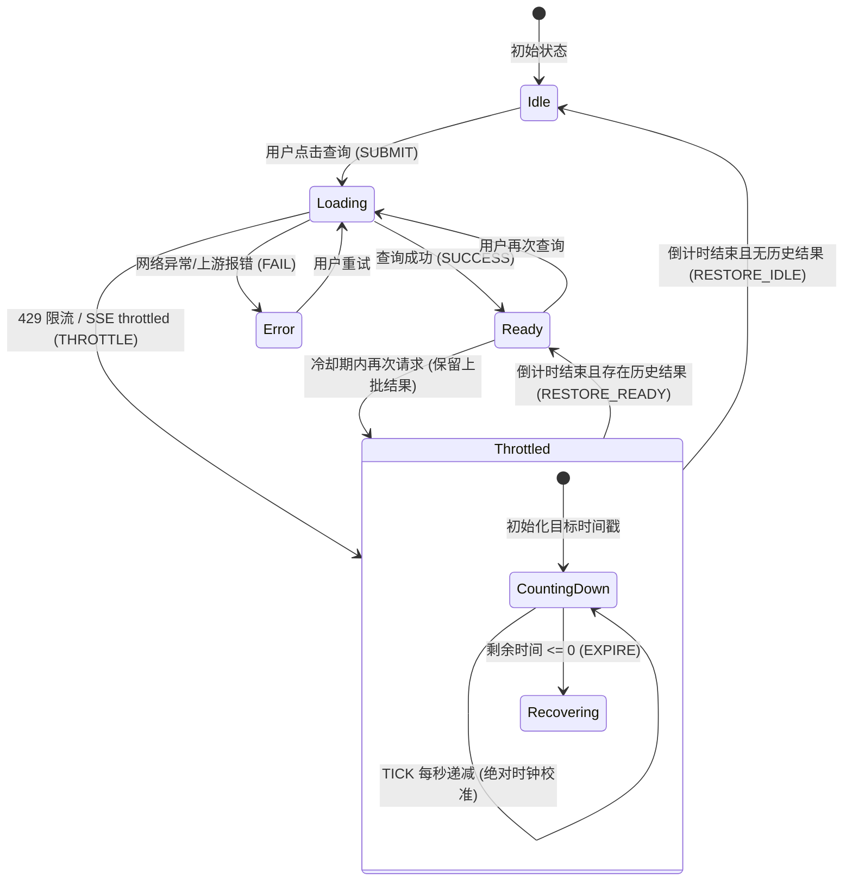

# 巡影 · Mediary Scout 资源检索动态倒计时与自动自愈架构设计白皮书

> 模块：`apps/web/features/acquisition`  
> 状态：Ready for Implementation  
> 主题：资源检索限流冷却动态倒计时、墙上时钟校准、有限状态机（FSM）与自动自愈可用性恢复  
> 日期：2026-11-02

---

## 目录
1. [背景与问题定义](#1-背景与问题定义)
2. [可行性、逻辑与性能全景头脑风暴](#2-可行性逻辑与性能全景头脑风暴)
   - 2.1 技术可行性论证
   - 2.2 逻辑缺陷与边界陷阱防范
   - 2.3 性能模型与重渲染控制
3. [设计模式在倒计时架构中的应用](#3-设计模式在倒计时架构中的应用)
   - 3.1 有限状态机模式 (Finite State Machine)
   - 3.2 策略模式 (Strategy Pattern for Formatting & Calculation)
   - 3.3 适配器模式 (Adapter Pattern for Multi-source Cooldown)
4. [业界主流方案对比与开源生态调研](#4-业界主流方案对比与开源生态调研)
   - 4.1 开源库评估（ahooks、react-use、Ant Design、Vercel AI SDK）
   - 4.2 为什么采用轻量自研 Hook 而非引入外部重库
5. [当前系统基础设施与复用分析](#5-当前系统基础设施与复用分析)
6. [具体落地方案与架构规范](#6-具体落地方案与架构规范)
   - 6.1 领域契约与模型设计 (`cooldown-model.ts`)
   - 6.2 墙上时钟高精度自校准 Hook (`use-resource-cooldown.ts`)
   - 6.3 搜索栏组件 (`resource-search-bar.tsx`) 改造与无障碍增强
   - 6.4 面板组件 (`title-resource-panel.tsx`) 状态保留与平滑自愈
7. [质量门禁与测试验证策略](#7-质量门禁与测试验证策略)

---

## 1. 背景与问题定义

在影视资源聚合检索流程中，由于上游索引器（如 PanSou、Prowlarr）及网盘搜索具有严格的请求频次与预算配额限制，服务端对单影视作品设定了 60 秒（或动态计算）的冷却间隔（Cooldown）。

当用户在冷却期内再次请求检索时，服务端会响应 HTTP 429 或通过 SSE 发送 `{ type: "error", kind: "throttled", retryAfterMs: 38000 }`。

### 现状痛点
1. **静态数字无感知**：当前界面仅根据接收到的瞬时 `retryAfterMs` 计算 `Math.ceil(retryAfterMs / 1000)`，渲染一次静态字符串 `"请稍候 38s"`。
2. **缺乏时钟滴答驱动**：界面缺少 `setInterval` 或时钟驱动，数字永远定格在 38s，不会随着时间推移递减至 37s、36s...
3. **无法自动恢复可用**：38 秒实际流逝后，按钮仍然保持禁用且显示 38s，下方依然展示“查询太频繁，38 秒后可再查”，用户陷入误以为功能损坏的焦虑，必须手动 F5 刷新整个浏览器页面才能重新查询。
4. **存量结果被无情抹除**：若用户之前已成功检索出部分资源，二次搜索被 429 拦截后，现存状态立即由 `ready` 切为 `throttled`，原有的候选列表瞬间消失，严重阻断用户的浏览与转存操作。

---

## 2. 可行性、逻辑与性能全景头脑风暴

### 2.1 技术可行性论证
在 Next.js App Router 客户端组件（React 19）中，实现动态倒计时并自动解除锁定在技术上 100% 可行。通过将倒计时驱动从单纯的“累加/递减状态”演进为“绝对目标时间戳比对”，配合 React 状态驱动机制，可以在毫秒级精度内准确计算剩余秒数，并在倒计时归零时触发自愈回调。

### 2.2 逻辑缺陷与边界陷阱防范
在传统前端倒计时的开发中，常见以下 5 大逻辑缺陷：

1. **浏览器后台休眠与定时器节流（Browser Tab Throttling）**：
   - 现代浏览器对后台不活跃标签页实施定时器节流，`setInterval(..., 1000)` 会被降频为 1 次/分钟甚至完全挂起。
   - 若采用 `setCount(c => c - 1)`，用户切走标签 40 秒后再切回，倒计时仅减少 1 秒！
   - **防范机制**：绝对时间戳公式：$\text{remainingMs} = \max(0, T_{\text{target}} - \text{Date.now()})$。同时监听 `document.visibilitychange` 与 `window.focus` 事件，用户切回标签时瞬间重新计算并核对，若时间已到立即解锁！
2. **多次连续触发的竞争条件（Race Conditions）**：
   - 用户在冷却中多次操作或快速重置时，必须清理前置的定时器句柄，确保单实例执行。
3. **整数除法与零边界抖动（Zero Boundary）**：
   - 若用 `Math.floor`，在剩余 500ms 时就会展示 `0s`，但实际上服务端仍未过冷却，用户点击仍会失败。
   - **防范机制**：严格遵循 `Math.ceil(remainingMs / 1000)`，0.1s~1.0s 向上取整展示 `1s`，当且仅当剩余时间 $\le 0$ 时才判定为结束。
4. **组件卸载导致的内存泄漏**：
   - 用户在倒计时期间导航离开页面，需确保 `clearInterval` 与事件监听器完整解绑。
5. **无障碍访问性（A11y）**：
   - 倒计时变化需要通过 `aria-live="polite"` 告知辅助技术，按钮处于倒计时态时显式增加 `aria-disabled="true"`。

### 2.3 性能模型与重渲染控制
- **渲染频次考量**：倒计时按秒刷新，理想频次为 1 秒 1 次 Render。绝对禁止使用 16ms 的 `requestAnimationFrame` 驱动秒级文本变更，避免造成无意义的 CPU 浪费。
- **渲染范围隔离**：
  若在拥有上百个候选节点、复杂筛选栏与分页器的 `TitleResourcePanel` 中直接触发 `setState(remainingSeconds)`，每次都会带来虚拟 DOM 树的 Diff。
  - **优化方案**：利用 `React.memo` 隔离候选列表，或将动态倒计时局部下沉至 `ResourceSearchBar`，保持计算解耦。

---

## 3. 设计模式在倒计时架构中的应用



### 3.1 有限状态机模式 (Finite State Machine)
将资源搜索面板演进为严格的 FSM 状态机：
- **状态集 (States)**：`IDLE`、`LOADING`、`STREAMING`、`READY`、`THROTTLED`、`ERROR`。
- **转移事件 (Events)**：
  - `SUBMIT`: `IDLE | READY | ERROR -> LOADING`
  - `THROTTLE(retryAfterMs, previousSnapshot)`: 进入 `THROTTLED`，同时冻结/挂起原有数据，激活内部计时器。
  - `TICK(remainingSeconds)`: `THROTTLED -> THROTTLED`，更新呈现。
  - `AUTO_RECOVER`: `THROTTLED -> READY (若有存量) | IDLE (无存量)`，自动解禁。

### 3.2 策略模式 (Strategy Pattern)
为文案和格式化抽象策略接口：
```typescript
export interface CooldownFormatStrategy {
  formatButtonText(remainingSeconds: number, defaultLabel: string): string;
  formatHintText(remainingSeconds: number): string;
}
```
- `StandardCooldownStrategy`: 输出“请稍候 38s”与“查询太频繁，38 秒后可再查。”
- `ExtendedCooldownStrategy`: 针对超长等待（>60s）自适应输出分秒格式（如“请稍候 1分15秒”）。

### 3.3 适配器模式 (Adapter Pattern)
将服务端异构的冷却信号统合为标准数据结构：
```typescript
export interface CooldownDescriptor {
  durationMs: number;
  targetTimestamp: number;
  remainingMs: number;
  remainingSeconds: number;
  isThrottled: boolean;
}
```
- 适配 HTTP 429 Header `Retry-After: 38`
- 适配 JSON Body `{ retryAfterMs: 38000 }`
- 适配 SSE Stream Event `{ type: "error", kind: "throttled", retryAfterMs: 38000 }`
- 适配默认保底 60s 缺省值

---

## 4. 业界主流方案对比与开源生态调研

| 方案 / 库 | 时钟源与原理 | 后台休眠唤醒 | 体积与依赖 | 结论 |
| :--- | :--- | :---: | :---: | :--- |
| **ahooks (`useCountDown`)** | TargetDate 绝对差值 + setInterval | 支持 (visibilitychange) | 需引入完整 ahooks 依赖包 | 优秀但引入过重，违背极简依赖原则 |
| **react-use (`useInterval`)** | 纯定时累加/累减 | ❌ 容易漂移，休眠失真 | 需引入 react-use | 存在时钟漂移缺陷，不推荐 |
| **Ant Design (`Statistic.Countdown`)** | Moment/Dayjs + requestAnimationFrame | 部分支持 | 强绑定 AntD 组件体系 | 无法直接拆解到 Next.js 独立组件 |
| **巡影原生自研 (`useResourceCooldown`)** | **目标墙上时钟 + 自校准单定时器 + 前台唤醒自愈** | **✅ 完美支持 (Visibility API + Focus)** | **零外部依赖 (0 KB external)** | **首选方案：完全贴合项目、高内聚、易测试** |

---

## 5. 当前系统基础设施与复用分析

1. **后端限流器已就绪**：
   [packages/workflow/src/providers/cooldown-limiter.ts](file:///e:/WorkProject/Node/_Project/mediary-scout/packages/workflow/src/providers/cooldown-limiter.ts) 已实现高精度的 `CooldownLimiter`，且在 [apps/web/app/api/titles/resources/route.ts](file:///e:/WorkProject/Node/_Project/mediary-scout/apps/web/app/api/titles/resources/route.ts) 中通过 `resourceLimiter` 维持单例，返回精准的 `retryAfterMs`。
2. **状态映射函数已具备**：
   `mapResourceResponse` 与 `mapResourceStreamEvent` 已具备对 429 和 throttled 事件的提取能力，可平滑附加 `previousCandidates` 保留能力。
3. **架构门禁已就绪**：
   所有新增业务代码与 Hook 将完全契约化、单测化，并在 `npm run gate` 体系下受保护。

---

## 6. 具体落地方案与架构规范

### 6.1 目录组织结构
```
apps/web/features/acquisition/
├── core/
│   ├── cooldown-model.ts           # 冷却领域模型、FSM 状态转移与格式化策略
│   └── cooldown-model.test.ts      # 领域计算与策略单元测试
├── hooks/
│   ├── use-resource-cooldown.ts    # 墙上时钟高精度自校准 Hook
│   └── use-resource-cooldown.test.ts # Hook 生命周期与自愈测试
├── components/
│   ├── resource-search-bar.tsx     # 搜索按钮倒计时动态响应与 A11y 强化
│   ├── title-resource-panel.tsx    # 整合 Hook、保留存量结果、自动自愈恢复
│   └── title-resource-panel.test.ts # 面板状态流转与集成测试
```

### 6.2 关键实现逻辑规范
1. **`cooldown-model.ts`**：
   - `createCooldownDescriptor(retryAfterMs, now)`：创建绝对时间目标。
   - `calculateRemainingSeconds(targetTimestamp, now)`：计算剩余秒数。
   - `formatCooldownButton(remainingSeconds)`：输出文案。
2. **`use-resource-cooldown.ts`**：
   - 监听 `retryAfterMs` 变化；当其为正值时，启动 1000ms 定时器。
   - 注册 `document.addEventListener("visibilitychange")`，切换前台时立即 recalibrate。
   - 达到 0 时执行 `onRecover` 回调并清除定时器。
3. **`title-resource-panel.tsx`**：
   - 在接收到 `throttled` 时，保留当前的 `state.candidates` 与 `snapshotId`。
   - 接入 `useResourceCooldown`，在倒计时结束触发 `handleCooldownRecover`：将面板从 `throttled` 平滑恢复回 `ready`（或 `idle`），使按钮立即可用。

---

## 7. 质量门禁与测试验证策略

1. **单元测试矩阵**：
   - `cooldown-model.test.ts`：验证时间戳计算、边界取整、各种策略文案格式化。
   - `use-resource-cooldown.test.ts`：利用 Vitest `vi.useFakeTimers()`，模拟 38s 逐秒递减至 0s，验证 `onRecover` 是否被精准调用；模拟标签页切回前台的时间跃迁。
   - `title-resource-panel.test.ts`：验证 429 拦截后存量数据保留与自愈恢复。
2. **CI 质量门禁**：
   - 运行 `npm run gate`，确保新增代码满足 `gate:limits`（单文件不超过 600 行）、`gate:hydration`、`gate:style`、`gate:layout` 与 TypeScript 类型检查。
