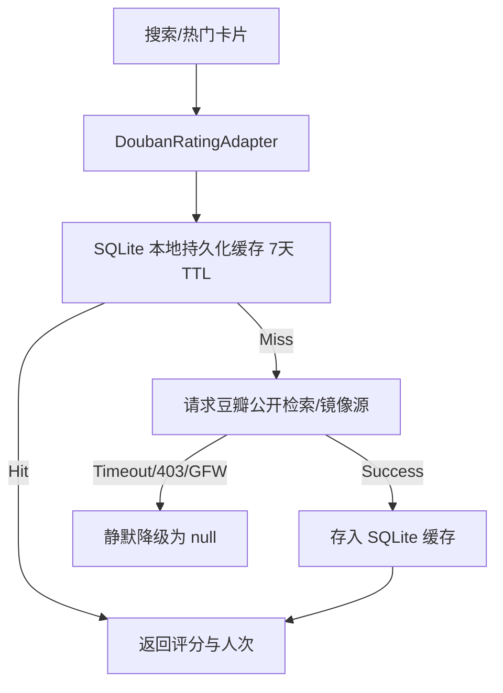

# 详情页资源搜索加速、搜索多标签矩阵、豆瓣评分集成与 AI 审查容灾增强架构设计与执行方案

## 1. 需求背景与痛点剖析

在实际影视搜寻与智能获取场景中，用户面临四个核心痛点：

1. **详情页资源搜索串行阻塞，响应迟缓**：
   - 当前 `resolveTitleResources` 对生成的关键词（中文名、原名、年份季数等）采用串行 `for (const keyword of keywords) await search(...)` 循环。
   - 每次搜索需访问上游聚合源（如 PanSou、Prowlarr），单个关键词耗时 1.5s~3s，累计总耗时常达 5s~9s。
   - 前端仅展示单一 loading 状态，用户在最慢的关键词返回前无法看到任何结果，即使第一个关键词已经命中了完美的 4K/1080p 资源，用户也只能空等。

2. **搜索页面维度单一，缺少多类型多标签筛选能力**：
   - 当前搜索页仅支持单一输入框或热门三大类（电影、剧集、动漫）的粗粒度切换。
   - 缺乏类似主流流媒体与影音系统（如 TMDB、豆瓣、Netflix）的多维度过滤矩阵（类型：全部/电影/剧集/动漫/纪录片/综艺；题材：科幻/悬疑/动作/喜剧/爱情/犯罪/奇幻/动画等；年代：2026/2025/2024/2023/2020年代/2010年代；排序：热门流行/高分优先/最新上映）。

3. **搜索与发现卡片缺少权威中文评分（如豆瓣评分）**：
   - TMDB 评分主要由海外用户打分，国内院线片、华语剧集和动漫受众普遍以**豆瓣评分**（如 8.8 分、9.2 分）作为选片关键决策依据。
   - 缺少双评分（豆瓣绿标 + TMDB 星标）呈现，无法直观评判影片口碑。

4. **AI 接口异常与内容审查阻断导致任务硬性崩溃**：
   - 当调用 Google Gemini、Azure OpenAI、Kilo 或第三方兼容网关时，网盘资源标题中夹带的敏感/成人关键词、特殊字符或敏感题材会触发上游安全过滤器，报错：
     `The content you provided or machine outputted is blocked.` 或 `finishReason: "content-filter"`。
   - 当前系统在未转存任何内容时直接抛出 `AgentContentFilterError` 导致任务硬性失败。
   - 此外，免费池在晚间高峰期频繁返回 HTTP 503（Service Unavailable），在循环步骤中缺乏前置指数退避重试和规则降级，造成任务挂死。

---

## 2. 头脑风暴与设计模式重构

针对上述痛点，我们进行可行性、性能、边界逻辑推演，并引入经典设计模式保障高内聚、低耦合与高可用：

### 2.1 详情页资源渐进式流式加载（Streaming & FSM）

#### 设计模式：流式通道适配器（Streaming Adapter）与状态机模式（FSM）
- **通信协议设计**：
  - 采用 **NDJSON (Newline-Delimited JSON)** 或 **SSE (Server-Sent Events)** 协议，由请求头 `Accept: application/x-ndjson` 或 Query `?stream=1` 自适应开启。
  - 保留传统非流式 JSON 响应通道，实现 100% 向后兼容。
- **并发与流式下发策略**：
  - 将原本串行的关键词查询改为梯队并发（`Promise.allSettled`），或有序阶梯并发。
  - 内部维护全局去重 Set（以 `candidateId` 为唯一标识），只要任一关键词检索完成，立即计算新增增量并下发 chunk：
    ```json
    {"type":"chunk","candidates":[...],"progress":{"done":1,"total":3}}
    ```
  - 当所有关键词完成或触发熔断时，持久化合并快照，并下发终态包：
    ```json
    {"type":"done","snapshotId":"search_account_123","candidates":[...all],"cached":false}
    ```
- **前端状态机演进**：
  ```mermaid
  stateDiagram-v2
      [*] --> Idle
      Idle --> Loading: 用户点击搜索
      Loading --> Streaming: 首批 Chunk 到达 (<800ms)
      Streaming --> Streaming: 后续关键词 Chunk 追加去重
      Streaming --> Ready: 接收到 Done 事件 (绑定快照)
      Loading --> Ready: 命中 30min 缓存直接完成
      Loading --> Throttled: 429 频控 (显示剩余秒数)
      Loading --> Error: 5xx 异常降级
      Ready --> Submitting: 点击手动入库
      Submitting --> Queued: 202 成功入队
  ```

### 2.2 搜索多类型多标签矩阵（Filter Strategy & Composition）

#### 设计模式：复合策略模式（Composite Filter Strategy）
- 将多维筛选抽象为可插拔的维度策略，由 URL Query Params（`type`, `genre`, `year`, `sort`）统一驱动，保证浏览器前进后退、可书签化与 SSR 亲和：
  - **Type Strategy**：`all` | `movie` | `tv` | `anime` | `doc` | `show`。
  - **Genre Strategy**：根据映射字典过滤 TMDB/媒体分类中的 `genre_ids`（如 878 科幻，9648 悬疑，28 动作，35 喜剧，16 动画，18 剧情）。
  - **Year Strategy**：精确年份（2026, 2025, 2024）或跨度分桶（2020s, 2010s, older）。
  - **Sort Strategy**：`popularity.desc`（热门）、`vote_average.desc`（高分优先）、`primary_release_date.desc`（最新）。
- 搜索交互：
  - 空输入态：多标签控制实时热门推荐行与探索墙（Discover Wall）。
  - 有输入态：多标签控制对当前查询候选集的结果过滤与重排，避免无关类型打扰。

### 2.3 豆瓣评分适配器与分级缓存（Douban Rating Adapter & Cache）

#### 设计模式：适配器模式（Adapter Pattern）与优雅降级（Graceful Degradation）

- **容灾契约**：
  - 豆瓣评分接口请求设置严格超时（2.5s），任何网络异常、反爬验证码（403）、解析错误均静默降级为 `null`。
  - 页面 UI 仅在评分有效时渲染豆瓣绿标（如 `🟢 豆瓣 8.6`），评分缺失时仅展示 TMDB 评分，**绝对不阻塞页面主渲染流程**。

### 2.4 AI 内容审查安全净化、重试退避与确定性规则降级（AI Resilience）

#### 设计模式：过滤器模式（Sanitizer）、指数退避状态机与规则降级策略（Fallback Strategy）
针对 `The content you provided or machine outputted is blocked.` 与 503 限流：
1. **前置提示词净化器（Prompt Sanitizer）**：
   - 过滤与脱敏：对候选资源名称、标签和简介中的成人代码、无意义长哈希、敏感干扰词进行前置净化。
   - 注入上下文防误杀声明：在系统提示词显式声明系统用途为“公开影视文献归档与标准元数据匹配”，指导模型以纯中立工具视角输出。
2. **审查阻断感知与安全降级重试（Cleansed Retry）**：
   - 拦截包含 `blocked`、`content-filter` 的错误或状态；
   - 触发 1 次轻量纯净重试（Clean Retry）：自动剥离候选列表中的非必要富文本与详细摘要，仅保留核心规范标题与文件尺寸，降低审查命中率。
3. **确定性规则降级兜底（Deterministic Fallback Strategy）**：
   - 当 LLM 因模型提供商系统级封锁或 503 彻底无法使用，且 Sandbox 中已经通过前序步骤获取到资源候选时：
   - 触发**规则选择器（DeterministicCandidateSelector）**：根据作品配置的清晰度偏好（4K/1080p）、做种数（seeders）及文件名置信度打分，直接选出最优候选调用 `transferCandidate`。
   - 避免整个工作流直接 crash，实现无模型中断时的优雅任务完结。

---

## 3. 业界主流方案对比与现有库借鉴

| 维度 | 常见开源/行业方案 | 本项目设计方案 | 架构优势 |
| :--- | :--- | :--- | :--- |
| **详情页资源加载** | Sonarr/Radarr（长轮询/全量等待 10s+）、Vercel AI SDK（SSE 流式） | **NDJSON / SSE 流式追加 + 前端增量去重渲染** | 首批结果 <800ms 可见，可立即入库，无需等待慢速源 |
| **搜索与筛选交互** | Bilibili/豆瓣电影（单选标签条）、Netflix（横向多轨分类） | **类型 + 题材 + 年份 + 排序 复合筛选栏** | 纯 URL 驱动，SSR 极速，书签友好，交互直观 |
| **评分数据源** | Jellyfin Douban 插件、Plex-Meta-Manager | **轻量 SQLite 缓存 + 豆瓣评分 Adapter 异步注入** | 零外部依赖，极速缓存，防封反爬，容灾静默降级 |
| **AI 审查容灾** | LangChain Guardrails、OpenAI Moderation API | **提示词前置脱敏 + 安全重试 + 确定性规则降级** | 彻底根治 503 与 blocked 导致的流程硬崩溃 |

---

## 4. 实施计划与质量保障

1. **Step 1 - 渐进式详情页资源搜索**:
   - 增强 `packages/workflow/src/title-resource-resolver.ts`：支持流式回调 `onProgress` 或生成器模式。
   - 增强 `apps/web/app/api/titles/resources/route.ts`：支持流式 chunk 传输。
   - 改造 `apps/web/components/title-resource-panel.tsx`：支持消费 ReadableStream，首批结果即刻展示。
2. **Step 2 - 搜索页多类型多标签方案**:
   - 在 `apps/web/components/search-form.tsx` 或新组件 `apps/web/components/media-filter-bar.tsx` 实现分类标签栏与题材/年份/排序标签。
   - 联动 `apps/web/app/page.tsx` 与 `apps/web/lib/search-page.ts`，多维度过滤与排序。
3. **Step 3 - 豆瓣评分集成**:
   - 编写 `apps/web/lib/douban-rating.ts` 与 SQLite 缓存逻辑。
   - 在 `CandidateCard` 与 `TrendingRow` 卡片上集成豆瓣评分徽章。
4. **Step 4 - AI 提示词安全净化、重试退避与确定性规则降级**:
   - 编写 `packages/workflow/src/acquisition-v2/prompt-sanitizer.ts`。
   - 增强 `packages/workflow/src/acquisition-v2/agent-loop.ts`，捕获 blocked / 503 并接入安全重试与确定性规则降级。
   - 编写回归与单元测试。
5. **Step 5 - 门禁与验证**:
   - `node scripts/check-style-tokens.mjs` 检查设计令牌合规；
   - `npm run gate` 检查 lint、typecheck、deps；
   - Playwright E2E 实测并截图验证。
