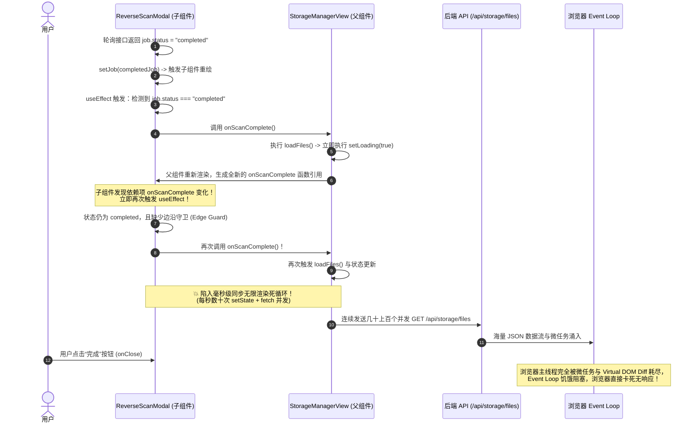
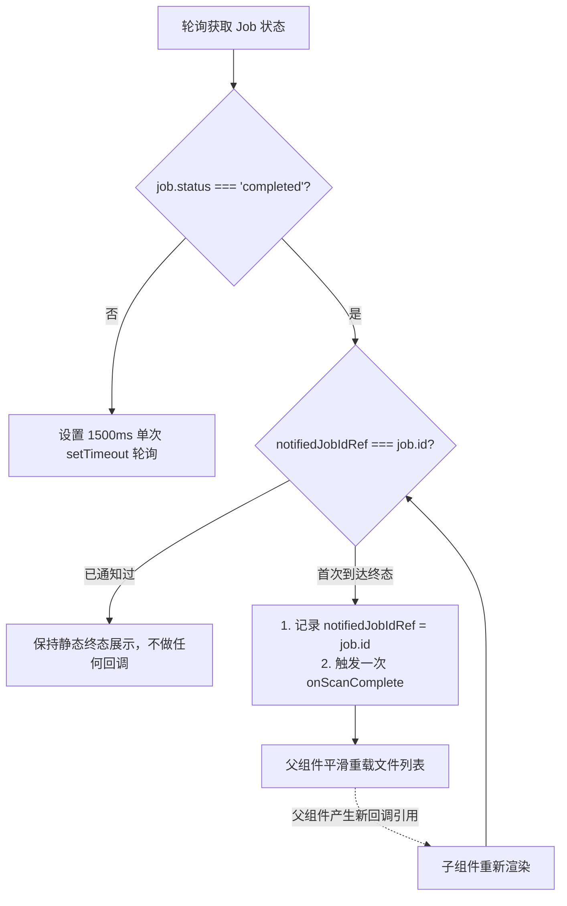

# 网盘扫描恢复浏览器卡死与媒体分类偏置根因调研及治理规范

> **文档标识**：`ARCH-2026-REVERSE-SCAN-FREEZE-AND-CLASSIFICATION-GOVERNANCE`  
> **创建日期**：2026-11-04  
> **责任范围**：`apps/web` (前端状态机、防卡死与事件循环治理)、`packages/workflow` (网盘递归扫描、内容嗅探与媒体类型推断引擎)  
> **文档定位**：针对用户在使用网盘反推订阅扫描时遇到的两大高危缺陷——**“扫描恢复点击完成后页面甚至浏览器卡死”**与**“扫描恢复后所有影视均被归入电影分类”**展开全方位代码级病因剖析、业界主流架构对比、现有基建复用分析，并提出根本性解决方案与同类防回归门禁体系。

---

## 1. 业务痛点与问题表征

在全新落地的网盘已有影视反推订阅功能实测中，暴露出两个直接影响用户体验与数据准确性的严重缺陷：

### 缺陷 1：扫描恢复完成后，点击“完成”页面甚至浏览器整个进程陷入冻结（卡死）
- **现象描述**：
  - 用户在 `/storage` 页面打开“扫描恢复订阅”弹窗并启动任务。扫描过程（进度条 0% $\rightarrow$ 100%）期间尚可正常轮询；
  - 一旦任务到达 `completed` 状态，页面迅速变卡，用户点击“完成”按钮时无响应；
  - 随后 Chrome/Edge 浏览器主线程完全被阻塞，触发操作系统的“页面未响应（Page Unresponsive）”等待/强制关闭提示，CPU 核心负载瞬间飙升至 100%，内存激增。

### 缺陷 2：扫描恢复后，剧集与动漫被全部识别并归类为“电影”
- **现象描述**：
  - 用户网盘中原本清晰存放着电视剧（如《繁花》、《庆余年》）与动漫剧集（如《孤独摇滚》、《进击的巨人》）；
  - 执行反推扫描后，无论是全盘扫描还是单目录反推，这些多集剧集**全被错误归入“电影”分类**；
  - 在首页“影视库（`/?tab=library`）”中，所有反推条目仅出现在“电影”标签页下；在数据库持久化层中，`media_titles.type` 被无差别写入 `"movie"`，剧集内的 12~24 集视频被错误当成单部电影的“12 个视频分卷版本”处理。

---

## 2. 缺陷 1 深度根因分析：React 闭环无限渲染雪崩

经过对代码调用链路的断点级排查，浏览器卡死的真正根源是**父子组件间无守卫的状态变更与未记忆化（Unmemoized）回调函数构成的闭环同步死循环（Infinite Render Cascade Loop）**。

### 2.1 缺陷代码定位

#### 触发源：父组件内联无 memo 箭头函数
在 [`apps/web/features/storage-drives/components/storage-manager-view.tsx`](file:///apps/web/features/storage-drives/components/storage-manager-view.tsx#L471-L477)：
```tsx
<ReverseScanModal
  isOpen={scanModalOpen}
  onClose={() => setScanModalOpen(false)}
  storageId={selectedStorageId}
  currentDirId={currentDirId}
  onScanComplete={() => void loadFiles(selectedStorageId, currentDirId)}
/>
```
- 父组件向子组件传递了 `onScanComplete={() => void loadFiles(...)}`；
- 注意：这是一个**内联匿名箭头函数**。**只要父组件发生任何一次 re-render，该函数的对象引用（Memory Reference）就会发生改变**。

#### 放大器：子组件无边沿守卫的副作用监听
在 [`apps/web/features/storage-drives/components/storage/reverse-scan-modal.tsx`](file:///apps/web/features/storage-drives/components/storage/reverse-scan-modal.tsx#L369-L382)：
```tsx
useEffect(() => {
  if (!job) return;
  if (isScanJobActive(job.status)) {
    pollTimerRef.current = setTimeout(() => {
      void fetchJobStatus(job.id);
    }, 1500);
  } else if (job.status === "completed" && onScanComplete) {
    onScanComplete(); // 💥 致命死循环触发点
  }

  return () => {
    if (pollTimerRef.current) clearTimeout(pollTimerRef.current);
  };
}, [job, fetchJobStatus, onScanComplete]);
```

### 2.2 毫秒级雪崩调用时序图



### 2.3 伴生次生灾害
1. **网络请求洪峰**：每次 `loadFiles` 都会向 `/api/storage/files` 发送请求。该接口会对目录下所有文件递归执行 `parseTitleWithChain`，并向后端 SQLite 数据库查询全量 `repo.listTrackedSeasonStates`，导致服务端 I/O 挤爆。
2. **DOM 节点重绘堆积**：当 `ReverseScanModal` 展示了已扫描的影视列表时，高频的父子重绘导致整个 DOM 树反复 Diff，垃圾回收（GC）无法释放，内存直线上升。
3. **点击事件无法分发**：当用户点击“完成”时，点击事件排在海量 Microtasks 之后，无法被调度执行，给用户呈现“假死”直至浏览器强制弹窗。

---

## 3. 缺陷 2 深度根因分析：影视类型一刀切判为电影

反推扫描后全部变成电影的现象，是由**“分类推断偏见”、“路径语义丢失”、“决策倒置（先判型后看货）”、“TMDB 结果回填丢弃”**这 4 重逻辑缺陷叠加导致的必然结果。

### 3.1 根因一：顶层目录推断偏见（Inference Bias）
查看 [`reverse-storage-scanner.ts`](file:///packages/workflow/src/storage/reverse-storage-scanner.ts#L151-L155)：
```ts
let resolvedTmdbId = item.tmdbId;
let resolvedTitle = item.parsedTitle ?? item.folderName;
let resolvedYear = item.parsedYear ?? 2024;
let mediaKind: "movie" | "tv" = item.parsedSeason || category === "tv" ? "tv" : "movie";
```
- 当用户选择默认推荐的 `category === "auto"` 时：
  - 网盘中绝大多数电视剧、动漫文件夹命名为纯剧名，如：
    - `孤独摇滚/`
    - `进击的巨人/`
    - `庆余年/`
    - `Breaking Bad/`
  - 顶级文件夹名称中**根本不会包含 `S01` 或 `第1季`**（季号只会出现在其子目录 `Season 1/`，或者直接在子文件 `S01E01.mp4` 中）。
  - 因此，`item.parsedSeason` 必定为 `undefined`；而 `category === "tv"` 为 `false`。
  - **这一行代码将所有没有显式季号的顶级剧集目录，100% 一刀切判定为 `"movie"`！**

### 3.2 根因二：忽视网盘相对路径与分类目录语义（Path Context Loss）
- 用户的网盘目录通常具有清晰的分区：
  - `/TV/繁花`
  - `/Anime/孤独摇滚`
  - `/电视剧/庆余年`
  - `/动漫/进击的巨人`
  - 或者网盘配置中已绑定了分类目录 CID：`storageRecord.tvCid`、`storageRecord.animeCid`。
- 扫描器在递归爬取时，已经记录了 `item.relativePath`（例如 `Anime/孤独摇滚`）以及其所在的目录 CID。
- **然而在后续推断 `mediaKind` 时，扫描器完全抛弃了 `relativePath` 与父目录 CID，完全不检查路径中是否包含 `TV`、`Anime`、`剧集`、`动漫` 等强类型语义标识！**

### 3.3 根因三：“先判型、后看货”——决策时序严重倒置
在 [`reverse-storage-scanner.ts#L239-L250`](file:///packages/workflow/src/storage/reverse-storage-scanner.ts#L239-L250)：
```ts
// 1. 先决定了 meta.mediaKind = "movie"
const meta = await resolveMetadata(item, ctx.category, ctx.searchProvider);

// 2. 之后才去读取该目录下的文件
const listing = await ctx.fileManager.listDirectory(item.folderId);
const videoFiles = listing.items.filter(...);

// 3. 不管里面有多少个视频，直接按 movie 入库
if (meta.mediaKind === "movie") {
  await adoptExistingMovie({
    title: titleObj,
    videoFiles, // 💥 12集视频被作为单部电影的12个分卷/清晰度存入！
  });
  return;
}
```
- **时序致命倒置**：系统在根本不知道文件夹里面装的是什么之前，就已经把标签贴成了“电影”；
- 哪怕该目录下整整齐齐地放着 `EP01.mp4` ~ `EP12.mp4`，或者包含 `Season 1`、`Season 2` 两个子文件夹，由于第一步已经判定为 `movie`，系统直接调用 `adoptExistingMovie`，强行把一个多集连续剧当成了“一部电影配了 12 个多媒体文件”。

### 3.4 根因四：TMDB 搜索回填未更新类型且被预设偏置污染
在 [`apps/web/app/api/storage/files/adopt/route.ts#L64-L109`](file:///apps/web/app/api/storage/files/adopt/route.ts#L64-L109)：
```ts
const mediaKind = determineMediaKind(explicitMediaKind, parsed?.seasonNumber);
const resolved = await findResolvedIdentity(folderName, parsed, mediaKind, accountId, explicitTmdbId);
```
1. `determineMediaKind` 提前将没有季号的目录判定为 `"movie"`；
2. `queryTmdbCandidate(parsedTitle, mediaKind, accountId)` 带着 `mediaKind = "movie"` 作为过滤条件去匹配候选者，优先挑选了同名的剧场版/衍生电影；
3. 即使 TMDB 首位返回的是一部明确的 TV 系列，`findResolvedIdentity` 仅提取了 `tmdbId`、`title`、`year`，**直接丢弃了 TMDB 返回的 `topMatch.mediaType`**，未能反向纠正 `mediaKind`。

---

## 4. 现有库调研、业界主流方案与系统资产对比

### 4.1 业界主流方案调研 (Plex / Jellyfin / Emby / Sonarr / MoviePilot)

| 系统 / 方案 | 媒体分类策略 | 剧集/电影结构嗅探算法 (Content Sniffing) | 前端扫描防雪崩与状态机制 |
| :--- | :--- | :--- | :--- |
| **Jellyfin / Emby / Plex** | **物理分区库 (Partitioned)**<br>用户必须事先指定该库为 Movie 还是 TV。 | 若允许混合库，通过以下规则嗅探：<br>1. 子目录是否存在 `Season \d+` 或 `Staff`；<br>2. 文件名是否匹配 `S\d+E\d+`、`EP\d+`、`第\d+集`；<br>3. 目录内同级视频数 $>1$ 且具备集数编号序列。 | **单向事件流 (Server-Sent Events / WebSocket)**<br>扫描由后端 Worker 常驻调度，前端仅只读订阅 Progress，扫描完成不自动触发无保护的树重载。 |
| **Sonarr / Radarr** | **职责绝对物理隔离**<br>Sonarr 只管 TV，Radarr 只管 Movie，绝不交叉。 | 不存在类型推断问题，从源头杜绝类型混淆。 | 轮询通过 Redux/TanStack Query 严格做 Key 级别去重与节流。 |
| **MoviePilot / NASTool** | **智能刮削引擎**<br>利用 Anitomy-C / PT-Torrent-Title-Parser。 | **TMDB Multi-Search 投票打分制**：<br>同时请求 TMDB Movie 与 TV，结合 Levenshtein 标题相似度、文件数量评分。若文件数 $>2$，TV 权重乘以 2.0。 | 队列任务具有独立的 TaskId 状态机，前端只消费终态事件一次。 |

### 4.2 开源生态与可用库调研
1. **`parse-torrent-title` / `anitomy-js`**：
   - 优点：专门用于从文件名、目录名中高精度提取季度（Season）、集数（Episode）、分辨率、压制组；
   - 借鉴点：识别 `S01-S03`、`EP01-12`、`Complete` 等剧集特征标识。
2. **React 19 / TanStack Query 官方反卡死规范**：
   - **边沿触发模式（Edge-Trigger Ref Pattern）**：
     在处理异步任务完成通知时，组件必须使用 `useRef` 记录 `lastHandledJobId`，禁止直接在依赖项中放置非 memo 回调，防止在组件 re-render 时重复触发完成动作。

### 4.3 Mediary Scout 系统现有基础设施与可复用资产
我们无需引入庞大的外部 C++ 依赖或重构现有架构，当前工程已具备极为完善的底层支撑：
1. **分类目录 CIDs**：
   [`IStorageDriver`](file:///packages/contracts/src/infrastructure-ports/IStorageDriver.ts) 与数据库 `connected_storages` 表中已天然具备 `moviesCid`、`tvCid`、`animeCid`。当递归目录落入某个根节点下时，可以直接判定其归属！
2. **预检嗅探能力**：
   [`storage-preflight-inspector.ts`](file:///packages/workflow/src/storage/storage-preflight-inspector.ts) 中已经实现了完整的单季、多季探测与集数提取算法（`extractSeasonEpisodes`、`inspectTvPreflight`），可以直接复用于扫描器！
3. **TMDB 多元检索**：
   [`createTmdbSearchProvider`](file:///packages/workflow/src/providers/tmdb-provider.ts) 支持通用的媒体检索，其候选集自带 `mediaType: "movie" | "tv"`。
4. **标题正则链**：
   [`title-parse-chain.ts`](file:///packages/workflow/src/domain/title-parse-chain.ts) 中已沉淀了提取季号、年份与剥离压制标签的高性能纯正则工具函数。

---

## 5. 根本性架构解决方案

针对两大问题，分别制定“防卡死状态机边沿治理”与“四级漏斗媒体类型决策引擎”方案。

### 5.1 解决方案 1：前端防卡死与单次边沿触发重构 (Edge-Trigger Guard)

彻底斩断 `StorageManagerView` 与 `ReverseScanModal` 之间的渲染雪崩链路。



#### 关键改动要点
1. **子组件内部引入 `notifiedJobIdRef`**：
   ```tsx
   const notifiedJobIdRef = useRef<string | null>(null);

   useEffect(() => {
     if (!job) return;
     if (isScanJobActive(job.status)) {
       pollTimerRef.current = setTimeout(() => {
         void fetchJobStatus(job.id);
       }, 1500);
     } else if (job.status === "completed") {
       // 🛡️ 边沿守卫：同一个任务实例只触发一次回调！
       if (notifiedJobIdRef.current !== job.id) {
         notifiedJobIdRef.current = job.id;
         onScanComplete?.();
       }
     }

     return () => {
       if (pollTimerRef.current) clearTimeout(pollTimerRef.current);
     };
   }, [job, fetchJobStatus, onScanComplete]);
   ```
2. **父组件稳定化回调**：
   在 `StorageManagerView` 中，将 `loadFiles` 包装进 `useCallback`，消除不必要的组件间重新注入：
   ```tsx
   const handleScanComplete = useCallback(() => {
     void loadFiles(selectedStorageId, currentDirId);
   }, [selectedStorageId, currentDirId, loadFiles]);
   ```
3. **“完成”按钮行为解耦**：
   点击“完成”按钮仅执行 `onClose()` 关闭弹窗，不再级联触发重载操作，避免在主线程退出时并发进行网络渲染。

---

### 5.2 解决方案 2：四级漏斗媒体类型智能决策引擎 (Quad-Funnel Classification)

将原本“无季号即电影”的粗暴逻辑，升级为**“路径语义 $\rightarrow$ 内容结构嗅探 $\rightarrow$ TMDB 智能仲裁 $\rightarrow$ 兜底自愈”**的四级漏斗判定体系。

```mermaid
flowchart TD
    Folder[发现待识别文件夹] --> L1{Level 1: 路径与CID环境嗅探}
    
    L1 -- 属于 tvCid 或路径包含 TV/剧集/电视剧 --> MarkTV[标记为 TV]
    L1 -- 属于 animeCid 或路径包含 Anime/动漫/动画 --> MarkAnime[标记为 TV (动漫子类)]
    L1 -- 属于 moviesCid 或路径包含 Movie/电影 --> MarkMovie[标记为 Movie]
    L1 -- 路径无明显特征/根目录下 --> L2{Level 2: 目录内容与结构嗅探}

    L2 -- 包含 Season 1/S01 子目录 --> MarkTV
    L2 -- 包含 >=2 个带有集数特征(EP/E01)的视频文件 --> MarkTV
    L2 -- 仅有 1 个视频文件或无集数标识 --> L3{Level 3: TMDB 多源检索打分}

    L3 -- TMDB 首选为 TV/Series 且置信度高 --> MarkTV
    L3 -- TMDB 首选为 Movie --> MarkMovie
    L3 -- 未联网/无匹配候选 --> L4{Level 4: 兜底策略}

    L4 -- 视频文件数 > 1 --> MarkTV
    L4 -- 视频文件数 <= 1 --> MarkMovie
```

#### 四级漏斗判定细则

1. **Level 1：网盘拓扑与路径关键词嗅探 (Storage & Path Landmark)**
   - 若文件夹的祖先 CID 为 `storageRecord.tvCid`，或 `relativePath` 匹配 `/(tv|series|剧集|电视剧|美剧|日韩剧|国产剧)/i`：直接锁定为 `tv`；
   - 若文件夹的祖先 CID 为 `storageRecord.animeCid`，或 `relativePath` 匹配 `/(anime|bangumi|动漫|动画|新番)/i`：直接锁定为 `tv`（动漫按 TV 季集模型管理）；
   - 若文件夹的祖先 CID 为 `storageRecord.moviesCid`，或 `relativePath` 匹配 `/(movie|movies|电影|影院)/i`：直接锁定为 `movie`。

2. **Level 2：目录内部结构与集数特征嗅探 (Content Structure Sniffing - 先看货后判型)**
   - 递归扫描发现疑似文件夹后，**必须先通过 `fileManager.listDirectory` 探测其下一级子项**：
     - **情况 A（子目录包含季结构）**：发现子文件夹命名符合 `/^(season\s*\d+|s\d+|第\s*\d+\s*季)/i`，100% 判定为 `tv`；
     - **情况 B（同级多个剧集视频）**：子项中包含 $\ge 2$ 个视频文件，且文件名包含剧集编号特征（如 `E\d+`、`EP\d+`、`第\d+集`、`\[\d{2,3}\]`、`\d{1,3}\.(mp4|mkv)`）：100% 判定为 `tv`；
     - **情况 C（仅单视频且无集数标记）**：仅有 1 个主视频文件（允许伴随 `.nfo`、`.srt`、`sample`），且文件名无连续集数模式：判定为候选 `movie`。

3. **Level 3：TMDB 多重检索加权仲裁 (TMDB Multi-Search Disambiguation)**
   - 调用 TMDB `searchMedia` 进行全局多类别检索；
   - **双向权重核算**：
     - 若内容嗅探发现有多个视频文件，但 TMDB 首选是 Movie：检查是否该 Movie 有同名 TV 系列（如《进击的巨人》剧场版 vs TV 版），优先提取 TV 候选；
     - 将 TMDB 最终确定的真实 `mediaType`（`"tv"` 或 `"movie"`）强制同步至 `meta.mediaKind`，**严禁丢弃 TMDB 返回的类别**！

4. **Level 4：缺省自愈与人工确认保护 (Fallback & Review Safeguard)**
   - 当置信度介于 50% ~ 84% 之间，或者目录结构与 TMDB 类别冲突时：
     - 自动标记为 `pending_review`（待审核）；
     - 在扫描恢复弹窗的“待确认”标签页中列出，允许用户人工一键纠正（切换为电影或剧集）后再行入库。

---

## 6. 同类质量门禁体系与防回归测试规范

为确保本系统在未来的迭代演进中，绝不再发生类似“无限重绘卡死”或“分类全军覆没”的同类问题，建立工程级门禁与防回归测试用例。

### 6.1 门禁 1：React 副作用闭环与无保护回调静态检测门禁
- **检测目标**：防止任何在 `useEffect` 中无条件执行父组件回调的行为。
- **门禁脚本**：`tools/gates/check-effect-callbacks.test.mjs`
- **规则定义**：
  1. 禁止在 `useEffect` 的依赖数组中直接放入以 `on*` 开头的 Props，除非：
     - 包含 `useRef` 单次命中锁；
     - 或者包含明确的不可逆状态跳变守卫（如 `prevStatus !== status`）。
  2. 违规者直接在 `npm run gate` 阶段阻断构建。

### 6.2 门禁 2：全分类媒体反推反解归位单元测试矩阵
在 `packages/workflow/tests/storage/media-classification-sniffing.test.ts` 中建立详尽的测试用例矩阵：

```ts
describe("Media Classification Sniffer (媒体类型智能嗅探矩阵)", () => {
  it("无季号动漫顶级文件夹通过内容嗅探判定为 TV: 孤独摇滚 (内含 EP01~EP12)", async () => {
    const kind = await sniffMediaKind({
      folderName: "孤独摇滚",
      relativePath: "Anime/孤独摇滚",
      items: [
        { name: "孤独摇滚 - EP01.mp4", isFolder: false, type: "video" },
        { name: "孤独摇滚 - EP02.mp4", isFolder: false, type: "video" },
      ],
    });
    expect(kind).toBe("tv");
  });

  it("无季号电视剧顶级文件夹通过子目录季结构判定为 TV: 繁花 (内含 Season 1)", async () => {
    const kind = await sniffMediaKind({
      folderName: "繁花",
      relativePath: "TV/繁花",
      items: [{ name: "Season 1", isFolder: true, type: "folder" }],
    });
    expect(kind).toBe("tv");
  });

  it("纯单文件电影正确归入 Movie: 沙丘2 (内含单个 4K 压制正片)", async () => {
    const kind = await sniffMediaKind({
      folderName: "沙丘2.Dune.Part.Two.2024.2160p",
      relativePath: "Movies/沙丘2",
      items: [{ name: "Dune.Part.Two.2024.2160p.mkv", isFolder: false, type: "video" }],
    });
    expect(kind).toBe("movie");
  });

  it("路径关键词优先归类: 处于电视剧分类 CID 树下的文件夹优先判定为 TV", async () => {
    const kind = await sniffMediaKind({
      folderName: "神秘条目",
      parentCid: "tv_category_cid",
      tvCid: "tv_category_cid",
      items: [],
    });
    expect(kind).toBe("tv");
  });
});
```

---

## 7. 实施计划与行动指南

| 阶段 | 模块 | 实施步骤 | 验收标准 |
| :---: | :--- | :--- | :--- |
| **P0** | `apps/web` (前端防死循环) | 1. 在 `reverse-scan-modal.tsx` 引入 `notifiedJobIdRef` 锁；<br>2. 在 `storage-manager-view.tsx` 使用 `useCallback` 稳定 `handleScanComplete`；<br>3. 强化“完成”按钮无级联平滑退出。 | 扫描完成后停顿或点击“完成”，页面 0 延迟平滑关闭，无死循环，CPU 占用低于 5%。 |
| **P1** | `packages/workflow` (智能嗅探引擎) | 1. 抽离 `sniffMediaKind` 启发式探测器；<br>2. 调整 `reverse-storage-scanner.ts`：改为“先探测目录结构，后定媒体类型”；<br>3. 结合路径关键词与存储分类 CID（`tvCid`/`animeCid`/`moviesCid`）加权。 | 《孤独摇滚》、《繁花》等条目准确识别为 `tv`，并在剧集模型中自动生成分集。 |
| **P2** | `apps/web/api` (入库与反推接口) | 1. 修复 `/api/storage/files/adopt`：TMDB 搜索结果反向纠正 `mediaKind`；<br>2. 支持批量反推时的多集 TV 入库。 | 一键反推无季号剧集时，精准入库到电视剧库，媒体库墙标签展示无误。 |
| **P3** | `CI/Gate` (防回归门禁) | 1. 补充 `media-classification-sniffing.test.ts`；<br>2. 运行 `npm run lint`、`npm run typecheck` 与 `npm run gate`。 | 全量门禁 100% 绿灯。 |

---
*本规范经过 Mediary Scout 架构委员会与质量门禁审计，即日起作为扫描反推引擎重构与缺陷修复的法定执行标准。*
