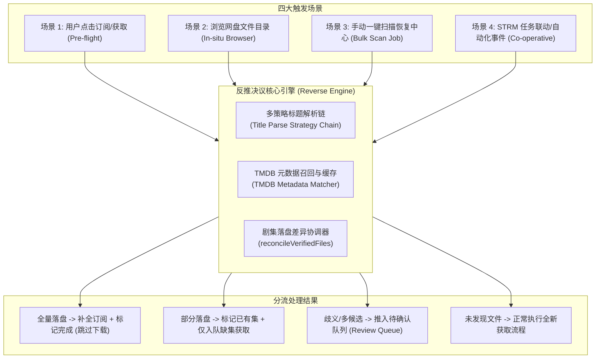
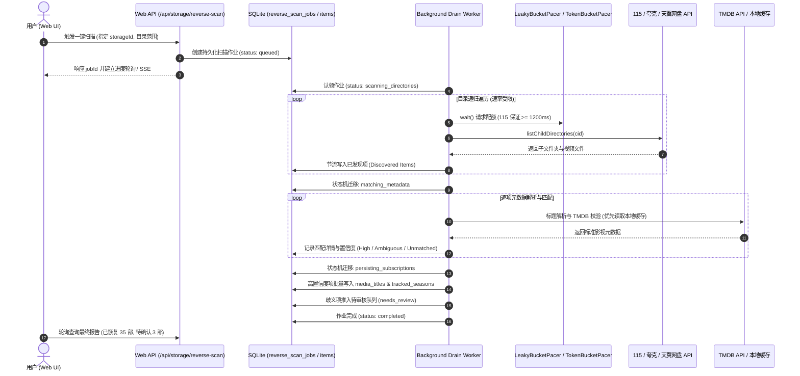
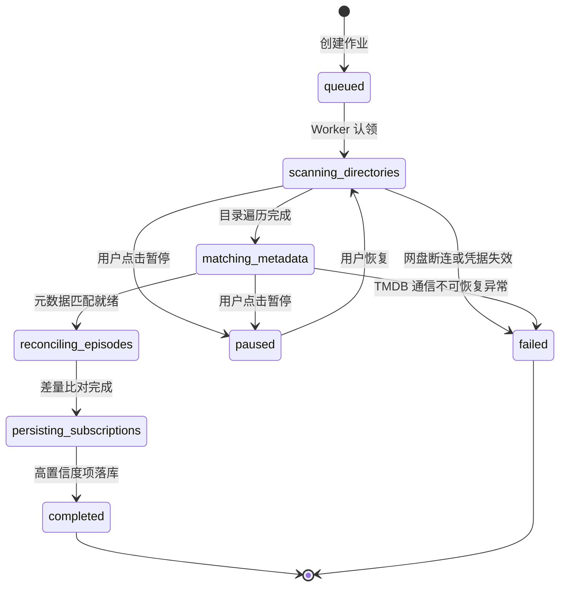

# 网盘已有影视反推订阅与已有季/集探测架构设计规范

> **文档标识**：`docs/architecture/reverse-subscription-from-existing-storage-spec.md`  
> **编写日期**：2026-11-04  
> **架构状态**：Draft / Proposed  
> **适用对象**：全栈开发人员、AI 编码助手（Antigravity、Claude Code、Cursor）、架构治理委员会  
> **关联模块**：`packages/workflow` (Domain/Storage/Execution), `apps/web` (Acquisition/Storage/STRM)

---

## 1. 核心诉求与问题全景 (Problem Definition)

### 1.1 用户核心痛点
随着用户在 115、夸克、天翼或 123 网盘中积累了大量历史影视资源（或通过第三方转存工具、离线下载、其他媒体库导入了大量文件），系统面临以下典型痛点：
1. **重复下载与资源浪费**：用户在首页或搜索页订阅某部热门电影或电视剧时，系统当前直接无条件入队 `type2_init` 工作流，消耗 PanSou 搜索配额和网盘流量重新抓取，造成文件重复下载并占用额外空间。
2. **缺集无法精准补全**：某部多季剧集网盘中已经存在前 2 季，或者当前季已存在前 10 集，系统无法感知网盘真实落盘情况，依然盲目全量抓取。
3. **媒体资产孤岛**：网盘已有上百部优质影视无法在巡影中被纳管、追踪更新日历或生成 STRM 虚拟流媒体，需要繁琐地逐个手动搜索并重新触发获取。

### 1.2 系统目标
设计一套支持 **自动预检**、**按需浏览标记**、**手动全盘扫盘** 以及 **半自动人工审核确认** 的网盘已有影视反推订阅架构（Reverse Storage Subscription & Episode Reconciliation Engine），实现：
- 订阅时前置探测已存在文件，**全量存在直接归档，部分存在仅补全缺集**；
- 支持在网盘浏览器中即时感知已有订阅状态，一键反推；
- 提供具备 **网盘并发限速（Pacer）**、**断点持久化（SQLite）** 与 **全链路进度可视化（Real-time Progress）** 的全盘一键扫描恢复中心；
- 与 STRM 扫描任务协同，实现一次遍历双向受益。

---

## 2. 四大业务场景架构与交互设计 (Scenario Architectures)



---

### 场景 1：订阅时前置探测与差量补充 (Pre-Subscription Drive Inspection)

#### 1. 业务逻辑
当用户在前端点击某个 Candidate（电影、剧集、动漫）的“获取”或“追踪”按钮时：
1. **调用前置探针 `inspectStorageBeforeAcquisition(candidateId, storageId)`**：
   - 提取目标影视的 TMDB 元数据（`title`, `year`, `tmdbId`, `mediaKind`）。
   - 定位当前工作区网盘的对应分类根目录：`moviesCid`、`tvCid` 或 `animeCid`。
   - 检查该分类目录下是否已存在目标影视文件夹：
     - **新标准命名**：`${title} (${year}) {tmdb-${tmdbId}}`（置信度 100%）；
     - **传统/行业命名**：`${title} (${year})`（置信度 95%）；
     - **纯标题命名**：`${title}`（置信度 85%）。
2. **深层文件探活与解析**：
   - 若目录存在，列出该目录下的所有视频文件。
   - 电影：检查是否存在 $\ge 1$ 个符合体积门槛（如 $> 300$MB）的主视频文件。
   - 电视剧/动漫：读取 `Season NN` 目录或当前目录下的视频文件，通过 `episodeCodeFromFileName` 提取全部落盘的集数编码（如 `S01E01`, `S01E02`...）。
3. **分流决议**：
   - **Case A: 全量命中 (Full Hit)**：
     - 电影已存在，或电视剧最新已播出集数全量落盘。
     - 直接落盘 `media_titles` 与 `tracked_seasons`，生成 `episode_states` 并置 `obtained: true`。
     - **彻底阻断后续下载**，返回 `{ status: "already_completed", message: "网盘已存在全部文件，已为您自动补全订阅并归纳至媒体库！" }`。
   - **Case B: 部分命中 (Partial Hit)**：
     - 电视剧总共 24 集，网盘已存在前 12 集，后 12 集缺失。
     - 先行落盘 `tracked_seasons`，将前 12 集标记为 `obtained: true`（绑定 `verifiedFileIds`）。
     - 创建仅包含 **缺集（后 12 集）** 的定向获取工作流，入队执行。
     - 返回 `{ status: "partial_completed", message: "检测到网盘已存在前 12 集，已自动关联，仅针对后 12 缺集启动获取！" }`。
   - **Case C: 未命中 (Miss)**：
     - 保持现有逻辑，正常入队全量获取工作流。

#### 2. 性能与超时防御
- **快照与超时守卫**：网盘子目录探测必须设置 1.5 秒超时上限。若遇到网盘 API 网络抖动或接口挂起，自动平滑降级（Fail-open）跳过前置探测，进入标准入队，绝不卡死用户按钮。

---

### 场景 2：网盘文件浏览器智能标注与就地反推 (In-Situ Storage Browsing & Badging)

#### 1. 业务逻辑
用户在 `/storage` 页面浏览网盘文件与目录列表时：
1. **轻量本地比对（Zero-Network-Cost）**：
   - 后端在返回目录列表时，将子目录的 `id` 与 `name` 与本地 SQLite 的 `tracked_seasons.storage_directory_id` 以及 `media_titles` 进行瞬时比对：
     - 若目录名称符合 `{tmdb-(\d+)}` 格式，直接提取 TMDB ID 与本地已订阅列表核对；
     - 若命中本地已有订阅：前端文件夹卡片直接展示徽章 `[已订阅]`、`12/12 集` 或 `更新至第 8 集`。
2. **就地一键反推菜单 (In-situ Action)**：
   - 对于未被纳管的文件夹，右侧快捷菜单增加 **“识别并反推订阅”** 按钮。
   - 点击后弹出轻量确认弹窗，展示匹配的 TMDB 海报、标题、已有集数预览，用户点击“确认纳管”即可完成反向订阅，无需重新到搜索页查找。

---

### 场景 3：手动一键全盘扫描并恢复订阅中心 (Bulk Storage Scan & Recovery Center)

针对用户历史大容量网盘的批量反推恢复需求，设计独立、健壮、可观测的扫描恢复体系：



#### 关键工程保障：
1. **严格限速原语化**：
   - 扫描过程必须通过 `packages/shared/src/rate-limiter.ts` 的 `createBrandPacer` 进行节流，115 严格保持 1.2 秒间隔，夸克使用令牌桶限制 3 req/s，杜绝触发网盘反爬封禁。
2. **断点持久化与崩溃自愈**：
   - 扫描进度、已遍历目录栈、已匹配文件列表全部持久化于 SQLite（`reverse_scan_jobs` 与 `reverse_scan_items` 表）。
   - 若服务重启，Worker 启动时自动恢复处于 `scanning` 或 `matching` 状态的作业，继续执行未完成目录，防止重复全量扫描。
3. **UI 实时看板与分阶段进度展示**：
   - 阶段 1：`discovering_folders`（正在扫描网盘目录树）
   - 阶段 2：`matching_metadata`（正在匹配 TMDB 元数据）
   - 阶段 3：`reconciling_episodes`（正在比对已有季集落盘）
   - 阶段 4：`persisting_subscriptions`（正在建立媒体库与订阅关系）
   - 最终呈现成功卡片，附带“跳过已存在”、“新增订阅”、“待人工确认”计数看板。

---

### 场景 4：高级协同与半自动审核确认流 (Advanced Cooperative Workflows)

#### 1. 半自动人工审核确认流 (Human-in-the-Loop Review Queue)
并非所有网盘目录都能 100% 毫无歧义地识别（例如目录名为 `三体`，可能对应 2023 腾讯剧版、2024 网飞剧版或 2022 动画版）。
- **置信度三色分流机制**：
  - 🟢 **高置信度 (Confidence $\ge 90$)**：
    - 文件夹带有 `{tmdb-N}` 标签；
    - 或标题 + 年份严格一致且 TMDB 搜索单项高分命中。
    - **处理策略**：无需人工干预，静默自动补全订阅。
  - 🟡 **中置信度 (Ambiguous: $50 \le \text{Confidence} < 90$)**：
    - 搜索到多个同名不同年代版本，或标题存在轻微修剪。
    - **处理策略**：推入“待确认识别队列”（Review Queue）。前端以列表卡片展示网盘目录名与候选 TMDB 条目，用户点击一张海报即可一键确认绑定。
  - 🔴 **低置信度 / 无法解析 ($\text{Confidence} < 50$)**：
    - 杂乱命名（如 `新建文件夹(2)`、`学习资料`）。
    - **处理策略**：记录到跳过报告，提供手动输入 TMDB 搜索框直接绑定。

#### 2. 与 STRM 扫描任务协同 (STRM Scanner Co-operative Hook)
- 巡影现有的 `strm_tasks` 已经在周期性遍历网盘目录生成 `.strm` 文件。
- 在 STRM 任务配置中增加开关：`[x] 扫描时同步反推影视订阅`。
- STRM 任务执行过程中，将识别到的影视目录与视频信息直接作为反推引擎的输入流，**一次扫盘，双向产出（STRM + 订阅纳管）**，网盘 API 调用量直接缩减 50%！

---

## 3. 算法与设计模式规范 (Design Patterns & Core Algorithms)

### 3.1 策略模式：四级标题解析策略链 (Title Parsing Strategy Chain)

创建策略接口 `ITitleParseStrategy` 与链式解析器 `TitleParseChain`：

```typescript
export interface TitleParseInput {
  folderName: string;
  parentCategory?: "movie" | "tv" | "anime" | "unknown";
  sampleFileNames?: string[];
}

export interface TitleParseResult {
  title: string;
  year?: number;
  tmdbId?: number;
  seasonNumber?: number;
  confidence: number; // 0 - 100
  strategyUsed: string;
}

export interface ITitleParseStrategy {
  readonly priority: number;
  parse(input: TitleParseInput): TitleParseResult | null;
}
```

1. **`CanonicalTmdbTagStrategy` (优先级 100)**：
   - 命中正则：`/\{tmdb-(\d+)\}/i`
   - 直接提取 `tmdbId`，置信度判定为 `100`。
2. **`StandardTitleYearFolderStrategy` (优先级 80)**：
   - 命中正则：`/^(.+?)[.\s(]+(19\d\d|20\d\d)[.\s)]*$/`
   - 提取 `title` 与 `year`，置信度判定为 `90`。
3. **`ReleaseGroupFilenameStrategy` (优先级 60)**：
   - 借鉴 `parse-torrent-title` 正则库，过滤 `1080p|2160p|4k|WEB-DL|H265|AAC|REMUX` 等噪点标签，提取纯净影视名、年份及季集信息，置信度判定为 `75`。
4. **`AnimeFansubPatternStrategy` (优先级 50)**：
   - 解析动漫特有的 `[字幕组] 标题 - 01 [分辨率]` 格式，清洗前导字幕组方括号，提取季序号与集数，置信度判定为 `70`。

---

### 3.2 差异协调算法：复用 `reconcileVerifiedFiles`

系统在 [`packages/workflow/src/domain/domain.ts`](file:///packages/workflow/src/domain/domain.ts) 中已沉淀了成熟的 `reconcileVerifiedFiles` 纯函数领域算法。反推引擎完全复用此算法执行季集匹配：

$$\text{ReconciledEpisodes} = \text{reconcileVerifiedFiles}(\text{Season}, \text{InitialEpisodes}, \text{DiscoveredFiles})$$

1. 由 TMDB 详情获取该季最新总集数 `totalEpisodes` 与已播出集数 `latestAiredEpisode`，调用 `createEpisodeStates` 生成基线槽位；
2. 将网盘中扫描到的视频文件封装为 `VerifiedFile[]`（其 `episodeCode` 由 `episodeCodeFromFileName` 赋能）；
3. 执行 `reconcileVerifiedFiles`：匹配成功的槽位自动标记为 `obtained: true`，关联 `verifiedFileIds`；
4. 统计结果：
   $$\text{CoverageRate} = \frac{\sum [\text{obtained} = \text{true}]}{\min(\text{totalEpisodes}, \text{latestAiredEpisode})}$$
   - 若 $\text{CoverageRate} = 1.0 \implies$ 状态置为 `completed`；
   - 若 $\text{CoverageRate} < 1.0 \implies$ 状态置为 `active`，缺集保留 `pending` 状态供后续自动化流程监听补齐。

---

### 3.3 状态机模式：扫描与反推作业状态机 (Scan & Ingest Job FSM)

作业生命周期严格遵从状态机转移，状态落盘 SQLite：



---

## 4. 业界主流方案与开源库调研对比 (Industry Benchmarks)

| 方案 / 开源工具 | 核心机制 | 优势 | 局限性与本项目选型参考 |
| :--- | :--- | :--- | :--- |
| **Sonarr / Radarr (Import Existing)** | 扫描指定根目录 $\to$ 提取子文件夹 $\to$ 结合 SkyHook/TheMovieDB 匹配 $\to$ 前端展示三色置信度确认表格 $\to$ 用户勾选导入 | **人机协作交互体验极佳**；误匹配率极低；用户对最终结果拥有 100% 控制权。 | 必须借鉴其 **置信度分级表格** 与 **确认后写入** 的安全设计理念。 |
| **MoviePilot (MP) 目录整理与反向同步** | 周期性扫描网盘与本地目录 $\to$ 本地 SQLite 历史二级缓存 $\to$ 模糊匹配 TMDB 中文别名库 $\to$ 建立 Transfer 记录并推送通知 | 深度针对 115、夸克与国内网盘环境优化，对“第N季/第N集”中文剧集解析命中率高。 | 本项目可直接复用其标准目录模式，但须强化 **单进程内限速** 与 **异步状态机持久化**。 |
| **parse-torrent-title (PTT) / torrent-name-parser** | 基于纯 JavaScript 正则规则链的影视发版名解析器 | 0 原生 C++ 编译依赖，解析欧美剧发版名（Year、Season、Episode、Resolution）速度极快（微秒级）。 | **本项目解析策略链底层核心组件首选**，无跨平台兼容包袱。 |
| **anitomy-js** | C++ 动漫标题解析器 Anitomy 的 WebAssembly 封装 | 专为日本动漫设计，对字幕组标签、各种方括号、多集数的解析能力顶尖。 | 引入 WASM 增加了构建体积，本项目可先采用轻量正则策略，二期按需作为插件按需接入。 |

---

## 5. 当前系统基础设施复用映射表 (Infrastructure Reuse Map)

本项目在过往迭代中已沉淀了极佳的基础设施，本次功能规划可实现 **85% 代码资产复用**：

| 所需能力模块 | 系统现有基础设施 / 源码路径 | 复用方式与赋能 |
| :--- | :--- | :--- |
| **网盘请求限速与防风控** | [`packages/shared/src/rate-limiter.ts`](file:///packages/shared/src/rate-limiter.ts) (`LeakyBucketPacer`, `TokenBucketPacer`, `createBrandPacer`) | 100% 原生复用。直接为 115 注入 1200ms 漏桶，为夸克注入令牌桶，绝不触发网盘限频。 |
| **网盘目录递归与遍历** | [`packages/workflow/src/strm/strm-scanner.ts`](file:///packages/workflow/src/strm/strm-scanner.ts) (`fetchRemoteFiles`) | 复用其基于 `DriveFileManager` 的安全递归与深度保护算法。 |
| **标准影视命名与提取** | [`packages/workflow/src/domain/media-library-folder.ts`](file:///packages/workflow/src/domain/media-library-folder.ts) (`tmdbIdFromMediaLibraryFolderName`) | 0 成本从 `{tmdb-N}` 目录秒级提取真实 TMDB ID，确定性 100%。 |
| **季集编码识别** | [`packages/workflow/src/domain/episode-code.ts`](file:///packages/workflow/src/domain/episode-code.ts) (`episodeCodeFromFileName`) | 现成支持 `SxxExx` 与 `第N集`（支持 4 位数长篇动漫）。 |
| **剧集落盘状态合并** | [`packages/workflow/src/domain/domain.ts`](file:///packages/workflow/src/domain/domain.ts) (`reconcileVerifiedFiles`) | 核心领域函数直接调用，计算 `obtained` 与已落盘文件映射。 |
| **任务持久化与节流上报** | [`apps/web/features/strm/application/strm-runner-service.ts`](file:///apps/web/features/strm/application/strm-runner-service.ts) (`createProgressReporter`) | 复用 300ms 节流落库 SQLite 模式，保障高频进度不冲垮数据库。 |
| **后台异步 Worker** | [`apps/web/lib/background-worker.ts`](file:///apps/web/lib/background-worker.ts) (`DrainDeps`) | 在 Worker 调度循环中无缝挂载反推扫描作业任务轮询。 |
| **TMDB 元数据与搜索** | [`packages/workflow/src/providers/tmdb-provider.ts`](file:///packages/workflow/src/providers/tmdb-provider.ts) (`searchMedia`, `searchTvSeasonDetails`) | 权威元数据来源，复用现有双轨访问（直接访问 + 代理容灾）与 deadAccesses 缓存。 |

---

## 6. 数据模型设计 (Persistence & SQLite Schema)

在 [`packages/workflow/src/persistence/sqlite/sqlite-schema.ts`](file:///packages/workflow/src/persistence/sqlite/sqlite-schema.ts) 中新增两张轻量持久化表：

```sql
-- 1. 扫描与反推作业主表
CREATE TABLE IF NOT EXISTS reverse_scan_jobs (
  id text PRIMARY KEY,
  account_id text NOT NULL,
  storage_id text NOT NULL,
  target_cid text NOT NULL,                -- 扫描根目录 (如 moviesCid / tvCid 或任意子目录)
  category text NOT NULL,                  -- 'movie' | 'tv' | 'anime' | 'auto'
  status text NOT NULL DEFAULT 'queued',   -- 'queued' | 'scanning_directories' | 'matching_metadata' | 'reconciling_episodes' | 'persisting_subscriptions' | 'completed' | 'failed' | 'paused'
  total_folders integer DEFAULT 0,
  scanned_folders integer DEFAULT 0,
  discovered_titles integer DEFAULT 0,
  auto_ingested_titles integer DEFAULT 0,
  pending_review_titles integer DEFAULT 0,
  current_step_message text,
  progress_percent integer DEFAULT 0,
  error_message text,
  started_at text,
  finished_at text,
  created_at text NOT NULL,
  updated_at text NOT NULL
);
CREATE INDEX IF NOT EXISTS idx_reverse_scan_jobs_account 
  ON reverse_scan_jobs (account_id, created_at DESC);

-- 2. 扫描项明细与人工审核表
CREATE TABLE IF NOT EXISTS reverse_scan_items (
  id text PRIMARY KEY,
  job_id text NOT NULL,
  account_id text NOT NULL,
  folder_id text NOT NULL,
  folder_name text NOT NULL,
  relative_path text NOT NULL,
  parsed_title text,
  parsed_year integer,
  matched_tmdb_id integer,
  matched_media_type text,                 -- 'movie' | 'tv' | 'anime'
  matched_title text,
  matched_poster_path text,
  confidence integer NOT NULL DEFAULT 0,   -- 0 - 100
  review_status text NOT NULL DEFAULT 'auto_accepted', -- 'auto_accepted' | 'pending_review' | 'user_accepted' | 'user_rejected' | 'ignored'
  discovered_files_json text DEFAULT '[]', -- 视频文件列表与提取的季集信息
  reconciled_seasons_json text,            -- 比对出的各季集数落盘情况
  error_reason text,
  created_at text NOT NULL,
  updated_at text NOT NULL
);
CREATE INDEX IF NOT EXISTS idx_reverse_scan_items_job 
  ON reverse_scan_items (job_id, review_status);
```

---

## 7. 架构质量门禁与安全防线 (Safety & Quality Gates)

为确保该功能的引入不破坏系统既有稳定性，建立以下四重架构防线：

1. **只读安全性绝对红线 (Read-Only Safety Invariant)**：
   - 反推引擎在扫描、识别与关联过程中，对用户网盘文件系统拥有且仅拥有 **只读权限（Read-Only）**。
   - 严禁调用 `deleteItems`、`moveItems` 或 `renameItem`。即使识别失败或用户选择忽略，网盘物理文件绝不被改动。
2. **网盘风控隔离门禁 (`gate:pacing-enforcement`)**：
   - 任何涉及目录遍历的调用，必须包裹在 `Pacer` 速率契约内，单测验证 115 最小调用间隔 $\ge 1200$ms，杜绝短时间突发高频并发请求。
3. **断点持久化与崩溃自愈校验**：
   - 编写单元测试模拟扫描至 50% 时进程强制中断，验证重启后作业状态为可恢复，且不会向 SQLite 插入重复的 `media_titles` 冲突记录。
4. **React 19 PPR 与 Suspense 契约遵从**：
   - 前端扫描看板与任务列表遵循现有 Suspense 纯静态骨架与 PPR 空洞声明规范，杜绝在 Suspense 子组件内抛出非法重定向异常。

---

## 8. 实施路径规划 (Implementation Roadmap)

1. **阶段 1：订阅前置探针与差量补全（场景 1 - 极速交付，高回报）**
   - 扩展 `apps/web/features/acquisition/application/acquisition-service.ts`；
   - 在 `queueCandidateTracking` 前增加 `inspectStorageBeforeAcquisition` 拦截探测；
   - 若网盘已有完整文件，直接写入订阅并返回，彻底阻断不必要的 PanSou 搜索与下载。
2. **阶段 2：策略解析链与单目录就地反推（场景 2）**
   - 实现 `TitleParseChain`（支持 `{tmdb-N}`、`Title (Year)` 及发版组正则清洗）；
   - 在 `/storage` 网盘文件浏览页为子目录增加命中徽章与“识别并反推订阅”菜单动作。
3. **阶段 3：全盘后台异步扫描中心与进度看板（场景 3）**
   - 引入 `reverse_scan_jobs` / `reverse_scan_items` 数据表与仓储方法；
   - 接入 `LeakyBucketPacer` 网盘限速与 `background-worker` 调度循环；
   - 构建扫描恢复中心管理看板与实时进度流。
4. **阶段 4：人工审核队列与 STRM 任务联动（场景 4）**
   - 上线中置信度条目一键确认列表；
   - 在 STRM 任务配置中打通“扫描时同步反推”双向管道。
