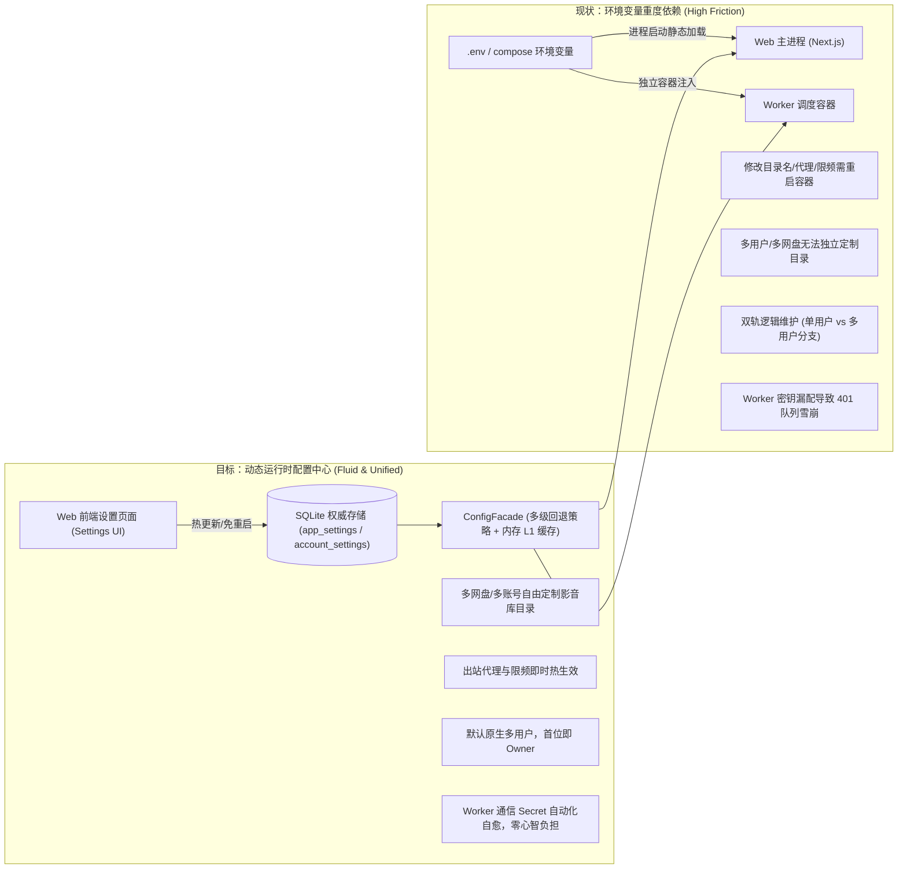
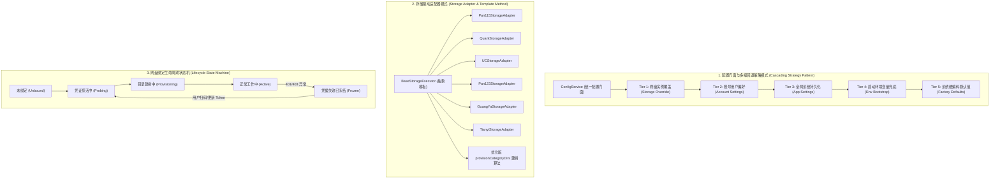

# 巡影 (Mediary Scout) 运行时配置下放与系统架构治理方案

> **文档定位**：针对环境变量下放 UI 设置页、多用户模式架构统一、死配置清理、设计模式重构与系统性能/逻辑健壮性的全景调研与落地技术方案。  
> **关联参考**：
> - [`docs/environment-variables.md`](file:///e:/WorkProject/Node/_Project/mediary-scout/docs/environment-variables.md)
> - [`docs/architecture/full-pipeline-audit-and-design-pattern-architecture.md`](file:///e:/WorkProject/Node/_Project/mediary-scout/docs/architecture/full-pipeline-audit-and-design-pattern-architecture.md)
> - [`docs/postmortems/pan115-directory-provisioning-and-multi-drive-governance.md`](file:///e:/WorkProject/Node/_Project/mediary-scout/docs/postmortems/pan115-directory-provisioning-and-multi-drive-governance.md)

---

## 目录 (Table of Contents)

1. [背景与核心痛点](#1-背景与核心痛点)
2. [配置下放调研：哪些配置应迁移至 Web 设置页面？](#2-配置下放调研哪些配置应迁移至-web-设置页面)
3. [配置精简与移除调研：哪些环境变量应当彻底清理？](#3-配置精简与移除调研哪些环境变量应当彻底清理)
4. [头脑风暴：可行性、逻辑闭环与性能防线深度剖析](#4-头脑风暴可行性逻辑闭环与性能防线深度剖析)
5. [架构演进与设计模式优化落地](#5-架构演进与设计模式优化落地)
6. [业界主流方案深度对比与参考借鉴](#6-业界主流方案深度对比与参考借鉴)
7. [现有基础设施复用与第三方库评估](#7-现有基础设施复用与第三方库评估)
8. [分阶段落地演进路线与测试保障](#8-分阶段落地演进路线与测试保障)

---

## 1. 背景与核心痛点

随着 Mediary Scout 从早期的单机桌面端脚本工具演化为如今支持 6 大网盘（115、夸克、UC、123、天翼、光鸭）、多用户并发隔离、微服务 Worker 调度与大模型 Agent 驱动的现代化自托管媒体聚合中枢，早期基于 `.env` / `process.env` 的静态配置体系逐渐显露出严重的架构失配与维护瓶颈：



### 1.1 核心痛点清单

1. **业务级配置与基础设施配置边界混淆**：
   - 像“媒体库根目录名”、“电影/剧集/番剧分类子目录名”、“115 网盘接口调用最小间隔（`115_MIN_DELAY_MS`）”、“代理服务器端口（`HTTP_PROXY`）”等本质上是纯粹的**业务偏好与运行时网络策略**，目前却被写死在 `.env` 中。用户想要微调一次，必须通过终端 SSH 登入服务器编辑文件并执行 `docker compose restart`，对于 NAS（群晖、绿联、飞牛）普通家庭用户门槛极高。
2. **多网盘与多租户场景下的语义破裂**：
   - 当前目录命名变量（`MEDIA_TRACK_LIBRARY_ROOT_DIR` 等）为全局静态变量。如果账号下既有 115 网盘（希望归入 `我的影音库`），又有夸克网盘（希望与已有的 `CloudDrive/Emby` 目录对接），或者家庭中多位成员各自希望使用不同的语言目录（如英文 `Movies` vs 中文 `电影`），全局静态环境变量完全无法满足需求。
3. **单用户/多用户双轨制（`MEDIA_TRACK_MULTI_USER`）的技术债务**：
   - 系统中充斥着大量的 `if (process.env.MEDIA_TRACK_MULTI_USER === "1")` 分支逻辑。单用户模式下局域网完全免密、全站共用 `acct_default`，多用户模式下强制 Session 门禁并校验 `workerApiGuard`。这不仅导致核心业务逻辑与测试用例严重分裂（一套逻辑两套跑法），而且只要用户开启多用户但漏填了 `MEDIA_TRACK_WORKER_SECRET`，后台 Worker 向 Web 的请求一律报 401，导致转存与巡检队列彻底卡死，是社区反馈最频繁的高危陷阱。
4. **历史遗留已废弃配置沉淀未清**：
   - 代码中仍保留有早期 PostgreSQL 连接串、Clawd 时代手动 CID fallback、硬编码 Xiaomi MiMo、早已弃用的调度脚本变量等，干扰了开发者的注意力与生产配置的简洁性。

---

## 2. 配置下放调研：哪些配置应迁移至 Web 设置页面？

### 2.1 环境变量 vs UI 设置项的划分原则

在 12-Factor App 原则与现代自托管软件（如 Jellyfin, Vaultwarden, Sonarr, MoviePilot）的最佳实践中，配置应当严格分为两层：

| 配置分类 | 定义与标准 | 典型示例 | 存放介质 |
| :--- | :--- | :--- | :--- |
| **基础设施启动配置 (Bootstrap / Infra Config)** | 进程启动前必须确定、无法从数据库动态读取，或者丢失它就无法连接数据库/网络的系统级元参数。 | `MEDIA_TRACK_SQLITE_PATH`、`MEDIA_TRACK_CREDENTIAL_KEY`、`WEB_PORT`、`DOCKER_MIRROR`、`MEDIARY_IMAGE` | 保持在环境变量 / `.env` / compose |
| **运行时业务配置 (Runtime Business Config)** | 影响业务执行策略、用户偏好、外部服务凭证、目录路由规则，且支持热重载（无需重启进程）的所有配置。 | 网盘目录命名、出站代理、网盘频控、通知通道、外部搜素服务基地址、AI 模型参数 | **下放至 Web 设置页面，SQLite 持久化** |

---

### 2.2 详细迁移清单与功能设计

#### (1) 网盘媒体库目录命名偏好（根目录名称、电影/剧集/番剧子目录）

- **当前涉及变量**：
  - `MEDIA_TRACK_LIBRARY_ROOT_DIR`（默认：`Mediary Scout`）
  - `MEDIA_TRACK_LIBRARY_MOVIES_DIR`（默认：`Movies`）
  - `MEDIA_TRACK_LIBRARY_TV_DIR`（默认：`TV`）
  - `MEDIA_TRACK_LIBRARY_ANIME_DIR`（默认：`Anime`）
- **迁移目标位置**：
  - **位置一（全局与账号偏好）**：「设置」→「网盘」（或「获取偏好」）新增「媒体库目录偏好 (Library Directory Naming)」卡片。
  - **位置二（单盘绑定向导与管理卡片）**：在扫码/添加网盘的向导第二步，以及已绑定网盘的「高级设置」抽屉中，允许直接查看和覆盖当前网盘的根目录与分类子目录！
- **分层落库方案**：
  1. **全局默认值**：存入 `app_settings`（键为 `library.root_name`, `library.movies_name`, `library.tv_name`, `library.anime_name`）。
  2. **账号偏好**：存入 `account_settings`，允许非管理员用户自定义自己的偏好。
  3. **网盘实体固化**：绑定建树成功后，该盘的实际目录名称与 CID（`root_cid`, `movies_cid`, `tv_cid`, `anime_cid`）固化在 `connected_storages` 表中，彻底摆脱后续全局修改对旧盘的意外冲击。

#### (2) 网盘频控安全与防封风控配额

- **当前涉及变量**：
  - `MEDIA_TRACK_115_MIN_DELAY_MS`（默认：`1200` 毫秒）
  - `MEDIA_TRACK_115_MAX_API_CALLS`（默认：`300` 次/任务）
  - `MEDIA_TRACK_115_WRITE_SCOPE_CIDS`（限制写入白名单）
  - `MEDIA_TRACK_115_PROTECTED_CIDS`（禁止删除保护名单）
- **痛点与迁移目标**：
  - 目前仅针对 115 且全部在 env 中配置，夸克/123/天翼无法复用该风控保护，且普通用户根本查不到 CID 怎么填。
  - **迁移位置**：「设置」→「网盘」→「网盘安全与频控防护 (Drive Rate Limit & Protection)」。
  - **功能设计**：
    - 可视化滑块调节 API 请求最小间隔（500ms ~ 3000ms）与单任务最大调用上限。
    - 在网盘卡片内直接提供“选择受保护目录”树状选择器，用户勾选文件夹后前端自动保存对应 CID，无需手动查 SQL。

#### (3) 出站网络代理配置（HTTP_PROXY / HTTPS_PROXY / NO_PROXY）

- **当前涉及变量**：
  - `HTTP_PROXY` / `http_proxy`
  - `HTTPS_PROXY` / `https_proxy`
  - `NO_PROXY` / `no_proxy`
- **痛点与迁移目标**：
  - 家庭内网代理软件（Clash / Sing-box / V2Ray）常因端口调整或节点失效需要更新，在 env 中修改必须重启容器。
  - **迁移位置**：「设置」→「资源与服务」新增「网络代理 (Outbound Proxy)」卡片（仅站主可见）。
  - **功能设计**：
    - 输入代理协议与地址（如 `http://192.168.1.5:7890`）。
    - 提供「测试代理连通性」按钮（并发探活 TMDB API 与 GitHub Release 接口，展示延迟毫秒数）。
    - 保存后在 Web 进程与内部网络栈动态热切换 `undici.setGlobalDispatcher`，**秒级热生效，无需重启任何容器**。

#### (4) 外部通知推送通道（Push Notification Channels）

- **当前涉及变量**：
  - `MEDIA_TRACK_PUSH_BARK_KEY`
  - `MEDIA_TRACK_PUSH_SERVERCHAN_SENDKEY`
  - `MEDIA_TRACK_PUSH_WECOM_WEBHOOK`
  - `MEDIA_TRACK_PUSH_WEBHOOK_URL`
- **迁移目标**：
  - 彻底将通知凭证迁移至「设置」→「巡检与通知」→「通知渠道配置」。
  - 允许多个账号（多用户模式下）分别绑定各自的 Bark 或 Server酱（家庭成员各自收到自己追更剧集的完结转存通知）。
  - 提供「发送测试通知」按钮，实时排查网络或 Token 错误。

#### (5) 外部公网访问域名与基础 URL

- **当前涉及变量**：
  - `MEDIA_TRACK_PUBLIC_BASE_URL`（如 `https://media.example.com`）
- **迁移目标**：
  - 迁移至「设置」→「远程访问」/「系统设置」。
  - 默认机制：若用户留空，系统自动提取传入请求的 `Host` 与 `X-Forwarded-Proto` 头；若填写则以设置页持久化数据为准。用于生成通知卡片中的直达点击超链接。

#### (6) 外部搜索源与 AI 模型统一收敛

- **涉及变量**：
  - `PANSOU_BASE_URL`、`TMDB_READ_TOKEN`、`PROWLARR_BASE_URL`、`PROWLARR_API_KEY`、`AGENT_MODEL_*`。
- **现状与治理**：
  - 代码库中已有部分表单存在，但底层存在“env 优先还是 DB 优先”的混乱。
  - **统一治理标准**：所有外部资源与服务配置，**以 Web 设置页（SQLite）为第一绝对优先源**；环境变量仅作为冷启动初始化 Seed 或彻底废弃。

---

## 3. 配置精简与移除调研：哪些环境变量应当彻底清理？

### 3.1 彻底移除 `MEDIA_TRACK_MULTI_USER`（多用户模式总开关）

#### 为什么单用户模式开关（`MEDIA_TRACK_MULTI_USER=0`）必须退出历史舞台？

1. **安全模型破损（Security Hazard）**：
   - 单用户模式下局域网完全免密、无鉴权。一旦用户开启了内网穿透（如 FRP/NPS/端口映射）而未正确设置反向代理头，公网流量会绕过门禁直接操作网盘增删文件。
2. **严重的架构分裂与认知负担**：
   - 现存代码库中有超过 100 处 `isMultiUserEnabled()` 判断，导致 API Key 鉴权、STRM 任务、媒体服务器配置、网盘绑定等所有新功能的实现与测试都必须冗余适配单用户与多用户两种场景。
3. **消除 Worker 401 卡死悲剧的前提**：
   - 正是因为有“单用户下免 secret、多用户下强制 secret”的分裂机制，导致大量用户在开启多用户时遗漏了 `MEDIA_TRACK_WORKER_SECRET`，导致后台队列全量阻塞。

#### 移除后的统一架构方案：原生多用户（Default Native Multi-User）

- **开箱即多用户**：系统启动后永远运行在严谨的多用户模型之上。
- **首位用户即站主（Owner Bootstrap Wizard）**：
  - 系统启动时检查 `accounts` 表：若无任何活跃账号或仅有未被认领的 `acct_default`，前端自动渲染「初始化站长向导（Setup Screen）」。
  - 站长输入用户名与密码后完成初始化，自动获得 Owner 权限。老单用户的数据（`acct_default`）通过现成的 `adoptDefaultAccount` 机制 100% 平滑绑定至新 Owner，零数据丢失。
- **如何满足“局域网不想输密码”的用户需求？**
  - 不应通过粗暴关闭鉴权系统实现，而应借鉴 **Jellyfin / Home Assistant** 的成熟做法：
  - 在「设置」→「账号与安全」中提供：
    1. **「局域网可信网段免密直通（Trusted Subnets Auto-Login）」**：配置 `192.168.0.0/16,10.0.0.0/8`，在此网段内的访问可直接以默认用户身份免密登录；
    2. **「持久会话（Remember This Device）」**：将 Session Cookie 过期时间延长至 90 天，家庭电视盒或内网 PC 仅需登录一次。

---

### 3.2 消除 `MEDIA_TRACK_WORKER_SECRET` 的手动配置

#### 痛点与解决方案

- **现状**：Web 与 Worker 容器通信时，需要用户在 `.env` 中使用 `openssl rand -hex 32` 手动生成密钥并在 `docker-compose.yml` 中注入两端。漏填或拼写错误会导致 Worker 永久 401。
- **自动化免配置方案（Auto-Provisioned Internal Secret）**：
  1. 在 `docker-compose.yml` 中，`mediaray-data:/app/data` 卷已经是 Web 容器持久化卷。只需将该卷同样只读挂载给 `worker` 容器（如 `/app/data:ro`）；
  2. Web 容器在启动时（`instrumentation.ts` 或服务启动钩子），检查 `/app/data/.worker_secret` 文件：
     - 若不存在，自动生成 32 字节高熵安全 Token 并写入该文件（文件权限 `0600`）；
     - 若用户在环境变量中显式配置了 `MEDIA_TRACK_WORKER_SECRET`，则优先遵循环境变量；
  3. Worker 容器启动时直接读取 `/app/data/.worker_secret` 发起请求，**普通用户在 `.env` 中完全不需要感知或配置此项**！

---

### 3.3 生产环境消除四大适配器变量

- **涉及变量**：
  - `MEDIA_TRACK_SEARCH_PROVIDER`
  - `MEDIA_TRACK_WORKFLOW_ADAPTER`
  - `MEDIA_TRACK_STORAGE_ADAPTER`
  - `MEDIA_TRACK_AGENT_ADAPTER`
- **问题**：目前必须在 `docker-compose.yml` 中写死 `tmdb`、`pansou`、`115`、`vercel-ai`。用户一旦使用单容器 `docker run` 未传入这些变量，系统立即退化为 Fake 假数据模式，完全无法搜索和入库。
- **整改方案**：
  - 在代码内核中，**生产环境（`NODE_ENV === "production"`）将这些适配器的默认值直接固化为真实实现**！
  - 存储适配器不再需要静态写死 `115`，而是根据用户在数据库中绑定的网盘驱动类型动态路由派发（基于网盘适配器注册表）；
  - 仅在测试环境（`NODE_ENV === "test"` 且显式指定测试开关）时才激活 `fake` 适配器。彻底消灭 Docker 部署因为漏传变量导致的假死状态。

---

### 3.4 历史废弃与死代码全面清理清单

经对全仓库代码审计，以下变量在代码中已完全丧失存在价值，列入清理清单：

| 环境变量 | 原用途 | 清理动作 |
| :--- | :--- | :--- |
| `MEDIA_TRACK_MULTI_USER` | 多用户开关 | **彻底删除**。全站默认且仅支持多用户架构，删除所有对应三元分支。 |
| `PAN115_COOKIE` | 环境变量直接写死 115 Cookie | **彻底删除**。统一走网页端扫码或 Cookie 导入，落库加密存储。 |
| `CLAWD_MEDIA_ROOT_CID`<br>`MOVIES_CID`<br>`TV_SHOWS_CID`<br>`ANIME_CID` | 早期 Clawd 阶段手动创建的 115 目录 CID | **彻底删除**。现代架构全品牌统一由 `provisionCategoryDirs` 自动建树落库。 |
| `MEDIA_TRACK_TV_PARENT_CID`<br>`MEDIA_TRACK_MOVIES_PARENT_CID`<br>`MEDIA_TRACK_ANIME_PARENT_CID`<br>`MEDIA_TRACK_115_TEST_ROOT_CID` | 单网盘时代父目录 CID fallback | **彻底删除**。已完全由 `connected_storages` 表结构接管。 |
| `MEDIA_TRACK_DEFAULT_TV_STORAGE_DIRECTORY_ID` | 强制指定剧集转存目录 CID | **彻底删除**。保留它会破坏规范的 `剧名 (年份)/Season N` 自动分层。 |
| `XIAOMI_MIMO_BASE_URL`<br>`XIAOMI_MIMO_MODEL_ID`<br>`XIAOMI_MIMO_API_KEY` | 早期硬编码小米模型参数 | **彻底删除**。统一收敛至通用 `AGENT_MODEL_*` 或前端「设置 → AI 模型」表单。 |
| `MEDIA_TRACK_POSTGRES_URL` | 早期 PostgreSQL 连接串 | **彻底删除**。S1.4b 已全面收敛为纯 SQLite 单引擎。 |
| `MEDIA_TRACK_PATROL_IGNORE_TIME_GATE` | 早期桌面端跳过零点巡检窗口 | **彻底删除**。已由 `runScheduledType3` 内核统一接管调度。 |
| `MEDIA_TRACK_BASE_URL`<br>`MEDIA_TRACK_RUN_NEXT_INTERVAL_MS`<br>`MEDIA_TRACK_TYPE3_PING_INTERVAL_MS`<br>`MEDIA_TRACK_SCHEDULER_ONCE` | 早期已废弃脚本 `scripts/scheduler.mjs` 参数 | **彻底删除**。该脚本已退役。 |

---

## 4. 头脑风暴：可行性、逻辑闭环与性能防线深度剖析

将配置从静态只读的 `process.env` 迁移至动态持久化的 SQLite + 前端热管理，绝非简单的“换个地方读取”，必须严格防范以下技术陷阱：

### 4.1 性能隐患与防线：高频读取下的 SQLite I/O 放大

- **风险隐患**：
  - 环境变量读取是 V8 内存访问（纳秒级）；
  - 后台 Worker 每 3 秒执行一次 Tick，任务队列消费过程中涉及多次转存和检索判断。如果每次判断都执行 `SELECT value FROM app_settings WHERE key = ...`，会导致严重的 SQLite 读锁争用、磁盘 I/O 放大以及上下文切换损耗。
- **架构应对方案：两级缓存穿透保护（L1 Memory Cache + L2 SQLite Storage）**：
  ```mermaid
  sequenceDiagram
    autonumber
    participant Caller as 业务调用方 (Worker/Route)
    participant Facade as ConfigFacade (内存注册表)
    participant SQLite as SQLite Database (app_settings)

    Caller->>Facade: get("library.naming", { accountId })
    alt L1 内存缓存命中且未过期 (TTL 60s)
      Facade-->>Caller: 立即返回内存解析对象 (0ms)
    else 缓存未命中或版本变更
      Facade->>SQLite: 批量读取配置键值
      SQLite-->>Facade: 返回持久化数据
      Facade->>Facade: 反序列化并写入本地 L1 Map (设置版本号)
      Facade-->>Caller: 返回最新配置
    end
  ```
  - **版本戳（`settings_version`）轻量探活**：
    在 `app_settings` 中维护单行全局版本号。只有在用户通过 Web 设置页触发写操作时，`settings_version` 才会递增；调用方仅需比对版本戳，无版本递增时 100% 内存直出，零 SQLite 磁盘 I/O。

---

### 4.2 逻辑闭环：目录重命名与网盘资产防断链保护

- **陷阱场景**：
  - 用户初始使用默认目录 `Mediary Scout / Movies` 转存了 50 部电影；
  - 随后用户在设置页将电影目录名称修改为 `电影 (4K)`；
  - 如果系统在后续转存时直接按新名字建了一个新文件夹，会导致**老电影在旧目录、新电影在新目录**，媒体库被无情撕裂；或者在刮削整理时因为 CID 变更导致识别丢失。
- **实体绑定模型（Storage-Bound Entity Model）解法**：
  ```mermaid
  stateDiagram-v2
    [*] --> TemplateConfig: 用户在设置页定义命名模板 (如 "我的影音库")
    TemplateConfig --> DriveBinding: 用户点击绑定新网盘
    DriveBinding --> Provisioning: 模板方法驱动创建物理目录并获取 CID
    Provisioning --> StorageSolidified: CID 固化至 connected_storages 行记录
    StorageSolidified --> RuntimeTransfer: 后续转存永远按固化的 CID 寻址

    note right of StorageSolidified
      哪怕用户后续在设置页修改了全局模板名，
      已绑定的网盘依然稳定使用已固化的 CID，
      绝不造成历史文件丢失或目录分裂！
    end note
  ```
  - **显式迁移工具（Explicit Migration Action）**：
    若用户确实希望对某个已绑定的网盘更改目录名称，系统在网盘管理卡片中提供显式的「重命名/迁移目录」操作流，先调用网盘重命名接口，再同步更新数据库中的 CID 与元数据，保证事务性闭环。

---

### 4.3 网络代理热重载防线：Node.js `undici` 全局分发器的优雅切换

- **技术细节**：
  - Next.js 服务端与 Node.js 运行时基于 `undici` 提供全局 `fetch`。
  - 目前 [`apps/web/features/settings-system/core/http-proxy.ts`](file:///e:/WorkProject/Node/_Project/mediary-scout/apps/web/features/settings-system/core/http-proxy.ts) 在模块加载时静态调用 `setGlobalDispatcher(new ProxyAgent(...))`。
- **热重载设计**：
  - 封装 `ProxyManager` 单例：提供 `updateProxyConfig({ httpProxy, httpsProxy, noProxy })` 方法；
  - 切换代理时，先创建新的 `ProxyAgent` 实例，原子替换全局分发器；
  - 随后调用旧 Agent 的 `.close()` 或 `.destroy()`，优雅释放旧连接池中的 TCP 句柄，杜绝文件描述符（FD）泄漏。

---

## 5. 架构演进与设计模式优化落地

为保证配置系统的优雅解耦、高扩展性与易测性，引入三大经典设计模式：



### 5.1 多级回退策略模式（Cascading Fallback Strategy Pattern）与配置门面

定义统一的类型安全配置接口，业务模块完全与底层存储解耦：

```typescript
export interface ConfigContext {
  accountId?: string;
  storageId?: string;
}

export interface ConfigStrategy {
  readonly priority: number;
  getValue<T>(key: string, ctx?: ConfigContext): Promise<T | undefined>;
}

export class ConfigService {
  private strategies: ConfigStrategy[] = [];
  private memoryCache = new Map<string, { value: unknown; expireAt: number }>();

  public registerStrategy(strategy: ConfigStrategy): void {
    this.strategies.push(strategy);
    this.strategies.sort((a, b) => b.priority - a.priority);
  }

  public async get<T>(key: string, ctx?: ConfigContext, defaultValue?: T): Promise<T> {
    const cacheKey = `${ctx?.storageId || ""}:${ctx?.accountId || ""}:${key}`;
    const cached = this.memoryCache.get(cacheKey);
    if (cached && cached.expireAt > Date.now()) {
      return cached.value as T;
    }

    for (const strategy of this.strategies) {
      const val = await strategy.getValue<T>(key, ctx);
      if (val !== undefined && val !== null && val !== "") {
        this.memoryCache.set(cacheKey, { value: val, expireAt: Date.now() + 60_000 });
        return val;
      }
    }

    return defaultValue as T;
  }

  public invalidate(keyPrefix?: string): void {
    if (!keyPrefix) {
      this.memoryCache.clear();
      return;
    }
    for (const k of this.memoryCache.keys()) {
      if (k.includes(keyPrefix)) this.memoryCache.delete(k);
    }
  }
}
```

### 5.2 存储驱动模板方法模式（Template Method Pattern）与全品牌统一建树

优化现有 6 大网盘目录建树与探活逻辑，提取公共模板：

- **单次列举建树算法**：
  在 `provisionCategoryDirs` 模板方法中：
  1. 列举根目录查找容器文件夹（如 `Mediary Scout`）；
  2. 若不存在，一次性创建容器文件夹，此时已确知该文件夹为空，**省去列举空目录的 API 往返**，直接并发创建 `Movies`、`TV`、`Anime` 三大子目录；
  3. 若容器文件夹已存在，**仅调用 1 次 `listChildDirs`** 获取子目录映射表，仅按需补齐缺失分类。整体建树 API 调用降低 50%~75%，有效免疫 115 与 123 网盘的高频限流风控。

### 5.3 网盘凭证与健康生命周期状态机（Lifecycle FSM）

杜绝目前通过散乱的 `status: "active" | "frozen"` 和多个 optional 字段引起的非法中间状态（如“已绑定但无 CID”、“已扫码但 Cookie 过期”）：

```typescript
export type StorageLifecycleStatus =
  | "unbound"
  | "probing"
  | "provisioning_dirs"
  | "active"
  | "auth_expired"
  | "rate_limited"
  | "dir_missing";

export interface StorageLifecycleState {
  status: StorageLifecycleStatus;
  storageId: string;
  provider: string;
  cids: { root?: string; movies?: string; tv?: string; anime?: string };
  errorMessage?: string;
  lastActiveAt?: string;
}
```

---

## 6. 业界主流方案深度对比与参考借鉴

| 维度 | MoviePilot (MP) | Sonarr / Radarr (`*arr` 家族) | AList / OpenList | Mediary Scout 本次演进方案 |
| :--- | :--- | :--- | :--- | :--- |
| **配置持久化介质** | 数据库（SQLite）为主，Docker 仅保留数据卷挂载。 | SQLite + 基础 XML。 | 纯 SQLite（`data/data.db`）。 | **纯 SQLite 单文件存储**（`app_settings` / `account_settings`），彻底告别环境变量重负。 |
| **媒体库目录映射** | 前端可视化路径映射，支持按影视分类自由指定存储与转移目标目录。 | 统一在 Settings → Media Management 中管理 Root Folders。 | 统一在“存储”管理中挂载虚拟路径并映射到实体路径。 | **前端三级层级配置**（全站默认模板 → 账号偏好 → 单网盘实例固化），兼顾灵活性与稳定性。 |
| **多用户安全模型** | 原生多用户，首个部署用户为超级管理员，支持多账号分配权限。 | 内置 Forms/Basic 认证，单一实例管理员掌控。 | 原生多用户，Admin 掌控所有存储挂载权限，普通用户分权。 | **彻底废弃单用户开关**，开箱默认原生多用户，首个用户为 Owner，老数据无缝归属。 |
| **出站网络代理** | 设置页面输入代理主机与端口，内置测试按钮，热生效。 | General 设置页配置 Proxy（支持 SOCKS5 / HTTP），测试连通性。 | 设置页配置全局代理。 | **前端设置页热管理**，动态重载 `undici` 分发器，支持即时延迟探活与零重启。 |
| **Worker/调度通信** | 进程内调度器或共享 Celery 消息队列。 | 进程内调度引擎。 | 进程内轮询与事件循环。 | **共享卷自动签发凭据**（`.worker_secret`），消灭手动配环境变量引起的 401 故障。 |

---

## 7. 现有基础设施复用与第三方库评估

### 7.1 现有基础设施直接复用矩阵

本项目现有代码库具备极高水平的基础设施建设，**无需重复造轮子**：

1. **类型安全数据库与加密存储**：
   - 现有的 [`packages/workflow/src/persistence/sqlite.ts`](file:///e:/WorkProject/Node/_Project/mediary-scout/packages/workflow/src/persistence/sqlite.ts) 与 [`db-schema.ts`](file:///e:/WorkProject/Node/_Project/mediary-scout/packages/workflow/src/persistence/db-schema.ts) 已经具备了完整的 `app_settings`、`account_settings`、`connected_storages` 表结构；
   - 现有的 `SECRET_SETTING_KEYS` 与 AES-256-GCM 加密机制已直接覆盖各类 API Token 与 Cookie，新增代理账密或通知凭据可直接纳入敏感词集合。
2. **账号级设置继承与读取器**：
   - 现有的 [`getAccountScopedSettings`](file:///e:/WorkProject/Node/_Project/mediary-scout/apps/web/features/settings-system/application/system-settings-service.ts#L26-L49) 已经实现了“优先读取账号个性化设置，若无则回退系统全局设置”的策略原型，可直接扩展。
3. **老用户数据无缝迁移机制**：
   - 现有的 `adoptDefaultAccount` 已经完全实现了“将 `acct_default` 下的网盘凭据、追更订阅、对话记录无损转移给首个注册站长”的逻辑，为安全移除 `MEDIA_TRACK_MULTI_USER` 铺平了道路。
4. **状态机与限流基础设施**：
   - 现有的 [`auth-fsm.ts`](file:///e:/WorkProject/Node/_Project/mediary-scout/apps/web/features/auth/core/auth-fsm.ts)、[`keyed-pool.ts`](file:///e:/WorkProject/Node/_Project/mediary-scout/packages/workflow/src/keyed-pool.ts)、[`drive-pacer.ts`](file:///e:/WorkProject/Node/_Project/mediary-scout/packages/workflow/src/drive-pacer.ts) 完全可复用于配置更新与网盘状态流转。

### 7.2 第三方库评估与选型决策

| 评估对象库 | 用途评估 | 决策与理由 |
| :--- | :--- | :--- |
| **`xstate`** | 复杂状态机管理 | **不引入**。项目追求零多余运行时体积，使用内聚的 TypeScript 判别联合类型与状态转移函数，兼具体积小、运行快、类型推导精准的优势。 |
| **`cache-manager`** | 内存与二级缓存管理 | **不引入**。现有几行带 TTL 的 Map 封装足以内聚满足两级缓存需求，无需增加外部依赖与潜在安全漏洞。 |
| **`dotenv-vault` / `env-cmd`** | 环境变量增强 | **不引入**。本方案核心目标正是**大幅缩减和消除环境变量**，转向数据库配置中心，增强外部 env 库背离整体架构演进方向。 |

---

## 8. 分阶段落地演进路线与测试保障


### 8.1 阶段任务细化清单

- [ ] **Phase 1：网盘媒体库目录命名偏好下放 UI**
  - 在 `db-schema.ts` / `settings-readers.ts` 中新增目录偏好读取器与更新契约；
  - 在前端「设置」→「网盘」面板增加「目录命名偏好」表单卡片；
  - 改造 `provisionCategoryDirs` 与 `drive-service.ts`，按照多级策略（网盘覆盖 → 账号偏好 → 系统偏好 → 默认值）解析目标路径。
- [ ] **Phase 2：出站代理与网络热重载下放 UI**
  - 在「设置」→「资源与服务」增加「出站代理设置」卡片与连通性自测按钮；
  - 改造 `http-proxy.ts`，支持 `ProxyManager.reload()` 动态更换全局 `ProxyAgent` 并销毁旧连接池。
- [ ] **Phase 3：网盘频控安全与保护白名单下放 UI**
  - 在「设置」→「网盘」高级配置抽屉中提供调用间隔滑块（ms）与写入白名单选择器；
  - 存储适配器执行器接入动态频控读取器。
- [ ] **Phase 4：多用户模式架构统一与 Worker 通信自愈**
  - 默认全站开启原生多用户，首个访问者直接进入 Owner 注册认领流程，移除 `MEDIA_TRACK_MULTI_USER` 环境变量及其对应的所有分支代码；
  - Web 启动时自动在共享持久卷生成内部通信 Secret 文件（`/app/data/.worker_secret`），Worker 容器挂载读取，消除普通用户手动配置负担。
- [ ] **Phase 5：死代码全面清理与文档同步**
  - 从全量源码中清理 `PAN115_COOKIE`、`CLAWD_*_CID`、`MEDIA_TRACK_*_CID`、`XIAOMI_MIMO_*` 等已失效变量的降级代码；
  - 更新 `.env.example` 与 `docs/environment-variables.md`，将配置指南精简至极简状态。

### 8.2 自动化测试与质量门禁矩阵

1. **单元与集成测试**：
   - 验证 `ConfigService` 优先级层级覆盖（网盘实例级 > 账号级 > 全局设置 > 默认模板）；
   - 验证缓存失效机制：修改设置后内存缓存立即更新，不再返回旧值；
   - 验证 `ProxyManager` 动态切换时无抛错且旧连接优雅关闭。
2. **多用户与认领回退测试**：
   - 模拟未初始化数据库：首次启动精准展示 Setup 认领屏；
   - 模拟老版本单用户升级：验证已存在的网盘凭证与追更数据无损迁移给首个站长账号。
3. **架构与代码复杂度门禁**：
   - 运行 `npm run gate`，确保消除死分支后代码复杂度、循环依赖检查与 TypeScript 类型校验 100% 通过。
