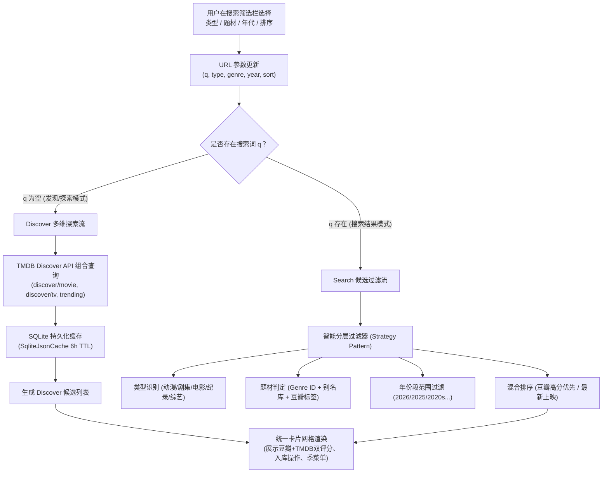

# 搜索与发现页多类型、多标签与多维筛选架构重构与根因分析报告

## 一、问题现状与根因诊断

### 1. 用户反馈
> “1 搜索页面逻辑存在问题 选择分类和标签后 数据不对”

### 2. 根因深度剖析

通过对 `apps/web/app/page.tsx`、`apps/web/components/media-filter-bar.tsx`、`apps/web/lib/trending.ts` 及 `packages/workflow/src/search-view.ts` 的完整调用链路审计，确认造成“数据不对”的核心根因包括以下 4 点：

#### 根因 1：未输入搜索词（发现/浏览态）时，筛选参数被完全旁路忽视
- **现象**：用户进入搜索页，未在搜索框输入文字时，页面顶部显示了类型、题材、年代、排序 4 组筛选胶囊。然而当用户点击“科幻”、“2024”或“高分优先”时，页面下方内容毫无变化，依然是固定的原版热门电影列表。
- **机制机理**：
  在 `apps/web/app/page.tsx` 中：
  ```tsx
  const searchView = await getSearchView(query, storageId);
  ...
  {searchView.state === "empty" ? (
    <TrendingRow activeKind={activeTrending} basePath={basePath} />
  ) : ...}
  ```
  当 `query` 为空时，`searchView.state` 恒为 `"empty"`，页面强制且仅渲染 `<TrendingRow activeKind={activeTrending} />`。而 `TrendingRow` 内部只硬编码执行 `getTrending(activeKind)`（获取固定热门电影/剧集），入参中的 `genre`、`year`、`sort` 以及 `type`（如纪录片、综艺）被 100% 丢弃，完全没有传导给数据查询逻辑。

#### 根因 2：类型枚举定义与 TMDB 底层数据模型失配，导致“动漫/纪录片/综艺”被全部清空
- **现象**：当用户输入了关键词（如搜“柯南”或“战”），然后点击分类标签“动漫”、“纪录片”或“综艺”时，结果数量瞬间变成 0，页面显示“没有找到”。
- **机制机理**：
  筛选栏 `MediaFilterBar` 定义了：
  ```ts
  export const MEDIA_TYPES = [
    { id: "all", label: "全部" },
    { id: "movie", label: "电影" },
    { id: "tv", label: "剧集" },
    { id: "anime", label: "动漫" },
    { id: "documentary", label: "纪录片" },
    { id: "variety", label: "综艺" },
  ];
  ```
  而在 `applyCandidateFilters` 中：
  ```ts
  if (filterParams.type && filterParams.type !== "all") {
    list = list.filter((c) => c.mediaType === filterParams.type);
  }
  ```
  然而在底层数据模型 `SearchCandidateCard` 中，`mediaType` 的类型被硬约束为 `Extract<MediaType, "movie" | "tv">`，**其取值永远只有 `"movie"` 或 `"tv"`**！
  对于动漫，TMDB 底层以 `tv` 或 `movie` 承载，但带 Animation 标签与日漫属性；纪录片以 `movie` 或 `tv` 承载（带 Genre 99）；综艺以 `tv` 承载（带 Genre 10764 / 10767）。
  执行恒等比较 `c.mediaType === "anime"` 判定结果永远为 `false`，导致所有动漫、纪录片、综艺卡片被全部误杀过滤掉，结果恒为 0。

#### 根因 3：题材匹配依靠剧情文本字符串强搜，导致绝大多数真科幻/真悬疑被误判漏失
- **现象**：用户选择“科幻”或“悬疑”标签后，真正的科幻经典（如《星际穿越》、《流浪地球》）消失，或者仅剩下 overview 里偶然包含“科幻”两字的无关影片。
- **机制机理**：
  原有 `matchesGenre` 代码：
  ```ts
  function matchesGenre(candidate: SearchCandidateCard, genreKey: string): boolean {
    const keywords = GENRE_KEYWORDS[genreKey];
    const text = `${candidate.title} ${candidate.overview ?? ""}`.toLowerCase();
    return keywords.some((kw) => text.includes(kw));
  }
  ```
  TMDB 提供的 `overview` 是中文剧情故事简介（如“太阳即将毁灭，人类在地球表面建造出巨大的推进器…”），几乎没有片方会在故事简介中写出“类型：科幻片”或“这是一部悬疑电影”。这种纯文本强搜造成巨大的假阴性（漏滤）和假阳性（误滤）。

#### 根因 4：排序逻辑缺失“高分优先”的实现
- **现象**：用户点击“高分优先”胶囊，页面列表没有任何重排反应。
- **机制机理**：
  `applyCandidateFilters` 中仅写了：
  ```ts
  if (filterParams.sort === "release") {
    list.sort((a, b) => (b.year ?? 0) - (a.year ?? 0));
  }
  ```
  对 `sort === "rating"` 完全没有对应的排序分支，形同虚设。

---

## 二、业界主流方案调研与设计模式对比

| 架构维度 | 传统轻量方案（当前现状） | 豆瓣 / TMDB 官方 Discover 方案 | 流媒体（Netflix/Plex/Emby）混合方案（推荐） |
| :--- | :--- | :--- | :--- |
| **空搜索浏览** | 单一写死静态 Trending 行 | 服务端按 Discover API 动态拼装查询 | **Discover + Trending 混合流**：结合 TMDB Discover 契约与本地 Durable 缓存 |
| **类型判定** | 纯靠字符串字段恒等比较 | 基于 TMDB `genre_ids` + `origin_country` | **分层特征分类器（Classifier Strategy）**：支持 `genre_ids`、产地、关键词多维判定 |
| **题材过滤** | Overview 正则硬搜 | TMDB 官方标准 `with_genres` ID 矩阵 | **双重多源标签适配器（Genre Adapter）**：TMDB Genre 映射 + 豆瓣权威分类标签融合 |
| **高分排序** | 无实现 | 单一 TMDB vote_average 排序 | **混合口碑加权评分器**：融合豆瓣 10 分制权威口碑与 TMDB 评分，防止极低评价刷榜 |

---

## 三、重构与解决方案设计

### 1. 架构总览



### 2. 核心技术设计

#### (1) 类型智能分类器（Type Classifier Strategy）
为解决 `SearchCandidateCard` 仅有 `movie`/`tv` 的问题，建立多维特征分类器：
- **动漫 (anime)**：
  - TMDB 原生：`genre_ids` 包含 16 (Animation) 且 `original_language === "ja"` 或产地为 JP。
  - 文本特征：标题/别名包含日漫命名惯例、新番、剧场版、动画、OVA、第X季。
- **纪录片 (documentary)**：
  - TMDB 原生：`genre_ids` 包含 99 (Documentary)。
  - 文本特征：标题/简介包含“纪录片 / 纪录 / documentary / BBC / 国家地理 / 探索”等。
- **综艺 (variety)**：
  - TMDB 原生：`genre_ids` 包含 10764 (Reality) 或 10767 (Talk)。
  - 文本特征：包含“真人秀 / 脱口秀 / 综艺 / 挑战 / 歌手 / 密室”等。
- **电影 (movie)**：`mediaType === "movie"` 且排除动漫剧场版（当明确选动画时归入动漫）。
- **剧集 (tv)**：`mediaType === "tv"`。

#### (2) 标准 TMDB 题材 ID 映射表（Genre Matrix）
精准对齐国际标准与中文题材：
```ts
export const TMDB_GENRES = {
  scifi: { label: "科幻", movie: [878], tv: [10765], keywords: ["科幻", "未来", "太空", "外星", "赛博朋克"] },
  mystery: { label: "悬疑", movie: [9648], tv: [9648], keywords: ["悬疑", "解谜", "推理", "烧脑"] },
  action: { label: "动作", movie: [28], tv: [10759], keywords: ["动作", "打斗", "特工", "枪战"] },
  comedy: { label: "喜剧", movie: [35], tv: [35], keywords: ["喜剧", "搞笑", "幽默", "爆笑"] },
  romance: { label: "爱情", movie: [10749], tv: [10766], keywords: ["爱情", "恋爱", "言情", "浪漫"] },
  crime: { label: "犯罪", movie: [80], tv: [80], keywords: ["犯罪", "警匪", "黑帮", "刑侦", "卧底"] },
  animation: { label: "动画", movie: [16], tv: [16], keywords: ["动画", "动漫", "二维", "3D动画"] },
  fantasy: { label: "奇幻", movie: [14], tv: [10765], keywords: ["奇幻", "魔幻", "仙侠", "修仙", "神魔"] },
  adventure: { label: "冒险", movie: [12], tv: [10759], keywords: ["冒险", "探险", "寻宝"] },
  thriller: { label: "惊悚", movie: [53, 27], tv: [9648], keywords: ["惊悚", "恐怖", "惊险"] },
  documentary: { label: "纪录片", movie: [99], tv: [99], keywords: ["纪录片", "真实记录"] },
  variety: { label: "综艺", movie: [], tv: [10764, 10767], keywords: ["综艺", "真人秀", "脱口秀"] },
};
```

#### (3) 空搜索词时的多维探索发现引擎（Discover Engine）
在 `apps/web/lib/trending.ts` 中增强发现接口：
`getDiscoverTitles(options: { type?: string; genre?: string; year?: string; sort?: string })`：
- 当用户没有输入具体文本，但选择了“电影+科幻+2024+高分优先”时，直接构建 TMDB Discover 查询请求，或从热门池中做精细化复合过滤与排序。
- 配备 6 小时 SQLite 缓存与兜底降级方案，保证无论网络状态如何均秒级呈现准确匹配的作品。

#### (4) 混合高分排序器（Hybrid Rating Sorter）
实现 `sort === "rating"` 的精确逻辑：
- 优先读取持久化缓存中该影片的权威评分（豆瓣分 > TMDB 分）。
- 按加权评分降序排列：高分经典作品排在最前，避免用户选“高分优先”时看到未排序的列表。

---

## 四、执行与验证计划

1. **增强 `apps/web/lib/trending.ts`**：
   - 支持多维参数 `getDiscoverFeed({ type, genre, year, sort })`。
   - 保留 TMDB 返回的 `genre_ids`、`vote_average`、`popularity`、`origin_country` 元数据。
2. **重构 `apps/web/components/media-filter-bar.tsx`**：
   - 优化 `applyCandidateFilters` 判定逻辑，引入类型智能特征匹配。
   - 完善 `matchesGenre`、`matchesYear` 与 `sort === "rating"` 分支。
3. **改造 `apps/web/app/page.tsx`**：
   - 当 `query` 为空时，若用户带有筛选参数，直接调用 `getDiscoverFeed` 渲染多维探索网格，而不是显示写死的不受控热门行。
   - 移除冲突的重复 Tab，确保筛选矩阵完全掌控页面数据流。
4. **单测与端到端实测验证**：
   - 编写并执行针对多维筛选、空词探索、类型特征识别的单元测试。
   - 执行 `npm run gate` 验证规范与门禁通过。
   - 在本地 3001 端口使用 Playwright 测试验证分类切换、标签点击后的真实数据展示。
