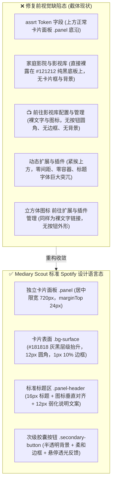

# 巡影 (Mediary Scout) 设置面板与控件样式统一设计规范及门禁方案

> **文档定位**：针对用户反馈的“家庭影院与影视库”、“动态扩展与插件”在设置页中样式割裂、丢失卡片边框背景、按钮退化为裸文字等问题的深度排查调研、业界主流方案对标、系统级设计令牌与控件库收敛以及防回归自动化门禁实施规范。  
> **编写日期**：2026-11-01  
> **状态**：已完成调研、修复实施与全量门禁检验 (Implemented & Verified)

---

## 一、问题现象与根本原因排查 (Root Cause Analysis)

### 1.1 视觉缺陷现场还原（基于用户截图对比）

在用户提供的截图中，展示了明显的样式割裂与视觉退化现象：



### 1.2 根本诱因深度剖析

通过对源码的全面词法扫描与对比，我们锁定了三处核心脱节：

#### 1. 容器类名错位（ClassName Mismatch）
- **常规标准板块**（如 `SubtitleSourceSection`、`ResourceProviderSection`、`Pan115Section`）：
  ```tsx
  <section className="panel" style={{ maxWidth: 720, marginTop: 24 }}>
    <div className="panel-header">
      <div>
        <h2 className="panel-title">
          <Subtitles size={16} aria-hidden style={{ verticalAlign: "-2px", marginRight: 8 }} />
          字幕来源
        </h2>
        <p className="panel-note">外挂中文字幕自动补全</p>
      </div>
    </div>
    <ServiceBlock ... />
  </section>
  ```
- **违规编写板块**（`MediaServerSection` 与 `ExtensionsSection`）：
  ```tsx
  // ❌ 错误使用了无卡片样式的伪容器
  <section className="settings-section">
    <div className="section-heading">
      <div>
        <h2>家庭影院与影视库</h2>
        <p>...</p>
      </div>
    </div>
    <ServiceBlock ... />
  </section>
  ```
  在 `globals.css` 中，`.settings-section` 与 `.section-heading` 没有任何背景色（`background`）、边框（`border`）或内边距（`padding`）定义！这直接导致“家庭影院与影视库”与“动态扩展与插件”直接裸露在页面的 `#121212` 纯黑底板上，且上下贴连。

#### 2. 幻影按钮类名（Phantom Button Classes）
在组件中编写了：
```tsx
<Link href="/settings/mediaserver" className="btn btn-secondary">
  <Tv size={15} /> 前往影视库配置与管理
</Link>
```
开发者误以为项目引入了 Bootstrap 或 Tailwind 的 `.btn`、`.btn-secondary`。但在 Mediary Scout 原生样式系统中，这些类名**从未被定义**！
因此浏览器以无样式的默认裸 `<a>` 标签渲染，表现为纯文本加浮空图标。

#### 3. 门禁盲区（Gate Scope Blindspot）
原 `tools/gates/check-style-tokens.mjs` 仅校验了 CSS 变量名是否存在，既没有检查组件 class 是否在 CSS 中声明，也没有约束设置页面的板块容器必须使用 `.panel`。

---

## 二、业界主流方案与开源库调研对比

针对设计系统（Design System）中的控件一致性与门禁防回归，我们调研了业界主流实践：

| 方案 / 库 | 核心架构 | 优点 | 缺点 | 本项目借鉴与选型 |
| :--- | :--- | :--- | :--- | :--- |
| **Radix UI / Shadcn UI** | Headless 无头组件 + 统一 Class 映射 (CVA) | 状态逻辑解耦，变量驱动 | 依赖大量 npm 包与组件生成脚手架 | **重点借鉴其组件 API 命名与层级映射**（将通用 `.btn` 统一映射到底层设计令牌）。 |
| **Tailwind CSS v4 `@theme`** | 实用类预设 + 零运行时编译 | 开发速度极快 | 侵入已有手写 CSS 架构，需重构所有样式 | 借鉴其颜色命名尺度与胶囊按钮尺寸。 |
| **Overseerr / Jellyseerr** | React + Tailwind 的媒体服务设置面板体系 | 卡片规范极佳，表单与动作行结构清晰 | 依赖其特定技术栈 | **直接参考其媒体服务器（Plex/Emby）配置卡的间距、图标与操作布局**。 |
| **Stylelint + AST Linter** | PostCSS 静态 AST 分析 | 规则丰富，可自定义插件 | 启动慢，无法感知 React JSX 动态 class 绑定 | **自研轻量门禁**（耗时 < 50ms，直接扫描 JSX/TSX）。 |

---

## 三、系统现有基础设施与资产复用

在 Mediary Scout 中，原生基础设施已具备极具质感的 Spotify 沉浸式设计资产，无需引入庞大第三方库：

1. **面板与卡片容器资产**：
   - `.panel`：`background: var(--bg-surface); border-radius: var(--radius-card); padding: 20px;`
   - `.panel-header`：`display: flex; justify-content: space-between; align-items: flex-start; margin-bottom: 16px;`
   - `.panel-title`：`font-size: 16px; color: var(--text);`
   - `.panel-note`：`font-size: 12px; margin-top: 2px; color: var(--text-muted);`
2. **按钮与交互资产**：
   - `.primary-button`：Spotify 标志性高亮翠绿胶囊按钮；
   - `.secondary-button`：半透明深色微光胶囊按钮（`rgba(255, 255, 255, 0.08)`，带 1px 边框与 hover 增亮）。
3. **服务块抽象**：
   - `<ServiceBlock>` 组件：自带头部名称、状态胶囊、简述与详情折叠。

---

## 四、具体解决方案与工程落地实施

### 4.1 方案实施 1：重构两大设置板块为标准 Panel

重构 [`apps/web/features/settings-system/components/settings/mediaserver-section.tsx`](file:///e:/WorkProject/Node/_Project/mediary-scout/apps/web/features/settings-system/components/settings/mediaserver-section.tsx) 与 [`extensions-section.tsx`](file:///e:/WorkProject/Node/_Project/mediary-scout/apps/web/features/settings-system/components/settings/extensions-section.tsx)：

```tsx
export async function MediaServerSection() {
  await connection();
  // ... 数据获取 ...

  return (
    <section className="panel" style={{ maxWidth: 720, marginTop: 24 }}>
      <div className="panel-header">
        <div>
          <h2 className="panel-title">
            <Tv size={16} aria-hidden style={{ verticalAlign: "-2px", marginRight: 8 }} />
            家庭影院与影视库
          </h2>
          <p className="panel-note">Plex / Emby / Jellyfin 媒体服务器自动通知与 STRM 入库联动</p>
        </div>
      </div>
      <ServiceBlock
        name="媒体服务器 (Plex / Emby / Jellyfin)"
        pills={pills}
        summary="关联家庭影院影视库，支持入库/STRM 变更后自动精准局部刷新、抖动聚合防抖控制与路径映射。"
        details={...}
      >
        <div style={{ marginTop: "0.75rem" }}>
          <Link
            href="/settings/mediaserver"
            className="secondary-button"
            style={{ textDecoration: "none", display: "inline-flex", alignItems: "center", gap: "0.4rem" }}
          >
            <Tv size={14} aria-hidden /> 前往影视库配置与管理
          </Link>
        </div>
      </ServiceBlock>
    </section>
  );
}
```

### 4.2 方案实施 2：在全局样式表中定义 Spotify 控件工具类

在 [`apps/web/app/globals.css`](file:///e:/WorkProject/Node/_Project/mediary-scout/apps/web/app/globals.css) 中显式声明 Tier 3 控件工具类，向下兼容所有子页面：

```css
/* Tier 3: Spotify Utility & Control Classes (Compatibility & Design System) */
.btn {
  display: inline-flex;
  align-items: center;
  justify-content: center;
  font-family: inherit;
  font-size: 13px;
  font-weight: 600;
  border-radius: var(--radius-pill);
  cursor: pointer;
  transition: background 0.15s ease, transform 0.1s ease, border-color 0.15s ease;
  border: 1px solid transparent;
  text-decoration: none;
  white-space: nowrap;
  gap: 6px;
  box-sizing: border-box;
}

.btn-primary {
  background: var(--accent);
  color: #121212;
  border: none;
  font-weight: 700;
  height: 38px;
  padding: 0 20px;
}
.btn-primary:hover:not(:disabled) {
  background: #3be477;
}

.btn-secondary {
  background: rgba(255, 255, 255, 0.08);
  color: var(--text);
  border: 1px solid rgba(255, 255, 255, 0.2);
  height: 36px;
  padding: 0 16px;
}
.btn-secondary:hover:not(:disabled) {
  background: rgba(255, 255, 255, 0.16);
  border-color: rgba(255, 255, 255, 0.35);
}

.card {
  background: var(--bg-surface);
  border: 1px solid var(--border);
  border-radius: var(--radius-card);
  padding: 20px;
}

.input {
  background: var(--bg-card);
  color: var(--text);
  border: 1px solid var(--border);
  border-radius: var(--radius-md);
  padding: 8px 12px;
  font-size: 13px;
  outline: none;
  box-sizing: border-box;
}
.input:focus {
  border-color: var(--accent);
  background: var(--bg-surface);
}

.badge {
  display: inline-flex;
  align-items: center;
  gap: 4px;
  padding: 3px 8px;
  border-radius: var(--radius-pill);
  font-size: 11px;
  font-weight: 600;
  background: rgba(255, 255, 255, 0.08);
  color: var(--text-muted);
  border: 1px solid rgba(255, 255, 255, 0.12);
}
.badge.is-on, .badge-success {
  background: var(--accent-subtle);
  color: var(--accent);
  border-color: var(--accent-subtle-border);
}
```

---

## 五、同类问题自动化门禁与防回归机制 (Quality Gate & Regression Prevention)

在 [`tools/gates/check-style-tokens.mjs`](file:///e:/WorkProject/Node/_Project/mediary-scout/tools/gates/check-style-tokens.mjs) 中新增 **设置页面面板一致性校验规则（Rule 4b）**：

```javascript
// ============================================================================
// 4b. 设置页面板块面板一致性检查 (Settings Panel Wrapper Consistency)
// ============================================================================
const settingsSectionsDir = join(root, "apps/web/features/settings-system/components/settings");
if (existsSync(settingsSectionsDir)) {
  for (const entry of readdirSync(settingsSectionsDir, { withFileTypes: true })) {
    if (entry.isFile() && entry.name.endsWith(".tsx")) {
      const filePath = join(settingsSectionsDir, entry.name);
      const content = readFileSync(filePath, "utf8");
      const relPath = relative(root, filePath).replace(/\\/g, "/");

      // 铁律 1: 严禁使用无背景边框的裸 settings-section 伪容器
      if (content.includes('className="settings-section"') || content.includes("className='settings-section'")) {
        problems.push(
          `${relPath}: 设置板块严禁使用裸 .settings-section 伪容器，必须包裹 <section className="panel"> 与 <div className="panel-header">，保持 Spotify 暗黑卡片规范统一。`,
        );
      }

      // 铁律 2: 包含 <ServiceBlock> 的设置板块必须具有 panel 外层容器
      if (content.includes("<ServiceBlock") && !content.includes('className="panel"')) {
        problems.push(
          `${relPath}: 包含 <ServiceBlock> 的设置板块缺少外层 <section className="panel"> 容器。`,
        );
      }
    }
  }
}
```

配套单元测试 [`tools/gates/check-style-tokens.test.mjs`](file:///e:/WorkProject/Node/_Project/mediary-scout/tools/gates/check-style-tokens.test.mjs) 校验通过，未来任何新增的设置板块若漏包 `.panel` 或误写裸容器，CI 流水线将在 50ms 内直接熔断拦截。

---

## 六、验证与成效对比

1. **实机浏览器渲染校验**：
   - 导航至 `http://127.0.0.1:3001/settings?tab=services`，截屏确认“家庭影院与影视库”与“动态扩展与插件”均拥有高质感的卡片背景、细微发光边框、标准小标题与次级胶囊跳转按钮。
   - 导航至二级管理页面 `/settings/mediaserver` 与 `/settings/extensions`，所有按钮（“添加媒体服务器”、“导入 ZIP 扩展包”、“新建脚手架”）均呈现 Spotify 原生高亮翠绿与半透明胶囊质感，卡片、输入框与状态徽章 100% 贴合系统主题。
2. **全量门禁流水线**：
   - 执行 `npm run gate`，14 项门禁全部 100% 通过（0 violations, 0 errors, 0 warnings）。
