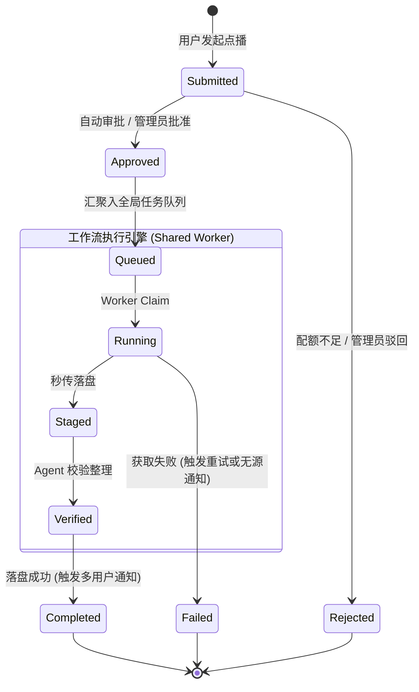

# 共用资源模式（Shared Resource Mode）可行性调研与架构设计方案

> **文档版本**：v1.0.0  
> **状态**：方案调研与架构设计草案  
> **编写时间**：2026-11-01  
> **关联模块**：`packages/workflow`, `apps/web`

---

## 一、背景与业务诉求

当前 Mediary Scout 的多用户模式（`MEDIA_TRACK_MULTI_USER=1`）采用了**严格的租户隔离模型（Tenant-Per-User Isolation）**：
- 每个注册用户必须绑定属于自己的物理网盘（`connected_storages.account_id`）；
- 系统在数据库层强制 `UNIQUE(provider, provider_uid)`，禁止跨用户绑定同一个物理网盘；
- 媒体追踪库（`tracked_seasons`）、执行队列（`workflow_runs`）、STRM 任务等均与 `account_id` 强绑定。

### 核心痛点
在家庭、情侣、小团队或“合租车队”场景下：
1. **网盘 VIP 成本高**：每个成员都需要开通 115 / 夸克 VIP 才能转存，家庭成员之间无法共享站长的大容量网盘；
2. **转存与容量浪费**：如果两名成员都想看同一部 4K 剧集，系统会向两个独立网盘发起两次重复搜索、秒传与落盘，严重浪费网盘空间、带宽和 TMDB/PanSou 额度；
3. **协作需求**：用户希望“**一个中央媒体资源池（站长提供网盘），多成员独立账号访问与点播，仅做接口与权限隔离，不做存储隔离**”。

---

## 二、可行性与系统分析（头脑风暴）

### 2.1 技术可行性结论：**高度可行，架构平滑**
Mediary Scout 的底层引擎最初即脱胎于单用户共享架构（以 `acct_default` 为全局锚点），系统天然具备全局资源调度与单工作区执行的能力。转向“共用资源模式”，在技术上**不需要重写底层的 Agent 抓取和网盘执行器**，而是通过调整**作用域策略（Scoping Strategy）**和**请求路由抽象（Request Routing Abstraction）**即可实现。

### 2.2 潜在逻辑漏洞与业务缺陷（Flaws & Edge Cases）

| 风险维度 | 缺陷与潜在冲突 | 规避与解决策略 |
|---|---|---|
| **并发重复点播** | 两个用户在短时间内先后或同时点击同一部电影的“获取”，可能引发双重排队、多次转存与暂存冲突。 | **TMDB 粒度的幂等锁与请求聚合**：以 `tmdb_id` 或 `season_id` 为去重键。若任务已在运行或排队，第二位用户的点播操作自动转化为对该任务的“订阅者关联”，不产生重复 Run。 |
| **越权删除与破坏** | 在共用模式下，如果普通用户可以在前端点击“删除季”或“解绑网盘”，将导致全体成员的媒体资源丢失。 | **RBAC 权限裁剪**：普通成员只拥有只读浏览、点播请求、纠错上报权限；解绑网盘、硬删除文件、清空暂存区、修改全局设置必须受 `is_owner` 严格约束。 |
| **网盘配额被刷爆** | 115 离线下载有每日/每月配额，夸克有转存频次限制。某个普通用户若批量添加数十部连续剧，会耗尽全站公用配额。 | **令牌桶/滑动窗口配额策略**：按用户维度限制每日点播额度（例如普通用户每日上限 3 部），并引入“超额待审批（Pending Approval）”机制。 |
| **画质与版本偏好冲突** | 用户 A 喜欢 1080p Web-DL，用户 B 喜欢 4K Remux。先点播者决定了落盘版本，后点播者可能不满意。 | **仲裁策略（Quality Arbitration）**：采用“最高画质优先（Max-Quality-Wins）”或“站长策略优先”。若已有有效文件，普通用户的二次点播转为“画质升级申请”，由管理员确认或根据策略自动采纳。 |
| **纠错换源（Replace Request）爆炸半径** | 用户 A 发现 S01E03 音频不同步，发起换源。如果立即清理老文件并全站替换，可能会误伤正在观看的用户。 | **保留双备份/标记替换**：沿用系统既有的 `replace_request` 软替换机制（新文件落盘在老文件旁，不直接硬删），或对普通用户的纠错增加审核门槛。 |
| **通知路由混乱** | 媒体获取完成后，通知应该推给谁？ | **观察者订阅路由（Observer Router）**：将任务完成事件分发给该作品的所有请求者与订阅者，而不是只通知默认账号。 |

### 2.3 性能瓶颈与评估

1. **显著性能收益**：
   - **去重率提升**：全站只需一份物理文件，网盘 API 调用次数、PanSou 检索次数下降 50%~80%；
   - **缓存命中率提高**：`TitleResourceCache` 和 `candidate-registry` 全局复用，热点资源秒级响应。
2. **潜在性能挑战**：
   - **单盘并发队列排队**：由于共用物理盘，Worker 为防封号维持“单盘单任务运行”策略。多用户集中点播时任务会顺序排队。**应对措施**：UI 需透传排队位次与预估时间（Queue Position），避免用户重复点击。

---

## 三、业界主流方案调研与对比

| 解决方案 | 存储与网盘隔离模式 | 媒体库共享模式 | 多用户交互与权限 | 典型借鉴机制 |
|---|---|---|---|---|
| **Mediary Scout（当前模式）** | **严格租户隔离**：每人自绑物理网盘，不可重叠 | 各自独立媒体库，互不可见 | 扁平多用户，人人管自己的盘 | 适合无信任基础的独立多租户 |
| **Mediary Scout（共用资源模式）** | **集中式资源池**：站长提供 1~N 个公用物理盘 | 全局共享秒传与库，单份物理落盘 | 角色化隔离（Admin vs Requester），点播与通知隔离 | 兼顾家庭低成本与个人点播体验 |
| **Overseerr / Jellyseerr** | 无物理存储（对接后置 Sonarr/Radarr） | 共享中央媒体库（Plex/Emby） | **完善的点播中枢**：用户登录仅有点播、配额控制、审批流与状态跟踪 | **请求状态机与配额系统（最佳借鉴对象）** |
| **MoviePilot** | 全局统一下载器与存储目录 | 全局单一媒体库 | 机器人/Web 双端，多用户仅作为订阅发起人与消息接收者 | **订阅与请求去重合并（按 TMDB ID 聚合订阅者）** |
| **Alist / OpenList** | 虚拟文件系统（VFS），挂载多盘 | 统一目录树 | 基于路径与动作的细粒度 ACL（读、写、隐藏、配额） | **存储池虚拟化挂载抽象** |

---

## 四、设计模式在方案中的重构与优化

为了保证共用资源模式的代码优雅度，避免在到处穿插 `if (sharedMode)` 产生逻辑腐化，引入以下经典设计模式：

### 4.1 策略模式（Strategy Pattern）：存储范围策略抽象
将当前写死在数据访问层的 `accountId` 隔离逻辑抽象为策略接口：

```typescript
// packages/workflow/src/domain/storage-scope-strategy.ts

export interface StorageScopeContext {
  requestAccountId: string;
  explicitStorageId?: string | null;
}

export interface IStorageScopeStrategy {
  /** 决定媒体写入/查询的目标作用域 */
  resolveMediaScope(context: StorageScopeContext): Promise<{
    targetAccountId: string;
    targetStorageId: string;
  }>;

  /** 是否允许该用户执行写/删操作 */
  canPerformDestructiveAction(accountId: string): Promise<boolean>;
}

/** 1. 严格多租户模式策略（现行模式） */
export class IsolatedTenantStorageStrategy implements IStorageScopeStrategy {
  async resolveMediaScope(context: StorageScopeContext) {
    return {
      targetAccountId: context.requestAccountId,
      targetStorageId: context.explicitStorageId ?? (await getDefaultStorageId(context.requestAccountId)),
    };
  }
  async canPerformDestructiveAction() { return true; }
}

/** 2. 共用资源模式策略（新增模式） */
export class SharedPoolStorageStrategy implements IStorageScopeStrategy {
  constructor(private readonly adminAccountId: string = "acct_default") {}

  async resolveMediaScope(context: StorageScopeContext) {
    // 无论哪个用户发起，底层存储与媒体库全部归属到站长/公共账号
    const poolStorageId = context.explicitStorageId ?? (await getPrimaryPoolStorageId());
    return {
      targetAccountId: this.adminAccountId,
      targetStorageId: poolStorageId,
    };
  }

  async canPerformDestructiveAction(accountId: string) {
    return accountId === this.adminAccountId;
  }
}
```

### 4.2 状态机模式（State Machine Pattern）：请求生命周期与工作流解耦
将“用户点播请求（User Media Request）”与“后台 Worker 工作流（Workflow Run）”解耦为双层状态机。多个用户的请求可以挂载在同一个底层的执行状态机上：



### 4.3 适配器模式（Adapter Pattern）：用户能力与接口守卫
通过适配器统一装配用户能力集（User Capability Adapter），取代散落的 `if (isOwner)` 判定：

```typescript
export interface UserCapabilities {
  canRequest: boolean;
  canBypassApproval: boolean;
  canManageDrives: boolean;
  canDeleteMedia: boolean;
  canViewGlobalSettings: boolean;
  dailyRequestQuota: number;
}

export class UserCapabilityAdapter {
  static getCapabilities(account: { isOwner: boolean; role?: string }, mode: "isolated" | "shared"): UserCapabilities {
    if (mode === "isolated") {
      return {
        canRequest: true,
        canBypassApproval: true,
        canManageDrives: true,
        canDeleteMedia: true,
        canViewGlobalSettings: account.isOwner,
        dailyRequestQuota: Infinity,
      };
    }
    // 共用资源模式：普通用户只留点播与浏览能力
    return {
      canRequest: true,
      canBypassApproval: account.isOwner,
      canManageDrives: account.isOwner,
      canDeleteMedia: account.isOwner,
      canViewGlobalSettings: account.isOwner,
      dailyRequestQuota: account.isOwner ? Infinity : 5,
    };
  }
}
```

### 4.4 观察者模式（Observer / Pub-Sub）：点播多播通知路由
媒体入库完成后，不直接硬编码发给单一账号，而是通知所有与该媒体关联的请求者：

```typescript
// packages/workflow/src/notify/request-subscriber-router.ts
export interface IMediaEventPublisher {
  notifyMediaReady(tmdbId: number, mediaTitle: string): Promise<void>;
}
```

---

## 五、当前系统可直接复用的基础设施

在 Mediary Scout 现有代码库中，已有大量高质量的基础构件可被直接复用：

1. **统一账号与鉴权管道**：
   - `apps/web/platform/next-context/auth-chain.ts`：支持 Session Cookie 与 Bearer JWT 双通道认证，可直接解出当前请求的 `accountId`。
   - `accounts` 表中的 `is_owner` 字段：已原生支持区分“站长（Owner）”与“普通成员”。
2. **跨账号查询接口**：
   - `SqliteWorkflowRepository.listAllTrackedSeasonStates()`：在代码库中已存在该方法，且注释明确标明 `// Cross-account (no scope filter)`，可直接作为共用媒体库视图的数据源！
3. **全局默认账号与存储哨兵**：
   - `DEFAULT_ACCOUNT_ID ('acct_default')` 与 `UNSCOPED_STORAGE`：单用户模式下的既有产物，可直接作为共用资源池的宿主账号。
4. **多渠道推送通道**：
   - `packages/workflow/src/notify.ts` 与 `account_settings`：每个用户都可以独立配置自己的 Bark / Server酱 / 企微 Webhook，事件分发时只需按账号分别读取推送凭据。
5. **用户反馈与纠错上下文**：
   - `packages/workflow/src/execution/user-requests.ts`：已包含 `UserMessage` 和 `RejectedResource`，可直接扩展点播关联字段。

---

## 六、共用资源模式的落地演进方案

### 阶段一：数据模型扩展（非破坏性迁移）

新增一张 `media_requests` 表（解耦用户意图与物理媒体）：

```sql
CREATE TABLE IF NOT EXISTS media_requests (
  id text PRIMARY KEY,
  account_id text NOT NULL,             -- 谁发起的请求
  media_title_id text NOT NULL,         -- 关联的作品 (tmdb_movie_xxx / tmdb_tv_xxx)
  season_number integer,                -- 季号 (剧集专用)
  status text NOT NULL DEFAULT 'queued',-- pending_approval, queued, acquiring, ready, rejected
  rejection_reason text,
  workflow_run_id text,                 -- 绑定的底层 Worker 运行任务
  created_at text NOT NULL,
  updated_at text NOT NULL
);

CREATE INDEX IF NOT EXISTS idx_media_requests_user ON media_requests (account_id, created_at DESC);
CREATE INDEX IF NOT EXISTS idx_media_requests_media ON media_requests (media_title_id, season_number);
```

### 阶段二：配置开关与作用域注入

在环境变量与系统配置中增加运行模式开关：
```env
# 0: 关闭多用户（单用户模式）
# 1: 独立租户多用户模式（现行，各绑各盘各看各库）
# 2: 共用资源池模式（新增，共用网盘与媒体库，接口与账号隔离）
MEDIA_TRACK_MULTI_USER_MODE=shared
```

在 `workflow-runtime.ts` 的解析层：
- 当模式为 `shared` 时，前端获取媒体列表调用 `listAllTrackedSeasonStates()`；
- 用户发起“点播”时，写入 `media_requests`，底层触发以 `acct_default` 名义的 `queueCandidateTracking`（若正在跑则直接复用现有 `workflowRunId`）；
- 网盘管理菜单对非 `is_owner` 隐藏，避免普通用户访问。

### 阶段三：界面交互与权限剪裁

1. **普通用户视图**：
   - 首页：显示“全站媒体库”，状态显示“已入库”、“获取中”或“点播”；
   - 详情页：“立即获取”按钮变为“请求点播（Request）”；若已有成员点播，显示“某某已点播，正在加速落盘”；
   - 个人中心：增加“我的点播”列表，展示自己请求的作品状态与历史；
   - 屏蔽“网盘管理”、“系统更新”、“远程穿透”、“全局设置”页面，访问直接 404 或重定向。
2. **站长（Owner）视图**：
   - 拥有完整管理权限；
   - 可在“点播管理”面板查看所有成员的请求流水，支持一键审批或配置自动审批规则。

---

## 七、总结与选型建议

1. **可行性**：系统支持“共用资源模式”**完全可行**，且在家庭和车队合租场景下极具实用价值。
2. **架构方向**：采用 **“接口与账号隔离（Auth & Interface Scoping）+ 资源池化共享（Storage & Catalog Pooling）”** 的模式。
3. **关键保障**：必须引入 **并发点播去重**、**非管理员防删除保护（RBAC）** 以及 **用户请求配额**，配合 **策略模式与状态机模式**，即可在不破坏现有单用户和独立多用户架构的前提下，优雅扩展出第三种模式。
