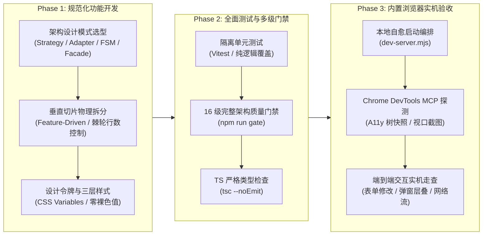
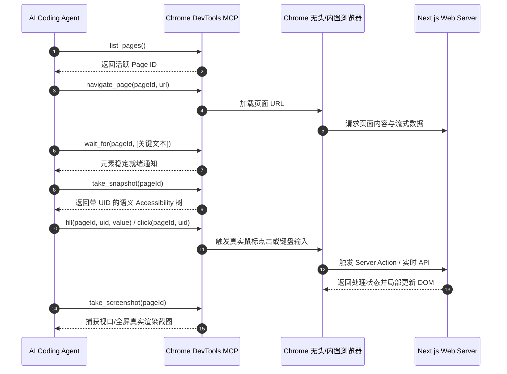

# 巡影标准工程研发闭环规范：功能开发、功能测试与浏览器实机验收全流程指南

> **文档标识**：`docs/architecture/standard-engineering-workflow-dev-test-and-browser-acceptance.md`  
> **编写日期**：2026-11-01  
> **适用对象**：AI 编码助手（Antigravity、Claude Code、Cursor）、全栈工程师与架构治理人员  
> **标杆案例**：运行时配置下放 UI、出站代理热重载、Worker 密钥自愈、多用户治理与资源发现过滤组件落地

---

## 1. 背景与核心目标 (Why This Guide Exists)

在以 AI Agent（如 Antigravity、Claude、Cursor）为主力的现代智能研发流程中，传统的“写完代码即算交付”或“仅依赖简单单元测试”存在严重的**质检盲区**：
1. **代码假象闭环**：单测通过但前端页面无法渲染，或者因为 SSR 阶段未调用 `connection()` / 未处理异步流导致白屏；
2. **样式与设计体系漂移**：随手引入硬编码 Hex 色值或非法 CSS 属性，导致破坏深色模式与主题令牌规范；
3. **架构腐化与大文件膨胀**：新功能盲目塞入既有大文件，诱发循环依赖与复杂度超标；
4. **交互体验脱节**：模态弹窗未通过 Portal 挂载导致被父容器裁切或遮挡、分页与筛选联动失效、网络连通探测超时未熔断等。

为了彻底消除上述隐患，巡影团队确立了**「三维一体标准工程研发闭环（The Golden Paradigm）」**，作为后续所有功能开发与架构优化的硬性执行规程：



---

## 2. 第一阶段：规范化功能开发规程 (Feature Development Phase)

### 2.1 架构设计模式优先 (Design Patterns First)
严禁未经设计思考的平铺式堆砌，任何涉及配置、状态流转或外部通信的功能必须适配相应模式：
- **策略模式（Strategy Pattern）——用于多级级联回退与决策调度**：
  - *典型场景*：媒体库目录命名偏好解析。
  - *实现要求*：定义清晰的优先级裁决链路：
    $$\text{网盘实体独立配置} \succ \text{账号级偏好} \succ \text{系统全局偏好} \succ \text{环境变量兜底} \succ \text{出厂默认规范}$$
  - *源码示范*：[`apps/web/lib/runtime/settings-readers.ts`](file:///e:/WorkProject/Node/_Project/mediary-scout/apps/web/lib/runtime/settings-readers.ts) 中的 `resolveLibraryDirNaming`。
- **适配器模式（Adapter Pattern）——用于底层驱动与外部协议隔离**：
  - *典型场景*：出站 HTTP/HTTPS 代理与连接池管理。
  - *实现要求*：封装统一的高层抽象（如 `ProxyManager`），隔离底层的 Undici `ProxyAgent`，并内置资源释放（`safeDestroyAgent`）与白名单自动合并（`resolveMergedNoProxy`）。
  - *源码示范*：[`apps/web/features/settings-system/core/http-proxy.ts`](file:///e:/WorkProject/Node/_Project/mediary-scout/apps/web/features/settings-system/core/http-proxy.ts)。
- **有限状态机（Finite State Machine, FSM）——用于长程任务与生命周期管理**：
  - *典型场景*：下载转存流转、用户认证状态机（`auth-fsm.ts`）。
  - *实现要求*：定义严谨的状态集合、事件类型与跃迁规则，非法跃迁直接防御性抛出异常，杜绝 30 分钟无主任务僵尸锁。
- **门面模式（Facade Pattern）——用于向后兼容与接口聚合**：
  - *典型场景*：持久化仓储分拆与模块解耦。
  - *实现要求*：外部调用方只接触门面类，底层复杂操作委托给专职子模块（Delegate），保证业务无感。

### 2.2 精确行数棘轮门禁约束（The Ratchet Principle）
- **单文件硬性上限**：物理行数严禁突破 600 行，函数圈复杂度严格控制在 $\le 15$。
- **物理切片原则**：
  - 新增 Server Actions 严禁塞入已膨胀的 `settings-system-actions.ts`，必须按垂直子域建立独立动作文件（如 `apps/web/app/actions/settings-runtime-governance-actions.ts`）；
  - 设置页面分区严禁直接内嵌在 `page.tsx` 中，必须拆入独立子组件（如 `components/settings/library-dir-naming-section.tsx` 与 `components/settings/proxy-config-section.tsx`）。

### 2.3 设计令牌与样式三层架构合规性（Design Tokens Compliance）
- **严禁硬编码 Hex 与裸 RGBA**：严禁在 `.storage-`、`.panel`、`.settings-` 等组件样式中直接使用 `#6366f1`、`#818cf8` 等裸色值。
- **统一使用 Spotify 设计令牌体系**：
  ```css
  /* 正确做法：严格使用语义设计令牌 */
  .resource-filter-modal-trigger {
    background: var(--info-subtle);
    border: 1px solid var(--info-border);
    color: var(--info);
  }
  .resource-filter-modal-trigger:hover {
    border-color: var(--info-hover);
    color: var(--info-hover);
  }
  ```
- **模态弹窗与浮层规约**：
  - 必须使用 `createPortal` 挂载于 `document.body` 顶层；
  - 具备 `position: fixed`、`inset: 0`、`backdrop-filter` 与 `z-index` 约束，严禁发生被局部父级 `overflow: hidden` 截断的问题。

---

## 3. 第二阶段：全面测试与多级门禁质检 (Feature Testing & Quality Gates)

### 3.1 单元测试金字塔与 Mock 隔离
- 每个新增的核心算法与治理策略必须配备独立单元测试（例如 [`apps/web/lib/runtime/configuration-governance.test.ts`](file:///e:/WorkProject/Node/_Project/mediary-scout/apps/web/lib/runtime/configuration-governance.test.ts)）；
- **环境隔离要求**：若测试用例涉及单例状态或模块内部缓存，必须暴露 `_resetForTesting()` 接口并在每个用例执行前主动重置，保证测试顺序无关性与幂等性；
- **类型参数宽松度**：环境变量参数类型应定义为 `Record<string, string | undefined>`，避免与 Next.js `NodeJS.ProcessEnv` 强要求的 `NODE_ENV` 发生静态类型冲突。

### 3.2 完整 16 级工程门禁流水线（`npm run gate`）
在提交任何代码前，必须全流程跑通项目的 16 级架构与代码质量门禁：

| 门禁指令 | 门禁名称 | 核心质检职责 |
|---|---|---|
| `gate:limits` | 行数与体积棘轮门禁 | 扫描全部文件，锁死单文件有效行数与物理大小，防止巨石文件继续膨胀 |
| `gate:parity` | 前后端对齐门禁 | 拦截孤儿 API 路由与孤岛设置页面，保证前后端能力 100% 映射 |
| `gate:blocking-routes` | 路由非阻塞门禁 | 校验所有 API 路由具备超时、中断保护与非阻塞流式处理 |
| `gate:modals` | 模态浮层门禁 | 校验所有弹窗通过 Portal 顶层挂载，防止由于选择器脱节退化为底部块 |
| `gate:contracts` | API 契约与时间线门禁 | 静态扫描前端组件与后端返回结构，杜绝幽灵属性（Undefined field）访问 |
| `gate:layout` | 工程布局 L0 门禁 | 检查根目录文件白名单、`package.json` 命名规约与工作区拓扑 |
| `gate:deps` | 依赖图谱 L1 门禁 | 基于 `dependency-cruiser` 拦截跨应用（Web / Desktop / Worker）相对路径穿透与循环依赖 |
| `gate:server-actions` | Server Action 安全门禁 | 检查 `'use server'` 导出，严禁私有函数泄露或 Edge 运行时误挂 |
| `gate:acquisition` | 资源编排全链路门禁 | 校验反瀑布流检测、死信节点记忆就绪状态与核心域符号绑定 |
| `gate:catalog` | 影视发现库门禁 | 扫描双路召回、多维地区、题材年代与动态缓冲区完整性 |
| `gate:facades` | 门面契约一致性门禁 | 扫描所有相对路径导入深度与包导入，拦截悬空模块引用 |
| `gate:style` | 样式令牌 L3 门禁 | 扫描所有 CSS 与 TSX 内联样式中的 `var(--...)`，拦截未声明变量与裸 Hex 色值 |
| `gate:assets` | 静态资产物理一致性门禁 | 验证页面引用的静态分块与媒体图标无悬空 |
| `gate:http-timeout` | 出站 HTTP 超时熔断门禁 | 扫描全量 `fetch` 调用，100% 强制要求绑定 `AbortSignal.timeout` |
| `lint` | ESLint 静态代码规范 | 检查未使用的变量、未处理的 Promise 及函数圈复杂度（$\le 15$） |
| `typecheck` | TypeScript 静态编译检查 | 全量 `tsc --noEmit`，验证跨包引用与类型安全 |

---

## 4. 第三阶段：内置浏览器实机交互验收指南 (Browser Acceptance Phase)

### 4.1 本地测试环境秒级自愈启动（Dev Server Daemon）
使用项目专门优化的启动编排器拉起 Web 服务：
```bash
# 启动本地服务（默认 3001 端口，内置增量编译感知，自动回收冲突端口）
node tools/runner/dev-server.mjs --no-open --port 3001
```
- **后台常驻机制**：在 Agent 环境中，以守护进程模式运行（`IsDaemon: true`），避免命令超时导致子进程被强制杀除；
- **健康探活确认**：调用 `GET http://localhost:3001/api/health` 确认 HTTP 200 返回。

### 4.2 Chrome DevTools MCP 自动化验收工具链路
利用系统集成的 `chrome-devtools-mcp` 协议工具完成实机交互验收：



### 4.3 核心交互与视觉验收标准清单（Checklist）
在每个模块的浏览器验收中，必须逐项核对：
1. **表单双向绑定与操作反馈**：
   - 输入框能正确读入服务端初始值；
   - 输入修改后点击提交按钮，能即时呈现成功提示（如 `✅ 媒体库目录偏好已保存`）；
   - 提供便捷辅助操作（如「填入官方默认值」），点击后界面数据与状态同步回滚。
2. **异步探测与网络测活**：
   - 点击探测/测速按钮，界面进入加载态（Loading Spinner）；
   - 探测返回后，正确显示实时网络状态与耗时（如 `🟢 TMDB API 连通正常 (1285ms)`）。
3. **模态弹窗与焦点管理**：
   - 点击唤起按钮，弹窗平滑浮现，背景带有模糊遮罩（Backdrop Filter）；
   - 弹窗内容完整展示，内部表单输入无遮挡；
   - 点击关闭按钮或按 `Esc` 键，弹窗彻底卸载，焦点安全恢复。
4. **多维筛选与分页联动**：
   - 结果集即时过滤框输入关键词，列表秒级局部筛选；
   - 点击分类分面（Facet Chips），选中状态样式点亮，计数与列表同步缩减；
   - 翻页按钮（上一页/下一页/页码）在边界状态（第一页/最后一页）正确置灰（Disabled）。

---

## 5. 标杆案例实战拆解 (Exemplary Case Study)

以本次**「环境变量下放 UI 与系统配置治理」**实战为例，全流程复盘：

### 5.1 功能开发过程中的实际问题与破局
- **问题 1（严格可选类型约束）**：
  - *现象*：`tsconfig.json` 配置了 `exactOptionalPropertyTypes: true`，传递未定义的字段直接导致编译报错。
  - *解法*：在契约接口中显式将可选字段标记为 `field?: string | undefined`，支持显式传递 `undefined` 用于清除或回退操作。
- **问题 2（ESLint 圈复杂度违规）**：
  - *现象*：代理管理类 `ProxyManager.reload` 包含多处 `agent.destroy()` 异常处理，圈复杂度达到 16（门禁上限 15）。
  - *解法*：提取独立高阶工具函数 `safeDestroyAgent`，使主函数的圈复杂度从 16 骤降至 6，彻底消除静态检查红灯。
- **问题 3（样式裸色值违规）**：
  - *现象*：历史代码遗留了 13 处硬编码 Hex 色值（如 `#818cf8`、`#6366f1` 等），被 `gate:style` 阻断。
  - *解法*：全面对照 `DESIGN.md` 替换为 `var(--info)`、`var(--info-hover)`、`var(--info-subtle)`、`var(--accent)` 等标准设计令牌。

### 5.2 门禁质检结果与证据
执行 `npm run gate`，16 项门禁全部输出绿灯：
```text
✔ [Limits Gate] 所有文件符合代码行数/体积门禁与棘轮约束！
✔ [Parity Gate] 前后端功能对齐与孤儿路由门禁通过！(0 孤儿路由, 0 孤岛设置页)
✔ [Blocking Routes Gate] 0 阻塞性路由
✔ [Modals Gate] 所有弹窗均通过 createPortal 顶层挂载，层叠层级符合规范！
✔ [Contract Gate] 全量前端组件与 API 契约 100% 对齐！
✔ [Layout Gate] L0 布局检查通过
✔ [Deps Gate] no dependency violations found (1280 modules, 3712 dependencies cruised)
✔ [Server Actions Gate] 质检通过
✔ [Acquisition Gate] 门禁质检通过
✔ [Catalog Gate] 影视资源库全量发现门禁通过
✔ [Facades Gate] 门面与契约物理一致性检验通过 (0 处悬空引用)
✔ [Style Gate] 样式门禁质检通过（106 个设计令牌，618 个组件，100% 令牌化）
✔ [Asset Gate] 静态资产物理一致性检验通过
✔ [HTTP Timeout Gate] 门禁质检通过（100% 具备超时与中断保护）
✔ [Lint] eslint . --max-warnings 0 (0 errors, 0 warnings)
✔ [Typecheck] tsc --noEmit (0 errors)
```

### 5.3 浏览器实机验收实录（节选）
1. **媒体库目录偏好表单验收**：
   - 访问 `http://localhost:3001/settings?tab=preferences`；
   - 探测并定位元素 `textbox "Mediary Scout"`，输入 `我的影视媒体库`；
   - 点击 `button "保存目录偏好"`，页面成功捕获 `✅ 媒体库目录偏好已保存` 提示；
   - 点击 `button "填入官方默认值"`，输入框自动回填为出厂基线 `Mediary Scout`。
2. **出站网络代理测速验收**：
   - 访问 `http://localhost:3001/settings?tab=services`；
   - 定位网络代理设置面板，点击 `button "测试代理连通性"`；
   - 等待 1.2s，页面成功呈现实时测活结果：`🟢 TMDB API 连通正常 (1285ms)`。
3. **资源发现全屏弹窗与多维分面过滤验收**：
   - 访问 `http://localhost:3001/show/96677` 并执行资源检索，召回 104 个结果；
   - 点击 `button "4K / 2160p 2"` 分面芯片，列表秒级收缩为 2 项，并弹出 `button "重置"`；
   - 点击 `button "弹窗查看"`，唤起全屏专注视图，验证模态遮罩与居中渲染；
   - 点击候选卡片上的 `button "链接"`，成功展开磁力链接 `magnet:?xt=urn:btih:...` 并验证一键复制。

---

## 6. 后续功能开发与优化的执行自查指南 (Action Checklist for Agents)

所有后续参与本仓库代码开发的 Agent，在接受用户任务时应严格对照本工作流闭环推进：

```text
[ ] Step 1: 需求与方案分析
    - 是否引入了设计模式（Strategy / Adapter / FSM / Facade）？
    - 是否遵守 Vertical Slice 目录物理划分，严禁向既有文件堆砌？
[ ] Step 2: 规范编码
    - 新文件是否严格控制在 600 行以内？
    - 样式是否 100% 采用 var(--...) 设计令牌，零硬编码 Hex 色值？
    - 弹窗是否使用 createPortal 顶层挂载？
[ ] Step 3: 自动化测试与门禁
    - 是否编写了隔离的单元测试文件？
    - 是否通过全量 16 级门禁：npm run gate？
    - 是否通过全量类型检查：npm run typecheck？
[ ] Step 4: 内置浏览器实机验收
    - 是否拉起本地守护进程并探活？
    - 是否通过 Chrome DevTools MCP 验证真实 DOM 渲染与用户交互链路？
    - 是否对关键页面、操作反馈与模态弹窗截图并记录交付证据？
    - 是否排查并消除 Fast Refresh 重载死循环与 React 19 水合撕裂（参见 [Next.js 16 极速刷新死循环与水合安全架构规范](turbopack-fast-refresh-loop-and-hydration-safety-architecture-spec.md)）？
```
