# SQLite 数据库持久化单源性与网盘/订阅数据治理规范

> **文档标识**：`docs/architecture/storage-and-subscription-persistence-governance-spec.md`  
> **编写日期**：2026-11-04  
> **适用对象**：全栈开发人员、运维部署人员、AI 编码助手（Antigravity、Cursor、Claude Code）  
> **关联工单**：彻底解决开发环境与多端部署下“已登录网盘和订阅数据突然消失”的割裂问题，建立数据库路径单源性规范与测试沙箱物理隔离门禁。

---

## 1. 现象复盘与四大根本原因 (Incident Anatomy & Root Causes)

在项目迭代过程中，开发者与用户反映“已登录的网盘和订阅列表突然看不到了 / 变为空白”。经过全链路数据探针排查与跨环境状态比对，该现象并非真实的物理数据被删除，而是由 **四个层面的环境与路径分歧（Divergence）** 复合导致的：

```mermaid
flowchart TD
    subgraph S1["根因 1: 本地开发双库分立 (Split-Brain SQLite)"]
        A1["运行 dev.bat 启动器"] --> A2["硬编码 MEDIA_TRACK_SQLITE_PATH = run/mediary.db"]
        A2 --> A3["包含已绑 115 网盘与 6 部真实追更订阅 (2.8MB)"]
        B1["直接运行 npm run dev:web / VSCode 调试"] --> B2["未注入环境变量，默认回退 packages/workflow 的 data/mediary.db"]
        B2 --> B3["空数据库: 0 块已绑网盘, 0 订阅 (430KB) -> 产生'数据丢失'错觉"]
    end

    subgraph S2["根因 2: 容器双轨部署数据卷物理隔离 (Volume Isolation)"]
        C1["正式发版容器 (端口 3000): 挂载卷 mediaray-data"] --> C2["生产用户影视库与网盘状态"]
        D1["极速开发容器 (端口 3020): 挂载卷 mediary-dev-data"] --> D2["独立开发隔离库 (绑有夸克/115，但订阅为0)"]
        C2 -. 物理物理隔离 .- D2
        D2 --> D3["用户从 3020 访问媒体库发现'订阅不见了'"]
    end

    subgraph S3["根因 3: 单用户局域网鉴权状态与 Hostname 作用域丢失"]
        E1["127.0.0.1 下建立会话 mt_session"] --> E2["访问 localhost:3001 时浏览器 Cookie 不互通"]
        E2 --> E3["未携带 Cookie 触发重定向到 /login 或解析为未认证账号 -> 呈现空状态"]
    end

    subgraph S4["根因 4: 单元测试环境变量泄漏与物理文件写入风险"]
        F1["测试用例执行 delete process.env.MEDIA_TRACK_SQLITE_PATH"] --> F2["后续测试静默连接物理文件 data/mediary.db"]
        F2 --> F3["执行测试建表/重置逻辑可能污染甚至覆盖工作区数据"]
    end

    subgraph S5["根因 5: 加解密主密钥分歧 (Split-Brain Credential Key)"]
        G1["run/credential.key 与 data/credential.key 密钥分裂"] --> G2["AES-256-GCM 验签失败: Unsupported state or unable to authenticate data"]
        G2 --> G3["Repository 防御跳过损坏凭据 + 输出 console.error -> Next.js 弹窗 + 网盘丢失"]
    end
```



### 1.1 根因一：本地双库分立与“裂脑”数据库 (Split-Brain SQLite DB)
- **现状分歧**：
  - 极速启动脚本 [`tools/runner/dev-server.mjs`](file:///tools/runner/dev-server.mjs) (`dev.bat`) 此前硬编码了 `MEDIA_TRACK_SQLITE_PATH = path.join(repoRoot, "run/mediary.db")`。
  - 而工程核心包 [`packages/workflow/src/persistence/sqlite-json-cache.ts`](file:///packages/workflow/src/persistence/sqlite-json-cache.ts)、Dockerfile、Docker Compose 以及辅助脚本，均统一定义默认基准为 `data/mediary.db`。
- **数据分化现状**：
  - `run/mediary.db`（体积 2.8 MB）：完好保存了 1 块 115 网盘凭据、4 个账户模型、35 次工作流审计以及 **全部 6 部真实追更订阅**（龙珠超、不存在的罪人、Lupin、末世行者、阿凡达、葫芦兄弟）；
  - `data/mediary.db`（体积 430 KB）：网盘数量为 **0**，订阅数据为空。
- **导致现象**：当使用 `dev.bat` 启动时能看到全部数据；但一旦使用 `npm run dev:web`、`npx next dev` 或 VSCode 调试任务启动时，系统直接读取 `data/mediary.db`，所有网盘与订阅瞬间“消失”。

### 1.2 根因二：双轨制部署数据卷物理隔离 (Container Volume Isolation)
- 根据项目规范 [`AGENTS.md`](file:///AGENTS.md) §2 “双轨制部署架构”：
  - **开发环境容器 `mediary-dev`**（对外端口 **3020**）挂载独立隔离卷 `mediary-dev-data:/app/data`；
  - **生产环境容器 `mediary`**（对外端口 **3000**）挂载生产数据卷 `mediaray-data:/app/data`。
- 两个数据卷在 Docker 存储层完全物理隔离。在远程宿主机上实测：
  - `mediary-dev`（端口 3020）上之前调试绑入了夸克网盘与 115 网盘，但订阅数据为 0；
  - `mediary`（端口 3000）上只有 115 网盘，订阅数据为 0；
- 当用户在不同端口（如从 3001 本地调试切换到 3020 远程容器）之间切换时，由于数据卷并未同步，直观感受为“之前绑定的网盘/订阅丢失”。

### 1.3 根因三：端口与主机名 Cookie 隔离机制
- 浏览器安全策略规定：`http://127.0.0.1:3001` 与 `http://localhost:3001` 属于不同的 Origin，其 `mt_session` 会话 Cookie **互不共享**。
- 若在 `127.0.0.1` 下登录了 `acct_default`，但用户在浏览器通过 `localhost` 访问时，系统检测不到 session。在设过密码的实例中，前端会被引导去 `/login`，若未完成登录则无法读取该账号下的网盘与订阅。

### 1.4 根因四：单测环境变量复原缺陷导致磁盘物理库穿透
- 在部分单元测试执行清理阶段，使用了 `delete process.env.MEDIA_TRACK_SQLITE_PATH`。
- 此时若后续测试代码执行了 `getWorkflowRepository()`，由于环境变量为空，系统自动跌落到默认物理路径 `data/mediary.db` 并执行写入与连接，对本地文件造成不可预期的读写污染。

### 1.5 根因五：加解密主密钥分歧导致网盘凭证解密失败 (Split-Brain Credential Key & GCM Tag Mismatch)
- **现状分歧**：
  - 系统使用 AES-256-GCM 对敏感配置（网盘连接载荷、115 Cookie、PanSou 访问密码）进行信封加密，密钥存储在工作区 `credential.key`。
  - 在历史环境创建中，`run/credential.key` 与 `data/credential.key` 生成了两个完全不同的 256 位密钥。
  - 用户的 115 网盘凭证 `cs_3204551` (`HideBcak`) 是由 `run/credential.key` 加密入库的。
- **导致现象**：
  - 当启动器切换至单源基准 `data/mediary.db` 并加载 `data/credential.key` 时，调用 `crypto.createDecipheriv('aes-256-gcm', ...)` 解密 `cs_3204551` 载荷校验 auth tag 失败，抛出 Node.js 原生错误：`Unsupported state or unable to authenticate data`。
  - 数据仓储层 `SqliteWorkflowRepository.listConnectedStorages()` 在捕获该解密异常后，为防止直接 500 导致用户连设置页都进不去，采取了防御性降级（跳过损坏凭据并记录 `console.error`）。
  - 但在 Next.js 16 (Turbopack SSR) 模式下，服务端 `console.error` 会直接被 Turbopack 收集并在客户端浏览器弹窗报错，同时跳过的网盘导致前端呈现“已绑网盘消失”。

---

## 2. 业界主流方案与调研 (Industry Survey & Best Practices)

针对单文件嵌入式数据库（SQLite）在敏捷开发、多环境部署与自动化测试中的持久化保障，我们调研了业界成熟方案（如 Nextcloud、Plex、Homarr、Supabase CLI）：

### 2.1 数据库路径单源性治理 (Single Source of Truth)
- **行业痛点**：多脚本、多启动器在不同历史时期各自指定数据库路径（如 `/data/app.db`、`/tmp/app.db`、`./run/app.db`），极易导致开发者在切换命令时误以为数据损坏或丢失。
- **金标准实践**：
  1. **层级化单源解析模式**：`CLI Flags` > `process.env.MEDIA_TRACK_SQLITE_PATH` > `.env` 文件声明 > `项目根目录统一基准 (data/mediary.db)`。启动器绝不自行创造第二条硬编码默认路径。
  2. **自动自愈同步 (Auto-Heal & Migration)**：启动器在检测到主从数据库存在数据差异（如从库有数据而主库为空）时，自动执行 SQLite 原生 `VACUUM INTO` 增量热同步，无缝继承既有数据。

### 2.2 测试数据库物理隔离标准 (Test Environment Sandboxing)
- **行业痛点**：测试用例直接或间接连接到本地磁盘数据库文件，导致跑一次测试真实数据被重置或被脏数据污染。
- **金标准实践**：
  - 在测试运行器顶层配置（如 `vitest.config.ts` 的 `test.env`）中**强制注入内存数据库**：`MEDIA_TRACK_SQLITE_PATH: ":memory:"`。
  - 在全局生命周期中拦截物理文件写入，严禁测试在未 mock 的情况下打开任何磁盘上的 `.db` 文件。

### 2.3 容器双轨制数据克隆 (Volume Clone Pattern)
- **行业痛点**：开发容器使用独立卷保证生产数据绝对安全，但开发容器初始无数据，需要重新扫码绑盘。
- **金标准实践**：
  - 在部署运维脚本中提供单命令安全快照拷贝通道（`docker cp` 或快照卷同步），支持开发者按需将生产网盘凭据一键克隆至开发卷，既物理隔离又免去重复扫码。

---

## 3. 当前系统基础设施与复用分析 (Infrastructure Reuse)

系统已具备以下关键基础设施，本次治理予以充分复用：

1. **复用 SQLite 原生热迁移原语 (`VACUUM INTO`)**：
   无需停止运行中的服务，利用 SQLite WAL 原生安全的快照复制命令，实现 `run/mediary.db` 毫秒级无损合并至标准 `data/mediary.db`。
2. **复用 `tools/runner/dev-server.mjs` 环境加载器**：
   复用其自带的 `loadEnvFile()` 与 FSM 启动检查，统一将数据库路径解析收敛至单一权威。
3. **复用 `tools/gates/` 静态门禁检测链**：
   复用门禁架构，新增持久化单源性门禁，防止后续任何 PR 重新引入分散的数据库路径。

---

## 4. 具体解决方案与工程落地 (Concrete Solution)

### 4.1 数据安全热同步：合并双库真相
执行 SQLite 权威数据热同步，将 `run/mediary.db` 中的全部真实网盘凭据与 6 部订阅（龙珠超、不存在的罪人、Lupin、末世行者、阿凡达、葫芦兄弟）完整同步至标准路径 [`data/mediary.db`](file:///data/mediary.db)：
```javascript
// 执行 SQLite 原生原子快照备份与覆盖
srcDb.prepare('VACUUM INTO ?').run('data/mediary-synced.db');
fs.copyFileSync('data/mediary-synced.db', 'data/mediary.db');
```
同步后验证：`data/mediary.db` 网盘连接数由 0 恢复为 **1 (115)**，订阅数由 0 恢复为 **6**，全部数据完好无损。

### 4.2 启动编排器收敛：支持环境变量优先与标准路径自愈
重构 [`tools/runner/dev-server.mjs`](file:///tools/runner/dev-server.mjs)：
- 优先读取 `process.env.MEDIA_TRACK_SQLITE_PATH` 或 `env/.envdev`；
- 默认路径优先对齐项目根目录标准 [`data/mediary.db`](file:///data/mediary.db)，仅在旧文件存在时平滑回退；
- 启动时自动确保目标父目录（`data/` 或 `run/`）递归存在，彻底消灭本地双库“裂脑”现象。

### 4.3 单元测试全局物理隔离锁定
在 [`vitest.config.ts`](file:///vitest.config.ts) 中增加测试环境强制内存隔离约束：
```typescript
test: {
  environment: "node",
  env: {
    MEDIA_TRACK_SQLITE_PATH: ":memory:",
  },
}
```
并在 [`apps/web/lib/workflow-runtime.test.ts`](file:///apps/web/lib/workflow-runtime.test.ts) 等用例中消除裸 `delete process.env.MEDIA_TRACK_SQLITE_PATH`，确保测试无论如何执行，绝不会触碰或污染磁盘物理数据库。

### 4.4 远程开发卷数据一键克隆命令
针对远程开发环境（端口 3020）与生产环境（端口 3000）的数据差异，规范在需要同步真实凭据到开发容器时的单行命令：
```powershell
powershell -ExecutionPolicy Bypass -File scripts/deploy-remote.ps1 -Mode Dev -RemoteExec "docker cp mediary:/app/data/mediary.db /tmp/prod.db && docker cp /tmp/prod.db mediary-dev:/app/data/mediary.db && rm /tmp/prod.db"
```

### 4.5 凭证密钥单源化与密文统一重加密 (Key Alignment & In-Place Re-encryption)
1. **多密钥探针诊断**：使用两套密钥对数据库全部加密列（`connected_storages.payload`、`app_settings.value`、`account_settings.pansou_password`）执行全量探针试解密；
2. **密文平滑平移**：使用对应的密钥解出历史配置，并统一使用主密钥全部重新加密，确保数据表内 100% 的密文在同一权威密钥下解密成功率达 100%；
3. **密钥单源同步**：将权威主密钥写入 `data/credential.key`，并同步更新 `run/credential.key`，确保双轨与历史目录密钥零漂移。

---

## 5. 防回归质量门禁设计 (Quality Gate & Anti-Regression)

创建专属质量门禁脚本 [`tools/gates/check-db-persistence-parity.mjs`](file:///tools/gates/check-db-persistence-parity.mjs)，并在 [`package.json`](file:///package.json) 中接入 `npm run gate`：

1. **`Canonical-Default-Db-Path` 规则**：静态分析 `packages/workflow/src/persistence/sqlite-json-cache.ts`，断言 `DEFAULT_SQLITE_DB_PATH` 必须严格等于 `"data/mediary.db"`；
2. **`Vitest-Test-Db-Memory-Isolation` 规则**：静态分析 `vitest.config.ts`，断言必须在 `test.env` 中显式指定 `MEDIA_TRACK_SQLITE_PATH: ":memory:"`；
3. **`Dev-Runner-Db-Path-Parity` 规则**：静态分析 `tools/runner/dev-server.mjs`，断言必须遵循 `data/mediary.db` 标准路径；
4. **`Dockerfile-Volume-Alignment` 规则**：静态分析 `Dockerfile.dev`，断言容器内数据库环境变量必须声明为 `/app/data/mediary.db`；
5. **`Credential-Key-Parity-And-Format` 规则**：静态与运行时结合校验：
   - 断言 `data/credential.key` 必须存在且符合 64 位十六进制 AES-256 格式；
   - 断言 `run/credential.key`（若存在）必须与 `data/credential.key` 保持 100% 完全哈希一致，彻底阻断由于密钥分裂导致的凭据解密失败。

门禁单测 [`tools/gates/check-db-persistence-parity.test.mjs`](file:///tools/gates/check-db-persistence-parity.test.mjs) 已纳入持续集成，确保全生命周期无回归。

---

## 6. 凭据与安全脱敏遵从声明

本文档严格遵守项目 `AGENTS.md` §7 凭据治理红线：
- 所有 IP 地址均采用本地回环地址 `127.0.0.1` 或局域网标准示例地址 `192.168.1.100`，绝不包含任何开发内网敏感 IP（如 `10.126.*.*`）；
- 所有示例凭据使用虚拟占位符；
- 所有代码路径均遵循标准相对路径与点击链接格式。
